# 第一节 探究：光的反射定律（同步练习）

> 教材：物理·八年级全一册·沪科技版2024新教材 ｜ 来源：国家中小学智慧教育平台·在线练习 ｜ 共 220 题

## 1. 单选题（难度：适中）

关于光的反射，下列说法不正确的是（    ）

- A. 镜面反射和漫反射都遵守光的反射定律
- B. 当入射光线靠近法线时，反射光线也靠近法线
- C. 当入射光线与反射面的夹角为90°时，反射角为90°
- D. 当入射角增大5°时，反射光线与入射光线的夹角增大10°

【答案】C

【解析】​

## 2. 填空题（难度：适中）

在“探究光的反射规律”的实验中，平面镜\( M\)水平放置，白色纸板立在平面镜上，纸板由\( P\)、\( Q\)两部分组成，可绕竖直接缝\( ON\)翻折. 
（1）实验时，应使纸板与平面镜保持. 如图甲，将一束光贴着纸板\( P\)沿\( EO\)射到镜面上\( O\)点，纸板\( Q\)上会显示出反射光束\( OF\). 接着将纸板\( Q\)绕\( ON\)向后翻折，则纸板\( Q\)上（选填“能”或“不能”）显示出反射光束，由此说明，在纸板\( Q\)绕\( ON\)向后翻折的过程中，反射光线的传播方向（选填“改变”或“不变”）；
（2）如图乙，实验过程中若将纸板\( P\)、\( Q\)整体倾斜，让光仍贴着纸板沿\( EO\)方向射向镜面，此时纸板\( Q\)上（选填“有”或“没有”）反射光束；
（3）当光垂直入射到平面镜上时，反射角等于 °；当入射光线与平面镜的夹角为30°时，反射光线与入射光线的夹角等于 °. 

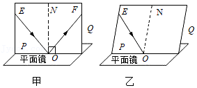

【答案】垂直，不能，反射光线、入射光线与法线在同一平面内，不变，没有，0，120

【解析】​

## 3. 单选题（难度：简单）

月亮、太阳、点燃的火把，其中属于光源的是（　　）

- A. 太阳和月亮
- B. 太阳、月亮、火把
- C. 只有太阳
- D. 太阳和点燃的火把

【答案】D

【解析】试题分析：光源指本身能够发光的物体，有人造光源和天然光源．太阳本身能发光，是光源；月亮是反射太阳的光，本身不会发光，不是光源．点燃的火把能够发光，是光源．故D正确．
故选D．
考点：本题考查光源
点评：辨别物体是否是光源的方法很简单，就是看该物体是本身会发光，还是反射其他物体发出的光．

## 4. 单选题（难度：适中）

关于光速和光年，下列说法正确的是（　　）

- A. 光的传播速度总是\(3.0\times {{10}^{8}}\ \text{m/s}\)
- B. 光在不同介质中传播速度是相同的
- C. 光年是天文学上使用的时间单位
- D. 光年是天文学上使用的长度单位

【答案】D

【解析】A．光在真空中的传播速度约为\(3.0\times {{10}^{8}}\text{m/s}\) ，在空气中的传播速度接近真空的中传播速度，在液体中传播速度比空气中的小，在固体中的传播速度比在液体中的小，故A错误；
B．光在不同介质中传播速度一般不同，故B错误；
CD．光年指光在一年内通过的路程，是长度单位，故C错误，D正确。

## 5. 单选题（难度：适中）

下列关于光线的说法中，正确的是（　　）

- A. 光源能射出无数条“光线”
- B. 光线就是很细的“光束”
- C. 光线是用来表示光传播方向的直线，常用虚线表示
- D. 光线不是真实存在的，但可以用一条带箭头的直线来表示

【答案】D

【解析】A．光源是能发光的物体，所以能发光，但不是射出光线，故A错误；
B．光线只是表示光传播方向的一条直线，并不是很细的光束，故B错误；
C．光的传播方向是确实存在，为了分析探究，于是用一条有方向的实际直线表示，即光线，光线常用实线来表示，故C错误；
D．人们用一条有箭头的直线来表示光线，它实际上并不存在，用到模型法，故D正确；

## 6. 单选题（难度：简单）

晴朗的夏天，树荫下的光斑是：（　　）

- A. 方形的
- B. 太阳的影子
- C. 太阳的虚像
- D. 太阳的实像

【答案】D

【解析】太阳光通过树叶间的小孔，在地面上形成一个倒立的、太阳的实像，像和太阳的形状是一样的，是圆形，这是光沿直线传播形成的，像的形状与树叶缝隙的形状无关，故D符合题意，ABC不符合题意。

## 7. 单选题（难度：适中）

因为有了光，世界才会如此绚丽多彩，下列关于光现象的说法正确的是（　　）

- A. 我们在电影院能看到幕布上的画面，说明幕布是光源
- B. 激光笔发出的光是一条光线
- C. 光线是用来表示光的径迹和方向的，用到了理想模型法
- D. 声和光的传播都需要介质

【答案】C

【解析】A．幕布本身不会发光，所以不是光源，故A错误；
B．激光笔发出的是光，不是光线，因为光线不是真实存在的，是人为引入的，故B错误；
C．光线实际不存在，是人为引入用于表示光的径迹和方向的，采用了理想模型法，故C正确；
D．声音的传播需要介质，光的传播不需要介质，故D错误。

## 8. 单选题（难度：适中）

皮影戏是我国的传统艺术，下列和“皮影”形成的原理不同的是（　　）

- A. 绿树成荫
- B. 天狗吞月
- C. 先看到闪电，后听到雷声
- D. 一叶障目

【答案】C

【解析】皮影戏中的影子是由于光的直线传播形成的。
A．“绿树成荫”是树木的影子，由于光的直线传播，光射到不透明物体上，在不透明物体后面形成影子。故A不符合题意；
B．“天狗吞月”即月食，是当月球运行到地球的阴影部分时，在月球和太阳之间的地球挡住了太阳射向月球的光，其原理是光的直线传播。故B不符合题意；
C．先看到闪电，后听到雷声，说明光速比声速快，故C符合题意；
D．当一片树叶遮挡住眼睛时，由于光的直线传播，光线被树叶阻挡，导致视线被遮挡，无法看到远处的物体。故D不符合题意。

## 9. 单选题（难度：非常简单）

生活中许多物体可以发光，下列物体中属于光源的一组是（　　）

- A. 太阳、发光的电灯、点燃的蜡烛
- B. 点燃的酒精灯、闪亮的钻石、发光的水母
- C. 点燃的蜡烛、月亮、发光的舞台灯
- D. 闪电、霓虹灯、波光粼粼的水面

【答案】A

【解析】A．太阳、发光的电灯、点燃的蜡烛，自身都能发光，都是光源，故A符合题意；
B．点燃的酒精灯火焰是光源；闪亮的钻石靠反射光，不是光源；水母自身发光，是光源（生物发光）故B不符合题意；
C．月亮自身不能发光，不是光源，故C不符合题意；
D．波光粼粼的水面自身不能发光，不是光源，故D不符合题意。

## 10. 多选题（难度：适中）

关于光线下列说法正确的是（　　）

- A. 光线就是很细的光束，是真实存在的
- B. 光线是光的理想化模型，它实际是不存在的
- C. 光线是用来表示光的传播径迹和方向的直线，用实线表示

【答案】B/C

【解析】为了研究光的传播特点，我们通常用带箭头的直线表示光传播的路径和方向，这样的线叫作光线，光线是人们为了便于研究和表示光的传播而引入的物理模型，实际上并不存在，故A错误，BC正确。

## 11. 单选题（难度：简单）

下列物体属于光源的是（　　）

【答案】A

## 12. 单选题（难度：简单）

晴天，树荫下地面上会出现圆形的光斑，这些光斑是（　　）

- A. 太阳的像
- B. 太阳的影子
- C. 树叶间缝隙的影子
- D. 树叶的像

【答案】A

【解析】晴天时，太阳发出的光沿直线传播，经过树叶间的缝隙（小孔），在地面上形成倒立的实像，也就是太阳的像，这是小孔成像现象。而影子是光被物体遮挡形成的阴暗区域，树叶间隙的影子形状不规则，树叶的像也不是圆形光斑的成因，故这些光斑是太阳的像。故A正确，BCD错误。

## 13. 填空题（难度：适中）

2025年9月7日，我国境内观测到了一次壮观的月全食，该现象形成的原理是。

【答案】光的直线传播

【解析】当发生月全食时，太阳、地球、月球几乎在同一条直线上，地球位于太阳和月球之间，地球挡住了太阳射向月球的光，使得月球进入地球的影子区域。这是由于光在同种均匀介质中沿直线传播导致的，所以月全食现象形成的原理是光的直线传播。

## 14. 单选题（难度：简单）

汉朝初期的李少翁用剪纸的人、物在幕后表演，并且用光照射，相应的人、物的“影”就放映在白幕上，幕外的人就可以欣赏到精彩的皮影戏表演，下列和皮影戏形成的原理不同的是（　　）

- A. 先看到闪电，后听到雷声
- B. 阳光下绿树成荫
- C. 打靶时“三点一线”瞄准
- D. 一叶障目，不见泰山

【答案】A

【解析】皮影戏形成的原理是光在同种均匀介质中沿直线传播。
A．先看到闪电，后听到雷声，这是因为光在空气中的传播速度远大于声音在空气中的传播速度，并非光的直线传播原理，故A符合题意；
B．阳光下绿树成荫，是由于光沿直线传播，树挡住了光，从而形成了树荫，与皮影戏形成原理相同，故B不符合题意；
C．打靶时“三点一线”瞄准，利用的是光在同种均匀介质中沿直线传播的原理，和皮影戏形成原理一致，故C不符合题意；
D．一叶障目，不见泰山，是因为光沿直线传播，叶子挡住了视线，与皮影戏形成原理相同，故D不符合题意。

## 15. 单选题（难度：适中）

傍晚时分，小明和家人一起散步，看到路灯下摇晃着的树叶的影子。下列说法正确的是（　　）

- A. 小明看见天上的月亮，说明月亮是光源
- B. 月光能透过大气层照到地球，说明光的传播需要介质
- C. 地上出现树叶的影子，是由于光沿直线传播形成的
- D. 小明听到风声的同时看到树叶在摇曳，说明声速和光速差不多大

【答案】C

【解析】A．月亮本身不发光，它反射太阳光，因此月亮不是光源，故A错误；
B．光的传播不需要介质，可以在真空中传播，月光透过大气层照到地球，但大气层并非光的传播必需条件，故B错误；
C．影子的形成是光沿直线传播的典型现象。树叶挡住了路灯的光线，在地面形成了暗区，即影子，故C正确；
D．光速远大于声速，光速约为

 ，声速约为340m/s。小明在近距离同时听到风声和看到树叶摇曳，是由于距离短、声传播时间短，时间差难以察觉，并非速度相近，故D错误。

## 16. 填空题（难度：适中）

在①太阳、②月亮、③北极光、④霓虹灯、⑤宝石，其中属于天然光源是；不属于光源的是。（以上两空均选填序号）

【答案】①③，②⑤

【解析】首先我们要明确光源的定义：能自行发光的物体叫做光源，光源分为天然光源和人造光源。
①太阳：能自行发光，属于天然光源。
②月亮：本身不发光，只是反射太阳光，不属于光源。
③北极光：由太阳带电粒子与地球磁场相互作用产生，能自行发光，属于天然光源。
④霓虹灯：由人工制造且能发光，属于人造光源，不是天然光源。
⑤宝石：本身不发光，只是反射光线，不属于光源。

## 17. 单选题（难度：适中）

如图所示，小华制作了一个针孔照相机，并用此装置观察一个明亮且不太大的物体，半透明蜡纸上可以呈现物体的像。关于针孔照相机，下列说法正确的是（　　）

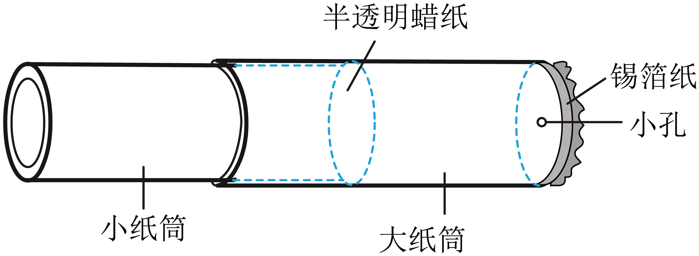

- A. 若改变小孔的形状，蜡纸上像的形状也改变
- B. 为了清晰观察蜡纸上呈现的像，眼睛应贴近小孔观察
- C. 小纸筒便于降低蜡纸上像周围亮度，使像更清晰
- D. 仅将小纸筒向右移动，蜡纸上的像变大

【答案】C

【解析】A．针孔照相机原理与小孔成像原理相同时，小孔成像时，像的形状与孔的形状无关，改变小孔的形状，蜡纸上像的形状不改变，故A错误；
B．眼睛贴近小纸筒上的观察口，可清晰观察光屏上的像，而不是贴近小孔观察，故B错误；
C．小纸筒可调节像距大小，降低蜡纸上像周围亮度， 使光屏上的像更清晰，故C正确；
D．仅将小纸筒向右移动，像距变小，蜡纸上的像变小，故D错误。

## 18. 单选题（难度：适中）

老刘晚上下班回家经过一盏路灯，如图所示，当他从A点沿直线走向B点的过程中，他的影子长度的变化情况是（　　）

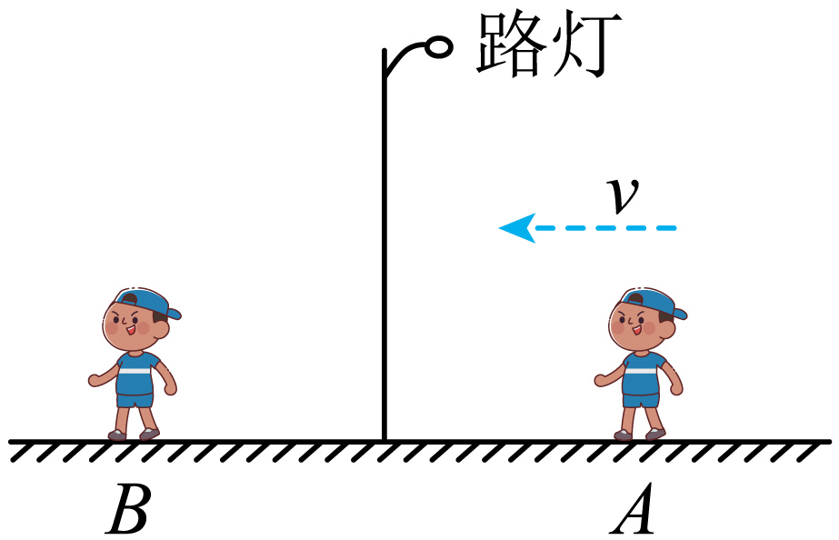

- A. 先变长后变短
- B. 先变短后变长
- C. 一直在变长
- D. 一直在变短

【答案】B

【解析】当人在远处时，人与灯光的夹角小，形成的影子长；当人逐渐走近路灯时，人与灯光的夹角会变大，此时形成的影子会变短；当人经过路灯逐渐远离时，人与灯光的夹角又会变小，形成的影子再次变长。
故ACD不符合题意，B符合题意。

## 19. 单选题（难度：简单）

关于光的传播，下列说法正确的是（　　）

【答案】A

## 20. 单选题（难度：适中）

如图为小孔成像与手影游戏，下列说法正确的是（　　）

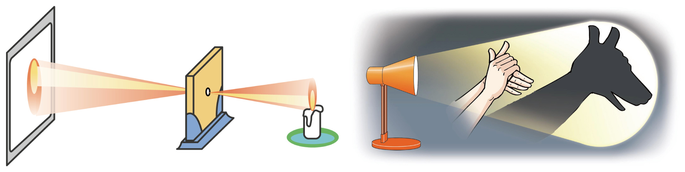

- A. 影子的形成原理和小孔成像的原理相同
- B. 墙上的影子就是像
- C. 图中蜡烛到像的直线就是光线
- D. 小孔成像必然为倒立放大的实像

【答案】A

【解析】A．影子和小孔成像都是由于光的直线传播形成的，原理相同，故A正确；
B．墙上的影子是光线照射到不透明物体形成的阴影，不是像，故B错误；
C．光线是研究光现象时所假设的，用来描述光的传播路径和方向，并不是真实存在的，故C错误；
D．小孔成像必然为倒立的实像，但像的大小可能放大、等大或缩小，这取决于蜡烛和光屏到小孔的距离，故D错误。

## 21. 单选题（难度：适中）

小明将易拉罐的上部剪去，蒙上半透明纸，在罐底部开一个小孔，用它做小孔成像实验，如图所示，下列说法中不正确的是（　　）

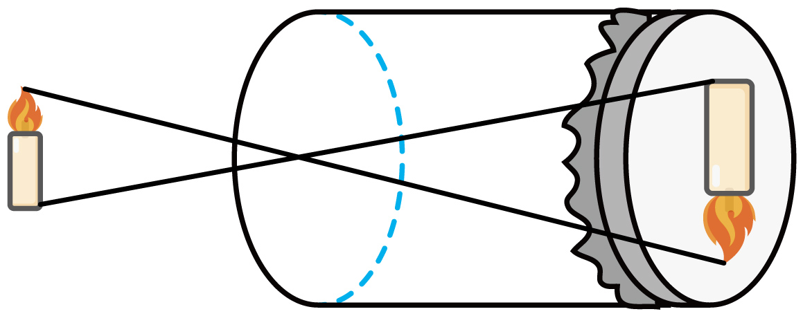

- A. 像与物上下颠倒，左右相反
- B. 像的形状与物体的形状有关
- C. 它的成像原理是光的直线传播
- D. 在物体到小孔的距离不变的情况下，半透明纸与小孔距离越小，像越大

【答案】D

【解析】AC．小孔成像是光的直线传播现象，像与物上下颠倒，左右相反，故AC正确，不符合题意；
B．像的形状只与物体的形状有关，与小孔的形状无关，故B正确，不符合题意；
D．在物体到小孔的距离不变的情况下，半透明纸与小孔距离越小，像距越小，像越小，故D错误，符合题意。

## 22. 单选题（难度：适中）

如图所示，一只白鹭正在浅水处觅食，在水中形成了两个“影子”。关于这两个“影子”的形成，下列说法中正确的是（　　）

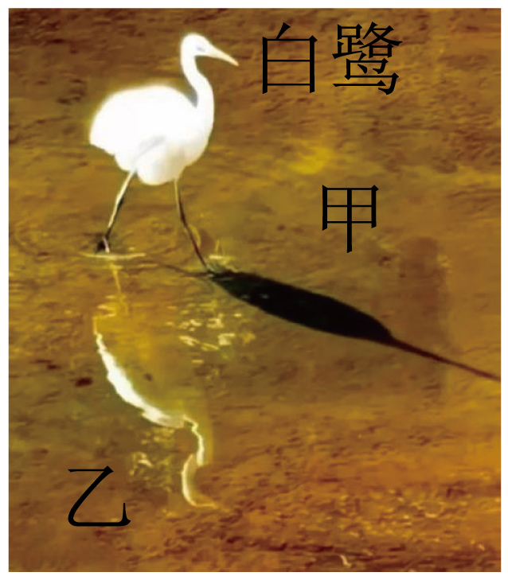

- A. “影子”甲是光沿直线传播形成的
- B. “影子”乙是光的折射形成的
- C. 当白鹭飞起来时，两个“影子”的大小都不变
- D. “影子”甲是实像，“影子”乙是虚像

【答案】A

【解析】ABD．由图可知，“影子”甲是光的直线传播形成的，“影子”乙属于平面镜成像，是光的反射形成的虚像，故A正确，BD错误；
C．当白鹭飞起来时，“影子”甲会变大，“影子”乙的大小不变，故C错误。

## 23. 多选题（难度：适中）

两千多年前，墨子在《墨经》中记录了小孔成像现象。如图是小孔成像实验，下列说法正确的是（　　）

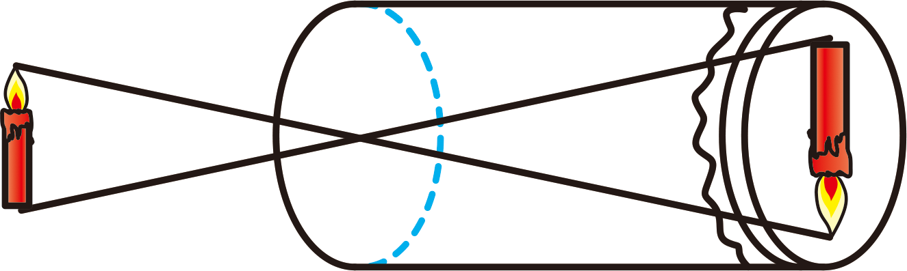

- A. 蜡烛燃烧时长度不断缩短，烛焰的像向上移动
- B. 所成的像既可能是实像，也可能是虚像
- C. 蜡烛和小孔不动，光屏靠近小孔，烛焰的像将变大
- D. 即使将小孔由圆形改为三角形，像的形状也不会改变

【答案】A/D

【解析】A．由于蜡烛的燃烧，烛焰的高度逐渐降低，则像的位置会偏高，即屏上像逐渐向上移动，故A正确；
B．小孔成像的原理是光的直线传播，所成的像是实像，故B错误；
C．像的大小与物到孔的距离及像到小孔的距离有关，蜡烛和小孔不动，光屏靠近小孔，烛焰的像变小，故C错误；
D．像的形状由物体的形状决定，与孔的形状无关，所以将小圆孔改为三角形小孔，则像的形状不变，故D正确。

## 24. 单选题（难度：适中）

如图所示，是同学们制作的小孔成像仪，下列说法正确的是（　　）

【答案】A

## 25. 单选题（难度：适中）

如图，在“品中国非遗游古都西安—2025西安文旅媒体行”活动中，生动的皮影戏演绎，尽显“一口道尽千古事，双手舞动百万兵”的魅力。下列关于皮影戏所涉及的物理知识说法正确的是（　　）

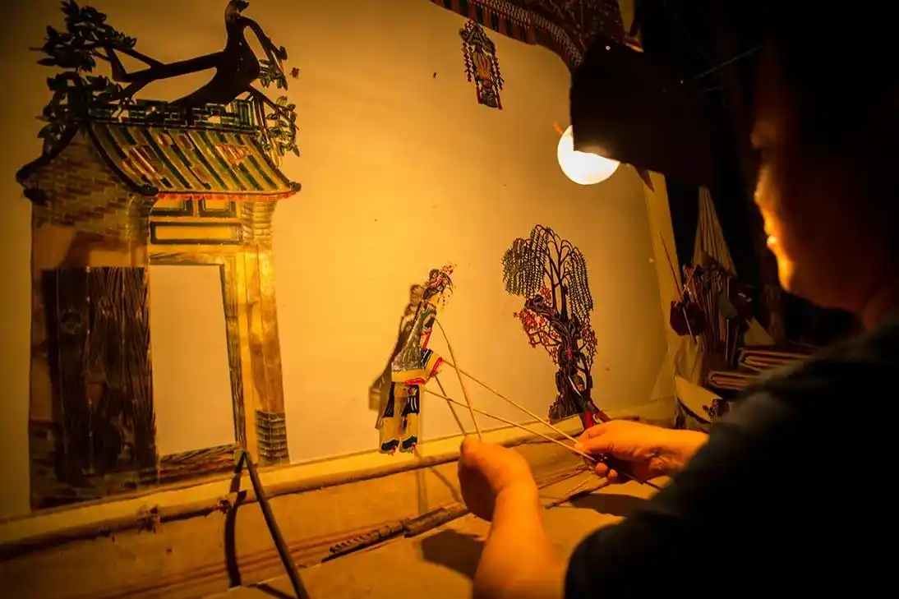

- A. 人能看见皮影是因为皮影是光源
- B. 幕布上的影子是虚像
- C. 影子的形成是因为光的直线传播
- D. 幕布选用白色，是因为白色物体不能反射光

【答案】C

【解析】A．皮影是不透明的物体，本身不能发光，不是光源。人能看到的是光被皮影挡住后在幕布上形成的影子，故A错误；
B．影子是光沿直线传播时，被不透明物体挡住后，在物体后方形成的光照不到的暗区，它不是由实际光线的反向延长线会聚形成的像，所以不是虚像，故B错误；
C．影子的形成是由于光在同种均匀介质中沿直线传播，皮影挡住了光的传播路径，在幕布上形成影子，故C正确；
D．幕布选用白色，是因为白色物体能反射所有颜色的光，这样可以呈现出各种色彩的画面，故D错误。

## 26. 填空题（难度：适中）

激光测距技术广泛应用在人造地球卫星测控、大地测量等方面。已知一束激光从激光测距仪发出并射向月球，大约经过2.56s被反射回来，则地球到月球的距离大约为米。（已知光速为\(3\times {{10}^{8}}\text{m/s}\) ）

【答案】$3.84\times {{10}^{8}}$

【解析】激光从地球到月球再返回地球，总时间为\(~t=2.56\text{s}\) ，所以单程时间为\({{t}_{}}=\frac{2.56\text{s}}{2}=1.28\text{s}\) 
则地球到月球的距离为\(s=v{{t}_{}}=3\times {{10}^{8}}\text{m/s}\times 1.28\text{s}=3.84\times {{10}^{8}}\text{m}\)

## 27. 单选题（难度：适中）

2025年9月3日，在纪念中国人民抗日战争暨世界反法西斯战争胜利80周年阅兵式上，一款我国自主研发的LY-1（燎原-1）舰载激光武器系统在汽车的轰鸣声中，接受人民的检阅。下列说法正确的是（　　）

- A. 汽车驶过的声音是物体振动产生的
- B. 激光的传播需要介质
- C. 激光在空气中传播速度

- D. 激光在水中传播速度比在空气中更快

【答案】A

【解析】A．声音是由物体振动产生的，汽车行驶时发动机、轮胎与地面的摩擦等都会引起振动，从而产生声音，故A正确；
B．激光属于电磁波，电磁波的传播不需要介质，可以在真空中传播，故B错误；
C．激光在空气中的传播速度约为3×10⁸m/s ，而340m/s 是声音在空气中的传播速度，故C错误；
D．光在不同介质中传播速度不同，在真空中传播速度最快，在空气中接近在真空中的传播速度，在水中的传播速度比空气中慢，故D错误。

## 28. 填空题（难度：适中）

人们常说“大树底下好乘凉”，从物理学角度可知，乘凉区域实际是大树的（选填“影子”或“像”），这是利用了光的，请列举生活中与此原理相同的一个实例：。

【答案】影子，直线传播，手影游戏(合理即可)

【解析】[1]大树挡住了太阳光，光线无法穿过树干和树叶，在地面形成光照不到的黑暗区域，这个区域是影子。
[2]光在同种均匀介质中沿直线传播，遇到不透明的大树被阻挡，无法绕过，后方形成阴影，这是光的直线传播的典型现象。
[3]只要是利用光的直线传播形成影子的实例都可以，比如手影游戏、日食、月食现象、排队看齐、小孔成像等。

## 29. 填空题（难度：适中）

如图所示，在开凿隧道时，工人常使用激光来引导掘进装置。这利用了的原理，在空气中光的速度接近m/s。

【答案】光在均匀介质中沿直线传播，$3\times {{10}^{8}}$

【解析】[1]激光引导掘进机掘进是激光准直的应用，利用了光在同种均匀介质中沿直线传播的原理，可以保证掘进机沿直线前进，开挖出笔直的隧道。
[2]光在真空中的传播速度为\(3\times {{10}^{8}}\text{m/s}\) ，光在空气中的传播速度接近真空中的速度。

## 30. 填空题（难度：适中）

根据天文预测，合肥可观测到的下一次“月全食”（血月）可能出现在2028年12月31日左右，如图表示月全食时太阳、地球、月球的位置，则图中的A是。

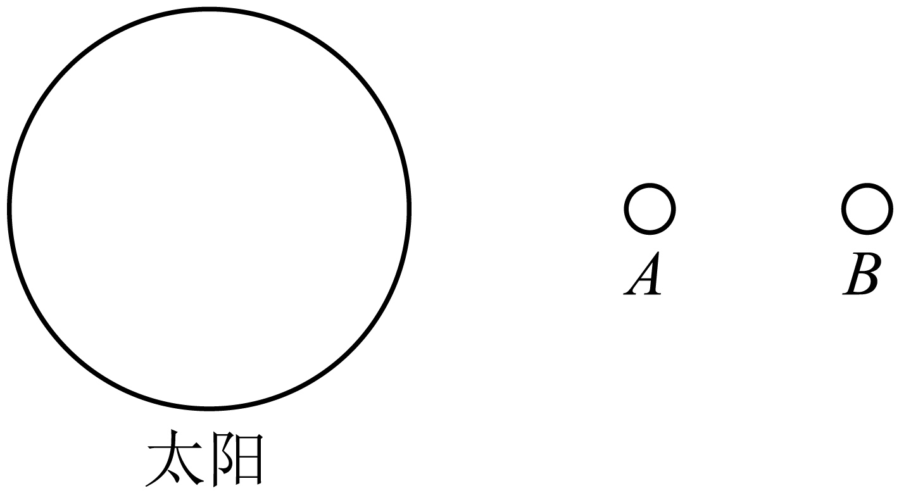

【答案】地球

【解析】月全食发生时，地球运行到太阳和月球之间，三者恰好或几乎在同一条直线上，地球挡住了太阳射向月球的光，使月球进入地球的本影区，从而形成月食。在图中，最左侧是太阳，中间的天体（A）是地球，因为它位于太阳和月球之间，挡住了太阳光，右侧的天体（B）是月球，此时它进入了地球的阴影中，发生月全食。所以，图中的A是地球。

## 31. 多选题

沈括在《梦溪笔谈》中记述到“若莺飞空中，其影随莺而移”，而在纸窗上开一个小孔使鹭的影子呈现在室内纸屏上，却观察到“鹭东则影西，鹭西则影东”，则下列说法正确的是（　　）
 
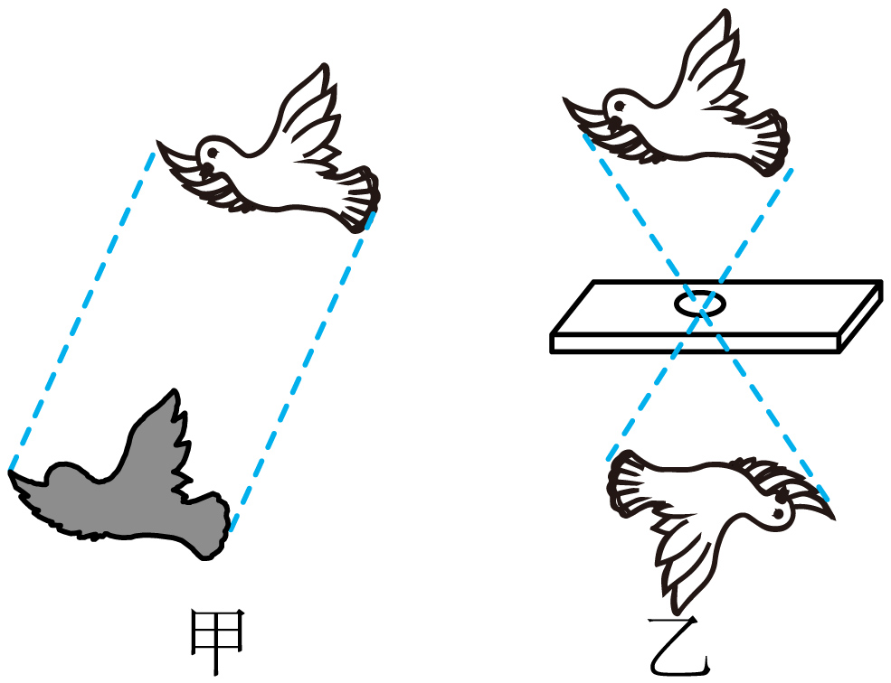

- A. “若莺飞空中，其影随莺而移”与日食形成的光学原理相同
- B. 图甲和图乙中“影”都能成在光屏上，均为实像
- C. “鹭东则影西，鹭西则影东”描述的现象是小孔成像
- D. 图乙中“影”的大小与鹭到小孔的距离及小孔到纸屏的距离有关

【答案】A/C/D

【解析】A．“若莺飞空中，其影随莺而移”是由于光的直线传播形成的。当月球运行到太阳和地球之间时，月球会挡住太阳射向地球的光，形成日食，日食也是由于光的直线传播，故A正确；
B．图甲中的“影”是影子，不是像，图乙中的描述的现象是小孔成像，成的是实像，故B错误； 
C．“莺东则影西，莺西则影东” 描述的是像与物的位置相反，这正是小孔成像的特点（成倒立的像）。 故C正确；
D．“莺东则影西，莺西则影东”是由于小孔成像形成的“影”，其“影”的大小与莺到小孔的距离及小孔到纸屏的距离有关，故D正确。

## 32. 多选题（难度：适中）

微信已越来越多被人们使用，如图所示为微信启动页面，是我国发射的地球同步气象卫星“风云四号”利用红外遥感技术拍摄合成，寓意从“人类起源”到“华夏文明”的历史发展．下列说法中正确的是（　　）

- A. 光年是天文学上表示长度的单位
- B. 光是人为引入的，光线是客观存在的
- C. 光线不可以用来表示光的明暗程度
- D. 卫星能拍摄到地球，是因为地球是光源

【答案】A/C

【解析】A．光年是指光在真空中一年内传播的距离，是长度的单位，故A正确；
B．光是存在的，光线是不存在的，光线是为了研究光的传播而引入的模型，故B错误；
C．光线是用来表示光的传播路径和方向的直线，光线不能表示光的明暗，故C正确；
D．地球本身不会发光，不是光源，故D错误。

## 33. 填空题（难度：适中）

雷雨天，我们先看到闪电再听到雷声，是由于光速比声速（选填“快”或“慢”）；200m短跑比赛中，终点计时员选择在发令枪冒烟时计时而不是听到枪声时计时，这种做法是（选填“正确”或“不正确”）的；光在中传播得最快。

【答案】快，正确，真空

【解析】[1]光在空气中的传播速度远大于声音在空气中的传播速度，由于光速比声速快，因此雷雨天，我们先看到闪电再听到雷声。
[2]声音传播需要时间，听到枪声时运动员已起跑一段时间，导致计时偏晚；光传播极快，看到烟时计时几乎无延迟，终点计时员选择在发令枪冒烟时计时而不是听到枪声时计时，这种做法是正确的。
[3]光在不同介质中传播速度不同，在真空中传播得最快。

## 34. 填空题（难度：适中）

这是古人用的日晷，它是用来计量的工具，它是根据太阳的东升西落，晷针在晷面上的指示位置来工作的，它的原理是，请说出这种工具在使用时的局限性或缺点：。

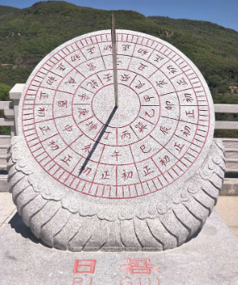

【答案】时间，光的直线传播，见解析

【解析】[1]日晷是我国古代劳动人民发明的一种用来计量时间的工具，也叫影子时钟。
[2]影子的形成就是由于光沿直线传播所形成的，所以影子时钟的原理就是光的直线传播。
[3]这种工具在使用时受天气影响，没有太阳时就不能工作。

## 35. （难度：适中）

雷声和闪电是同时发生的，但为什么打雷时总是先看到闪电后听到雷声？

## 36. 填空题（难度：适中）

小明同学做了小孔成像实验，如图所示。

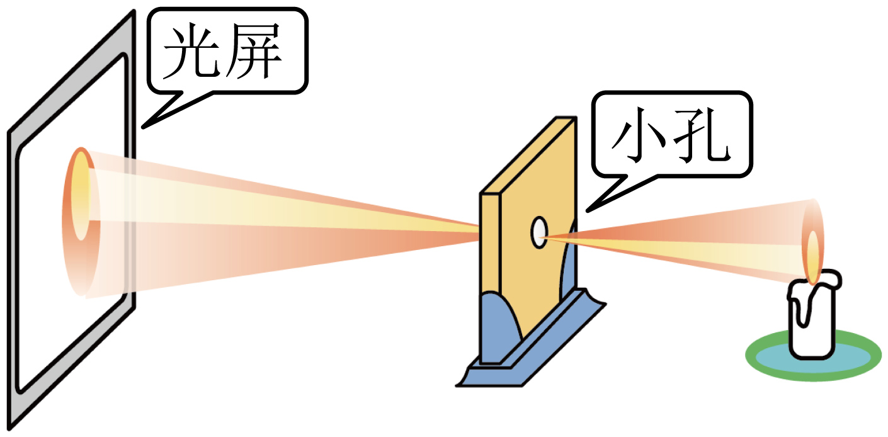
 
(1)小孔成的像是（选填“正立”或“倒立”）的像。
(2)若将小孔由圆形改为三角形，则所成的像的形状（选填“改变”或“不变”）。

【答案】倒立，不变

【解析】（1）小孔成像的原理是光的直线传播，物体上方的光通过小孔会投射到光屏的下方，物体下方的光通过小孔会投射到光屏的上方，所以成的是倒立的像。
（2）小孔所成的像的形状只与物体的形状有关，所以若将圆形小孔改为三角形小孔，所成像的形状不会改变。

## 37. 填空题（难度：适中）

学习了光学知识后，爱动脑筋的小明想自己探究小孔成像规律，他拿出三个相同的空罐，给其中两个空罐的底部中央分别打上一个圆孔，给剩下一个空罐的底部中央打上一个方孔，再用相同的半透明的塑料膜分别蒙在三个空罐的口上，分别将孔对着烛焰和发光的灯泡，可以看到烛焰和灯泡通过小孔所成的像，如图1所示。

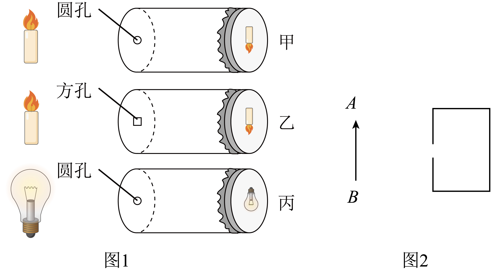
 
(1)分析比较图1中甲、乙，可以得出结论：烛焰在塑料膜上所成的像的形状与小孔的形状（填“有”或“无”）关。
(2)分析比较图1中甲、丙，可以得出结论：物体在塑料膜上所成的像的形状与物体的形状（填“有”或“无”）关。
(3)小明增大蜡烛与小孔之间的距离，在塑料膜上成的像（填“变大”“变小”或“不变”）。
(4)请在图2中画出蜡烛AB经小孔所成像的光路及其在塑料膜上所成的像A′B′。
(5)晴天的正午时分，走在公园茂密的树林下，会看到阳光透过树叶的缝隙在地上留下许多大小不同的圆形光斑，这是（填“太阳”“树叶的缝隙”或“树叶”）的（填“像”或“影子”），光斑大小不同的原因是。
(6)另有几个同学在硬纸板上挖孔来研究太阳的小孔成像，为了研究孔的大小对光斑形状的影响，小华设计了图3的装置，小强设计了图4的装置，接着，从图示位置沿箭头方向水平移动乙，改变孔的大小，同时观察光斑形状的变化情况，你认为设计更合理，依据是。

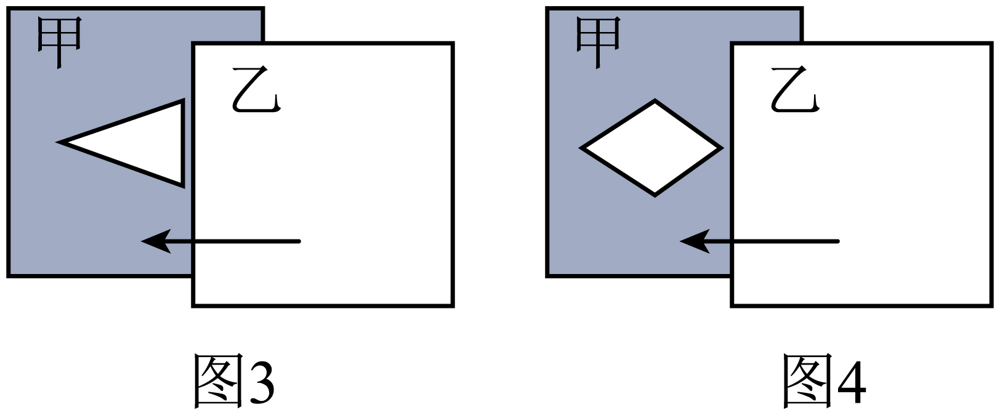

【答案】无，有，变小，(4)，(5)太阳，像，树叶的缝隙到地面的距离不同，(6)小华，见解析

【解析】（1）甲、乙两实验中，烛焰的形状不变，只改变小孔的形状，此时所成的像的形状不变，则说明烛焰在塑料膜上所成的像的形状与小孔的形状无关。
（2）甲、丙两实验中，小孔的形状不变，光源的形状不同，此时所成像的形状不同，说明物体在塑料膜上所成的像的形状与物体的形状有关。
（3）小明增大蜡烛与小孔之间的距离，物距变大，在塑料膜上成的像变小。
（4）小孔成像时，根据光沿直线传播，成的是倒立的实像，如图所示：

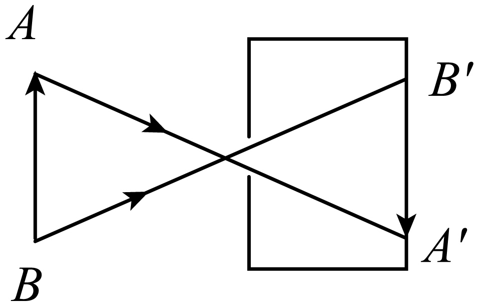
 
（5）[1][2]阳光透过树叶的缝隙在地上留下的圆形光斑，是由光沿直线传播形成的太阳的实像，与小孔成像的原理相同。
[3]由于树叶的缝隙到地面的距离不同，即像距不同，所以光斑大小不同。
（6）[1][2]为了研究孔的大小对光斑形状的影响，需要控制其它因素不变，只改变孔的大小。由图可知，沿箭头方向水平移动乙时，图3中的小孔只有大小改变，图4中的小孔大小和形状都改变，故小华设计更合理。

## 38. 填空题（难度：适中）

2025年9月7日午夜至8日凌晨，一轮罕见的暗红色“红月亮”悬挂夜空。月亮___（选填“是”或“不是”）光源。从物理学的角度来说，月食和日食的形成都属于光的___现象。

## 39. （难度：适中）

如图甲所示，小明制作一个简易的针孔照相机，在空易拉罐底部的中央戳一个小孔，将易拉罐的顶部剪去后，蒙上一层半透明的塑料薄膜。

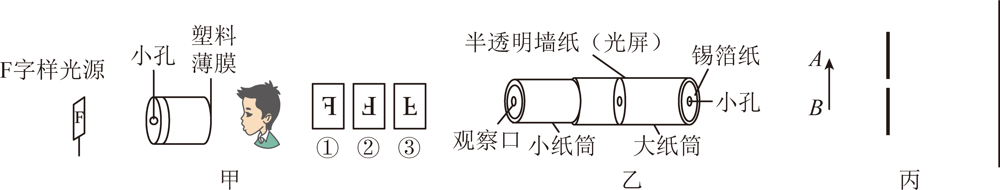

如图甲所示，将小孔对准“F”光源，人在塑料薄膜上看到的像是（①/②/③）。将“F”光源向上移动，则这个像（向上/不动/向下）移动。仅将小孔由“三角形”改为“圆形小孔”，塑料薄膜上像的形状。

如图乙所示，小明用大小不同的两个圆纸筒（套在一起时能推拉自如）、锡箔纸、半透明蜡纸等物品改进针孔照相机，装置中小纸筒的好处有。

在图丙中画出针孔照相机的成像原理图。

小明在树荫下的地面上，观察到形状不规则的“大光斑”和圆形的“小光斑”，其中较亮的是斑，经过和同学们实验探究后明白：地面上圆形光斑是的像，不规则的“大光斑”和圆形的“小光斑，”形成的原理（相同/不同）。

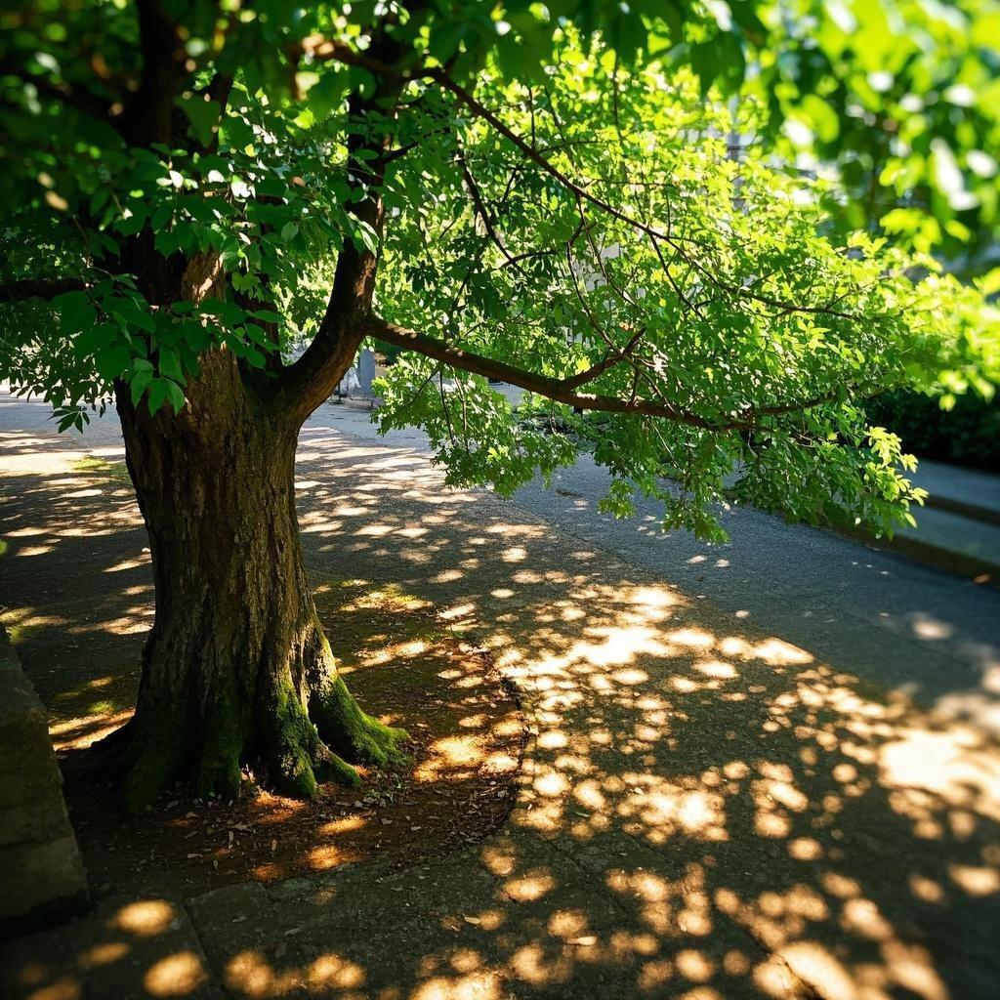

【答案】②/向下/不变，可以改变像距，改变像的大小，可以避免外部光线对像的干扰，使观察到的像更清晰，

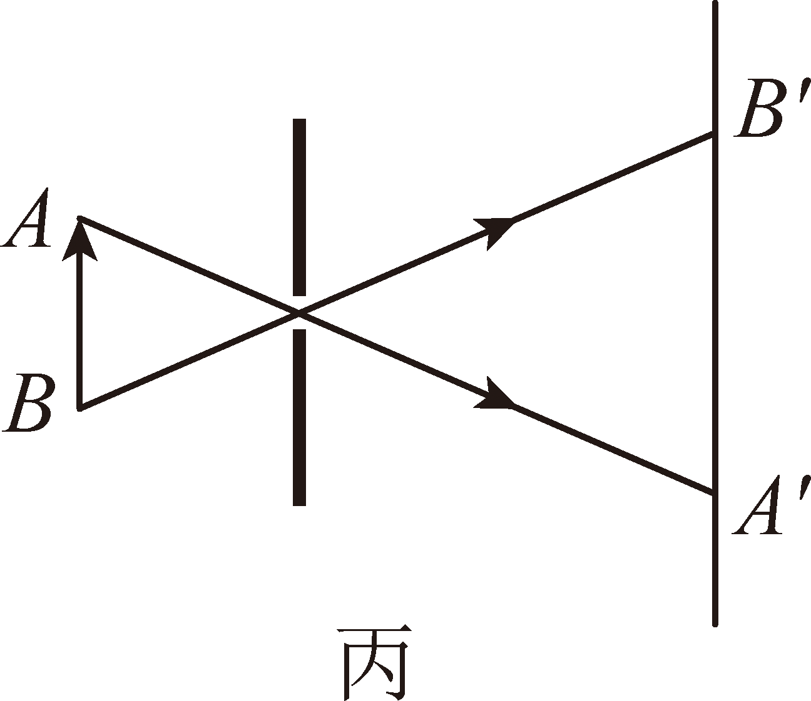

，大光/太阳/相同

【解析】[1][2]小孔成像是光沿直线传播形成的，形成的是倒立的实像，故人在薄膜上看到的像是②（上下左右都相反）。将“F”光源向上移动，则像将向下移动。
[3]小孔成像时像的形状与光源的形状相同，与孔的形状无关，故仅将小孔由“三角形”改为“圆形小孔”塑料薄膜上像的形状不变。

图乙与图甲相比，小纸筒能推拉自如，可以改变像距。小纸筒套在大纸 筒内，光屏在大纸筒内部，可以避免外部光线对像的干扰，使像更清晰。

小孔成像的原理是光在同种均匀介质中沿直线传播，故原理图如下：

[1][2][3]当树叶间的间隙较大时，透过的光比较多，地面上会有一些形状不规则较亮的光斑。当树叶间隙较小时是小孔成像，透过的光比较少，地面上会有形状规则的圆形小光斑，是太阳的实像，相比较暗。它们的形成原因都是光在同种均匀介质中沿直线传播，因此不规则的“大光斑”和圆形的“小光斑”形成的原理是相同的。

## 40. 填空题（难度：适中）

晴天的正午时分，走在公园的树林里，小明看到阳光透过树叶的缝隙在地上留下许多大小形状不同的光斑和黑色区域；其中黑色区域是（选填“太阳”、“树叶的缝隙”或“树叶和树枝”）的（选填“实像”、“虚像”或“影子”）。圆形光斑大小不一，原因是树叶间缝隙到距离不同（选填“地面”或“太阳”）。

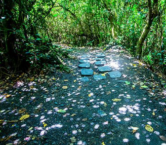

【答案】树叶和树枝，影子，地面

【解析】光沿直线传播时，树叶和树枝会挡住太阳光，在地面形成无光的黑色区域，这是树叶和树枝的影子。
圆形光斑是太阳的小孔成像，光斑大小取决于缝隙到地面的距离，距离不同，光斑大小就不同。

## 41. （难度：适中）

按要求完成下列作图；

如图甲，光源A发出的光被物体BC阻挡后，在墙壁上留下了物体BC的影，请在图中作出物体BC的影B′C′。（保留作图痕迹）

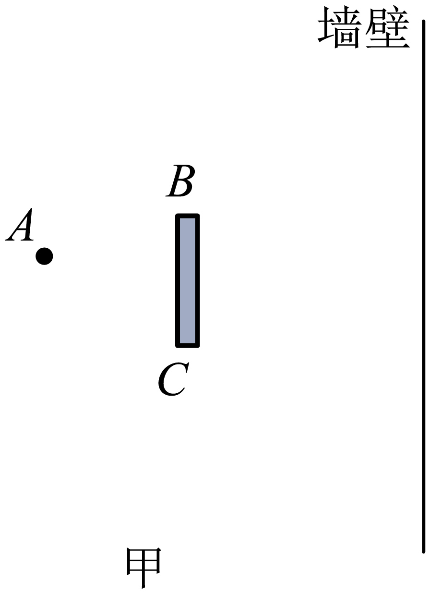

如图乙，地面上是小明和小亮在同一灯光下的影子，请通过作图确定灯泡S的位置。

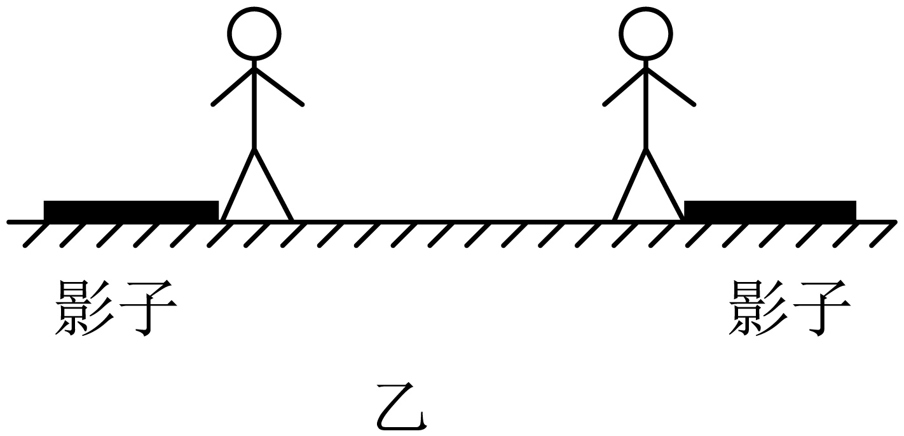

【答案】

，

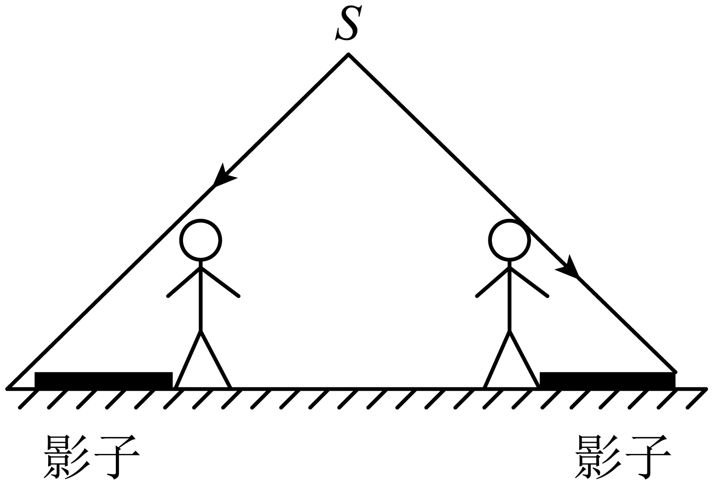

【解析】从点光源A过点C作直线与墙壁相交于点C′，从A过点B作直线与墙壁相交于B′，直线AC与AB所夹的墙壁上的阴影部分B′C′就是BC的影子，如图所示：

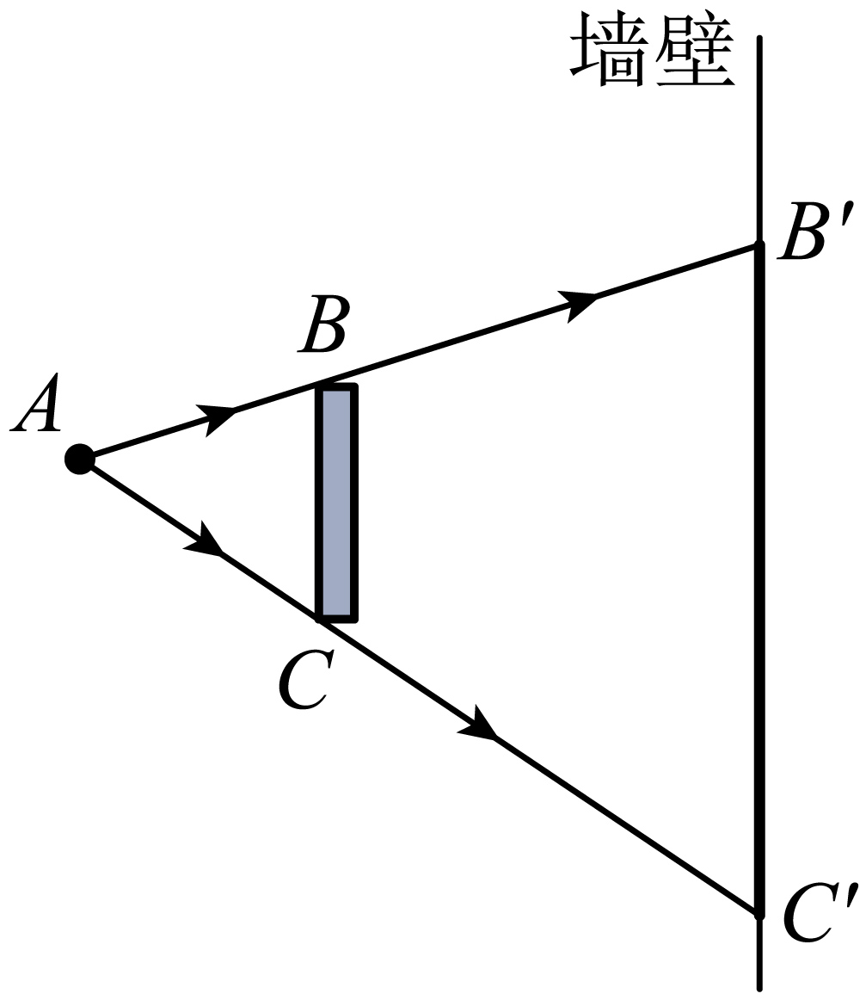

光在空气中沿直线传播，将小明和小亮的顶端和影子的顶端连接并延长可交于一点S，点S就是光源的位置，如图所示：

## 42. 填空题（难度：适中）

学习了光学知识后，爱动脑筋的小桐和小朵想探究小孔成像现象。如图所示，她们给两个空罐的底部中央分别打上一个圆孔和一个方孔，再用两片半透明的塑料膜蒙在空罐的口上，分别将小孔对着烛焰和灯泡，可以看到烛焰和灯丝通过小孔所成的像。

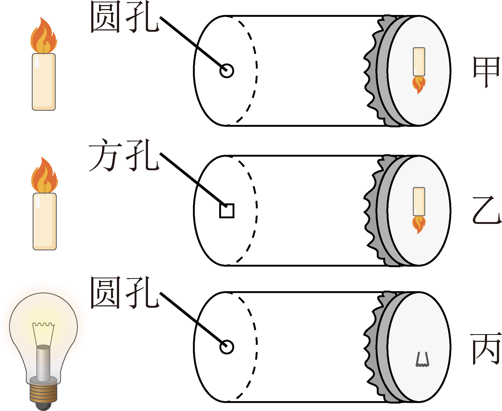
 
(1)分析比较甲、乙两图，可以得出：物体通过小孔所成的像与无关。
(2)分析比较甲、丙两图，可以得出：物体通过小孔所成的像与有关。
(3)通过实验，可以看到烛焰和灯泡在塑料膜上成的都是（选填“正立”或“倒立”）的实像。
(4)若在图甲中，蜡烛靠近圆孔，则塑料膜上的像会（选填“变小”“不变”或“变大”）。
(5)如图所示，AB是蜡烛的示意图，作出它通过空罐底部上的小孔O在光屏P上所成的像。

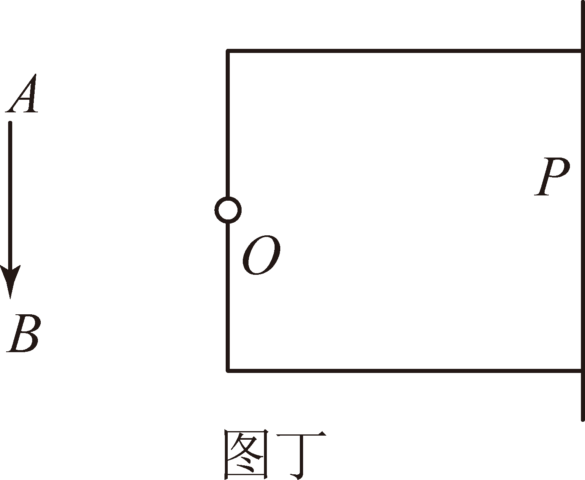

【答案】孔的形状，物体的形状，倒立，变大，(5)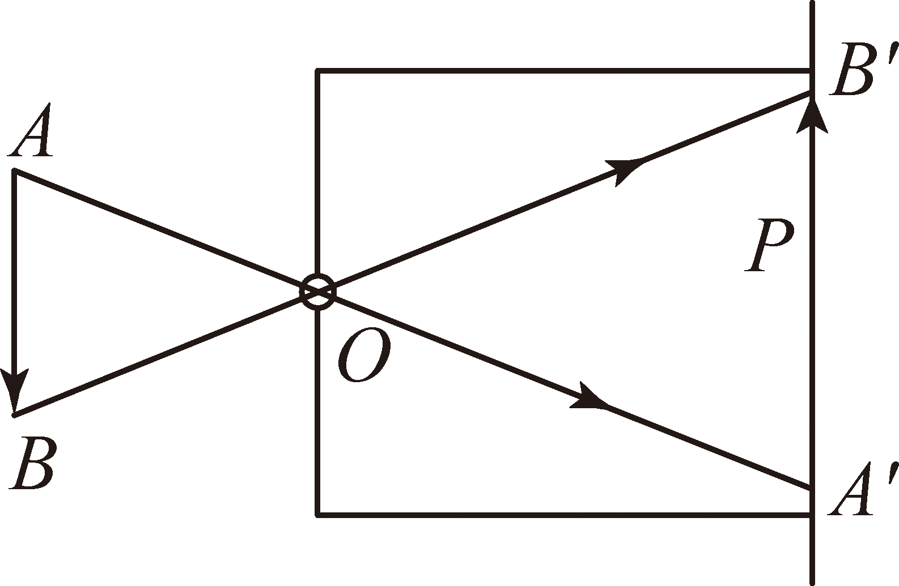

【解析】（1）分析比较甲、乙两图，小孔形状不同，但蜡烛通过小孔所成的像相同，可以得出：物体通过小孔所成的像与小孔的形状无关。
（2）分析比较甲、丙两图，小孔的形状相同，但半透明塑料膜上的像不同，故可以得出：物体通过小孔所成的像与物体的形状有关。
（3）通过实验，可以看到烛焰和灯泡在塑料膜上成的都是倒立的实像，说明小孔成像的原理是光沿直线传播，即物体上端发出光线经过小孔射到下端，而物体下端发出光线经过小孔射到上端，所以是倒立的。
（4）物体靠近小孔时，光线穿小孔后传播角增大，因此在光屏上的像会变大。
（5）小孔成像根据的是光沿直线传播，物体上端发出光线经过小孔射到光屏的下端，而物体下端发出光线经过小孔射到光屏的上端，如图所示：

## 43. （难度：适中）

按要求作图：

如图甲所示，室内一盏电灯通过木板隔墙上的两个小洞，透过两条光线。请在图中根据这两条光线，完善光路图，确定并标出电灯的位置S；

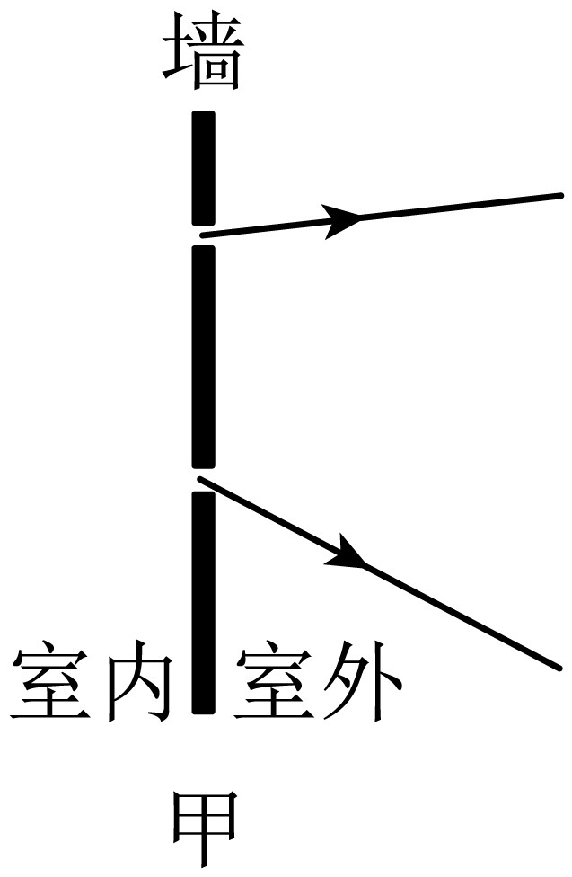

如图乙是小强在纸杯上蒙上一层塑料膜做小孔成像实验的情景，请在图中作出烛焰（用AB表示）在塑料膜上成的像（用箭头及\({{A}^{'}}{{B}^{'}}\) 表示）。

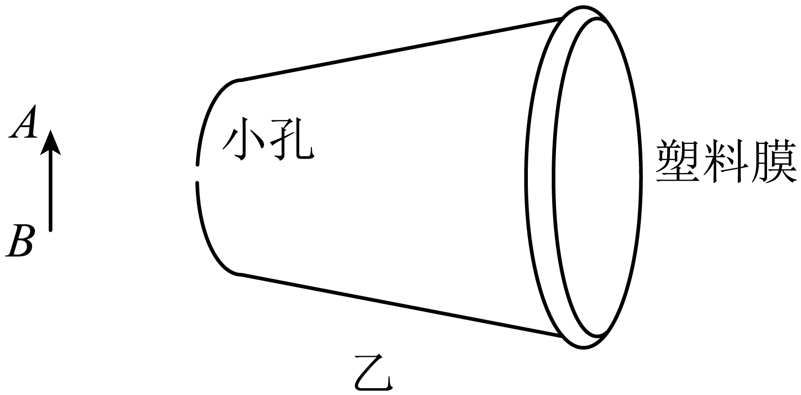

【答案】

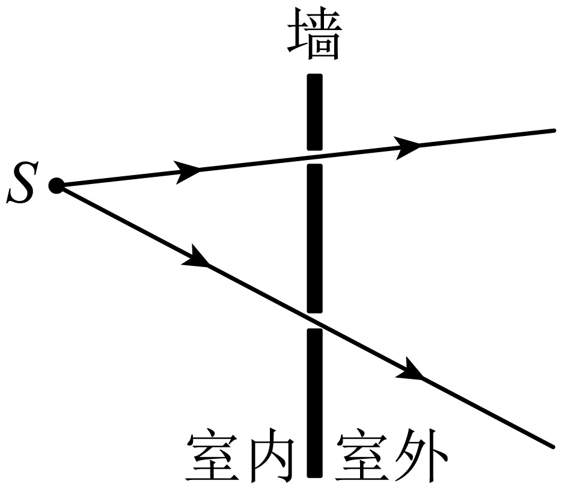

，

【解析】根据光沿直线传播的原理，作两条光线的反向延长线交于一点，即电灯的位置S，作图如下：

小孔成像的原理是光的直线传播，成倒立的实像。连接A点和小孔并延长，与塑料膜的交点为\({{A}^{'}}\) ；连接B点与小孔并延长，与塑料膜的交点为\({{B}^{'}}\) ；用实线连接\({{A}^{'}}{{B}^{'}}\) ，标上向下的箭头，则\({{A}^{'}}{{B}^{'}}\) 就是烛焰AB在塑料膜上所成的像，作图如下：

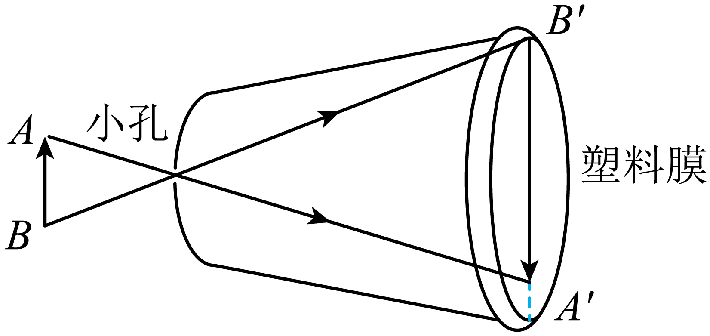

## 44. 填空题（难度：适中）

如图所示，是我国古代的走马灯。灯笼中点燃蜡烛，在蜡烛与灯笼外壁之间安装可旋转马的卡片，外壁上就会呈现马走动的影子，马影子的形成是利用光的___，点燃的蜡烛属于___（选填“自然”或“人造”）光源。

## 45. 单选题（难度：适中）

如图所示是2025年9月3日阅兵活动场景，仪仗兵们排着整齐的队列，踏着铿锵的步伐，非常震撼。关于场景中涉及到的物理知识及说法正确的是（　　）

【答案】A

## 46. 填空题（难度：适中）

某科创小组在空易拉罐的底部中央戳个小圆孔，将顶部剪去后，蒙上一层（填“透明”或“半透明”）塑料薄膜，制作成一个简易针孔照相机，如图所示，将其水平放置，在左侧固定一只与小孔等高的小灯泡，灯泡发光时，可在薄膜上看到灯丝（填“倒立”或“正立”）的像。其形成原理可以用光的来解释。若水平向右移动灯泡，像的大小（填“变大”“变小”或“不变”）。若只将小圆孔改为三角形小孔，则像的形状（填“改变”或“不变”）。

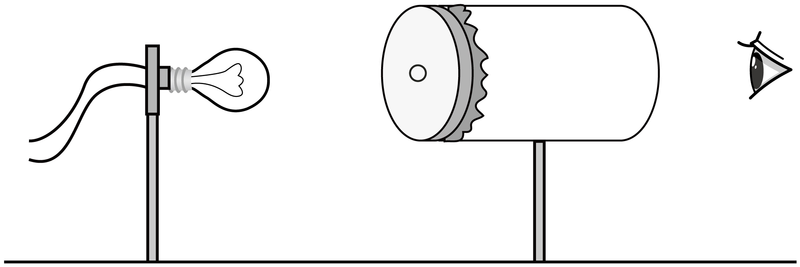

【答案】半透明，倒立，直线传播，变大，不变

【解析】[1]针孔照相机的成像原理是小孔成像，需要让光线通过小孔后投射到屏幕上形成像。为了观察像，屏幕材料应允许部分光线透过但又不完全透明，因此选择半透明塑料薄膜。
[2]小孔成像的特点是物体通过小孔在屏幕上形成倒立的实像。这是因为物体上部的光线通过小孔后投射到屏幕下部，物体下部的光线投射到屏幕上部。
[3]小孔成像的形成原理是光的直线传播。光线在均匀介质中沿直线传播，通过小孔后，物体不同部分的光线在屏幕上交叉，形成倒立的像。
[4]图中水平向右移动灯泡，灯泡与小孔的距离减小。根据小孔成像的规律，物体与小孔的距离减小，像会变大。
[5]小孔成像的像形状由物体决定，与小孔形状无关。因此，若只将小圆孔改为三角形小孔，像的形状不变。

## 47. 多选题（难度：适中）

早在战国时期，我国古代著名教育家、思想家墨子就在研究小孔成像的现象。如图所示，他用蜡烛作为光源，在木板上钻一个小孔，发现光线透过小孔在墙壁上形成一个倒立的像。下列说法正确的有（　　）

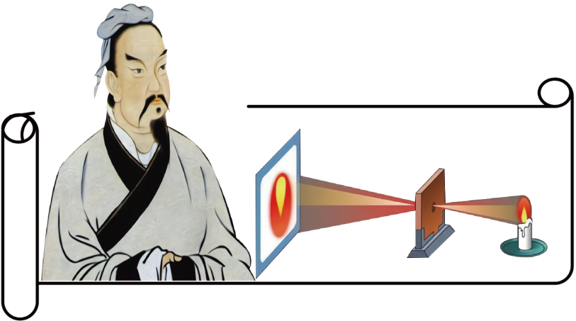

- A. 小孔成像现象能说明光沿直线传播
- B. 木板上的小孔一定是圆形的
- C. 保持蜡烛和墙的位置不变，将木板向靠近墙的方向移动，蜡烛在墙上的像会变大
- D. 蜡烛在墙上形成的像是实像

【答案】A/D

【解析】A．小孔成像的原理就是光沿直线传播，蜡烛发出的光线通过小孔后，在墙上形成倒立的像，这个现象能说明光沿直线传播，故A正确；
B．小孔成像的形状与小孔的形状无关，只与光源的形状有关，所以木板上的小孔不一定是圆形的，故B错误；
C．保持蜡烛和墙的位置不变，将木板向靠近墙的方向移动，此时像距变小，物距变大，根据小孔成像的规律，像会变小，故C错误；
D．蜡烛在墙上形成的像是由实际光线会聚而成的，属于实像，故D正确。

## 48. 填空题（难度：适中）

皮影戏是国家级非物质文化遗产。如图所示，兽皮在幕布上投下的“皮影”是由于形成的。在点光源和幕布位置不变的情况下，要使幕布上投射的“皮影”变大，可以兽皮与幕布间的距离。

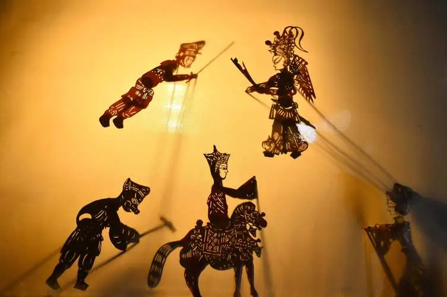

【答案】光的直线传播，增大

【解析】[1]兽皮在幕布上投下的“皮影”是影子，是光的直线传播形成的。
[2]影子的大小与物体和光源的距离及物体与幕布之间的距离都有关系，表演者想让影子变大，灯光和白色幕布位置不变，可以使兽皮慢慢靠近灯光，即增大兽皮与幕布间的距离。

## 49. 填空题（难度：适中）

如图所示，当你放学时从图中位置沿箭头方向远离路灯时，你的影子的长度会；生活中，先看见闪电再听到雷声，是因为光的传播速度比声音的传播速度；光不仅能使周围变得明亮，还能帮助植物光合作用，甚至可以切割金属，这说明光具有。

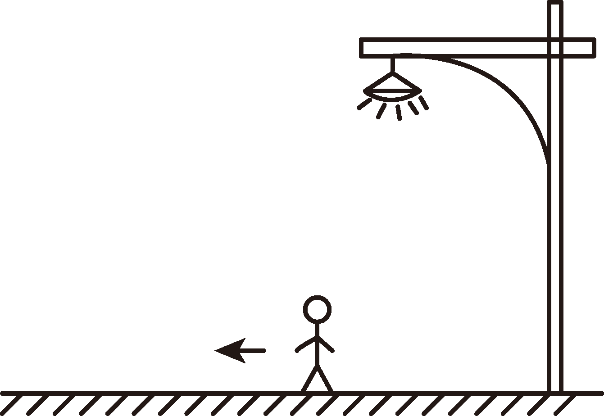

【答案】变长，快，能量

【解析】[1]根据光沿直线传播，沿箭头方向远离路灯时，灯与头顶的连线倾斜程度越大，你的影子的长度会变长。
[2]生活中，先看见闪电再听到雷声，是因为光的传播速度比声音的传播速度快，因为光在空气中传播的速度约为\(\text{3}\times \text{1}{{\text{0}}^{8}}\text{m/s}\) ，而声音在15℃时，空气中传播的速度为340m/s。
[3]光不仅能使周围变得明亮，还能帮助植物光合作用，甚至可以切割金属，这说明光具有能量，能够将金属切割开。

## 50. 填空题（难度：适中）

如图所示是兴趣小组在趣味物理晚会上展示的“奇妙透视现象”，先打开A灯，在屏幕上看到一个清晰的鸡蛋影像，再打开B灯，鸡蛋的影像明亮了许多，同时可以看到鸡蛋影像内部有一个更为清晰的鸡雏影像。该现象利用的光学原理是___，鸡雏影像比鸡蛋影像清晰的原因是___。

## 51. 填空题（难度：适中）

日食、月食是由于光的原理形成的，如图所示是太阳、地球和月球三者某时刻的位置示意图，若此时出现月食现象，则月球处于位置；若出现日食现象，则月球处于位置（以上两空均选填“甲”“乙”“丙”或“丁”）。

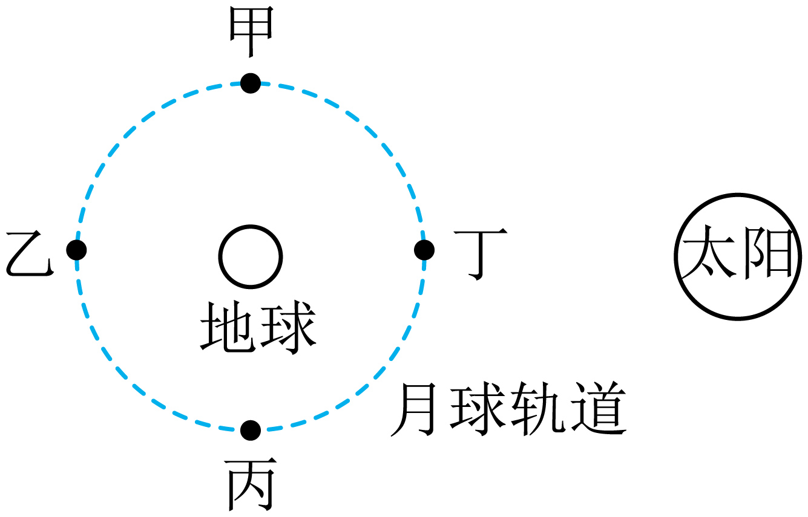

【答案】直线传播，乙，丁

【解析】日食、月食的形成都是因为光沿直线传播，当光的传播路径被遮挡时，就会形成影子，进而产生日食和月食。
月食是当地球位于太阳与月球之间，即月球运动到乙位置时，三者在同一条直线上时，被不透明的地球挡住了沿直线传播射向月球的光，太阳光照不到月球上，看不到月球而形成的；日食，又叫做日蚀，是月球运动到太阳和地球中间即月球运动到丁位置时，如果三者正好处在一条直线时，月球就会挡住太阳射向地球的光，月球身后的黑影正好落到地球上，这时发生日食现象。

## 52. 填空题（难度：适中）

手机防窥膜起到的效果是只有正对屏幕时能看到，如果从侧面则看不到。其结构上采用了超细不透明百叶窗光学技术，其立体结构放大示意图如图甲，工作原理如图乙所示。防窥结构层利用（选填“光沿直线传播”、“光的反射”或“光的折射”）的原理达到防窥目的，为达到更好的防窥效果，应（选填“降低”或“升高”）超细百叶窗的高度。

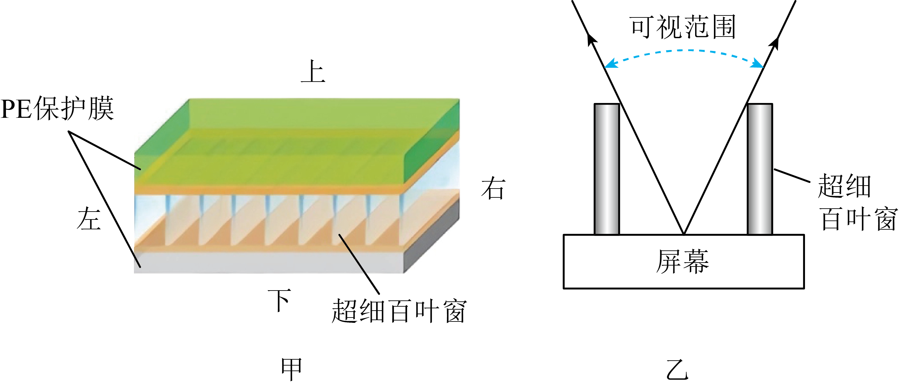

【答案】光沿直线传播，升高

【解析】[1]手机防窥膜两侧看不清屏幕内容，是因为光沿直线传播，只有在特定角度范围内的光线才能透过防窥膜。
[2]要让防窥效果更好，即可视范围减小，应适当升高超细百叶窗的高度，这样能透过光线的角度范围就更小。

## 53. 填空题（难度：适中）

圭表是我国古代的天文仪器，如图，由“圭”和“表”两个部件组成，圭和表相互垂直。正午时人们通过表在圭上影子的长度变化来推测节气，这是利用了光在同种均匀介质中___的原理；请再列举一个利用该原理的实例或现象：___。

## 54. 填空题（难度：适中）

如图所示是2025年9月中国人民抗日战争暨世界反法西斯战争胜利80周年阅兵式的场景之一，仪仗队里官兵排列非常整齐是应用了___的原理。

## 55. （难度：适中）

“井底之蛙”这个成语大家都很熟悉，图中P点表示青蛙的眼睛。请根据光的直线传播知识画出青蛙能看到天空范围的光路图。（温馨提示：只需做出光路图，无需画出天空范围。）

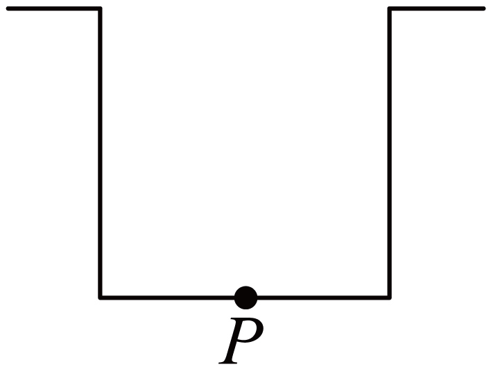

【答案】

【解析】过井沿的边缘和青蛙的眼球画出进入青蛙眼睛最边缘的两条光线，两条光线之间的范围为青蛙能看到天空范围，如图所示：

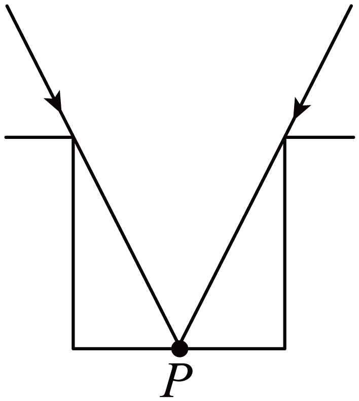

## 56. 单选题（难度：适中）

一个雨后的晚上，天刚放晴，地面虽已干，但仍留有不少积水，为了不致踩在小水坑，下列判断正确的是（　　）

- A. 背着月光走时，看到更亮是干的地面
- B. 背着月光走时，看到更亮的是水坑
- C. 迎着月光和背着月光行走时，地面上亮处是水坑
- D. 迎着月光和背着月光行走时，地面上暗处是水坑

【答案】A

【解析】当迎着月光走时，月光射到水面上时，光在水面发生的是镜面反射，大量反射光射入人的眼睛，而光在地面发生漫反射，只有很少的光进入人的眼睛，所以此时水面亮、干的地面暗，人应走暗处。背着月光走时，光在水面发生镜面反射，反射光线射向人的对面，几乎没光射入人的眼睛；而光在地面发生漫反射，反射光线射向不同的方向，有光线射入人的眼睛，故此时干的地面较亮、水面暗，人应走亮处。故A正确，BCD错误。

## 57. 单选题（难度：适中）

雨后的夜晚，当你行走在有积水的路上，为了避让水洼，描述正确的是（　　）

- A. 背着月光走，应走较暗的地方，月光照水面上发生镜面反射
- B. 背着月光走，应走较亮的地方，月光照到地面上发生漫反射
- C. 迎着月光走，应走较亮的地方，月光照到地面上发生漫反射
- D. 迎着月光走，应走较暗的地方，月光照水面上发生漫反射

【答案】B

【解析】AB．背着月光走，月光经水面发生镜面反射，没有反射光线进入人的眼睛，人感觉水面暗；地面发生漫反射，有少量的光线反射进入人的眼睛，人感觉地面亮，因此需要走较亮的地方，故A错误，B正确；
CD．迎着月光走，月光经水面发生镜面反射，光线集中进入人的眼睛，人感觉很亮；地面发生漫反射，有少量的光线反射进入人的眼睛，人感觉地面暗，因此需要走较暗的地方，故CD错误。

## 58. 单选题（难度：简单）

黑板若发生“反光”会造成黑板上的字迹看不清，这是因为“反光”的黑板会发生（　　）

- A. 漫反射现象，使光射向四面八方
- B. 镜面反射现象，使进入人眼的光线太强
- C. 漫反射现象，使进入人眼的光线变弱
- D. 镜面反射现象，使光线射向四面八方

【答案】B

【解析】AC．漫反射是光线射到凹凸不平的物体表面时，反射光线射向各个方向，即射向四面八方，所以我们能从各个不同方向看到本身不发光的物体及黑板上的字，就是因为光漫反射，使进入人眼的光线变弱，故AC不符合题意；
BD．镜面反射是平行光射到光滑的物体表面时，反射光仍平行，射向同一方向，正好处在这一方向上时，获得的光线很强，其他方向上几乎没有反射光线。当黑板光滑时，黑板“反光”就是因为黑板发生了镜面反射，使进入人眼的光线太强，会造成黑板上的字迹看不清，综上分析知，故B符合题意，D不符合题意。

## 59. 单选题（难度：适中）

如图为探究光的反射定律实验，平面镜水平放置， 白色纸板竖直地立在镜面上，入射光线AO紧贴纸板射向镜面， 纸板上能看到反射光线OB（图中未画出），O为入射点，ON为法线，则（　　）

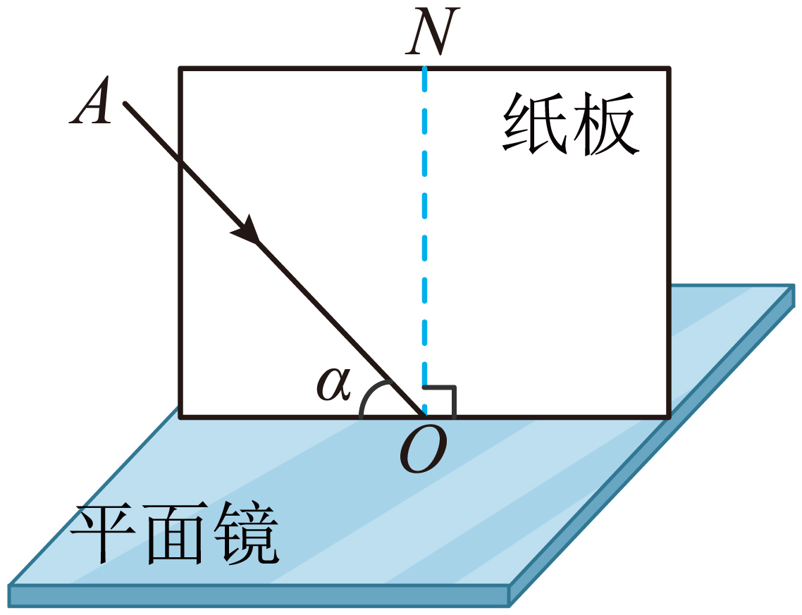

- A. 反射光线OB的位置在ON的左侧
- B. 仅增大图中α的角度，反射光线OB将远离ON
- C. 仅将平面镜在水平面内绕O旋转，OB位置不变
- D. 仅将纸板取走，反射光线OB将不存在

【答案】C

【解析】A．反射光线OB和入射光线AO分居在法线的两侧，反射光线OB的位置在ON的右侧，故A错误，不符合题意；
B．仅增大图中∠α的角度，入射角减小，则反射角减小，反射光线OB将靠近ON，故B错误，不符合题意；
C．仅将平面镜在水平面内绕O旋转，纸板仍然和平面镜垂直，法线位置不变，入射光线位置不变，反射光线OB位置不变，故C正确，符合题意；
D．仅将纸板取走，反射光线OB仍然存在，只是不能显示在纸板上，故D错误，不符合题意。

## 60. 单选题（难度：适中）

如图所示，小红同学能够看到掉在地面上不发光的书。下列说法正确的是（　　）

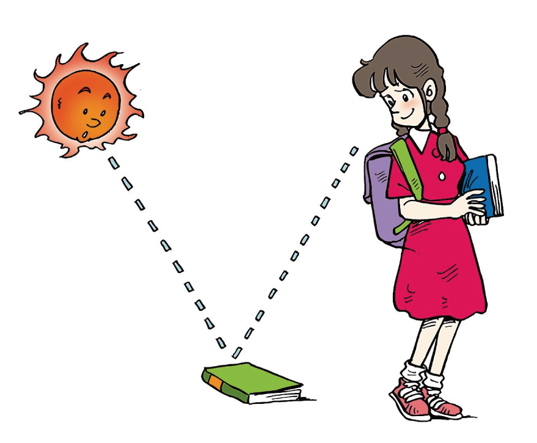

- A. 书本发出的光射到了小红的眼睛里才看到书
- B. 书本漫反射的光射到了小红的眼睛里才看到书
- C. 因为人眼发出的光射到了物体上，小红才看到书
- D. 书本镜面反射的光射到了小红的眼睛里才看到书

【答案】B

【解析】A．光源是指能够自行发光的物体，而书本本身不能发光，不是光源，所以不存在书本发出光射到小红眼睛里这种情况，故A错误；
B．我们能看到本身不发光的物体，是因为物体反射的光进入了我们的眼睛。地面上的书本表面是粗糙的，当光线照射到书本上时，会发生漫反射，即反射光线会射向各个方向。小红的眼睛处于这些反射光线的传播路径上，有部分反射光射入了小红的眼睛，所以小红能够看到掉在地面上不发光的书，故B正确；
C．人眼不是光源，不能自行发光，人眼只是能够接收光线，从而让我们看到物体，而不是人眼发出光射到物体上使我们看到物体，故C错误；
D．镜面反射是指平行光线射到光滑表面上时反射光线也是平行的，只能在特定方向看到反射光。而书本表面粗糙，发生的是漫反射，不是镜面反射，故D错误。

## 61. 单选题（难度：适中）

如图所示，入射光线与平面镜成30°角，则（　　）

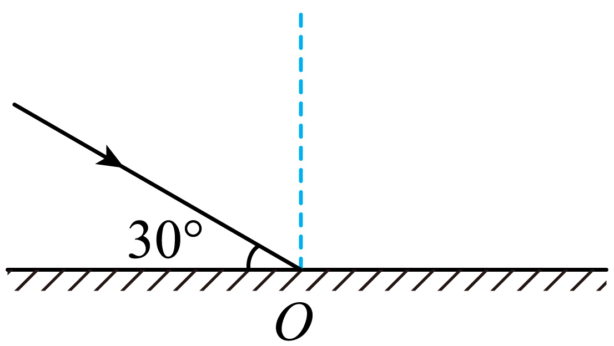

- A. 入射角是30°
- B. 反射光线与镜面的夹角是60°
- C. 入射角增大5°，反射角增大10°
- D. 入射光线不变，平面镜顺时针转过15°，此时反射角是75°

【答案】D

【解析】A．入射角为入射光线与法线的夹角，应为60度，说法错误，故A不符合题意。
B．根据反射定律，两角相等，那么光线与镜面的夹角也相等，反射光线与镜面的夹角也应等于30度。故B不符合题意。
C．因为反射角等于入射角，入射角增大5度，反射角也应增大5度，说法错误，故C不符合题意。
D．入射光线不变，平面镜顺时针旋转15度，则入射光线与平面镜的夹角减小为15度，则入射角增加至75度，此时反射角也为75度，说法正确，故D符合题意。

## 62. 单选题（难度：适中）

如图所示，“探究光的反射规律”实验时，利用红、绿、蓝三种色光的激光笔进行实验，将位于同一平面内的白色纸板A、B立在平面镜上。下列说法中正确的是（　　）

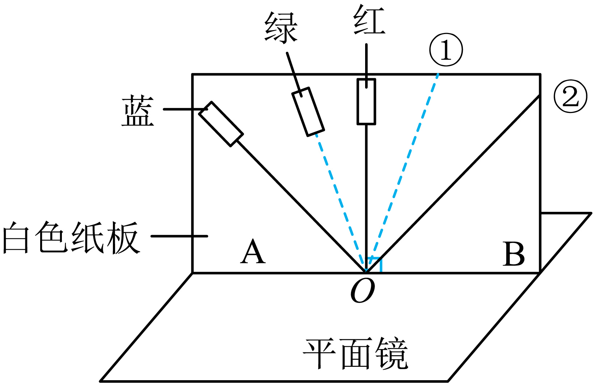

- A. 红光的入射角为90°
- B. 利用该装置进行实验时，纸板应垂直于平面镜放置
- C. ②号光为绿色
- D. 将纸板B向后翻折，B板无反射光，表明反射现象消失

【答案】B

【解析】A．红光垂直照射在平面镜上，与法线重合，入射角是0°，故A错误；
B．因为当纸板与平面镜不垂直时，法线无法在纸板上显示出来，就不能够探究入射光线、反射光线和法线的关系，只有垂直放置时，三条线才会都体现出来，因此纸板必须垂直放置，故B正确；
C．在光的反射中，反射光线和入射光线分居法线的两侧，反射角等于入射角，因此②号光线的颜色为蓝色，故C错误；
D．当纸板B转过一定的角度后，两块纸板不在同一平面上，所以在纸板B上就无法呈现出反射光线了，但反射光线没有消失，故D错误。

## 63. 单选题（难度：适中）

如图是镜面反射与漫反射的光路图，下列选项中判断不正确的是（　　）

【答案】A

## 64. 单选题

两个互相垂直的平面镜组成了激光反射器，如图所示。如果入射光线方向不变，反射器绕O点向顺时针方向转过45°，那么经过反射器两次反射的光线将转过（　　）

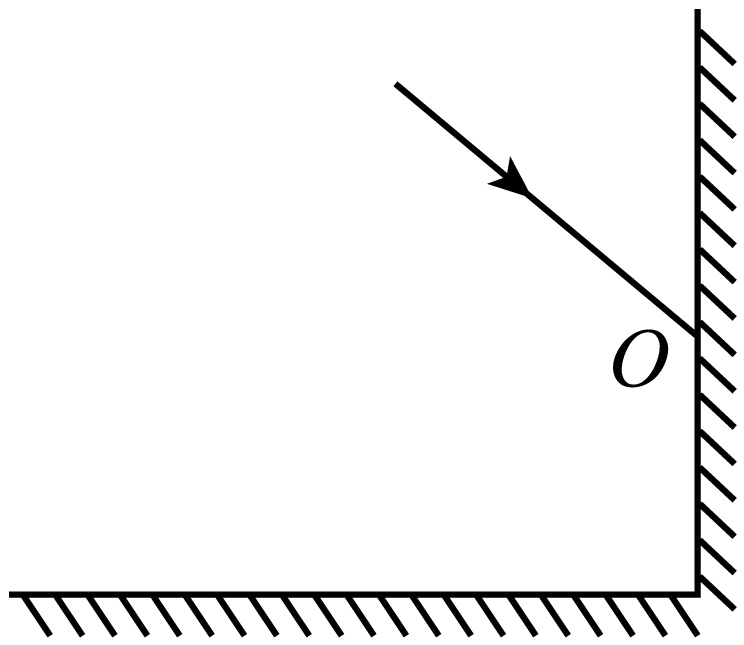

- A. 90°
- B. 45°
- C. 22.5°
- D. 0°

【答案】D

【解析】因为两个镜面互相垂直，再次反射的法线互相垂直，第一次的反射角与第二次的入射角之和为直角，即第一次的入射角与第二次的入射角之和为直角，所以第一次的入射角与第二次的反射角为直角，所以第一次的入射光线与第二次的反射光线平行。反射器绕O点顺进针方向转过45°，入射光线的方向不变，则反射光线的方向也不变，所以两次反射的光线将转过0°，故ABC不符合题意，D符合题意。

## 65. 单选题（难度：适中）

如图，若要让反射光线射中天花板上的新目标，下列方法可行的是（　　）

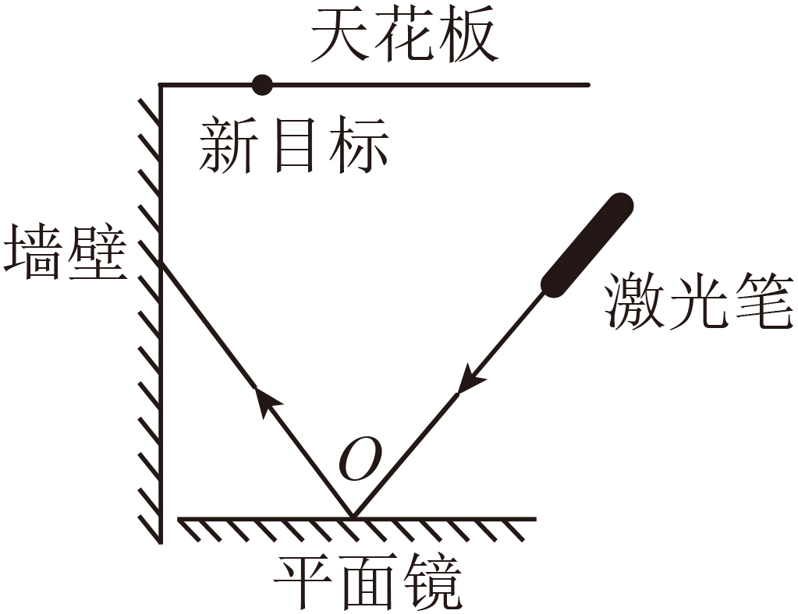

- A. 只将平面镜竖直向上平移一段距离
- B. 只将平面镜水平向右平移一段距离
- C. 只将平面镜绕O点逆时针转动一定角度
- D. 只将激光笔的入射光绕O点顺时针转过一定角度

【答案】A

【解析】A．将平面镜竖直向上移动一段距离，则入射光线方向不变，入射点向右移动，则反射光线也向右移动，光斑会向上移动，可以射中新目标，故A符合题意；
B．将平面镜水平向右移动一段距离，入射光线不变，则反射光线也不会改变，不能射中新目标，故B不符合题意；
C．只将平面镜绕O点逆时针转动一定角度，入射角变大，根据反射角等于入射角可知，反射角也随之变大，则反射光线向左转到，光斑会向下移动，不能射中新目标，故C不符合题意；
D．只将激光笔的入射光线绕O点顺时针转过一定角度，入射角变大，根据反射角等于入射角可知，反射角也随之变大，反射光线向左转动，光斑会向下移动，不能射中新目标，故D不符合题意。

## 66. 单选题（难度：适中）

如图所示，雨后的夜晚，迎着月光行走在有积水的路上时，会发现水坑处和干燥的地面亮度不一样。结合光的反射知识，下列说法正确的是（　　）

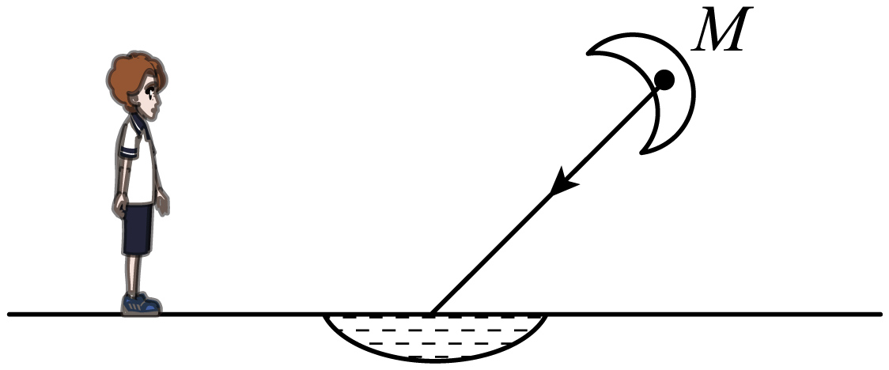

- A. 水面比较亮，主要是因为水面发生镜面反射
- B. 干燥的地面发生漫反射，不遵循光的反射定律
- C. 水面发生漫反射，遵循光的反射定律
- D. 干燥的地面比较暗，主要是因为月光不够亮

【答案】A

【解析】水面表面光滑，月光经水面发生镜面反射，迎着月光行走时，月光平行射入，平行射出，镜面反射进入人眼的光线比较多，所以，水面比较亮；地面凹凸不平，月光经地面发生漫反射，漫反射光线射向四面八方，进入人眼的光线比较少，所以迎着月光行走，感觉地面比较暗，漫反射和镜面反射都遵循光的反射定律，故A正确，BCD错误。

## 67. 单选题（难度：适中）

晚自习后，小莹发现自己家的车灯照射前面自行车“尾灯”时，会发现对方“尾灯”很明亮。查阅资料知道自行车“尾灯”结构如图所示。这种结构称为角反射器，是由互相垂直的反光面组成的。则下列说法正确的是（　　）

【答案】A

## 68. 单选题（难度：适中）

如图，是镜面反射与漫反射的光路图，依图并结合所学知识，下列选项中判断正确的是（　　）

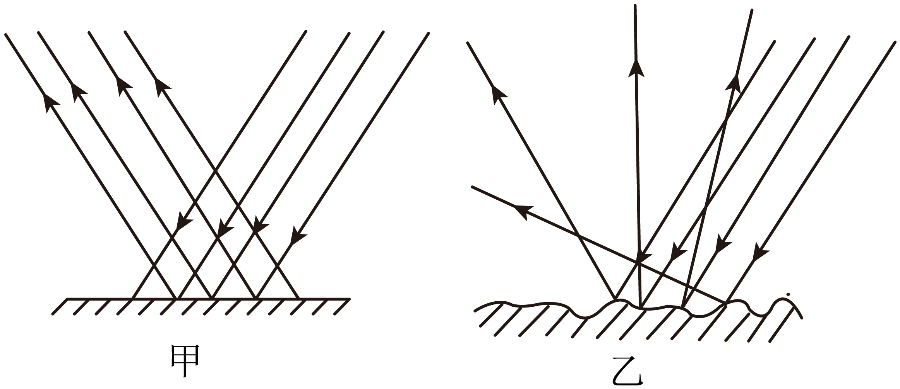

- A. 甲是漫反射，乙是镜面反射
- B. 甲、乙光线均不遵循光的反射定律
- C. 自行车尾灯是根据甲的思路设计的
- D. 在黑夜背着月光行走，较暗的地方是路面

【答案】C

【解析】AB．根据图示可知，甲、乙的入射光线都平行，而甲的反射光线也平行，乙的反射光线不平行，因此甲图发生了镜面反射，乙图发生了漫反射；不论是镜面反射还是漫反射都遵守光的反射定律，故AB错误；
C．自行车尾灯是根据甲的思路设计的，故C正确；
D．背着月光走，月光经水面发生镜面反射，没有反射光线进入人的眼睛，人感觉水面暗；地面发生漫反射，有少量的光线反射进入人的眼睛，人感觉地面亮，故D错误。

## 69. 单选题（难度：适中）

如图所示，晚上在桌面上铺一张白纸，把一块平面镜放在纸上（镜面朝上），让手电筒的光正对着平面镜照射，关于此现象下列说法正确的是（　　）

【答案】A

## 70. 单选题（难度：适中）

如图所示，被隔板隔开的两个人偶不能直接“看到”对方，但人偶A可以从平面镜中“看到”人偶B的眼睛，则人偶B通过平面镜（　　）

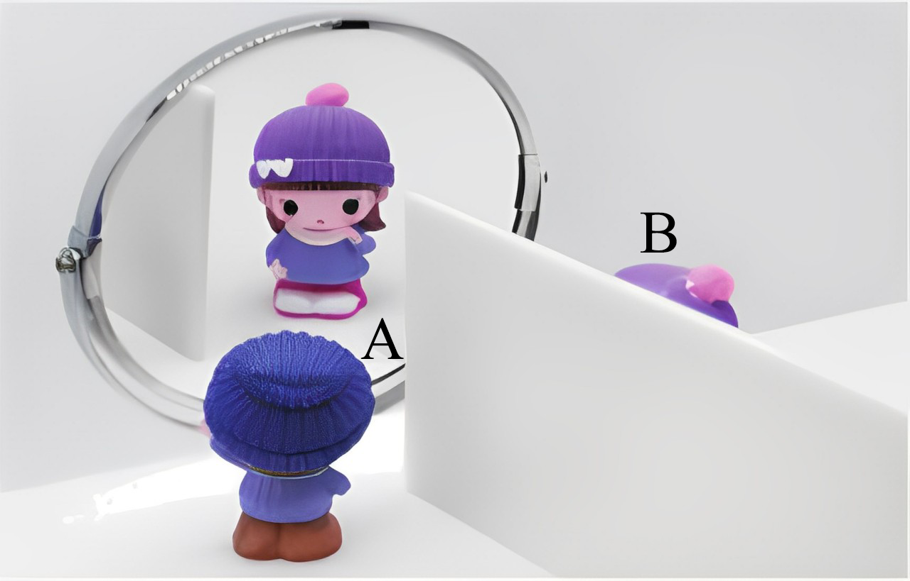

- A. 可能看见人偶A的眼睛
- B. 一定不能看见人偶A的眼睛
- C. 一定能看见人偶A的眼睛
- D. 无法确定，与所处位置有关

【答案】C

【解析】在光的反射中，光路是可逆的。人偶A通过平面镜能看到人偶B的眼睛，那么人偶B也一定可以通过平面镜看到人偶A的眼睛，故C符合题意，ABD不符合题意。

## 71. 单选题（难度：简单）

如图所示，为了探究光反射时的规律，把一个平面镜放在水平桌面上，再把一张纸板ENF竖直地立在平面镜上，纸板ENF是用两块纸板连接起来的，纸板NOF可以向前或向后折。下列说法正确的是（　　）

【答案】A

## 72. 单选题（难度：简单）

在沂河湿地公园游玩的小明拍到如图所示的景象，让他真切的体会到李白的诗句“举杯邀明月，对影成三人”。下列解释错误的是（　　）

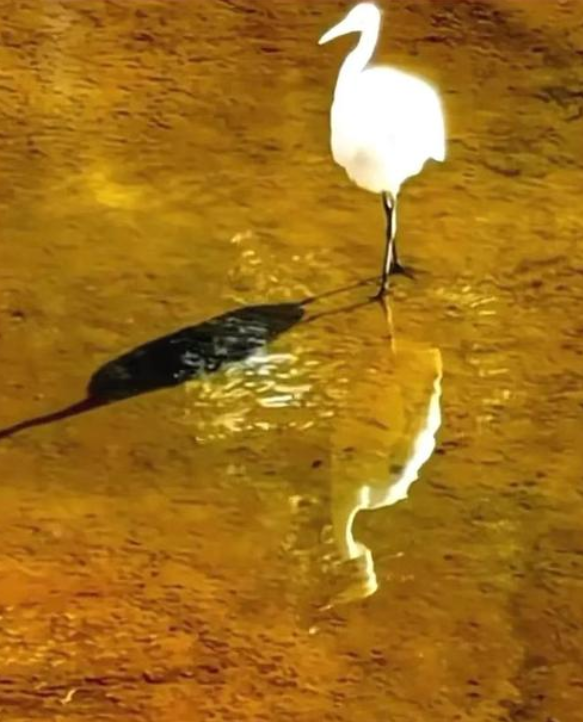

- A. 第一个“人”——白鹤自己，能看到白鹤是因为它是光源
- B. 第二个“人”——白鹤的影子，因光沿直线传播形成
- C. 第三个“人”——白鹤的“倒影”，因为光的反射形成
- D. 白鹤的“倒影”之所以暗淡，是因为部分光折射到水里去了

【答案】A

【解析】A．白鹤不是光源，故A错误，符合题意；
B．白鹤的影子是光沿直线传播形成的，故B正确，不符合题意；
C．白鹤在水中的倒影是由光的反射形成的虚像，故C正确，不符合题意；
D．白鹤的“倒影”之所以暗淡，是因为部分光折射到水里去了，用于光的反射形成倒影的光线变少，导致白鹤的“倒影”暗， 故D正确，不符合题意。

## 73. 单选题

教室黑板用久后有一部分变得光滑。当如图所示太阳光从右侧窗户射入时，下列说法正确的是（　　）

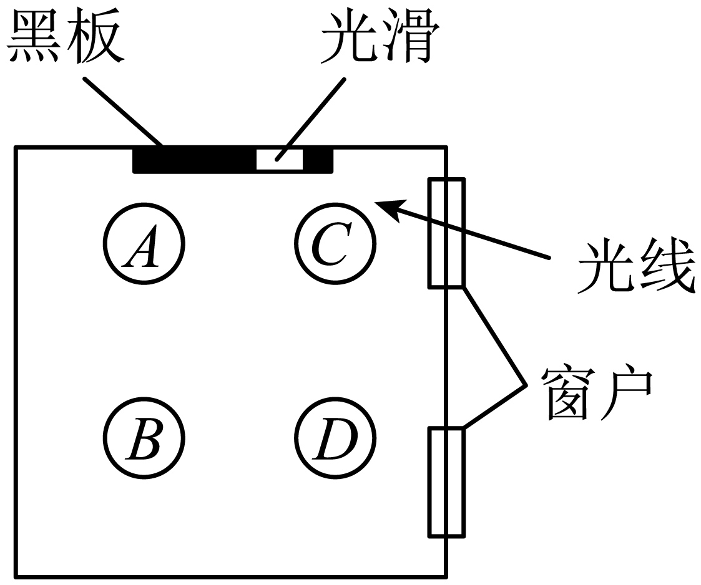

- A. 太阳光照射到光滑处将发生漫反射
- B. 最有可能因反光而看不清光滑处字的是位置A
- C. 最有可能因反光而看不清光滑处字的是位置C
- D. 太阳光照在黑板上发生反射时不遵循光的反射定律

【答案】B

【解析】ABC．太阳光照射到光滑处将发生镜面反射，反射光线较为集中，会造成黑板发光。位置A位于镜面反射后的反射光线经过的地方，所以最有可能因反光而看不清光滑处字的是位置A，故AC错误，B正确；
D．无论是漫反射还是镜面反射均遵循光的反射定律，故D错误。

## 74. 单选题（难度：简单）

小王同学在家里将一个平面镜放在水平桌面上，再把一张可沿ON折叠的硬白纸板ENF竖直的立在平面镜上，以此来探究光的反射规律。通过测量他发现此时入射光线与平面镜成50°夹角，如图所示，则（　　）

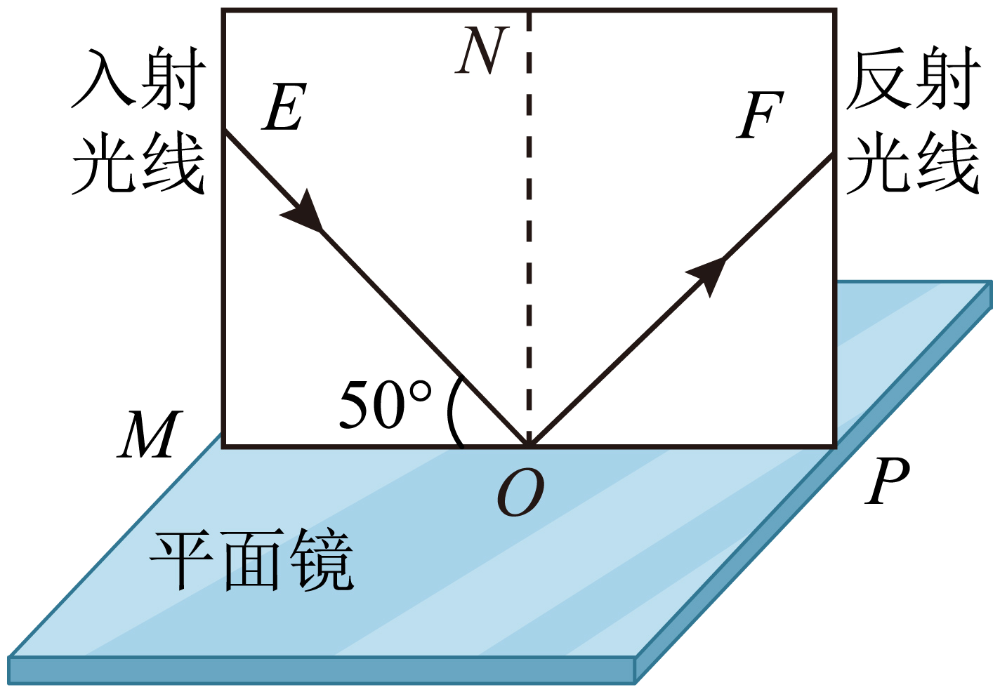

- A. 反射光线与镜面的夹角是40°
- B. 入射角增大10°，反射光线与入射光线的夹角增大20°
- C. 将纸板NOF向后折叠，则反射光线会消失
- D. 光在纸板上发生了镜面反射

【答案】B

【解析】A．入射光线与平面镜成50°夹角，则入射角为
90°-50°=40°
根据光的反射规律可知，反射角为40°，则反射光线与镜面的夹角是
90°-40°=50°
故A不符合题意；
B．入射角增大10°，则反射角也增大10°，那么反射光线与入射光线的夹角增大20°，故B符合题意；
C．因为反射时，反射光线、入射光线和法线在同一平面内，将纸板NOF向后折叠，在纸板NOF上将看不到反射光线，但反射光线不会消失，故C不符合题意；
D．为了能在各个方向都能观察到光线，纸板表面比较粗糙，光在纸板上发生了漫反射，故D不符合题意。

## 75. 单选题（难度：适中）

玻璃幕墙在阳光照射下非常刺眼，会造成“光污染”。下列说法正确的是（　　）

- A. 玻璃幕墙会刺眼是因为阳光在玻璃幕墙上发生镜面反射
- B. 普通墙体不刺眼是因为阳光在普通墙体上没有发生反射
- C. “光污染”形成的原理与“月食”形成的原理相同
- D. 阳光在玻璃幕墙上发生的反射不遵循光的反射定律

【答案】A

【解析】A．玻璃幕墙会刺眼是因为阳光在玻璃幕墙上发生镜面反射，故A正确；
B．普通墙体不刺眼是因为阳光在普通墙体上发生了漫反射，故B错误；
C．光污染主要是由镜面反射引起的，月食是由光沿直线传播形成的，二者形成的原理不相同，故C错误；
D．阳光在玻璃幕墙上发生的反射为镜面反射，无论镜面反射还是漫反射都遵循光的反射定律，故D错误。

## 76. 单选题（难度：适中）

若反射光线跟镜面成40°角，则入射光线跟反射光线之间的夹角是（　　）

- A. 100°
- B. 90°
- C. 80°
- D. 50°

【答案】A

【解析】反射光线跟镜面成40°角，则反射角为
90°-40°=50°
根据光的反射定律可知反射角等于入射角，所以入射光线跟反射光线之间的夹角是100°。故A符合题意，BCD不符合题意。

## 77. 单选题（难度：适中）

图所示为水位测量仪的示意图。A点与光屏PQ在同一水平面上，从A 点发出一束光，经水面反射在光屏上B 点形成一个光斑。下列说法正确的是（　　）

- A. 当水位升高时，入射角将变大
- B. 当水位升高时，反射角将变小
- C. 当水位降低时，光斑向 B 点左侧移动
- D. 当水位降低时，光斑向 B 点右侧移动

【答案】D

【解析】AB．如下图

 
水面相当于平面镜，当水位升高时，入射光线不变，入射光线与水面的夹角不变，则入射角不变，根据光的反射定律，反射角对于入射角，则反射角也不变，故AB错误；
CD．当水位降低时，入射光线不变，入射点右移且降低，由于光线的入射角不变，反射角不变，因此水面降低后，反射光线与原来的反射光线平行，且右移，光斑向 B 点右侧移动，故C错误，D正确。

## 78. 单选题（难度：适中）

下列关于镜面反射和漫反射的分析正确的是 （　　）

【答案】A

## 79. 单选题（难度：适中）

下面关于反射现象的描述，正确的是（　　）

- A. 反射角等于入射角
- B. 反射角是指反射光线与反射面的夹角
- C. 反射光线与入射光线并不在同一平面内
- D. 反射光线、入射光线没有重合的可能

【答案】A

【解析】AC．根据光的反射定律，发生反射时，反射光线、入射光线与法线在同一平面内，反射光线、入射光线分居法线两侧，反射角等于入射角，故A正确，C错误；
B．反射角是指反射光线与法线的夹角，故B错误；
D．当光垂直入射时，反射光线沿原路返回，反射光线、入射光线和法线三线合一，反射光线、入射光线重合，故D错误。

## 80. 填空题（难度：适中）

巴黎奥运会即将开幕，爱思考的乐达达同学去巴黎旅游,发现奥运五环被挡住看不见是因为光沿___传播，埃菲尔铁塔无灯的栏杆被人看见是因为栏杆___的光进入达达同学的眼睛。

## 81. 填空题（难度：适中）

如图所示，平面镜M水平放置，白色纸板竖直地立在平面镜上，纸板由A、B两部分组成，可绕接缝\(ON\) 翻折。使一束光紧贴纸板A射向镜面上的O点，只有当纸板B翻折至图中位置时，才能观察到纸板B上呈现反射光线，可知反射光线、入射光线和法线在，此时角度\(\alpha \) 为\(40{}^\circ \) ，则\(\beta \) 为，将一束光沿\(FO\) 方向入射，则反射光将沿方向射出。

【答案】同一平面内，40&deg;，<i>OE</i>

【解析】[1]反射光线、入射光线和法线都呈现在白色纸板上，在同一个平面上，所以可知在光的反射现象中，反射光线、入射光线和法线在同一个平面内。
[2]由光的反射定律可知，反射角等于入射角，所以入射角为40°时，反射角也等于40°。
[3]由于在光的反射现象中，光路是可逆的，所以将一束光沿原来的反射光路方向入射，则反射光将沿原来的入射光路射出，故反射光将沿OE方向射出。

## 82. 填空题（难度：适中）

如图所示，在探究光反射时的规律实验中，通过实验可知，反射光线、入射光线和法线都在___（选填“同”或“不同”）一平面内，反射角r___入射角i。

## 83. 单选题（难度：适中）

在教室中上课，有时黑板反射的光会“晃”着一些同学的眼睛，看不清黑板上的粉笔字。出现这种现象的原因是（　　）

【答案】A

## 84. 单选题（难度：适中）

如图所示，某同学从墙上的镜子里看到了小猫偷鱼吃。下列说法中正确的是（　　）

- A. 光线AO、BO是真实存在的
- B. 光线AO、BO与法线ON不在同一平面内
- C. ∠BON是反射角
- D. 光的传播方向为“眼睛→镜子→猫”

【答案】C

【解析】A．光线AO、BO是建立的物理模型，并非是真实存在的，故A错误；
B．在光的反射现象中，入射光线AO、反射光线BO与法线ON在同一平面内，故B错误；
C．∠BON是反射光线BO与法线ON的夹角，是反射角，故C正确；
D．人看见猫，说明猫反射的光射到平面镜上发生反射，反射光进入人眼，则光的传播方向为“猫→镜子→眼睛”，故D错误。

## 85. 单选题（难度：适中）

如图所示，阳光下一本物理教材掉到地上，小明和小红从不同的位置都能看到它。以下说法正确的是（　　）

- A. 阳光在教材上发生镜面反射，反射光线向各个不同方向射出
- B. 小明和小红眼睛发出的光都射在书本上
- C. 阳光在教材上发生漫反射，且满足反射角等于入射角
- D. 物理教材是光源，它发出的光射入小明和小红的眼睛

【答案】C

【解析】AC．教材的表面凹凸不平，光照在上面发生漫反射，反射光线是向着四面八方的，所以小明和小红从不同的位置都能看到教材，在光的反射现象中，反射角等于入射角，故A错误，C正确；
BD．小明和小红眼睛以及物理教材本身不会发光，故不是光源，之所以能看见教材，是因为教材反射的光线进入人眼，故BD错误。

## 86. 填空题（难度：适中）

如图所示探究光的反射定律实验中，入射角为度；增大入射角，则反射角；将纸板NOF沿ON向后翻折，在纸板上（选填“能”或“不能”）看到反射光。

【答案】40，增大，不能

【解析】[1]入射角是入射光线与法线的夹角，则入射角为40°。
[2]光的反射现象中，反射角随入射角的变化而变化，当增大入射角，则反射角会增大。
[3]光的反射现象中，反射光线与入射光线在同一平面内，因此将纸板NOF沿ON向后翻折，在纸板上不能看到反射光。

## 87. 单选题

如图，某日午后太阳发出的一条光线\(AO\) ，照射到一块平面镜上，反射光线沿水平方向\(OB\) 射出，在东侧的墙面形成一个光点\(P\) ，光线\(AO\) 与\(OB\) 的夹角为120°，下列说法不正确的是（　　）

- A. 入射角为60°
- B. 反射光线与平面镜的夹角为30°
- C. 若平面镜绕

 逆时针转过10°，反射角会减小5°
- D. 当太阳向西下落时，照射在墙壁上的光点

 向下移动

【答案】C

【解析】A．入射角为入射光线与法线间的夹角，此时入射光线与反射光线间的夹角为120°，反射角等于入射角，所以入射角为\(\frac{120{}^\circ }{2}=60{}^\circ \) 
故A正确，不符合题意；
B．根据反射角等于入射角可知，反射角为60°，反射光线与平面镜的夹角为90°-60°=30°
故B正确，不符合题意；
C．若平面镜绕O逆时针转过10°，则入射角减小10°，根据反射角等于入射角可知，反射角会减小10°，故C错误，符合题意；
D．当太阳向西下落时，光线AO向西移动，靠近平面镜，入射角增大，反射角也增大，反射光线也靠近平面镜，照射在墙壁上的光点P向下移动，故D正确，不符合题意。

## 88. （难度：适中）

如图甲所示是小宇同学探究“光的反射规律”的实验装置，用加湿器使整个玻璃罩内充满水雾，将一小块平面镜放在一个能转动的水平圆台上，用固定放置的红色激光笔发出一束垂直射向平面镜的光ON，然后用另一个绿色激光笔向O点发出一束光AO，经平面镜反射后沿OB方向射出。

实验中，用加湿器使整个玻璃罩内充满水雾的目的是（选填“显示光路”或“降低温度”），红色激光笔发出的光束ON相当于；

将绿色激光笔固定在玻璃罩上后，缓慢转动圆台，可以看到三束光重合，这说明反射光线、入射光线和法线在内；

利用量角器，测出对应入射光线、反射光线到（选填“ON”或“镜面”）的夹角，并比较大小；多次测量是为了使实验结论更具有性；

实验时，小雨发现每次用铅笔把光的传播路径用铅笔描下来非常不方便。认真思考后，她认为在正确操作时，只要在光传播的路径上标记两个合适的点就能确定了，用到的光学知识是光在中沿直线传播；

如图丙，用固定激光笔照向鼓面上的平面镜，墙面出现一个光点，轻压平面镜左侧鼓面使其稍许凹陷，则墙上光点位置会（选填“上移”、“不变”或“下移”）。

【答案】　显示光/　法，同一平面，<i>ON</i>/普遍，同种均匀介质，上移

【解析】玻璃罩内充满水雾，则入射光线及反射光线的传播路径都能显示出来；利用红色激光比较明显，容易观察到，其发出的光束ON相当于法线。

缓慢转动圆台，反射光线位置随着入射光线的变化而变化，当看到三束光重合时，说明反射光线、入射光线和法线在同一平面内。

实验中需要量角器测出反射角和入射角的大小，即测出对应入射光线、反射光线到法线ON的夹角，这样做的目的是为了比较反射角和入射角的大小关系，多次测量是为了使实验结论更具有普遍性。

因为光在同种均匀介质中是沿直线传播的，因此沿光路用铅笔相隔一定距离时在纸板上各打两个点，再过两点用直尺、铅笔将光的路径画在纸板上。

轻压图中平面镜左侧的鼓面，平面镜逆时针转动，入射光线不动，此时的入射角会变小，反射角也变小，则反射光线会逆时针转动，则墙壁上光点位置上移。

## 89. 填空题（难度：适中）

探究光的反射定律，实验装置如图1。让一束光贴着光屏射向平面镜的O点，改变入射光线多次实验，数据记录于下表。
序号
入射光线相对法线的位置
反射光线相对法线的位置
入射角i
反射角r

1
左
右
30°
30°

2
左
右
45°
45°

3
左
右
60°
60°

4
右
左
60°
60°

 
（1）能从不同方向观察到光的传播路径，是因为光在光屏上发生反射；
（2）分析表中数据得出结论：①反射光线、入射光线分别位于法线；反射角入射角；
（3）光热电站利用追日镜将太阳光反射到吸热塔用于发电。图2为上午某时刻的光路图，根据上述实验结论推断，随着太阳的运动，追日镜应沿时针方向旋转，使反射光线射向吸热塔。

【答案】漫，两侧，等于，逆

【解析】（1）[1]因为光在光屏上发生漫反射，所以能从不同方向观察到光的传播路径。
（2）[2]分析表格中入射光线相对法线的位置、反射光线相对法线的位置，总是左右相反的，所以反射光线、入射光线分别位于法线两侧。
[3]分析表格中多组入射角i和反射角r，他们的大小相等，所以反射角等于入射角。
（3）[4]根据图2可知，此时上午某时刻的光路图，说明太阳要逆时针方向运动，入射角变小，反射角也要变小，为了保证使反射光线射向吸热塔，追日镜也要沿逆时针方向旋转。

## 90. 单选题（难度：适中）

如图甲是我国建造的亚洲第一座24小时持续发电的熔盐塔式光热电站．当太阳位置变化时，自动控制系统可以调整定日镜的角度，将太阳光准确反射到到吸热塔顶部，实现储能发电．如图乙所示是上午某时刻的光路图，则太阳下山前，该定日镜的旋转方向应该是（　　）

- A. 自东向西
- B. 自西向东
- C. 自北向南
- D. 自南向北

【答案】A

【解析】如图所示，为了将太阳光准确反射到吸热塔顶部，根据光的反射定律可知，反射角等于入射角，反射光线与入射光线分居法线两侧，反射光线、入射光线和法线在同一平面；吸热塔的位置不变，随着太阳位置的变化，反射光线与入射光线的夹角减小，所以定日镜自东向西旋转，故A符合题意，BCD不符合题意。

## 91. 填空题（难度：适中）

下图是关于小猫和小聪的一幅漫画，图中两条光线的夹角是60°，那么，小聪观察小猫光路的入射角大小是___，此现象说明光在反射时，光路是___的。

## 92. 填空题（难度：适中）

如下图（a）所示是“探究光的反射定律”的实验装置。白板安装在底座上，可绕水平直径MN偏转：平面镜固定在水平底座上。用激光笔作光源，让其发出的激光束始终沿白板斜射到平面镜的中心点O。

 
（1）为了寻找反射光与入射光构成的平面究竟在哪里，让白板绕着MN偏转，设法使白板上呈现入射光和的径迹，如图b所示，此时还观察到，从而说明在同一平面内；
（2）实验中选择自带量角器的白板，其目的是；
（3）如下图甲所示，另一组同学把一个平面镜放在水平桌面上，再把一张可以绕ON翻折的纸板ABCD竖直地立在平面镜上，也对“光的反射定律”进行了探究；

 
（4）如上图甲所示，入射光线EO和反射光线OF已经呈现在纸板上，此时让另一束光沿FO方向射向平面镜，反射光沿OE方向射出，该实验现象说明；
（5）如上图乙所示，在图甲的基础上，将纸板右侧部分绕ON向后翻折，在右侧纸板ONBC上观察不到反射光线，此时反射光线（选填“消失”或“存在”）；
（6）如上图丙所示，将入射光EO连同纸板一起以ON为轴旋转一定角度；图丁中入射光EO连同纸板一起以CD为轴向后旋转一定角度。以上甲、乙、丙、丁四幅图中，纸板上仍可以看到反射光线的有，入射角的大小未改变的有，法线位置未改变的有。（填“甲”“乙”“丙”“丁”）

【答案】反射光，白板垂直平面镜，反射光线、入射光线和法线，测量反射角和入射角的大小，光路可逆，存在，甲、丙，甲、乙、丙，甲、乙、丙、丁

【解析】（1）[1][2][3]让白板绕着MN偏转，让光束沿着白板射向镜面，设法使白板上呈现入射光和反射光线的径迹。 由图b所示知道，此时白板垂直于平面镜，即法线与平面镜垂直，且法线在白板上，同时在白板上还观察到入射光和反射光线，说明反射光线、入射光线和法线在同一平面内。
（2）[4]实验中选择自带量角器的白板，这样可以直接测量反射角和入射角的大小。
（4）[5]当光贴着纸板沿FO射到O点，反射光将沿图中的OE方向射出，说明光在反射时，光路是可逆的。
（5）[6]光在反射时，反射光线、入射光线、法线在同一平面内，所以将纸板面绕轴ON向后折，此时反射光线没有随纸板向后折转，故在NOF面上看不到反射光线，反射光线仍然在原来位置，即反射光线仍然存在。
（6）[7]根据题意知道，甲图中入射光线EO和反射光线OF已经呈现在纸板上；图乙中将纸板右侧部分绕ON向后翻折，在右侧纸板ONBC上观察不到反射光线；将入射光EO连同纸板一起以ON为轴旋转一定角度，反射光线依然会出现在ONBC上；图丁中入射光EO连同纸板一起以CD为轴向后旋转一定角度，这样纸板已经不与镜面垂直，所以，无法看到反射光线。
[8][9]法线垂直于平面镜，入射光线与法线的夹角叫入射角。由图知道，入射角的大小未改变的有甲、乙、丙，法线位置未改变的有甲、乙、丙、丁。

## 93. 填空题（难度：适中）

探究光的反射规律，器材有：激光笔、平面镜、标有刻度的白色硬纸板（可沿中缝折叠）、白板；

 
（1）如图甲所示，将一束光照射到平面镜上，它的反射光在光屏上形成一个光斑，保持光在平面镜上的入射点不变，减小入射光与平面镜的夹角，则光屏上的光斑向（选填“上”或“下”）移动；
（2）利用图乙所示的装置进行探究；
平面镜水平放置，标有刻度的白色硬纸板竖直地立在平面镜上，使一束光紧贴纸板A，射向镜面上的O点，将纸板B绕接缝ON向前或向后翻折，当纸板B和纸板A在时，纸板B上能呈现反射光束；
改变入射光的方向，读出入射角和反射角的大小，将测得的数据记录在表格中，由此可知：反射角与入射角大小；
实验序号
入射角
反射角

①
30°
30°

②
45°
45°

③
60°
60°

用另一束光逆着反射光的方向射到镜面，观察到反射后的光会逆着原来入射光的方向射出，这表明：；
（3）利用如图丙所示的装置进行探究。让一束光斜射到平面镜上，在入射点O放置白板并调整位置，发现白板只在某一位置能同时呈现入射光和反射光，测得此时白板与镜面成

 角，说明白板与镜面的位置关系是：，实验表明：；
（4）自行车尾灯是由许多角反射器组成的反光装置，角反射器是由互相垂直的反光面组成的。当汽车的灯光照在尾灯上时，司机看到尾灯特别亮，原因是：。

【答案】下，同一平面，相等，反射光路是可逆的，垂直，光的反射定律中，入射光线、反射光线、法线三线在同一个平面内，见解析

【解析】（1）[1]保持光在平面镜上的入射点不变，减小入射光与平面镜的夹角，入射光线偏离法线，反射光线也偏离法线，故光斑向下移动。
（2）[2]将纸板B绕接缝ON向前或向后翻折，发现当纸板B和纸板A在同一平面内时，B板上才能够呈现出反射光线，说明光的反射定律中，入射光线和反射光线、法线三条光线在同一平面内。
[3]分析表格中的数据发现，反射角等于入射角。
[4]用另一束光逆着反射光的方向射到镜面，观察到反射后的光会逆着原来入射光的方向射出，沿着原来的路径返回，故说明光路是可逆的。
（3）[5][6]白板与镜面成

 角，说明白板与镜面的位置关系是垂直；若白板与平面镜不垂直，则法线不在该白板上，入射光线、反射光线、法线也不会在这个平面镜内，故看不到反射光线、入射光线，说明光的反射定律中，入射光线、反射光线、法线三线在同一个平面内。
（4）[7]由于角反射器是由互相垂直的反光面组成的，当汽车的灯光照在尾灯上时，经过两次反射后，光线将平行于入射光线，反射进入司机眼中，司机看到尾灯特别亮。

## 94. （难度：适中）

如图，OB是反射光线，画出其对应的入射光线AO并标出入射角的大小。

## 95. （难度：适中）

在下图中，根据给出的入射光线AO画出反射光线OB，并标出反射角及其度数。

## 96. （难度：适中）

自行车尾灯的反光原理如图所示，请完成入射光路，并标出入射角度数。

【答案】

【解析】光的反射现象中，反射角等于入射角。光线共计发生了两次反射。先作法线，由图可知反射角为

 ，则入射角为60°，作出对应入射光线，又由于镜子转角为90°，则可得到第一次反射角为30°，则第一次入射角为30°，再次做法线，作出第一次入射光线。作图如下：

## 97. （难度：适中）

傍晚时分，在水面平静的池塘边，小湘尝试用激光笔从A点去照亮池塘对面树上的一个果子（B点），发现可以用两种不同的方式实现。请在图中画出这两种方式的光路图（保留作图痕迹）。

【答案】

【解析】用激光笔从A点去照亮池塘对面树上的一个果子（B点），利用光的直线传播原理，连接AB两点，还可以利用光的反射原理，通过水面作出点B的对称点B′，连接AB′交水面于点O，连接AO、OB，AO为入射光线，OB为反射光线，如下图所示：

## 98. （难度：适中）

太阳光与水平面成30°角，若要用镜子将太阳光线反射到竖直的深井里，请在下图1中画出其光路图。（保留作图痕迹）

【答案】

【解析】因入射光线与水平面成30°，而反射光线是竖直向下的，所以入射光线与反射光线的夹角为
30°+90°=120°
则反射角为60°，因法线为入射光线与反射光线的角平分线，则可确定其位置，然后作法线的垂直线就可确定平面镜的位置了，如图所示：

## 99. （难度：适中）

按要求完成下列作图。

如图甲所示，一束强光照到镜面上，画出反射光线，并标出反射角的大小。

在图乙中画出入射光线，并标出入射角的大小。

在图丙中画出平面镜所处的位置。

【答案】

，

，

【解析】根据光的反射定律可知，反射光线、入射光线和法线在同一平面内，反射光线、入射光线分居法线两侧，反射角等于入射角，入射角是入射光线与法线的夹角，反射角是反射光线与法线的夹角。在法线右侧画出反射光线，反射光线与法线之间的夹角为反射角，大小为

 
如图所示：

过入射点作法线，因为反射光线与镜面的夹角是50°，所以反射角为

 
根据反射角与入射角相等作出入射光线并标出入射角的度数。如图所示：

过入射点作法线，法线为入射光线和反射光线夹角的角平分线，再过入射点作法线的垂线，即为平面镜所处的位置。如图所示：

## 100. 单选题（难度：适中）

如图所示，李白的名句“举杯邀明月，对影成三人”中，涉及到的光学知识理解正确的是（　　）

- A. 空中的明月是光源
- B. 月光能照射到人，说明光的传播需要介质
- C. 我们能看到人是因为人是光源
- D. 地上的人影是光的直线传播形成的

【答案】D

【解析】A．光源是指自身能发光的物体。月亮本身不发光，我们看到的月光是它反射的太阳光，所以月亮不是光源，故A错误；
B．光的传播可以不需要介质，光可以在真空中传播。月光从月球传播到地球，经过了太空中的真空环境，这恰好说明光的传播不需要介质，故B错误；
C．人本身不能发光，不是光源。我们能看到人，是因为光源发出的光被人反射后进入我们的眼睛，故C错误；
D．影子的形成是因为光在沿直线传播的过程中，被不透明的物体（人）挡住，在物体后面光线照不到的区域形成了暗区。这体现了光的直线传播，故D正确。

## 101. 单选题（难度：适中）

一束光照射到平面镜上，欲使反射光刚好照射到白纸板上的A点，下列操作可行的是（　　）
①适当减小入射角
②将平面镜向上平移适当距离
③将平面镜向下平移适当距离
④将平面镜顺时针转动适当角度
⑤将平面镜逆时针转动适当角度

- A. ①②⑤
- B. ①②④
- C. ①③⑤
- D. ③⑤

【答案】A

【解析】①保持光在平面镜上的入射点不变，增大入射光与平面镜的夹角，则入射角减小，根据反射角等于入射角，反射角也减小，由此可知，此时光屏上的光斑向上移动，可使反射光刚好照射到白纸板上的A点，故①可行; 
②将平面镜竖直向上移动，入射光线方向不变，入射点向左移动，则反射光线也向左移动，光斑会向上移动，能射中目标，故②可行; 
③将平面镜竖直向下移动，入射光线方向不变，入射点向右移动，则反射光线也向右移动，光斑会向下移动，不能射中目标，故③不可行; 
④在入射点不变，将将平面镜顺时针转动，则反射光线顺时针也转过一定的角度，光斑会向下移动，不能射中目标，故④不可行; 
⑤在入射点不变，将将平面镜逆时针转动，则反射光线逆时针也转过一定的角度，光斑会向上移动， 能射中目标，故⑤可行。 
综上所述，可行的操作有①②⑤，故A符合题意，BCD不符合题意。

## 102. 单选题（难度：适中）

一束平行光分别照射到光滑和凹凸不平的物体表面，如图甲、乙所示，下列说法正确的是（　　） 

- A. 甲图为漫反射的光路图，乙图为镜面反射的光路图
- B. 乙图中的光线不遵循光的反射定律
- C. 镜面反射看上去总比漫反射亮
- D. 在电影院里看电影时电影屏幕发生的是漫反射

【答案】D

【解析】A．平行光线入射到平而光滑反射面上，反射光线还是平行射出，这种反射是镜面反射；平行光线入射到粗糙的反射面上，反射光线射向四面八方，这种反射是漫反射。甲图光路为镜面反射的光路图，乙图光路为漫反射的光路图，故A错误；
B．无论镜面反射还是漫反射，每一条光线都遵循光的反射定律，故B错误；
C．镜面反射后的光线射向同一方向，正好处在这一方向上时，获得的光线很强，其他方向上几乎没有反射光线，所以镜面反射看上去不一定比漫反射亮，故C错误；
D．乙图反生漫反射，因反射光线射向四面八方，故可以从任意角度观察到乙图中的光线，所以在电影院里看电影时电影屏幕发生的是漫反射，故D正确。

## 103. （难度：适中）

在“探究光的反射规律”的实验中，如图所示，水平放置平面镜，白色纸板竖直立在平面镜上，纸板由E、F两部分组成，可以绕ON翻折。

实验时，把纸板ENF垂直放在平面镜上，入射光线AO的法线是，光线AO的入射角大小是度；

为了探究反射角与入射角大小的关系，应进行的操作是___________；

将一束光贴着纸板E沿AO射到镜面上O点，纸板F上会显示出反射光束OB，接着将纸板F绕ON向后翻折，则纸板F上（选填“能”或“不能”）显示出反射光束，由此说明反射光线、入射光线与法线在内（选填“同一平面”或“不同平面”）

若让另一束光沿BO方向射向平面镜，反射光将沿OA方向射出。该实验现象说明___________。

- A. 改变纸板与平面镜之间的夹角
- B. 沿ON向后转动纸板E
- C. 沿ON向后转动纸板F
- D. 改变入射角的大小
- A. 反射角等于入射角
- B. 在光的反射现象中，光路可逆

【答案】<i>ON</i>/40，D，不能/同一平面，B

【解析】[1]纸板ENF垂直放在平面镜上，光线沿AO射入，经平面镜反射，沿OB射出。法线与入射光线AO和反射光线OB在同一平面内，且法线垂直于反射面，故入射光线AO的法线是ON。
[2]入射角是入射光线与法线的夹角，由图可知，光线AO的入射角大小为

[3]为了探究反射角与入射角大小的关系，使实验结论更具普遍性，可多次改变入射角，记录每次反射角的变化，对比每次入射角和反射角的大小关系，得出实验结论，故ABC不符合题意，D符合题意。

[4][5]将纸板F绕ON向后翻折，反射光线的位置并不会随之发生改变，纸板F不能显示出反射光线，这说明反射光线、入射光线和法线在同一平面内。

[6]若让另一束光沿BO方向射向平面镜，反射光将沿OA方向射出，说明在光的反射现象中，光路是可逆的，并不能说明反射角等于入射角，故A不符合题意，B符合题意。

## 104. 单选题（难度：适中）

如图所示，固定在水面上方的光源发出一束光线经水面反射后在光屏上有一个光斑A，已知光束与水面的夹角为 ，下列说法中正确的是（　　）

【答案】A

## 105. 单选题（难度：适中）

夜晚，当汽车发出的光照射到自行车尾灯上时，司机看到尾灯反射的光，就能及时避让。如图中有关自行车尾灯的光路图正确的是（　　）

- A. 
- B. 
- C. 
- D. 

【答案】A

【解析】由图可知，汽车尾灯的反射面是相互垂直的两个反射面，当光照到车尾灯上时，经过两个反射面反射，根据光的反射定律可知，入射光线和最终的反射光线相互平行。

## 106. 单选题（难度：简单）

黑暗的房间里有两盏电灯，只有一盏灯点亮，但人能看到未点亮的灯泡。以下对于“看到未点亮灯泡”所画的光路图，正确的是（　　）

- A. 
- B. 
- C. 
- D. 

【答案】D

【解析】点亮的灯泡属于光源，会发出光，未点亮的灯泡会反射点亮的灯泡的光线，使光线进入人的眼睛，从而人看到了未点亮的灯泡，故D光路图正确，ABC错误。

## 107. 单选题

小明在房间中安装了一块太阳能电池板给家里供电。当太阳在电池板后方时，利用一块平面镜将太阳光反射到电池板上。若某时刻太阳光与平面镜的夹角为60°（如图所示），一束阳光经镜面反射后照射到电池板上P点，下列说法正确的是（　　）

- A. 若镜面顺时针转动10°，该束光线将照到P点上方
- B. 若镜面竖直上移，则反射角将变大
- C. 若镜面水平左移，该束光线将照到P点下方
- D. 入射角的大小为60°

【答案】A

【解析】A．若镜面顺时针转动10°，光路图如图所示：

 
通过作图可以知，该束光线将照到P点上方。故A正确；
B．若镜面竖直上移，入射角的大小不变，则反射角大小不变，故B错误；
C．若镜面水平左移，入射角不变，如图所示：

 
该束光线照到P点上方；故C错误；
D．太阳光与平面镜的夹角为60°，则入射角为

 
故D错误。

## 108. 单选题（难度：适中）

有一光电控制液面高度的仪器，它是通过光束在液面上的反射光线反射到光电屏上的光斑位置来判断液面高低的，如图所示，一束光与液面的夹角为

 ，S为光电屏上的光斑。下列说法正确的是（　　）

- A. 反射角的大小为

- B. 当水面升高时，反射角将变大
- C. 若光电屏上的光斑右移，可判断出液面在下降
- D. 入射点不变，增大入射光线与水平液面夹角，光斑S将向右移动

【答案】C

【解析】A．根据图像可知，入射光线与液面的夹角是40°，可以判断入射角为90°-40°=50°
根据光的反射定律，反射角等于50°，故A错误；
B．当水面升高时，入射角大小不变，反射角等于入射角，则反射角大小也不变，故B错误；
C．当液面下移时，如图所示：

 
光斑会右移，故C正确；
D．入射点不变，增大入射光线与水平液面夹角，则入射角减小，反射角减小，反射光线向左转动，都会使得光点S将向左移动，故D错误。

## 109. 单选题（难度：适中）

如图所示为生活中常见的各种光现象，其中属于光的反射的是（　　）

- A. 
 
透过树丛的光
- B. 
 
激光准直
- C. 
 
手影
- D. 
 
波光粼粼

【答案】D

【解析】A．透过树丛的光，是光的直线传播形成的，故A不符合题意；
B．激光准直原理是光的直线传播，故B不符合题意；
C．影子的形成说明光是沿直线传播的，由于光的直线传播，被物体挡住后，物体后面就会呈现出阴影区域，就是影子，故C不符合题意；
D．波光粼粼的现象是因为光在水面上的反射形成的，所以属于光的反射，故D符合题意。

## 110. 单选题（难度：简单）

在如图所示的光现象中，形成原因和其他三个不同的是（　　）

- A. 
 
路灯下的影子
- B. 
 
光污染
- C. 
 
小孔成像
- D. 
 
射击瞄准

【答案】B

【解析】A．路灯下的人影，这是由于光的直线传播造成的。当路灯的光线照射到人体上时，由于光是沿直线传播的，所以会在人体背后形成一个暗区，即影子，故A不符合题意；
B．光污染，这通常指的是过量的光照射到环境中，造成不适或危害。其中，镜面反射是造成光污染的一种重要原因。当光线从一个光滑的表面（如玻璃幕墙）反射时，会形成强烈的反射光，造成光污染，故B符合题意；
C．小孔成像，这是由于光的直线传播造成的。当光线通过一个小孔时，会在小孔后面的屏幕上形成一个倒立的实像。这是光的直线传播的一个典型应用，故C不符合题意；
D．射击瞄准，这同样是由于光的直线传播造成的。当射手通过瞄准器看目标时，由于光是沿直线传播的，所以瞄准器的准星、缺口和目标应该三点一线，以确保射击的准确性，故D不符合题意。

## 111. 单选题（难度：适中）

小荣的班级今天学习了《光现象》一章，放学后他和同学们在教室里讨论以下四个观点，他们四人中，只有一个人的说法是完全正确的。下列说法正确的是（　　）

- A. 小荣说：“我们能从不同方向看到教室墙壁上的挂画，是因为光在海报上发生了镜面反射，反射光很强”
- B. 小付说：“我用手电筒垂直照射桌面上的小镜子，我认为此时的反射角应该是90°”
- C. 小南说：“虽然电影银幕看起来不怎么光滑，光打在上面显得很散乱，但我觉得每一条反射光线应该还是遵守反射定律的”
- D. 小开说：“物理课上我们用易拉罐做了小孔成像实验，我发现蜡烛火焰的像一定是倒立的，而且像的大小和火焰的大小分毫不差”

【答案】C

【解析】A．镜面反射只能在特定方向看到，而漫反射才可以从不同方向看到。能从不同方向看到教室墙壁上的海报，是因为光在海报上发生了漫反射，而不是如小荣所说的是因为镜面反射，故A错误；
B．垂直入射时，入射角为0°，反射角等于入射角也为0°，并不是小付所认为那样反射角是90°，故B错误；
C．漫反射是表面粗糙不平导致反射光向四面八方分散，但每一条光线均遵循反射定律。小南的说法正确，故C正确；
D．小孔成像的像的大小取决于物距和像距，可能放大、缩小或不变，并非总是小开的说法中“分毫不差”般的等大，故D错误。

## 112. 单选题（难度：适中）

看电影时，人们在电影院每个座位上都能看到银幕上的画面，关于这种现象下列说法正确的是（　　）

- A. 银幕向各个方向都发出了光
- B. 光在银幕上发生了镜面反射
- C. 银幕对光的反射作用很强
- D. 光在银幕上发生了漫反射

【答案】D

【解析】A．我们能看到银幕上的画面，是银幕反射的光进入人眼，而不是银幕本身能发光，故A错误；
B．如果光在银幕上发生的是镜面反射，由于反射光线向同一方向射出，不可能使影院内每个座位上的观众都看到银幕上的画面。故B错误；
C．光在银幕上发生漫反射。不能说银幕对光的反射作用很强，故C错误；
D．正是由于光在银幕上发生了漫反射，反射光线向各个方向射出，才使得每一位观众都能看到银幕画面。故D正确。

## 113. 多选题（难度：适中）

对下列光学现象的描述或解释正确的是（　　）

【答案】A

## 114. 单选题（难度：适中）

坐在教室各个位置的同学，眼睛能清楚地看到黑板上面的字，这是由于：（　　）

- A. 粉笔字发出的光射入眼内
- B. 眼睛发出的光觉察到黑板上粉笔字
- C. 粉笔字对光产生了镜面反射
- D. 粉笔字对光产生了漫反射

【答案】D

【解析】坐在教室各个位置的同学，眼睛能清楚地看到黑板上面的字，是由于光照在粉笔字上之后由于反射面凹凸不平发生了漫反射，光线射向四面八方，所以各个位置的同学都看得见。故D符合题意，ABC不符合题意。

## 115. 单选题（难度：适中）

雨后晴朗的夜晚，为了不踩到地上的积水，人们根据生活经验判断，下列四种说法正确的是（　　）

- A. 迎着月光走，地上发亮的是水
- B. 背着月光走，地上发暗的是土
- C. 迎着月光走，地上发亮的是土
- D. 背着月光走，地上发亮的是水

【答案】A

【解析】AC．迎着月光走，地上的水面对月光发生镜面反射，反射光线大部分能入射到人的眼睛，地面对月光发生漫反射，反射光线进入眼睛的相对较少，所以地上发亮的是水，故A正确，C错误；
BD．背着月光走，地上的水面对月光发生镜面反射，反射光线大部分反射到人的对面，人看不到水面发生镜面反射的月光，地面对月光发生漫反射，有部分反射光线进入人眼，所以地上发暗的是水，故BD错误。

## 116. 单选题（难度：适中）

中国人有用右手写字的习惯，晚上在桌上写字时，为了使眼睛受到光的刺激较小，且对写字影响最小，台灯应该放在学习者的下列位置（　　）

- A. 正前方
- B. 正后方
- C. 左前方
- D. 右前方

【答案】C

【解析】A．刺眼的光是光线发生镜面反射产生的，反射光束与入射光束关于法线对称，台灯放在正前方，反射光会直接射入人眼，故A不符合题意；
B．台灯放在正后方，学习者的头会挡光，在桌面形成阴影，故B不符合题意；
C．刺眼的光是光线发生镜面反射产生的，反射光束与入射光束关于法线对称，为了使反射光束不射入眼睛，应将台灯放在左侧或右侧，因为要用右手写字，所以最好将台灯放在左臂外侧，所以台灯应该放在学习者的左前方，故C符合题意；
D．台灯放在右前方，学习者的写字的手会挡光，在桌面形成阴影，故D不符合题意。

## 117. 单选题（难度：适中）

小明用手电筒对着光滑的大理石地面照射，小莉在旁边发现对面粗糙的墙壁上出现一个明亮的光斑，它比光滑地面上的光斑亮得多，关于此现象下列说法正确的是（　　）

- A. 地面没有反射手电筒的光
- B. 只有在小莉的位置能看到墙上的亮斑
- C. 从各个方向均可看到墙上的亮斑，但亮度差别很大
- D. 小莉换个角度去看地上的亮斑，亮度有可能比墙上更亮

【答案】D

【解析】A．小明用手电筒对着光滑的大理石地面照射，由于地面光滑，发生镜面反射，故A错误；
BC．由于墙壁粗糙，墙面发生的是漫反射，从其他位置也可以看到墙上的亮斑，亮度差别不大，故BC错误；
D．由于地面光滑，发生镜面反射，小莉换个角度去看地上的亮斑时，若在反射光线的区域内，亮度有可能比墙上更亮，故D正确。

## 118. 单选题（难度：适中）

下面是一束进入教室内的太阳光的“自述”，下列说法错误的是（　　）

- A. 当我照到某同学的小镜子表面时，我会集中力量照亮某一个方向
- B. 当我照到磨砂黑板（俗称“毛玻璃黑板”）表面时，我会照向教室的不同位置
- C. 当我照到凹凸不平的墙壁时，我会发生镜面反射，利于保护同学们的视力
- D. 在教室内均匀的空气中，我能做到的就是勇往直前，不走弯路

【答案】C

【解析】A．镜面比较光滑，光照到镜子表面时会发生镜面反射，反射光线较为集中，故A正确，不符合题意；
B．光照到磨砂黑板表面时，会发生漫反射，反射光线朝向各个方向，故B正确，不符合题意；
C．光照到凹凸不平的墙壁时，会发生漫反射，故C错误，符合题意；
D．光在同种均匀介质中沿直线传播，故D正确，不符合题意。

## 119. 单选题（难度：适中）

关于镜面反射和漫反射说法正确的是（　　）

- A. 镜面反射遵守反射定律，而漫反射不遵守反射定律
- B. 强烈阳光照射到建筑的玻璃幕墙上，会发生镜面反射造成“光污染”
- C. 入射光线彼此平行时，漫反射后的反射光线彼此仍平行
- D. 人们能从不同方向看见本身不发光的物体，是因为光在物体表面发生了镜面反射

【答案】B

【解析】A．镜面反射和漫反射都遵守光的反射定律，故A错误；
B．巨大的玻璃幕墙，表面光滑，当光照射到它们的表面时会发生镜面反射，能量强亮度大，照到物体上会给人们的生活工作等造成很大的不便，称为光污染，故B正确；
C．漫反射的光线是射向各个方向的，所以入射光线彼此平行时，漫反射后的反射光线彼此不平行，故C错误；
D．能够从不同方向看到一些本身不发光的物体，说明光在这些物体上发生了漫反射，故D错误。

## 120. 单选题（难度：适中）

甲亢哥在成都中医药馆直播时，手机前的观众听到他因针灸体验发出的惊叹声，并通过镜头观察到银针在灯光下的明亮的反光。下列说法正确的是（　　）

- A. 观众通过响度识别甲亢哥的声音，银针反光是由于发生了漫反射
- B. 观众通过音色识别甲亢哥的声音，银针反光是由于发生了镜面反射
- C. 针灸时银针的形变说明力能改变物体形状，惊叹声直接通过空气传入观众耳中
- D. 针灸时银针的形变说明力能改变物体运动状态，惊叹声通过电磁波传播到手机

【答案】B

【解析】AB．音色是由发声体的材料，结构决定的，则观众通过音色识别甲亢哥的惊叹声；银针在灯光下发生反光是由于光的镜面反射。故A错误，B正确；
CD．针灸时银针的形变说明力可以改变物体的形状；观众听到的惊叹声是通过电磁波传播到手机的，故CD错误。

## 121. 多选题（难度：适中）

雨后的夜晚，当你行走在有积水的路上，为了避让水洼，描述正确的是（　　）

- A. 背着月光走，应走较暗的地方，月光照到水面上发生镜面反射
- B. 背着月光走，应走较亮的地方，月光照到地面上发生漫反射
- C. 迎着月光走，应走较亮的地方，月光照到地面上发生漫反射
- D. 迎着月光走，应走较暗的地方，月光照到水面上发生镜面反射

【答案】B/D

【解析】AB．背着月光走，月光经水面发生镜面反射，没有反射光线进入人的眼睛，人感觉水面暗；地面发生漫反射，有少量的光线反射进入人的眼睛，人感觉地面亮，因此需要走较亮的地方，故A错误，B正确；
CD．迎着月光走，月光经水面发生镜面反射，光线集中进入人的眼睛，人感觉很亮；地面发生漫反射，有少量的光线反射进入人的眼睛，人感觉地面暗，因此需要走较暗的地方，故C错误，D正确。

## 122. 单选题（难度：适中）

关于镜面反射、漫反射与相关现象，下列说法正确的是（　　）

- A. 发生漫反射时，也遵循光的反射规律
- B. 光污染的形成是由于发生了漫反射
- C. 在雨后天晴的夜晚背对着月光行走，较亮的地方是水面
- D. 观众可以从不同角度看到电影是因为光在屏幕上发生了镜面反射

【答案】A

【解析】A．不论是镜面反射还是漫反射都遵守光的反射定律，故A正确；
B．光污染是由于光的镜面反射使光线集中反射到某个方向，形成刺眼的强光，故B错误；
C．在雨后天晴的夜晚背着月光行走，月光经水面发生镜面反射，反射光线射向人的对面，人感觉水面暗；月光经地面发生漫反射，反射光线射向各个方向，有少量的光线反射进入人的眼睛，因此较亮的地方是路面，故C错误；
D．漫反射的光线射向四面八方，则观众可以从不同角度看到电影是因为光在屏幕上发生了漫反射，故D错误。

## 123. 单选题（难度：适中）

下列说法中不正确的是（　　）

- A. 黑板表面越平滑，字就越看得清，漫反射的效果越好
- B. 黑板反光看不清黑板上的字，这是由于光的镜面反射
- C. 无论是漫反射还是镜面反射，它们都遵守反射定律
- D. 我们能从不同方向看清黑板上的字，这是由于光的漫反射

【答案】A

【解析】A．黑板表面越平滑，越容易发生镜面反射，越不容易看清黑板上的字，故A错误符合题意；
B．黑板“反光”，是因为黑板发生了镜面反射，黑板反射的光线比粉笔字反射的光线强，使人无法看清黑板上的字，故B正确不符合题意；
C．不论是镜面反射还是漫反射，都遵守光的反射定律，故C正确不符合题意；
D．能从不同方向看到黑板上的字，是因为光在黑板表面上发生了漫反射，反射光线射向各个方向的缘故，故D正确不符合题意．

## 124. 单选题（难度：适中）

小明在听讲座时，想把会场情况用相机拍摄记录．由于会场较暗，他使用了闪光灯，这样拍出来的照片，与同等条件下不用闪光灯拍出来的照片相比（　　）

- A. 演讲者会被拍的更亮
- B. 听众会被拍的更暗
- C. 银幕上用投影仪投影的彩色幻灯片会被拍的更清楚
- D. 银幕上用投影仪投影的彩色幻灯片会被拍的更大

【答案】A

【解析】闪光灯的光照射到物体上，可以使物体表面的亮度增大，但闪光灯照射到银幕上以后，只能增加银幕的亮度，而不能增加图像的亮度，相反，图像的亮度和清晰度明显减弱，所以反而看不清银幕上的图像，而银幕上的污渍更加清晰了，银幕上的黑色的字和纸条实际上就是投影片上不透明物体的影子，即黑暗区域．因此不用闪光灯拍摄的效果好．综上所述，只有选项A正确．
故选A．
【点睛】此题不仅仅是考查凸透镜成像的规律，而主要考查光的反射和漫反射，有一定的拔高难度，属于难题．

## 125. 单选题（难度：适中）

下列现象中发生漫反射的是（　　）

- A. 打过鞋油的鞋十分光亮
- B. 镜子反射太阳光后十分刺眼
- C. 电影银幕十分粗糙，我们能从各个方向看清上面的影像
- D. 太阳照在湖面上波光粼粼

【答案】C

【解析】反射面光滑，发生镜面反射；反射面凹凸不平，则发生漫反射。
A．打过鞋油的鞋十分光亮，发生的是镜面反射，故A不符合题意；
 B．镜子反射太阳光后十分刺眼，发生的是镜面反射，故B不符合题意；
 C．投影仪的屏幕（反射面）十分粗糙，我们能从各个方向看清屏幕上的影像，发生的是漫反射，故C符合题意；
 D．太阳照在湖面上波光粼粼，发生的是镜面反射，故D不符合题意。

## 126. 单选题（难度：适中）

下列四个实验是八心年级物理教科书中探究光现象的四幅插图，其中说法错误的是（　　）

- A. 甲图说明在光的反射现象中，反射角和入射角是相等的
- B. 乙图光的反射实验中，纸板必须与平面镜垂直放置
- C. 丙图说明在光的镜面反射现象中，遵守光的反射规律
- D. 丁图说明在光的漫反射现象中，不遵守光的反射规律

【答案】D

【解析】A．在光的反射现象中，入射是因，反射是果，因此应该说反射角等于入射角，故A正确，不符合题意；
B．由于法线与平面镜垂直，且入射光线、反射光线和法线处于同一平面内，则乙图光的反射实验中，纸板必须与平面镜垂直放置，故B正确，不符合题意；
C．在光的镜面反射现象中，遵守光的反射规律，故C正确，不符合题意；
D．漫反射也是光的反射现象，同样遵守光的反射定律，故D错误，符合题意。

## 127. 单选题（难度：适中）

夜晚，在没有路灯的道路上，汽车车灯的光照射在穿着带有反光警示条校服的学生身上，司机能够清晰地看到明亮的反光条，如图所示。下列说法正确的是（　　）

【答案】A

## 128. 单选题（难度：适中）

在磨砂黑板上固定一块小平面镜，用手电筒从侧面对着黑板和平面镜表面照射，如图所示。下列说法中（　　）

 
①平面镜发生了镜面反射，而黑板发生了漫反射；
②从A处观察，镜子是暗的，黑板是亮的；
③从B处观察，镜子是亮的，黑板是暗的；
④镜面反射遵循光的反射定律，而漫反射不遵循光的反射定律。

- A. 只有①③正确
- B. 只有①④正确
- C. 只有②③④正确
- D. 只有①②③正确

【答案】D

【解析】①磨砂黑板表面粗糙，光线在其表面发生漫反射，反射光向各个方向传播，因此从不同角度都能看到反射光；而平面镜表面光滑，光线发生镜面反射，反射光沿特定方向传播，在侧面观察时几乎看不到反射光，故①正确。
②当从A处观察时，镜子没有将光线反射到观察者的眼睛，而是反射到了其他方向，因此镜子看起来是暗的，而黑板由于漫反射，无论观察者在哪个位置，都能接收到一部分反射光线，所以黑板看起来是亮的，故②正确。
③当从B处观察时，镜子的反射光线恰好进入了观察者的眼睛，因此镜子看起来是亮的。而此时黑板的漫反射光线可能没有直接到达观察者的眼睛，黑板反射的光线较少，所以看起来是暗的，故③正确。
④镜面反射遵循光的反射定律，漫反射也遵循光的反射定律，故④错误。

## 129. 多选题（难度：适中）

如图是晚上汽车在干燥的沥青路面和潮湿的沥青路面上行驶时大灯部分光路简图，在晚上开车时（　　）

- A. 潮湿的路面更容易发生光镜面反射
- B. 干燥的路面发生光的折射
- C. 对面无车时．驾驶员看潮湿的路面更暗
- D. 照射到干燥路面上的光不遵循光的反射定律

【答案】A/C

【解析】比较两图发现潮湿的路面更容易发生镜面反射，选项A说法正确，干燥的路面发生的是漫反射，选项B说法错误，对面无车时，路面几乎没有反射光线进入司机眼睛，所以看到路面更暗，选项C说法正确，不论镜面反射还是漫反射均遵循光的反射定律，选项D说法错误。

## 130. 单选题（难度：适中）

如图是平行光照射到不同物体表面时发生反射的情况，下列说法正确的是（　　）

- A. 甲、乙均为镜面反射
- B. 甲、乙均遵循光的反射定律
- C. 乙为漫反射，不遵循光的反射定律
- D. “光污染”与乙图所示的光现象有关

【答案】B

【解析】A．甲图中，平行光线入射到光滑表面上，反射光线也是平行的，这种反射是镜面反射；乙图中，平行光线入射到凹凸不平的表面上，反射光线射向四面八方，这种反射是漫反射，故A错误；
BC．镜面反射和漫反射都是光的反射现象，它们的区别在于反射面的光滑程度不同，但每条光线都遵循光的反射定律，即反射角等于入射角，故B正确，C错误；
D．“光污染”通常是指建筑物的玻璃幕墙等光滑表面发生镜面反射，将强烈的太阳光反射到某个区域，影响人们的正常生活和工作。这与甲图所示的镜面反射有关，故D错误。

## 131. 单选题（难度：适中）

如图所示，是晚上汽车在干燥的沥青路面和潮湿的沥青路面上行驶时，大灯部分光路简图。在晚上开车时，下列说法正确的是（　　）

- A. 潮湿的路面更容易发生光的漫反射
- B. 对面有车时，驾驶员看潮湿的路面更清楚
- C. 在会车时，双方司机均须将汽车大灯的远距灯切换成近距灯，以防止发生意外
- D. 照射到干燥路面上的光不遵守光的反射规律

【答案】C

【解析】A．由图可知，光射到潮湿的沥青路上反射光线还是平行射出，发生的是镜面反射，故A错误；
B．由于光射到潮湿的沥青路上容易发生镜面反射，反射光线是平行射出的，所以，对面有车时，驾驶员看潮湿的路面更亮，但看不清楚，故B错误；
C．在会车时，为了安全行车，双方司机均须将汽车大灯的远距灯切换成近距灯，这样看得清楚些，以防止发生意外，故C正确；
D．光的反射现象中，无论那种反射，都遵循光的反射定律，所以照射到干燥路面上的光也遵循光的反射定律，故D错误。

## 132. 填空题（难度：适中）

我们在教室的各个方向都能看到黑板上的字，这是光的现象；而学习或工作用的台灯上有一个灯罩，其作用是利用光的将光线尽量集中照到需要照射的地方，因此灯罩内表面应尽量．

【答案】漫反射，镜面反射，光滑

【解析】本题考查的知识点是凹凸不平的表面对光将发生漫反射，光滑的表面对光将发生镜面反射．黑板上的字是为了各个方向的同学都能看见，所以光照到上面是发生了漫反射；而台灯的目的是让光线射向同一地方，所以台灯灯罩做成光滑，为了能发生镜面反射．

## 133. 单选题（难度：适中）

如图所示，下列光学现象及其解释正确的是（　　）

- A. 图甲，漫反射的光线杂乱无章，因此不遵循光的反射定律
- B. 图乙，看见地上不发光的书本，是因为书本折射的光进入了眼睛
- C. 图丙，产生日食的原因是光的反射，在示意图中能看到日全食的区域是a区
- D. 图丁，为了方便人们观察路况，在路的急拐弯处装上凸面镜来扩大视野，这利用了光的反射定律

【答案】D

【解析】A．只要是光的反射，都遵循光的反射定律，漫反射反射光线向四面八方是因为反射面不平，即漫反射也遵守光的反射定律，故A错误；
B．能看见不发光的物体，是因为从书本反射出的光线进入了我们的眼睛，故B错误；
C．日食是由于光的直线传播形成的，当月球运行到太阳和地球之间，并且三者在同一直线上时，月球会挡住太阳射向地球的光，因此在示意图中能看到日全食的区域是a区，故C错误；
D．街角处的凸面镜利用了光的反射的原理，凸面镜对光有发散作用，能够扩大视野，故D正确。

## 134. 填空题（难度：适中）

正如宋代苏轼所写的“但愿人长久，千里共婵娟”，中秋夜晚，如果天气晴朗，华夏各地都可以欣赏美丽的月亮，这是因为月亮发生了；湖面在日光照耀下产生“粼粼”的闪烁感属于。（以上均选填“镜面反射”或“漫反射”）

【答案】漫反射，镜面反射

【解析】[1]月亮本身不发光，我们能看到月亮是因为它反射了太阳的光，月亮的表面是凹凸不平的，光线照射到上面会向各个方向反射，属于漫反射，所以华夏各地都能看到月亮。
[2]湖面在日光照耀下产生“粼粼”的闪烁感，是因为平静的湖面相当于平面镜，光线在湖面发生镜面反射，反射光集中向某一方向传播，所以会看到闪烁的效果。

## 135. 填空题（难度：适中）

有时，黑板反射的光会“晃”着一些同学的眼睛，这主要是由于光发生了反射（选填“镜面”或“漫”）。

【答案】镜面

【解析】当黑板表面太光滑，光射到这里发生了镜面反射，反射光线朝着同一方向射出，位于反射光线方向的同学由于进入眼睛的光线多，会感到“晃”眼睛。

## 136. 填空题（难度：适中）

阳光斜射到玻璃墙面上让人感到刺眼，造成光污染，是光发生反射形成的；为了让各个方向的学生都能看见图像，电影幕布要尽量做得（选填“光滑”或“粗糙”）；这两种反射（填“遵守”或“不遵守”）光的反射定律。

【答案】镜面，粗糙，遵守

【解析】[1]当平行光线射到玻璃墙面等光滑表面时，反射光线会朝着同一方向射出，光线比较集中，强度较大，从而形成光污染，因此阳光斜射到玻璃墙面上让人感到刺眼，造成光污染，是光发生镜面反射形成的。
[2]为了让各个方向的学生都能看见图像，电影幕布要尽量做得粗糙。这是因为粗糙的幕布表面可以使光发生漫反射。漫反射是指光线投射到粗糙表面时，它会向四面八方反射光线，这样在各个方向的学生都能接收到反射光线，从而看到幕布上的图像。
[3]这两种反射都是光的反射现象，都遵守光的反射定律。

## 137. （难度：适中）

很多建筑物用玻璃幕墙来装饰，阳光斜射到玻璃墙面上让人感到刺眼，造成光污染。请你用所学知识解释光污染的主要原因，并提出一条合理的措施，减少玻璃幕墙的光污染。

【答案】

原因：太阳光照在建筑物外墙的玻璃幕墙上发生镜面反射，平行光线射到表面光滑的玻璃幕墙时，反射光线仍是平行的，反射到比较集中的方向上，造成了光污染；

措施：可采用比较粗糙的玻璃幕墙使太阳光在其表面发生漫反射，减少光污染。

## 138. 填空题（难度：适中）

雨后天晴的夜晚，人在月光下行走，如图所示，为了不踩到地上的积水，甲同学迎着月光走，应走___处，乙同学背着月光走，应走___处（两空均选填“亮”或“暗”），若迎着月光走，月光射到水面上时，在水面发生的是___反射。

## 139. 填空题（难度：适中）

雨后的夜晚，小明在广场散步，路面残留着积水。如图所示，他背着路灯前行时，小明看到积水处相较干燥路面更___（选填“亮”或“暗”），这是因为光在积水处的水面发生了___（选填“漫反射”或“镜面反射”）。

## 140. 填空题（难度：适中）

如图所示，雨后的夜晚路面有积水，小韬背着月光步行回家。水坑处发生，（选填“漫反射”或“镜面反射”），但因为背对月光，所以小韬觉得水坑处相较。（选填“亮”或“暗”）

【答案】镜面反射，暗

【解析】[1][2]雨后的夜晚背着月光步行，地面的积水发生的是镜面反射，反射光线比较集中，几乎没有进入人的眼睛，所以看起来较暗的是积水，而地面发生的是漫反射，有光线进入人的眼睛，所以看起来较亮的是地面，有时为了不踩到积水，应走地面较亮处。

## 141. 填空题（难度：适中）

如图所示，小王用激光灯对着光滑的大理石地面照射，无意中发现对面粗糙的墙壁上会出现一个明亮的光斑，而光滑地面上的光斑很暗，经分析原来是墙壁对光发生反射，而大理石地面对光发生反射（选填“漫”或“镜面”）。

【答案】漫，镜面

【解析】[1][2]小王用激光笔对着光滑的大理石地面照射时，由于大理石地面光滑，发生镜面反射，反射光线射向墙壁，由于墙壁粗糙，发生了漫反射，在一侧看时，光滑地面反射的光线几乎没有光线进入人眼，而墙壁由于发生漫反射进入人眼的光线较多，所以小王看到墙壁上出现了一个明亮的光斑，而光滑地面上的光斑很暗。

## 142. 填空题（难度：适中）

如图所示是一只小鸟正在飞离水面时的情景，小鸟向上飞行时，它在水中像的大小将 （选填“变大”“不变”或“变小”）；小鸟飞行到距水面2m时，小鸟与它在水中的像相距 m；站在岸边的人能从各个角度观察到飞行的小鸟，是因为发生了光的反射。

【答案】不变，4，漫

【解析】[1]由于物体在平面镜中所成的像是虚像，像和物体的大小相等，所以不管小鸟距水面的距离远还是近，像始终和物体等大，因此当小鸟向上飞行时，它在水中的像的大小不变。
[2]平面镜成的像和物体到平面镜的距离相等，已知小鸟距水面2m，像到水面的距离也是2m，所以小鸟与它在水中像的距离为
2m+2m=4m
[3]漫反射是指光线被粗糙表面无规则地向各个方向反射的现象。站在岸边的人能从各个角度观察到飞行的小鸟，是因为发生了光的漫反射。

## 143. 填空题（难度：适中）

钢铁洪流势不可挡。地面突击方队展示的新型坦克（如图），配备了360度全景影像系统，不采用民用车传统玻璃后视镜，因为光在光滑的玻璃表面上会发生___（选填“镜面”或“漫”）反射，该坦克激光测距仪发射的激光经平面镜反射后被接收器接收，若激光从接收器位置沿原反射光路射向平面镜，光线会射中激光测距仪，这是利用了光路的___。

## 144. 填空题（难度：适中）

晚上，在桌上铺一张白纸，把一块小平面镜放在纸上（镜面朝上），让手电筒的光正对着平面镜照射，从侧面看去白纸亮，平面镜是暗的，因为光射到白纸上发生（填“镜面反射”或“漫反射”），白纸反射比平面镜反射进入人眼的光（选填“多”或“少”）。

【答案】漫反射，多

【解析】[1][2]当手电筒垂直照射白纸和平面镜时，平面镜发生镜面反射，光线被垂直反射，从侧面看时，几乎没有光线进入人眼，所以人眼感觉平面镜是暗的；光线垂直照射到白纸上，白纸表面是粗糙的，发生漫反射，反射光线射向四面八方，从侧面看时，有光线进入人眼，则人眼感觉白纸是亮的，即白纸反射比平面镜反射进入人眼的光多。

## 145. 单选题（难度：适中）

为了中小学生在清晨或夜晚出行的安全，校服设计者增加了具有强反射性能的反光警示条，如图所示。下列说法正确的是（　　）

- A. 校服上的反光警示条是光源
- B. 看到黄色的反光警示条是因为发生了色散
- C. 光被反光警示条反射后的传播速度大于3×10⁸m/s
- D. 反光警示条具有强反射性能是因为光在反光警示条表面发生了镜面反射

【答案】D

【解析】A．校服上的反光条是靠反射发光，自身不能发光，不是光源，故A错误；
B．反光条是不透明物体，黄色反光条只能反射黄光，因此看到黄色的反光条是因为发生了反射，故B错误；
C．由于光被反光条反射后还是在同种介质中传播，即还是在空气中传播，所以光被反光条反射后传播速度等于

 ，故C错误；
D．漫反射时，光可以反射向各个不同的方向，镜面反射在某一个方向会有强反射性，因此反光警示条具有强反射性能是因为光在反光警示条表面发生了镜面反射，故D正确。

## 146. 填空题（难度：适中）

在暗室中的光滑桌面上平铺一张白纸，白纸上有一面小镜子，用手电筒按如图方式照射，顺着入射光的方向观察，被照射部分的纸面较、镜面较（均选填“亮”或“暗”）；这是由于。

【答案】亮，暗，光射到纸面上发生漫反射，射到镜面上发生镜面反射

【解析】【小题1】[1][2][3]在暗室中的光滑桌面上平铺一张白纸，白纸上有一面小镜子，用手电筒按如图方式照射，平面镜和光滑桌面发生镜面反射，反射光线较集中，人眼顺着入射光的方向观察，几乎没有反射光线进入人眼，人眼感觉平面镜和光滑桌面是暗的；白纸表面是粗糙的，发生漫反射，反射光线射向四面八方，有光线进入人眼，人眼感觉白纸是亮的。

## 147. 填空题（难度：适中）

光与镜面成30°角射在平面镜上，反射角为°，如果入射角增大10°，入射光线与反射光线的夹角增大°；在电影院里，坐在不同角度的人都能看清银幕上的画面，这是因为光在银幕上发生了反射。

【答案】60，20，漫

【解析】[1]已知光与镜面成30°角，所以入射角等于

 
又因为反射角等于入射角，所以反射角的大小为

 
[2]已知原来入射角60°，反射角60°，入射光线与反射光线夹角为120°；当入射角增大10°后，入射角70°，反射角70°，两者的夹角140°；夹角增大\(140{}^\circ -120{}^\circ =20{}^\circ \) 
[3]银幕表面粗糙，光在银幕表面发生漫反射，使不同位置观众都能看到。

## 148. 单选题（难度：适中）

如图所示是自行车的尾灯，是由很多角反射器组成的反光装置，下列关于尾灯说法正确的是（　　）

- A. 发光的尾灯外观是红色的，这是因为它只吸收了太阳光中的红色光
- B. 角反射器是由相互之间成

 角的反光面组成的
- C. 光在反射器上发生反射时，不遵循光的反射定律
- D. 为了使自行车后方任何方位的汽车灯光照射时都能沿原方向反射回去，每一个角反射器应该由三块反光面组成

【答案】D

【解析】A．发光的尾灯外观是红色的，这是因为它只反射红色的色光，吸收了太阳光中的其它色光，故A错误；
B．角反射器是由相互垂直的角反射面组成的，相互之间成

 角，能使光线平行射入平行射出，故B错误；
C．光在反射器上发生反射时，遵循光的反射定律，反射现象都遵循光的反射定律，故C错误；
D．自行车每一个角反射器由三块反光面组成，后方任何方位的汽车灯光照射在后尾灯时，光先都能沿原方向反射回去，使汽车司机看清自行车，避免事故发生，故D正确。

## 149. 填空题（难度：适中）

如图甲所示，反射面是（选填“光滑”或“粗糙”）的，平行光反射后反射光是（选填“平行”或“杂乱无章”）的，反射光比较（选填“集中”或“分散”）。如图乙所示，反射面是（选填“光滑”或“粗糙”）的，平行光反射后反射光是（选填“平行”或“杂乱无章”）的，反射光比较（选填“集中”或“分散”）。从各个角度都可以看见反射光的是（选填“镜面反射”或“漫反射”）。

【答案】光滑，平行，集中，粗糙，杂乱无章，分散，漫反射

【解析】由图甲可知，图中反射面比较光滑，平行光反射后还是平行光，反射光比较集中。由图乙可知，图中反射面比较粗糙，平行光反射后杂乱无章，反射光比较分散；由于反射光可以照射到各个角度，所以可以从各个角度看见反射光。

## 150. 单选题（难度：适中）

关于镜面反射和漫反射说法正确的是（　　）

- A. 镜面反射遵守反射定律，而漫反射不遵守反射定律
- B. 强烈阳光照射到建筑的玻璃幕墙上，会发生镜面反射造成“光污染”
- C. 入射光线彼此平行时，漫反射后的反射光线彼此仍平行
- D. 人们能从不同方向看见本身不发光的物体，是因为光在物体表面发生了镜面反射

【答案】B

【解析】A．镜面反射和漫反射都遵守光的反射定律，故A错误；
B．巨大的玻璃幕墙，表面光滑，当光照射到它们的表面时会发生镜面反射，能量强亮度大，照到物体上会给人们的生活工作等造成很大的不便，称为光污染，故B正确；
C．漫反射的光线是射向各个方向的，所以入射光线彼此平行时，漫反射后的反射光线彼此不平行，故C错误；
D．能够从不同方向看到一些本身不发光的物体，说明光在这些物体上发生了漫反射，故D错误。

## 151. 单选题（难度：适中）

小明用手电筒对着光滑的大理石地面照射，小莉在旁边发现对面粗糙的墙壁上出现一个明亮的光斑，它比光滑地面上的光斑亮得多，关于此现象下列说法正确的是（　　）

- A. 地面没有反射手电筒的光
- B. 只有在小莉的位置能看到墙上的亮斑
- C. 从各个方向均可看到墙上的亮斑，但亮度差别很大
- D. 小莉换个角度去看地上的亮斑，亮度有可能比墙上更亮

【答案】D

【解析】A．小明用手电筒对着光滑的大理石地面照射，由于地面光滑，发生镜面反射，故A错误；
BC．由于墙壁粗糙，墙面发生的是漫反射，从其他位置也可以看到墙上的亮斑，亮度差别不大，故BC错误；
D．由于地面光滑，发生镜面反射，小莉换个角度去看地上的亮斑时，若在反射光线的区域内，亮度有可能比墙上更亮，故D正确。

## 152. 多选题（难度：适中）

对下列光学现象的描述或解释正确的是（　　）

- A. 从太阳发出的光沿直线传到地球表面
- B. 光在水中传播的速度一定小于3×10⁵千米/秒
- C. 漫反射的光线尽管杂乱无章，但每条光线仍然遵循光的反射定律
- D. 太阳灶对光线有会聚作用

【答案】B/C/D

【解析】A. 由于空气是不均匀的，所以从太阳发出的光沿直线传到地球表面的过程中，光线的传播方向发生了偏转，故该选项不符合题意；
B.光在真空中传播最快,其速度是3×10⁵千米/秒,其次是空气,再次是水,再次是玻璃,故光在水中传播的速度一定小于3×10⁵千米/秒．故该选项符合题意．
C.镜面反射和漫反射都遵循光的反射定律，故该选项符合题意；
D.太阳灶是凹面镜，故该灶对光线有会聚的作用，故该选项符合题意．

## 153. 单选题（难度：适中）

坐在教室各个位置的同学，眼睛能清楚地看到黑板上面的字，这是由于：（　　）

【答案】A

## 154. 单选题（难度：适中）

中国人有用右手写字的习惯，晚上在桌上写字时，为了使眼睛受到光的刺激较小，且对写字影响最小，台灯应该放在学习者的下列位置（　　）

【答案】A

## 155. 单选题（难度：适中）

看电影时，人们在电影院每个座位上都能看到银幕上的画面，关于这种现象下列说法正确的是（　　）

【答案】A

## 156. 单选题（难度：适中）

下列现象中发生漫反射的是（　　）

【答案】A

## 157. 单选题（难度：适中）

小荣的班级今天学习了《光现象》一章，放学后他和同学们在教室里讨论以下四个观点，他们四人中，只有一个人的说法是完全正确的。下列说法正确的是（　　）

- A. 小荣说：“我们能从不同方向看到教室墙壁上的挂画，是因为光在海报上发生了镜面反射，反射光很强”
- B. 小付说：“我用手电筒垂直照射桌面上的小镜子，我认为此时的反射角应该是90°”
- C. 小南说：“虽然电影银幕看起来不怎么光滑，光打在上面显得很散乱，但我觉得每一条反射光线应该还是遵守反射定律的”
- D. 小开说：“物理课上我们用易拉罐做了小孔成像实验，我发现蜡烛火焰的像一定是倒立的，而且像的大小和火焰的大小分毫不差”

【答案】C

【解析】A．镜面反射只能在特定方向看到，而漫反射才可以从不同方向看到。能从不同方向看到教室墙壁上的海报，是因为光在海报上发生了漫反射，而不是如小荣所说的是因为镜面反射，故A错误；
B．垂直入射时，入射角为0°，反射角等于入射角也为0°，并不是小付所认为那样反射角是90°，故B错误；
C．漫反射是表面粗糙不平导致反射光向四面八方分散，但每一条光线均遵循反射定律。小南的说法正确，故C正确；
D．小孔成像的像的大小取决于物距和像距，可能放大、缩小或不变，并非总是小开的说法中“分毫不差”般的等大，故D错误。

## 158. 多选题（难度：适中）

雨后的夜晚，当你行走在有积水的路上，为了避让水洼，描述正确的是（　　）

- A. 背着月光走，应走较暗的地方，月光照到水面上发生镜面反射
- B. 背着月光走，应走较亮的地方，月光照到地面上发生漫反射
- C. 迎着月光走，应走较亮的地方，月光照到地面上发生漫反射
- D. 迎着月光走，应走较暗的地方，月光照到水面上发生镜面反射

【答案】B/D

【解析】AB．背着月光走，月光经水面发生镜面反射，没有反射光线进入人的眼睛，人感觉水面暗；地面发生漫反射，有少量的光线反射进入人的眼睛，人感觉地面亮，因此需要走较亮的地方，故A错误，B正确；
CD．迎着月光走，月光经水面发生镜面反射，光线集中进入人的眼睛，人感觉很亮；地面发生漫反射，有少量的光线反射进入人的眼睛，人感觉地面暗，因此需要走较暗的地方，故C错误，D正确。

## 159. 单选题（难度：适中）

雨后晴朗的夜晚，为了不踩到地上的积水，人们根据生活经验判断，下列四种说法正确的是（　　）

【答案】A

## 160. 单选题（难度：适中）

下面是一束进入教室内的太阳光的“自述”，下列说法错误的是（　　）

【答案】A

## 161. 单选题（难度：适中）

下列说法中不正确的是（　　）

【答案】A

## 162. 单选题（难度：适中）

关于镜面反射、漫反射与相关现象，下列说法正确的是（　　）

【答案】A

## 163. 单选题（难度：适中）

小明在听讲座时，想把会场情况用相机拍摄记录．由于会场较暗，他使用了闪光灯，这样拍出来的照片，与同等条件下不用闪光灯拍出来的照片相比（　　）

- A. 演讲者会被拍的更亮
- B. 听众会被拍的更暗
- C. 银幕上用投影仪投影的彩色幻灯片会被拍的更清楚
- D. 银幕上用投影仪投影的彩色幻灯片会被拍的更大

【答案】A

【解析】闪光灯的光照射到物体上，可以使物体表面的亮度增大，但闪光灯照射到银幕上以后，只能增加银幕的亮度，而不能增加图像的亮度，相反，图像的亮度和清晰度明显减弱，所以反而看不清银幕上的图像，而银幕上的污渍更加清晰了，银幕上的黑色的字和纸条实际上就是投影片上不透明物体的影子，即黑暗区域．因此不用闪光灯拍摄的效果好．综上所述，只有选项A正确．
故选A．
【点睛】此题不仅仅是考查凸透镜成像的规律，而主要考查光的反射和漫反射，有一定的拔高难度，属于难题．

## 164. 填空题（难度：适中）

我们在教室的各个方向都能看到黑板上的字，这是光的___现象；而学习或工作用的台灯上有一个灯罩，其作用是利用光的___将光线尽量集中照到需要照射的地方，因此灯罩内表面应尽量___．

## 165. 单选题（难度：适中）

甲亢哥在成都中医药馆直播时，手机前的观众听到他因针灸体验发出的惊叹声，并通过镜头观察到银针在灯光下的明亮的反光。下列说法正确的是（　　）

【答案】A

## 166. 填空题（难度：适中）

正如宋代苏轼所写的“但愿人长久，千里共婵娟”，中秋夜晚，如果天气晴朗，华夏各地都可以欣赏美丽的月亮，这是因为月亮发生了___；湖面在日光照耀下产生“粼粼”的闪烁感属于___。（以上均选填“镜面反射”或“漫反射”）

## 167. 填空题（难度：适中）

有时，黑板反射的光会“晃”着一些同学的眼睛，这主要是由于光发生了反射（选填“镜面”或“漫”）。

【答案】镜面

【解析】当黑板表面太光滑，光射到这里发生了镜面反射，反射光线朝着同一方向射出，位于反射光线方向的同学由于进入眼睛的光线多，会感到“晃”眼睛。

## 168. 填空题（难度：适中）

阳光斜射到玻璃墙面上让人感到刺眼，造成光污染，是光发生___反射形成的；为了让各个方向的学生都能看见图像，电影幕布要尽量做得___（选填“光滑”或“粗糙”）；这两种反射___（填“遵守”或“不遵守”）光的反射定律。

## 169. 填空题（难度：适中）

雨后的夜晚，小明在广场散步，路面残留着积水。如图所示，他背着路灯前行时，小明看到积水处相较干燥路面更___（选填“亮”或“暗”），这是因为光在积水处的水面发生了___（选填“漫反射”或“镜面反射”）。

## 170. 填空题（难度：适中）

如图所示是一只小鸟正在飞离水面时的情景，小鸟向上飞行时，它在水中像的大小将 （选填“变大”“不变”或“变小”）；小鸟飞行到距水面2m时，小鸟与它在水中的像相距 m；站在岸边的人能从各个角度观察到飞行的小鸟，是因为发生了光的反射。

【答案】不变，4，漫

【解析】[1]由于物体在平面镜中所成的像是虚像，像和物体的大小相等，所以不管小鸟距水面的距离远还是近，像始终和物体等大，因此当小鸟向上飞行时，它在水中的像的大小不变。
[2]平面镜成的像和物体到平面镜的距离相等，已知小鸟距水面2m，像到水面的距离也是2m，所以小鸟与它在水中像的距离为
2m+2m=4m
[3]漫反射是指光线被粗糙表面无规则地向各个方向反射的现象。站在岸边的人能从各个角度观察到飞行的小鸟，是因为发生了光的漫反射。

## 171. 填空题（难度：适中）

钢铁洪流势不可挡。地面突击方队展示的新型坦克（如图），配备了360度全景影像系统，不采用民用车传统玻璃后视镜，因为光在光滑的玻璃表面上会发生（选填“镜面”或“漫”）反射，该坦克激光测距仪发射的激光经平面镜反射后被接收器接收，若激光从接收器位置沿原反射光路射向平面镜，光线会射中激光测距仪，这是利用了光路的。

【答案】镜面，可逆性

【解析】[1]光滑的玻璃表面是平整的，光照射到上面会发生镜面反射，传统玻璃后视镜的镜面反射易导致视野盲区，因此坦克不采用这种设计。
[2]光的反射遵循“光路可逆”原理，即光线沿原反射光路射向平面镜时，会沿原入射光路返回，因此能射中激光测距仪。

## 172. 填空题（难度：适中）

在暗室中的光滑桌面上平铺一张白纸，白纸上有一面小镜子，用手电筒按如图方式照射，顺着入射光的方向观察，被照射部分的纸面较___、镜面较___（均选填“亮”或“暗”）；这是由于___。

## 173. 填空题（难度：适中）

雨后天晴的夜晚，人在月光下行走，如图所示，为了不踩到地上的积水，甲同学迎着月光走，应走处，乙同学背着月光走，应走处（两空均选填“亮”或“暗”），若迎着月光走，月光射到水面上时，在水面发生的是反射。

【答案】暗，亮，镜面

【解析】[1]甲同学迎着月光走，月光经水面反射进入甲同学的眼睛，甲同学看到的亮处是水，故应走在暗处。
[2]乙同学背着月光走，月光经水面反射无法进入乙同学的眼睛，而经干燥的地面漫反射可以进入人眼，故暗处是水，亮处是干燥的路面，故应走在亮处。
[3]水面比较光滑，平行光射入，反射出平行光，故月光射到水面上时，在水面发生的是镜面反射。

## 174. 填空题（难度：适中）

晚上，在桌上铺一张白纸，把一块小平面镜放在纸上（镜面朝上），让手电筒的光正对着平面镜照射，从侧面看去白纸亮，平面镜是暗的，因为光射到白纸上发生___（填“镜面反射”或“漫反射”），白纸反射比平面镜反射进入人眼的光___（选填“多”或“少”）。

## 175. 填空题（难度：适中）

如图所示，雨后的夜晚路面有积水，小韬背着月光步行回家。水坑处发生___，（选填“漫反射”或“镜面反射”），但因为背对月光，所以小韬觉得水坑处相较___。（选填“亮”或“暗”）

## 176. 填空题（难度：适中）

如图所示，小王用激光灯对着光滑的大理石地面照射，无意中发现对面粗糙的墙壁上会出现一个明亮的光斑，而光滑地面上的光斑很暗，经分析原来是墙壁对光发生反射，而大理石地面对光发生反射（选填“漫”或“镜面”）。

【答案】漫，镜面

【解析】[1][2]小王用激光笔对着光滑的大理石地面照射时，由于大理石地面光滑，发生镜面反射，反射光线射向墙壁，由于墙壁粗糙，发生了漫反射，在一侧看时，光滑地面反射的光线几乎没有光线进入人眼，而墙壁由于发生漫反射进入人眼的光线较多，所以小王看到墙壁上出现了一个明亮的光斑，而光滑地面上的光斑很暗。

## 177. 填空题（难度：适中）

如图甲所示，反射面是（选填“光滑”或“粗糙”）的，平行光反射后反射光是（选填“平行”或“杂乱无章”）的，反射光比较（选填“集中”或“分散”）。如图乙所示，反射面是（选填“光滑”或“粗糙”）的，平行光反射后反射光是（选填“平行”或“杂乱无章”）的，反射光比较（选填“集中”或“分散”）。从各个角度都可以看见反射光的是（选填“镜面反射”或“漫反射”）。

【答案】光滑，平行，集中，粗糙，杂乱无章，分散，漫反射

【解析】由图甲可知，图中反射面比较光滑，平行光反射后还是平行光，反射光比较集中。由图乙可知，图中反射面比较粗糙，平行光反射后杂乱无章，反射光比较分散；由于反射光可以照射到各个角度，所以可以从各个角度看见反射光。

## 178. 填空题（难度：适中）

光与镜面成30°角射在平面镜上，反射角为°，如果入射角增大10°，入射光线与反射光线的夹角增大°；在电影院里，坐在不同角度的人都能看清银幕上的画面，这是因为光在银幕上发生了反射。

【答案】60，20，漫

【解析】[1]已知光与镜面成30°角，所以入射角等于

 
又因为反射角等于入射角，所以反射角的大小为

 
[2]已知原来入射角60°，反射角60°，入射光线与反射光线夹角为120°；当入射角增大10°后，入射角70°，反射角70°，两者的夹角140°；夹角增大\(140{}^\circ -120{}^\circ =20{}^\circ \) 
[3]银幕表面粗糙，光在银幕表面发生漫反射，使不同位置观众都能看到。

## 179. （难度：适中）

通常，皮鞋的表面有许多小孔，不是很光滑。当有灰尘附着在表面上时，皮鞋就会失去光泽。涂上鞋油后用布擦一擦，皮鞋就变得又亮又好看了。请你结合所学的物理知识解释“涂上鞋油后用布擦一擦，皮鞋就变得又亮又好看”的原因。

## 180. （难度：适中）

很多建筑物用玻璃幕墙来装饰，阳光斜射到玻璃墙面上让人感到刺眼，造成光污染。请你用所学知识解释光污染的主要原因，并提出一条合理的措施，减少玻璃幕墙的光污染。

## 181. 单选题（难度：适中）

在磨砂黑板上固定一块小平面镜，用手电筒从侧面对着黑板和平面镜表面照射，如图所示。下列说法中（　　）

 
①平面镜发生了镜面反射，而黑板发生了漫反射；
②从A处观察，镜子是暗的，黑板是亮的；
③从B处观察，镜子是亮的，黑板是暗的；
④镜面反射遵循光的反射定律，而漫反射不遵循光的反射定律。

- A. 只有①③正确
- B. 只有①④正确
- C. 只有②③④正确
- D. 只有①②③正确

【答案】D

【解析】①磨砂黑板表面粗糙，光线在其表面发生漫反射，反射光向各个方向传播，因此从不同角度都能看到反射光；而平面镜表面光滑，光线发生镜面反射，反射光沿特定方向传播，在侧面观察时几乎看不到反射光，故①正确。
②当从A处观察时，镜子没有将光线反射到观察者的眼睛，而是反射到了其他方向，因此镜子看起来是暗的，而黑板由于漫反射，无论观察者在哪个位置，都能接收到一部分反射光线，所以黑板看起来是亮的，故②正确。
③当从B处观察时，镜子的反射光线恰好进入了观察者的眼睛，因此镜子看起来是亮的。而此时黑板的漫反射光线可能没有直接到达观察者的眼睛，黑板反射的光线较少，所以看起来是暗的，故③正确。
④镜面反射遵循光的反射定律，漫反射也遵循光的反射定律，故④错误。

## 182. 多选题（难度：适中）

如图是晚上汽车在干燥的沥青路面和潮湿的沥青路面上行驶时大灯部分光路简图，在晚上开车时（　　）

- A. 潮湿的路面更容易发生光镜面反射
- B. 干燥的路面发生光的折射
- C. 对面无车时．驾驶员看潮湿的路面更暗
- D. 照射到干燥路面上的光不遵循光的反射定律

【答案】A/C

【解析】比较两图发现潮湿的路面更容易发生镜面反射，选项A说法正确，干燥的路面发生的是漫反射，选项B说法错误，对面无车时，路面几乎没有反射光线进入司机眼睛，所以看到路面更暗，选项C说法正确，不论镜面反射还是漫反射均遵循光的反射定律，选项D说法错误。

## 183. 单选题（难度：适中）

下列四个实验是八心年级物理教科书中探究光现象的四幅插图，其中说法错误的是（　　）

- A. 甲图说明在光的反射现象中，反射角和入射角是相等的
- B. 乙图光的反射实验中，纸板必须与平面镜垂直放置
- C. 丙图说明在光的镜面反射现象中，遵守光的反射规律
- D. 丁图说明在光的漫反射现象中，不遵守光的反射规律

【答案】D

【解析】A．在光的反射现象中，入射是因，反射是果，因此应该说反射角等于入射角，故A正确，不符合题意；
B．由于法线与平面镜垂直，且入射光线、反射光线和法线处于同一平面内，则乙图光的反射实验中，纸板必须与平面镜垂直放置，故B正确，不符合题意；
C．在光的镜面反射现象中，遵守光的反射规律，故C正确，不符合题意；
D．漫反射也是光的反射现象，同样遵守光的反射定律，故D错误，符合题意。

## 184. 单选题（难度：适中）

夜晚，在没有路灯的道路上，汽车车灯的光照射在穿着带有反光警示条校服的学生身上，司机能够清晰地看到明亮的反光条，如图所示。下列说法正确的是（　　）

【答案】A

## 185. 单选题（难度：适中）

如图是平行光照射到不同物体表面时发生反射的情况，下列说法正确的是（　　）

【答案】A

## 186. 单选题（难度：适中）

如图所示，下列光学现象及其解释正确的是（　　）

【答案】A

## 187. 单选题（难度：适中）

如图所示，是晚上汽车在干燥的沥青路面和潮湿的沥青路面上行驶时，大灯部分光路简图。在晚上开车时，下列说法正确的是（　　）

- A. 潮湿的路面更容易发生光的漫反射
- B. 对面有车时，驾驶员看潮湿的路面更清楚
- C. 在会车时，双方司机均须将汽车大灯的远距灯切换成近距灯，以防止发生意外
- D. 照射到干燥路面上的光不遵守光的反射规律

【答案】C

【解析】A．由图可知，光射到潮湿的沥青路上反射光线还是平行射出，发生的是镜面反射，故A错误；
B．由于光射到潮湿的沥青路上容易发生镜面反射，反射光线是平行射出的，所以，对面有车时，驾驶员看潮湿的路面更亮，但看不清楚，故B错误；
C．在会车时，为了安全行车，双方司机均须将汽车大灯的远距灯切换成近距灯，这样看得清楚些，以防止发生意外，故C正确；
D．光的反射现象中，无论那种反射，都遵循光的反射定律，所以照射到干燥路面上的光也遵循光的反射定律，故D错误。

## 188. 单选题（难度：适中）

为了中小学生在清晨或夜晚出行的安全，校服设计者增加了具有强反射性能的反光警示条，如图所示。下列说法正确的是（　　）

【答案】A

## 189. 单选题（难度：适中）

如图所示是自行车的尾灯，是由很多角反射器组成的反光装置，下列关于尾灯说法正确的是（　　）

【答案】A

## 190. 单选题（难度：适中）

小明用手电筒对着光滑的大理石地面照射，小莉在旁边发现对面粗糙的墙壁上出现一个明亮的光斑，它比光滑地面上的光斑亮得多，关于此现象下列说法正确的是（　　）

- A. 地面没有反射手电筒的光
- B. 只有在小莉的位置能看到墙上的亮斑
- C. 从各个方向均可看到墙上的亮斑，但亮度差别很大
- D. 小莉换个角度去看地上的亮斑，亮度有可能比墙上更亮

【答案】D

【解析】A．小明用手电筒对着光滑的大理石地面照射，由于地面光滑，发生镜面反射，故A错误；
BC．由于墙壁粗糙，墙面发生的是漫反射，从其他位置也可以看到墙上的亮斑，亮度差别不大，故BC错误；
D．由于地面光滑，发生镜面反射，小莉换个角度去看地上的亮斑时，若在反射光线的区域内，亮度有可能比墙上更亮，故D正确。

## 191. 单选题（难度：适中）

下面是一束进入教室内的太阳光的“自述”，下列说法错误的是（　　）

【答案】A

## 192. 多选题（难度：适中）

雨后的夜晚，当你行走在有积水的路上，为了避让水洼，描述正确的是（　　）

【答案】A

## 193. 单选题（难度：适中）

看电影时，人们在电影院每个座位上都能看到银幕上的画面，关于这种现象下列说法正确的是（　　）

【答案】A

## 194. 单选题（难度：适中）

小明在听讲座时，想把会场情况用相机拍摄记录．由于会场较暗，他使用了闪光灯，这样拍出来的照片，与同等条件下不用闪光灯拍出来的照片相比（　　）

- A. 演讲者会被拍的更亮
- B. 听众会被拍的更暗
- C. 银幕上用投影仪投影的彩色幻灯片会被拍的更清楚
- D. 银幕上用投影仪投影的彩色幻灯片会被拍的更大

【答案】A

【解析】闪光灯的光照射到物体上，可以使物体表面的亮度增大，但闪光灯照射到银幕上以后，只能增加银幕的亮度，而不能增加图像的亮度，相反，图像的亮度和清晰度明显减弱，所以反而看不清银幕上的图像，而银幕上的污渍更加清晰了，银幕上的黑色的字和纸条实际上就是投影片上不透明物体的影子，即黑暗区域．因此不用闪光灯拍摄的效果好．综上所述，只有选项A正确．
故选A．
【点睛】此题不仅仅是考查凸透镜成像的规律，而主要考查光的反射和漫反射，有一定的拔高难度，属于难题．

## 195. 单选题（难度：适中）

中国人有用右手写字的习惯，晚上在桌上写字时，为了使眼睛受到光的刺激较小，且对写字影响最小，台灯应该放在学习者的下列位置（　　）

【答案】A

## 196. 单选题（难度：适中）

甲亢哥在成都中医药馆直播时，手机前的观众听到他因针灸体验发出的惊叹声，并通过镜头观察到银针在灯光下的明亮的反光。下列说法正确的是（　　）

【答案】A

## 197. 单选题（难度：适中）

关于镜面反射、漫反射与相关现象，下列说法正确的是（　　）

【答案】A

## 198. 单选题（难度：适中）

雨后晴朗的夜晚，为了不踩到地上的积水，人们根据生活经验判断，下列四种说法正确的是（　　）

【答案】A

## 199. 单选题（难度：适中）

关于镜面反射和漫反射说法正确的是（　　）

【答案】A

## 200. 单选题（难度：适中）

下列说法中不正确的是（　　）

【答案】A

## 201. 单选题（难度：适中）

坐在教室各个位置的同学，眼睛能清楚地看到黑板上面的字，这是由于：（　　）

【答案】A

## 202. 单选题（难度：适中）

下列现象中发生漫反射的是（　　）

【答案】A

## 203. 多选题（难度：适中）

对下列光学现象的描述或解释正确的是（　　）

【答案】A

## 204. 单选题（难度：适中）

小荣的班级今天学习了《光现象》一章，放学后他和同学们在教室里讨论以下四个观点，他们四人中，只有一个人的说法是完全正确的。下列说法正确的是（　　）

【答案】A

## 205. 单选题（难度：适中）

下列四个实验是八心年级物理教科书中探究光现象的四幅插图，其中说法错误的是（　　）

【答案】A

## 206. 单选题（难度：适中）

如图所示，是晚上汽车在干燥的沥青路面和潮湿的沥青路面上行驶时，大灯部分光路简图。在晚上开车时，下列说法正确的是（　　）

【答案】A

## 207. 多选题（难度：适中）

如图是晚上汽车在干燥的沥青路面和潮湿的沥青路面上行驶时大灯部分光路简图，在晚上开车时（　　）

【答案】A

## 208. 单选题（难度：适中）

在磨砂黑板上固定一块小平面镜，用手电筒从侧面对着黑板和平面镜表面照射，如图所示。下列说法中（　　）

 
①平面镜发生了镜面反射，而黑板发生了漫反射；
②从A处观察，镜子是暗的，黑板是亮的；
③从B处观察，镜子是亮的，黑板是暗的；
④镜面反射遵循光的反射定律，而漫反射不遵循光的反射定律。

- A. 只有①③正确
- B. 只有①④正确
- C. 只有②③④正确
- D. 只有①②③正确

【答案】D

【解析】①磨砂黑板表面粗糙，光线在其表面发生漫反射，反射光向各个方向传播，因此从不同角度都能看到反射光；而平面镜表面光滑，光线发生镜面反射，反射光沿特定方向传播，在侧面观察时几乎看不到反射光，故①正确。
②当从A处观察时，镜子没有将光线反射到观察者的眼睛，而是反射到了其他方向，因此镜子看起来是暗的，而黑板由于漫反射，无论观察者在哪个位置，都能接收到一部分反射光线，所以黑板看起来是亮的，故②正确。
③当从B处观察时，镜子的反射光线恰好进入了观察者的眼睛，因此镜子看起来是亮的。而此时黑板的漫反射光线可能没有直接到达观察者的眼睛，黑板反射的光线较少，所以看起来是暗的，故③正确。
④镜面反射遵循光的反射定律，漫反射也遵循光的反射定律，故④错误。

## 209. 单选题（难度：适中）

如图是平行光照射到不同物体表面时发生反射的情况，下列说法正确的是（　　）

- A. 甲、乙均为镜面反射
- B. 甲、乙均遵循光的反射定律
- C. 乙为漫反射，不遵循光的反射定律
- D. “光污染”与乙图所示的光现象有关

【答案】B

【解析】A．甲图中，平行光线入射到光滑表面上，反射光线也是平行的，这种反射是镜面反射；乙图中，平行光线入射到凹凸不平的表面上，反射光线射向四面八方，这种反射是漫反射，故A错误；
BC．镜面反射和漫反射都是光的反射现象，它们的区别在于反射面的光滑程度不同，但每条光线都遵循光的反射定律，即反射角等于入射角，故B正确，C错误；
D．“光污染”通常是指建筑物的玻璃幕墙等光滑表面发生镜面反射，将强烈的太阳光反射到某个区域，影响人们的正常生活和工作。这与甲图所示的镜面反射有关，故D错误。

## 210. 单选题（难度：适中）

如图所示，下列光学现象及其解释正确的是（　　）

- A. 图甲，漫反射的光线杂乱无章，因此不遵循光的反射定律
- B. 图乙，看见地上不发光的书本，是因为书本折射的光进入了眼睛
- C. 图丙，产生日食的原因是光的反射，在示意图中能看到日全食的区域是a区
- D. 图丁，为了方便人们观察路况，在路的急拐弯处装上凸面镜来扩大视野，这利用了光的反射定律

【答案】D

【解析】A．只要是光的反射，都遵循光的反射定律，漫反射反射光线向四面八方是因为反射面不平，即漫反射也遵守光的反射定律，故A错误；
B．能看见不发光的物体，是因为从书本反射出的光线进入了我们的眼睛，故B错误；
C．日食是由于光的直线传播形成的，当月球运行到太阳和地球之间，并且三者在同一直线上时，月球会挡住太阳射向地球的光，因此在示意图中能看到日全食的区域是a区，故C错误；
D．街角处的凸面镜利用了光的反射的原理，凸面镜对光有发散作用，能够扩大视野，故D正确。

## 211. 单选题（难度：适中）

夜晚，在没有路灯的道路上，汽车车灯的光照射在穿着带有反光警示条校服的学生身上，司机能够清晰地看到明亮的反光条，如图所示。下列说法正确的是（　　）

【答案】A

## 212. 填空题（难度：适中）

我们在教室的各个方向都能看到黑板上的字，这是光的___现象；而学习或工作用的台灯上有一个灯罩，其作用是利用光的___将光线尽量集中照到需要照射的地方，因此灯罩内表面应尽量___．

## 213. （难度：适中）

通常，皮鞋的表面有许多小孔，不是很光滑。当有灰尘附着在表面上时，皮鞋就会失去光泽。涂上鞋油后用布擦一擦，皮鞋就变得又亮又好看了。请你结合所学的物理知识解释“涂上鞋油后用布擦一擦，皮鞋就变得又亮又好看”的原因。

## 214. 填空题（难度：适中）

正如宋代苏轼所写的“但愿人长久，千里共婵娟”，中秋夜晚，如果天气晴朗，华夏各地都可以欣赏美丽的月亮，这是因为月亮发生了___；湖面在日光照耀下产生“粼粼”的闪烁感属于___。（以上均选填“镜面反射”或“漫反射”）

## 215. 填空题（难度：适中）

如图所示，雨后的夜晚路面有积水，小韬背着月光步行回家。水坑处发生，（选填“漫反射”或“镜面反射”），但因为背对月光，所以小韬觉得水坑处相较。（选填“亮”或“暗”）

【答案】镜面反射，暗

【解析】[1][2]雨后的夜晚背着月光步行，地面的积水发生的是镜面反射，反射光线比较集中，几乎没有进入人的眼睛，所以看起来较暗的是积水，而地面发生的是漫反射，有光线进入人的眼睛，所以看起来较亮的是地面，有时为了不踩到积水，应走地面较亮处。

## 216. 填空题（难度：适中）

阳光斜射到玻璃墙面上让人感到刺眼，造成光污染，是光发生反射形成的；为了让各个方向的学生都能看见图像，电影幕布要尽量做得（选填“光滑”或“粗糙”）；这两种反射（填“遵守”或“不遵守”）光的反射定律。

【答案】镜面，粗糙，遵守

【解析】[1]当平行光线射到玻璃墙面等光滑表面时，反射光线会朝着同一方向射出，光线比较集中，强度较大，从而形成光污染，因此阳光斜射到玻璃墙面上让人感到刺眼，造成光污染，是光发生镜面反射形成的。
[2]为了让各个方向的学生都能看见图像，电影幕布要尽量做得粗糙。这是因为粗糙的幕布表面可以使光发生漫反射。漫反射是指光线投射到粗糙表面时，它会向四面八方反射光线，这样在各个方向的学生都能接收到反射光线，从而看到幕布上的图像。
[3]这两种反射都是光的反射现象，都遵守光的反射定律。

## 217. 填空题（难度：适中）

晚上，在桌上铺一张白纸，把一块小平面镜放在纸上（镜面朝上），让手电筒的光正对着平面镜照射，从侧面看去白纸亮，平面镜是暗的，因为光射到白纸上发生___（填“镜面反射”或“漫反射”），白纸反射比平面镜反射进入人眼的光___（选填“多”或“少”）。

## 218. 填空题（难度：适中）

有时，黑板反射的光会“晃”着一些同学的眼睛，这主要是由于光发生了___反射（选填“镜面”或“漫”）。

## 219. 填空题（难度：适中）

如图甲所示，反射面是___（选填“光滑”或“粗糙”）的，平行光反射后反射光是___（选填“平行”或“杂乱无章”）的，反射光比较___（选填“集中”或“分散”）。如图乙所示，反射面是___（选填“光滑”或“粗糙”）的，平行光反射后反射光是___（选填“平行”或“杂乱无章”）的，反射光比较___（选填“集中”或“分散”）。从各个角度都可以看见反射光的是___（选填“镜面反射”或“漫反射”）。

## 220. （难度：适中）

很多建筑物用玻璃幕墙来装饰，阳光斜射到玻璃墙面上让人感到刺眼，造成光污染。请你用所学知识解释光污染的主要原因，并提出一条合理的措施，减少玻璃幕墙的光污染。

【答案】

原因：太阳光照在建筑物外墙的玻璃幕墙上发生镜面反射，平行光线射到表面光滑的玻璃幕墙时，反射光线仍是平行的，反射到比较集中的方向上，造成了光污染；

措施：可采用比较粗糙的玻璃幕墙使太阳光在其表面发生漫反射，减少光污染。

