# 第二节 探究：平面镜成像的特点（同步练习）

> 教材：物理·八年级全一册·沪科技版2024新教材 ｜ 来源：国家中小学智慧教育平台·在线练习 ｜ 共 91 题

## 1. 单选题（难度：适中）

一个身高为1.68m的中学生站在平面镜前5m远的正前方，当他以1m/s的速度向平面镜靠近时，镜中的像（    ）

- A. 2s后像与人之间的距离是6m，像的大小不变
- B. 以2m/s的速度向人靠近，像的大小不断变大
- C. 2s后像与人之间的距离变化了6m，像的大小不变
- D. 以1m/s的速度向平面镜靠近，像高0.84m

【答案】A

【解析】​

## 2. 单选题

如图甲所示，蜡烛\(a\)​在竖直放置的平面镜\(MN\)​中所成的像为\( {a}^{\text{'}}\)，下列关于平面镜成像的说法中正确的是（    ）

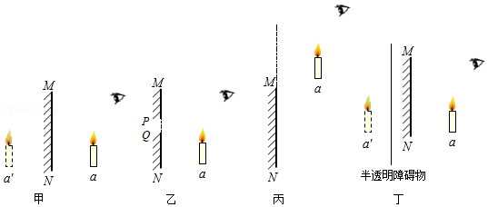

- A. 图甲中，随着蜡烛燃烧变短，像 \( {a}^{\text{'}}\)的大小仍保持不变
- B. 图乙中，将平面镜 \( MN\) 中间的 \( PQ\) 段去除，仍成像，但像\( {a}^{\text{'}}\)不完整
- C. 图丙中，该平面镜 \( MN\) 竖直向下移动一段距离，仍成像，且像\( {a}^{\text{'}}\)在原来位置
- D. 图丁中，在平面镜 \( MN\) 的镜后放置一半透明的障碍物，此时的像\( {a}^{\text{'}}\)变暗

【答案】C

【解析】​

## 3. 多选题（难度：适中）

如图所示是探究平面镜成像特点的实验装置. 下列说法中正确的是（    ）

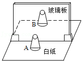

- A. 跳棋\( A\)靠近玻璃板时像的大小不变
- B. 跳棋\( A\)在玻璃板中所成的像是光的折射形成的虚像
- C. 物和像的连线与玻璃板垂直
- D. 把纸板放在玻璃板和跳棋\( B\)之间挡住\( B\)，从跳棋\( A\)这一侧看不到像

【答案】A/C

【解析】​

## 4. 填空题（难度：适中）

如图甲所示，是小明在水平桌面上探究“平面镜成像的特点”时的实验装置. 

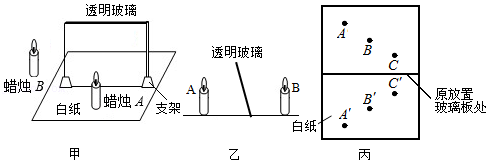
   
（1）用透明玻璃板代替平面镜进行实验的目的是. 为了能看到更清晰的像，应选择在较（选填“明亮”或“暗”）的环境中做实验. 
（2）在如图乙所示的玻璃板前放一支点燃的蜡烛\( A\)，可以看到玻璃板后面出现蜡烛\( A\)的像. 拿大小完全相同、未点燃的蜡烛\( B\)在玻璃板后面移动，人眼一直在玻璃板（选填“前面”或“后面”）观察，发现无法让\( B\)与\( A\)的像完全重合，原因是没有将玻璃板放置. 
（3）当蜡烛\( A\)远离玻璃板时，像的大小（选填“变大”、“变小”或”不变”）. 
（4）该实验用到了等效替代法，是用等效替代了（两空均选填“蜡烛\( A\)”、“蜡烛\( B\)”、“蜡烛\( A\)的像”、“蜡烛\( B\)的像”）. 
（5）实验中，看到点燃的蜡烛通过玻璃板成两个像，其中距离观察者较远的像较（选填“亮”或“暗”）. 
（6）图丙是他们经过三次实验后，在白纸上记录的像与物对应点的位置. 在没有刻度尺的情况下，他们下一步应该怎样处理这张“白纸”上的信息，得出像和物相对于平面镜的位置关系：.

【答案】便于确定像的位置，暗，前面，垂直桌面，不变，蜡烛$ B$  ，蜡烛$ A$的像  ，暗，沿玻璃板所在位置把纸对折，观察像点和对应的物点是否重合

【解析】​

## 5. （难度：适中）

如图所示. \( {O}^{\text{'}}\)是\( O\)在平面镜中成的像，在图中画出平面镜的位置，并画出线段\( AB\)在该平面镜中所成的像. 

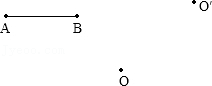

【答案】

    

【解析】​

## 6. 填空题（难度：简单）

正常眼睛观察物体的最佳距离为25cm，当用平面镜仔细观察自己的脸部时，应当把镜子拿到离眼睛cm处最为合适. 如图是人眼与鱼眼的结构示意图，我们观察发现：鱼眼晶状体的形状比人眼更加凸一些，如果人眼的晶状体像鱼这样，观察远处物体的像将成在视网膜的（填“前”或“后”）面，若要看清远处的物体，应该配戴（填“凹”或“凸”）透镜. 

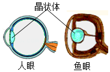

【答案】12.5，前，凹

【解析】​

## 7. 单选题（难度：简单）

小明站在竖直悬挂的平面镜前，逐渐靠近平面镜，他在镜中像的大小（　　）

- A. 不变
- B. 变大
- C. 变小
- D. 先变小后变大

【答案】A

【解析】物体在平面镜中成虚像，物像大小相等，当小明逐渐靠近平面镜时，人的大小不变，像的大小也不变。故BCD不符合题意，A符合题意。

## 8. 单选题（难度：适中）

物体在平面镜中像的大小取决于（　　）

- A. 平面镜的大小
- B. 平面镜的厚度
- C. 物体本身的大小
- D. 物体到平面镜的距离

【答案】C

【解析】平面镜成的像与物体等大，所以物体在平面镜中像的大小只取决于物体本身的大小，故C符合题意，ABD不符合题意。

## 9. 单选题（难度：适中）

夜晚，小林在明亮房间里，通过一面窗户玻璃看到了自己的像，而在晴朗的白天却看不见。对于此现象，他作出如下分析，正确的是（　　）

- A. 夜晚和白天，人都可以通过这面玻璃成像
- B. 射向这面玻璃的光，夜晚发生镜面反射，白天发生漫反射
- C. 白天，射向这面玻璃的光全部透过玻璃，没有反射
- D. 白天，人通过这面玻璃成的像更小

【答案】A

【解析】ACD．小林通过窗户成像，是平面镜成像现象，所以夜晚和白天都可能通过玻璃成像。白天、晚上射向玻璃的光都是部分透过，部分反射，而白天因环境光线太强，不易观察到玻璃中的像，据平面镜成像特点，白天、夜晚所成的像的大小应相同。故A正确，CD错误；
B．射向玻璃的光，无论白天夜晚都是发生镜面反射，故B错误。

## 10. 单选题（难度：简单）

我们通过平面镜看到物体的像是（　　）

- A. 倒立等大的实像
- B. 倒立缩小的实像
- C. 倒立放大的实像
- D. 正立等大的虚像

【答案】D

【解析】平面镜成像的特点是：物体在平面镜中所成的像是虚像，像和物体的大小相等，像和物体的连线垂直于镜面，像和物体到镜面的距离相等；简记为：正立、等大、对称、虚像。

## 11. 单选题（难度：适中）

南通濠河水位缓慢上涨时，河面上方的“和平桥”在水中所成的像是（　　）

- A. 实像，像的大小不变
- B. 实像，像的大小变大
- C. 虚像，像的大小不变
- D. 虚像，像的大小变大

【答案】C

【解析】“和平桥”在水中所成的像属于平面镜成像，是由光的反射形成的虚像，平面镜所成的像和物体大小相等，南通濠河水位缓慢上涨时，河面上方的“和平桥”在水中所成的像的大小不变，故C符合题意，ABD不符合题意。

## 12. 单选题（难度：简单）

某同学站在竖直放置的平面镜前1m处，他在镜中的像与他相距（　　）

- A. 0.5m
- B. 1m
- C. 2m
- D. 3m

【答案】C

【解析】平面镜成像规律：像是虚像，像与物到平面镜的距离相等、连线与镜面垂直、大小相等、左右相反，即像与物关于平面镜对称；因平面镜成像时物距与像距相等，此时站在竖直平面镜前1m处，物距为1m，所以像距也为1m，而镜中的像与他相距为物距与像距之和为2m。

## 13. 单选题（难度：适中）

如图所示，小红正在做“探究平面镜成像的特点”实验，棋子A、B完全相同关于该实验，下列说法中错误的是（　　）

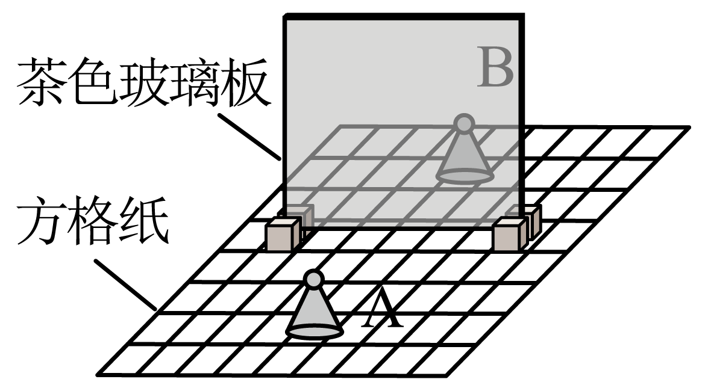

- A. 选用茶色玻璃板便于确定像的位置
- B. 茶色玻璃板应竖直放置在方格纸上
- C. 若B能与A的像完全重合，说明像与物等大
- D. 在B位置放上光屏能接收到A的像

【答案】D

【解析】A．因为玻璃板是透明的，所以能在观察到A像的同时，还可以透过玻璃清楚的看到放在后面B，便于确定像的位置，故A正确，不符合题意；
B．茶色玻璃板应竖直放置在方格纸上，因为玻璃板如果不垂直桌面，则像和物体不在同一水平面上，找像的位置时，像与棋子不能重合，故B正确，不符合题意；
C．两个完全相同棋子，大小相同，后面的棋子又和前面棋子的像完全重合，这样就证明了像与物大小相同，故C正确，不符合题意；
D．验证像的虚实时，将光屏放在像的位置上，眼睛从B处直接观察光屏，通过看到光屏上没有像的现象，可知平面镜所成的像是虚像，故D错误，符合题意。

## 14. 单选题

如图所示，平面镜M直立在水平地面上，长6cm的铅笔平放在地面上且与平面镜垂直，笔尖离平面镜10cm，现铅笔以2cm/s的速度垂直平面镜向它匀速靠近。则（　　）

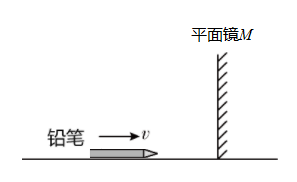

- A. 铅笔的像为虚像，且尖端朝右
- B. 笔尖的像移动速度大于笔尾的像移动速度
- C. 经过3s，笔尖的像与笔尾的像相距6cm
- D. 将M逆时针转动45°，铅笔的像竖直且尖端朝上

【答案】C

【解析】A．铅笔在平面镜中成虚像，且铅笔与像关于平面镜对称，故像的尖端朝左，故A错误；
B．铅笔是一个整体，整体的移动速度相同，故笔尖的像移动速度等于笔尾的像移动速度，故B错误；
C．移动过程中，铅笔的长度不变，则此时笔尖的像与笔尾的像仍相距6cm，故C正确；
D．将M逆时针转动45°，像与物体关于镜面对称,则此时铅笔的像是竖直且尖端朝下的，故D错误。

## 15. 单选题（难度：适中）

小明从平面镜里看到镜子对面电子钟示数的像如图所示，实际此时的时刻是（　　）

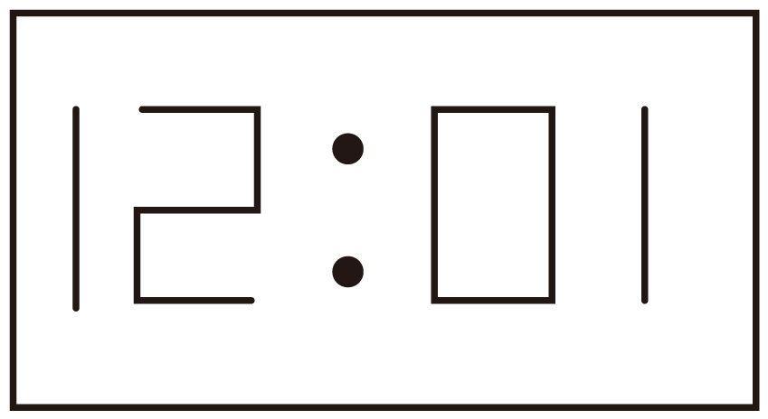

- A. 10：51
- B. 10：21
- C. 21：10
- D. 12：01

【答案】A

【解析】根据平面镜成像时像和物关于镜面对称可知，题中所显示的时刻与10:51成轴对称，所以此时实际时刻为10:51，故A符合题意，BCD不符合题意。

## 16. 单选题（难度：适中）

如图所示，检查视力时，视力表挂在被测者头部的后上方，被测者识别对面墙上镜子里的像。下列表述中正确的是（　　）

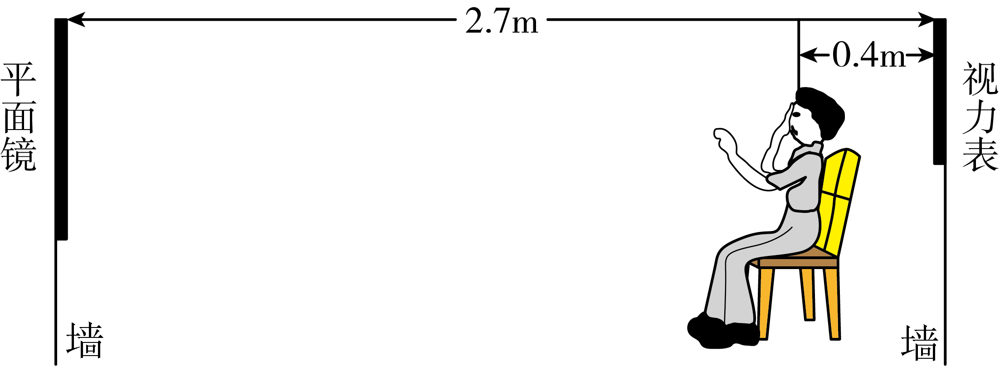

- A. 视力表在平面镜中所成的像能被我们看到，所以为实像
- B. 视力表在平面镜中的像与被测者相距5.4m
- C. 若被测者向平面镜靠近0.1m，则她在镜中的像将变大
- D. 若被测者看到“E”的像开口向上，则视力表上的该“E”开口向上

【答案】D

【解析】A．根据平面镜成像特点可知，视力表在平面镜中所成的像是虚像，故A错误；
B．视力表到平面镜的距离是2.7m，根据物像到平面镜的距离相等，所以视力表像到平面镜的距离也是2.7m，所以人到视力表像的距离
l=2.7m+2.7m-0.4m=5m
故B错误。
C．根据平面镜成像规律可知，像的大小与物的大小相等，若被测者向平面镜靠近0.1m，她在镜中的像大小不变，故C错误；
D．平面镜成像像和物关于镜面对称，故若被测者看到“E”的像开口向上，则视力表上的该“E”开口向上，故D正确。

## 17. 单选题（难度：适中）

2024年8月6日，在巴黎奥运会跳水女子比赛中，中国选手全红婵在亚运会上以425.60分夺得女子10m跳台冠军。如图所示，全红婵跳下去保持抱腿姿势的过程中，全红婵在水中的像（　　）

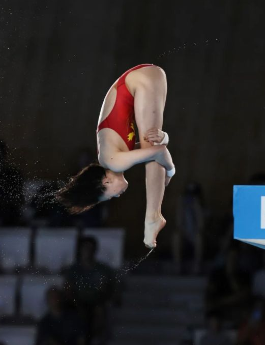

- A. 实像，且像与水面的距离变小
- B. 虚像，且像的大小不变
- C. 实像，且像与水面的距离变大
- D. 虚像，且像逐渐变大

【答案】B

【解析】全红婵在水中的像是光的反射所成的虚像，像与物体等大，则像的大小不变；全红婵跳下去保持抱腿姿势的过程中，物距变小，像距变小，则像与水面的距离变小，故B正确，ACD错误。

## 18. 单选题（难度：适中）

如图所示、两块垂直放置的平面镜前有个玩具狗，此时我们能看见其中一块平面镜中有它的两个像A、B，以图中左右为标准下列说法正确的是（　　）

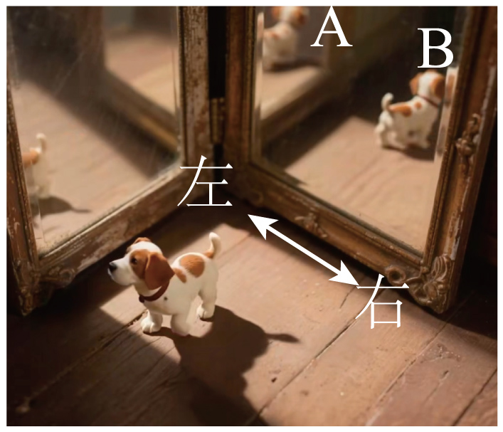

- A. 像A的大小比玩具狗的大，像B的大小与玩具狗的相等
- B. 像A的大小比玩具狗的大，像B的大小比玩具狗的小
- C. 若玩具狗从左向右运动，则像A从左向右运动，像B从左向右运动
- D. 若玩具狗从左向右运动．则像A从右向左运动，像B从左向右运动

【答案】D

【解析】AB．平面镜所成的像与物体的大小相同，所以像A和像B的大小与玩具狗一样大，故AB错误；
CD．像A是玩具狗在玩具狗左边镜子所成的像又在玩具狗前面镜子再次成像，所以像A的运动方向要根据玩具狗左边的镜子判断。平面镜所成的像与物体关于平面镜对称，物距等于像距，若玩具狗从左向右运动，根据平面镜与玩具狗的位置关系，像A远离平面镜从右向左运动，像B从左向右运动，故C错误，D正确。

## 19. 单选题（难度：适中）

测量视力时，利用平面镜成像特点可以节省空间。如图所示，让被测者对着镜子背对视力表，此人看到视力表的像离他的距离是（　　）

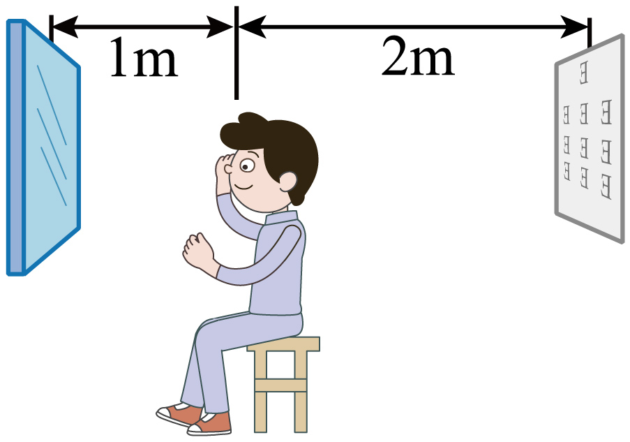

- A. 3m
- B. 4m
- C. 5m
- D. 6m

【答案】B

【解析】由图可知，视力表与平面镜的距离为
\(1\text{m}+2\text{m}=3\text{m}\) 
根据平面镜成像规律可知，此时视力表的像距平面镜的距离为3m，则此人看到视力表的像离他的距离是
\(3\text{m}+1\text{m}=4\text{m}\) 
故B符合题意，ACD不符合题意。

## 20. 单选题

如图，照镜子时人的位置保持不变，如果不小心镜子裂开成两半并分别向上下两侧平移一段距离，则人通过上、下两半面镜子（　　）

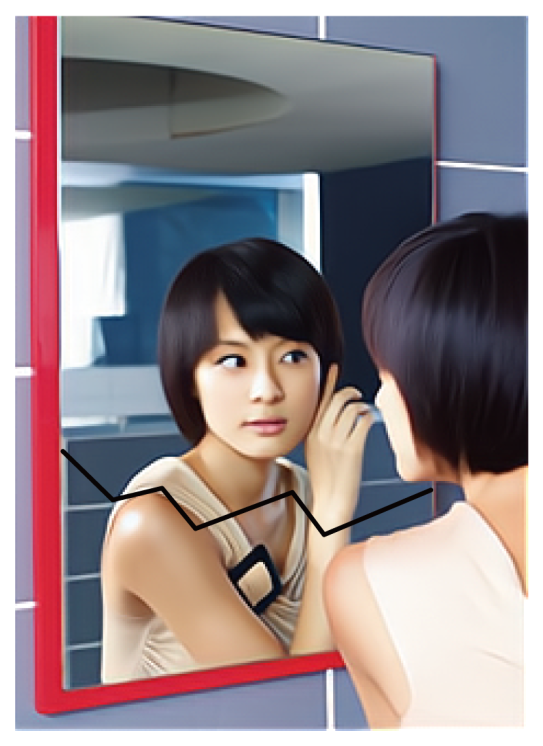

- A. 上、下两半面镜子都成完整的像，且两个像位置重合在原位置
- B. 上、下两半面镜子都成完整的像，且两个像位置重合，但不在原位置
- C. 上、下两半面镜子只能各成一半的像，且中间断开
- D. 上、下两半面镜子都成完整的像，但两个像位置并不重合

【答案】A

【解析】因为平面镜成像的特点是：像与物大小相等、到平面镜的距离相等、连线与镜面垂直、左右互换，即像、物关于平面镜对称；所以当镜子分开后，人在两个镜子中都成完整的像，且两个像重合在原位置。

## 21. 单选题（难度：适中）

如图所示，小明透过平面镜看到了蜡烛的像，下列有关平面镜成像描述正确的是（　　）

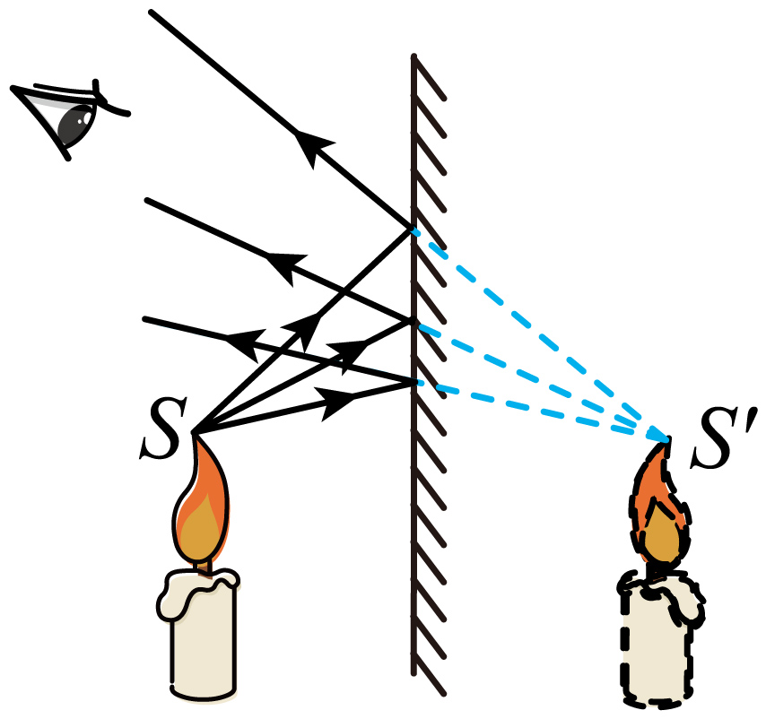

- A. 进入人眼的光是由蜡烛的像发出的
- B. 如果将平面镜竖直上移，则像随之上移
- C. 如果将图中的平面镜截掉一部分，则蜡烛仍能在剩余的平面镜中成完整的像
- D. 如果紧贴平面镜背面放置一块不透明挡板，则蜡烛在平面镜中无法成像

【答案】C

【解析】A．平面镜成虚像，虚像不会发出光线，故A不符合题意；
B．平面镜成像，像与物关于镜面对称，而物体不动，像就不动，故B不符合题意；
C．物体通过平面镜所成的像和物体大小相等，物体大小不变，则所成的像始终是完整的，故C符合题意；
D．平面镜成的像是光的反射形成的，被人眼接收，所以若紧贴平面镜背面放置一块和平面镜大小一样的不透明挡板，所以从前面看去仍能看到蜡烛的像，故D不符合题意。

## 22. 单选题

一块仪容镜如图甲所示，放在某学校走廊的AB处，仪容镜靠墙而立，镜面与墙壁平行，在另一面墙壁上的O处悬挂一电铃，如图乙所示。为了总能看到电铃通过仪容镜所成的像O′，小强同学沿着走廊的ae直线走动，若将人和电铃各自看作一个点，则小强同学所在的区间是（　　）

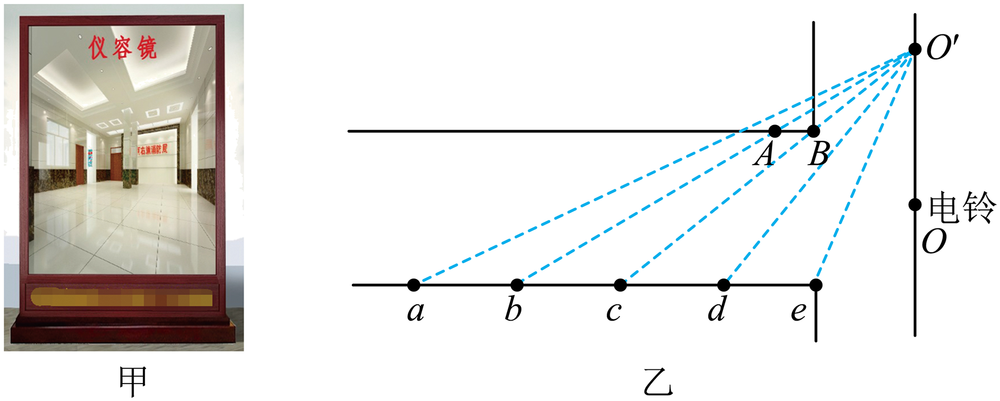

- A. ab
- B. bc
- C. cd
- D. de

【答案】B

【解析】电铃通过平面镜所成的像在O′，根据光沿直线传播，小强同学在的区间bc可看到电铃通过仪容镜所成的像。

## 23. 单选题（难度：适中）

一只白鹤静立在平静的水中，在岸边可以看到白鹤的两个“影”——影子和倒影，如图所示。下列分析正确的是（　　）

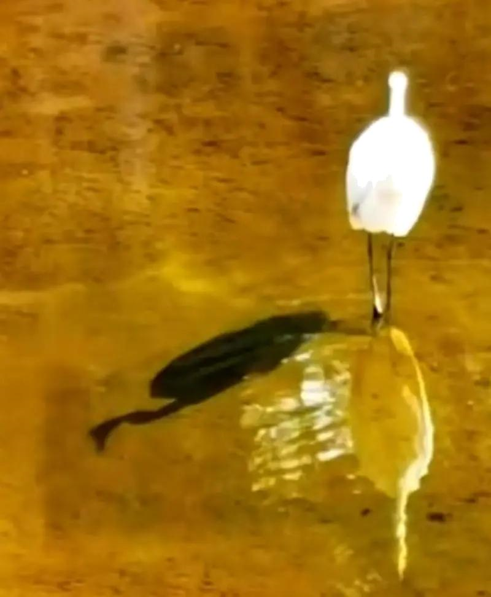

- A. 白鹤的影子是由于光的直线传播形成的
- B. 白鹤的倒影是由于光的折射形成的
- C. 白鹤飞离水面时，它的倒影会变小
- D. 白鹤在水中的倒影是实像

【答案】A

【解析】A．影子的形成是光的直线传播现象，故A正确；
BD．白鹤在水中的倒影是由光的反射形成的虚像，故BD错误；
C．白鹤在水中的倒影属于平面镜成像，像和物体大小相等，白鹤的大小不变，像的大小不变，即它的倒影不变，故C错误。

## 24. 单选题（难度：适中）

卢沟桥是华北最大的古代石拱桥，桥上石狮众多，卢沟晓月更是著名的“燕京八景”之一。如图所示，下列说法正确的是（　　）

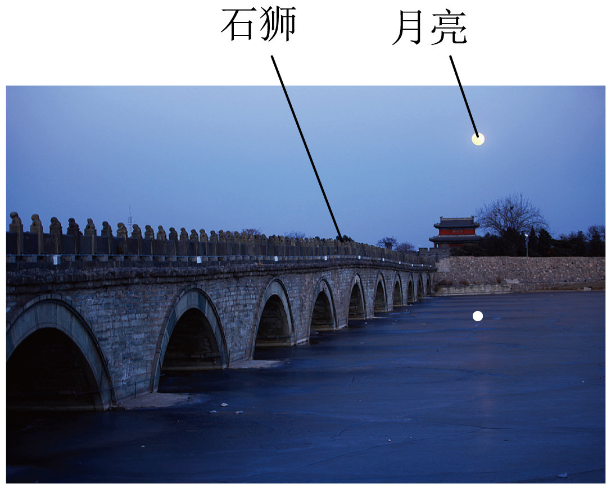

- A. 月亮在水中的倒影是实像
- B. 月亮在水中的像到水面的距离与月亮到水面的距离相等
- C. 如果水面上升，桥上的石狮在水中的像将变大
- D. 如果水面下降，桥孔与其倒影所组成的图形形状不会变化

【答案】B

【解析】A．因为水面相当于平面镜，平面镜成的像是虚像，月亮在水中的倒影属于平面镜成像，月亮在水中的倒影是虚像，故A错误；
B．平面镜成的像和物体到平面镜的距离相等，水中的月亮到水面的距离与天上的月亮到水面的距离相等，故B正确；
CD．平面镜成的像和物体大小相等，水面上升或水面下降，桥上的石狮在水中的像与物体大小相等，像大小将不变，桥孔与其倒影所组成的图形形状发生变化，故CD错误。

## 25. 单选题（难度：适中）

利用如图示的装置，探究平面镜成像的特点，下列说法错误的是（　　）

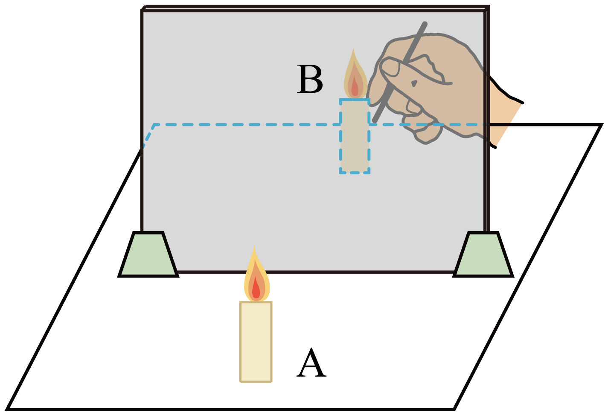

- A. 用玻璃板代替平面镜、成像更清晰
- B. 使用相同的蜡烛A、B，目的是比较像与物的大小
- C. 将蜡烛A远离玻璃板，它所成的像的大小不变
- D. 将光屏放到像的位置，光屏上不能承接到像

【答案】A

【解析】A．用透明的玻璃板代替平面镜，在蜡烛A一侧能看到蜡烛A的像，同时还能看到蜡烛B，便于确定像的位置；但由于光的折射，会减少进眼睛的反射光，看到的像清晰度会比用平面镜时差。故A错误，符合题意；
B．选择大小相同的蜡烛A、B，是为了比较像与物的大小关系，故B正确，不符合题意；
C．平面镜成的像和物体大小相等，因此若蜡烛A远离玻璃板，则蜡烛A的像大小不变，故C正确，不符合题意；
D．物体在平面镜中成虚像，将光屏放到像的位置，光屏上不能承接到像，故D正确，不符合题意。

## 26. 单选题（难度：适中）

物体AB直立于足够大的平面镜前，甲图中物体与平面镜之间插入一块不透光的木板CD；乙图中平面镜后面插入一块不透光的木板MN。则物体在甲、乙两图的平面镜中，能否成完整的像？（　　）

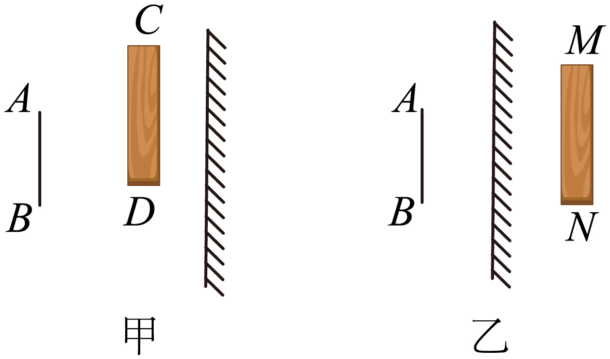

- A. 都能
- B. 都不能
- C. 甲图中不能，乙图中能
- D. 甲图中能，乙图中不能

【答案】A

【解析】先根据“物像关于平面镜对称”画出A、B 点在平面镜中成的像A'、B'；从A点反射的光线沿CD的最下边缘射到平面镜上， 根据反射角等于入射角画出反射光线，若这条反射光线的反向延长线能过像点A'，则AB能在平面镜内成完整的虚像A'B'。如图所示：

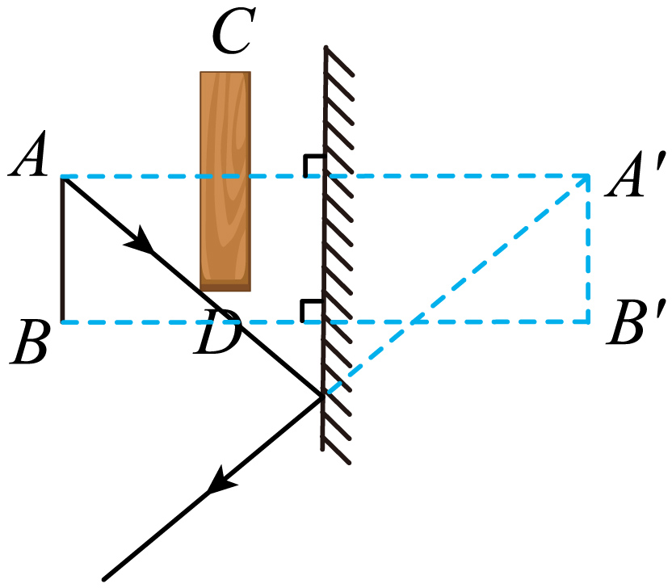
 
平面镜成的是虚像，像是反射光线的反向延长线会聚形成的，不是实际光线照到像点，所以乙图中镜子背面放什么物体都不会影响成像，并且根据物像关于平面镜对称，物体AB能在平面镜中成完整的像。故A符合题意，BCD不符合题意。

## 27. 单选题（难度：适中）

临沂市文化公园是我市一道亮丽的风景线。1.5m深的荷花池内，一只立于荷尖上的蜻蜓距水面0.6m（如图），蜻蜓在水中的像（　　）

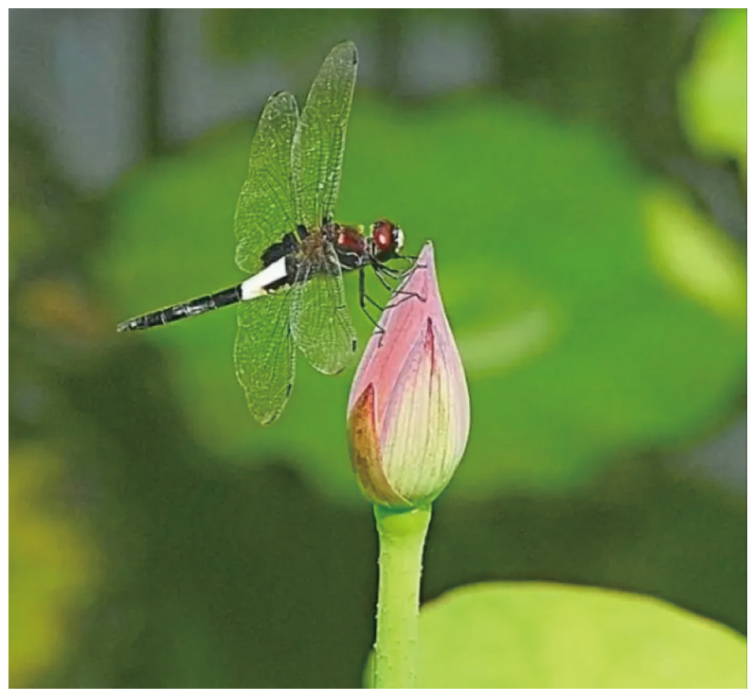

- A. 因光的折射而形成
- B. 是比蜻蜓略小的虚像
- C. 在水面下0.9m深处
- D. 与蜻蜓相距1.2m

【答案】D

【解析】A．蜻蜓在水中的像是平面镜成像，是光的反射，故A不符合题意；
B．蜻蜓在水中的像是平面镜成像，成的是等大的虚像，故B不符合题意；
C．蜻蜓在水中的像是平面镜成像，像到平面镜的距离等于物体到水面的距离等于0.6m，故C不符合题意；
D．蜻蜓在水中的像与蜻蜓相距
\(L\text{=}2\times 0.6\text{m=}1.2\text{m}\) 
故D符合题意。

## 28. 单选题

小华站在平面镜前

 m处，下列说法不正确的是（　　）

- A. 小华向前走，然后把手指压在玻璃镜面上，发现手指与像相距6mm，则镜面厚6mm
- B. 小华向着镜面以 m/s的速度移动\(1\) s后，像距她2m
- C. 晚间照镜子时，为了使像更清晰，可以用手电筒对准自己照射
- D. 如果平面镜打碎成两半，小华在平面镜中仍能成完整的像

【答案】A

【解析】A．当手指压在镜面上时，手指到反射面的距离为镜面厚度，设为d；根据“物距等于像距”，像到反射面的距离也为d。因此手指与像的距离应为2d。根据题，若手指与像相距\(6\text{mm}\) ，则镜面厚度为\(3\text{mm}\) ，故A错误，符合题意；
B．小华一开始距镜面2m，以

 的速度向镜面移动1s，移动距离为1m，此时她距镜面的距离变为\(2\text{m}-1\text{m}=1\text{m}\) 。根据“物距等于像距”，则像距镜面也为1m，因此小华与像的距离为\(1\text{m}+1\text{m}=2\text{m}\) ，故B正确，不符合题意；
C．晚间环境较暗，小华自身反射的光少，经镜面反射进入人眼的光也少，所以像不清晰；用手电筒对自己照射，使小华身体反射更多光。从而镜面反射后，进入人眼的光增加，像更清晰，故C正确，不符合题意；
D．平面镜成像的完整性取决于镜面能否反射物体各部分的光，与镜面是否完整无关，故D正确，不符合题意。

## 29. 单选题（难度：适中）

如图所示，飞天航天服有两个特别的设计：手腕上的小镜子和胸前反印的汉字。航天员穿上舱外航天服后，在头盔里看不到航天服上的按钮及汉字。工程人员想了个办法：在手腕处安装了小镜子，来看衣服上的字和准确操作按钮。以下说法正确的是（　　）

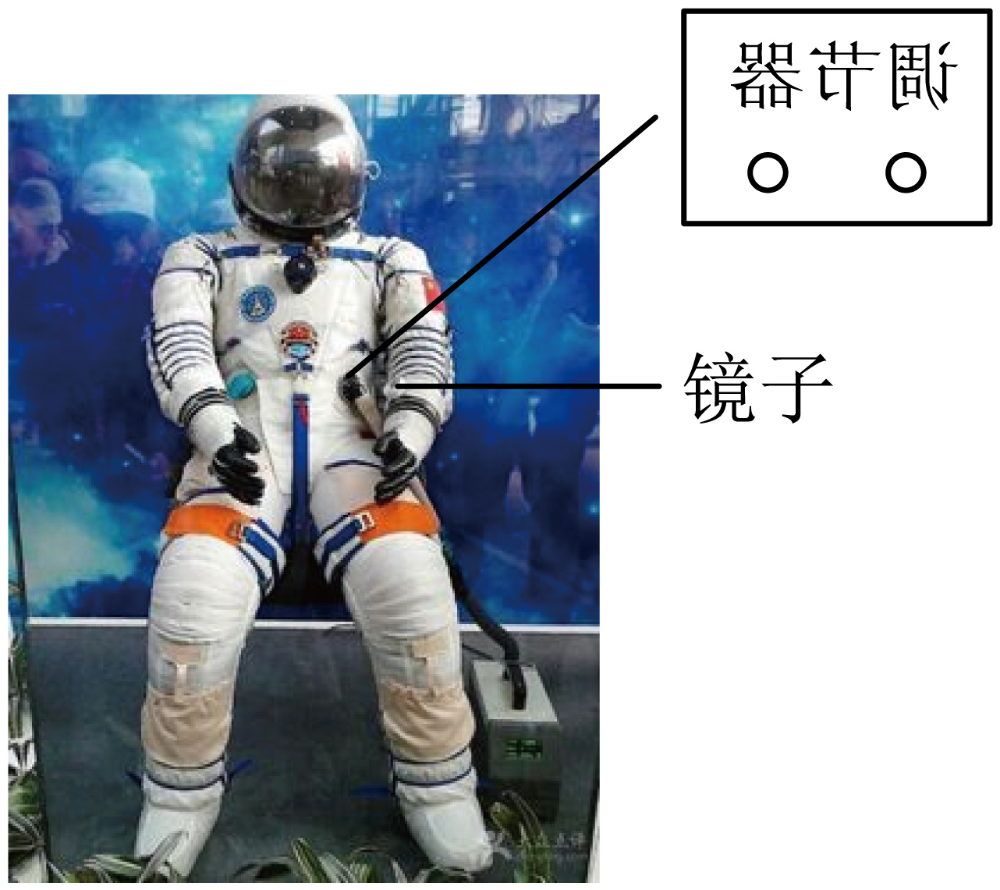

- A. 汉字通过镜子所成的是实像
- B. 航天服胸前的字与它的像关于镜面对称
- C. 当镜子靠近汉字时，汉字通过镜子成的像会变大
- D. 当镜子靠近汉字时，汉字到镜子的距离小于像到镜子的距离

【答案】B

【解析】A．由于是平面镜成像，故成的是虚像，故A错误；
B．根据平面镜成像特点，像与物体关于平面镜对称，则航天服胸前的字与它的像关于镜面对称，故B正确；
C．根据平面镜成像特点，像与物体等大，当镜子靠近汉字时，汉子的大小不变，则汉字通过镜子成的像的大小不变，故C错误；
D．根据平面镜成像特点，像与物体到平面镜的距离相等，当镜子靠近汉字时，汉字到镜子的距离等于像到镜子的距离，故D错误。

## 30. 单选题（难度：适中）

如图是横跨在苏州护城河上的吴门桥，它是江苏省最大的一座单孔石桥。以下说法正确的是（　　）

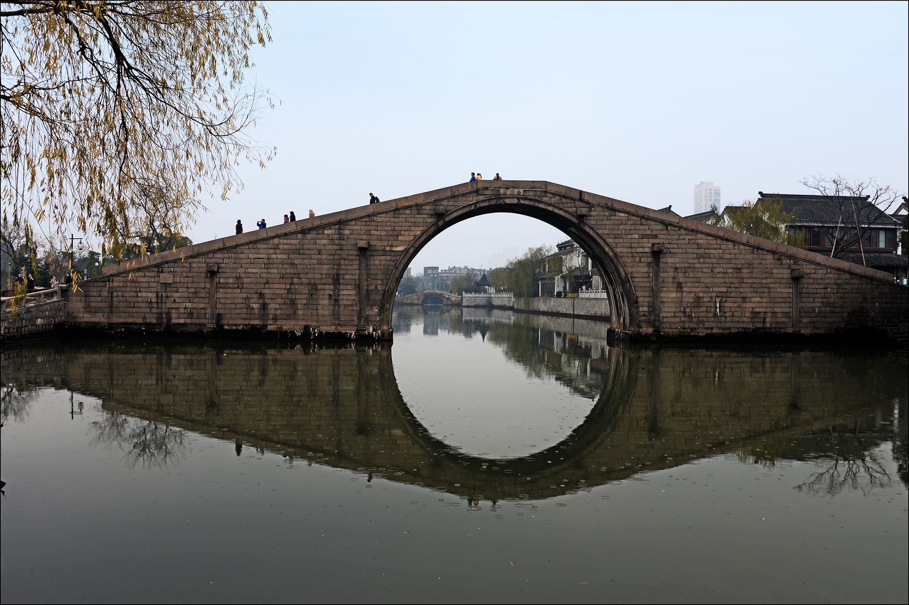

- A. 桥在水中的倒影是虚像
- B. 河水上涨，桥顶与其像的距离变大
- C. 桥在水中的倒影是光的折射形成的
- D. 河水上涨，桥顶与其像的距离不变

【答案】A

【解析】AC．桥在水中的倒影是光的反射形成的等大的虚像，故A正确，C错误；
BD．河水上涨后，桥顶到水面的距离减小，即物距减小，则根据平面镜成像特点可知，像距减小，即像到水面的距离减小，则桥顶到像的距离变小，故BD错误。

## 31. 单选题（难度：适中）

下列是平面镜成像特点及其应用，其中说法错误的是（　　）

- A. 平面镜所成的是虚像
- B. 医生为病人检查牙齿时，放在口腔中的内窥镜是平面镜
- C. 物体远离平面镜时，像会变小
- D. 用两块平面镜可以制成一个简易的潜望镜

【答案】C

【解析】A．据平面镜成像的特点可知，平面镜所成的是等大的虚像，故A正确，不符合题意；
B．医生为病人检查牙齿时，放在口腔中的内窥镜是平面镜，用于成像，故B正确，不符合题意；
C．平面镜成的像和物体大小相等，物体远离平面镜时，像大小不变，故C错误，符合题意；
D．潜望镜利用了平面镜成像的知识，用两块平面镜可以制成一个简易的潜望镜，故D正确，不符合题意。

## 32. 填空题（难度：适中）

如图所示，夜晚，小华通过可左右推拉的竖直窗户玻璃观察发光吊灯的像和自己的像。增大吊灯的亮度，观察到吊灯的像更。小华靠近玻璃窗观察，她像的大小，她与像之间的距离。向右推动玻璃窗，吊灯像的位置。（本题后3空填变化情况）

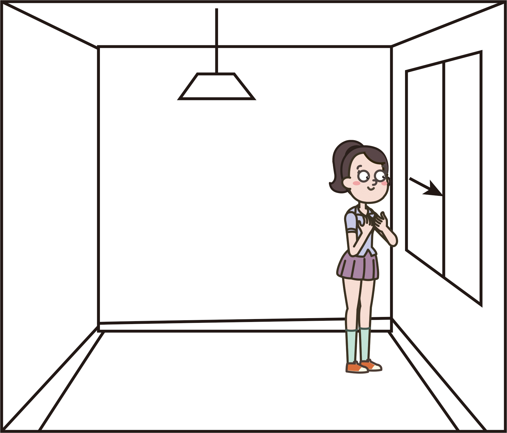

【答案】清晰，不变，变小，不变

【解析】[1]吊灯是光源，夜晚，光源越亮，与周围的环境对比度越大，因此吊灯的像会更清晰。
[2][3][4]根据平面镜成像特点可知，平面镜所成的像与物大小相等，像与物关于平面镜对称；像与物到平面镜的距离相等。因此小华靠近玻璃窗观察，她像的大小不变，她与玻璃窗之间的距离减小，因此她与像之间的距离减小，向右推动玻璃窗，因吊灯位置不变，因此吊灯像的位置也不变。

## 33. 单选题（难度：适中）

如图教室外突然下雨，小明在水平向左关闭玻璃窗时，在玻璃窗上观察到自己的像，以下说法正确的是（　　）

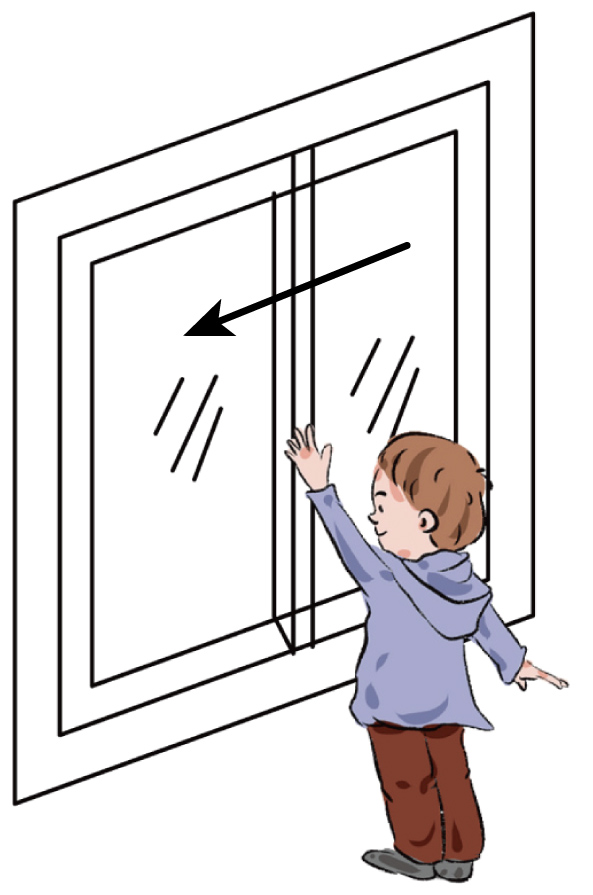

- A. 这是光沿直线传播形成的
- B. 关窗前，两扇窗都成像完整
- C. 关窗时，镜中像逐渐变大
- D. 向左关窗时，他的像在向左移动

【答案】B

【解析】A．他看到的像属于平面镜成像，是由于光的反射形成的，故A错误；
B．关窗前，小明到两扇窗的距离不同，两扇窗都能反射光成像，两扇窗都成像完整。故B正确；
C．关窗时，人在窗玻璃上成像是光的反射成像，所成像的大小只与物体的大小有关，小明的大小不变，所成像的大小不变。故C错误；
D．平面镜成像时，像和物体关于镜面对称，他向左推动玻璃窗，玻璃位置仍在原来所在对称面上，像的位置不变，故D错误。

## 34. 单选题（难度：适中）

如图中是物体在平面镜中成像的情况，正确的是（　　）

- A. 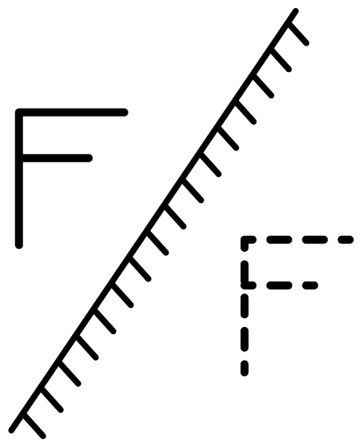
- B. 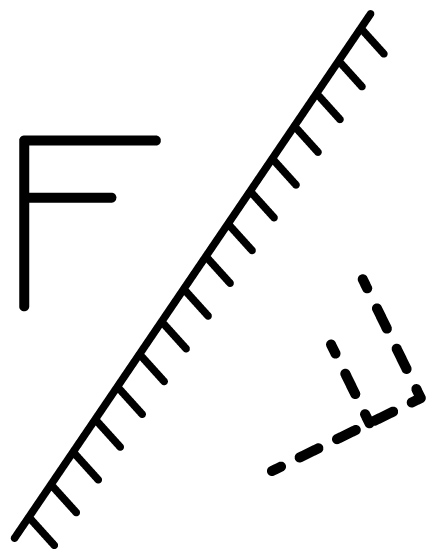
- C. 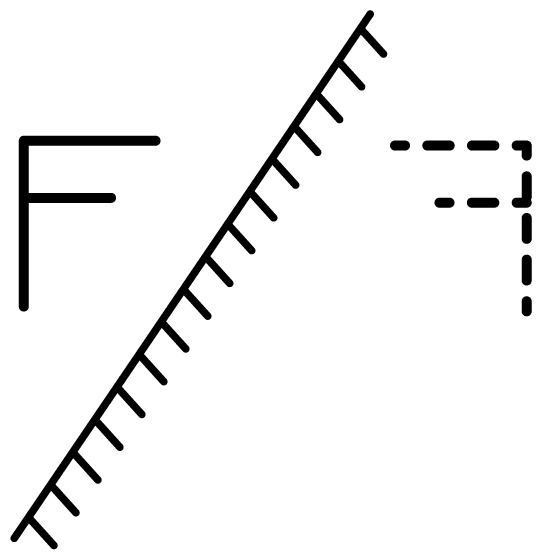
- D. 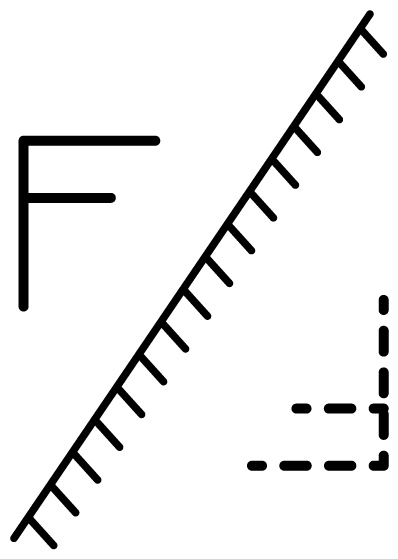

【答案】B

【解析】平面镜成的像与物体等大，又关于镜面对称，所以物体成的像看起来是左右相反的。
A．选项中像与物体左右相同，物像不是关于镜面对称，故A不符合题意；
B．选项中物体与像大小相等，像与物关于镜面对称，故B符合题意；
C．选项中物体与像不是关于平面镜对称，故C不符合题意；
D．选项中像相对于物是倒立的，像与物关于平面镜不是对称的，故D不符合题意。

## 35. 单选题（难度：适中）

体检时测试者与视力表距离一般为5m，但测试房间只有3m。如图所示，视力表挂在距离平面镜3m的对面墙上测试者通过看平面镜中的像进行测试。测试者距离平面镜应为（　　）

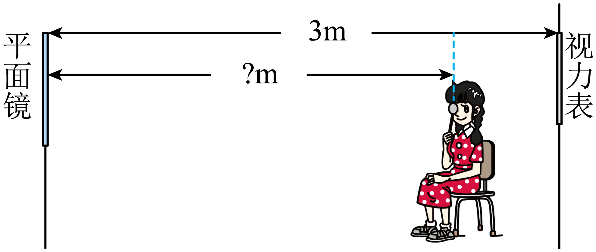

- A. 1m
- B. 2m
- C. 3m
- D. 5m

【答案】B

【解析】视力表距离平面镜3m，根据平面镜成像特点，视力表的像到平面镜的距离是3m，视力表和视力表的像之间的距离是6m，检查视力时眼睛离视力表的像距离是5m，所以人站在平面镜和视力表之间，那么人到镜子的距离应为2m，故B符合题意，ACD不符合题意。

## 36. 填空题（难度：适中）

如图所示，天津永乐桥上直径为110m的摩天轮，有着“天津之眼”的美誉，它与水中的倒影相映成趣。倒影的形成是由于光的，倒影中“摩天轮”的直径110m（选填“大于”“小于”或“等于”）。

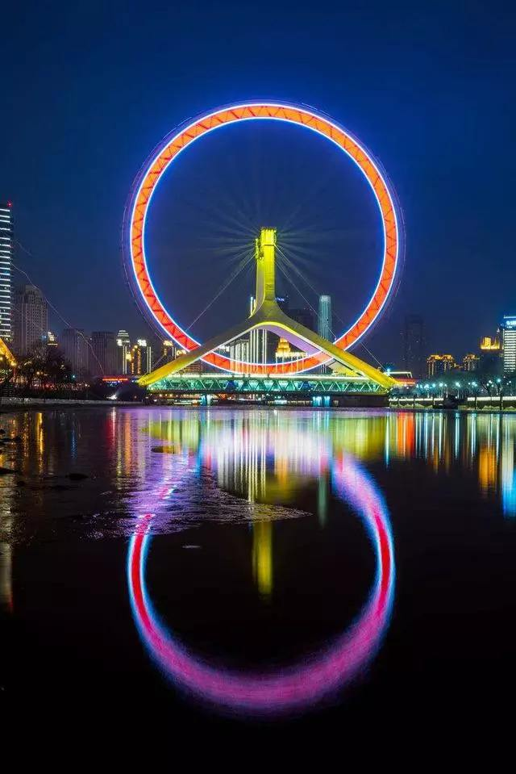

【答案】反射，等于

【解析】[1]摩天轮在水中形成的倒影属平面镜成像，平面镜成像是由于光的反射形成的。
[2]根据平面镜成像的特点，平面镜所成的像的大小与物体的大小相等，所以倒影中“摩天轮”的直径等于摩天轮的直径110m。

## 37. 多选题

如图，商场某鞋店里有一块放置在地面上的试鞋镜，它的镜面是倾斜的。下列说法正确的是（　　）

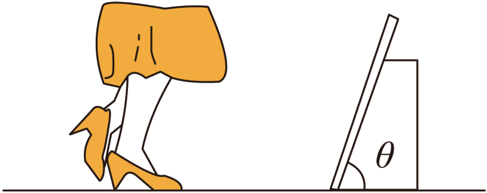

- A. 能从不同方向看到试鞋镜是因为光发生了漫反射
- B. 该试鞋镜较小，人通过该试鞋镜不能成完整的像
- C. 当人远离试鞋镜时，鞋子在试鞋镜中的像将变小
- D. 若通过试鞋镜不能看到自己的鞋，则应向试鞋镜靠近

【答案】A/D

【解析】A．能从不同方向看到试鞋镜，是因为试鞋镜表面（包括边框等）发生了漫反射。漫反射的特点是反射光线向各个方向散射，所以能从不同角度看到物体，故A正确；
B．平面镜成像时，像的大小与物体大小相等。故能成完整的像。但有时人不能看到完整的像。故B错误；
C．平面镜成像时，像与物体大小相等，人远离试鞋镜时，鞋子的像大小不变，故C错误；
D．如图，如果看不到鞋，说明眼睛与鞋的像连线没有过镜面，靠近试鞋镜可能让反射光线进入眼睛，看到像。故D正确。

## 38. 单选题（难度：适中）

对于生活中常见的光现象的分析，下面说法中错误的是（　　）

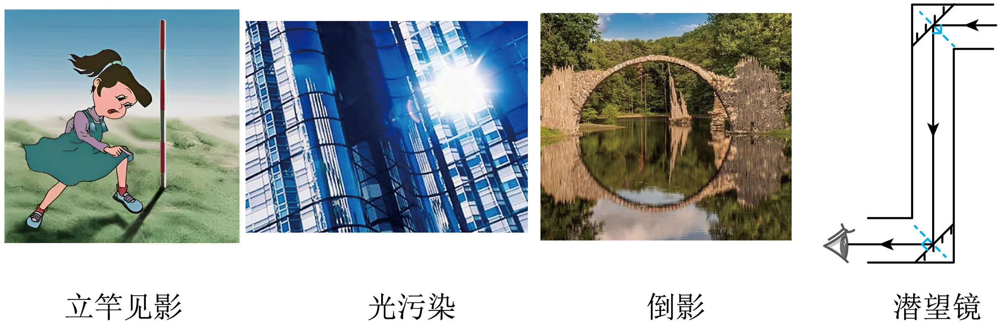

- A. “立竿见影”可以用“光沿直线传播”的知识来解释
- B. 从本质上看，光污染是由于光发生镜面反射造成的
- C. “倒影”实际上是由于光发生镜面反射形成的虚像
- D. 人眼从潜望镜中看水面上的舰艇时，看到的是实像

【答案】D

【解析】A．立竿见影是指竿遮挡住了光线，形成了竿的影子，属于光的直线传播现象，故A正确，不符合题意；
B．平行光线入射到平而光滑的反射面上，反射光线还是平行射出，叫做镜面反射，其反射光线很强，照到物体上会给人们的生活工作等造成很大的不便，因此光污染是由于光发生镜面反射造成的，故B正确，不符合题意；
C．湖面相当于平面镜，“倒影”实际上是由于光发生镜面反射形成的虚像，故C正确，不符合题意；
D．潜望镜中看到的景物的像，属于平面镜成像，是由于光的反射形成的虚像，故D错误，符合题意。

## 39. 填空题（难度：适中）

如图所示是光线射到空气和玻璃界面上发生反射和折射的光路图，则___是空气和玻璃的交界面，界面的右侧为___（选填“空气”或“玻璃”），入射角为___。

## 40. 多选题（难度：适中）

在探究平面镜成像特点的实验中，下列说法与事实相符的是（　　）

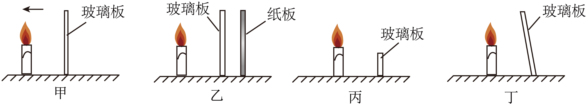

- A. 如图甲，当蜡烛远离玻璃板时，像的大小不变
- B. 如图乙，在玻璃板后竖直放置一纸板，人在任何位置都看不到像
- C. 如图丙，若玻璃板的高度为蜡烛高度的一半，像的高度也为蜡烛高度的一半
- D. 如图丁，若玻璃板与水平桌面不垂直，像仍与蜡烛关于玻璃板对称

【答案】A/D

【解析】A．根据平面镜成像规律可知，像和物的大小相等，当蜡烛远离玻璃板时，像的大小不变，故A符合题意；
B．平面镜成像是从物体发出的光线被平面镜反射进入人眼中所成的虚像，在玻璃板后竖直放置一纸板，不影响虚像的形成，在蜡烛一侧仍然可以看到像，故B不符合题意；
C．根据平面镜成像规律可知，像和物的大小相等，若玻璃板的高度为蜡烛高度的一半，像的高度仍然等于蜡烛的高度，故C不符合题意；
D．根据平面镜成像规律可知，像与物关于平面镜对称，即使玻璃板与水平桌面不垂直，像仍与蜡烛关于玻璃板对称，故D符合题意。

## 41. 填空题（难度：适中）

2024年1月，国家一级保护野生动物东方白鹳出现在广东海丰鸟类省级自然保护区。如图所示，水中的“东方白鹳”是由于光的___形成的___像；当东方白鹳飞离水面时，像的大小___（选填“变大”“变小”或“不变”）。

## 42. 填空题（难度：适中）

如图所示，竖直放置的平面镜能绕水平轴MN转动，小明站在平面镜正前方，他在镜中成的是 （选填“实”或“虚”）像；小明垂直镜面移动8cm，他与像的距离改变 cm；为了让他站着就能看到镜中脚的像，可以让平面镜绕轴沿 时针方向转动。

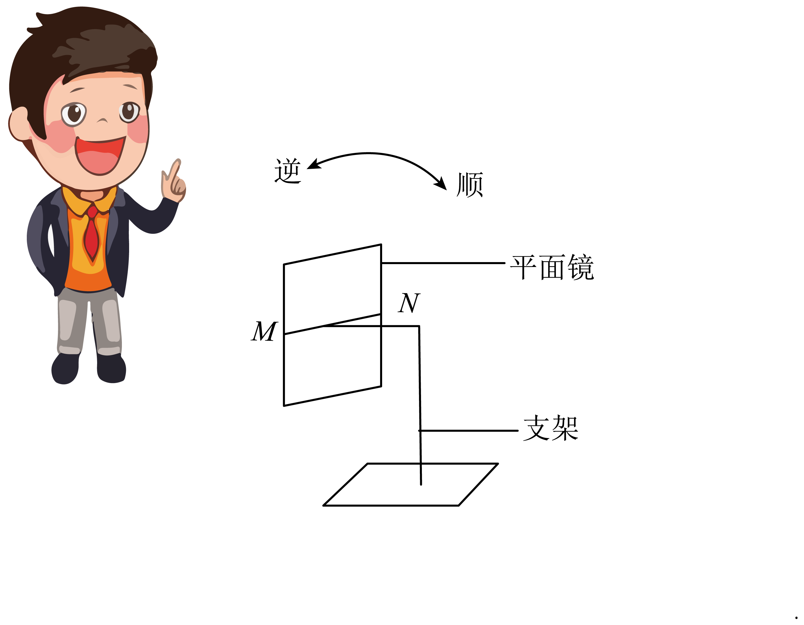

【答案】虚，16，顺

【解析】[1]据平面镜所成像的特点可知，平面镜所成的像是虚像，所以小明同学在镜中的像是虚像。
[2]小明垂直镜面移动8cm，由于像到平面镜的距离等于物到平面镜的距离，所以小明镜中的像也垂直镜面移动8cm，那么他与像的距离改变值为
8cm+8cm=16cm
[3]为了让他站着就能看到镜中脚的像，即让脚反射出来的光线经平面镜反射后能够射入人的眼睛，所以应让平面镜倾斜一些，绕轴沿顺时针方向转动。

## 43. 填空题（难度：适中）

小明照镜子时，看到镜中自己的像，这个像有什么特点呢？为此他进行了实验探究。 实验思路：（1）探究平面镜成像的特点，关键是要确定像的位置和大小；（2）可选用___作为平面镜观察像，先将点燃的蜡烛置于镜前，再用一支外形相同未点燃的蜡烛在镜后移动，通过是否与像重合来确定像的位置和大小，进而得到平面镜成像的特点；实验过程：（3）按照实验思路进行操作，观察蜡烛与像完全重合后，在纸上分别标记平面镜、蜡烛和像的

## 44. 填空题（难度：适中）

某小组的同学用如图甲所示器材完成了“探究平面镜成像的特点”的实验。

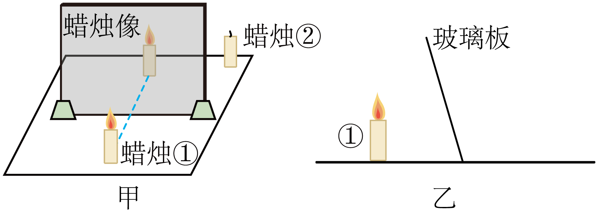
　　 
（1）实验中用薄玻璃板代替平面镜目的是：便于确定像的；
（2）实验中应选择与蜡烛①外形相同且（选填“已点燃”或“未点燃”）的蜡烛②，移动蜡烛②发现其恰好能与蜡烛①的像完全重合，说明像与物；
（3）将蜡烛①远离玻璃板，像的大小将（选填“变大”、“变小”或“不变”）；
（4）如图乙，将玻璃板倾斜，蜡烛①的像将（选填“仍然”或“不再”）与蜡烛①关于镜面对称。

【答案】位置，未点燃，大小相同，不变，仍然

【解析】（1）[1]实验中用玻璃板代替平面镜，玻璃板透光，能够成像，为了便于确定像的位置。
（2）[2][3]运用等效替代法用大小相同的两根蜡烛，点燃一根蜡烛再用未点燃蜡烛与点燃蜡烛的像重合，若能够完全重合，说明平面镜成像中，物像大小相等。
（3）[4]根据平面镜成像特点可知，物像大小相等，将蜡烛①远离玻璃板，蜡烛①的大小不变，则所成像的大小不变。
（4）[5]由平面镜成像原理可知，物与像关于平面镜对称，所以将玻璃板倾斜，蜡烛①的像将仍然与蜡烛①关于镜面对称。

## 45. 填空题（难度：适中）

小华探究“平面镜成像特点”。

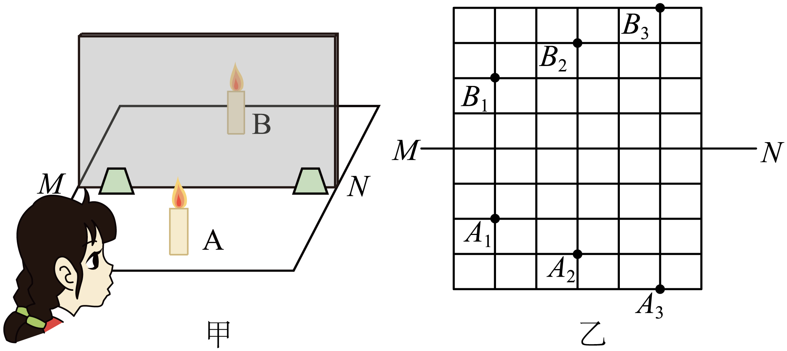
 
（1）实验装置如图甲所示，为顺利完成实验，MN应选择（透明玻璃板/平面镜），并将其放置在水平桌面上；
（2）将点燃的蜡烛A放置在MN前面，将外形相同、没有点燃的蜡烛B在MN后面移动，直至与A的像完全重合，重合现象说明。此时，蜡烛B所处的位置即为像的位置；
（3）改变蜡烛A的位置，重复步骤（2），可得三组像与物的位置，如图乙所示，由此可知平面镜成像时，；
（4）为判断平面镜成像的虚实，用光屏替代蜡烛B，然后（直接/隔着MN）观察光屏上有无像，根据实验现象可得平面镜所成的像是像。

【答案】透明玻璃板，竖直，像与物大小相等，见解析，直接，虚

【解析】（1）[1]在探究平面镜成像特点的实验中，为了方便确定像的位置，应用透明玻璃板代替平面镜，因为玻璃板是透明的，直接通过玻璃板既可观察到成像情况，又可以看到玻璃板后面的蜡烛B，便于确定像的位置。
[2]透明玻璃板应竖直放置在水平桌面上，以确保物体和像都在水平桌面上。
（2）[3]蜡烛B与A外形相同，B与A的像完全重合，说明B与A的像大小相等，则A的像与A大小相等，所以在平面镜成像中，像与物的大小相等。
（3）[4]图乙中，测量每组对应的A及其像与镜面距离，可得：在平面镜成像时，像与物体到镜面的距离相等。
（4）[5]平面镜成像是光的反射形成的，隔着MN观察时，有反射光线进入眼睛，仍能观察到像，所以应直接观察光屏上有无像。
[6]实像是实际光线会聚而成的，在光屏上能呈现，虚像不是实际光线会聚而成的，不能在光屏上呈现，直接在光屏上观察不能看到平面镜所成的像，说明平面镜所成的像是虚像。

## 46. 填空题（难度：适中）

如图所示，每年冬天从北方迁徙而来的红嘴鸥都会来到重庆的两江四岸栖息停留。一只红嘴鸥在距水面10m处，以1.5m/s的速度竖直向下靠近平静的水面，江水深50m，则2s后它在湖水中的像到湖面的距离为___m，该过程红嘴鸥的像的大小将 ___（选填“变大”、“变小”或“不变”）。

## 47. （难度：适中）

如图所示，\(M\) 为平面镜，\(S\) 为光源。请作出\(S\) 发出的光经平面镜反射后通过\(A\) 点的光路图（保留作图痕迹）。

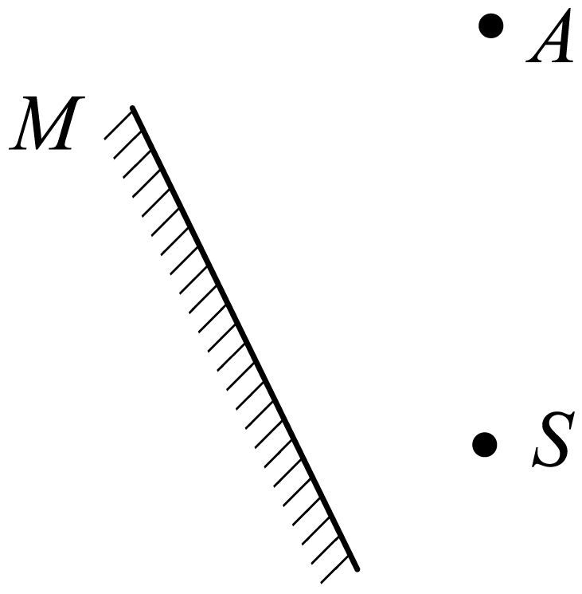

【答案】

【解析】先通过平面镜作出发光点S的对称点S′（即为像点），连接S′A与平面镜相交于点O，则OA为反射光线，连接SO，则SO为入射光线，如图所示：

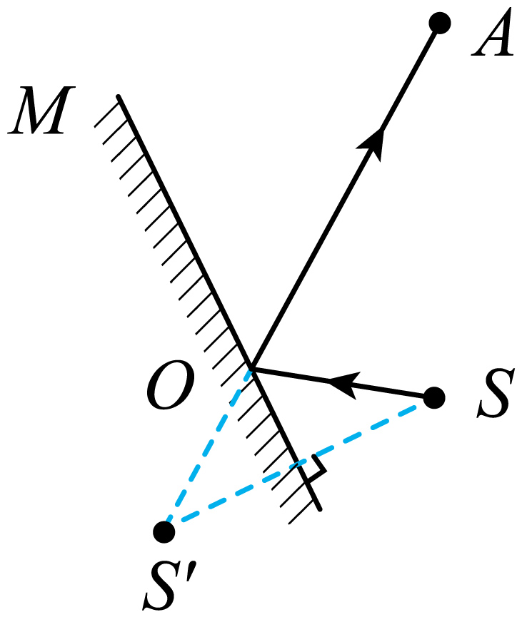

## 48. 填空题（难度：适中）

敬老爱亲的小明跟奶奶拉呱时，发现奶奶一直认为“人离平面镜越近，人在镜中的像越大”，为了纠正奶奶的错误认知，小明做了如下实验。 （1）如图所示，将白纸平铺在水平桌面上，用支架把玻璃板架在白纸上，并让玻璃板与纸面___；（2）将两支相同的蜡烛A和B分别竖放在玻璃板前后，点燃蜡烛___（选填“A”或“B”），并移动蜡烛B，直至与蜡烛A的像重合；（3）为了纠正奶奶的错误认知，小明多次改变蜡烛A的位置时，需

## 49. （难度：适中）

如图所示是光源S发出的两条光线经平面镜反射后的两条反射光线，请利用平面镜成像特点确定光源位置，并完成光路图。

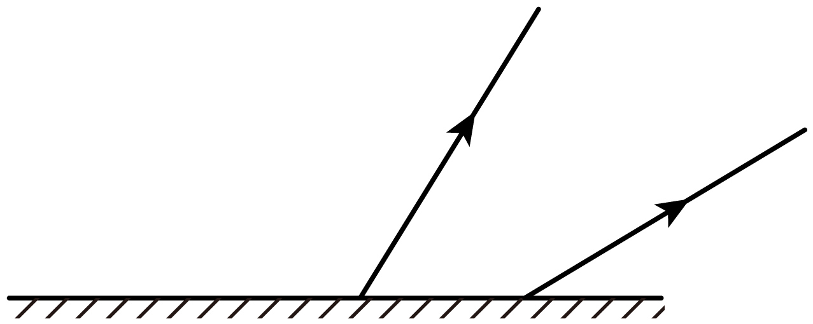

【答案】

【解析】画出两条反射光线反向延长线，交点为S′，再作出S′关于平面镜的对称点S，S即为光源位置，如图所示：

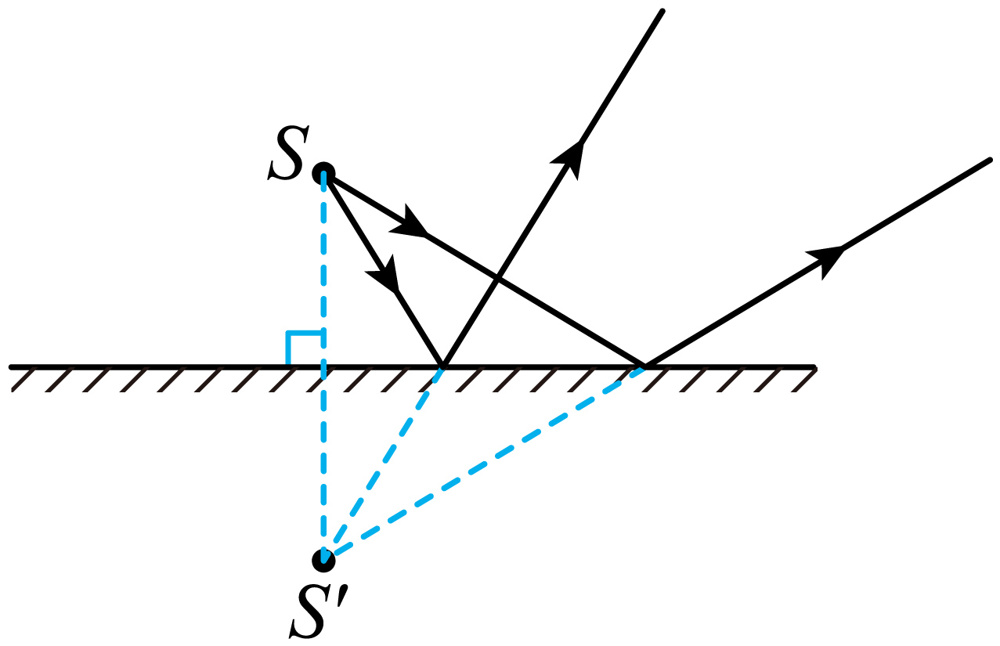

## 50. （难度：适中）

如图B点为牙齿的位置，请画出牙医在A点通过平面镜看到这颗牙齿的光路图。

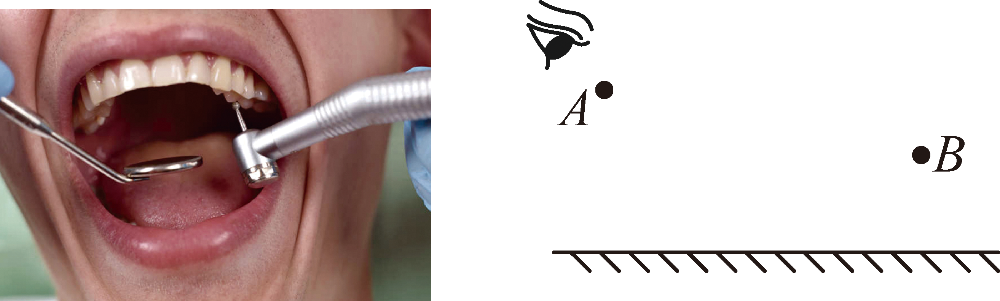

【答案】

【解析】我们看到的是牙齿B的像，是因为牙齿反射的光经平面镜反射后进入人眼，所以光路的起点是B，经镜面反射后到A。因此我们应该：
①找像点：根据平面镜成像特点，像与物关于镜面对称，作出B点在平面镜中的像点C。 
②连像眼：连接像点C与观察点A，这条线与平面镜的交点即为入射点O。
③画光线：从B点向入射点O画出入射光线，从入射点O向A点画出反射光线。
如图所示：

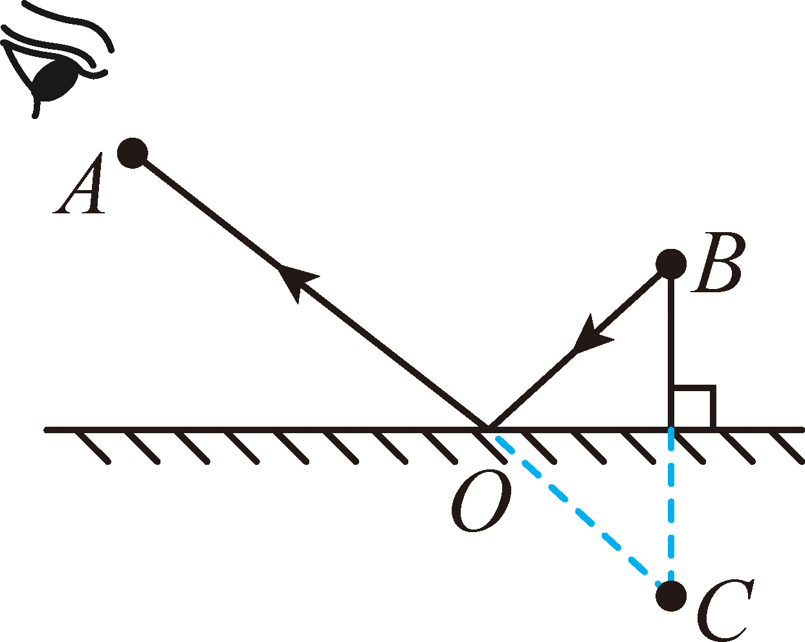

## 51. （难度：适中）

产品设计除了美观实用，也要特别关注安全性，小型汽车的前挡风玻璃为什么要倾斜设计？请说明理由。

【答案】

根据平面镜成像的特点，像与物关于平面镜对称，当汽车前挡风玻璃竖直时，车内物体经玻璃反射形成的像会出现在玻璃正前方的路面上，与实际路面的物体重合，容易让驾驶员产生混淆，影响行车安全。而倾斜设计时，车内物体的像会成在玻璃的上方，不会与路面的实际物体重合，从而避免了这种干扰，保障了驾驶安全。

## 52. （难度：适中）

如图甲所示，是小明在水平桌面上探究“平面镜成像的特点”时的实验装置。

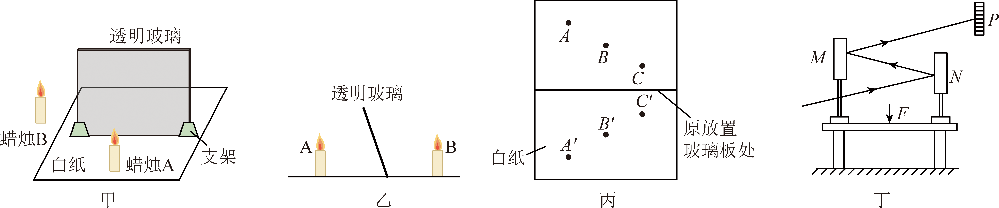

用透明玻璃板代替平面镜进行实验的目的是便于确定。为了能看到更清晰的像，应选择在较（选填“明亮”或“暗”）的环境中做实验；

在如图乙所示的玻璃板前放一支点燃的蜡烛A，可以看到玻璃板后面出现蜡烛A的像。拿大小完全相同、未点燃的蜡烛B在玻璃板后面移动，由于平面镜成的是（虚/实）像，所以人眼要一直在玻璃板（选填“前面”或“后面”）观察，发现无法让B与A的像完全重合，原因是没有将玻璃板放置。此时的蜡烛A的像在蜡烛B的方（选填“上”或“下”）；

该实验用到了等效替代法，在探究像与物到镜面的关系时，是用等效替代了（两空均选填“蜡烛A”、“蜡烛B”、“蜡烛A的像”、“蜡烛B的像”）；

图丙是他们经过三次实验后，在白纸上记录的像与物对应点的位置。他们把白纸沿着中间直线对折，发现物点和对应的像点刚好重合，得出像和物关于平面镜；

实验中，若玻璃板较厚，可能看到点燃的蜡烛通过玻璃板成两个像，则其中距离观察者较远的像较（选填“亮”或“暗”）；

如丁图利用平面镜可以把微小形变“放大”，在箭头所指处用力向下压桌面，使桌面发生形变时，光点就会在刻度尺上出现明显的移动，在图中，刻度尺上光点将会向（“上”、“下”）移动，这种实验方法是。

【答案】像的位置/暗，虚/前面/竖直/上，蜡烛B/蜡烛A的像，对称，暗，下/转换法

【解析】[1]用透明玻璃板代替平面镜进行实验的目的是，在观察到蜡烛A的像的同时，也能观察到蜡烛B，便于确定了像的位置。
[2]为了能看到更清晰的像，应选择在较暗的环境中做实验。

[1][2]平面镜所成的像为虚像，不能在光屏上承接，所以人眼要一直在玻璃板前面观察。
[3]由图乙可知，无法让B与A的像完全重合，原因是没有将玻璃板竖直放置。
[4]平面镜成的像与物关于镜面对称，实验中，若不小心将玻璃板碰倾斜如图乙所示，则蜡烛A的像在蜡烛B的上方。

[1][2]实验中，竖立的玻璃板前点燃蜡烛A，拿未点燃的蜡烛B竖直在玻璃板后面移动，人眼一直在玻璃板的前侧观察，直至B蜡烛与蜡烛A的像完全重合，故实验中是用蜡烛B等效替代了蜡烛A的像。

他们经过三次实验后，在白纸上记录的像与物对应点的位置，他们把白纸沿着中间直线对折，发现物点和对应的像点刚好重合，得出像和物关于平面镜对称。

看到点燃的蜡烛通过玻璃板成两个像，其中距离观较远的像较暗。

[1][2]根据光的反射定律，反射角等于入射角，光依次被这两个平面镜反射，最后射到刻度尺上形成一个光点P，如果当在箭头所指处用力向下压桌面，使桌面发生形变时，如图：

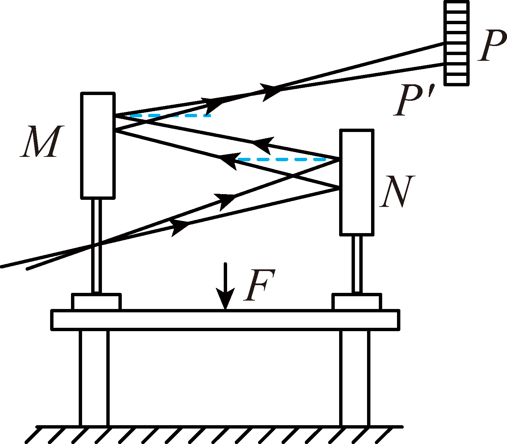
 M、N将向中间倾斜，M、N上的入射角减小，由光的反射定律可知，光点会在刻度尺上从P点移动到P'点，则P'的位置比P低，即刻度尺上光点将会向下移动，这种实验方法是转换法。

## 53. 单选题（难度：适中）

如图所示事例不属于平面镜应用的是（　　）

- A. 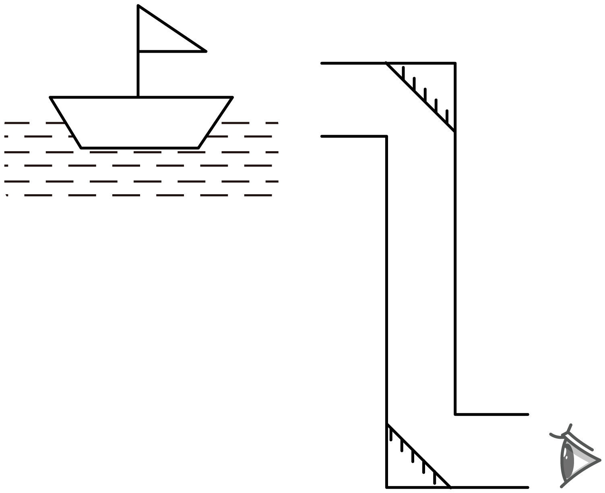
 
利用潜望镜观察海面上的情况
- B. 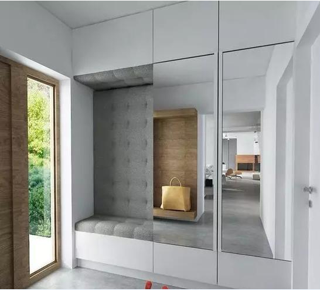
 
利用平面镜扩大视野空间
- C. 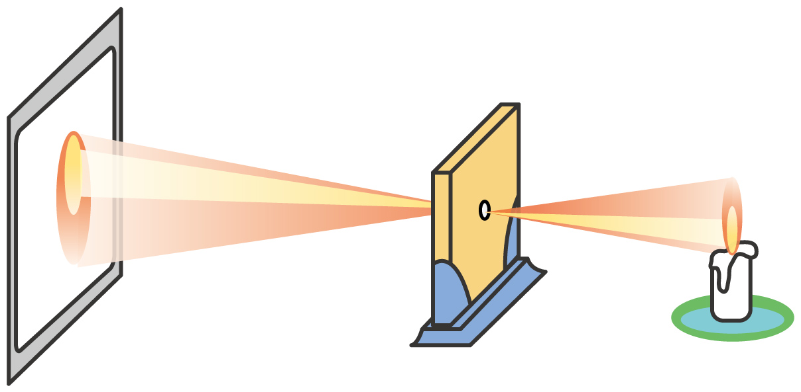
 
小孔成像
- D. 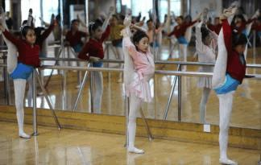
 
舞蹈演员用镜子观察自己的姿势

【答案】C

【解析】A．潜望镜是两块平面镜，利用潜望镜观察海面上的情况，属于平面镜应用，故A不符合题意；
B．利用平面镜扩大视野空间是利用平面镜成像，属于平面镜应用，故B不符合题意；
C．小孔成像是光沿直线传播的应用，不属于平面镜应用；故C符合题意；
D．舞蹈演员用镜子矫正自己的舞姿，属于平面镜应用，故D不符合题意。

## 54. （难度：适中）

如图，物体

 放在平面镜前，请作出物体

 在平面镜中所成的像。

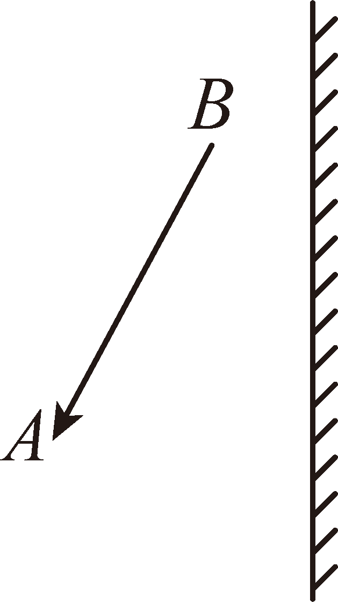

【答案】

【解析】平面镜成像的原理是光的反射，像与物体关于镜面对称，即像和物体到镜面的距离相等、对应点的连线与镜面垂直，且成虚像。作图时，先分别过物体端点A、B作平面镜的垂线，延长垂线至镜后，使镜后线段长度与镜前相等，得到对应像点A'、B'，最后用虚线连接A'、B'，即为物体AB在平面镜中所成的像，如图所示：

## 55. （难度：适中）

图甲是某实验小组的同学做“探究平面镜成像规律”实验时的情景，请回答下列问题：

实验中选用玻璃板代替平面镜，原因是玻璃板透光，便于。

实验中应选择（填“较厚”或“较薄”）的玻璃板，若选择另一种玻璃板会产生什么现象？。

该实验小组的同学最好选用（填“无色”或“茶色”）玻璃板。

实验中选取\(\operatorname{A}\) 、\(\operatorname{B}\) 两支完全相同的蜡烛的目的是，这里用到的是（填实验方法），实验中还会用到刻度尺，它的作用。

实验过程中为了便于观察，最好在（填“较明亮”或“较黑暗”）的环境中进行。

实验时，若实验小组的同学发现无论如何移动蜡烛

 都无法与蜡烛

 的像重合，原因可能是。

如图甲，实验小组的小明把一支点燃的蜡烛

 放在玻璃板的前面，此时他应该从（填“玻璃板前”或“玻璃板后”）观察蜡烛

 的像，这个像是由光的形成的。

如图甲，小明将另一支与蜡烛

 完全相同但（填“点燃”或“未点燃”）的蜡烛

 放到玻璃板后像的位置，它与像完全重合，说明像与蜡烛

 的大小（填“相等”或“不相等”）。

将光屏放在蜡烛

 的位置上，发现光屏上（填“能”或“不能”）承接到蜡烛

 的像，这说明平面镜成像时成的是（填“虚”或“实”）像。
【能力设问】

小明在只做了一次实验后就得出了实验结论，这种做法正确吗？为什么？。

为了研究像和物到镜面距离的关系，应多次，重复实验。

若小明将桌面上的白纸换成方格纸进行实验，则这种做法的优点是。

进行三次实验后，记录的物体和像的位置如图乙所示，为了得到实验结论，接下来应如何操作？。

分析图丙中的信息可得出平面镜成像的特点：像和物到平面镜的距离，像和物的连线与平面镜。

将白纸沿

 对折后发现物体的位置和它的像的位置重合，所以平面镜成像的特点又可表述为：平面镜成的像与物体关于镜面。

如图甲，将蜡烛

 逐渐远离玻璃板时，蜡烛

 应（填“靠近”或“远离”）玻璃板，才能与蜡烛

 的像完全重合，此时所成像的大小（填“变大”“变小”或“不变”）；若将蜡烛

 向远离玻璃板的方向移动了

 ，蜡烛

 与它的像之间的距离变化了

 。

同组的小丽用棋子代替蜡烛进行实验，如图丁所示，但怎么也看不清楚棋子的像，请你提出一个解决这个问题的办法：。
【拓展设问】

小丽在白纸上沿棋

 和

 的边缘画圆，测出物到玻璃板的距离

 和像到玻璃板的距离

 的值如下表：
实验序号
 

 

 

 

 

 

 

 

 

 

 

小丽发现三次实验的像距都比物距略大一些，原因是_______________。

同组的小飞实验时发现蜡烛

 在玻璃板中像的位置偏高且倾斜，则你认为图戊中的图是产生该现象的原因。

小飞将蜡烛沿平行于玻璃板横向移动一段距离，则烛焰的像离玻璃板的距离。

- A. 刻度尺测量像距时存在误差
- B. 玻璃板有一定厚度
- C. 物和像的标记点不对应
- D. 玻璃板没有竖直放置

【答案】确定像的位置，较薄/会同时出现两个像，茶色，便于比较像和物大小关系/等效替代法/测量像和物到玻璃板的距离，较黑暗，玻璃板没有与水平桌面垂直放置，玻璃板/反射，未点燃/相等，不能/虚，不正确，因为仅凭一次实验数据得出的结论具有偶然性，改变蜡烛$\operatorname{A}$ 到平面镜的距离，便于比较像与物到平面镜的距离关系，测量对应的像和物到平面镜的距离并比较它们的大小关系（或连接对应的像和物，测量像与物的连线与平面镜是否垂直），相等/垂直，对称，远离/不变/6，用灯光照亮棋子，B，2，不变

【解析】实验中选用玻璃板代替平面镜，原因是玻璃板透光，既能成像，也便于确定像的位置。

[1]厚玻璃板成两个相距较远的像，不能确定像的位置，实验中应选择较薄的玻璃板。
[2]若选择另一种玻璃板产生的现象：玻璃板会同时出现两个像，不能确定像的位置。

为使像清晰，该实验小组的同学最好选用茶色玻璃板。

[1][2][3]实验中选取A、B两支完全相同的蜡烛的目的是比较像与物大小，这里用到的是等效替代法，实验中还会用到刻度尺，它的作用是测量像与物到镜面的距离。

为使像清晰，实验过程中为了便于观察，最好在较黑暗的环境中进行。

实验时，若实验小组的同学发现无论如何移动蜡烛B都无法与蜡烛A的像重合，原因可能是玻璃板与桌面没有垂直。

[1][2]如图甲，实验小组的小明把一支点燃的蜡烛A放在玻璃板的前面，此时他应该从玻璃板前观察蜡烛A的像，这个像是由光的反射形成的。

[1][2]如图甲，为使像清晰，小明将另一支与蜡烛A完全相同但未点燃的蜡烛B放到玻璃板后像的位置，它与像完全重合，说明像与蜡烛A的大小相等。

[1][2]虚像不能呈现在光屏上，将光屏放在蜡烛B的位置上，发现光屏上不能承接到蜡烛A的像，这说明平面镜成像时成的是虚像。

小明在只做了一次实验后就得出了实验结论，这种做法不正确，因为仅凭一次实验数据得出的结论具有偶然性。

为了研究像和物到镜面距离的关系，应多次改变蜡烛的位置，即改变蜡烛A到平面镜的距离，重复实验。

若小明将桌面上的白纸换成方格纸进行实验，则这种做法的优点是便于比较像与物到镜面的距离。

连接对应点，判断连线与镜面是否垂直，测量像与物到镜面的距离，进行比较，得出结论。

[1][2]分析图丙中的信息可得出平面镜成像的特点：像和物到平面镜的距离相等，像和物的连线与平面镜垂直。

白纸沿MN对折后发现物体的位置和它的像的位置重合，所以平面镜成像的特点又可表述为：平面镜成的像与将物体关于镜面对称。

[1][2][3]因为平面镜成像像与物到平面镜的距离相等，所以将蜡烛A逐渐远离玻璃板时，它的像将远离玻璃板，蜡烛B应远离玻璃板，才能与蜡烛A的像完全重合，此时所成像的大小不变；将蜡烛A向玻璃板远离3cm，蜡烛A的像也向玻璃板远离3cm；因此，再将蜡烛B移到A像的位置，通过测量，发现蜡烛A与它在玻璃板中像的距离变化了6cm。

同组的小丽用棋子代替蜡烛进行实验，如图丁所示，但怎么也看不清楚棋子的像，解决这个问题的办法：用手电筒照亮棋子。

玻璃板有一定厚度，棋子B反射的光通过玻璃板时发生折射而进入人眼，人眼看到的棋子B是由于光的折射形成的虚像，这个虚像比棋子B更靠近玻璃板一些，当我们认为棋子B与棋子A的像重合时，而实际的棋子B在棋子A的像的后方，所以导致每次测得的像距都比物距略大一些，故B符合题意，ACD不符合题意。

根据平面镜成像规律，像和物关于镜面对称；图戊中1图成像在水平面上且不倾斜，2图在玻璃板中像的位置偏高且倾斜，3图成像位置偏低且倾斜，故2图是产生该现象的原因。

根据平面镜成像规律，物距和像距相等，小飞将蜡烛沿平行于玻璃板横向移动一段距离，物距不变，则像距不变，即烛焰的像离玻璃板的距离不变。

## 56. 单选题（难度：适中）

如图所示，用手电筒对着平面镜中的像照射时，观察到的像比原来亮多了，对此现象的合理解释是（　　）

【答案】A

## 57. 单选题（难度：适中）

如图是潜望镜结构的示意图，观察者利用潜望镜看到外面的景物是（　　）

- A. 正立、等大的
- B. 倒立、等大的
- C. 正立、缩小的
- D. 倒立、缩小的

【答案】A

【解析】潜水员利用潜望镜来观察水面上的情况，利用了光的反射，根据平面镜成像特点可知，看到的是正立、等大的虚像，故A符合题意，BCD不符合题意。

## 58. 单选题（难度：适中）

如图甲，小明和小红做“探究平面镜成像特点”的实验：

 
(1)在竖立的玻璃板前点燃蜡烛A，拿未点燃的蜡烛B（与蜡烛A大小相同）竖立在玻璃板后面移动，直至蜡烛B与蜡烛A的像完全重合，这说明平面镜成像时，像与物______；
(2)如图乙，移去蜡烛B，在其原来位置上放置一块不透明的光屏，按照眼睛______（选填“①”“②”或“③”）的方法观察光屏，光屏上不能出现蜡烛的像，说明物体通过平面镜所成的像是______（选填“虚”或“实”）像；
(3)下列操作中，像的位置不发生变化的是______；
A．让玻璃板沿所在平面向右移动
B．将玻璃板绕\(O{O}'\) 轴（如图中玻璃板与桌面的接触部分）转向自己
C．将玻璃板沿着水平桌面向后平移
D．将玻璃板沿着水平桌面向前平移
(4)如图丙所示，小明在实验中采用的是厚玻璃板，他观察到蜡烛A通过玻璃板成了两个清晰的像\({{k}_{1}}\) 和\({{\text{k}}_{2}}\) ，则像\({{k}_{1}}\) 的像距为______（填“\({{v}_{1}}\) ”或“\({{v}_{2}}\) ”）；
(5)小明想进一步探究像和物的左右是否对调，她应将蜡烛改成图戊中的______（填“a”、“b”或“c”）光源进行实验；
(6)完成上述实验后，小明反思实验过程，提出一个质疑：实验中利用玻璃板镀膜的那一面成像，应该在镀膜那一面下边划线，作为平面镜的位置。怎样判断玻璃板哪面镀膜呢？小组同学讨论出一种方法：将铅笔尖分别贴在玻璃板的左右两面，观察到铅笔较清楚的像如图丁所示，由此可以判断镀膜在玻璃板的______（选填“左”或“右”）面。

- A. 让玻璃板沿所在平面向右移动
- B. 将玻璃板绕\(O{O}'\) 轴（如图中玻璃板与桌面的接触部分）转向自己
- C. 将玻璃板沿着水平桌面向后平移
- D. 将玻璃板沿着水平桌面向前平移

【答案】A

【解析】（1）根据等效替代法，与蜡烛A大小相同的蜡烛B放在A像的位置时能与其完全重合，可知，蜡烛A与蜡烛A的像大小相等，说明平面镜成像时，像与物的大小相等。
（2）[1][2]移去蜡烛B，在B位置上放置一块不透明的光屏，为了判断蜡烛A通过玻璃板由于光的反射所形成的像是否可以在光屏上承接，则应按照眼睛②的方法观察光屏；此时光屏上不能出现蜡烛的像，说明物体通过平面镜所成的像是虚像（光屏只能承接实像）。
（3）A．平面镜成的像与物关于镜面对称，让玻璃板沿所在平面向右移动，对称面的位置没有变化，所以像的位置不发生变化，故A符合题意；
B．根据平面镜成像特点可知，像与物关于镜面是对称的，将玻璃板绕OO′轴（如图中玻璃板与桌面的接触部分）转向自己，像会向上运动，像的位置发生变化，故B不符合题意；
C．将玻璃板沿着水平桌面向后平移，物距变大，像距也变大，像的位置发生变化，故C不符合题意；
D．将玻璃板沿着水平桌面向前平移，物距变小，像距也变小，像的位置发生变化，故D不符合题意。
（4）k1是由于蜡烛通过平面镜的前表面形成的像，k1到平面镜的前表面的距离为v2，故像

 的像距为v2。
（5）要探究像与物是否左右对调，为了便于观察，需要挑选左右不对称的物体，由图可知b、c均为对称图形，a不对称，故a符合题意，bc不符合题意。
故选a。
（6）镀膜那一面，反射效果好为反射面，将铅笔尖分别贴在玻璃板的左右两面，观察到铅笔较清楚的像如图丁左所示，由像与物体关于平面镜对称可知，左侧为反射面，由此可以判断镀膜在玻璃板的左面。

## 59. 单选题（难度：适中）

如图所示，小明通过平面镜看到了蜡烛的像，下列有关平面镜成像的描述，正确的是（　　）

- A. 进入人眼的光是由蜡烛的像发出的
- B. 如果将平面镜竖直上移，则像的位置也上移
- C. 如果将图中的平面镜截掉

 ，则蜡烛仍能在剩余的平面镜中成完整的像
- D. 如果紧贴平面镜背面放置一块和平面镜大小一样的不透明挡板，则蜡烛在平面镜中无法成像

【答案】C

【解析】A．进入人眼的光是由点燃的蜡烛发出光经过平面镜反射的，故A错误；
B．平面镜成像中，像与物关于平面镜对称，如果将平面镜竖直上移，成像的蜡烛的位置不变，则像的位置不变，故B错误；
C．平面镜所成的像，像和物体形状、大小相同，与平面镜的大小无关，平面镜截掉

 仍能成完整像，故C正确；
D．平面镜成的像是光的反射形成的，蜡烛发出的光线经玻璃板反射，被人眼接收，才能看到像，所以若紧贴平面镜背面放置一块和平面镜大小一样的不透明挡板，不影响蜡烛成像，所以从前面看去仍能看到蜡烛的像，故D错误。

## 60. 单选题（难度：适中）

如图1所示是潜望镜的结构示意图，其中两块平面镜均相对水平面倾角45°角。现有一艘军舰位于与平面镜1等高的正前方。则下列说法不正确的是（　　）

- A. 潜望镜是利用了光的反射原理
- B. 人眼看到军舰所成的像位于平面镜2的正前方
- C. 在潜望镜中看到的时间如图2，则实际的时间是20:51
- D. 人眼看到军舰所成的像到潜望镜的距离等于军舰到潜望镜的距离

【答案】D

【解析】A．潜望镜是由两个平面镜制成的，通过潜望镜成正立的虚像，应用了光的反射原理，故A正确，不符合题意；
B．由平面镜成像特点可知，像和物体各对应点到平面镜间距离相等；现有一艘军舰位于与平面镜1等高的正前方，则人眼看到军舰是正立、等大的虚像；且所成的虚像位于与平面镜2等高的正前方，如图所示

 
故B正确，不符合题意；
C．由镜面对称性可知，潜望镜中使用的是两块平面镜，第一个镜子成正立等大、左右颠倒的像，第二个镜子成正立等大，左右再次颠倒的像，最后的像就是跟原物完全一样的像，实际时间与看到的时间均为

 ，故C正确，不符合题意；
D．由图可知，人眼看到军舰所成的像到潜望镜的距离大于军舰到潜望镜的距离，故D错误，符合题意。

## 61. 单选题（难度：适中）

家用小汽车的后视镜是用来观察车后情况的，在某次行驶时，发现左侧后视镜中只能看到左侧车身，看不见车后马路上的情况，为确保行驶安全，左侧后视镜的镜面应该（　　）

【答案】A

## 62. 单选题（难度：适中）

如图是物体在平面镜中成像的情况，正确的是（　　）

【答案】A

## 63. 填空题（难度：简单）

小明同学利用易拉罐制作了一个取火凹面镜。利用它能将火柴点燃是因为凹面镜对光有___作用；汽车的后视镜能扩大视野是应用了___（选填“平面镜”或“凸面镜”）。

## 64. （难度：简单）

生活中处处有物理：

许多学校在一进楼门的位置都竖立着一块平面镜，同学们经过镜前都习惯照一照。同学们在镜子中看到的是自己的（实／虚）像，当同学们走近镜子时，像的大小（变大／不变／变小）。

汽车驾驶室外面的观后镜是一个凸镜而不是平面镜或凹镜，是利用凸镜对光线的（填“会聚”或“发散”作用而成缩小像的特点，使看到的实物小，观察范围更，而保证行车安全。

【答案】虚/不变，发散/大

【解析】[1][2]平面镜成的像是光的反射现象，成左右相反、上下相同，等大、正立的虚像，当同学们走近镜子时，看到的是等大的虚像，即像的大小不变。

[1][2]汽车驾驶室外面的观后镜是凸面镜，对光线有发散作用，使用凸面镜的好处是可以扩大观察的范围。

## 65. 填空题（难度：适中）

凸面镜和凹面镜
（1）以球的外表面为反射面叫面镜，以球的内表面为反射面的叫面镜；
（2）凸面镜对光有作用，可增大视野（汽车上的观后镜，街道拐角处的反光镜）；凹面镜对光有作用（太阳灶，反射式天文望远镜，电筒）

【答案】凸，凹，发散，会聚

## 66. 填空题（难度：适中）

有些汽车的后视镜表面是向外凸出的，我们把它称为___（选填“凸透镜”或“凸面镜”），它会对光线有___作用，更有利于司机扩大视野；而手电筒的反光装置、太阳灶它们主要利用了凹面镜对光有___作用。

## 67. 填空题（难度：简单）

汽车的后视镜便于观察后方来车。目前，汽车两侧的后视镜用的是（填“平面镜”、“凸面镜”或“凹面镜”），物体通过该光学元件成立的（填“实像”或“虚像”）。选用该光学元件的优势是。

【答案】凸面镜，正，虚像，扩大视野

【解析】[1] 汽车两侧的后视镜是为了扩大司机的视野，一般用的是凸面镜，凸面镜对光线有反射发散作用，当平行光投射到凸面镜上，反射的光线发散，这样可以扩大司机的视野，减少盲区。
[2][3]物体通过凸面镜成正立，缩小的虚像，且物体离凸面镜越远，所成虚像越小；凸面镜对光线有反射发散作用，可以扩大司机的视野。

## 68. 填空题（难度：适中）

2021年10月18日，2022年北京冬奥会圣火火种在希腊成功采集。图中的圣火采集器是利用凹面镜对光有会聚作用的原理工作的。它在反射光时，（填“遵循”或“不遵循”）光的反射定律。

【答案】遵循

【解析】凹面镜对光有会聚作用，可以将阳光会聚于其焦点位置，这种反射遵循光的反射定律。

## 69. 填空题（难度：简单）

在一些车流量较大、车速较低的小区路段经常会看到如图所示的镜子——街道拐角镜，它的镜面物理学上称之为 镜，这种镜面对光有作用。装在街道拐角处可以扩大视野。

【答案】凸面，发散

【解析】[1]街道拐角镜的镜面呈向外凸起的形状，在物理学中，这种形状的镜子被称为凸面镜，故此处应填凸面。
[2]凸面镜对入射的光线具有发散作用，能将拐角另一侧的景物所反射的光向更广的方向反射，从而让观察者看到更大范围的景象，达到扩大视野的目的，故此处应填发散。

## 70. 填空题（难度：适中）

在“走进西藏”活动中，小明对藏民用面积很大凹面镜制成的太阳灶烧水（如图甲）很好奇．于是他利用不锈钢汤勺的内表面当凹面镜，将平行的光正对“凹透镜”照射，光路如图乙．

 
（1）使用太阳灶烧水，水壶应放在（选填“a”、“b”或“c”）点．
（2）太阳灶的使用，说明凹面镜对光有（选填“发散”或“会聚”）作用．

【答案】b，会聚

【解析】平行光经凹面镜汇聚于一点，太阳灶利用了凹面镜的会聚能量，据此解答；
（1）由图可知，凹面镜能将平行光汇聚到一点，即图中的b点，因此使用太阳灶烧水，水壶应放在b点．
（2）太阳灶的使用，说明凹面镜对光有会聚作用．

## 71. 填空题（难度：简单）

司机要善于通过观后镜了解后车的位置及速度情况。汽车观后镜有平面镜的也有凸面镜的，图示观后镜为平面镜。当看到后车的像在镜中占据的空间变大时，说明后车离本车越来越___（选填“远”或“近”），后车在镜中的像与后车大小___（选填“相等”或“不相等”）；凸面镜对光有___（选填“发散”或“会聚”）作用。

## 72. 填空题（难度：适中）

如图为太阳灶，它是___面镜。它利用不透明的集光板把太阳光聚集起来加热水壶，烧水的壶应放置在太阳灶的___上。

## 73. 填空题（难度：简单）

如图，当汽车在盘山公路AB路段行驶时，司机看不到BC路段的情况；为了能够看到BC路段的情况，于是人们在公路急拐弯B处装上一块___（选填“凸面镜”“平面镜”或“凹面镜”），该镜对光线有___作用（选填“发散”或“会聚”），以减少道路安全事故的发生。

## 74. 填空题（难度：简单）

如图所示，小明同学利用易拉罐制作了一个取火凹面镜。利用它能将火柴点燃是因为凹面镜对光有___作用；汽车的后视镜能扩大视野的应用原理与此___（选填“相同”或“不同”）。

## 75. 填空题（难度：简单）

如甲图是我国自主研发的世界上最大口径的射电望远镜，被誉为中国的“天眼”。它由许多个反射面组成，其外形相当于（选填“凸面镜”或“凹面镜”），它对光有（选填“会聚”或“发散”）作用，其成像与图（选填“乙”或“丙”）一样。

【答案】凹面镜，会聚，丙

【解析】[1]由图可知，“天眼”外形相当于凹面镜。
[2]凹面镜对光线有会聚作用。
[3]凹面镜成倒立的虚像，其成像与丙一样。

## 76. 填空题（难度：适中）

凸面镜和凹面镜
（1）以球的外表面为反射面叫面镜，以球的内表面为反射面的叫面镜；
（2）凸面镜对光有作用，可增大视野（汽车上的观后镜，街道拐角处的反光镜）；凹面镜对光有作用（太阳灶，反射式天文望远镜，电筒）

【答案】凸，凹，发散，会聚

## 77. （难度：简单）

生活中处处有物理：

许多学校在一进楼门的位置都竖立着一块平面镜，同学们经过镜前都习惯照一照。同学们在镜子中看到的是自己的（实／虚）像，当同学们走近镜子时，像的大小（变大／不变／变小）。

汽车驾驶室外面的观后镜是一个凸镜而不是平面镜或凹镜，是利用凸镜对光线的（填“会聚”或“发散”作用而成缩小像的特点，使看到的实物小，观察范围更，而保证行车安全。

【答案】虚/不变，发散/大

【解析】[1][2]平面镜成的像是光的反射现象，成左右相反、上下相同，等大、正立的虚像，当同学们走近镜子时，看到的是等大的虚像，即像的大小不变。

[1][2]汽车驾驶室外面的观后镜是凸面镜，对光线有发散作用，使用凸面镜的好处是可以扩大观察的范围。

## 78. 填空题（难度：适中）

有些汽车的后视镜表面是向外凸出的，我们把它称为（选填“凸透镜”或“凸面镜”），它会对光线有作用，更有利于司机扩大视野；而手电筒的反光装置、太阳灶它们主要利用了凹面镜对光有作用。

【答案】凸面镜，发散，会聚

【解析】[1]汽车后视镜表面向外凸出，这种镜子被称为凸面镜。
[2]凸面镜对光线的作用是发散。这意味着它会使入射光线向外扩散，从而扩大视野范围。
[3]凹面镜对光线具有会聚作用。在手电筒中，灯泡位于凹面镜的焦点处，反射后光线近似平行射出，以增强照明距离。在太阳灶中，凹面镜将太阳的平行光会聚于焦点，产生高温用于加热或烹饪。

## 79. 填空题（难度：简单）

小明同学利用易拉罐制作了一个取火凹面镜。利用它能将火柴点燃是因为凹面镜对光有___作用；汽车的后视镜能扩大视野是应用了___（选填“平面镜”或“凸面镜”）。

## 80. 填空题（难度：简单）

汽车的后视镜便于观察后方来车。目前，汽车两侧的后视镜用的是___（填“平面镜”、“凸面镜”或“凹面镜”），物体通过该光学元件成___立的___（填“实像”或“虚像”）。选用该光学元件的优势是___。

## 81. 填空题（难度：适中）

在“走进西藏”活动中，小明对藏民用面积很大凹面镜制成的太阳灶烧水（如图甲）很好奇．于是他利用不锈钢汤勺的内表面当凹面镜，将平行的光正对“凹透镜”照射，光路如图乙．

 
（1）使用太阳灶烧水，水壶应放在（选填“a”、“b”或“c”）点．
（2）太阳灶的使用，说明凹面镜对光有（选填“发散”或“会聚”）作用．

【答案】b，会聚

【解析】平行光经凹面镜汇聚于一点，太阳灶利用了凹面镜的会聚能量，据此解答；
（1）由图可知，凹面镜能将平行光汇聚到一点，即图中的b点，因此使用太阳灶烧水，水壶应放在b点．
（2）太阳灶的使用，说明凹面镜对光有会聚作用．

## 82. 填空题（难度：简单）

在一些车流量较大、车速较低的小区路段经常会看到如图所示的镜子——街道拐角镜，它的镜面物理学上称之为 镜，这种镜面对光有作用。装在街道拐角处可以扩大视野。

【答案】凸面，发散

【解析】[1]街道拐角镜的镜面呈向外凸起的形状，在物理学中，这种形状的镜子被称为凸面镜，故此处应填凸面。
[2]凸面镜对入射的光线具有发散作用，能将拐角另一侧的景物所反射的光向更广的方向反射，从而让观察者看到更大范围的景象，达到扩大视野的目的，故此处应填发散。

## 83. 填空题（难度：简单）

请阅读材料，回答材料后的问题：《速度与激情》中任性飙车的场景总会让人看得热血沸腾，前不久，商丘长江路上就有用非法改装的轿车在道路上飙车速度快、声音大，开出轰炸机要起飞的架势，老百姓称之为“炸街”请你回答下列有关汽车的问题： （1）假如刚下过一场雨，司机会感觉前方积水处更暗，原因是光照在水面时发生了___。（2）汽车头灯里的反射镜是一个凹面镜。凹面镜是用球面的内表面作反射面，对光线有会聚作用，如图甲

## 84. 填空题（难度：简单）

有些道路的拐弯处会放一个反光镜，它是（选填“平面”“凸面”或“凹面”）镜，它对光线有作用。太阳灶多用镜制成。

【答案】凸面，发散，凹面

【解析】[1][2]道路拐弯处的反光镜主要是为了扩大视野，便于观察周围情况，它是凸面镜，凸面镜对光起到发散作用。
[3]太阳灶需要聚集光线，选凹面镜，凹面镜对光有会聚作用。

## 85. 填空题（难度：适中）

如图为太阳灶，它是面镜。它利用不透明的集光板把太阳光聚集起来加热水壶，烧水的壶应放置在太阳灶的上。

【答案】凹，焦点

【解析】[1][2]观察可知，太阳灶的反射面是凹进去的，为凹面镜。凹面镜对光线有会聚作用，太阳光照射到凹面镜上，经凹面镜反射后，反射光线会聚在焦点上，太阳灶就是利用了这一原理，利用其烧水。所以应把壶放在太阳灶的焦点上。

## 86. 填空题（难度：简单）

如甲图是我国自主研发的世界上最大口径的射电望远镜，被誉为中国的“天眼”。它由许多个反射面组成，其外形相当于___（选填“凸面镜”或“凹面镜”），它对光有___（选填“会聚”或“发散”）作用，其成像与___图（选填“乙”或“丙”）一样。

## 87. 填空题（难度：简单）

如图，当汽车在盘山公路AB路段行驶时，司机看不到BC路段的情况；为了能够看到BC路段的情况，于是人们在公路急拐弯B处装上一块___（选填“凸面镜”“平面镜”或“凹面镜”），该镜对光线有___作用（选填“发散”或“会聚”），以减少道路安全事故的发生。

## 88. 填空题（难度：简单）

世界最大口径射电望远镜（FAST）位于贵州省黔南布依族苗族自治州平塘县，被誉为“中国天眼”，如图所示，该望远镜口径为500米、占地约30个足球场大小，它由4450个球面镜组成超大反射面，其外形像一口巨大的锅，用于观测暗物质和暗能量，寻找新一代天体。“中国天眼”相当于一个巨大的（选填“凸面镜”或“凹面镜”），对光线有作用。请你再举出应用该原理的实例：。

【答案】凹面镜，会聚，点火装置

【解析】[1][2]被誉为“中国天眼”的望远镜，是利用凹面镜制成的，凹面镜对光具有会聚作用。
[3]凹面镜对光有会聚作用，将其对着阳光时，‌可以将光线聚焦到一点，‌用于点燃火柴或其他可燃物，因此可以用来制作点火装置。

## 89. 填空题（难度：简单）

司机要善于通过观后镜了解后车的位置及速度情况。汽车观后镜有平面镜的也有凸面镜的，图示观后镜为平面镜。当看到后车的像在镜中占据的空间变大时，说明后车离本车越来越___（选填“远”或“近”），后车在镜中的像与后车大小___（选填“相等”或“不相等”）；凸面镜对光有___（选填“发散”或“会聚”）作用。

## 90. 填空题（难度：适中）

2021年10月18日，2022年北京冬奥会圣火火种在希腊成功采集。图中的圣火采集器是利用凹面镜对光有会聚作用的原理工作的。它在反射光时，___（填“遵循”或“不遵循”）光的反射定律。

## 91. 填空题（难度：简单）

如图所示，小明同学利用易拉罐制作了一个取火凹面镜。利用它能将火柴点燃是因为凹面镜对光有___作用；汽车的后视镜能扩大视野的应用原理与此___（选填“相同”或“不同”）。

