# 第四节 光的色散（同步练习）

> 教材：物理·八年级全一册·沪科技版2024新教材 ｜ 来源：国家中小学智慧教育平台·在线练习 ｜ 共 50 题

## 1. 单选题（难度：适中）

有了光，自然界才绚丽多彩。下列有关光的说法中正确的是（　　）

- A. 光的三原色是红、黄、蓝
- B. 紫外线照射对人体有益，因此我们让紫外线照射越多越好
- C. 电影屏幕选用粗糙的布料，目的是避免光发生漫反射
- D. 电视机遥控器是利用红外线工作的

【答案】D

【解析】A．色光的三原色是红、绿、蓝，故A错误；
B．适当的紫外线有助于人体合成维生素D，促进人体对钙的吸收，促进骨骼的生长，但过量的紫外线照射对人体有害，轻则使皮肤粗糙，重则引起皮肤癌，故B错误；
C．电影屏幕选用粗糙的布料，目的是让光发生漫反射，让不同位置的人都能看见屏幕，故C错误；
D．电视机的遥控器发出的是红外线，是不可见光，它能对电视机进行遥控，故D正确。

## 2. 单选题（难度：适中）

生活处处有物理，留心观察皆学问。下列关于生活中光现象的解释，正确的是（　　）

- A. 周末在家晒被褥可以杀菌，主要是利用了阳光中的红外线
- B. 暴雨过后，小明在公园看到了美丽的彩虹，这是光的色散现象
- C. 医院病房里紫外线灯发出的淡紫色光，就是我们要利用的紫外线
- D. 美术课上画水彩画时，老师说的颜料三原色是红、黄、蓝，也就是光的三原色

【答案】B

【解析】A．晒被褥杀菌主要利用阳光中的紫外线，因为紫外线具有杀菌消毒作用，而红外线主要产生热效应，故A错误；
B．彩虹是阳光通过空气中的水滴发生折射和反射，分散成不同颜色的光，这是光的色散现象，故B正确；
C．紫外线灯发出的淡紫色光是可见光，而紫外线本身是不可见的，杀菌作用主要来自不可见的紫外线，故C错误；
D．颜料的三原色是红、黄、蓝，用于颜料混合；光的三原色是红、绿、蓝，用于光的叠加，两者不同，故D错误。

## 3. 单选题（难度：适中）

《玄真子》中记载了著名的人工彩虹实验：“背日喷乎水，成虹霓之状”。下列关于彩虹的说法正确的是（　　）

- A. 彩虹是光的直线传播形成的
- B. 面向太阳喷水者可看到较清晰的彩虹
- C. 背对太阳喷水者可看到较清晰的彩虹
- D. 干燥的空气更容易形成彩虹

【答案】C

【解析】A. 彩虹的形成涉及光的折射，而非直线传播，故A错误；
B. 面向太阳喷水时，光线直接进入眼睛，不易观察到彩虹，故B错误；
C. 背对太阳喷水时，水滴折射和反射太阳光，形成彩虹，观察者可清晰看到，故C正确；
D. 彩虹需要水滴作为介质，干燥空气缺乏水滴，不易形成彩虹，故D错误。

## 4. 单选题（难度：适中）

冬末春初，随着2020年春节到来的脚步，新冠肺炎疫情在武汉爆发。为防止疫情扩散，教研院的党员干部积极参与济南市教育局下沉社区服务基层疫情防控一线，协助社区人员对进出小区的人员测量体温、盘查登记车辆小区人员劝返等工作。测量体温使用的测温枪能在不接触人体的情况下测量人体的温度，主要利用了（　　）

- A. 超声波
- B. 次声波
- C. 红外线
- D. 紫外线

【答案】C

【解析】A．测温枪利用红外线的感热能力来工作，超声波不能测温，故A不符合题意；
B．地震、海啸等自然灾害来临时会发出次声波，次声波不能测温，故B不符合题意；
C．红外线感热能力强，可以用作测温枪，故C符合题意；
D．紫外线具有杀菌和使荧光物质发光的作用，不能用来测温，故D不符合题意。

## 5. 单选题（难度：适中）

关于太阳光，下列说法正确的是（　　）

- A. 太阳光是白光，是单色光
- B. 太阳光中的红外线可以灭菌
- C. 太阳光中的红外线可以使荧光物质发光
- D. 太阳光中的紫外线对于骨骼的生长有好处

【答案】D

【解析】A．太阳光是白光，是复色光，故A错误；
B．太阳光中的紫外线可以灭菌，故B错误；
C．太阳光中的紫外线可以使荧光物质发光，故C错误；
D．太阳光中的紫外线能促进人体合成维生素D，维生素D有助于钙的吸收，对于骨骼的生长有好处，故D正确。

## 6. 单选题（难度：适中）

下列四种现象，由于光的色散形成的是（　　）

- A. 水中的倒影
- B. 变幻的手影
- C. 雨后的彩虹
- D. 海面上的海市蜃楼

【答案】C

【解析】A．水中的倒影属于平面镜成像，是由光的反射形成的，故A不符合题意；
B．变幻的手影是由于光在同种均匀介质中沿直线传播形成的，故B不符合题意；
C．雨后的彩虹是太阳光通过悬浮在空气中细小的水珠折射，白光经水珠折射后分成各种彩色光，这种现象叫做光的色散现象，所以雨后的彩虹是由光的色散形成的，故C符合题意；
D．海面上的海市蜃楼是由于光在不均匀的介质中传播时发生折射形成的，故D不符合题意。

## 7. 单选题（难度：适中）

在各种色光中，属于三原色光的是（　　）

- A. 绿光
- B. 黄光
- C. 紫光
- D. 靛光

【答案】A

## 8. 单选题（难度：适中）

光可以让我们的生活绚丽多彩，下列有关光的说法中正确的是（　　）

- A. 光的色散和光的漫反射实质是一样的
- B. 全自动感应水龙头是利用紫外线实现自动控制的
- C. 彩色电视画面的色彩是由红、黄、蓝三种色光混合而成的
- D. 红外线和紫外线的应用非常广泛，额温枪是利用红外线热效应工作的

【答案】D

【解析】A．光的色散是光的折射现象（白光分解成七色光）；光的漫反射是指光在粗糙表面反射时，光线向各个方向散射，属于反射现象；两者本质不同，故A错误；
B．全自动感应水龙头通常通过红外线传感器检测人体发出的红外辐射来实现自动控制，而紫外线主要用于消毒、荧光等场景，故B错误；
C．彩色电视画面的色彩原理基于色光三原色：红、绿、蓝，通过这三种色光的混合产生各种颜色，故C错误；
D．红外线具有显著的热效应，物体发热时会辐射红外线；额温枪通过检测人体辐射的红外线能量来测量温度，符合其工作原理，故D正确。

## 9. 单选题（难度：适中）

光学知识在生活中有着广泛应用，下列正确的是（　　）

- A. 彩色电视机显示器上的色彩是由红、黑、蓝三原色混合而成
- B. 电视机遥控器利用红外线实现对电视机的遥控
- C. 紫外线属于可见光，往往呈现紫色
- D. 游泳池注水后，看上去好像变浅了是光的色散现象

【答案】B

【解析】A．彩色电视机显示器上的色彩是由红、绿、蓝三原色混合而成（光的三原色），故A错误；
B．电视机遥控器通过发射红外线（一种不可见光）信号控制电视机，红外线遥控技术是常见应用，故B正确；
C．紫外线是一种不可见光，人眼无法直接观察，故C错误；
D．游泳池注水后看起来变浅是由于光从水进入空气时发生折射，故D错误。

## 10. 单选题（难度：适中）

有了光，自然界才绚丽多彩。下列有关光的说法中正确的是（　　）

【答案】A

## 11. 单选题（难度：适中）

电影院的屏幕都是用白色的幕布制成，那是因为（　　）

- A. 白色幕布的密度最小
- B. 白色幕布含有七种色光
- C. 白色幕布能够吸收所有色光
- D. 白色幕布能够反射所有色光

【答案】D

【解析】A．幕布的颜色选择与密度无关，这是一个无关选项，故A不符合题意；
B．白色是由各种色光混合而成的视觉效果，幕布本身并不“含有”色光，故B不符合题意；
C．如果物体吸收所有色光，它会呈现黑色，而不是白色，故C不符合题意；
D．白色物体的特性是反射所有色光，这样才能保证投影到幕布上的各种颜色都能被观众看到，保证画面色彩真实，故D符合题意。

## 12. 单选题（难度：适中）

下面的说法中，正确的是(　　)

- A. 太阳光是由多种色光合成的，电灯光是单纯的
- B. 白光和红光通过棱镜都能发生光的色散现象
- C. 透明体的颜色是由它透过的色光决定的，不透明体的颜色是由它吸收的色光决定的
- D. 白色光通过三棱镜在白纸屏上形成一条彩色的光带，这一现象叫光的色散，此实验说明了白光是由多种色光组成的

【答案】D

【解析】A．太阳光是由多种色光合成的，电灯光也是复色光，故A错误．
B．白光通过棱镜能发生光的色散现象，红光是单色光，通过棱镜不能发生光的色散，故B错误．
C．透明体的颜色是由它透过的色光决定的，不透明体的颜色是由它反射的色光决定的，故C错误．
D．白色光通过三棱镜在白纸屏上形成一条彩色的光带，这一现象叫光的色散，此实验说明了白光是由多种色光组成的，白光是复色光，故D正确为答案．

## 13. 单选题（难度：适中）

关于红外线与紫外线说法正确的是（　　）

- A. 都具有显著的热效应
- B. 都属于不可见光
- C. 都能使荧光物质发光
- D. 都能被人眼感觉到

【答案】B

【解析】AC．红外线具有热效应，可以制成热谱仪、红外线夜视仪、红外线体温枪等；紫外线最显著的性质是它能使荧光物质发光，验钞机就是利用这个原理制成的，故AC错误；
BD．红外线和紫外线属于不可见光，因此人眼看不见，故B正确，D错误。

## 14. 单选题（难度：适中）

关于光现象，下列说法正确的是（　　）

- A. 白光通过三棱镜发生色散，说明白光是由红、绿、蓝三种色光混合而成
- B. 紫外线有荧光效应可用于人民币防伪；红外线的热效应显著常用于测温
- C. 色光的三原色是红、黄、蓝，利用它们可以混合出各种颜色的光
- D. 电视机遥控器通过发射紫外线脉冲信号来控制电视机

【答案】B

【解析】A．白光通过三棱镜发生色散，分解成红、橙、黄、绿、蓝、靛、紫等色光，说明白光是由多种色光混合而成，但并非仅由红、绿、蓝三种色光混合，故A错误；
B．紫外线具有荧光效应，能使某些物质发光，可用于人民币防伪；红外线具有显著的热效应，常用于温度测量，如红外测温仪，故B正确；
C．色光的三原色是红、绿、蓝，利用它们可以混合出各种颜色的光，故C错误；
D．电视机遥控器通过发射红外线脉冲信号来控制电视机，而非紫外线，故D错误。

## 15. 单选题（难度：适中）

如图甲，一束太阳光照射三棱镜，射出的光照到竖直放置的白屏上，屏上得到彩色光带。将温度传感器分别放在光带边缘A、B两点外侧，测得温度随时间变化的图像如图乙所示。则（　　）

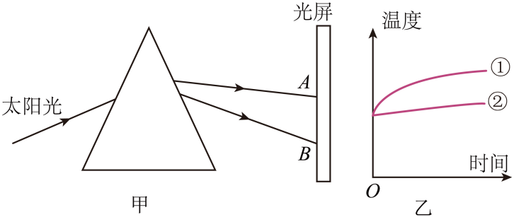

- A. A点外侧为紫光
- B. B点外侧为红光
- C. 曲线①对应的是紫外线
- D. 曲线②对应光线能使荧光物质发光

【答案】D

【解析】太阳光中，红光经三棱镜后，偏折较小，紫光偏折较大，所以A点为红光的位置，B点为紫光的位置，A点外侧为红外线，B点外侧为紫外线。红外线的热作用较强，温度传感器被红外线照射时，温度变化较明显，所以曲线①为红外线，曲线②为紫外线，紫外线能使荧光物质发光，故ABC不符合题意，D符合题意。

## 16. 单选题（难度：适中）

红外线和紫外线的应用非常广泛，下列仪器中属于利用红外线工作的是（　　）

- A. 验钞机
- B. 杀菌灯
- C. 医用“B超”机
- D. 电视机遥控器

【答案】D

【解析】A．验钞机是利用紫外线能使荧光物质发光工作的，故A不符合题意；
B．杀菌灯是利用紫外线具有杀毒作用工作的，故B不符合题意；
C．医用“B超”机是利用超声波可以传递信息工作的，故C不符合题意；
D．电视机遥控器是利用红外线的感应功能工作的，故D符合题意。

## 17. 单选题（难度：适中）

如图所示，在水槽中斜插入一块平面镜，让太阳光斜射到平面镜上，适当调整平面镜的位置和角度，可以在墙壁上看到彩色的光带。下列说法错误的是（　　）

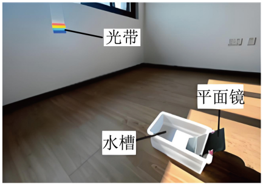

- A. 平面镜上方的水面相当于三棱镜
- B. 光带中只有红、绿、蓝三种颜色
- C. 这种现象叫作光的色散
- D. 白光不是一种单纯的色光

【答案】B

【解析】A．水槽中的水面与平面镜构成了一个类似三棱镜的结构，太阳光通过时发生折射，不同颜色的光折射角度不同，从而分解成彩色光带，故A正确，不符合题意；
B．太阳光是复色光，经过色散后会分解为红、橙、黄、绿、蓝、靛、紫七种颜色的光。红、绿、蓝是光的三原色，用于色光混合，但色散产生的光谱是连续的七色光谱，不仅仅是这三种颜色，故B错误，符合题意；
C．太阳光通过水棱镜后被分解成七色光带的现象，在物理学中被称为光的色散，故C正确，不符合题意；
D．白光是由各种单色光混合而成的复色光，它不是一种单纯的色光，故D正确，不符合题意。

## 18. 单选题（难度：适中）

如图所示，一束太阳光通过三棱镜后照射在光屏上，下列说法正确的是（　　）

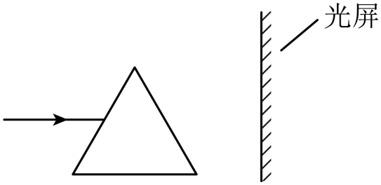

- A. 光向斜上方偏转
- B. 光按原来方向传播
- C. 光屏上只呈现红、绿、蓝三种色光
- D. 光屏上能呈现七种色光

【答案】D

【解析】当太阳光经过三棱镜后，会分解成红、橙、黄、绿、蓝、靛、紫七种单色光，这是光的色散现象，光将向斜下方偏折。故ABC错误，D正确。

## 19. 多选题（难度：适中）

光可以让我们的生活绚丽多彩，下列有关光的说法正确的是（　　）

- A. 彩色电视机的多彩画面是由红、黄、蓝三种色光混合而成
- B. 电视机遥控器是利用红外线来控制电视机的
- C. 验钞机利用紫外线来鉴别钞票的真伪
- D. 超市营业结束后用紫外线灯消毒，灯会发出淡紫色的紫外线

【答案】B/C

【解析】A．光的三原色是红、绿、蓝，彩色电视机的多彩画面是由红、绿、蓝三种色光混合而成，故A错误；
B．由于红外线的穿透能力较强，电视机遥控器是利用红外线来控制电视机的，故B正确；
C．紫外线可以使荧光物质发光，因此验钞机利用紫外线来鉴别钞票的真伪，故C正确；
D．超市营业结束后用紫外线灯消毒，灯会发出淡紫色的紫光，但是紫外线属于不可见光，人眼是看不见的，故D错误。

## 20. 单选题（难度：适中）

唐人张志和在《玄真子·涛之灵》中写道：“雨色映日而为虹”，从物理学的角度看，虹是太阳光经过雨滴的两次折射和一次反射形成的，我们通过如图的简化示意图来研究彩虹的形成。关于彩虹的形成，下列说法错误的是（　　）

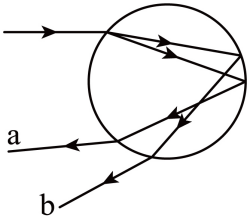

- A. 彩虹的形成是光的色散现象
- B. 太阳光发生色散时红光偏折最小
- C. a光线是红光
- D. 由光路图可知，若要观测“人工虹”，应背日喷水

【答案】C

【解析】A．彩虹是太阳光通过悬浮在空气中细小的水珠折射而成的，太阳光被分解成各种单色光，这种现象叫做光的色散现象，故A正确，不符合题意；
BC．不同颜色的光的折射程度是不同的，发生色散时，红光的偏折程度最小，故b光线代表的是红光；紫光的偏折程度最大，故a光线代表的是紫光，故B正确，不符合题意，C错误，符合题意；
D．由图可知，太阳光从观察者背后射到水滴上，经折射、反射后进入人眼，所以人要背对太阳喷水能看到彩虹，故D正确，不符合题意。

## 21. 填空题（难度：适中）

太阳光经过三棱镜后，被分解成各种色光，这是光的现象．将三种色光适当混合能产生其它任何色光，这三种色光分别是红光、和蓝光，一朵月季花在阳光下呈现出十分耀眼的红色，这是因为．

【答案】色散，绿光，月季花只反射红光

【解析】太阳光由七种单色光组成，经三棱镜之后可以分解，这是光的色散；红、绿、蓝三种单色光是光的三原色，混合后可以产生其它任何色光；因为月季花呈红色，当太阳光照射到花上时，花只反射红光，而把其它色光都吸收了，反射的红光进入人眼，人看到的就是红色的．
【点睛】太阳光经三棱镜后，可以分解成七种单色光，这是光的色散；光的三原色是：红光、绿光和蓝光；颜料的三原色是：红、黄、蓝；不透明的物体可以反射与它相同的色光，而吸收其它色光；透明物体可以让与它相同的色光透过，而把其它色光反射回去．

## 22. 单选题

五彩斑斓的光现象为生活增添了无穷色彩。下列有关光现象的说法中正确的是（　　）

- A. 电视机的遥控器是利用紫外线来遥控的
- B. 病房中紫外线灯发出的淡紫色光就是紫外线
- C. 验钞机发出的红外线能使钞票上的荧光物质发光
- D. 彩色电视画面的颜色是由红、绿、蓝三种色光合成的

【答案】D

【解析】A．电视机遥控器利用的是红外线，红外线可传递信息，且人眼看不到。故A错误；
B．紫外线是不可见光，人眼无法直接看到，紫外线灯发出的“淡紫色光”是其伴随的可见光，并非紫外线本身。故B错误；
C．紫外线能使钞票上的荧光物质发光，验钞机利用的是紫外线的荧光效应。红外线主要用于热效应、遥控等。故C错误；
D．彩色电视画面的颜色由光的三原色红、绿、蓝合成，这三种色光按不同比例混合，可呈现出各种颜色。故D正确。

## 23. 填空题（难度：适中）

电影或投影仪的银幕都是白色的，而且这些银幕都是粗糙的，请解释其中的物理道理。银幕是白色：___；银幕是粗糙：___。

## 24. 填空题（难度：适中）

唐朝《玄贞子》一书记载了著名的人工彩虹实验：“背日喷乎水，成霓虹之状。”这是由于喷水后空气中浮有细小的水珠，太阳光透过小水珠后形成美丽的彩虹，该现象称为现象。英国物理学家首先通过实验研究了这个现象。

【答案】光的色散，牛顿

【解析】[1] 太阳光透过空气中的细小水珠，被分解成红、橙、黄、绿、蓝、靛、紫七色光，这种现象称为光的色散现象。
[2]英国物理学家牛顿首先通过三棱镜实验研究了光的色散现象。

## 25. 填空题（难度：适中）

红外线应用非常广泛，下列仪器中，属于利用红外线工作的是___（填序号）。①电视遥控器②医用“B超机”③验钞机④热成像仪⑤地震台风检测仪

## 26. 填空题（难度：适中）

物理知识和我们的生活联系非常紧密，电视机遥控器可以发出不同的红外线光来实现电视机的遥控，把遥控器对准电视机的控制窗口，按一下按钮控制电视这是利用了光的；不把遥控器对准电视机的控制窗口，按一下按钮，有时也可以控制电视机，这是利用了光的；彩色电视机画面上的丰富色彩是由红、、蓝三原色光混合而成的。

【答案】直线传播，反射，绿

【解析】[1]可见光与不可见光在同种均匀的介质中沿直线传播，把遥控器对准电视机的控制窗口来控制电视机，是利用光的直线传播。
[2]不把遥控器对准电视机的控制窗口，也能控制电视机，这是遥控器对着墙时，经过墙的反射来控制电视机。
[3]光的三原色是红、绿、蓝，故彩色电视机的色彩是红、绿蓝三种色光混而成的。

## 27. 填空题（难度：适中）

白居易诗《河亭晴望》中有诗句“晴虹桥影出，秋雁橹声来”描绘了一幅江南水乡的雨后秋景。雨后彩虹是太阳光的现象。

【答案】色散

【解析】当太阳光进入小水滴时，由于不同颜色的光折射程度不同，太阳光被分解成红、橙、黄、绿、蓝、靛、紫七种颜色的光，雨后彩虹是光的色散现象。

## 28. 填空题（难度：适中）

太阳光中的___可以使荧光物质发光，经常用来验钞；晒太阳令人感觉温暖是因为其中的___具有显著的___。

## 29. 填空题（难度：适中）

如图所示，某物理小组在水槽中斜插一块平面镜，让太阳光斜射在水下的平面镜上，并反射到白纸上，可以在白纸上看到彩色光带，这种白光被分解成各种颜色光的现象叫作光的___。最早通过实验研究该现象的物理学家是___；白纸上红光之外还存在看不见的红外线，请写出一种生活中利用红外线的实例：___。

## 30. 填空题（难度：适中）

孔颖达在《礼记·月令》中写道：“云薄漏日，日照雨滴则虹生”。雨后彩虹是由于光的___而形成。英国物理学家牛顿通过三棱镜将一束太阳光分解为红到紫七种颜色的光，其中绿、蓝、___叫做光的三原色，太阳光属于___（选填“A．单色光”或“B．复色光”）。

## 31. 填空题（难度：适中）

一束太阳光经三棱镜折射后，被分解成红、橙、黄、绿、蓝、靛、紫七种色光的现象叫做光的，说明太阳光是。从图甲中可以看出红色光线的偏折程度最（选填“大”或“小”）。图乙为光的三原色的示意图，图乙中区域1应为色，区域2应为色。

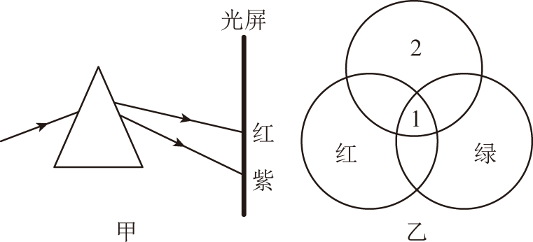

【答案】色散，复色光，小，白，蓝

【解析】[1][2]一束太阳光经三棱镜折射后，被分解成红、橙、黄、绿、蓝、靛、紫七种色光的现象叫做光的色散，雨后彩虹也属于色散现象，这说明太阳光是多种色光混合而成的，属于复色光。
[3]由图甲可知，太阳光经过三棱镜后被分解成七种色光，红光在光屏的最上方，说明其偏折能力最小，紫光在光屏的最下方，说明其偏折能力最大。
[4][5]红、绿、蓝三种色光按照不同的比例混合，就可以看到多种颜色，故红、绿、蓝三种色光被称为光的“三原色”；当红、绿、蓝三种色光按照一定的比例同时重叠时，可以看到白色，故图乙中区域1是白色，区域2是蓝色。

## 32. 填空题（难度：适中）

一本物理教材掉到了地上，小明和小红从不同的位置都能看到它，对于这一现象，小明和小红看到教材都是由于光在教材表面发生了（选填“镜面反射”、“漫反射”）。晴天晒被子能杀菌，这是利用太阳光中的（选填“红外线”或“紫外线”）；晒过太阳后的被子暖热，这是利用太阳光中的（选填“红外线”或“紫外线”）。

【答案】漫反射，紫外线，红外线

【解析】一本物理教材掉到了地上，小明和小红从不同的位置都能看到它，小明和小红看到教材都是由于光在教材表面发生了漫反射，反射光线射向各个方向。
紫外线能杀死微生物，晴天晒被子能杀菌，这是利用太阳光中的紫外线；红外线具有良好的热效应，晒过太阳后的被子暖热，这是利用太阳光中的红外线。

## 33. 填空题（难度：适中）

如图甲所示，雾炮车利用大型鼓风机向空中喷射水雾，吸附空气中的PM2.5，若天气晴好，望向水雾可能会看到美丽的“彩虹”，这种现象在物理学上属于光的___现象；如图乙所示，一束太阳光通过三棱镜后，在白色光屏上呈现彩色光带，说明不同色彩的光的偏折角度不同，光屏上A、B是光带边缘的色光，其中A为 ___ 光；彩色电视机画面上的丰富色彩是由红、绿 、___三种色光混合而成的，这三种色光叫光的三原色。

## 34. 填空题（难度：适中）

如图，我们知道太阳光是由各种色光混合而成的，各种色光的偏折程度不同，其中偏折程度最大的是___光。

## 35. 填空题（难度：适中）

长寿湖是三峡国际旅游黄金线的重要节点，被评为“巴渝十二景”。雨后的长寿湖上横跨了一轮彩虹，彩虹的形成是光的___现象。

## 36. 填空题（难度：适中）

春游时，同学们看到：①水中的鱼；②岸边的树在湖中的倒影；③雨后的彩虹；④茂密的树下有一个个圆形的小光斑。在他们看到的景物中，属于光的反射现象的是___；成实像的是___（均选填序号）。

## 37. 填空题（难度：适中）

如图是同学们通过电视观看“九三阅兵”。彩色电视机画面上的丰富色彩是由红、___、蓝三原色光混合而成的；阅兵式上洪亮的口号是通过___传入人耳的，电视机遥控器可以发出___（选填“红外线”或“紫外线”），来实现电视机的遥控。

## 38. 单选题（难度：适中）

牛顿曾做过光的色散实验，将一束太阳光投射到三棱镜上，如图在右侧光屏上AB范围内可观察到不同颜色的光。下列说法错误的是（　　）

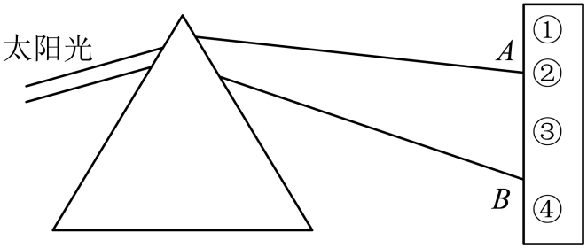

- A. 太阳光由各种色光混合而成
- B. 把温度计放在①处，会看到温度上升
- C. 光屏②处是紫色光，其偏折程度最小
- D. 将面值100元的钞票放在④处，会看到“100”字样发光

【答案】C

【解析】A．太阳光通过三棱镜后，被分解成红、橙、黄、绿、蓝、靛、紫等多种颜色的光，这个现象叫做光的色散，这表明太阳光是由各种色光混合而成的复色光，故A正确，不符合题意；
B．光屏上A处是红光，①处位于A的外侧，是红外线区域，红外线具有显著的热效应，能使物体的温度升高，因此，把温度计放在①处，会看到温度上升，故B正确，不符合题意； 
C．太阳光经过三棱镜折射后，不同色光的偏折程度不同，从上到下依次是红、橙、黄、绿、蓝、靛、紫。红光的偏折程度最小，位于光谱的最上端（A处附近）；紫光的偏折程度最大，位于光谱的最下端（B处附近），所以光屏②处是红光区域，故C错误，符合题意；
D．光屏上B处是紫光，④处位于B的外侧，是紫外线区域，紫外线能使荧光物质发光。人民币的防伪标记中含有荧光物质，在紫外线的照射下会发光。因此，将面值100元的钞票放在④处，会看到“100”字样发光，故D正确，不符合题意。

## 39. 填空题（难度：适中）

白光被分解成多种色光的现象叫做光的___，最早发现这一现象的物理学家是___，如图所示为色光三原色的示意图，图中区域1应标___色。

## 40. 填空题（难度：适中）

如图所示，在深盘中盛一些水，盘边斜放一块平面镜，使镜的下部浸入水中。让一束阳光照射在水下的平面镜上，并反射到白纸上，白纸上出现一条彩色的光带。白光被分解是光的___现象；在不同角度都能看到这条光带，是光在白纸上发生___（选填“漫”或“镜面”）反射。

## 41. 多选题（难度：适中）

如图所示的彩色电视机的荧屏上呈现各种颜色，都是由三种基本色光混合而成 的，这三种基本色光是(　　)

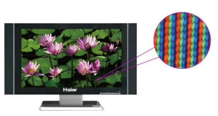

- A. 黄光
- B. 红光
- C. 蓝光
- D. 绿光

【答案】B/C/D

【解析】光的三原色是红、绿、蓝。光的三原色能组成各种色光。故选BCD。

## 42. 填空题（难度：适中）

如图，让一束太阳光通过挡光板的狭缝照射到三棱镜的一个侧面上，在另一侧的光屏上可观察到彩色光带，这说明太阳光是。光屏上A、B是彩色光带边缘的色光，用温度计测试不同区域内光的热效应时发现，当温度计玻璃泡放在（选填“A”或“B”）光外侧时，温度计的示数会明显升高。

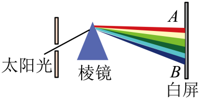

【答案】由多种色光混合而成，A

【解析】[1]太阳光透过三棱镜分解为红、橙、黄、绿、蓝、靛、紫七色光的现象叫光的色散，说明太阳光是多种色光混合而成。
[2]A的外侧有红外线，红外线的热效应强，因此，用温度计测试时发现，当温度计玻璃泡放在A光外侧时，温度计的示数会明显升高。

## 43. 填空题（难度：适中）

小明学习了光学后在家做了有关实验。如图所示，在深盘中盛一些水，盘边斜放一块平面镜，使镜的下部浸入水中。让一束阳光照射在水下的平面镜上，并反射到白纸上。他在白纸上看到了（选填“白色光”或“各种颜色的光”）；能从不同角度观察到白纸上的现象，是因为发生了反射。

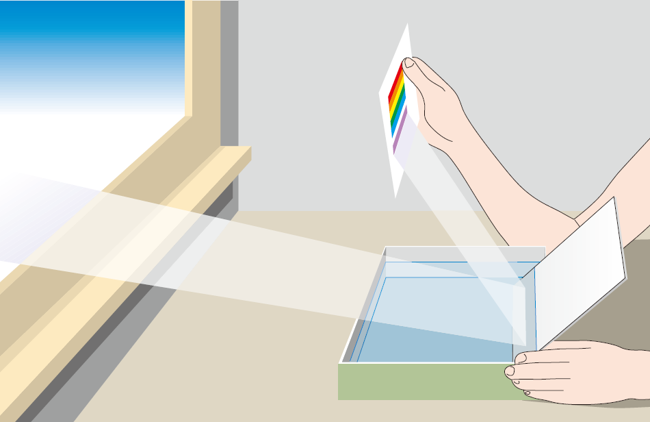

【答案】各种颜色的光，漫

【解析】让一束阳光照射在水下的平面镜上，经过光的折射后，再反射到白纸上，发生光的折射时，将太阳光分解为各种颜色的光，故经反射到白纸上的是各种颜色的光。
白纸比较粗糙，光照射到白纸时，向四面八方反射，发生了漫反射，故能从不同角度观察到白纸上的现象。

## 44. 填空题（难度：适中）

将太阳光通过三棱镜色散，在三棱镜后方放置白色光屏，如图甲所示。将三支温度传感器分别置于图甲ABC三个区域，测得温度T随时间t变化的图像如图乙所示。曲线③对应的光是___，对应的温度传感器置于光屏的___区域。

## 45. 单选题（难度：适中）

如图所示是“洋湖灯展”的场景，这场光与影的盛宴吸引了一波又一波的游客前来参观。下列说法正确的是（　　）

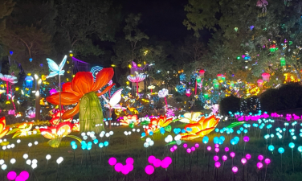

- A. 五光十色的灯光是由于光的色散形成的
- B. 彩灯发出五颜六色的光是由红、绿、黄三种色光混合而成的
- C. 正在发光的灯是自然光源
- D. 白光不是单色光，是由各种色光混合而成的

【答案】D

【解析】A．彩灯发出五颜六色的光是因为发光体产生的，不属于光的色散形成的，故A错误；
B．光的三原色是红、绿、蓝，彩灯发出五颜六色的光是由红、绿、蓝三色混合而成，故B错误；
C．正在发光的灯属于人造光源，故C错误；
D．光的色散现象表明，白光不是单色光，是由各种色光混合而成的，故D正确。

## 46. 单选题（难度：适中）

下列关于光现象的说法正确的是（　　）

- A. 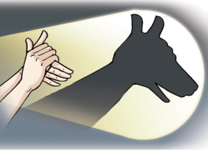
 
如图中，手影是光沿直线传播在墙上成的实像
- B. 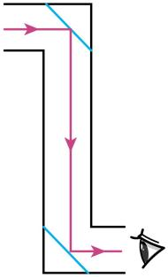
 
如图中，潜望镜利用光的折射来观察物体
- C. 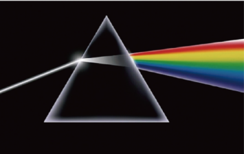
 
如图中，光的色散现象表明太阳光是由多种色光组成的
- D. 
 
如图中，铅笔“错位”是光从空气射入水中发生折射形成的

【答案】C

【解析】A．手影是光沿直线传播形成的阴影，故A错误；
B．潜望镜是两块平行的平面镜，是利用光的反射来观察物体，故B错误；
C．彩虹是典型的色散现象，光的色散现象表明太阳光是由多种色光组成的，故C正确；
D．铅笔“错位”是光从水中斜射入空气中发生折射形成的，故D错误。

## 47. （难度：适中）

元代诗人黄庚在《暮景》中写道：“一曲彩虹横界断，南山雷雨北山晴。”

雨后彩虹的产生是由于光的而形成。实验表明，白光通过三棱镜后在光屏上形成一条由红到紫连续排列的彩色光带，其中，红、、蓝三种色光被称为光的三原色；

请在图中画出白光通过三棱镜的大致光路图，并标出红光、紫光的位置。

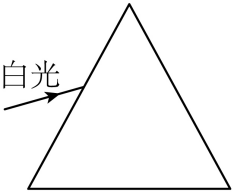

【答案】色散/绿，

【解析】雨后彩虹的产生是由于阳光穿过空气中悬浮的小水滴发生光的色散现象而形成的。
白光经三棱镜后，光屏上自上而下出现了红、橙、黄、绿、蓝、靛、紫的色带，这种现象称为光的色散。这个现象同时说明白光是由多种色光组成的，因此白光是一种复色光，其中，红、绿、蓝三种色光被称为光的三原色。

一束白光通过三棱镜，被分解成七种色光的现象叫光的色散，这七种色光从上至下依次排列为红、橙、黄、绿、蓝、靛、紫。光线从空气斜射入玻璃时，折射角小于入射角，从玻璃斜射入空气时，折射角大于入射角，三棱镜对红光的偏折能力最弱，对紫光的偏折能力最强。

## 48. 单选题（难度：适中）

下列生活、生产中的器具，其工作原理主要利用了紫外线特性的是（　　）

【答案】A

## 49. 单选题（难度：适中）

下列设备中利用紫外线工作的是（　　）

- A. 
 
电视机遥控器
- B. 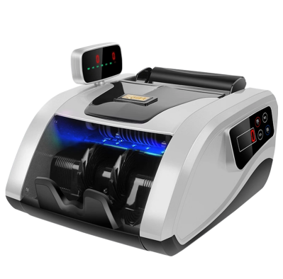
 
验钞机
- C. 
 
感应水龙头
- D. 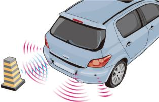
 
倒车雷达

【答案】B

【解析】A．电视机遥控器是利用红外线来传递信号，实现对电视机的控制，故A不符合题意；
B．验钞机是利用紫外线工作的。人民币上涂有荧光物质，在紫外线的照射下会发出荧光，从而可以辨别真伪，故B符合题意；
C．感应水龙头是利用红外线传感器工作的，通过接收人体发出的红外线或反射的红外线来控制水流的开关，故C不符合题意；
D．倒车雷达是利用超声波（属于声波）工作的，通过发射和接收超声波，根据回声定位的原理来判断障碍物的距离，故D不符合题意。

## 50. 单选题（难度：适中）

1666年英国物理学家牛顿通过三棱镜发现了光的色散现象，从而揭示了光的颜色之谜。如图所示的光学现象与光的色散现象原理相同的是（　　）

- A. 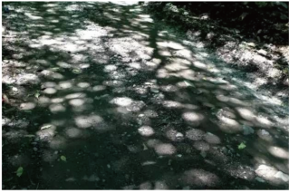
 
树底地面上的光斑
- B. 
 
雨后空中的彩虹
- C. 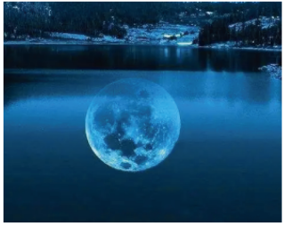
 
水中的月亮
- D. 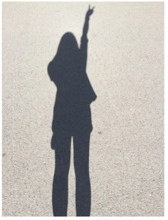
 
阳光下的身影

【答案】B

【解析】A．树底地面上的光斑是太阳光经过树叶间的小孔时，由于光的直线传播所成的实像，故A不符合题意；
B．雨后空中的彩虹是太阳光在经过小水珠时发生了折射和反射，将太阳光分解成了七种颜色的光，属于光的色散现象，故B符合题意；
C．水中的月亮是平面镜成像，属于光的反射，故C不符合题意；
D．阳光下的身影是太阳光经过人体时被挡住了，光线所不能照射到的位置，属于光的直线传播，故D不符合题意。
