# 第一节 声音的产生与传播（同步练习）

> 教材：物理·八年级全一册·沪科技版2024新教材 ｜ 来源：国家中小学智慧教育平台·在线练习 ｜ 共 80 题

## 1. 单选题（难度：简单）

以下几个实验现象，不能说明声音产生的原因的是（     ）

- A. 拨动张紧的橡皮筋，橡皮筋嗡嗡作响，橡皮筋在振动
- B. 把正在发声的闹钟密封在塑料袋里，然后放入水中，人们仍能听到闹钟发出的声音
- C. 用发声的音叉接触水面时，水面会激起水花
- D. 说话时声带在振动

【答案】B

【解析】​

## 2. 单选题（难度：适中）

以下与声现象有关的几个实验中，不能说明声音产生原因的是（     ）

- A. 用手按住正在发声的琴弦时，琴声会消失
- B. 将正在发声的音叉轻轻插入水里，看到水花飞溅
- C. 放在钟罩内的闹钟正在响铃，在抽取钟罩内的空气的过程中，铃声逐渐减小
- D. 在吊着的大钟上固定一支细小的笔，把钟敲响后，用纸在笔尖上迅速拖过，可以在纸上画出一条来回弯曲的细线

【答案】C

【解析】​

## 3. 单选题（难度：简单）

如图所示，将正在发出声音的音叉放入水中，能观察到音叉周围溅起许多水花，该实验是为了说明（     ）

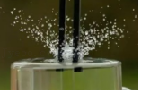

- A. 液体能够传声
- B. 装水的容器能够传声
- C. 发声的音叉正在振动
- D. 水也可以作为声源

【答案】C

【解析】​

## 4. 单选题（难度：简单）

如图是一款骨传导蓝牙耳机，将耳机贴在颞骨两侧而不是堵塞住耳朵，既可以听到耳机发出的声音，也不影响听到周围环境的声音. 耳机声和周围环境声音对应的传播介质分别是（     ）

- A. 固体、固体
- B. 气体、气体
- C. 固体、气体
- D. 气体、固体

【答案】C

【解析】​

## 5. 单选题（难度：简单）

在空间站内、外工作的航天员不能直接对话，他们间的对话必须借助电子设备，其主要原因是（     ）

- A. 直接对话时，空间站舱壁不能传播声音
- B. 直接对话时，航天员听到对方的声音太小
- C. 电子设备传播声音的速度更快一些
- D. 空间站外是真空，真空无法传声

【答案】D

【解析】​

## 6. 单选题（难度：简单）

下表是某些介质中的声速\(v\)​，分析表格的信息，下列判断中是错误的是（     ）

 
 
 
 介质

 
 
 \( v\text{/}\text{（}\text{m/s}\text{）}\) 

 
 
 介质

 
 
 \( v\text{/}\text{（}\text{m/s}\text{）}\) 

 
 

 
 
 水（5℃）

 
 
 1450

 
 
 冰

 
 
 3230

 
 

 
 
 水（15℃）

 
 
 1470

 
 
 软橡胶（常温）

 
 
 40至50

 
 

 
 
 水（20℃）

 
 
 1480

 
 
 软木

 
 
 500

 
 

 
 
 海水（25℃）

 
 
 1531

 
 
 铁（棒）

 
 
 5200

- A. 声速大小可能跟温度有关
- B. 声速大小可能跟介质种类有关
- C. 声音在固体中的传播速度一定比在液体中的传播速度大
- D. 真空中声速是0m/s

【答案】C

【解析】​

## 7. 单选题（难度：适中）

下列的实验实例中，能说明声音的传播条件的一组是（     ）

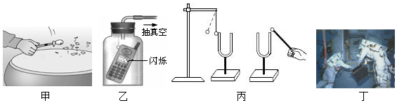
  
甲：在鼓面上放一些碎纸屑，敲鼓时可观察到纸屑在不停地跳动
乙：放在真空罩里的手机，当有来电时，只见指示灯闪烁，听不见铃声
丙：敲击右边的音叉，左边完全相同的音叉将把泡沫塑料球弹起
丁：宇航员在飞船舱外工作时，他们之间的对话必须借助电子通讯设备才能进行

- A. 甲、乙、丁
- B. 甲、丙、丁
- C. 甲、乙、丙
- D. 乙、丙、丁

【答案】D

【解析】​

## 8. 单选题（难度：简单）

以下情景中，不能产生声音的是（     ）

- A. 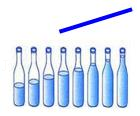
被敲击的水瓶
- B. 
真空罩中响铃的闹钟
- C. 
振翅飞行的蝴蝶
- D. 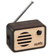
关闭的收音机

【答案】D

【解析】​

## 9. 单选题（难度：简单）

关于声速，下列说法正确的是（     ）

- A. 声音被墙壁反射回来，声速变大
- B. 声音被墙壁反射回来，声速变小
- C. 声音从水中传到空气中时，声速变大
- D. 声音从水中传到空气中时，声速变小

【答案】D

【解析】​

## 10. 单选题（难度：简单）

关于声现象，下列说法正确的是（     ）

- A. 声音的传播速度是340米/秒
- B. 一切正在发声的物体都在振动
- C. 声音可以在真空中传播
- D. 声音只能在空气中传播

【答案】B

【解析】​

## 11. 填空题（难度：简单）

舞龙俗称舞龙灯，是一种起源于中国的汉族传统民俗文化活动. 在舞龙活动中，给舞龙伴奏的鼓声是由鼓面产生的.

【答案】振动

【解析】​

## 12. 单选题（难度：简单）

关于“声速”，以下说法正确的是（     ）

- A. 声音的传播速度总是340m/s
- B. 声音在真空中的传播速度最大
- C. 声音在空气中的传播速度最大
- D. 声音在同种介质中的传播速度可能不同

【答案】D

【解析】​

## 13. 填空题（难度：简单）

“夜半钟声到客船”说明体可以传声；“隔墙有耳”、“贴地听声”等实例说明；“路人借问遥招手，怕得鱼惊不应人”，水下的鱼也能听到水面上人的喊话声，说明体可以传声.

【答案】气，固，液

【解析】​

## 14. 单选题（难度：适中）

图中小资料是声音在一些介质中的传播速度，根据表中提供的信息，下面说法正确的是（     ）

- A. 声音在同一种介质中传播速度一定相同
- B. 声音的传播速度只与介质的温度有关
- C. 声音的传播速度与介质种类和介质的温度有关
- D. 声音在金属中传播速度小于它在气体中传播速度

【答案】C

【解析】​

## 15. 填空题（难度：简单）

如图所示，牛牛同学用力击鼓，鼓面 而产生鼓声，图中出现的波纹夸张地表现了鼓声在空气中是以的形式向外传播的. 

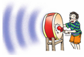

【答案】振动，波

【解析】​

## 16. 填空题（难度：适中）

如图所示，用悬挂着的乒乓球接触正在发声的音叉，可观察到乒乓球被，它说明了；小华用手使劲敲桌子，桌子发出了很大的声响，但他几乎没有看到桌子的振动，为了明显地看到实验现象，你的改进方法是：. 

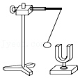

【答案】弹开，发声体在振动，可在桌子上放一些小纸屑，观察纸屑的振动

【解析】​

## 17. 填空题（难度：简单）

某同学看到闪电后，过了3秒才听到雷声，假如忽略光传播所需时间，那么他离闪电的距离大约为.

【答案】1020m

【解析】​

## 18. 填空题（难度：简单）

声音在传播的过程中遇到较大的障碍物会发生反射，形成回声. 如果回声和原声的差别在0.1s以上，人耳可以听到两次声音. 据此判断，人要想清楚的听到两次声音，障碍物和人之间至少要相隔m．闪电和雷声同时产生，可是我们总是先看到闪电，后听到雷声，这说明光速要比声速. （填“快”或者“慢”）

【答案】17，快

【解析】​

## 19. 填空题（难度：适中）

在探究固体能否传声时，小华先坐在桌边（耳朵不往桌子上贴）听小明手指轻划桌面的声音，听到的声音是振动发出的. 小明减轻划桌子的力度，直到小华听不见声音，然后保持小明划桌子的力度，小华耳朵与发声处的距离不变，小华将耳朵贴在桌面上又听到了声音，如图所示，分析以上实验现象，小华得出结论：. 

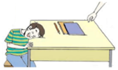

【答案】桌面，固体能够传声且固体传声效果比空气好

【解析】​

## 20. 填空题（难度：适中）

将耳朵贴在长铁管的一端，让另外一个人敲一下铁管的另一端，你会听到次敲打的声音（管中是空的），产生这种现象的原因是 .

【答案】两，敲击声会通过铁管较快地传播到人耳，同时也会通过空气较慢地传播到人耳

【解析】​

## 21. 填空题（难度：简单）

当别人嚼脆饼时，你听到的声音很小；而你自己嚼同样的脆饼时，你会听到较大的咀嚼声. 这是因为前者的声音是靠传播，后者的声音是靠传播，的传声效果好.

【答案】空气，骨骼，固体

【解析】​

## 22. 填空题（难度：简单）

在抗日战争中，八路军为了伏击日军火车，侦察员常用耳朵贴着铁轨来提前判断是否来了火车. 这是利用声音在铁轨中的传播速度声音在空气中的传播速度. （填“大于”“小于”或“等于”）15℃时声音在空气中的传播速度是m/s.

【答案】大于，340

【解析】​

## 23. 

汽车距离山洞\( \text{370m}\)，当它鸣笛后继续向前匀速行驶，经过\( \text{2s}\)后，听到回声，求

（1）\( \text{2}\text{s}\)内声音传播的距离；

（2）\( \text{2}\text{s}\)内汽车前进的距离；

（3）汽车的速度. （已知声音传播速度为\( \text{340m/s}\)）

【答案】

解：（1）已知声速$ {v}_{\text{声}}\text{＝}\text{340m/s}$，时间$ t\text{＝}\text{2s}$，

声音传播的距离：$ s={v}_{\text{声}}t\text{＝}\text{340m/s}\text{×}\text{2s}\text{＝}\text{680m}$；

（2）由题意知：$ \text{2s}$内，汽车与声音通过的路程之和是汽车距离山洞$ s$的2倍，即$ {s}_{\text{车}}+{s}_{\text{声}}=2s$；

得：$ {s}_{\text{车}}=2s﹣{s}_{\text{声}}=\text{2}\text{×}\text{370m}\text{﹣}\text{680m}\text{＝}\text{60m}$；

（3）根据公式$ v=\frac{s}{t}$得；$ {v}_{\text{车}}=\frac{{s}_{\text{车}}}{t}=\frac{\text{60m}}{\text{2s}}\text{＝}\text{30m/s}$. 

答：（1）$ \text{2}\text{s}$内声音传播的距离$ \text{680m}$；（2）$ \text{2}\text{s}$内汽车前进的距离$ \text{60m}$；（3）汽车的速度$ \text{30m/s}$.

【解析】​

## 24. （难度：适中）

在某次军事演习中，一门迫击炮向目标发射了一枚炮弹，炮弹发射后看到炮弹击中目标爆炸，过了\( \text{4.5s}\)听到爆炸的声音. （声音的速度为\( \text{340m/s}\)，不计光传播的时间）求：

（1）先看到爆炸后听到爆炸的声音的原因是什么？

（2）迫击炮离目标的距离是多少？

【答案】

解：

（1）因为在空气中光速远大于声速，所以先看到爆炸后听到爆炸的声音；

（2）由$ v=\frac{s}{t}$可得，追击炮离目标的距离：$ s=vt=\text{340m}/\text{s}\text{×}\text{4.5s}\text{=}\text{1530m}$. 

答：（1）在空气中光速远大于声速；（2）追击炮离目标的距离为$ \text{1530m}$；

【解析】​

## 25. （难度：简单）

超音速飞机的飞行速度常用马赫数表示，马赫数指的是声速的倍数（声速取\( \text{15}\text{℃}\)时空气的传播速度，即\( \text{340m/s}\)），某超音速飞机飞行的马赫数为\( \text{2.5}\)，那么它的飞行速度是多少\( \text{m/s}\)？若广州到北京的距离为\( \text{1900km}\)，这架飞机从广州飞到北京需要多少时间？

【答案】

解：飞机的飞行速度：

$ v=340\text{m/s}\text{×}\text{2.5=850m/s}$，

广州到北京的距离$ s=\text{1900km}\text{＝}\text{1.9}\text{×}{\text{10}}^{\text{6}}\text{m}$，

$ \because $ $ v=\frac{s}{t}$

$ \therefore t=\frac{s}{v}=\frac{\text{1.9×}{\text{10}}^{\text{6}}\text{m}}{\text{850}\text{m}/\text{s}}\text{≈}\text{2235s}$. 

答：这架飞机从广州飞到北京需要$ \text{2235s}$.

【解析】​

## 26. 填空题（难度：简单）

如图所示，将一只通电的小电铃放在连通于抽气机的玻璃罩内，请回答下列问题：
（1）真空能不能传播声音呢？这是科学探究中的环节之一：. 
（2）实验中，用抽气机对玻璃罩中的空气进行抽气，听到的声音会越来越，
（3）此实验说明了. 这种研究方法叫. 

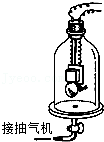

【答案】提出问题，小，声音的传播需要介质，声音不能在真空中传播，推理法.

【解析】​

## 27. 填空题（难度：简单）

小丽“探究声音的产生”的实验装置如图，将系在细线上的乒乓球靠近音叉. 
（1）当小丽同学用小锤敲击音叉的时候，既能听到音叉发出的声音，又能观察到乒乓球在摆动. 通过实验现象得出的结论是. 
（2）如果把实验装置拿到没有空气的月球上做实验，用小锤敲击音叉的时候，实验现象是： 

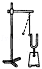

【答案】声音是由物体振动产生的；，能看到乒乓球被弹开，但不能听到声音.

【解析】​

## 28. 填空题（难度：适中）

如图所示，将一只通电的小电铃放在连通于抽气机的玻璃罩内，请回答下列问题：
（1）用抽气机把玻璃罩内的空气逐渐抽出将会发现，. 
（2）如果把空气又逐渐地通入玻璃罩内，将会发现，. 
（3）此实验说明了. 
（4）某同学在做实验时虽然听到的铃声逐渐变小，但始终都能听到铃声，请你分析原因可能是. 

【答案】逐渐变小，逐渐变大，声音不能在真空中传播，玻璃罩内空气没有完全抽出或声音通过泡沫塑料传出.

【解析】​

## 29. 单选题（难度：非常简单）

小明同学用8个相同的水瓶演奏了一首音乐。他在这8个相同水瓶中灌入不同高度的水，如图所示，从左到右敲击它们，就可以发出“Do、re、mi……”的声音来。演奏时，声音的发声体是（　　）

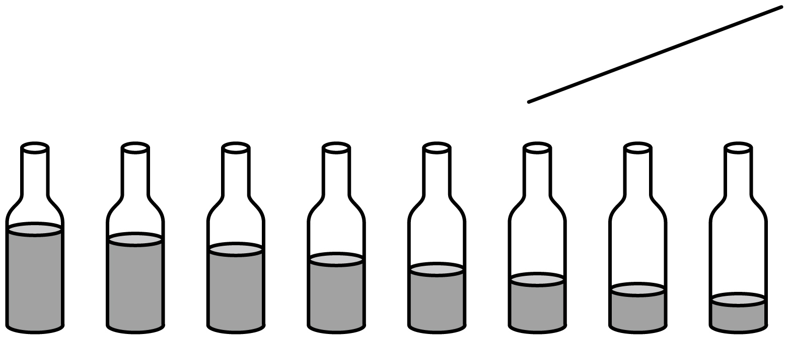

- A. 瓶子和水
- B. 空气柱
- C. 水柱
- D. 敲击棒

【答案】A

【解析】声音是由物体振动产生的。演奏时，振动的物体为瓶子和水，声音的发声体是瓶子和水。故A符合题意，BCD不符合题意。
故选 A。

## 30. 单选题（难度：非常简单）

中国民族乐器历史悠久。下列考古发现的中国乐器，演奏时发声体是空气的是（    ）

- A. 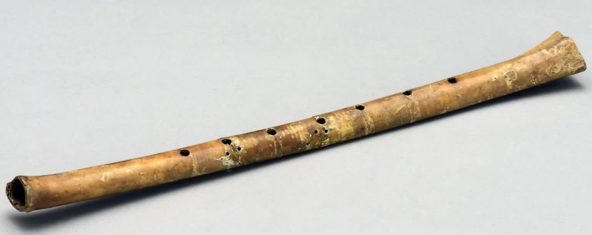
 
贾湖骨笛
- B. 
 
磬
- C. 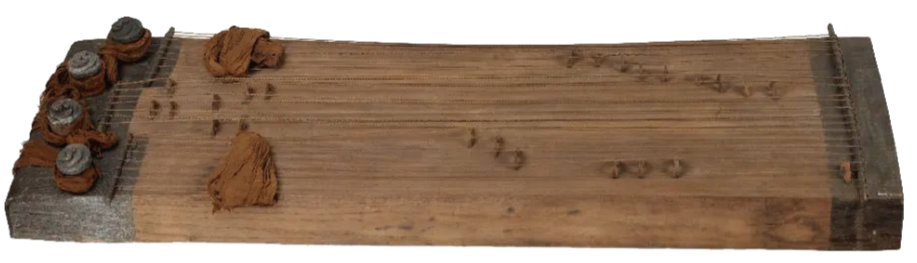
 
西汉二十五弦瑟
- D. 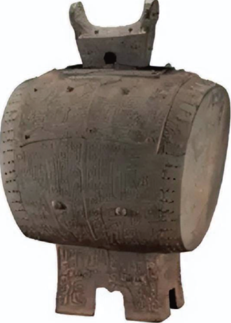
 
崇阳铜鼓

【答案】A

【解析】A．吹奏骨笛时，人吹动骨笛上的孔，笛子内部的空气柱振动发声，故A符合题意；
B．磬演奏时是中间的金属部分振动发声，故B不符合题意；
C．二十五弦瑟演奏时是弦振动发声，故C不符合题意；
D．铜鼓演奏时，人用力敲击鼓面，鼓面振动发声，故D不符合题意。
故选A。

## 31. （难度：非常简单）

如图所示，拨动绷紧的橡皮筋，橡皮筋发出声音，同时观察到橡皮筋“变胖”、“变虚”。橡皮筋“变胖”、“变虚”，说明它在(    )；该实例说明声音是由发声体(    )产生的。

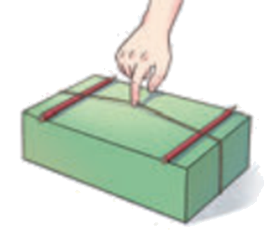

【答案】

振动     振动

【解析】橡皮筋振动时，位置不断变化，由于“视觉暂留”现象，会同时观察到不同位置的橡皮筋，所以看到的橡皮筋“变胖”、“变虚”。发声的橡皮筋同时在振动，说明声音是由物体振动产生的。

## 32. 单选题（难度：适中）

鸟鸣清脆如玉，琴声婉转悠扬，那请你判断下列关于声现象的说法正确的是（　　）

- A. 老师在教室里讲课时，没有产生回声
- B. 声音在真空中以声波的形式进行传播
- C. 一般来说，声音在固体中传播速度比液体中快
- D. 声音是由物体振动产生的，物体的振动停止，声音立即就会消失

【答案】C

【解析】A．老师在教室里讲课时，产生了回声，但是人耳无法区分，故A错误；
B．声音在真空中不能传播，故B错误；
C．一般来说，声音在固体中传播速度比液体中快，故C正确；
D．声音是由物体振动产生的，物体的振动停止，声音不会立即就会消失，但是会停止发声，故D错误。

## 33. 单选题（难度：适中）

2025年12月27日，“湘超”总决赛在长沙贺龙体育馆隆重举行，关于赛场上涉及的物理知识说法正确的是（　　）

- A. 裁判员通过哨声来执行裁判工作，“哨声”在真空中比在空气中的传播速度大
- B. 现场观众为运动员们呐喊助威，“呐喊声”是通过空气传播到运动员耳朵的
- C. 中场休息时，现场响起动听的音乐声，“音乐声”在空气中传播时，速度不断变小
- D. 球迷方阵成员以激昂的鼓声为运动员们加油，“鼓声”是由空气振动产生的

【答案】B

【解析】A．声音的传播需要介质，真空不能传声，所以“哨声”在真空中无法传播，不存在传播速度大小比较，故A错误；
B．现场观众的“呐喊声”是通过空气这种介质传播到运动员耳朵的，故B正确；
C．“音乐声”在空气中传播时，温度不变，其传播速度是不变的，故C错误；
D．“鼓声”是由鼓面振动产生的，而不是空气振动产生的，故D错误。

## 34. 单选题（难度：适中）

声音在空气中的传播速度，下列说法中正确的是(　　)

- A. 声音在空气中的传播速度是340m/s
- B. 声音在空气中的传播速度不随温度的变化而变化
- C. 声音在15℃的空气中的传播速度是340m/s
- D. 声音在空气中的传播速度随温度的升高而减小

【答案】C

【解析】A. 声音在15℃的空气中的传播速度是340m/s，故A错误；
B. 声音在空气中的传播速度与温度有关，故B错误；
C. 声音在15℃的空气中的传播速度是340m/s，故C正确；
D. 声音在空气中的传播速度随温度的升高而增大，故D错误；

## 35. 单选题（难度：简单）

下列乐器中，主要通过空气柱振动发声的是（　　）

- A. 编钟
- B. 二胡
- C. 钢琴
- D. 长笛

【答案】D

【解析】A．编钟属于打击乐器，通过编钟振动发声的，故A不符合题意；
B．二胡是弦乐器，通过拉弦时弦振动发声，故B不符合题意；
C．钢琴是弦乐器，通过按琴键时琴弦振动发声，故C不符合题意；
D．长笛是管乐器，通过吹奏时长笛里面的空气柱振动发声，故D符合题意。

## 36. 单选题（难度：适中）

在古代，士兵为了能及早听到敌人夜袭的马蹄声，常常睡在地上，并把耳朵贴在地面上听。以下解释不正确的是（　　）

- A. 马蹄踏在地面上，使地面振动
- B. 马蹄声可以沿地面传播
- C. 马蹄声在空气中不能传播
- D. 声音在大地中比在空气中传播快

【答案】C

【解析】A.马蹄踏地面，使地面振动发声，故A正确，不符合题意；
B.声音可在固体（地面）中传播，故B正确，不符合题意；
C.马蹄声在空气中能传播，只是在空气中传播速度比在大地中慢，故C错误，符合题意；
D.声音在固体中传播速度比空气中快，所以贴地听更早，故D正确，不符合题意。

## 37. 单选题（难度：适中）

声音的传播需要介质，下列能说明“液体可以传播声音”的事例是（　　）

- A. 我们听到树枝上小鸟的“唧唧”声
- B. 我们听到雨滴落到雨伞上的“嗒嗒”声
- C. 将要上钩的鱼被岸边的说话声吓跑
- D. 人们在小溪边听到“哗哗”的流水声

【答案】C

【解析】A．小鸟的“唧唧”声也是通过空气进行传播的，故A不符合题意；
B．雨滴打在雨伞上的“嗒嗒”声，是通过空气进行传播的，故B不符合题意；
C．因为声音可以通过水进行传播，所以鱼会被岸上的说话声吓跑，故C符合题意；
D．流水的“哗哗”声是通过空气进行传播的，故D不符合题意。

## 38. 单选题（难度：适中）

在敲响大钟时有同学发现，停止了对大钟的撞击后大钟“余音未绝”，其原因是（　　）

- A. 一定是大钟的回声
- B. 是因为人的听觉发生“延长”的缘故
- C. 大钟虽已停止振动，但空气仍在振动
- D. 有余音说明大钟仍在振动

【答案】D

【解析】敲击大钟时，大钟因为振动而发出声音，停止对大钟的撞击，但大钟的振动不能马上停止，所以仍会产生声音，所以会有“余音未绝”，故ABC不符合题意，D符合题意。

## 39. 单选题（难度：适中）

站在百米赛跑终点的计时员，听到起跑的枪声后立即开始计时，测得小郑同学百米赛跑的时间是13.00s，则小郑同学跑百米的真实时间是（声音在空气中的传播速度为340m/s）（　　）

- A. 13.29s
- B. 13.00s
- C. 12.71s
- D. 无法确定

【答案】A

【解析】声音传播100m所用的时间为
\( {t}_{\mathrm{声}}=\frac{s}{{v}_{\mathrm{声}}}=\frac{100\text{m}}{340\text{m/s}}\approx 0.29\text{s}\) 
小郑同学跑出百米的真实时间为
\( t=13.00\text{s}+0.29\text{s}=13.29\text{s}\) 
故BCD不符合题意，A符合题意。

## 40. 单选题（难度：适中）

同学们一定有这样的体验：吃饼干时，我们自己能听到很响亮的嚼碎饼干的沙沙声，而旁边的人听到这沙沙声就弱多了。最主要的原因是（　　）

- A. 噪声制造者自己听是最响的
- B. 旁人隔得远，声音自然小
- C. 自己听是骨传导，效果更好
- D. 旁人没有认真听，所以觉得声音小

【答案】C

【解析】我们自己能听到很响亮的嚼碎饼干的沙沙声，主要通过骨传导，固体介质传声效果更好，因此声音更响亮；旁边的人听到这沙沙声就弱多了，是因为旁人只能通过空气传导听到声音，气体传声效果不如固体好，故C符合题意，ABD不符合题意。

## 41. 单选题（难度：适中）

宋代苏轼在《琴诗》中问道：“若言琴上有琴声，放在匣中何不鸣？若言声在指头上，何不于君指上听？”诗中的琴声是由什么振动产生的（　　）

- A. 琴弦
- B. 匣子
- C. 指头
- D. 耳朵

【答案】A

【解析】声音是由物体的振动产生的，振动停止，发声也停止。苏东坡的诗句中以设问的形式说明“声音不是在琴弦上，不是在指头上，而是手指拨动琴弦使弦振动产生的”。故A符合题意，BCD不符合题意。

## 42. 单选题（难度：适中）

如图所示，把你的耳朵贴在桌面上，请一位同学用手指甲轻刮桌子（不要让附近的同学听到声音）。此时，你却可以通过桌面听到指甲轻刮桌子的声音。从这个实验可以发现（　　）

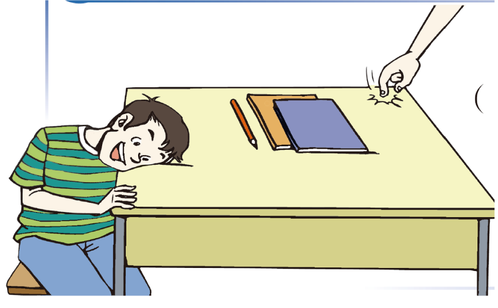

- A. 声音由物体的振动产生
- B. 声音的传播需要介质
- C. 桌子可以传播声音
- D. 空气不能传播声音

【答案】C

【解析】声音的传播需要介质，声音可以在固体液体气体中传播。一位同学用手指甲轻刮桌面，另一位同学把耳朵贴在桌面上听到了声音，但附近的其他同学几乎听不到声音。说明声音不是通过空气传入另一位同学的耳朵的，而是通过桌面传入另一位同学的耳朵的，所以这个实验能说明固体能传播声音。故C符合题意，ABD不符合题意。

## 43. 单选题（难度：简单）

关于声音的产生和传播，下列说法正确的是（　　）

- A. 声音可以在真空中传播
- B. 一切正在发声的物体都在振动
- C. 只要物体振动，我们就一定能听到声音
- D. 声音在不同介质中的传播速度相同

【答案】B

【解析】A．声音的传播需要介质，真空中没有介质，所以声音不可以在真空中传播，故A错误；
B．声音是由物体振动产生的，一切正在发声的物体都在振动，这是声音产生的本质原因，故B正确；
C．物体振动能产生声音，但人耳听到声音还需要满足多个条件：声音的频率在人耳的听觉范围内（20Hz-20000Hz）、有传播声音的介质、声音的响度足够等。所以，物体振动，我们不一定能听到声音，故C错误；
D．声音在不同介质中的传播速度不同，一般情况下，声音在固体中传播速度最快，液体中次之，气体中最慢，故D错误。

## 44. 单选题

火车正在以\( {v}_{1}=144\text{km}/\text{h}\)的速度匀速直线运行，这时司机发现正前方出现隧道，火车鸣笛后就立即开始减速，经过4s听到由隧道口反射回来的回声，此时观察到速度仪表盘上的速度显示为\( {v}_{2}\)，有\( {v}_{1}:{v}_{2}\)=2:1。紧接着司机再次鸣笛，并保持\( {v}_{2}\)匀速直线运动下去，3.5s后司机再次听到回声（v声=340m/s），下列有关说法正确的是（　　）

- A. 以火车头作为参照物，列车行李架上的物品是运动的
- B. 火车第一次鸣笛时距离隧道口的距离为760m
- C. 火车第二次听到回声后，再经过25s后火车开始进入隧道
- D. 火车在减速过程中走过的路程为100m

【答案】D

【解析】A．以火车头作为参照物，列车行李架上的物品的位置没有发生改变，物品是静止的，故A错误；
BD．火车速度为\( {v}_{1}=144\text{km}/\text{h=40m/s}\)
因为\( {v}_{1}\) :\( {v}_{2}\) =2：1，所以第2次的速度为\( {v}_{2}=\frac{1}{2}{v}_{1}\text{=}\frac{1}{2}\times \text{40m/s}=20\text{m/s}\)
列车第1次鸣笛后4s时间内声音传播的路程为\( {s}_{1}={v}_{\mathrm{声}}t=340\text{m/s}\times 4\text{s}=1360\text{m}\)
列车第2次鸣笛后3.5s时间内声音传播的路程为\( {s}_{2}={v}_{\mathrm{声}}{t}^{\text{'}}=340\text{m/s}\times 3.5\text{s}=1190\text{m}\)
列车第2次鸣笛后3.5s时间内火车移动的距离\( {s}_{\mathrm{车}}={v}_{2}{t}^{\text{'}}=20\text{m/s}\times 3.5\text{s}=70\text{m}\)

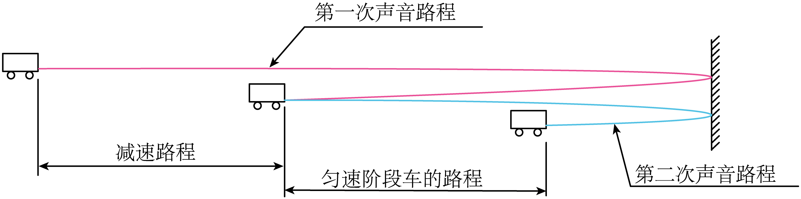
 
由图可知，火车在减速过程中走过的路程为\( L={s}_{1}-({s}_{2}+{s}_{\mathrm{车}})=1360\text{m}-\left(1190\text{m}+70\text{m}\right)=100\text{m}\)
火车第一次鸣笛时距离隧道口的距离为\( {d}_{1}=\frac{{s}_{1}+L}{2}=\frac{\text{1360m+100m}}{\text{2}}=730\text{m}\)
故B错误，D正确；
C．火车第二次鸣笛时，声音传到隧道口并反射回来共用时3.5s，第二次听到回声时距离隧道口的距离为\( {d}_{2}=\frac{{v}_{\mathrm{声}}{t}^{\text{'}}-{v}_{2}^{}{t}^{\text{'}}}{2}=\frac{\text{340m/s}\times \text{3.5s}-\text{20m/s}\times \text{3.5s}}{\text{2}}=\text{560m}\)
火车第二次听到回声后，进入隧道的时间\( {t}^{\text{'}\text{'}}=\frac{{d}_{2}}{{v}_{2}}=\frac{\text{560m}}{\text{20m/s}}=\text{28s}\) 
故C错误。

## 45. 单选题（难度：简单）

如图所示，尔滨同学发现用笔帽可以吹出一段优美的旋律来，那么此声音产生时，振动的物体是（　　）

- A. 嘴唇
- B. 笔帽
- C. 笔帽内空气
- D. 小明声带

【答案】C

【解析】声音是物体振动产生的，尔滨同学发现用笔帽发出的声音，是通过吹气使笔帽内的空气柱振动发声的。

## 46. 单选题（难度：适中）

下列关于声的实验现象中说法错误的是（　　）

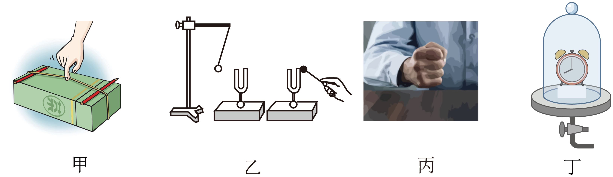

- A. 如图甲，拨动张紧的橡皮筋，看到橡皮筋上下弹跳，并能听到声音，说明发声的物体在振动
- B. 如图乙，敲击右边的音叉，左边完全相同的音叉把泡沫塑料球弹起，这个现象说明声音可以在空气中传播
- C. 如图丙，用手使劲敲桌子，桌子发出了很大的声音，但看不到桌子的振动，说明声音靠物体的振动产生
- D. 如图丁，逐渐抽出真空罩内的空气，闹钟的铃声逐渐减小，可推理得出声音不能在真空中传播

【答案】C

【解析】A．力拨动张紧的橡皮筋时，橡皮筋会振动，而我们会听到振动的橡皮筋发出声音，说明声音是由物体振动发出的，故A正确，不符合题意；
B．敲击右边的音叉，左边完全相同的音叉把泡沫塑料球弹起，说明声音从右边的音叉传到了左边的音叉处，而两个音叉之间隔着空气，所以该实验能说明空气可以传声，故B正确，不符合题意；
C．桌子是较大的物体，用手使劲敲桌子，桌子发出了很大的声音，但看不到桌子的振动，是因为发声振动不易观察，故不能说明声音靠物体的振动产生，故C错误，符合题意；
D．玻璃罩内空气越来越少，声音就越来越小，是因为能使声音传播的介质（空气）逐渐减少造成的，由此可以推出：真空不能传声。故D正确，不符合题意。

## 47. 单选题（难度：适中）

如图所示是两个相同规格的音叉，小敏同学敲响右边的音叉，与左边音叉接触的泡沫塑料球被多次弹开。若把该装置搬到月球表面进行实验，用更大的力敲右边的音叉，则（　　）

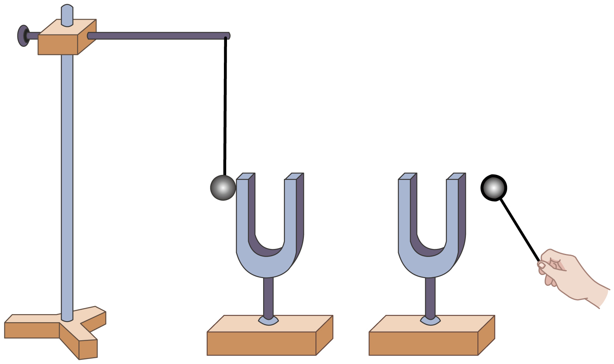

- A. 泡沫塑料球会被弹开，且振幅比第一次实验大
- B. 泡沫塑料球会被弹开，但振幅比第一次实验小
- C. 泡沫塑料球不会被弹开，但能听到音叉发声
- D. 泡沫塑料球既不会被弹开，也不能听到音叉发声

【答案】D

【解析】若把该装置搬到月球表面进行实验，用更大的力敲右边的音叉，月球上没有空气，不能传声，所以左边的泡沫球不会被弹起，左边的音叉也不会发声。

## 48. 单选题（难度：适中）

大课间，学校腰鼓队正在表演，用手掌按住正在发声的鼓面，鼓声就会消失，这是因为（　　）

- A. 手使鼓面停止了振动
- B. 手吸收了鼓声
- C. 手把声音反射回去了
- D. 手不能传播声音

【答案】A

【解析】A．声音是由物体振动产生的，用手掌按住正在发声的鼓面，鼓声就消失了，原因是手使鼓面停止了振动，所以声音消失，故A符合题意，
BC．多孔或柔软材料可以吸声，手无法像吸音材料那样高效吸收声波，手可以反射声音，不能使声音消失，故BC不符合题意；
D．声音的传播需要介质，手是固体，可以传播声音，故D不符合题意。

## 49. 单选题（难度：适中）

如图所示为一款骨传导耳机，它发出的声波可直接通过骨骼传至听神经，使用时不伤害人耳的鼓膜。下列有关说法正确的是（　　）

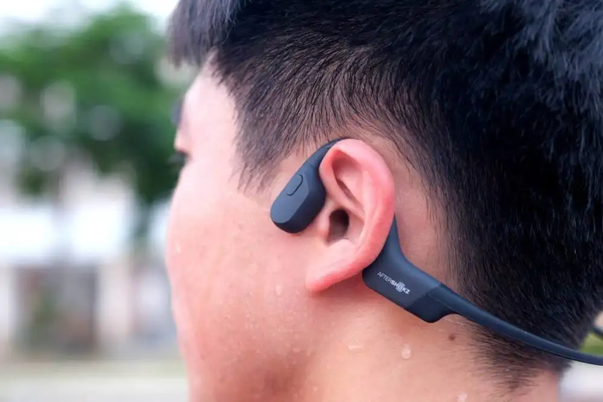

- A. 佩戴者能听到声音说明声音的传播不需要介质
- B. 在太空中，也能使用这款耳机听到声音
- C. 这款耳机发出的声音不是由物体振动产生的
- D. 这款耳机是通过空气传播声音

【答案】B

【解析】AD．声音的传播需要介质，佩戴者能听到声音说明声音的传播是通过骨骼传递的，故AD错误；
B．在太空中，骨骼仍可以传声，所以也能使用这款耳机听到声音，故B正确；
C．声音是由物体的振动产生的，这款耳机发出的声音是由扬声器的振动产生的，故C错误。

## 50. 单选题（难度：适中）

如图所示，是博物馆珍藏的古代青铜“鱼洗”，注入半盆水后，用双手搓把手，会发出嗡嗡声，盆内水花四溅。传说，众多“鱼洗”声能汇集成千军万马之势，曾吓退数十里外的敌军。这反映了我国古代高超的科学制器技术。下列分析正确的是（　　）

- A. “水花四溅”说明发声的“鱼洗”正在振动
- B. “鱼洗”发出嗡嗡声不是由物体振动产生的
- C. “鱼洗”发出的声音只能靠盆中水传入人耳
- D. 众多“鱼洗”声汇集改变了声音的传播速度

【答案】A

【解析】A．发声的“鱼洗”正在振动带动水振动使“水花四溅”，故A正确；
B．声音都是由物体振动产生的，故B错误；
C．“鱼洗”发出的声音是通过空气传入人耳的，故C错误；
D．声音的传播速度只与介质种类和温度有关，与其他因素无关，故D错误。

## 51. 单选题（难度：简单）

如图所示，把正在响铃的闹钟放在玻璃罩内，逐渐抽出玻璃罩内的空气，听到闹铃声逐渐变小；再让空气逐渐进入玻璃罩内，听到闹铃声又逐渐变大。关于实验，下列说法中正确的是（　　）

- A. 空气可以传播声音
- B. 闹铃不振动，也能发出铃声
- C. 若多抽一段时间，可以完全听不见闹铃声
- D. 听到闹铃声又逐渐变大，是由于闹铃振动逐渐变剧烈了

【答案】A

【解析】A.当玻璃罩内有空气时能听到铃声，抽出空气时声音变小，说明声音的传播需要介质，空气是传播声音的介质之一。故A正确；
B.声音是由物体振动产生的，闹铃发出铃声的前提是其铃锤振动敲击铃盖使铃盖振动。若闹铃不振动，无法产生声音。故B错误；
C.若持续抽出玻璃罩内的空气，使其达到真空状态，声音失去传播介质，人耳将无法听到铃声。实际实验中因无法达到绝对真空，声音会非常微弱但还是有一点声音，故C错误；
D.声音的响度与传播介质、距离声源的远近等因素有关。当空气逐渐进入玻璃罩时，声音传播的介质增多，因此响度变大，并非闹铃的振动程度变剧烈了。故D错误。

## 52. 单选题（难度：简单）

如图所示，在演示声音是由物体振动引起的实验中，将正在发声的音叉紧靠悬线下的轻质小球（　　）

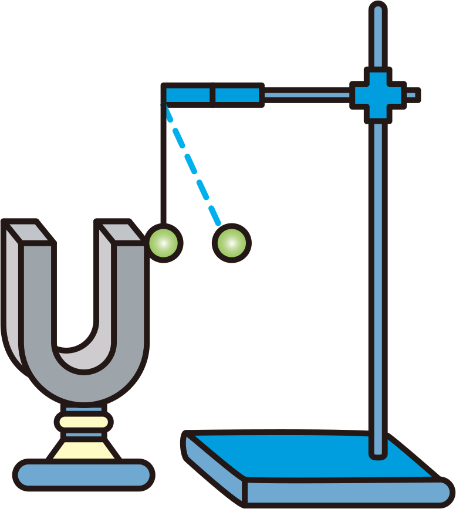

- A. 使音叉振动时间延长
- B. 使音叉振动尽快停下来
- C. 把音叉的微小振动放大，便于观察
- D. 使声波多次反射形成回声

【答案】C

【解析】正在发声物体在振动但不易观察，为了观察到它的振动，放一小球，振动的音叉将小球弹开。通过小球的振动来反映音叉的振动，故C符合题意，ABD不符合题意。

## 53. 单选题（难度：适中）

下列有关声现象的实验中，用于探究声音的传播条件的实验是（　　）

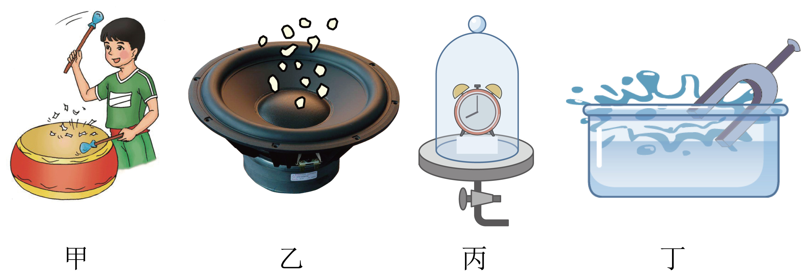

- A. 如图甲所示，敲击鼓面时，发现纸屑不断地跳动
- B. 如图乙所示，正在发声的扬声器上面的碎纸屑不断地跳动
- C. 如图丙所示，随着空气的不断抽出，闹铃的声音越来越小
- D. 如图丁所示，将正在发声的音叉放入水中，看到水花四溅

【答案】C

【解析】A．如图甲所示，敲击鼓面时，发现纸屑不断地跳动，这是探究声音是由物体振动产生的，故A不符合题意；
B．如图乙所示，正在发声的扬声器上面的碎纸屑不断地跳动，同样是探究声音是由物体振动产生的，故B不符合题意；
C．如图丙所示，随着空气的不断抽出，闹铃的声音越来越小，这表明声音的传播需要介质，当介质逐渐减少时，声音传播受到影响，声音变小，是用于探究声音传播条件的实验，故C符合题意；
D．如图丁所示，将正在发声的音叉放入水中，看到水花四溅，还是探究声音是由物体振动产生的，故D不符合题意。

## 54. 单选题（难度：适中）

在一般的教室里我们听不到自己讲话的回声，其原因是（　　）

- A. 教室墙壁完全吸收声波，没有反射，因此无回声
- B. 回声到达人耳比原来的声音滞后小于0.1秒
- C. 在教室中讲话的声音轻
- D. 讲话的人多

【答案】B

【解析】人耳能辨别出回声的条件是反射声具有足够大的声强，并且与原声的时差大于0.1s，即和墙壁至少相隔17米，教室不够大自然听不到回声。故B符合题意，ACD不符合题意。

## 55. 单选题（难度：适中）

天坛是我国古代工匠建造的具有奇特声学效果的回声建筑。两人分别站在东西围墙边，甲轻声说话，乙能清楚地听到对方的声音，下列说法中正确的是（　　）

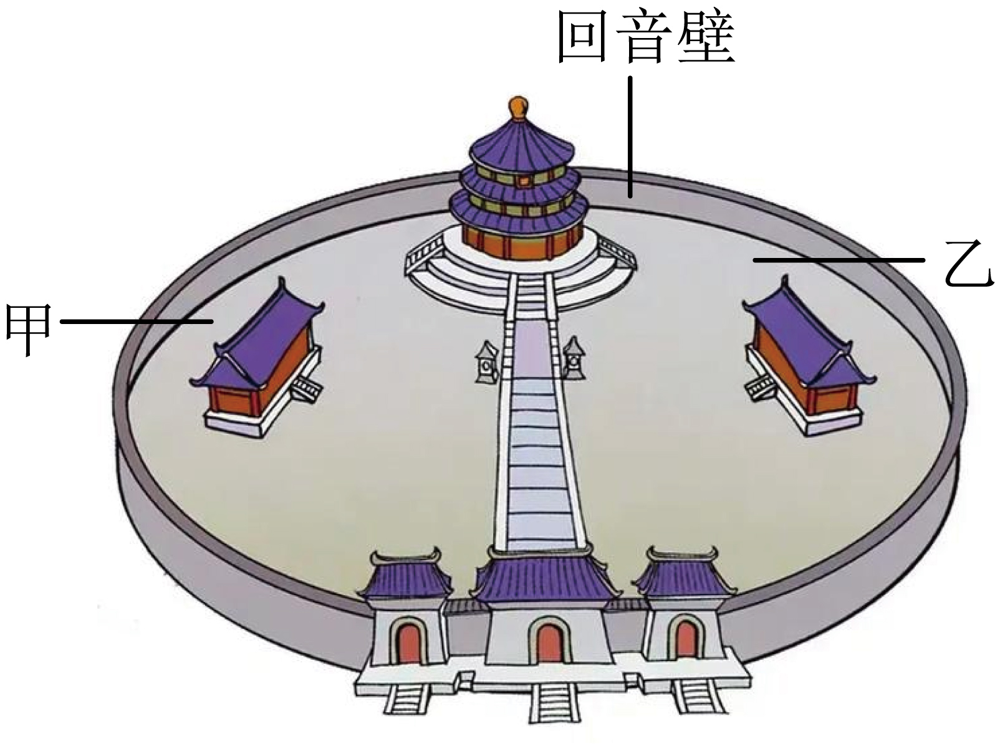

- A. 回声说明声音的传播不需要时间
- B. 甲的声音主要在墙壁中传播
- C. 两人是借助墙壁对声音的反射实现轻声对话的
- D. 回音壁的表面越粗糙，乙听到的声音越清晰

【答案】C

【解析】A．声音的传播是有速度的，通常在空气中的传播速度约为340米/秒。回声是声音遇到障碍物反射回来的现象，这个过程需要时间，故A错误；
B．声音主要是在空气中传播，而不是在墙壁中传播，墙壁的作用是反射声音，使声音能够传到另一侧，故B错误；
C．天坛的回音壁设计巧妙，墙壁能够有效地反射声音，使得站在围墙两边的人即使轻声说话也能被对方清楚地听到，故C正确；
D．粗糙的表面会散射声音，使得声音的能量分散，反而会使声音变得模糊。光滑的表面能够更好地反射声音，使声音更清晰，故D错误。

## 56. 单选题（难度：简单）

剧场等场所的墙壁上被装修成坑坑洼洼的，俗称“燕子泥”，其目的是（　　）

- A. 装饰美观
- B. 增强对声音的吸收
- C. 减弱对声音的吸收
- D. 防止墙体振动发出声音

【答案】B

【解析】松软多孔的物质容易吸收声音，墙壁上都被装修成坑坑洼洼的，其目的就是为了减弱声波的反射，增强对声音的吸收，减弱回声，减少对听原声的干扰，故ACD不符合题意，B符合题意。

## 57. 单选题

骨传导耳机紧贴骨头，声波直接通过骨头传至听神经，不伤害鼓膜。佩戴时不堵塞耳朵，将耳机贴在颞骨两侧，我们就可以听到声音了。下列有关说法正确的是（　　）

- A. 声音在骨传导耳机中的传播速度是340\( \text{m/s}\)
- B. 这种耳机传导的声音不是由物体振动产生的
- C. 对于同一个声音，骨传导耳机和普通耳机传导的声波是完全不同的两种波形
- D. 当我们吃饼干的时候，我们能够听到饼干碎裂的声音就是通过骨传导到我们的内耳

【答案】D

【解析】A．声音在空气中的传播速度是340m/s，一般情况下声音在固体中的传播速度大于在空气中的传播速度，声音在骨传导耳机中的传播速度大于340m/s，故A错误；
B．声音是由物体振动产生的，这种耳机发出的声音也是由物体振动产生的，故B错误；
C．对于同一个声音，它的波形由其振动方式决定，传播介质不同，不会改变波形，故C错误；
D．当我们吃饼干的时候，饼干碎裂的声音是通过我们的牙齿和头骨传递到我们的内耳，该声音以骨传导方式传递，故D正确。

## 58. 单选题（难度：适中）

能说明“液体可以传播声音”的事例是（　　）

- A. 将要上钩的鱼被岸边的说话声吓跑
- B. 我们听到树枝上小鸟的“唧唧”声
- C. 我们听到雨滴打在雨伞上的“嗒嗒”声
- D. 人在小溪边听到“哗哗”的流水声

【答案】A

【解析】A．将要上钩的鱼被岸边的说话声吓跑，是因为声音通过水传到鱼的耳朵，因此鱼被吓跑，说明液体可以传声，故A符合题意；
BCD．树枝上小鸟的“唧唧”声、雨滴打在雨伞上的“嗒嗒”声、“哗哗”的流水声都是通过空气传到人耳，说明气体可以传声，故BCD不符合题意。

## 59. 单选题（难度：适中）

下列能够佐证声是由物体振动产生的是（　　）

- A. 将要上钩的鱼，会被岸上的说话声或脚步声吓跑
- B. 远处的一道闪电划过漆黑的夜空，过一会儿才能听到隆隆的雷声
- C. 边说话边用手触摸并感觉颈前喉头部分
- D. 对着远处的高墙或山崖喊话以后听到的回声

【答案】C

【解析】A．将要上钩的鱼，会被岸上的说话声或脚步声吓跑，这说明了声音可以在液体中传播，故A不符合题意；
B．下雨天人们先看到闪电后听到雷声，这是因为在空气中光的传播速度比声音的传播速度快，故B不符合题意；
C．说话时用手触摸颈前喉头部分，可以感受到振动，说明人的说话声音是声带振动产生的，故C符合题意；
D．对着远处的高墙或山崖喊话以后能听到回声，说明声音在传播过程中遇到障碍物会发生反射，故D不符合题意。

## 60. 多选题（难度：适中）

婴儿从呱呱坠地的那时起，就无时无刻不与声打交道。下列关于声的说法，正确的是（　　）

- A. 我们能听到远处的雷声，说明空气可以传声
- B. 人在岸上大声说话也能惊动水中的鱼，说明水能传声
- C. 宇航员在太空中不能直接对话，说明真空不能传声
- D. 将耳朵贴在长钢管的一端，让他人在另一端敲击一下，你会听到几次敲击声，其中最先听到的声音是通过空气传来的

【答案】A/B/C

【解析】A．声音可以在空气中传播，我们听到远处传来的雷声，是靠空气传播的，A正确，故A符合题意；
B．声音可以在水中传播，人在岸上说话能够惊动水中的鱼，说明水能传声，B正确，故B符合题意；
C．太空中没有空气，是真空状态，声音无法传播，所以宇航员在太空中不能直接对话，C正确，故C符合题意；
D．将耳朵贴在长钢管的一端，让他人在另一端敲击一下，能够听到两次敲击声，一次是钢管传来的，一次是空气传来的，声音在固体的传播速度大于在空气中的传播速度，其中最先听到的声音是通过钢管传来的，D错误，故D不符合题意。

## 61. 单选题（难度：适中）

下列关于声的说法，错误的是（　　）

- A. 我们能听到远处的雷声，说明空气可以传声
- B. 人在岸上大声说话也能惊动水中的鱼，说明水能传声
- C. 将耳朵贴在长钢管的一端，让他人在另一端敲击一下，你会听到几次敲击声，其中最先听到的声音是通过空气传来的
- D. “谁家玉笛暗飞声，散入春风满洛城”中的笛声是由空气柱的振动产生的

【答案】C

【解析】A．声音的传播需要介质，我们能听到远处的雷声，说明空气可以传声，故A正确，不符合题意；
B．声音的传播需要介质，人在岸上大声说话也能惊动水中的鱼，说明水能传声，故B正确，不符合题意；
C．声音在固体中比在气体中传播的快，故将耳朵贴在长钢管的一端，让他人在另一端敲击一下，你会听到几次敲击声，其中最先听到的声音是通过钢管传来的，故C错误，符合题意；
D．声音是有物体振动产生的，“谁家玉笛暗飞声，散入春风满洛城”中的笛声是由空气柱的振动产生的，故D正确，不符合题意。

## 62. 多选题（难度：适中）

古诗《小儿垂钓》中有“路人借问遥招手，怕得鱼惊不应人”。小儿面对路人询问，只是招招手却不作声，下列说法中正确的是（　　）

- A. 声波从空气传入水中后，传播速度不变
- B. 声波在空气中的传播速度小于声音在水中的传播速度
- C. 声音只能在空气中传播，不能在水中传播
- D. 小儿回答路人的询问声能在水中传播，会惊跑鱼儿

【答案】B/D

【解析】AB．声波从空气传入水中后，传播速度变快，故A错误，B正确；
CD．声音在所有的介质中均可以传播，所以小儿回答路人的询问声能在水中传播，故C错误，D正确。

## 63. （难度：适中）

一列长250m的列车在笔直的轨道上匀速行驶，在车头距离桥头200m时，坐在车头的司机鸣笛。在鸣笛10s后列车到达桥头，此时司机恰好到来自车后面山崖传回的回声，列车再行驶1分50秒后，车尾驶过桥尾。（空气中声速为340m/s）

计算列车的速度；

计算大桥的长度；

司机鸣笛时，列车车头到后面山崖的距离是多少。

【答案】

20m/s

，

1950m

，

1600m

【解析】列车的速度\( {v}_{\mathrm{车}}=\frac{{s}_{1}}{{t}_{1}}=\frac{\text{200m}}{\text{10s}}\text{=20}\)

（2）火车完全通过大桥的路程s2=v车t2=20m/s×(60s+50s)=2200m
则大桥的长度L桥=s2-L车=2200m-250m=19

（3）声音传播的路程s声=v声t=340m/s×10s=3400m
设司机鸣笛时车到山崖的距离为s，则2s=s声-s1
所以司机鸣笛时，列车车头到后面山崖的距离\( s=\frac{{s}_{\mathrm{声}}-{s}_{1}}{2}=\frac{3400\text{m}-200\text{m}}{2}=1\)

## 64. 填空题（难度：适中）

发声的音叉放入水中溅出水花，说明声音是由于物体产生的，物理学中把这种研究方法叫做（选填“等效替代法”、“转换法”或“控制变量法”）。

【答案】振动，转换法

【解析】[1]发声的音叉放入水中溅出水花，是因为音叉振动使得水花溅出，说明声音是由于物体振动产生的。
[2]将不易于观察的音叉的振动转换为易于观察的溅起的水花，这种研究方法叫做转换法。

## 65. 填空题（难度：适中）

用金属棒敲击一下钢管的一端，耳朵贴近钢管的另一端听，会先后听到两次声音，其中第一声是通过传入耳中的，第二声是通过传入耳中的，这说明。

【答案】钢管，空气，声音在不同介质中传播速度不同

【解析】声音在固体中的传播速度大于在空气中的传播速度。在敲击钢管时，声音既通过钢管传播，又通过空气传播。由于声音在钢管中传播的速度比在空气中快，所以第一声是通过钢管传入耳中的，第二声是通过空气传入耳中的，这说明声音在不同介质中传播的速度不同。

## 66. 填空题

一辆汽车在匀速行驶，道路前方有一座高山，司机鸣笛并在6s后听到回声，若汽车行驶速度为20m/s，司机从鸣笛到听到回声，汽车行驶了m，司机听到回声时距离高山m。与此同时，复兴号列车车身长428m，正以68m/s的速度驶入长1000m的平直隧道，复兴号在进入隧道时鸣笛9.4s，在隧道另一端口的护路工人听到鸣笛的时间为s。（空气中声速340m/s）

【答案】120，960，7.52

【解析】[1]汽车行驶的路程
s车=v车t=20m/s×6s=120m
[2]声音传播的距离
s声=v声t=340m/s×6s=2040m
设司机鸣笛时汽车到高山的距离为s，则
2s=s声+s车=2040m+120m=2160m
解得
s=1080m
司机听到回声时汽车到高山的距离
s′=s-s车=1080m-120m=960m
[3]假设列车静止在隧道口鸣笛时间为9.4秒，则隧道另一端口的护路工人听到鸣笛的时间为9.4s，列车以68m/s的速度行驶，因此列车在鸣笛结束时已经行驶路程
s1= v1t1=68m/s×9.4s=639.2m
声音传播这段时间
\( {t}_{2}=\frac{{s}_{\mathrm{总}}}{{v}_{\mathrm{声}}}=\frac{639.2\mathrm{m}}{340\mathrm{m}/\mathrm{s}}=1.88\mathrm{s}\) 
实际列车第9.4s末鸣笛声到隧道另一端口则少用t2的时间，所以在隧道另一端口的护路工人听到鸣笛的时间
\( {t}_{\mathrm{总}}={t}_{1}-{t}_{2}=9.4\mathrm{s}-1.88\mathrm{s}=7.52\mathrm{s}\)

## 67. 填空题（难度：适中）

2025年9月18日，中国多地于上午9时18分准时鸣响防空警报，是为了纪念“九一八”事变，向世界传递珍视和平、自强不息的信念。警报声是声源由于而产生的，它是通过传到我们耳朵的。

【答案】振动，空气

【解析】声音是由物体振动产生的，一般通过空气传播进入人耳。

## 68. 填空题

道县正在创建文明城市，严查违法行为，为了监督司机遵守限速规定，交管部门在公路上设置了固定测速仪。如图，静止的巡逻车上测速仪发出并接收超声波脉冲信号。第一次测速仪发出信号到接收经汽车反射回的信号用时0.8s，第二次测速仪发出信号到接收经汽车反射回来的信号用时0.6s。若发出两信号的时间间隔为1.1s，超声波在空气中传播的速度为340m/s，汽车第一次收到信号时，距离测速仪m，被测车的车速m/s。

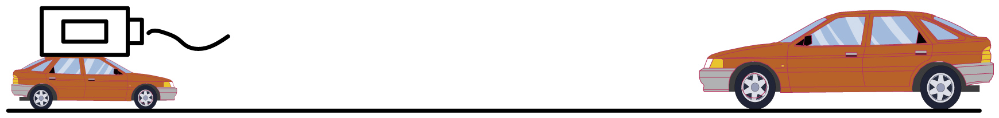

【答案】136，34

【解析】[1]由\( v=\frac{s}{t}\)得，汽车第一次收到信号时，距离测速仪\( s=vt=340\text{m}/\text{s}\times \frac{0.8}{2}\text{s=136m}\)
[2]被测车的车速\( {v}^{\text{'}}=\frac{{s}^{\text{'}}}{{t}^{\text{'}}}=\frac{s-340\text{m/s}\times \frac{0.6\text{s}}{2}}{\frac{0.8\text{s}}{2}+\frac{0.6\text{s}}{2}+1.1\text{s}}=\frac{136-340\text{m/s}\times \frac{0.6\text{s}}{2}}{1.1\text{s-0.8s}+\frac{0.8\text{s}}{2}+\frac{0.6\text{s}}{2}}=34\text{m/s}\)

## 69. （难度：适中）

小明乘坐的汽车在两壁平行的山崖中，当他按了一声喇叭后，经过0.3s后听到一次回声，再经过0.4s后再听到第二次回声。

若汽车是静止的，则这两个山崖之间的距离为m；

若汽车是以20m/s的速度面向较近的山崖匀速驶，则这两个山崖之间的距离为m。（声音在空气中传播速度为340m/s）

【答案】170m，166m

【解析】由题意可知，按了一声喇叭后，经过0.3s后听到一次回声，则声音从汽车所在位置传到较近一侧的山崖所用时间为
t1=0.5×0.3s=0.15s
再经过0.4s后再听到第二次回声，则声音从汽车传播到较远一侧的山崖所用时间为
t2=0.5×（0.3s+0.4s）=0.35s
所以两山之间的距离为
L=v声（t1+t2）=340m/s×（0.15s+0.35s）=170m

由题意可知，若汽车是以20m/s的速度面向较近的山崖匀速驶，则汽车起始位置到较近的山崖的距离为
\( {s}_{1}=\frac{{v}_{\mathrm{声}}{t}_{1}+{v}_{\mathrm{车}}{t}_{1}}{2}=\frac{340\mathrm{m}/\mathrm{s}\times 0.3\mathrm{s}+20\mathrm{m}/\mathrm{s}\times 0.3\mathrm{s}}{2}=54\mathrm{m}\) 
汽车起始位置到较远的山崖的距离为
\( {s}_{2}=\frac{{v}_{\mathrm{声}}（{t}_{1}+{t}_{2}）-{v}_{\mathrm{车}}（{t}_{1}+{t}_{2}）}{2}=\frac{340\mathrm{m}/\mathrm{s}\times 0.7\mathrm{s}-20\mathrm{m}/\mathrm{s}\times 0.7\mathrm{s}}{2}=112\mathrm{m}\) 
则两山之间的距离为
s=s1+s2=54m+1

## 70. 填空题（难度：适中）

唐朝诗人胡令能写了一首《小儿垂钓》“蓬头稚子学垂纶，侧坐莓苔草映身。路人借问遥招手，怕得鱼惊不应人。”如图所示，路人发出声音是由于声带产生的，垂钓小儿不敢答话，因为他知道，声音可以通过气体和传播，可能会吓跑将要上钩的小鱼。现代城市中居民安装双层玻璃窗，可以起到隔音效果，这说明声音不能在中传播。

【答案】振动，液体（水），真空

【解析】[1]声音是由于物体的振动产生的，人发声是由于声带的振动产生的。
[2]因为液体能够传播声音，声音通过水传到小鱼处，所以会把小鱼吓跑。
[3]声音可以在固体、液体和气体中传播，但不能在真空中传播，所以可以利用双层玻璃窗（中间是真空的），这样可以有效的在噪声的传播途中减弱噪声。

## 71. 填空题（难度：适中）

如图，我国已经建成多条“音乐公路”，路面上刻有一条条凹槽，每条凹槽就像一个音符，可以把整条路面看成是一张留声机的碟片，而汽车的轮胎就像是唱针，每当汽车驶过这段路面时，一段完整的音乐就奏响了。音乐声是由轮胎的产生的，音乐声通过传入人耳。

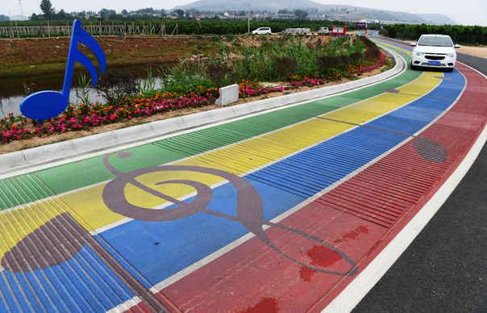

【答案】振动，空气

【解析】[1]声音是由物体的振动产生的，轮胎在路面上振动时，产生了音乐声。
[2]声音的传播需要介质，音乐声通过空气传入人耳。

## 72. （难度：适中）

在探究声音的产生与传播时，小明和小华一起做了下面的实验：

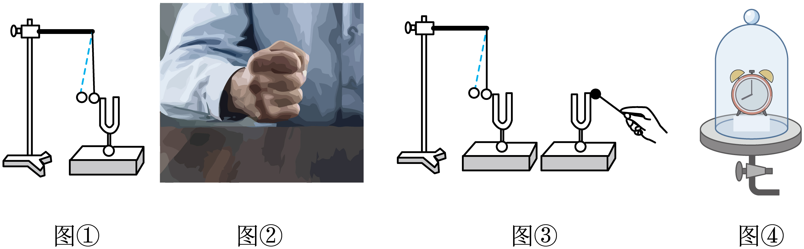

如图①所示，用悬挂着的乒乓球接触正在发声的音叉，可观察到，它说明了声音是由产生的。此探究中悬挂着的乒乓球的作用是；

如图③所示，敲响右边的音叉，左边完全相同的音叉也会发声，并且把泡沫塑料球弹起。该实验能说明可以传声。在月球上（选填“能”或“不能”）看到塑料球弹起；

如图④所示，把正在响铃的闹钟放在玻璃罩内，逐渐抽出玻璃罩内的空气，所听到的铃声将会逐渐（选填“变大”、“变小”或“不变”），并由此推理可知：如果玻璃罩内抽成真空后，就听不到闹钟响铃的声音了，最后得出结论：真空（选填“能”或“不能”）传声。

【答案】乒乓球被弹起/物体振动/放大音叉的微小振动，空气/不能，变小/不能

【解析】[1][2]用悬挂着的乒乓球接触正在发声的音叉，可观察到乒乓球被音叉弹开，说明发声的音叉在振动，说明声音是由物体振动产生的。
[3]发声的音叉在振动，但音叉振动幅度小、肉眼不易直接观察，需借助乒乓球将振动“显示”出来。这里乒乓球的作用是将音叉的微小振动放大，这种研究方法称为 “转换法”。

[1]敲响右边音叉，其振动产生的声音通过周围空气传播到左边相同的音叉，使左边音叉振动，并弹起泡沫塑料球。该实验说明空气可以传声。
[2]月球表面是真空环境，没有空气作为传声介质，右边音叉振动产生的声音无法传播到左边音叉，左边音叉不振动，塑料球不会弹起。

[1][2]玻璃罩内空气逐渐减少，传声介质变稀薄，声音传播的效果减弱，因此听到的铃声逐渐变小。由于无法将玻璃罩内完全抽成真空，需通过“空气越少，铃声越小”的现象推理出 “真空不能传声”，这种研究方法称为“科学推理法”。

## 73. 填空题（难度：适中）

2024年4月10日，雪龙号圆满完成中国第40次南极科考任务。雪龙号在科考活动中经过某海洋区域时，利用回声定位原理从海面竖直向海底发射超声波，从发射到接收到回声所用的时间为4s，若声音在海水中的传播速度为\( 1500\text{m/s}\)，该处海洋的深度为m；探测器发出的超声波由声源的而产生的；在月球表面不能用超声波代替激光来探测距离，原因是。

【答案】$ \text{3000}$ ，振动，真空不能传声

【解析】[1]声音传播到海底所用的时间为
\( t=\frac{\text{4s}}{\text{2}}\text{=2s}\) 
该处海洋的深度为
\( s=vt=1500\text{m/s}\times 2\text{s=3000m}\) 
[2]一切声音都是由于物体振动产生的，探测器发出的超声波由声源的振动而产生的。
[3]声音的传播需要介质，月球表面没有空气，是真空，真空不能传声，所以，在月球表面不能用超声波代替激光来探测距离。

## 74. 填空题（难度：适中）

住宅的玻璃门窗通常采用真空玻璃。其结构特点是将两块玻璃边部密封在一起，通过抽气口将两层玻璃之间抽成接近真空，并用玻璃柱支撑，如图所示。这种双层真空玻璃“既不影响采光，又能隔音”。；“能隔音”的原因是。

【答案】声音不能在真空中传播

【解析】声音的传播是需要介质的，无法在真空中传播，所以两层玻璃之间抽成接近真空后声音无法传播，起到了隔音的效果

## 75. （难度：适中）

学校组织春游，同学们来到了一个山谷里。两侧山崖壁近似平行，物理老师站在山谷里的某一位置（如图所示），他大叫一声2s后听到了第一次回声，又过了3s他听到了第二次回声，已知v声=340m/s。

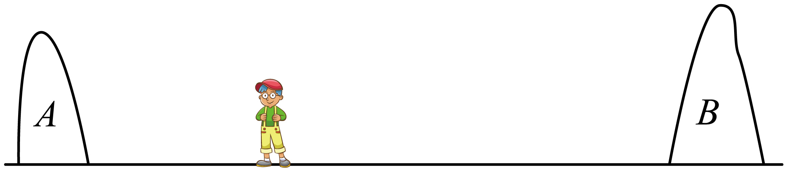

人耳区分回声和原声的最短时间间隔是0.1s，老师距离山崖至少多少米才能听到回声？

老师此时离A山崖的距离是多少米？

两个山崖之间的距离是多少米？

【答案】

17m

，

340m

，

1190m

【解析】声音在空气中传播的速度为340m/s，声音从人到山崖用的时间\( t=\frac{1}{2}\times 0.1\text{s}=0.05\text{s}\)
老师距离山崖的最小距离为s=vt=340m/s×0.05s=17m

物理老师站在山谷里的某一位置叫了一声，2s后他听到了第一次回声，又过了3s后他听到了第二次回声，则声音传播到离他较近的A山崖的时间\( {t}_{1}=\frac{\text{2s}}{\text{2}}=1\text{s}\)
老师此时离A山崖的距离为s1=v声t1=340m/s×1s=340m

声音传到较远山崖的时间\( {t}_{2}=\frac{\text{5s}}{\text{2}}=2.5\text{s}\)
人到该山崖的距离s2=v声t2=340m/s×2.5s=850m
则两个山崖之间的距离为s=s1+s2=340m+850m=1190m

## 76. 填空题（难度：适中）

小丽同学在学习声现象时做了几个探究实验：

 
（1）如图甲所示，将正在发声的音叉放入水中，能观察到音叉周围溅起许多水花，这说明发出声音的音叉在。
（2）如图乙所示，敲响右边的音叉，左边完全相同的音也会发声，并且把泡沫塑料球弹起，该实验能说明可以传声。
（3）如图丙所示，把正在响铃的闹钟放在玻璃罩内，渐抽出玻璃罩内的空气所听到的铃声将会逐渐（选填“变大”、“变小”或“不变”），并由此推理可知：如果玻璃罩内抽成真空后，就听不到闹钟响铃的声音了，最后得出结论：真空（选填“能”或“不能”）传声。
（4）通过丙实验的结论可知，若在月球上做图乙实验，泡沫塑料球弹起（选填“能”或“不能”）。

【答案】振动，空气，变小，不能，不能

【解析】（1）[1]甲图中，发声的音叉激起水花，说明声音是由物体振动产生的。
（2）[2]乙图中，敲响右边的音叉，振动通过空气向外传递，左边完全相同的音叉也会发声，并且把泡沫塑料球弹起，该实验能说明气体可以传声。
（3）[3][4]抽取玻璃罩内的空气，听到罩内的声音逐渐变小，进一步推论得：声音的传播需要介质，真空不能传播声音。
（4）[5]月球上为真空，没有传递声音的介质，所以在月球上做图乙实验，泡沫塑料球不能弹起。

## 77. 多选题

为了监督司机遵守限速规定，交管部门在公路上设置了固定测速仪，如图所示，测速仪向汽车发出两次短促的（超声波）信号，超声波经汽车反射并返回测速仪，第一次发出信号到测速仪接收到信号用时0.5s，第二次发出信号到测速仪接收到信号用时0.4s，若测速仪发出两次信号的时间间隔是1.05s，超声波的速度是340m/s，下列说法正确的是（　　）

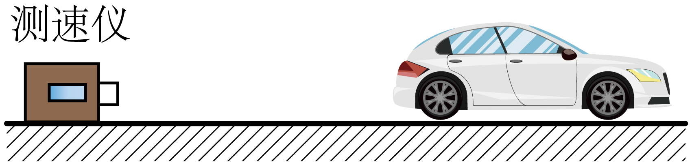

- A. 汽车第一次碰到信号的位置距测速仪170m
- B. 汽车第二次碰到信号的位置距测速仪68m
- C. 汽车两次碰到信号的时间间隔为1s
- D. 汽车行驶的速度为34m/s

【答案】B/C

【解析】A．第一次发出信号到测速仪接收到信号用时0.5s，所以第一次信号到达汽车的时间为0.25s，由\( v=\frac{s}{t}\)可得，汽车接收到第一次信号时，汽车距测速仪\( {s}_{1}={v}_{\mathrm{声}}{t}_{1}=340\text{m/s}\times 0.25\text{s}＝85\text{m}\)，故A错误；
B．第二次发出信号到测速仪接收到信号用时0.4s，所以第二次信号到达汽车的时间为0.2s，由\( v=\frac{s}{t}\)可得，汽车接收到第二次信号时，汽车距测速仪\( {s}_{2}={v}_{\mathrm{声}}{t}_{2}=340\text{m/s}\times 0.2\text{s}=68\text{m}\)，故B正确；
C．汽车在两次信号的间隔过程中，行驶了\( s\text{'}={s}_{1}\mathrm{﹣}{s}_{2}=85\text{m}\mathrm{﹣}68\text{m}=17\text{m}\)
这17m共用了\( {t}^{\text{'}}=\mathrm{\Delta }t-{t}_{\text{1}}+{t}_{\text{2}}=1.05\text{s}-0.25\text{s}+0.2\text{s}=1\text{s}\)，故C正确；
D．汽车的车速为\( {v}^{\text{'}}=\frac{{s}^{\text{'}}}{{t}^{\text{'}}}=\frac{\text{17m}}{\text{1s}}=17\text{m/s}\)，故D错误。

## 78. （难度：适中）

如图所示，长度为300m的火车在笔直的轨道上匀速行驶，在从山崖驶向大桥的过程中，火车头距离桥头500m处鸣笛，鸣笛10s后，火车头到达桥头，此时车头的司机听到来自山崖的回声，最后火车从上桥到完全通过大桥所需时间为30s，空气中的声速为340m/s。求：

火车的速度；

听到回声时，火车车头到山崖的距离；

大桥的长度。

【答案】

$ 50\text{m}/\text{s}$ 

，

$ 1950\text{m}$ 

，

$ 1200\text{m}$ 

【解析】火车头距离桥头500m处鸣笛，鸣笛10s后，火车头到达桥头，火车的速度为\( {v}_{1}=\frac{{S}_{1}}{{t}_{1}}=\frac{500\text{m}}{10\text{s}}=50\)

（2）声音与火车行驶的路程之和等于司机听到回声时火车头距山崖距离的2倍。听到回声时声音传播的路程\( {s}_{\mathrm{声}\mathrm{音}}={v}_{\mathrm{声}}{t}_{1}=340\text{m}/\text{s}\times 10\text{s}=3400\text{m}\)
听到回声时，火车车头到山崖的距离\( {s}_{2}=\frac{1}{2}\left({s}_{1}+{s}_{\mathrm{声}}\right)=\frac{1}{2}\left(500\text{m}+3400\text{m}\right)\)

\( 1950\text{m}\) 
（3）火车完全通过大桥的路程\( {s}_{3}={v}_{1}{t}_{2}=50\text{m}/\text{s}\times 30\text{s}=1500\text{m}\)
大桥的长度\( L={s}_{3}-{L}_{\mathrm{车}}=1500\text{m}-30\)

## 79. 单选题（难度：适中）

下列各项描述的现象中，能说明声音的传播需要介质的是（　　）

- A. 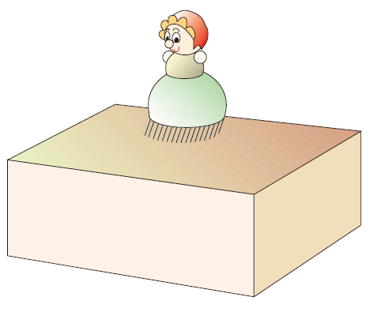
 
小“人”随着音乐起舞
- B. 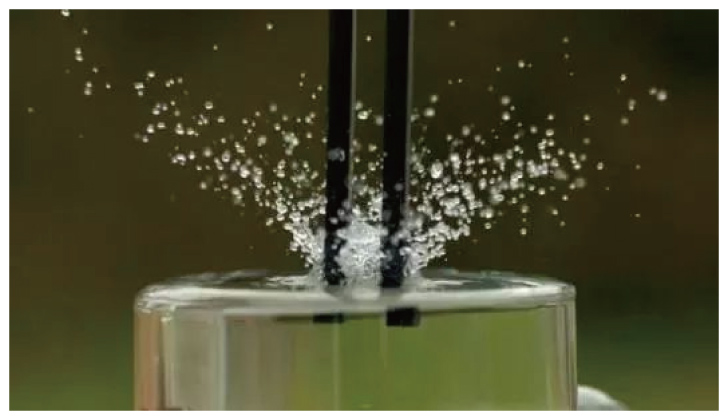
 
正在发声的音叉激起水花
- C. 
 
抽出空气时铃声逐渐变小
- D. 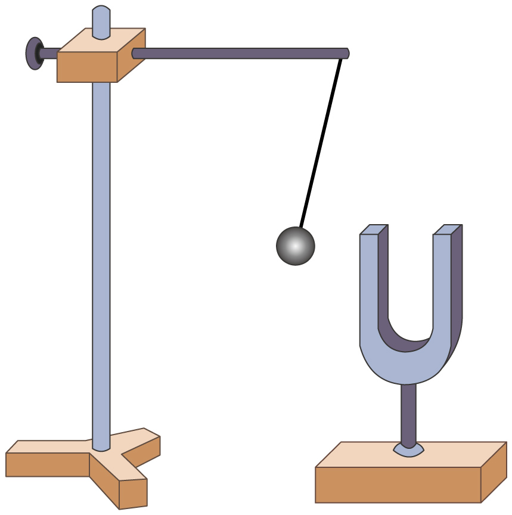
 
正在发声的音叉将乒乓球弹开

【答案】C

【解析】A．将小“人”放在音乐盒上，会发现小“人”随着音乐跳动，说明发声的物体在振动，故A不符合题意；
B．发声的音叉激起水花，说明声音是由物体振动产生的，故B不符合题意；
C．抽出空气时铃声逐渐变小，说明声音的传播需要介质，故C符合题意；
D．正在发声的音叉将接触的乒乓球弹开，说明声音是由于物体的振动产生的，故D不符合题意。

## 80. （难度：适中）

如图所示，一辆汽车在平直公路上匀速行驶，在距离前方山崖430m处时鸣笛，继续行驶2.5s后听到回声，求：

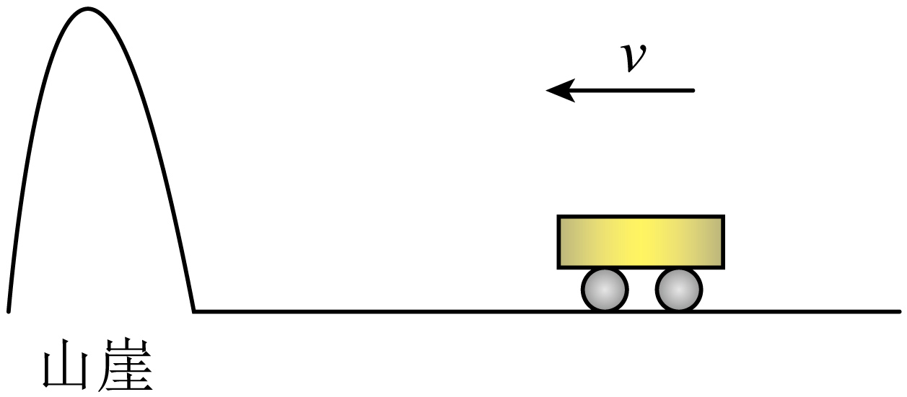

2.5s内声音传播的路程；

听到回声时汽车与山崖的距离；

汽车行驶的速度。

【答案】

850m

，

420m

，

4m/s

【解析】2.5s内声音传播的路程为
\( {s}_{\mathrm{声}}={v}_{\mathrm{声}}t=340\text{m}/\text{s}\times 2.5\text{s}=850\text{m}\)

）从鸣笛到听到回声时汽车前进的距离为
s车＝2L﹣s声＝2×430m﹣850m＝10m
则听到回声时汽车与山崖的距离为
\( s=L-{s}_{\mathrm{车}}=430\text{m}-10\text{m}=420\text{m}\)

）汽车行驶的速度为
\( {v}_{\mathrm{车}}=\frac{{s}_{\mathrm{车}}}{t}=\frac{10\text{m}}{2.5\text{s}}=4\text{m}/\text{s}\) 
 
【题干】38．周末，小王一家开车到郊外的山上游玩。如图是小王开车到山前的示意图，一条笔直的公路通到山崖下，小王在公路上开车向着山崖的方向匀速行驶，他车上速度表显示此时的车速是54km/h，小王开车到A处时，按响了汽笛，汽车向前行驶4s到B处，小王听到了汽笛的回声，（声速是340m/s）。求：

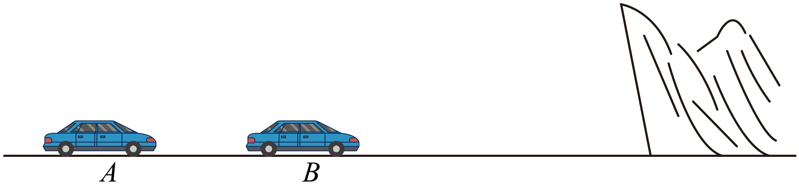
 
(1)汽车行驶路程AB；
(2)声音4s内传播距离；
(3)发声处A点距山崖的距离；
(4)听到回声处B点距山崖的距离。
【答案】(1)60m
(2)1360m
(3)710m
(4)650m
【解析】（1）汽车的速度为
\( v\text{=}54\text{km/h=}15\text{m/s}\) 
根据\( v\text{=}\frac{s}{t}\)可得，汽车行驶路程AB为
\( {s}_{AB}\text{=}v{t}_{1}\text{=15m/s}\times 4\text{s=60m}\) 
（2）根据\( v\text{=}\frac{s}{t}\)可得，声音4s内传播距离为
\( {s}_{\mathrm{声}}\text{=}{v}_{\mathrm{声}}{t}_{1}\text{=340m/s}\times 4\text{s=1360m}\) 
（3）根据题意可知，声音4s内传播的路程与汽车4s内行驶的路程之和等于发声处A点距山崖的距离的两倍，即
\( {s}_{AB}+{s}_{\mathrm{声}}\text{=}2s\) 
所以发声处A点距山崖的距离为
\( s\text{=}\frac{{s}_{AB}+{s}_{\mathrm{声}}}{2}\text{=}\frac{60\text{m}+1360\text{m}}{2}\text{=}710\text{m}\) 
（4）听到回声处B点距山崖的距离为
\( {s}^{\text{'}}\text{=}s\text{-}{s}_{AB}\text{=}710\text{m-}60\text{m=}650\text{m}\) 
 
【题干】39．如图所示火车在笔直的轨道上匀速行驶，在从山崖驶向一座长为1km的大桥的过程中，当火车头在距离桥头150m，距离山崖775m时鸣笛，鸣笛5s后火车头到达桥头，此时车头的司机听到来自山崖的回声。到达桥头后，火车又用50s完全通过了该大桥。

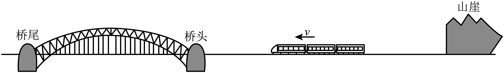
 
(1)计算火车的速度；
(2)声音的速度；
(3)火车的长度。
【答案】(1)30m/s
(2)340m/s
(3)500m
【解析】（1）火车的速度
\( {v}_{\mathrm{车}}=\frac{{s}_{1}}{{t}_{1}}=\frac{150\text{m}}{5\text{s}}=30\text{m/s}\) 
（2）设声音传播的路程s声，司机鸣笛时车到山崖的距离为s=775m，则
2s=s声-s1
s声=2s+s1=2×775m+150m=1700m
声音的速度为
\( {v}_{\mathrm{声}}=\frac{{s}_{\mathrm{声}}}{{t}_{\mathrm{声}}}=\frac{\text{1700m}}{\text{5s}}\text{=340m/s}\) 
（3）火车完全通过大桥的路程
s2=v车t2=30m/s×50s=1500m
则火车的长度
L车=s2-L桥=1500m-1000m=500m 
【题干】40．长度为200m的动车在笔直的轨道上匀速行驶，在从山崖驶向大桥的过程中，如图所示，司机在动车头距离桥头300m处鸣笛，鸣笛6s后，动车头到达桥头，此时车头的司机听到来自山崖的回声；听到回声20s后，车尾驶过桥尾。（此时空气中的声速为340m/s）求：

 
(1)动车的速度；
(2)大桥的长度；
(3)鸣笛时，动车车头离山崖的距离。
【答案】(1)50m/s
(2)800m
(3)870m
【解析】（1）动车的速度
\( {v}_{\mathrm{车}}=\frac{{s}_{1}}{{t}_{1}}=\frac{300\mathrm{m}}{6\mathrm{s}}=50\mathrm{m}/\mathrm{s}\) 
（2）动车完全通过大桥的路程
\( {s}_{2}={v}_{\mathrm{车}}{t}_{2}=50\mathrm{m}/\mathrm{s}\times 20\mathrm{s}=1000\mathrm{m}\) 
则大桥的长度
\( {L}_{\mathrm{桥}}＝{s}_{2}-{L}_{\mathrm{车}}＝1000\mathrm{m}-200\mathrm{m}＝800\mathrm{m}\) 
（3）声音传播的距离
\( {s}_{\mathrm{声}}={v}_{\mathrm{声}}{t}_{1}=340\mathrm{m}/\mathrm{s}\times 6\mathrm{s}=2040\mathrm{m}\) 
鸣笛时，动车头与山崖的距离
\( s=\frac{1}{2}\left({s}_{\mathrm{声}}-{s}_{1}\right)=\frac{1}{2}\left(2040\mathrm{m}-300\mathrm{m}\right)=870\mathrm{m}\) 
【题干】41．中国高铁技术，独步全球。如图所示，列车长为220m，某日小明和小李坐在稳定运行的高铁中，小明坐在高铁车尾的最后一排，小李坐在高铁车头的最前一排（小李到车头的距离忽略不计），列车在到达某隧道口之前车头会鸣笛一次，小明会听到两次鸣笛声（第一次是车头发出的鸣笛声，第二次是隧道口反射回来的回声），小李听到鸣笛声（时间忽略）后，经过5s听到隧道口反射回来的回声。已知：高铁速度恒定不变为100m/s，空气中声速取340m/s。求：

 
(1)鸣笛后，小明听到第一次鸣笛的时间是多少秒？
(2)小李听到鸣笛时，高铁车头到隧道口的距离是多少米？
(3)小明第二次听到鸣笛时，高铁车头到隧道口的距离是多少米？
【答案】(1)0.5s
(2)1100 m
(3)550 m
【解析】（1）小明听到的第一次鸣笛声从车头发出，车发出鸣笛声后继续向前行驶，鸣笛声向车尾传播，车头发出鸣笛声的位置与小明的距离\( {s}_{1}={L}_{\mathrm{车}}={s}_{\mathrm{声}}+{s}_{\mathrm{车}}=\left({v}_{\mathrm{声}}+{v}_{\mathrm{车}}\right){t}_{1}=\left(340\mathrm{m}/\mathrm{s}+100\mathrm{m}/\mathrm{s}\right){t}_{1}=220\mathrm{m}\)
解得\( {t}_{1}=0.5\mathrm{s}\)。
（2）列车在车头处鸣笛，向前传播的声音被隧道口反弹回来，被坐在车头第一排的小李听到，这段时间为\( {t}_{2}=5\mathrm{s}\)，在鸣笛声向前传播时，列车也在向前运动，则小李听到回声时，车向前运动5s，该段时间声音传播的距离\( {{s}_{\mathrm{声}}}^{\text{'}}={v}_{\mathrm{声}}{t}_{2}=340\mathrm{m}/\mathrm{s}\times 5\mathrm{s}=1700\mathrm{m}\)
车行驶的路程\( {{s}_{\mathrm{车}}}^{\text{'}}={v}_{\mathrm{车}}{t}_{2}=100\mathrm{m}/\mathrm{s}\times 5\mathrm{s}=500\mathrm{m}\)
小李听到鸣笛时高铁车头到隧道口的距离\( {l}_{\mathrm{距}\mathrm{离}}=\frac{{{s}_{\mathrm{声}}}^{\text{'}}+{{s}_{\mathrm{车}}}^{\text{'}}}{2}=\frac{1700\mathrm{m}+500\mathrm{m}}{2}=1100\mathrm{m}\)
（3）小李听到从隧道口反射回来的回声时，高铁车头到隧道口的距离是\( {{l}_{\mathrm{距}\mathrm{离}}}^{\text{'}}=\frac{{{s}_{\mathrm{声}}}^{\text{'}}-{{s}_{\mathrm{车}}}^{\text{'}}}{2}=\frac{1700\mathrm{m}-500\mathrm{m}}{2}=600\mathrm{m}\)
此后经过0.5s，坐在车尾的小明第二次听到鸣笛声，此时车运动的路程为\( {s}_{\mathrm{车}}={v}_{\mathrm{车}}{t}_{1}=100\mathrm{m}/\mathrm{s}\times 0.5\mathrm{s}=50\mathrm{m}\)
此时高铁车头到隧道口的距离是\( {{l}_{\mathrm{距}\mathrm{离}}}^{\text{'}}={l}_{\mathrm{距}\mathrm{离}}-{s}_{\mathrm{车}}=600\mathrm{m}-50\mathrm{m}=550\mathrm{m}\) 
【题干】42．小丽同学在学习声现象时做了几个探究实验：

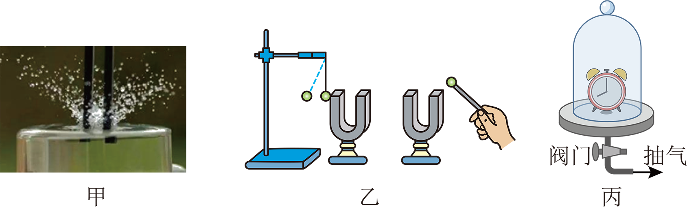
 
（1）如图甲所示，将正在发声的音叉放入水中，能观察到音叉周围溅起许多水花，这说明发出声音的音叉在__________。
（2）如图乙所示，敲响右边的音叉，左边完全相同的音也会发声，并且把泡沫塑料球弹起，该实验能说明__________可以传声。
（3）如图丙所示，把正在响铃的闹钟放在玻璃罩内，渐抽出玻璃罩内的空气所听到的铃声将会逐渐__________（选填“变大”、“变小”或“不变”），并由此推理可知：如果玻璃罩内抽成真空后，就听不到闹钟响铃的声音了，最后得出结论：真空__________（选填“能”或“不能”）传声。
（4）通过丙实验的结论可知，若在月球上做图乙实验，泡沫塑料球__________弹起（选填“能”或“不能”）。
【答案】振动　空气　变小　不能　不能
【解析】（1）[1]甲图中，发声的音叉激起水花，说明声音是由物体振动产生的。
（2）[2]乙图中，敲响右边的音叉，振动通过空气向外传递，左边完全相同的音叉也会发声，并且把泡沫塑料球弹起，该实验能说明气体可以传声。
（3）[3][4]抽取玻璃罩内的空气，听到罩内的声音逐渐变小，进一步推论得：声音的传播需要介质，真空不能传播声音。
（4）[5]月球上为真空，没有传递声音的介质，所以在月球上做图乙实验，泡沫塑料球不能弹起。
