# 第三节 超声波与次声波（同步练习）

> 教材：物理·八年级全一册·沪科技版2024新教材 ｜ 来源：国家中小学智慧教育平台·在线练习 ｜ 共 98 题

## 1. 单选题（难度：简单）

下列事例中，利用声来传递信息的是（     ）

- A. 利用超声波对金刚石等坚硬物品钻孔
- B. 超声波使液体微粒剧烈振动，加速溶质溶解
- C. 人暴露在150dB的噪声环境中，耳内鼓膜会破裂出血
- D. 社区人员用大喇叭播放疫情防护知识

【答案】D

【解析】​

## 2. 单选题（难度：简单）

下列事例是利用声传递能量的是（     ）

- A. 人们可以利用声呐探测海底深度
- B. 医生常用超声波去除人体内的结石
- C. 渔民捕鱼时利用声呐获得水中鱼群的信息
- D. 大象可以用次声波进行交流

【答案】B

【解析】​

## 3. 单选题（难度：适中）

下列说法中正确的是（     ）

- A. 甲图中超声波清洗机工作原理是声能传递信息
- B. 乙图中烛焰摆动说明声音可以传递能量
- C. 丙图中可以利用超声波监测火山爆发的强度
- D. 丁图中倒车雷达是利用次声波来传递信息的

【答案】B

【解析】​

## 4. 单选题

如图是一种能发出超声波的电动牙刷，刷牙时，超声波可以直达牙刷棕毛刷不到的地方，刷牙既干净又舒服. 关于电动牙刷，下列说法正确的是（     ）

- A. 电动牙刷利用超声波传递信息
- B. 超声波的音调很低，人们听不到
- C. 超声波也是由物体振动产生的
- D. 人听不到超声波，说明超声波不能在空气中传播

【答案】C

【解析】​

## 5. 单选题（难度：简单）

声与我们的生活紧密相连，下列属于利用声传递信息的是（    ）

- A. 人们利用超声波清洗眼镜
- B. 巨大的爆炸声将周围房屋的玻璃震碎
- C. 母象与小象之间利用次声波交流
- D. 牙医利用超声波为患者洗牙

【答案】C

【解析】​

## 6. 填空题（难度：简单）

“柴门闻犬吠，风雪夜归人”这一诗句中，说明声音能传递（选填“信息”或“能量”）；人是根据声音的（选填“音调”、“响度”或“音色”）这一特性辨别出狗的叫声.

【答案】信息，音色

【解析】​

## 7. 单选题

如图所示是一款低音频发声灭火装置，通过发出\( \text{30Hz}\text{～}\text{60Hz}\)的低频声波，能够在短短数秒之内扑灭火焰. 关于这台低音频发声灭火装置，下列说法正确的是（     ）

- A. 该装置发出的低频声波属于次声波
- B. 该装置发出的声波可以在真空中传播
- C. 声波可以灭火说明声波具有能量
- D. 低音频发声灭火装置是高科技产品，发声不需要振动

【答案】C

【解析】​

## 8. 填空题（难度：简单）

2021年10月17日，我国神舟十三号载人飞船成功升空. 火箭发射过程中，巨大的轰鸣声不绝于耳，“巨大”形容的是声音的这一特性，如果离得近，会感觉耳膜有胀痛感，这是因为声音能够传递. 

【答案】响度，能量

【解析】​

## 9. 单选题（难度：简单）

下列事例是利用声传递能量的是（     ）

- A. 蝙蝠靠超声波发现昆虫

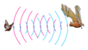
- B. 医生用B超查看胎儿的发育情况

- C. 利用超声波倒车雷达判断障碍物距离

- D. 超声波清洗机清洗眼镜上的污渍

【答案】D

【解析】​

## 10. 填空题（难度：简单）

扫地机器人已经逐步进入普通家庭，机器人能够自动躲避障碍物，其工作原理类似蝙蝠，它是用（选填“超声波”或“次声波”）来判断障碍物及空间方位的，这是利用了声能够传递.

【答案】超声波，信息

【解析】​

## 11. 填空题（难度：简单）

登雪山时不许大声讲话，这是因为声音可以传递，可能诱发雪崩；中国传统中医以“望，闻、问、切”检查病人，其中“闻”有听的意思，这是利用声音能够传递.

【答案】能量，信息

【解析】​

## 12. 填空题（难度：适中）

如图所示是一款导盲杖，它发出的（选填“超声波”或“次声波”）遇到障碍物反射回来，再被导盲杖接受收，导盲杖会发出“嘀嘀”的提示音，提醒使用者周围有障碍物，这说明声能传递. 

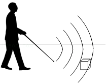

【答案】超声波，信息

【解析】​

## 13. 单选题（难度：简单）

甲、乙音叉的形状差不多，分别标有“256Hz”、“512Hz”字样，先后用相同的力度敲击它们，甲、乙两音叉相比（  ）

- A. 甲响度小
- B. 甲音调低
- C. 乙振幅大
- D. 乙声速小

【答案】B

【解析】​

## 14. 单选题（难度：简单）

在校园合唱比赛中，老师将同学们分为高音部和低音部，他是依据声音的（  ）

- A. 音调
- B. 响度
- C. 振幅
- D. 音色

【答案】A

【解析】​

## 15. 单选题（难度：简单）

如图所示，将钢尺一端紧压在桌面上，另一端伸出桌面，用大小不同的力拨动钢尺，则钢尺发出声音的（       ）不同.  

- A. 音调
- B. 音色
- C. 响度
- D. 速度

【答案】C

【解析】​

## 16. 单选题（难度：适中）

吉他演奏前，乐手会调节弦的松紧，这样做主要是为了改变声音的（  ）

- A. 响度
- B. 音调
- C. 音色
- D. 速度

【答案】B

【解析】​

## 17. 单选题（难度：简单）

戴口罩是防止新冠病毒传播的有效措施，当你戴上口罩与人交谈时，需提高声音的（  ）

- A. 响度
- B. 音色
- C. 音调
- D. 频率

【答案】A

【解析】​

## 18. 单选题（难度：简单）

下列日常用语中所讲的“高”指音调的是（  ）

- A. 引吭高歌
- B. 不敢高声语
- C. 男高音歌唱家
- D. 请勿高声喧哗

【答案】C

【解析】​

## 19. 单选题（难度：简单）

在一场大型交响音乐会中，听众能根据不同乐音区分出不同的乐器，主要是根据声音的（  ）

- A. 音色
- B. 音调
- C. 响度
- D. 频率

【答案】A

【解析】​

## 20. 单选题（难度：适中）

如图所示，在鼓面上撒些纸屑，第一次轻轻敲击一下鼓面，鼓面上的纸屑跳动起来；第二次用力敲击一下鼓面，鼓面上的纸屑跳动得高了一些，并且听到声音比第一次时声音大. 根据纸屑跳动的幅度可以说明（  ）

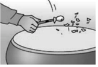

- A. 声音的响度与振幅有关
- B. 声速与声音的频率有关
- C. 一切发声物体都在振动
- D. 真空不能传播声音

【答案】A

【解析】​

## 21. 多选题（难度：适中）

同一监测器在A、B两处测得同一声源发出的甲、乙两声音，得到相关数据如下表．甲与乙相比，一定正确的是（  ）
声音
声音强弱的等级/dB
频率/Hz

甲
70
1100

乙
110
700

- A. 声源在发乙声音时每秒内振动次数较多
- B. 声源在发乙声音时音调较高
- C. 监测器测得甲声音的响度较小
- D. 声源在发甲声音时振动幅度较小

【答案】C/D

【解析】​

## 22. 多选题（难度：适中）

二胡是我国的民族乐器，有粗（内弦）、细（外弦）两根弦，拉弓时，弓毛和弦摩擦发出声音，如图所示. 下列做法能改变二胡音调的是（  ）

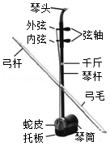

- A. 用手指按压同一根弦的不同位置
- B. 加大摩擦弦的力度
- C. 手指按压在弦的相同位置，从摩擦内弦换到摩擦外弦
- D. 旋转弦轴，调整弦的松紧程度

【答案】A/C/D

【解析】​

## 23. 单选题

现有四个编钟，如图所示，它们按大到小的顺序由左至右排列，其中有一编钟上有一隐形的裂痕，为了查找出这口编钟，用锤子分别敲击它们，将所产生的声波输入示波器中，右侧四幅图为示波器中显示的对应的波形图，则下列关于敲锺时用力大小和判断裂痕的有无，说法中正确的是（  ）

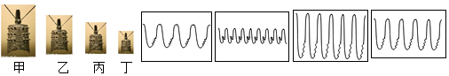

- A. 敲甲编钟用力最大，乙编钟有裂痕
- B. 敲丙编钟用力最大，丁编钟有裂痕
- C. 敲乙编钟用力最大，丁编钟有裂痕
- D. 敲丙编钟用力最大，乙编钟有裂痕

【答案】B

【解析】​

## 24. 单选题（难度：适中）

如图所示，7个相同的水瓶中灌入不同高度的水，仔细调节水的高度后，用相同的力在瓶口吹气，可以发出“1，2，3，4，5，6，7”的声音来. 关于这种“水瓶琴”，下列说法错误的是（  ）

- A. 声音是由瓶内的空气振动产生的
- B. 7个水瓶发出声音的音色大致相同
- C. 7个水瓶发出声音的响度大致相同
- D. 最左边水瓶发出声音的音调最低

【答案】D

【解析】​

## 25. 多选题（难度：简单）

地震常常伴有人听不到的次声波. 下列关于次声波的说法正确的是（  ）

- A. 次声波是由物体振动产生的
- B. 次声波可以在真空中传播
- C. 次声波的传播速度可达\( 3\text{×}{\text{10}}^{\text{8}}\text{m/s}\)
- D. 次声波的频率低于\( \text{20Hz}\)

【答案】A/D

【解析】​

## 26. 多选题（难度：适中）

医生在给病人检查内脏时，常常会用到听诊器，听诊器起不到的作用是（  ）

- A. 缩短听者距内脏的距离，使响度更大
- B. 改变声音的频率，使音调变高
- C. 使内脏振动时的振幅增大，从而增大响度
- D. 减少声音的分散，使响度更大

【答案】A/B/C

【解析】​

## 27. 多选题（难度：简单）

关于声音，下列说法中正确的是（  ）

- A. 我们能区分出小提琴和二胡的声音，是因为他们发出的声音的音色不同
- B. 我们无法听到蝴蝶飞过的声音，是因为他发出的声音的响度太小
- C. 敲锣时用力越大，它发出声音的响度就越大
- D. 歌唱演员引吭高歌，其中的“高”是指音调高

【答案】A/C

【解析】​

## 28. 多选题（难度：适中）

如图所示，在空气均匀，且温度处处相同的室内，小明吹响长笛一个音，并用 \( A\)、\( B\)两个相同设置的声音监测器在距小明不同距离的位置监测，得出如下的波形图，以下说法正确的是（  ）

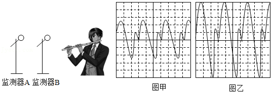

- A. 甲图为监测器\( A\)处检测到声音的波形图
- B. 声音从监测器\( B\)处传播到监测器\( A\)处，响度减小
- C. 声音从监测器\( B\)处传播到监测器\( A\)处，音色改变
- D. 声音从监测器\( B\)处传播到监测器\( A\)处，声速改变

【答案】A/B

【解析】​

## 29. 多选题（难度：适中）

小明用如图所示实验装置进行探究实验. 把两个纸杯底部用细棉线连接起来，在一个纸杯口上蒙上塑料膜，膜上粘一片小平面镜，拉紧细棉线，将激光发出的光照射在平面镜上，小明对另一个纸杯口说话，会看到墙上反射的光点在晃动. 则下列说法中正确的（  ）

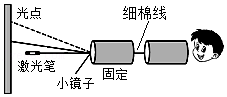

- A. 该实验装置可探究音调与响度的关系
- B. 该实验装置可探究响度与振幅的关系
- C. 该实验装置可探究音调与频率的关系
- D. 该实验装置可探究音色与频率的关系

【答案】B/C

【解析】​

## 30. 多选题（难度：简单）

如图所示，下列关于四幅图的说法正确的是（  ）

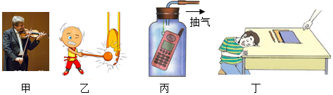

- A. 甲图中，演奏者通过手指在弦上按压位置的变化来改变音调
- B. 乙图中，敲锣时用力越大，发出声音的响度越大
- C. 丙图中，随着向外不断抽气，手机铃声越来越大
- D. 丁图中，分别轻敲桌面和重敲桌面，听到声音的音调不同

【答案】A/B

【解析】​

## 31. 多选题

如图所示是声波的波形图，下列说法不正确的是（  ）

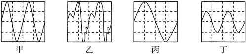

- A. 甲、乙的音色和响度相同
- B. 丙声源每秒钟振动次数最少
- C. 甲、丁的音色和声音强弱等级相同
- D. 若丁为敲击音叉时波形，若用更快的速度不断敲击，音叉发出声音的音调会更高

【答案】A/C/D

【解析】​

## 32. 多选题（难度：适中）

物理课上，老师用力吹一根较长的塑料吸管的同时，用剪刀一小段一小段地剪短吸管，如图所示. 同学们听到的声音（  ）

- A. 音色不变
- B. 音调变了
- C. 是老师的声带振动产生的
- D. 后排同学听到的与前排同学听到的响度相同

【答案】A/B

【解析】​

## 33. 填空题（难度：适中）

发生地震时，有些动物能比人提前感觉到，是因为它们能“听到”地震时产生的. 蜜蜂1min振翅26400次，蝴蝶20s振翅120次，蚊子10s振翅6400次，其中音调最高的是（选填“蜜蜂”、“蝴蝶”或“蚊子”），人耳（选填“能”、“不能”）听到蝴蝶振翅的声音.

【答案】次声波，蚊子，不能

【解析】​

## 34. 填空题（难度：简单）

有些同学有听“耳机”的习惯，虽然对其他同学影响不大，但是由于声音的传播非常集中，所以在听者的耳朵里 （选填“音调高”或“响度大” ），长期如此，会造成听力的损伤.

【答案】响度大

【解析】​

## 35. 填空题（难度：适中）

如图所示，相同的水下录音装置\( A\)、\( B\)录下在海里同一位置的鲸发出的同一段声音. \( A\)录到的有高、低音，\( B\)录到的只有低音，由此可以推测：在海洋中传播较远距离的声音是音调较的. 因此，轮船的汽笛声的频率较 . 

【答案】低，低

【解析】​

## 36. 填空题

如图所示，用大小相同的力从左向右用筷子依次敲击水瓶口，其发出声音的音调将逐渐（选填“升高”或“降低”），用大小相同的力从左向右用嘴往水瓶口吹气，其发出声音的音调将逐渐 （选填“升高”或“降低”）.

【答案】升高，降低

【解析】​

## 37. 填空题（难度：简单）

两个女高音同唱一首歌，这里的“高”指的是声音的，观众席的前排观众和后排观众听到的声音强度不同，这是指声音的不同，能分辨出不同的歌手，是因为她们的不同. (选填“音调”、“响度”或“音色”)

【答案】音调，响度，音色

【解析】​

## 38. 填空题（难度：适中）

诗句“不敢高声语，恐惊天上人”中的“高”是指声音的(选填“音调高”或”响度大”). 实际上，从物理学的角度看，再“高”的声音也惊不到太空上的人，这是因为.

【答案】响度大，声音传播需要介质，真空不能传声

【解析】​

## 39. 填空题（难度：适中）

智能手机的“智慧语音“功能，可以通过声音识别实现对手机解锁，该系统主要是根据声音的（选填“音调”、“音色”或“响度”）这一特征来工作的. “快手”App能将正常录制的音频和视频以3倍的速度快速播放，此时声波的频率也为正常声音的3倍，则“快手”的音调比正常声音的（选填“高”或“低”），此时声波在空气中的传播速度（选填“变大”、“变小”或“不变”）.

【答案】音色，高，不变

【解析】​

## 40. 填空题（难度：适中）

微风吹过，金属管风铃发出悦耳的声音. 小明想探究管子发出声音的频率与长度、直径的关系. 他选取了材料与管壁厚度都相同、长度和直径都不同的三根直管，将它们用细线悬挂，用相同的力敲击不同的金属管，测出各自发出声音的频率，数据如表：
编号
长度/cm
直径/cm
频率/Hz

1
20.50
1.50
2131

2
31.00
2.00
1284

3
48.50
2.50
656

 （1）从表格数据可知，三根管中音调最低的是号管. 
（2）根据表中数据，（选填“能”或“不能”）得出“管子发出声音的频率随长度的增大而减小”的结论？理由：. 
（3）如果再增加一根长度为20.50cm和直径为的金属管做实验，就能得出管子发出声音的频率与长度、直径的关系.

【答案】3，不能，没有控制管子的直径不变，2.00cm或2.50cm

【解析】​

## 41. 填空题（难度：简单）

小明在学习吉他演奏的过程中，发现琴弦发出声音的音调高低是受各种因素影响的，他决定对此进行研究. 经过和同学们讨论，提出了以下猜想：
猜想一：琴弦发出声音的音调高低，可能与琴弦的长短有关
猜想二：琴弦发出声音的音调高低，可能与琴弦的粗细有关
猜想三：琴弦发出声音的音调高低，可能与琴弦的材料有关
为了验证上述猜想是否正确，他们选用如图所示材料进行实验，每根琴弦固定在音箱上的松紧程度相同. 
（1）为了验证猜想一，应选用编号为、的琴弦进行实验. 
（2）若他们选择\( a\)和\( b\)是为了研究音调的高低与琴弦的关系. 
（3）除了上述探究外还可以选择（填材料序号）进行的研究是音调的高低与琴弦的关系. 

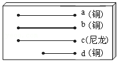

【答案】a，d，粗细，c，材料

【解析】​

## 42. 填空题（难度：简单）

如图是“探究影响声音高低的因素”实验，请将如表空缺部分填写完整. 
（1）把钢尺按在桌面上，一端伸出桌边，拨动钢尺振动，听到声音，说明声音是由物体产生的；
（2）改变钢尺伸出桌面长度，再做几次实验. 实验时要使钢尺振动的振幅大致相同，运用了控制变量法. 从实验中可以观察到钢尺伸出越短振动越快，音调越 . 
（3）在实验中发现，当钢尺伸出桌面超过一定长度时，虽然用同样的力拨动钢尺，却听不到声音，这是由于振动频率过（选填“高”或“低”），不在人听觉范围. 

【答案】振动，高，低

【解析】​

## 43. 填空题

如图所示，有4支相同材料相同厚度的玻璃量筒，其中\( a\)、\( b\)、\( c\)等高，\( a\)、\( b\)粗细相同，\( c\)、\( d\)粗细相同. 各量筒内装水的高度如图所示，小明根据所听声音音调的高低猜想气柱发声的频率可能与1、气柱的长短有关；2、量筒的粗细有关；3、水柱的长度有关. 
 
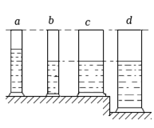
   
（1）若探究“气柱越长，发声的音调越高”，应选量筒（填字母代号），其中所用到的科学研究方法是法；
（2）若选择的是量筒\( b\)、\( c\)，则探究的是；
（3）小明用同样大小的力在\( c\)和\( d\)的口上方吹气，使它们发声，则所发出的声音音调（选填“\( c\)高”、“\( d\)高”或“一样高”）；
（4）如果用同样大小的力敲击\( c\)和\( d\)使它们发声，所发出的声音音调较高.

【答案】$ a$、$ b$，
控制变量，气柱发声频率跟横截面积的关系，一样高，$ c$ 

【解析】​

## 44. 填空题（难度：简单）

小明利用如图所示的实验器材探究响度的影响因素：
（1）将系在细线上的乒乓球轻触正在发声的音叉，观察到乒乓球被弹开的现象，说明. 
（2）用更大的力敲击音叉，使其发出更大的声音，观察到乒乓球被弹开的幅度出现的变化是. 
（3）通过实验探究得出的结论是：响度与发声体振幅有关，越大，响度越大. 

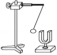

【答案】声音是由物体振动产生的，变大，振幅

【解析】​

## 45. 单选题（难度：简单）

下列关于声波应用的例子，描述不正确的是（　　）

- A. 声呐利用次声波来探测海底深度
- B. 超声波测车速是声波传递了信息
- C. 眼镜清洗仪利用超声波传递能量
- D. 医生给病人做B超是声波传递信息

【答案】A

【解析】A．声呐，又称超声雷达，利用超声定向性强的特点来探测海底深度，故A错误，符合题意；
B．声波能传递信息。超声波测车速是利用超声波可以传递信息的道理，故B正确，不符合题意；
C．由于声波能传递能量，可以利用超声波清洗眼镜，故C正确，不符合题意；
D．声波能传递信息。医生给病人做B超是利用超声波传递信息的道理，故D正确，不符合题意。

## 46. 单选题（难度：简单）

关于声的利用，下列说法正确的是（　　）

- A. 倒车雷达是利用了次声波来识别障碍
- B. 蝙蝠靠超声波发现昆虫
- C. 地震海啸火山喷发等自然灾害往往会伴随超声波的产生
- D. “B超”诊断病情是利用声传递能量

【答案】B

【解析】A．倒车雷达是利用超声波来区分障碍物的距离，利用了超声波传递信息，故A错误；
B．蝙蝠在飞行时能够发出超声波，超声波碰到蛾子、蚊子等昆虫或其它的障碍物反射回来，蝙蝠根据反射回来的超声波就可以对前方的物体做出判断，故B正确；
C．地震、海啸、火山喷发等自然灾害往往会伴随次声波的产生，故C错误；
D．声波既可以传递信息又可以传递能量，“B超”诊断病情是利用超声波传递信息，故D错误。

## 47. 单选题（难度：适中）

在学校组织的消防疏散演练中，随着报警装置中警报声的响起，同学们双手护头，迅速躲到桌下或墙角等安全三角区。下列关于该警报声说法正确的是（　　）

- A. 警报声是由空气振动而产生的
- B. 在空气中的传播速度一定是340m/s
- C. 警报声是超声波
- D. 警报声能传递信息

【答案】D

【解析】A．声音是由物体振动产生的，警报声是由警报器中的发声装置振动产生的，故A错误；
B．声音的传播速度和介质的种类与温度有关，声音在15℃空气中的传播速度是340m/s，故B错误；
C．人的听觉频率范围是20~20000Hz，超声波的振动频率大于20000Hz，同学们能听到警报声，说明警报声不是超声波，故C错误；
D．各班学生听到警报声响起，立即进行消防疏散演练，说明警报声能传递信息，故D正确。

## 48. 单选题（难度：简单）

下列例子属于声与能量相关的是（　　）

- A. 声呐
- B. 超声波清洗精细机械
- C. B超
- D. 蝙蝠利用超声波定位目标

【答案】B

【解析】A．声呐是通过向水下发送声波，并接收回波信号，来探测水下的物体、地形、水深等信息，说明声音可以传递信息。故A不符合题意；
B．超声波清洗精细机械，利用的是声音可以传递能量，故B符合题意；
C．B超是一种医学影像学检查技术，通过超声波显示人体内部结构，为医生提供病变部位的信息。说明声音可以传递信息，故C不符合题意；
D．蝙蝠利用超声波定位目标，即蝙蝠通过发出超声波并分析其反射回来的声波来识别和定位物体，说明声音可以传递信息。故D不符合题意。

## 49. 单选题（难度：适中）

下列关于声音的说法正确的是（　　）

- A. 蜜蜂的翅膀在3s内振动了1500次，我们不能听到蜜蜂翅膀振动的声音
- B. 医生利用超声波去除人体内的结石，这是利用声能传递能量
- C. 在室内讲话比在旷野里响亮，是因为声速在室内比在旷野里大
- D. 手在小提琴上不同的位置按弦，目的是改变音色

【答案】B

【解析】A．人耳能听见声音的频率为20Hz~20000Hz之间，低于20Hz，或高于20000Hz人耳听不到，蜜蜂振动翅膀的频率
\( f\text{=}\frac{\text{1500}\mathrm{次}}{\text{3s}}\text{=500Hz}\) 
人耳能听到，故A错误；
B．声音可以传递信息和能量，利用超声波的振动除去体内结石是利用声能传递能量，故B正确；
C．声音的传播速度只与介质种类和温度有关，所以不管在室内还是内外，声音的传播速度是一样的，而教室里说话声音响亮是因为教室内的回声与原声音叠加而体现出来的，故C错误；
D．手在小提琴上不同位置按弦，可改变振动琴弦的长度，从而改变振动频率，达到改变音调的目的，故D错误。

## 50. 单选题（难度：简单）

“声能发电”装置可将城市交通噪声的能量转化为电能供路灯使用。下列利用声音的实例中，与该项技术最相似的是（　　）

- A. 用声波粉碎人体内结石
- B. 用B超检查人体疾病
- C. 用声呐探测鱼群的位置
- D. 用超声导盲杖探测障碍物

【答案】A

【解析】A. 用声波粉碎人体内结石，是利用声波具有的能量。题干中的“声能发电”也是利用声波的能量，两者都属于对声能的利用，因此最相似。故A符合题意；
B. 用B超检查人体疾病：该技术利用超声波的回声反射成像，获取人体内部信息，主要利用了声波传递信息的特性，故B不符合题意；
C. 用声呐探测鱼群的位置：该技术通过发射声波并接收回声来定位鱼群，主要利用了声波传递信息的特性，故C不符合题意；
D. 用超声导盲杖探测障碍物：该技术利用超声波反射探测障碍物位置，主要利用了声波传递信息的特性，故D不符合题意。

## 51. 单选题（难度：简单）

下列实例中，不是利用声波能够传递能量的是（　　）

- A. 清洗钟表的精细器件
- B. 外科医生用超声波切除病人体内的结石
- C. 利用超声波加工高硬度工件
- D. 用“B超”检查身体

【答案】D

【解析】ABC．超声波清洗钟表的精细器件、外科医生用超声波切除病人体内的结石、利用超声波加工高硬度工件，都说明了声音可以传递能量，故ABC不符合题意；
D．用“B超”检查身体是使用声音来传递信息的，不是用来传递能量的，故D符合题意。

## 52. 单选题（难度：简单）

海底地形测绘船依靠声呐设备收集信息，信息的载体是（　　）

- A. 超声波
- B. 次声波
- C. 红外线
- D. 紫外线

【答案】A

【解析】海底地形测绘利用声呐发出超声波，超声波向下传播遇到海底反射，根据接受到的回波测绘。故A符合题意，BCD不符合题意。

## 53. 单选题（难度：简单）

随着科学技术和社会的发展，超声波已广泛应用于各个领域。下列事例中利用超声波传递信息的是（　　）

- A. 用超声波电动牙刷刷牙
- B. 用超声波给金属工件探伤
- C. 用超声波清洗眼镜片
- D. 用超声波除去人体内的结石

【答案】B

【解析】A．用超声波电动牙刷刷牙，这是利用超声波传递能量的，故A不符合题意；
B．用超声波给金属工件探伤，这是利用超声波传递信息的，故B符合题意；
C．用超声波清洗眼镜片，这是利用超声波传递能量的，故C不符合题意；
D．用超声波除去人体内的结石， 这是利用超声波传递能量的，故D不符合题意。

## 54. 单选题（难度：简单）

军队中号声就是命令，关于号声下列说法正确的是（　　）

- A. 号声是由司号员的声带振动产生的
- B. 士兵通过声音的响度分辨出号声
- C. 司号员利用号声传递信息
- D. 号声属于超声波

【答案】C

【解析】A．在军队中，号声是由司号员吹响军号时，军号内的空气柱振动产生的，而不是司号员的声带振动产生的。故A错误；
B．士兵能够分辨出号声，主要是依据声音的音色，即不同乐器或发声体发出的声音具有独特的音质和音色特征；响度是声音的大小或强弱，与士兵分辨号声无关。故B错误；
C．在军队中，号声被用作传递命令和信息的方式，司号员通过吹响不同的号声来传达特定的指令或信息给士兵。故C正确；
D．超声波是频率高于人耳能听到的声音频率范围（即20Hz到20000Hz）的声波，号声的频率在这个范围内，因此它是人耳能听到的可听声，而不是超声波。故D错误。

## 55. 单选题（难度：适中）

关于声现象，下列说法正确的是（　　）

- A. 蝙蝠获取信息的原理与声呐系统的工作原理不同
- B. 运动员打鼓用的力越大，鼓声的音调就越高
- C. B超利用的是超声波能传递能量
- D. 观众听到二胡演奏出的优美旋律，声音是由弦的振动产生的，并通过空气传递到人耳

【答案】D

【解析】A．蝙蝠利用超声波定位，声呐系统也是利用超声波的回声定位，工作原理相同，故A错误；
B．运动员打鼓用的力越大，鼓面振动幅度越大，鼓声的响度越大，故B错误；
C．声音既能传递信息，又能传递能量；B超利用的是超声波能传递信息，故C错误；
D．声音是由物体振动产生的，声音的传播需要介质，固体、液体、气体都能传播声音。观众听到二胡演奏出的优美旋律，声音是由弦的振动产生的，并通过空气传递到人耳，故D正确。

## 56. 单选题（难度：简单）

据中国地震台网消息，中国地震台网正式测定：5月21日在云南大理州漾濞县发生6.4级地震，震源深度8千米。但令人感到惊讶的是，地震过后，人们没有发现野生动物大规模伤亡的情况。如果从物理知识的角度分析，其中的原因可能是（　　）

- A. 动物反应灵敏
- B. 有些动物能听到超声
- C. 有些动物能听到次声
- D. 动物能观察到地面的变化

【答案】C

【解析】人耳听觉的频率范围是20Hz~20000Hz，而动物的听力比人强，许多动物可以听见地震的产生的次声波，所以野生动物提前逃跑或隐藏，很少大规模死亡，故C符合题意，ABD不符合题意。

## 57. 单选题（难度：适中）

关于超声波和次声波，下列说法正确的是（　　）

- A. 声呐发出的次声波遇到障碍物反射
- B. 医院利用次声波检查胎儿在母体内是否正常发育
- C. 用超声波能粉碎人体内的“小石头”，说明声波具有能量
- D. 大自然的许多活动，如地震、海啸等都伴有超声波产生

【答案】C

【解析】A．声呐发出的是超声波，遇到障碍物发生反射，根据反射的声波来发现障碍物，故A错误；
B．检查胎儿在母体内的发育情况用到的是“B超”，是超声波传递信息的重要应用，故B错误；
C．超声波可以传递能量，用超声波能粉碎人体内的“小石头”，故C正确；
D．大自然的许多活动，如地震、海啸等，都伴有次声波产生，故D错误。

## 58. 单选题（难度：适中）

已知琴弦A在5s钟内振动了200次，琴弦B的频率是60Hz，则下列说法正确的是（　　）

- A. 琴弦A比琴弦B发出声音的音调高，两个声音都属次声波频率范围
- B. 琴弦A比琴弦B发出声音的音调低，两个声音都可传递信息和能量
- C. 琴弦A比琴弦B发出声音的响度大，两个声音的传播速度都与温度有关
- D. 琴弦A比琴弦B发出声音的响度小，两个声音都不能在真空中传播

【答案】B

【解析】AB．琴弦A的频率为\( \frac{200\mathrm{次}}{5\text{s}}=40\text{Hz}\)，比琴弦B振动频率低，琴弦A的音调低，琴弦AB振动频率都大于20Hz，都不是次声波，根据声音的特性可知，声音都可以传递信息和能量，故A错误，B正确；
CD．由于琴弦AB的振幅不确定，不能判断琴弦AB的响度，故CD错误。

## 59. 单选题（难度：简单）

下列关于声的利用的说法中，正确的是（　　）

- A. 超声波可以清洗眼镜，说明声可以传递信息
- B. 医生通过听诊器给病人诊病时，主要是利用声传递能量
- C. 超声波能粉碎人体内的结石，说明声波具有能量
- D. 轮船的“声呐”系统是利用了超声波在水中能传递能量

【答案】C

【解析】AC．超声波可以清洗眼镜等精密仪器、粉碎人体内的结石等，说明声波具有能量，且可以传递能量，故A错误，C正确；
BD．医生通过听诊器给病人诊病、B超、“声呐”系统是利用声传递信息，故BD错误。
故选C 。

## 60. 单选题（难度：简单）

下列实例中利用声音可以传递能量的是（　　）

- A. 声呐捕鱼
- B. B超探病
- C. 用声波清洗眼镜片
- D. 打雷声预示着一场雨要来了

【答案】C

【解析】A．用声呐可以探测鱼群的信息，说明声音可以传递信息，故A不符合题意；
B．B超是利用超声波，可以获得人体内是否有疾病的信息，故B不符合题意；
C．清洗眼镜片是利用声音传递能量的特点来完成工作的，说明声音可以传递能量，故C符合题意；
D．雷声是下雨的信息，说明声音可以传递信息，故D不符合题意。

## 61. 单选题（难度：适中）

中华文化博大精深，有些古诗词中蕴含着丰富的物理知识。白居易在《夜雪》中写道“夜深知雪重，时闻折竹声”。下列对“折竹声”的分析，正确的是（　　）

- A. “折竹声”不是由物体的振动产生
- B. “折竹声”是通过空气传入人耳的
- C. 诗人根据声音的音调分辨出“折竹声”
- D. 诗人通过“折竹声”“知雪重”说明声音可以传递能量

【答案】B

【解析】A．声音是由物体振动产生的，“折竹声”也是由物体的振动产生，故A错误；
B．声音的传播需要介质，“折竹声”是通过空气介质传入人耳的，故B正确；
C．声音的音色由发声体的材料、结构等决定，每个发声体发出的声音音色是特异的，诗人根据声音的音色分辨出“折竹声”，故C错误；
D．声音可以传递信息和能量，诗人通过“折竹声”“知雪重”，说明声音可以传递信息，故D错误。

## 62. 单选题（难度：简单）

以下不属于利用超声的是（　　）

- A. 利用声呐探测鱼群
- B. 用B超观察母体中的胎儿
- C. 利用声波信息对核爆炸进行监测
- D. 利用金属探伤仪探测金属内部的缺陷

【答案】C

【解析】A．利用声呐探测鱼群，利用了超声波传递信息，故A不符合题意；
B．用B超观察母体中的胎儿，利用超声波传递信息，故B不符合题意；
C．利用声波粉碎结石，核爆炸时会产生次声波，可利用次声波信息对核爆炸进行监测，故C符合题意；
D．利用金属探伤仪探测金属内部的缺陷，是利用超声波传递金属内部是否存在缺陷这一信息，故D不符合题意。

## 63. 单选题（难度：简单）

2011年3月11日发生在日本的强烈地震造成了大量人员伤亡及财产损失，下列说法中，你认为错误的是(　　)

- A. 地震时伴有次声波产生；
- B. 地震时会产生地震波，这种地震波不能在真空中传播；
- C. 受灾人员通过呼喊和敲击方式求救主要是利用声音可以传递信息；
- D. 地震时产生的地震波不是由物体振动产生的；

【答案】D

【解析】A．一些自然灾害，如地震、台风、海啸等会伴随着次声波的产生，故A正确，不符合题意；
B．地震时产生的地震波属于声波，声的传播需要介质，不能在真空中传播，故B正确，不符合题意；
C．声音可以传递信息和能量。受灾人员通过呼喊和敲击方式发出求救信号，传递被困信息，主要 是利用声音可以传递信息，故C正确，不符合题意；
D．声音是由物体振动产生的，地震时产生的地震波是由物体振动产生的，故D错误，符合题意。

## 64. 单选题（难度：简单）

某品牌新能源汽车配备自动泊车系统，其原理是通过车身周围的超声波传感器发射超声波，根据反射信号判断周边障碍物的距离。下列相关说法正确的是（　　）

- A. 超声波传感器利用了声波传递能量
- B. 自动泊车系统的提示音“嘀嘀”声属于超声波
- C. 超声波在空气中的传播速度大于次声波的传播速度
- D. 该系统与蝙蝠飞行的定位原理相同

【答案】D

【解析】A．超声波传感器是利用声波传递信息来判断周边障碍物的距离，而非传递能量，故A错误；
B．人耳能听到自动泊车系统的提示音“嘀嘀”声，说明其频率在人耳听觉范围内，不属于超声波，超声波是频率高于20000Hz的声波，人耳听不到，故B错误；
C．超声波和次声波在空气中的传播速度相同，声速只与介质和温度有关，与声波的频率无关，故C错误；
D．该自动泊车系统通过超声波传感器发射和接收超声波来判断障碍物距离，蝙蝠飞行也是通过发出超声波，根据反射波来定位，二者原理相同，故D正确。

## 65. 单选题（难度：简单）

下列事例中，属于利用次声的是（　　）

- A. 用声呐技术测海底深度
- B. 蝙蝠确定目标的方向和距离
- C. 海豚判断物体的位置和大小
- D. 预报海啸、台风

【答案】D

【解析】A．声呐利用的是超声波，故A不符合题意；
B．蝙蝠可以发出超声波，并进行回声定位，故B不符合题意；
C．海豚可以发出超声波，通过回声定位来判断物体的位置和大小，故C不符合题意；
D．在海啸、台风、火山喷发、地震等灾害来临前会发出次声波，故D符合题意。

## 66. 单选题（难度：简单）

下列事例中不是利用声音传递信息的是（　　）

- A. 利用超声波清洗脏了的眼镜
- B. 医生通过听诊器给病人诊断疾病
- C. 学生听到体育课上体育老师的指令
- D. 根据发动机的声音我们判断它是远离还是靠近我们

【答案】A

【解析】A．利用超声波清洗脏了的眼镜，说明声音能够传递能量，故A符合题意；
B．医生通过听诊器给病人诊断疾病，利用了声音能够传递信息，故B不符合题意；
C．学生听到体育课上体育老师的指令，利用了声音能够传递信息，故C不符合题意；
D．根据发动机的声音我们判断它是远离还是靠近我们，说明声音能够传递信息，故D不符合题意。

## 67. 单选题（难度：简单）

如图所示是一款超声导盲手杖，它可以通过发射超声波并接收反射波，探测周围5m内障碍物的情况，方便出行。下列说法正确的是（　　）

- A. 超声波的频率低于20Hz
- B. 该超声导盲手杖的定位原理与声呐测距的原理相同
- C. 该导盲杖利用了声音可以传递能量
- D. 在地震、海啸等自然灾害来临之前会产生超声波

【答案】B

【解析】A．振动频率高于20000Hz的声波是超声波，故A不符合题意；
B．该导盲手杖是利用回声定位来探测前方障碍物的，故B符合题意；
C．使用该导盲杖，使盲人可以辨别障碍物的方位、距离、形状等信息，所以该导盲杖利用了声音可以传递信息，故C符合题意；
D．地震、海啸等自然灾害来临时，会伴随着发出次声波，故D不符合题意。

## 68. 单选题（难度：适中）

科研人员用低音频灭火装置进行灭火试验如图所示，装置通过发出30~60Hz的低频声波，在短短数秒之内就扑灭了火焰。关于低音频灭火装置下列说法正确的是（　　）

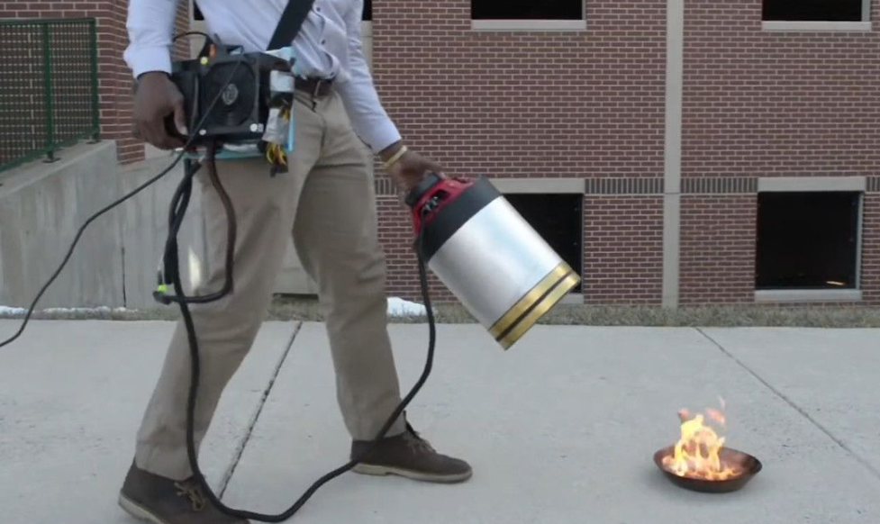

- A. 低音频灭火装置发出的声音人耳听不到
- B. 声波可以灭火说明声波能传递能量
- C. 低音频灭火装置发出的声音不是以声波的形式传递
- D. 装置发出的低频声波指的是其发声的响度低

【答案】B

【解析】A．人耳可以听到的声音的频率为20Hz~20000Hz之间，此装置的频率在人耳能听到的频率范围之内，故A错误；
B．声音可以传递能量和信息，声波灭火是因为声音可以传递能量，故B正确；
C．低频音也属于声音，只要是声音，就以声波的形式传递，故C错误；
D．低频指的是声音的振动频率低，故D错误。

## 69. 单选题（难度：适中）

如图，小明探究“看”到自己的声音的实验。把两个纸杯底部用细棉线连接起来，固定其中一个纸杯，在纸杯口上蒙上胶膜，膜上粘一小片平面镜，拉紧棉线，将激光笔发出的光照射在平面镜上，小明对另一纸杯说话（不接触纸杯）。会看到墙上反射的光点在晃动。在下列说法中正确的是（　　）

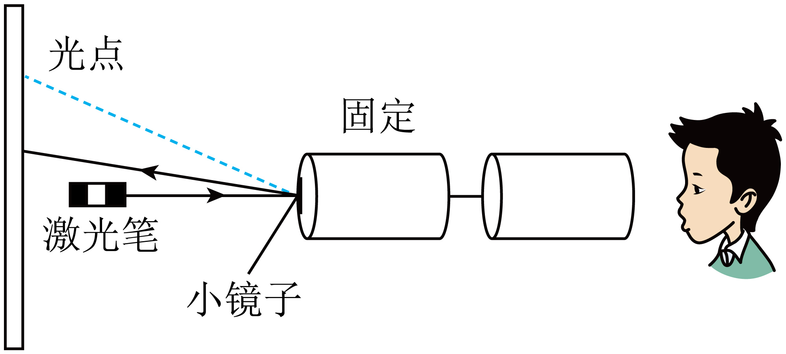

- A. 小明发出的声音是由空气振动产生的
- B. 该实验不说明声音能传递能量
- C. 两个纸杯间声音的传播主要是通过空气实现的
- D. 在月球上做该实验不能看到光点的晃动

【答案】D

【解析】A．声音由物体的振动产生，小明发出的声音是由声带振动产生的，故A错误；
B．看到墙上反射的光点在晃动，说明声音能够传递能量，故B错误；
C．两个纸杯间声音的传播主要是通过固体棉线传播的，故C错误；
D．在月球上是真空，真空不能传声，故做该实验不能成功，不能看到光点的晃动，故D正确。

## 70. 单选题（难度：简单）

下列事例中，属于利用声波传递能量的是（　　）

- A. 医生用听诊器为病人检查身体
- B. 用声呐探测海底深度
- C. 用超声波清洗眼镜
- D. 听到隆隆的雷声预示着可能要下雨

【答案】C

【解析】声音可以传递能量，声音还可以传递信息。
A．医生利用听诊器为病人检查身体，说明了声音可以传递信息，故A不符合题意；
B．用声呐探测海底深度，利用的是回声测距说明了声音可以传递信息，故B不符合题意；
C．超声波可以引起眼镜中的灰尘振动，达到清洗眼镜的目的，说明了声音可以传递能量，故C符合题意；
D．隆隆的雷声预示着一场大雨的到来，说明了声音可以传递信息，故D不符合题意。

## 71. 单选题（难度：适中）

如图所示，体育场紧邻主干道，当运动员经过带有弧形顶棚的主席台时，听到的外面车辆声音总是比在体育场其他地方听到的车辆声音大。下列说法错误的是（　　）

- A. 声波在顶棚处发生了反射
- B. 运动员能够区分不同车辆的声音，说明声波传递了信息
- C. 道路旁的树木使声音的能量在传播过程中逐渐减小
- D. 听到车辆的声音很大说明车辆发声的频率很高

【答案】D

【解析】A．弧形顶棚会导致声波反射，使声音在特定区域（主席台附近）增强，当运动员经过带有弧形顶棚的主席台时，听到的外面车辆声音总是比在体育场其他地方听到的车辆声音大，故A正确，不符合题意；
B．声音可以传递信息，声音可以传递能量，运动员根据不同车辆的音色和响度等进行区分，说明声音可以传递信息，故B正确，不符合题意；
C．道路旁植树可以在传播过程中有效地减弱声音的传播，使声音的能量在传播过程中逐渐减小，故C正确，不符合题意；
D．声音的响度是指声音的大小，听到车辆的声音很大，说明车辆发声的响度很大，故D错误，符合题意。

## 72. 多选题（难度：简单）

下列事例中，属于声波可以传递能量的是（　　）

- A. 医生利用超声波除去人体内的结石
- B. 超声波加工硬度高的工件
- C. 渔民利用声波来探测鱼群
- D. 超声波加湿器

【答案】A/B/D

【解析】ABD．医生利用超声波除去人体内的结石、超声波加工硬度高的工件、超声波加湿器都属于声音传播能量的现象，故ABD符合题意；
C．渔民利用声波来探测鱼群，属于声音传递信息的现象，故C不符合题意。

## 73. 单选题（难度：适中）

有一种随身携带的“声波盒”，它利用47000Hz超声波使液体高频振动产生无数微小的气泡，再立即使其破裂，这个短暂的过程，会产生强烈冲击力，将物体表面的污渍、油脂撞击、剥离下来，达到高效清洁的目的。下列说法正确的是（　　）

- A. 超声波不是由物体振动产生的
- B. 利用超声波清洗物品说明声波具有能量
- C. 超声波只能在固体、空气和水中传播
- D. 超声波和人耳可听到的声波在同种情况下传播的速度不同

【答案】B

【解析】A．声音是由物体振动产生的，超声波属于声波，因此超声波也是由物体振动产生的，故A错误；
B．声可以传递信息和能量，利用超声波清洗物品说明声波具有能量，故B正确；
C．声音的传播需要介质，超声波可以在固体、液体以及气体中传播，故C错误；
D．声音的传播速度与温度和介质有关，超声波属于声波，超声波和人耳可听到的声波在同种情况下传播的速度相同，故D错误。

## 74. 多选题（难度：简单）

下列事例中，主要利用了声传递信息的是（　　）

- A. 用听诊器给病人诊病
- B. 用超声波给工件探伤
- C. 用次声波预报海啸
- D. 用超声波清洗眼镜

【答案】A/B/C

【解析】声音可以传递信息，也可以传递能量。
A．用听诊器给病人诊病，是利用声传递信息，故A符合题意；
B．利用超声波给金属工件探伤，是通过利用超声波传递信息，故B符合题意；
C．用次声波预报海啸，是利用次声波传递信息，故C符合题意；
D．利用超声波清洗眼镜是利用超声波将附着在眼镜上的污垢击落，是利用声传递能量，故D不符合题意。

## 75. 多选题（难度：简单）

下列技术属于利用声波传递信息的是（　　）

- A. 利用超声波探查金属、陶瓷、混凝土等材料制品的内部结构
- B. 医生通过听诊器了解病人心、肺的健康状况
- C. 利用超声波将普通水“击碎”成水雾，增大房内空气的湿度
- D. 利用鸣枪声警告歹徒

【答案】A/B/D

【解析】A．利用超声波探查金属、陶瓷、混凝土等材料制品的内部结构情况，这属于利用声波传递信息，故A符合题意；
B．医生通过听诊器了解病人心、肺的工作状况，这属于利用声波传递信息，故B符合题意；
C．利用超声波将普通水“击碎”成水雾，增大房间内空气的湿度，属于利用声波传递能量，故C不符合题意；
D．利用鸣枪声警告歹徒，属于利用声波传递信息，故D符合题意。

## 76. 单选题（难度：适中）

我国的南海海域，齿鲸发出的巨大的超声波震晕一群小鱼，在齿鲸旁观察的潜水员却没有听到齿鲸发出的声音，下列说法正确的是（　　）

- A. 该声音响度大、频率高
- B. 该声音靠空气传播给潜水员
- C. 说明声能传递信息
- D. 该声音在人耳听觉频率范围内

【答案】A

【解析】A．齿鲸发出巨大的超声波能震晕小鱼，“巨大” 表明声音响度大，“超声波” 说明频率高于 20000Hz，频率高，故A正确；
B．齿鲸在海水中，声音是靠海水传播，而非空气传播给潜水员，故B错误；
C．齿鲸发出超声波震晕小鱼，体现的是声能传递能量，并非传递信息，故C错误；
D．超声波频率高于 20000Hz，超出人耳听觉频率范围（20Hz-20000Hz），所以潜水员听不到，故D错误。

## 77. 多选题（难度：适中）

小明家购置了一台超声波洗碗机。餐具放进洗碗机水槽中，超声波穿过水对餐具内外表面、狭缝等部位进行有效清洗。关于超声波，下列说法正确的是（　　）

- A. 在水中的传播速度是3×10⁸m/s
- B. 人耳听不到，是因为超声波不能在空气中传播
- C. 是由物体振动产生的
- D. 超声波能传递能量

【答案】C/D

【解析】A．超声波是声波，在水中的传播速度是1460m/s，故A错误；
B．人耳听不到，是因为超声波振动频率快，不在人耳能听到的范围内，故B错误；
C．超声波也是声波，是由物体振动产生的，故C正确；
D．超声波能传递信息和能量，故D正确。

## 78. 多选题（难度：适中）

关于声现象，下列说法正确的是（　　）

- A. 在空气中超声波传播的速度比次声波大
- B. 医生通过听诊器诊断病情，是利用声能传递信息
- C. 因为次声波响度很低，所以人耳听不到
- D. 超声波可以击碎人体内的碎石，说明声波能传递能量

【答案】B/D

【解析】A．在空气中传播速度为声速，所以在空气中超声波传播的速度和次声波传播速度是相同的，故A错误；
B．超声有很强的穿透能力，可以用来检查疾病，是利用声音传递信息，故B正确；
C．次声波的频率低于20Hz，不在人耳能够听到的声音频率范围之内，所以人类听不到次声波，而不是因为响度低，故C错误；
D．超声对物体有很强的“破碎”能力，可用于医疗和化学工业上，超声波能击碎人体内结石说明声能传递能量，故D正确。

## 79. 填空题（难度：简单）

汽车的倒车雷达是利用 （填“超声波”或“次声波”）来工作的；这是利用声波可以传递 （填“信息”或“能量”）。

【答案】超声波，信息

【解析】汽车的倒车雷达发出超声波，超声波遇到障碍物会反射回来，根据反射回来的超声波就能判断周围情况，这是利用超声波来传递信息。

## 80. 多选题（难度：简单）

下列关于声的利用例子中，与“倒车雷达”相同的是（　　）

- A. 利用超声波给金属工件探伤
- B. 利用超声波排除人体内的结石
- C. 发声中的扬声器能使烛焰晃动
- D. 医生通过听诊器给病人诊病

【答案】A/D

【解析】“倒车雷达”在工作时发射和接收超声波，利用声波传递信息来工作。
A．利用超声波给金属工件探伤是由于声波能携带金属工件情况的信息，利用声波传递信息来工作，故A符合题意；
B．超声波排除人体内的结石，是因为声波具有能量，将结石震落，故B不符合题意；
C．发声中的扬声器能使烛焰晃动，是因为声波具有能量，故C不符合题意；
D．医生通过听诊器给病人诊病，是因为声波能携带病人症状的信息，利用声波传递信息工作，故D符合题意。

## 81. 填空题（难度：简单）

2020年5月18日在云南昭通市巧家县发生5.0级地震，造成4人死亡，23人受伤。地震观测站是利用接收器来测定何时何地、发生了几级地震的，医护人员在救治伤员时，使用的“B超”是利用获得信息的（均填“超声波”或“次声波”）。

【答案】次声波，超声波

【解析】[1]地震、台风、火山爆发等都伴随着次声波的发生，所以地震观测站是利用次声波接收器来测定何时何地。
[2]医学上的B超利用超声波来获得信息。

## 82. 填空题（难度：简单）

医生正在用听诊器为病人诊病，听诊器运用了声音（具有能量/传递信息）的道理；来自患者的声音通过橡皮管传送到医生的耳朵，这样可以提高听到声音的 （音调/响度），这是利用（固体/液体/气体）传声。

【答案】传递信息，响度，气体

【解析】[1]声音可以传递信息和能量，医生用听诊器为病人诊病，是利用声音传递信息。
[2][3]医生利用听诊器诊断病情时，从身体到听诊器通过鼓片收集振动产生的声音，然后通过橡皮管里的空气传到耳朵，利用了气体传声，橡皮管减少了声音的分散，提高了响度。

## 83. 填空题（难度：简单）

物理学中用来客观描述声音强弱。播放音乐的扬声器旁的烛焰晃动，说明声音可以传递；从音乐声中能够辨别不同乐器发出的声音，是由于它们的（填声音的特性）不同。

【答案】响度，能量，音色

【解析】[1]物理学中，用响度表示声音强弱。
[2]声音可以传递信息与能量，播放音乐的扬声器旁的烛焰晃动，说明声音可以传递能量。
[3]不同发声体发出的音色一般不同，根据音色可以从音乐声中能够辨别不同乐器发出的声音。

## 84. 填空题（难度：简单）

下列事实中，说明声音传信息的是，说明声音传能量的是。
①听广播
②“B超”检查
③振动的喇叭前的蜡烛火焰来回摇摆
④利用超声波来击碎体内结石

【答案】①②，③④

【解析】①听广播可以获取信息，是利用声音来传递信息；
②“B超”检查可以查看身体健康状态，是利用声音来传递信息；
③振动的喇叭前的蜡烛火焰来回摇摆说明声音能传播能量；
④利用超声波来击碎体内结石说明声音能传播能量。
[1][2]故说明声音传信息的是①②；说明声音传能量的是③④。

## 85. 填空题（难度：简单）

2016年4月17日，日本九州地区14日和16日连接发生强烈地震，在发生地震会产生（选填“超声波”或“次声波”），本次地震造成逾1700栋建筑整体倒塌或半倒塌，说明声音能传递（选填“信息”或“能量”）

【答案】次声波，能量

【解析】[1]人耳能听到的声音的频率范围是20～20000Hz，低于20Hz的声音叫次声波，高于20000Hz的声音叫超声波，发生地震会产生次声波。
[2]声音可以传递信息、也能传递能量。地震造成建筑物倒塌说明声音可以传递能量。

## 86. （难度：适中）

如图所示为一款身高测量仪，其顶部的感应器竖直向下发射超声波信号，经下方物体反射后返回，被感应器接收。已知感应器距测高台的高度为2.38m，超声波在空气中的速度为340m/s。

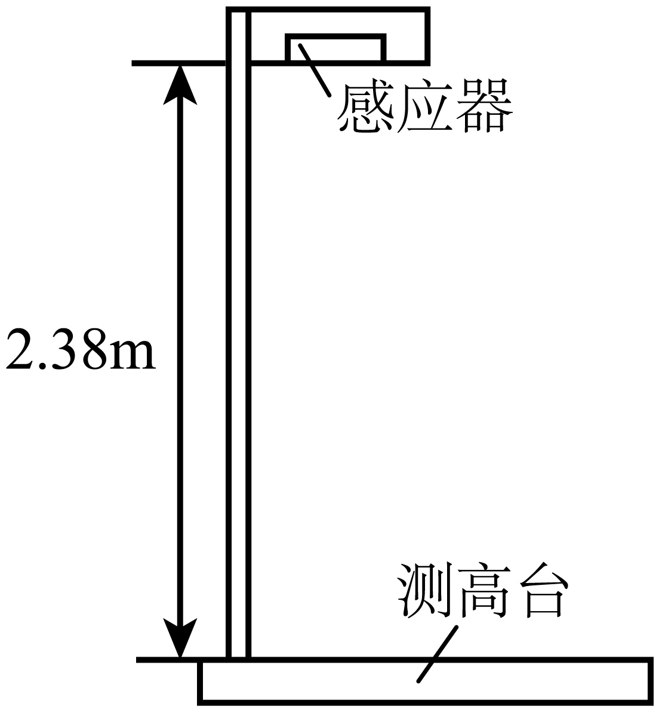

无人站立在测高台上时，求感应器发射超声波后到达测高台的时间；

某同学站在测高台上，感应器记录信号从发射到接收所经历的时间为0.005s，求该同学的身高。

【答案】

0.007s

，

1.53m

【解析】感应器发射超声波后到达测高台的时间为\( t=\frac{s}{v}=\frac{2.38\text{m}}{340\text{m}/\text{s}}=0.007\text{s}\)

）感应器发射超声波后到达人头顶的时间\( {t}_{1}=\frac{1}{2}\times 0.005\mathrm{s}=0.0025\mathrm{s}\)
感应器发射超声波后到达人头顶的距离为\( {s}_{1}=v{t}_{1}=\text{340m}/\text{s}\times 0.0025\text{s}=0.85\text{m}\)
该同学的身高为\( h=s-{s}_{1}=2.38\text{m}-0.85\text{m}=1.53\text{m}\)

## 87. 填空题（难度：适中）

外科医生可以利用超声除去人体内的结石，是利用了声波能传递；现代汽车一般安装有倒车雷达，当汽车倒车距离障碍物较近时，它就会发出声音及时提醒司机，这是利用了声音可以传递。

【答案】能量，信息

【解析】声音可以传递信息和能量。利用超声除去人体内的结石，说明声音可以传递能量；现代汽车一般安装有倒车雷达，当汽车倒车距离障碍物较近时，它就会发出声音及时提醒司机，这是利用了声音可以传递信息。

## 88. 填空题（难度：简单）

如图所示，医生利用的“B超”是通过（选填“超声波”或“次声波”）来观察胎儿的发育情况，这是利用了声音能够传递（选填“信息”或“能量”）。

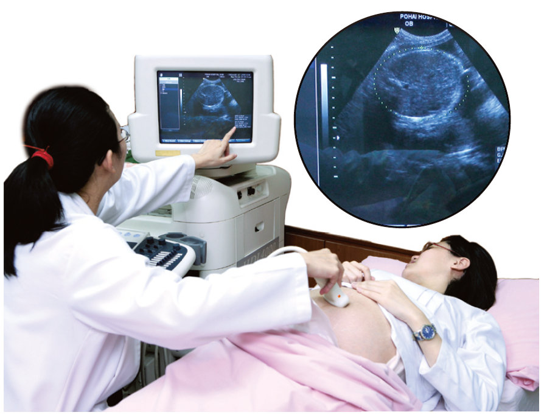

【答案】超声波，信息

【解析】次声波对人体有害，“B超”是利用超声波传递信息的原理来观察胎儿的发育情况。

## 89. 填空题（难度：简单）

如图所示是一种声悬浮仪， 它发出的声波与蝙蝠发出的一致，这种声波是（选填“超声波”或“次声波”），在空气中与人耳能听见的声音相比它具有更大的 (选填“速度”或“频率”)。将泡沫小球放在悬浮仪的两个发声体之间，小球就会悬浮在空中振动，这说明声音可以传递。

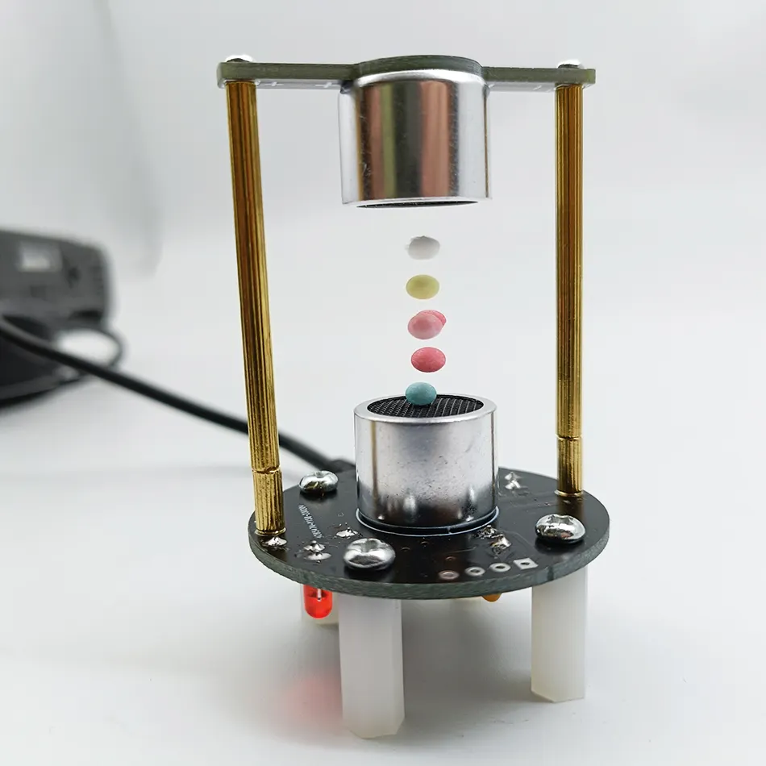

【答案】超声波，频率，能量

【解析】[1]蝙蝠发出的是超声波，所以声悬浮仪发出的声音为超声波。
[2]这种声音是由物体的振动产生的，在空气中和次声波相比超声波具有更大的频率。
[3]将泡沫小球放在悬浮仪的两个发声体之间，小球就会悬浮在空中振动，说明声音可以传递能量。

## 90. 填空题（难度：简单）

如图所示，将点燃的蜡烛放在发声喇叭前方，可以看到烛焰随着声音晃动，喇叭的纸盆由于产生声音，声音通过传播到烛焰处，烛焰晃动说明声音具有。

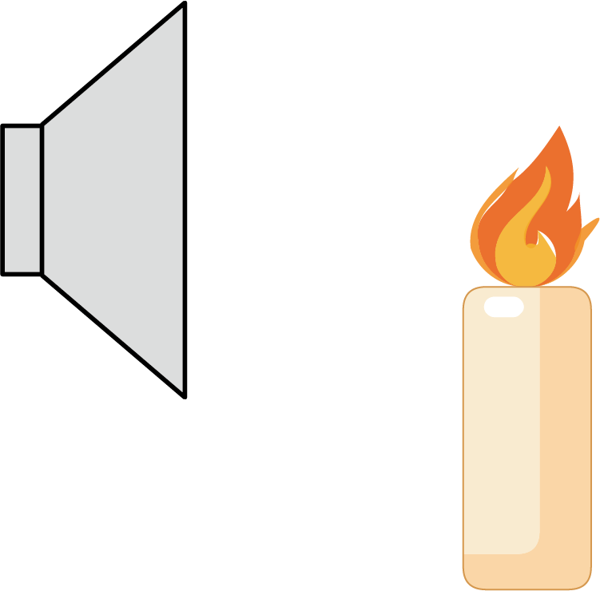

【答案】振动，空气，能量

【解析】声音是由物体的振动产生的，喇叭的纸盆由于振动产生声音；声音的传播需要介质，声音通过空气传播到烛焰处；声音可以传递信息，声音可以传递能量，烛焰晃动说明声音具有能量。

## 91. 多选题（难度：适中）

关于声现象，下列说法正确的是（　　）

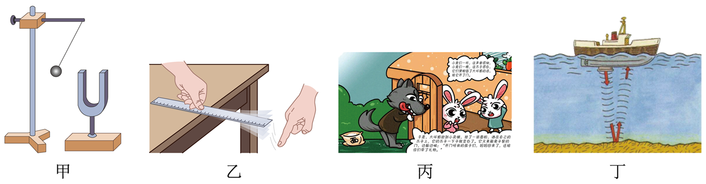

- A. 图甲中发声的音叉将乒乓球弹开说明声是由物体振动产生的
- B. 图乙中钢尺伸出桌面的长度越长，振动时，音调越高
- C. 图丙中小白兔通过声音的音调判断出叫门的不是妈妈
- D. 图丁中捕鱼船通过声呐确定鱼群位置是利用了超声波

【答案】A/D

【解析】A．发声的音叉将乒乓球弹开，该现象说明发声的物体在振动，故A正确；
B．钢尺发出声音的音调高低与尺子的振动快慢有关，当钢尺伸出桌面的长度越长时，振动越慢，发出声音的音调越低，故B错误；
C．不同材料的物体发出声音的音色不同，所以小兔子根据音色判断出叫门的不是妈妈，故C错误；
D．捕鱼船通过声呐确定鱼群位置是利用超声波的反射来传递信息，故D正确。

## 92. 填空题（难度：适中）

如图甲所示，在医院里医生通过听诊器给病人诊病，是利用了声可以传递（选填“信息”或“能量”）的性质；另外，在医院里我们还经常看到如图乙所示的“静”字，其目的是提醒大家要注意控制好声音的（选填“音调”、“响度”、或“音色”），以免影响他人。

【答案】信息，响度

【解析】[1]声音可以传播信息或能量，在医院里医生通过听诊器给病人诊病，方便诊断病情，是利用了声可以传递信息的性质。
[2]在医院里我们还经常看到如图乙所示的“静”字，其目的是提醒大家说话轻声细语，要注意控制好声音的强弱即响度。

## 93. （难度：适中）

海岭又称海脊，有时也称“海底山脉”，是狭长延绵的大洋底部的高地，一般在海面以下，高出两侧海底\( \text{3km~}4\text{km}\)．如图所示，对某海岭进行勘测时，某勘探船停在该海岭底部的A处正上方，向海底发出声呐信号，\( 6\text{s}\)后收到回波信号。之后勘探船行驶到达海岭最高点B处正上方，停下后，该船再次向海底发出声呐信号，经\( \text{3s}\)收到回波信号。已知声音在海水中的传播速度为\( \text{1500m/s}\)，在空气中的传播速度为\( \text{340m/s}\)。

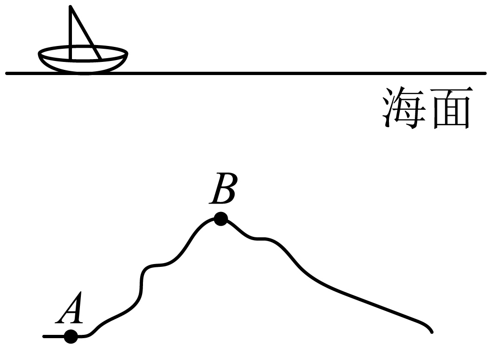

求A处海水的深度；

B处比A处高多少米？

【答案】

$ \text{4500m}$ 

，

$ 2250\text{m}$ 

【解析】声呐信号从海面到A处海底的时间\( {t}_{A}=\frac{6\mathrm{s}}{2}=3\mathrm{s}\)
根据\( s=vt\)，A处海水的深度\( {s}_{A}=1500\mathrm{m}/\mathrm{s}\times 3\mathrm{s}=4500\mathrm{m}\)

声呐信号从海面到B处海底的时间\( {t}_{B}=\frac{3\mathrm{s}}{2}=1.5\mathrm{s}\)
B处海水深度\( {s}_{B}=1500\mathrm{m}/\mathrm{s}\times 1.5\mathrm{s}=2250\mathrm{m}\)
B处比A处高\( \mathrm{\Delta }s={s}_{A}-{s}_{B}=4500\mathrm{m}-2250\mathrm{m}=2250\mathrm{m}\)

## 94. 单选题

如图所示，当轿车倒车时，尾部的非安全距离内遇到人或障碍物，倒车雷达就会发出警报，方便司机判断车尾与后部障碍物间的距离。在倒车雷达工作的过程中，会应用到下列物理知识中的（　　）

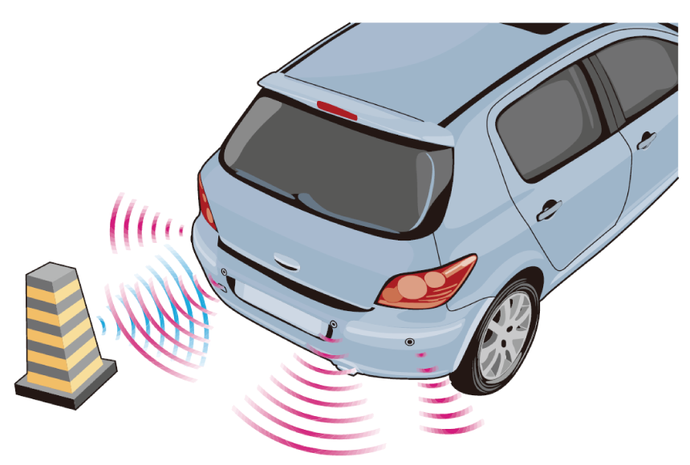
 
①声的反射；②超声波；③声音可以传递信息；④次声波

- A. ①②
- B. ③④
- C. ①②③
- D. ①②③④

【答案】C

【解析】倒车时，利用超声波原理，由装置在车尾保险杠上的探头发送超声波撞击障碍物后反射此声波，计算出车体与障碍物间的实际距离，然后提示给司机，使停车或倒车更容易、更安全，所以说倒车雷达应用了回声定位的原理，获得一些信息。故倒车雷达工作过程中，应用了超声波、回声、声音可以传递信息，没涉及到次声波，应用到的物理知识是①②③，没有应用到④。

## 95. 填空题（难度：简单）

如图所示是象群迁移时的情景，它们之间是利用声波交流，这是利用声音传递。

【答案】次，信息

【解析】频率低于20Hz的声音称为次声波，象群之间交流用的是低于20Hz的声音，即它们之间是用次声波进行交流，这也说明了声音能够传递信息。

## 96. 多选题（难度：适中）

2021年12月9日，神舟十三号的三名航天员翟志刚、王亚平、叶光富在中国空间站的首次太空授课以天地互动的方式，在中国空间站和地面课堂同步进行。在太空授课期间，下列说法正确的是（　　）

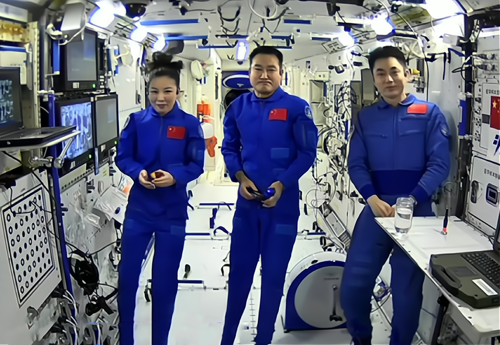

- A. 王亚平老师的声音听起来较尖，指的是声音音调较高
- B. 航天员在空间站里也能正常交流，说明声音传播不需要介质
- C. 同学们通过航天员的讲解获取的很多知识，说明声音可以传递信息
- D. 我们不用看大屏幕就能分辨三位航天员的声音，是根据音色进行判断

【答案】A/C/D

【解析】A．音调是指声音的高低，王亚平老师的声音听起来较“尖”，指的是声音音调较高，故A正确；
B．空间站里有空气，航天员在空间站里也能正常交流，不能说明声音传播不需要介质，故B错误；
C．同学们通过航天员的讲解获取的很多知识，这些知识通过声音传递给我们，说明声音可以传递信息，故C正确；
D．音色是不同物体发出的声音的特有属性，不同人发出声音的音色不同，所以我们不用看大屏幕就能分辨三位航天员的声音，是根据音色进行判断，故D正确。

## 97. 填空题（难度：简单）

口技是民间的一种声音艺术，高超的口技艺人，可以模仿各种语音，从声音的特性来看，他主要模仿声音的。虽然艺人挡在屏风后看不见，但现场观众能通过艺人发出的声音就能感受到人生的喜怒哀乐，说明声音可以传递。

【答案】音色，信息

【解析】[1]音色是指声音的特色，不同人发声的音色是不同的，高超的口技艺人，可以模仿各种语音，从声音的特性来看，他主要模仿声音的音色。
[2]声音可以传播信息和能量。现场观众能通过艺人发出的声音就能感受到人生的喜怒哀乐，说明声音可以传递信息，而不是能量。

## 98. 单选题（难度：简单）

如图所示的物体或情景在工作或发生过程中产生次声波的是（　　）

- A. 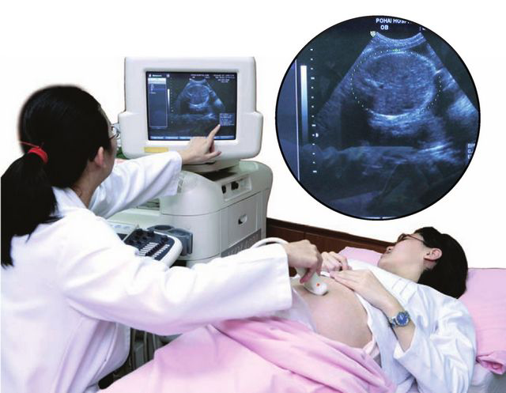
 
通过“B超”检查身体
- B. 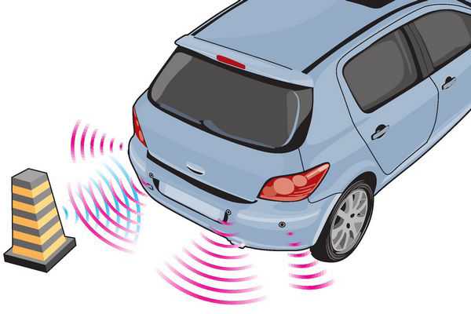
 
倒车雷达
- C. 
 
超声加湿器
- D. 
 
大象预测海啸

【答案】D

【解析】A．通过“B超”检查身体是利用超声波传递信息，故A不符合题意；
B．倒车雷达是利用超声波传递信息，故B不符合题意；
C．超声加湿器是利用超声波传递能量，故C不符合题意；
D．大象预测海啸，是因为海啸产生次声波被大象听到，故D符合题意。
