# 第二节 声音的特性（同步练习）

> 教材：物理·八年级全一册·沪科技版2024新教材 ｜ 来源：国家中小学智慧教育平台·在线练习 ｜ 共 51 题

## 1. 单选题（难度：简单）

声音的音调，决定于发声体的（　　）

- A. 振动频率
- B. 振动幅度
- C. 振动时间
- D. 形状结构

【答案】A

【解析】音调是声音的高低，是由物体振动的频率决定的，故A符合题意，BCD不符合题意。

## 2. 单选题（难度：简单）

小明用相同的力连续敲击两个完全相同的玻璃杯，但甲杯中的水比乙杯多。发出的声音相比，甲杯比乙杯声音“低沉”。这主要是由于两个声音的哪个特性不同（　　）

- A. 响度
- B. 音调
- C. 音色
- D. 振幅

【答案】B

【解析】用相同的力连续敲击两个完全相同的玻璃杯，发出声音的响度相同；甲杯比乙杯声音“低沉”，这主要是由于两个声音的音调特性不同，因为它们的振动频率不同。故B符合题意，ACD不符合题意。

## 3. 单选题（难度：简单）

“春眠不觉晓，处处闻啼鸟，夜来风雨声，花落知多少。”诗人能辨别出鸟鸣和风雨声，是依据声音的哪种特性（　　）

- A. 音调
- B. 音色
- C. 响度
- D. 频率

【答案】B

【解析】诗人能够清楚地辨别出鸟鸣和风雨声，是因为鸟鸣和风雨声的发声体不同，音色不同，即诗人是通过声音的音色来辨别的，故ACD不符合题意，B符合题意。

## 4. 单选题（难度：适中）

以下几句日常用语中，在表示音调的是（　　）

- A. 引吭高歌
- B. 调起高了，我唱不上去
- C. 窃窃私语
- D. 说话像蚊子叫

【答案】B

【解析】音调指声音的高低，与振动的频率有关，响度指声音的大小或强弱，与物体振幅和距发声体的远近有关，题中“引吭高歌”，“窃窃私语”，“说话像蚊子叫”都是指改变声音的大小，即改变声音的响度，而“调起高了，我唱不上去”，是指声音的音调高，故ACD不符合题意，故B符合题意。

## 5. 单选题（难度：简单）

同学们练习吹奏竖笛时，会按压不同的笛孔，使竖笛发出的声音的（　　）

- A. 响度不同
- B. 音调不同
- C. 音色不同
- D. 传播速度不同

【答案】B

【解析】吹奏竖笛时，竖笛内的空气柱就会振动发声，按住不同的笛孔，空气柱长度不同，振动频率不同，音调不同，故ACD不符合题意，B符合题意。

## 6. 单选题（难度：适中）

古诗词是中华传统文化的瑰宝之一，它不仅文字优美，还蕴含着许多物理知识。下列诗句中有关声现象的分析正确的是（　　）

- A. “转轴拨弦两三声”中的声音是由空气振动产生的
- B. “忽闻岸上踏歌声”中听到的歌声是通过空气传播的
- C. “不敢高声语，恐惊天上人”中的高指的是声音的音调高
- D. “夜半钟声到客船”中的钟声是根据响度辨别的

【答案】B

【解析】A．“转轴拨弦两三声”中的声音是由琴弦振动产生的，故A错误；
B．声音的传播需要介质，“忽闻岸上踏歌声”中听到的歌声是通过空气传播的，故B正确；
C．“不敢高声语，恐惊天上人”中的高指的是声音的响度大，故C错误；
D．“夜半钟声到客船”中的钟声是根据音色辨别的，故D错误。

## 7. 单选题

医生用听诊器检查病人心脏跳动主要是为了（　　）

- A. 适当改变心脏跳动频率，使音调变高
- B. 减少声音的分散，增大声音的响度
- C. 缩短和病人之间的距离，增大声音的响度
- D. 可以增大心脏跳动振幅，使响度增大

【答案】B

【解析】心脏跳动频率和心脏跳动振幅是由心脏决定的，医生用听诊器检查病人心脏跳动时不能改变心脏跳动频率和心脏跳动振幅；医生用听诊器检查病人心脏跳动时，人耳和病人的心脏有适当的距离，也没有缩短人耳和病人之间的距离，而是使病人心跳的声音通过听诊器的橡胶管传入人耳，减少了声音的分散，使声音变得更集中，从而增大了声音的响度，故B符合题意，ACD不符合题意。

## 8. 单选题（难度：简单）

声纹锁运用声纹识别技术，能识别主人说出的“口令”并自动解锁。声纹锁能识别主人的身份，主要是依据声音的（　　）

- A. 响度
- B. 音调
- C. 音色
- D. 频率

【答案】C

【解析】音色是由发声体的材料和结构决定的，不同人声带的结构不同，发出的声音音色也不同。声纹锁通过识别主人声音的音色来辨别身份。故ABD不符合题意，C符合题意。

## 9. 单选题（难度：适中）

如图，音叉M、N完全相同，M发出440Hz的声音，原来静止的N随之振动，N也发出440Hz的声音，则（　　）

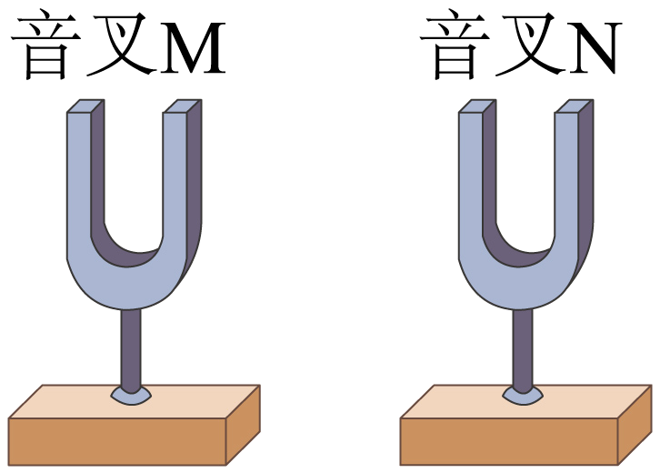

- A. M发声时每分钟振动440次
- B. M和N发出的声音的频率相同
- C. M和N发声时的振幅一定相同
- D. M发出的声音无需介质就能传播

【答案】B

【解析】A．频率表示每秒钟内振动的次数。已知M发出声音的频率为440Hz，表示该音叉每秒钟振动440次，故A不符合题意；
B．已知M和N发出声音的频率都为440Hz，所以M和N发出的声音的频率相同，故B符合题意；
C．引起N音叉振动的能量是由M音叉传递来的，传递过程中存在能量损耗，所以N音叉发声振动的振幅应比M音叉小，故C不符合题意；
D．声音的传播需要介质，故D不符合题意。

## 10. 单选题（难度：适中）

声音看不见摸不着，却以其独特的方式塑造并链接着我们的社会。下列关于声现象的叙述正确的是（　　）

- A. 不同动物对声音的感知各异，大象通过次声波进行信息交流
- B. 把正在响的闹钟放到真空罩中，听到声音越来越小，就能证明真空不能传声
- C. 人耳听到的声音有一定的频率范围，频率超过20000Hz的超声波，传播速度也变快
- D. 我们看到正在发声的鼓面在振动，由此就可以得出声音是由物体振动产生的

【答案】A

【解析】A．不同动物对声音的感知各异，不同动物的听觉和发声有不同的频率范围，大象通过低于人听觉下限的次声波进行信息交流，故A正确；
B．把正在响的闹钟放到真空罩中，抽出空气时，罩内传声介质越来越少，听到声音越来越小，可以进一步推理，如果罩内没有空气，将听不到声音，即真空不能传声，但是不能直接证明真空不能传声，故B错误；
C．人耳听到的声音有一定的频率范围，频率超过20000Hz的称为超声波，超声波传播速度与普通声波在同种介质中相同，故C错误；
D．我们看到正在发声的鼓面在振动，不能由此就得出声音是由物体振动产生的，只由一种现象得出的结论具有偶然性，需要通过大量实验归纳出普遍规律，故D错误。
答案A。

## 11. 单选题（难度：适中）

琴声悠扬，歌声嘹亮……我们的世界充满声音，关于声现象，下列说法正确的是（　　）

- A. “闻其声而识其人”，是根据响度来辨别的
- B. 高声唱国歌，其中“高”指的是音调高
- C. 蝴蝶翅膀振动慢，所以发出声音的响度小
- D. 拨动琴弦发声，是因为琴弦在振动

【答案】D

【解析】A．不同的人发出声音的音色不同，因此可以通过声音的音色来辨别人，故A错误；
B．高声唱国歌，“高”是指声音的响度大，故B错误；
C．蝴蝶翅膀振动慢，振动的频率低，声音的音调低，故C错误；
D．声音是由物体的振动产生的，用手拨动琴弦后，琴弦振动，从而发出声音，故D正确。

## 12. 单选题（难度：简单）

如图所示，小明用大小不同的力敲击鼓面，前后两次鼓面发出的声音（　　）

- A. 音调不同
- B. 响度不同
- C. 音色不同
- D. 速度不同

【答案】B

【解析】用大小不同的力敲击会造成鼓面振动幅度不同，声音的响度不同，故ACD不符合题意，B符合题意。

## 13. 单选题（难度：适中）

为弘扬中华优秀传统文化，激发学生对古诗词的热爱，铜仁市某中学举办了一场精彩纷呈的中学生诗词大赛。节目中有关声音的知识，下列解释正确的是（　　）

- A. “姑苏城外寒山寺，夜半钟声到客船”中“钟声”是通过空气传入人耳的
- B. “不闻机杼声，唯闻女叹息”听不见机杼声是因为声音的音调太低
- C. “谁家玉笛暗飞声”中的笛声是由笛筒振动产生的
- D. “少小离家老大回，乡音无改鬓毛衰”，是指说话声的响度没有改变

【答案】A

【解析】A．声音的传播需要介质，固体、液体、气体都能传声，“姑苏城外寒山寺，夜半钟声到客船”中的钟声通过空气传到客船上人的耳朵中，故A正确；
B．听不见机杼声，可能是因为声音比较小，即声音的响度小，故B错误；
C．声音是由物体的振动产生的，笛声是空气柱振动产生的，故C错误；
D．音色反映了声音的特点与品质，不同发声体的材料、结构不同，发出声音的音色也就不同，因此每个人的音色是不同的，“少小离家老大回，乡音无改鬓毛衰”中的“乡音无改”就是指此人的音色没有改变，故D错误。

## 14. 单选题（难度：适中）

根据题图所给信息，判断下列说法正确的是（　　）

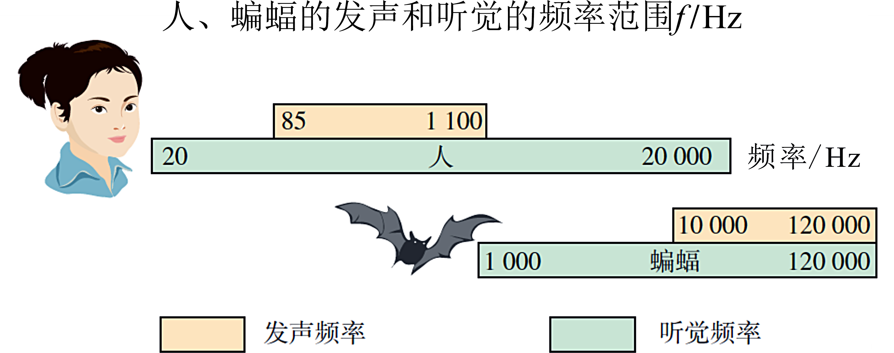

- A. 蝙蝠可以发出频率为400Hz的声音
- B. 人能听到蝙蝠发出的所有频率的声音
- C. 15Hz的声音只要振幅足够大，人耳是能听到的
- D. 人听觉频率范围比人发声频率范围要大

【答案】D

【解析】A．由图蝙蝠的发声频率为10000Hz∼120000Hz，所以蝙蝠不能发出频率为400Hz的声音，故A错误；
B．人的听觉范围为20Hz∼20000Hz，蝙蝠的发声频率为10000Hz∼120000Hz，所以人只能听到蝙蝠发出的部分频率的声音，故B错误；
C．15Hz的声音低于人听觉的下限20Hz，由振动的频率决定，与振幅没有关系，故C错误；
D．人的发声频率为85Hz∼1100Hz，听觉范围为20Hz∼20000Hz，人听觉频率范围比人发声频率范围要大，故D正确。

## 15. 单选题（难度：适中）

我国古代将锅称为“釜”。据《天工开物》记载：“凡釜既成后，试法以轻杖敲之，响声如木者佳，声有差响，则铁质未熟之故，他日易为损坏。”下列说法正确的是（　　）

- A. 轻杖敲打“釜”发出的声音是由空气振动产生的
- B. “响声如木者佳”是根据响度判断其品质
- C. “釜”发出的声音是通过空气传入人耳的
- D. “声有差响”是由于“釜声”的传播速度改变了

【答案】C

【解析】A．声音是由物体振动产生的。轻敲“釜”时，是釜本身（固体）振动发出声音，而不是空气振动，空气只是声音传播的介质，不是发声体，故A错误；
B．声音的三个特性是音调、响度、音色。音调由振动频率决定，响度由振幅决定，音色由发声体的材料、结构决定。“响声如木者佳”是通过声音的特色（音色）来判断釜的品质，而不是响度，故B错误；
C．声音的传播需要介质，空气是常见的传声介质，“釜”发出的声音通过空气传递到人耳，人才能听到，故C正确；
D．“声有差响”是因为不同的釜（比如未烧熟的和已烧熟的）材料、结构不同，振动时的音色、音调不同，不是声音传播速度改变，声音在空气中的传播速度只和温度等环境因素有关，和发声体无关，故D错误。

## 16. 单选题（难度：简单）

如图所示为古时排箫，又叫做“参差”，由长短不一的竹管组成。竹管参差不齐，目的是改变声音的（　　）

- A. 响度
- B. 音调
- C. 音色
- D. 传播速度

【答案】B

【解析】古时排箫，又叫做“参差”，由长短不一的竹管组成；竹管参差不齐，竹管中空气柱的长度不同，吹奏时空气柱振动的频率不同，目的是改变声音的音调，故B符合题意，ACD不符合题意。

## 17. 单选题（难度：简单）

如图是我国最早的乐器之一“埙”，吹奏时能发出宫、商、角、徵、羽五音，相当于现在的do、re、mi、sol、la。五音是指声音的（　　）

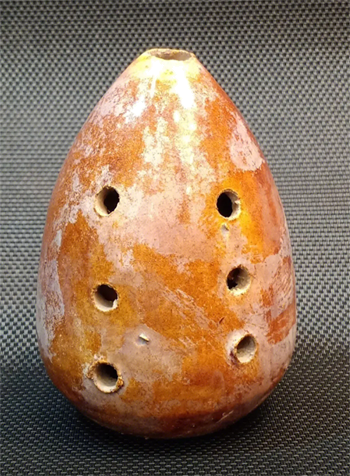

- A. 响度
- B. 音调
- C. 音色
- D. 速度

【答案】B

【解析】吹奏“埙”时，通过改变手按压不同的孔，改变发出声音的宫、商、角、徵、羽五音不同，所以是通过改变振动空气中的长短，来改变声音的频率，即改变音调，故B符合题意，ACD不会符合题意。

## 18. 单选题（难度：适中）

绷紧在纸盒上的两条橡皮筋，粗细不同（如图），用手拨动橡皮筋可发出声音。下列说法正确的是（　　）

- A. 拨动橡皮筋发出的声音，不是振动产生的
- B. 手拨动越快，橡皮筋发出的声音传播越快
- C. 拨动两条橡皮筋，发出声音的响度一定不同
- D. 拨动不同橡皮筋，可探究音调与振动频率的关系

【答案】D

【解析】A．声音是由物体的振动产生的。拨动橡皮筋发出的声音，也是振动产生的，故A错误；
B．手拨动越快，橡皮筋振动得越快，发出的声音音调越高，不是传播越快，声音传播的快慢与介质种类和温度有关，故B错误；
C．拨动两条橡皮筋，因为橡皮筋粗细不同，发出声音的音调不同，但响度可能不同，当拨动的力度相同时，响度相同，故C错误；
D．拨动不同橡皮筋，因为橡皮筋粗细不同，发出声音的频率不同，音调不同，所以可探究音调与振动频率的关系，故D正确。

## 19. 单选题（难度：适中）

第九届亚洲冬季运动会在哈尔滨举行，汽车匀速行驶在赛区亚雪公路上，轮胎经过特定设计的凹凸路面时，发出乐音。当轮胎匀速先后经过如图所示的甲、乙两种路面时，发出的声音（　　）

- A. 频率变大，音调变高
- B. 频率变大，音调变低
- C. 频率不变，音调不变
- D. 频率变小，音调变低

【答案】A

【解析】当轮胎匀速先后经过如图所示的甲、乙两种路面时，乙图中振动的频率变大，发出的声音的音调变高，故A符合题意，BCD不符合题意。

## 20. 单选题（难度：适中）

如图所示为不同的声音信号输入示波器时显示的波形图，下列说法正确的是（　　）

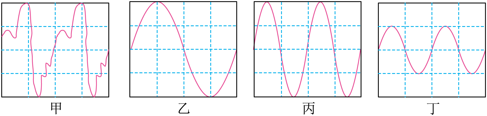

- A. 乙、丙、丁的响度相同
- B. 甲、丙、丁的响度相同
- C. 乙、丙、丁的音色相同
- D. 甲、乙、丙的音调相同

【答案】C

【解析】AB．响度是由振幅决定的，甲乙丙的振幅相同，丁的振幅要小一些。所以甲乙丙的响度相同。故AB错误；
C．音色是由波的形状决定的，乙、丙、丁三者波的形状相同，所以它们的音色相同。故C正确；
D．音调是由频率决定的。甲丙丁振动频率相同，乙的振动频率要小一些。故D错误。
【点睛】

## 21. 单选题（难度：适中）

CCTV推出一档大型文博探索节目《国家宝藏》，小琳特别关注了“贾湖骨笛”和“曾侯乙编钟”两件国宝，下面说法错误的是（　　）

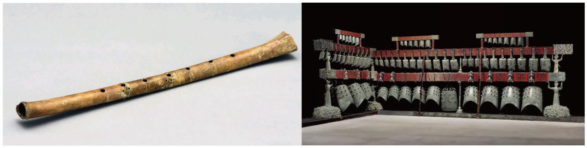

- A. 敲击编钟，编钟因振动而发出声音
- B. 轻敲或重敲编钟同一位置，编钟发出声音的响度不同
- C. 吹奏骨笛时，按压骨笛不同位置的气孔，发出声音的音色不同
- D. 悦耳的骨笛声是通过空气传入人耳中的

【答案】C

【解析】A．声音是由物体振动产生的，用钟锤敲击编钟时发出的声音是由于编钟振动产生的，故A正确，不符合题意；
B．用大小不同的力敲击编钟，编钟振动的幅度不同，产生的响度不同，轻敲，响度小，重敲，响度大，故B正确，不符合题意；
C．吹奏骨笛时，按压骨笛不同位置的气孔，则发声的空气柱长度不同，振动频率不同，发出声音的音调不同，故C错误，符合题意；
D．因声音可以在空气中传播，所以悦耳的骨笛声是通过空气传播到我们耳中的，故D正确，不符合题意。

## 22. 单选题（难度：适中）

利用如图所示装置，不能探究的是（　　）

- A. 真空不能传声的
- B. 振幅越大，响度越大
- C. 频率越大，音调越高
- D. 声音是由物体振动产生

【答案】A

【解析】A．在实验的过程中，我们能听到声音，说明空气能传播声音，但没法获得真空，无法探究真空不能传声，故A符合题意；
B．实验中，固定尺子不动，用大小不同的力拨动尺子，听尺子发出声音的响度大小，即可以探究响度与振幅的关系，故B不符合题意；
C．保持拨动尺子的力度不变，改变尺子伸出桌面的长短，听尺子发出声音的音调高低，即可以探究频率越大，音调越高，故C不符合题意；
D．实验中通过拨动尺子，能听到声音，表明声音是由物体的振动产生的，故D不符合题意。

## 23. 单选题（难度：适中）

如图所示是小宇和小南分别朗读课文时，老师使用同一设置参数的示波器记录并显示的声音波形图。根据波形图可知，小宇和小南声音的（　　）

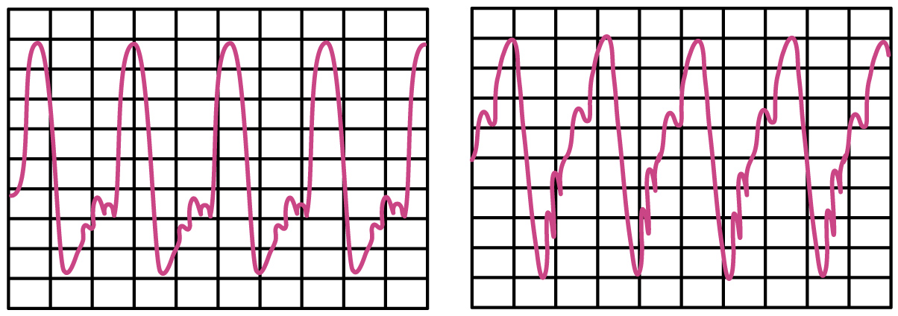

- A. 音调相同，音色不同
- B. 响度相同，音色相同
- C. 音调相同，响度不同
- D. 响度不同，音色不同

【答案】A

【解析】如图所示，两个同学的声音波形图中振动的幅度相同，则响度相同；振动的频率相同，则音调相同；波形的形状不同，表明音色不同，故A符合题意，BCD不符合题意。

## 24. 单选题（难度：适中）

如图是不同声音的波形图，其中声音的音调相同的是（　　）

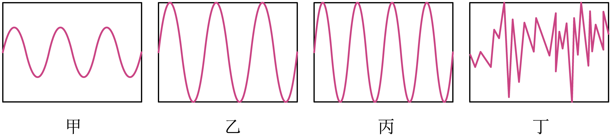

- A. 甲和乙
- B. 乙和丙
- C. 丙和丁
- D. 甲和丙

【答案】A

【解析】由图可知，在相同的时间里，甲和乙的振动次数是相同的（都是3个波峰和2个波谷），而丙的振动次数明显变多，丁是杂乱无章的振动，根据音调和频率的关系可知，甲和乙的音调相同，故A符合题意，BCD不符合题意。

## 25. 单选题（难度：适中）

如图所示，某款变频超声波驱蚊器能够发出不同频率的超声波干扰蚊子的感觉和行为，以达到驱蚊的效果。关于驱蚊器，下列说法中错误的是（　　）

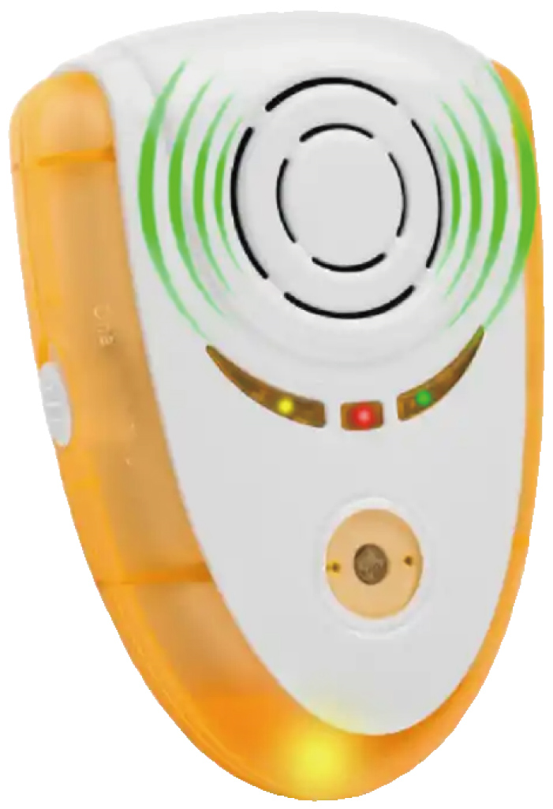

- A. 驱蚊器发声体通过振动发出声音
- B. 驱蚊器发出的声音可以被人听到
- C. 调高驱蚊器振动频率，声音的音调变高
- D. 该驱蚊器发声时，其声速不随距离的变化而变化

【答案】B

【解析】A．一切正在发声的物体都在振动，驱蚊器发声体通过振动发出声音，故A正确，不符合题意；
B．驱蚊器发出的声音为超声波，不在人的听觉范围内，不可以被人听到，故B错误，符合题意；
C．音调的高低与频率有关，调高驱蚊器振动频率，声音的音调变高，故C正确，不符合题意；
D．声音传播的速度与介质有关，在传播的过程中速度不变，该驱蚊器发声时，其声速不随距离的变化而变化，故D正确。

## 26. 填空题（难度：适中）

某款电动声波牙刷工作时每分钟振动30000次，该牙刷振动发出的声波频率为Hz，该声波（选填“是”或“不是”）超声波，人们（选填“能”或“不能”）听到该声波。

【答案】500，不是，能

【解析】【小题1】[1][2][3]由题可知，牙刷每分钟振动 30000 次。频率 \( f\)是每秒振动次数。即牙刷的频率\( f=\frac{30000\mathrm{次}}{60\mathrm{s}}=500\text{Hz}\)
人耳能听到的频率范围大约是 20 Hz 到 20000 Hz。500Hz在这个范围内，人耳可以听见，所以不是超声波。

## 27. 单选题（难度：适中）

超声导盲手杖可以帮助视障人士在出行时探测前进道路上的障碍物。当前方有障碍物时，手杖会发出警报声，距障碍物越近，警报声越尖锐。下列说法正确的是（　　）

- A. 距障碍物越近，声音的响度越大
- B. 距障碍物越近，声音的音调越高
- C. 盲人听到的尖锐的警报声是超声波
- D. 超声波的声速大于次声波的声速

【答案】B

【解析】AB．距障碍物越近，警报声越尖锐，声音尖锐是指声音的音调越高，故B正确，A错误；
C．超声波属于人耳听不到的声波，“尖锐的警报声”是手杖发出的可听声，而非超声波，故C错误；
D．声速大小只与介质有关，在同种介质中，超声波和次声波的传播速度是相同的，故D错误。

## 28. 单选题（难度：适中）

学习了声音的知识后，小芳自制了“水瓶琴”。她往八个相同的玻璃瓶中灌入不同高度的水，敲击它们就可以发出不同的声音。关于“水瓶琴”，下列说法中错误的是（　　）

- A. “琴声”通过空气传播到小芳的耳朵
- B. 敲击八个瓶子发出的声音传播速度相同
- C. 敲击不同的瓶子，发出声音的音调不同
- D. 若改为对瓶口吹气，则盛水越少，发出声音的音调越高

【答案】D

【解析】A．空气是声音的介质，“琴声”通过空气传播到小芳的耳朵，故A正确，不符合题意；
B．声音在同种介质中的传播速度只与温度有关，与声音的频率、响度等无关。因此，无论敲击哪个瓶子，声音在空气中的传播速度都是相同的，故B正确，不符合题意；
C．瓶中水的高度不同，敲击不同的瓶子，瓶子振动的频率不同，发出声音的音调不同，故C正确，不符合题意；
D．若改为对瓶口吹气，空气柱振动发声，则盛水越少，空气柱越长，发出声音的音调越低，故D错误，符合题意。

## 29. 单选题（难度：适中）

在纪念中国人民抗日战争胜利80周年大阅兵时，士兵齐声喊出“听党指挥、能打胜仗、作风优良”的口号，声音洪亮有力。下列说法正确的是（　　）

- A. 口号声是由士兵的声带振动产生的
- B. 远处观众听到口号声小，是因为声音的音调变低
- C. 所有士兵的声音音色相同，所以听起来整齐
- D. 口号声的传播速度会随声音响度的增大而变快

【答案】A

【解析】A．一切声音都是由物体振动产生的，口号声也是由振动产生的，故A正确；
B．远处观众听到口号声小，是因为声音响度变小，响度与距离声源的远近有关，故B错误；
C．整齐的口号声，指的是大家同时说出相同的内容，而不是音色相同，故C错误；
D．声音的传播速度与介质的种类和温度有关，与响度大小无关，故D错误。

## 30. 单选题（难度：适中）

如图所示，为增加驾乘体验，国内很多景区修建了“音乐公路”，即路面上分布着特定排列的横向凹槽、车每经过一个凹槽，就会上下振动一次，发出声音。假设某段音乐公路设定汽车以54km/h的速度匀速通过时，会演奏出一段20s时长的曲子，要发出第一个音符“sol”，每秒钟汽车轮胎与凹槽要碰撞400次。下列关于以上情景的选项中不正确的是（　　）

- A. 该音乐公路的总长约为300m
- B. 汽车发出“sol”这个音时，所对应的相邻凹槽之间的距离为3.75cm
- C. 如果速度超过设定速度值时，听到音乐的音调就会变高
- D. 相邻凹槽间的距离不同，目的是使车速相同时发出声音的音色不同

【答案】D

【解析】已知汽车速度\( \nu =54\text{km}/\text{h=15m/s}\)
A．该音乐公路总长约为\( s=vt=15\text{m/s}\times \text{20s=300m}\)，故A正确，不符合题意；
B．汽车每秒行驶15m，音符的频率为400赫兹，即每秒内振动400次，所以相邻的凹槽之间的距离为\( d=\frac{v}{f}=\frac{15\text{m/s}}{400\text{Hz}}=0.0375\text{m=3.75cm}\)，故B正确，不符合题意；
C．如果速度超过设定速度值时，车轮驶过时，振动频率会变高，听到音乐的音调就会变高，故C正确，不符合题意；
D．音色由发声体的材料、结构决定，与凹槽间距无关，相邻凹槽间距不同，是为了改变振动频率，从而改变音调，而非音色，故D正确，符合题意。

## 31. 填空题（难度：适中）

AI智能音箱让用户以语音对话的交互方式实现多项功能的操作。当对AI智能音箱发出“调大声音”的指令时，音箱就自动改变声音的。智能音箱可以模仿很多明星的声音，该音响主要是模仿声音的（选填“音调”“音色”或“响度”）。

【答案】响度，音色

【解析】[1]当对AI智能音箱发出“调大声音”的指令时，音箱就自动改变声音的响度，使音箱发出的声音更大。
[2]根据音色可以辨别不同的发声体，智能音箱可以模仿很多明星的声音，该音响主要是模仿声音的音色。

## 32. 填空题（难度：适中）

支付宝用户可以“声音锁”。开支付宝时，主人无论轻声或大声、高音或低音，只要读对APP显示的数字，便可打开支付宝。支付宝的“声音锁”，主要是根据主人的（两空均选填“音调”、“响度”或“音色”）；超声波驱蚊器发出的超声波可以有效驱蚊，而人却听不到它发出的超声波，是因为超声波的太高。

【答案】音色，音调

【解析】[1]音色是声音的独特特征，不同人的音色不同，且不受响度（轻声 / 大声）、音调（高音 / 低音）的影响。支付宝 “声音锁” 正是依据主人声音的音色来识别身份。
[2]人耳的听觉范围是20Hz~20000Hz，超声波的频率高于20000Hz，超出了人耳的听觉范围，因此人听不到超声波。

## 33. 填空题（难度：适中）

某昆虫的翅膀每分钟振动12000次，某同学发出250赫兹声音，音调较高的是（选填“昆虫”或“同学”）发出的声音。蜜蜂的翅膀1min振动15000次，人类（选填“能”或“不能”）听到它的声音。

【答案】同学，能

【解析】[1]昆虫翅膀每分钟振动12000次，则每秒振动的次数为\( \frac{12000\mathrm{次}}{60\mathrm{秒}}=200\mathrm{H}\mathrm{z}\)。音调由频率决定，频率越高，音调越高。昆虫的频率为200Hz，同学的频率为250Hz，250Hz > 200Hz，因此同学发出的声音音调更高。
[2]蜜蜂翅膀每分钟振动15000次，则每秒振动次数\( \frac{15000\mathrm{次}}{60\mathrm{秒}}=250\mathrm{H}\mathrm{z}\)。人类听觉频率范围为20Hz到20000Hz，250Hz在此范围内，因此人类能听到蜜蜂的声音。

## 34. 填空题（难度：适中）

上课时，老师对同学们说“朗读时，声音请大一点”，这里的“大”指的是声音的。人听到蚊子飞行的“嗡嗡”声，是由蚊子翅膀产生的，但人听不到蝴蝶飞行的声音，是因为蝴蝶发出声音的不在可听声的范围内。

【答案】响度，振动，频率

【解析】[1]声音的大小叫响度，声音请大一点，这里的“大”指的响度。
[2]声音是由物体振动产生的，蚊子飞行的“嗡嗡”声，是由蚊子翅膀振动产生的。
[3]人可以听见的声音范围是20Hz~20000Hz。蝴蝶飞行时翅膀振动频率低于20Hz，属于次声波，人耳无法感知，故人听不到蝴蝶飞行的声音，是因为蝴蝶发出声音的频率不在可听声的范围内。

## 35. 填空题（难度：适中）

初中阶段很多男生会进入变声期，变声期会让男生的声音变粗，声音变粗是指声音的（选填“音调”“响度”或“音色”）发生改变；一只蝴蝶\( 1\mathrm{m}\mathrm{i}\mathrm{n}\)内振翅300次，其翅膀振动发出的是（选填“可听声”“次声波”或“超声波”）。

【答案】音调，次声波

【解析】[1]音调指声音的高低。变声期会让男生的声音变粗，声音变粗是指声音的音调会发生改变。
[2]一只蝴蝶1min振动300次，即振动频率为5Hz，次声波的频率低于20Hz，蝴蝶振翅的频率低于20Hz，属于次声波范畴。

## 36. 填空题（难度：适中）

如图甲所示，用大小相同的力从左向右敲击水瓶琴，其发出声音的音调将（选填“升高”或“降低”）；如图乙所示，将正在发声的音叉轻触系在细绳上的乒乓球，音叉产生声音的（选填“音调”或“响度”）越大，乒乓球被弹开的幅度越大，这里将不易测量的物理量通过非常直观的现象去认识，用到的科学探究方法是法。

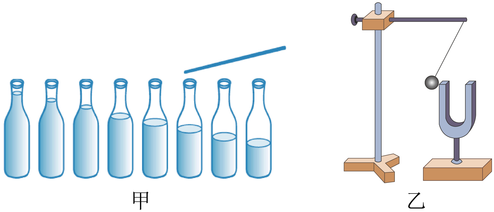

【答案】升高，响度，转换

【解析】[1]对于图甲，用大小相同的力从左向右敲击水瓶琴，瓶内水越多，瓶子振动越慢，频率越低，音调越低。从左到右瓶内水逐渐减少，瓶子振动会加快，频率升高，所以音调升高。
[2]对于图乙，正在发声的音叉轻触乒乓球，音叉响度越大，振动幅度越大，乒乓球被弹开的幅度越大。
[3]这里把音叉的振动幅度（不易测量）通过乒乓球被弹开的幅度（直观现象）来体现，用到的是转换法。

## 37. 填空题（难度：适中）

如图所示是教室上课时常用的一种便携式扩音器，教师使用它讲课的主要目的是改变声音特性中的，在声音的波形图中，甲、乙两图表示声音特性中的不同，甲、丙两图表示声音特性中的不同。

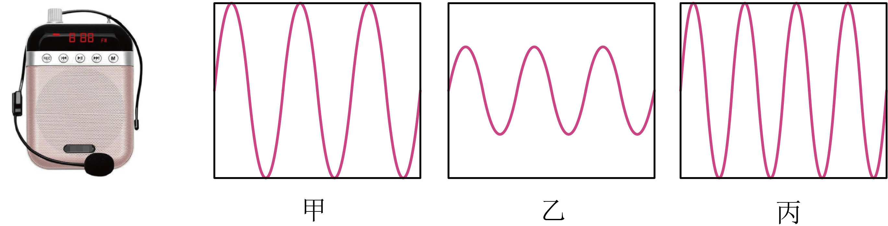

【答案】响度，响度，音调

【解析】[1]物理学中把人耳能感觉到的声音的强弱称为响度，教师使用扩音器讲课的主要目的是使声音变强，即改变声音特性中的响度。
[2][3]声源振幅越大，声音的响度越大，在声音的波形图中，甲和乙的振幅不同，响度不同，甲和丙的频率不同，音调不同。

## 38. 填空题（难度：适中）

如图所示的曾侯乙编钟是我国古代重要的打击乐器，体现了中国先秦礼乐文明和青铜器铸造技术的极高水平。敲击时发出的声音是编钟产生的；用相同的力敲击大小不同的编钟，发出声音的不同。

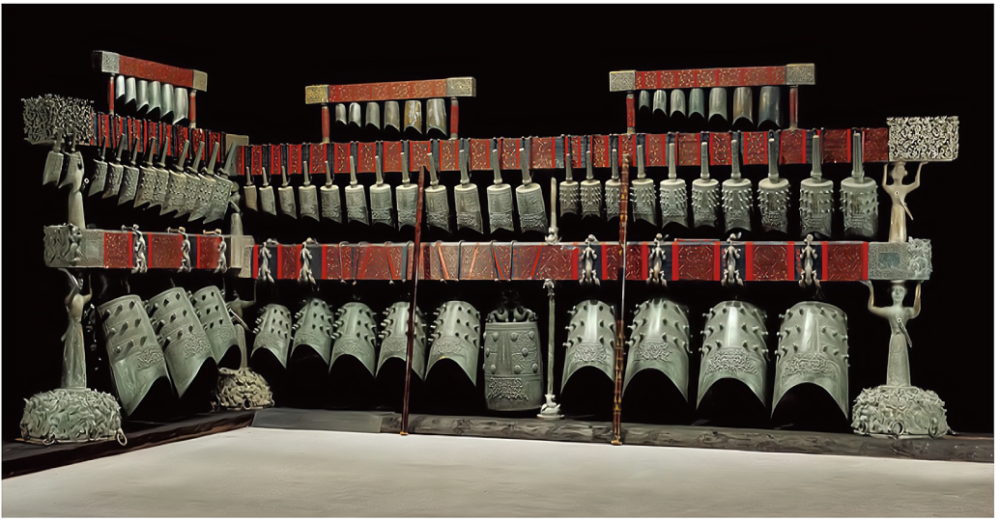

【答案】振动，音调

【解析】[1]声音是由物体振动产生的，敲击编钟，编钟振动而发出声音。
[2]用相同的力敲击大小不同的编钟，编钟振动频率不同，则发出声音的音调不同。

## 39. （难度：适中）

在无锡鸿山遗址出土的战国青瓷乐器中，三足缶尤为特别。它形似鼎，实为乐器，它的出土让文献“击缶而歌”有了实物印证。

乐师演奏时，用相同的力度敲击缶的腹部（中心区域）和口沿（边缘），发出的声音最显著的差异在于（填写一个声音特性）不同。

单个的三足缶，主要作为节奏性乐器使用。而同样出土于鸿山的编钟、编磬，却能演奏出丰富的旋律。从物理角度看，编钟、编磬能演奏旋律，是因为一套之中每个钟或磬的（填写一个声音特性）都精确地不同。如果要让一个单个的缶也能勉强奏出几个不同音高的音，理论上可以尝试向缶内注入不同量的水来改变其振动特性，这主要是通过改变缶内可振动部分的来实现的。

【答案】音调，音调/频率

【解析】力度相同所以响度相近，都是同一个乐器所以音色相近；中心区域振动部分质量大、振动慢，所以频率低，则音调低；边缘区域振动部分质量小、振动快，所以频率高，则音调高；故发出的声音最显著的差异在于音调不同。

[1]编钟、编磬大小、厚薄不一样，敲击时振动快慢不一样，所以音调不一样，有不同音调，才能组成音阶、旋律。
[2]往缶里加水，缶里水越多，参与振动的总质量越大，质量越大，振动越慢，则振动的频率越低，所以音调越低，故加水本质就是改变振动部分的频率。

## 40. （难度：适中）

探究声音的特性：

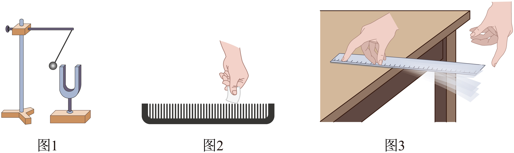

如图1所示，小慧同学用小锤轻敲和重敲音叉，并将正在发声的音叉轻触系在细绳上的乒乓球，听音叉发声的同时观察乒乓球被弹开的幅度变化。她想探究的问题是：；

如图2所示用一张硬卡片在木梳齿上划过，可听到（选填“梳齿”或“卡片”）振动发声；先快划后慢划，听声音的变化，可探究问题是；

如图3所示，小明将一把钢尺的一端压在桌面上，保持钢尺伸出桌边的长度不变，先轻拨后重拨，发现重拨时，桌面被拍得较响，由此现象，小明得出了“振幅越大，响度越大”的结论。你认为小明得出结论所依据的实验现象是（选填“正确”或“错误”）的，判断的理由是；

小明还利用图\( 3\)所示探究了“影响声音的音调的因素”，实验时逐渐增加钢尺伸出桌面的长度，用大小相同的力拨动钢尺，可听到声音的音调变小，可观察到钢尺振动变慢，由此得到结论：；实验中小明还发现当钢尺伸出桌面超过一定长度时，虽然用同样的力拨动钢尺，看到钢尺在振动可却听不到声音了，其原因是；

图3所示的实验若改用塑料尺做实验，则发出声音的一定会改变。

【答案】声音的响度与声源振幅的关系，卡片/声音的音调与声源振动频率的关系，错误/应该听钢尺振动发出的声音而不是听桌面被拍打发出的声音，声音的音调与振动频率有关，频率越低，音调越低/钢尺振动产生的是次声波，人耳不能听到，音色

【解析】[1]如图\( 1\)所示，小慧同学用小锤轻敲和重敲音叉，改变了音叉的振幅，并将正在发声的音叉轻触系在细绳上的乒乓球，听音叉发声的同时观察乒乓球被弹开的幅度变化，则她想探究的问题是：声音的响度与声源振幅的关系。

[2][3]如图\( 2\)所示，用一张硬卡片在木梳齿上划过时，可听到卡片振动发声；先快划后慢划，改变了卡片的振动频率，听声音的变化，可探究的问题是声音的音调与声源振动频率的关系。

[4][5]如图\( 3\)所示，小明将一把钢尺的一端压在桌面上，保持钢尺伸出桌边的长度不变，先轻拨后重拨，发现重拨时，桌面被拍得较响，由此现象，小明得出了“振幅越大，响度越大”的结论；小明得出结论所依据的实验现象是错误的，判断的理由是应该听钢尺振动发出的声音而不是听桌面被拍打发出的声音。

[6]小明还利用图\( 3\)所示探究了“影响声音的音调的因素”，实验时逐渐增加钢尺伸出桌面的长度，用大小相同的力拨动钢尺，听到声音的音调变小，可观察到钢尺振动变慢，由此得出结论：声音的音调与振动频率有关，频率越低，音调越低；
[7]实验中小明还发现当钢尺伸出桌面超过一定长度时，虽然用同样的力拨动钢尺，看到钢尺在振动可却听不到声音了，其原因是钢尺振动产生的是次声波，人耳不能听到。

[8]图\( 3\)所示的实验若改用塑料尺做实验，音色与发声体的材料和结构有关。因塑料尺和钢尺的材料不同，则发出声音的音色一定会改变。

## 41. 多选题（难度：适中）

下面四幅图片中关于声音特性的研究，说法正确的是（　　）

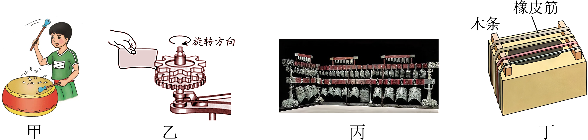

- A. 甲图：用大小不同的力敲击鼓面，可以研究响度与振幅的关系
- B. 乙图：纸片接触齿数不同的旋转齿轮，研究响度与频率的关系
- C. 丙图：用大小相同的力敲击大小不同的编钟，所发出声音的音调不同
- D. 丁图：用大小不同的力拨动同一根橡皮筋，所发出声音的响度不同

【答案】A/C/D

【解析】A．用大小不同的力敲击鼓面，鼓面的振幅不同，响度不同，实验可以探究响度跟振幅的关系，故A正确；
B．用硬纸片接触转速一定齿数不同的齿轮，纸片振动的快慢不同，音调不同，可以探究“音调与频率的关系”，故B错误；
C．用相同的力度敲击大小不同的钟，编钟的质量不同，体积不同的钟，振动的难易不同，频率不同，音调不同，故C正确；
D．同时当用大小不同的力拨动同一根橡皮筋，橡皮筋振动的幅度是不同的，则响度是不同的，故D正确。

## 42. 多选题（难度：适中）

物理课上，老师用力吹一根较长的塑料吸管的同时，用剪刀一小段一小段地剪短吸管，如图所示， 同学们听到的声音（　　）

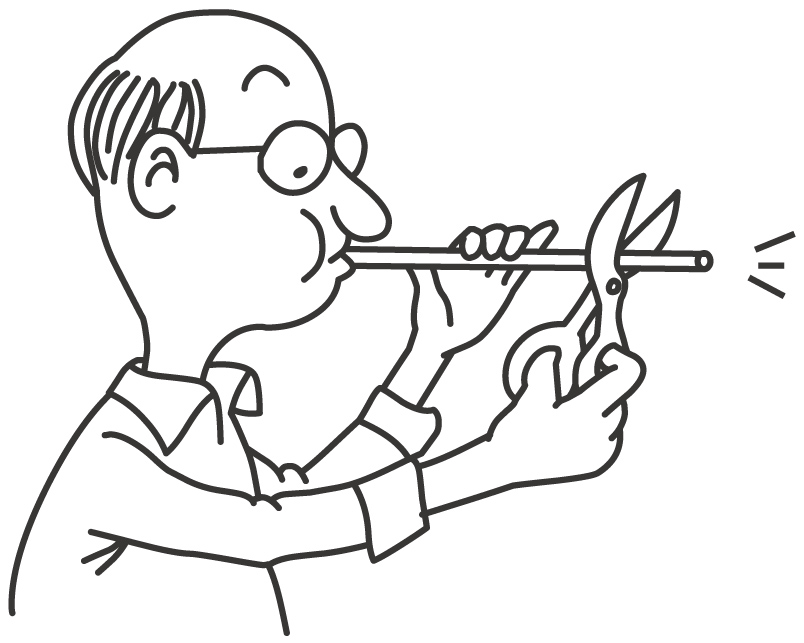

- A. 音色不变
- B. 音调变了
- C. 是老师的声带振动产生的
- D. 后排同学听到的与前排同学听到的相同

【答案】A/B

【解析】A．音色反映声音的品质与特色，与发声体的材料、结构有关，由题意可知材料不变，故音色不变，故A符合题意；
BC．声音是由物体的振动产生的，用力吹一根较长的塑料吸管，产生的声音是由内部的空气柱振动产生的，用剪刀一小段一小段地剪短吸管，管内空气柱长度变短，振动频率变快，音调变高，故同学们听到的声音与不剪时相比音调变了，故B符合题意，C不符合题意；
D．响度与振幅和距离声源的远近有关，后排同学与吸管距离较远，听到声音的响度会变小，故D不符合题意。

## 43. 多选题（难度：适中）

（多选）如图所示，下列有关声音的特性的说法正确的是（　　）

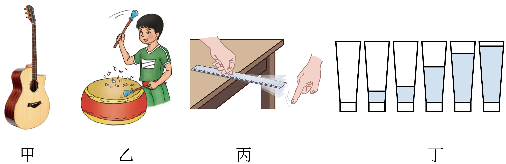

- A. 图甲中，改变吉他弦的松紧程度可以改变声音的音调
- B. 图乙中，敲击鼓面所用的力不同，发出的声音的响度不同
- C. 图丙中，钢尺伸出桌边的长度越长，拨动它时发出的声音的音调越高
- D. 图丁中，用相同大小的力敲击盛有不同水量的杯子，发出的声音的音调相同

【答案】A/B

【解析】A．改变吉他弦的松紧程度可以改变吉他弦振动的快慢，从而改变声音的音调，故A正确；
B．改变敲击鼓面所用力的大小可改变鼓面的振幅，振幅不同，声音的响度不同，故B正确；
C．钢尺伸出桌面长度越长，振动时频率越低，音调越低，故C错误；
D．用相同大小的力敲击不同水量的杯子，由于水量不同，杯子和水振动的频率不同，发出声音的音调不同，故D错误。

## 44. 多选题（难度：适中）

如图所示，在筷子上摆一些棉花，做一个活塞，用水蘸湿棉花后插入两端开口的塑料管中，用嘴吹管的上端，可以发出悦耳的哨音，上下推拉活塞，并用力吹管的上端时，下列说法错误的是（　　）

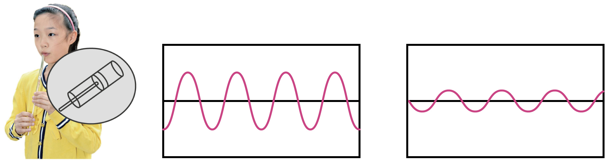

- A. 哨音是由塑料管振动产生的，以声波的形式传播
- B. 哨音是通过空气传到别人耳朵的
- C. 两次声音的波形图，左边的声音波形图对应的哨音响度更大
- D. 向下拉活塞时，空气柱更长，吹出的哨音音调会变高

【答案】A/D

【解析】A．声音由物体振动产生；用嘴吹管的上端，可以发出悦耳的哨音，哨音是由管内空气振动产生的，故A错误，符合题意；
B．哨声是通过空气这种介质传播到别人耳朵的，故B正确，不符合题意；
C．两次声音的波形图，左边的声音波形图振幅大，因此对应的声音的响度更大，故C正确，不符合题意；
D．向下拉活塞时，管内空气柱变长，振动慢，吹出的哨音音调会变低，故D错误，符合题意。

## 45. 单选题（难度：适中）

葫芦丝是云南省傣、阿昌、德昂、佤等少数民族地区流行的一种民间乐器，如图所示是西双版纳的同学们演奏葫芦丝时的情景，下列有关说法不正确的是（　　）

- A. 葫芦丝是靠空气柱振动发声的
- B. 现场观众听到的声音是通过空气传入人耳的
- C. 演奏时按不同的孔，可以改变声音的音调
- D. 演奏时的声音越大，声音在空气中传播的速度就越快

【答案】D

【解析】A．一切声音都是由于物体振动产生的，葫芦丝是靠空气柱振动发声的。故A正确，不符合题意；
B．声音的传播需要介质，现场观众听到的声音是通过空气传入人耳的，故B正确，不符合题意；
C．演奏时按不同的孔，改变了空气柱的长度，从而改变了空气柱的振动频率，可以改变声音的音调。故C正确，不符合题意；
D．声速只与介质的种类和温度有关，演奏时的声音变大时，声音在空气中传播的速度不变，故D错误，符合题意。

## 46. 填空题（难度：适中）

如图所示，将一把钢尺压在桌面上，一部分伸出桌面，轻拨与重拨钢尺，则钢尺发出声音的不同；改变钢尺伸出桌面的长度，保持尺的振动幅度不变不同；换用一把塑料尺子继续实验，其他条件不变不同。（均选填“响度”、“音调”和“音色”）

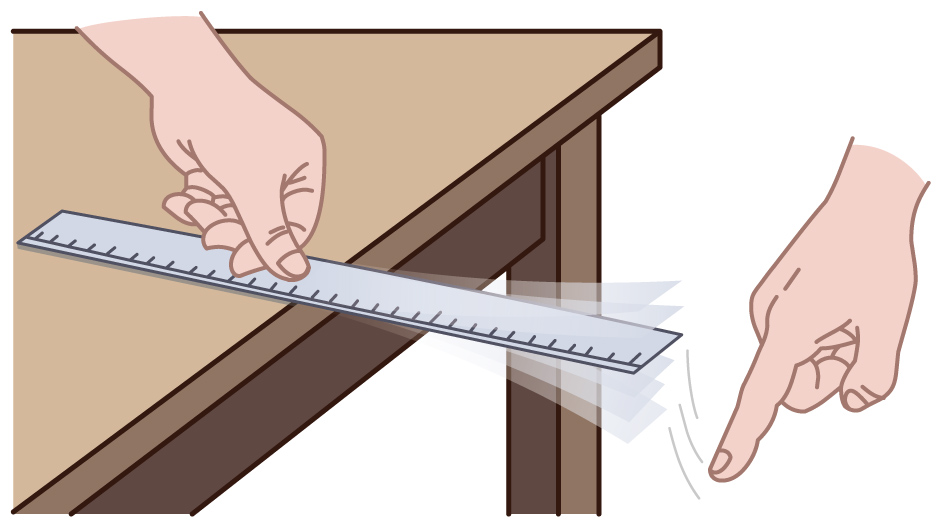

【答案】响度，音调，音色

【解析】[1]声音的响度与声源振动的幅度和距离发声体的远近有关，振动幅度越大，响度越大；轻拨与重拨钢尺，会导致钢尺振动幅度不同，所以声音的响度不同。
[2]音调的高低与发声物体振动快慢有关，物体振动越快，音调越高；改变钢尺伸出桌面的长度，用同样大小的力拨动其伸出桌面的一端，钢尺的振动频率不同，所以发声的音调不同。
[3]音色反映的是声音的品质与特色，它跟发声体的材料和结构有关；换用一把塑料尺子继续实验，发声体改变，其他条件不变，则音色不同。

## 47. 多选题（难度：适中）

四个相同的玻璃瓶里，装着不同高度的水。对着瓶口吹气，如能吹出1，2，3，4四个音阶，则1（duo）和2（ruai）是（　　）

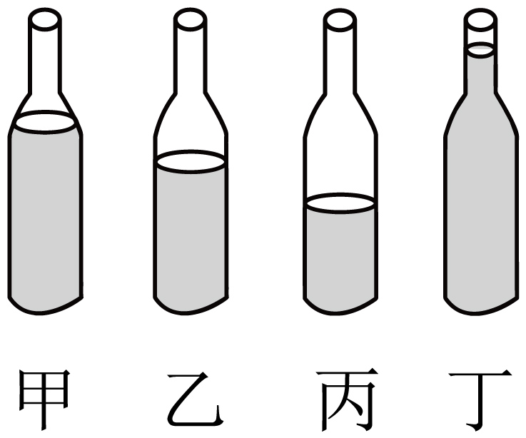

- A. 丙瓶
- B. 丁瓶
- C. 甲瓶
- D. 乙瓶

【答案】A/D

【解析】当用嘴向瓶内吹气时，瓶内的空气柱振动发声，随着瓶内水位的升高，瓶内的空气柱越来越短，振动的频率越来越高，因此音调也会越来越高；由图知：四个瓶子的水位，从低到高分别是：丙、乙、甲、丁，因此对应的四个音阶是：1、2、3、4，故AD符合题意，BC不符合题意。

## 48. 单选题（难度：适中）

关于如图所示的民族吹管乐器唢呐，下列说法正确的是（　　）

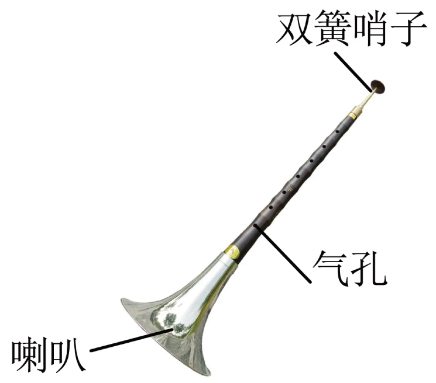

- A. 吹奏时按压不同位置的气孔，主要改变了声音的音色
- B. 用不同的力度吹奏主要改变了声音的音调
- C. 唢呐前端的喇叭主要是减小声音分散，使得较远处听者能听清声音
- D. 唢呐发出的声音也能在真空中传播

【答案】C

【解析】A．吹奏时按压不同位置的气孔，发声的空气柱长度不同，振动频率不同，因此主要改变声音的音调，故A错误；
B．用不同的力度吹奏，发声体的振幅不同，从而发出声音的响度不同，故B错误；
C．唢呐前端的喇叭主要是减少了声音的分散，使声音集中向一个方向传播，改变了声音的响度，故C正确；
D．声音的传播需要介质，声音不能在真空中传播，故D错误。

## 49. （难度：适中）

请同学们回顾课堂上做过的“探究影响音调高低的因素”实验，完成下列问题。

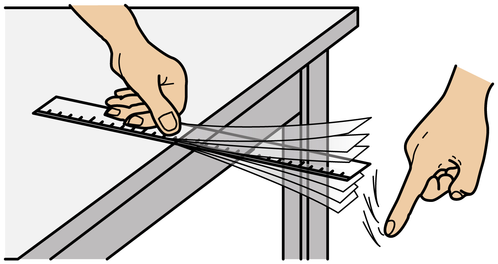

将钢尺的一端紧压在桌面上，另一端伸出桌面。将伸出桌面的一端下压2cm，松手后，观察钢尺振动的（选填“幅度”或“快慢”）听钢尺发出声音音调的高低；

接下来正确的操作是：_____，松手后观察钢尺振动并听钢尺发出音调高低；

实验中同学们发现：钢尺伸出桌面长度越，钢尺振动越 ，发出的音调越高。

如图是“录制合成”的声音波形图，由图可知，甲和丙的相同，甲和丁的相同的。（两空选填“音调”或“响度”）若甲每分钟振动2400次，甲的频率是Hz，丙的频率是 Hz。

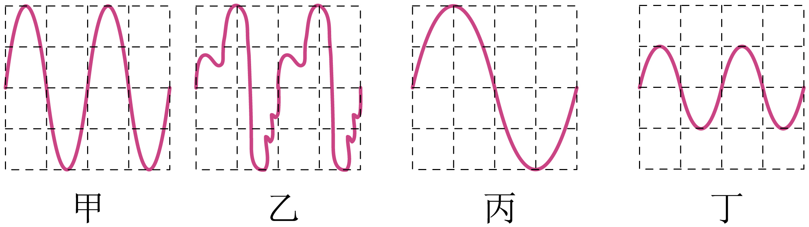

- A. 改变钢尺伸出桌面长度，将伸出桌面的一端下压3cm
- B. 保持钢尺伸出桌面长度不变，将伸出桌面的一端下压3cm
- C. 改变钢尺伸出桌面长度，将伸出桌面的一端下压2cm

【答案】快慢，C，短/快，响度/音调/40/20

【解析】音调是由振动频率决定，振动越快，频率越高，所以观察钢尺振动的快慢听钢尺发出声音音调的高低。

钢尺伸出桌面的长度不同，钢尺振动快慢不同，音调不同。所以探究影响音调高低的因素需改变钢尺伸出桌面长度；根据控制变量法可知，需控制钢尺伸出桌面的一端下压的距离，

[1][2]钢尺伸出桌面长度越短，钢尺越容易振动起来，振动越快，频率越高，发出的音调越高。

[1]甲和丙的振幅相同，所以甲和丙的响度相同。
[2]甲和丁的频率相同，所以甲和丁的音调相同。
[3]每秒钟振动的次数就是频率，所以甲的频率为\( f=\frac{2400}{60}\text{Hz}=40\text{Hz}\)
[4]由图可知，丙的频率是甲的频率的一半，所以，丙的频率是20Hz。

## 50. 单选题（难度：适中）

某实验小组用一把钢尺、示波器、话筒等仪器研究声音的有关问题。实验装置如图所示，具体步骤如下:

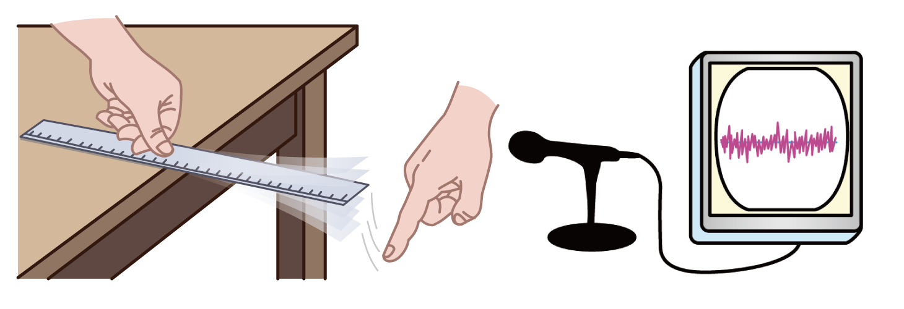
 
a.将钢尺紧按在桌面上，一端伸出桌边。拨动钢尺，听它振动发出的声音，同时记录它发出声音的波形。
b.不改变钢尺伸出桌边的长度，增加拨动钢尺的力度，听它振动发出的声音，同时记录它发出声音的波形。
c.使钢尺伸出桌边的长度变短，使用步骤b中的力度拨动钢尺，听它振动发出的声音，同时记录它发出声音的波形。请完成下列问题:
（1）拨动钢尺，钢尺才能发出声音，这说明声音是由物体______产生的；
（2）改变钢尺伸出桌边的长度，钢尺的振动快慢会改变，示波器显示的波形也会改变。可见，发声体振动的快慢是一个很重要的物理量，它决定着_____的高低。如果示波器上波形显示声音的频率为60Hz，则此时钢尺在1分钟内振动______次；
（3）通过步骤______和______可以研究振幅和响度的关系；
（4）三个步骤中实验小组记录的波形如图甲、乙、丙所示，按照步骤从先拍到后的顺序排列是下列四个选项中的______。

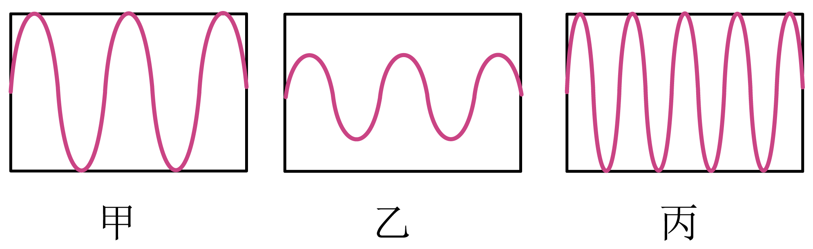

- A. 甲乙丙
- B. 乙甲丙
- C. 甲丙乙
- D. 丙甲乙

【答案】B

【解析】（1）[1]把长钢尺紧紧压在桌上，一端伸出桌面适当的长度，拨动钢尺，就可听到钢尺振动发出的声音，这说明声音是由物体振动产生的。
（2）[2]频率是指发声体振动的快慢的物理量，发声体振动越快，频率越高，音调越高；发声体振动越慢，频率越低，音调越低;所以频率决定着音调的高低。
[3]示波器波形显示声音的频率为60Hz，表示物体1s振动60次，则此时钢尺在1分钟内振动的次数为
n=60次/s×60s=3600次
（3）[4][5]探究振幅与响度的关系时，要控制钢尺伸出桌边的长度不变，增加拨动钢尺的力度，听它振动发出的声音，同时记录它发出声音的波形，故选择步骤a和b。
（4）[6]实验步骤b增大拨动钢尺的力度，钢尺振动的振幅增大，响度变大；步骤c缩短了钢尺伸出桌面的长度，增大了振动频率，音调升高；相对波形可知，正确顺序为乙、甲、丙，故ACD不符合题意，B符合题意。

## 51. 填空题（难度：适中）

国庆假期，小明在六只相同的小瓷碗中倒入水，调节碗中水的质量，用筷子敲击瓷碗，演奏出优美的旋律“小星星”。在演奏乐句

 时，发现“5”音偏低，则他应该向对应碗中（选填“加水”或“减水”）。妈妈听后，夸赞“小星星”演奏好，声音主要通过传到妈妈的耳中。妈妈（选填“是”或“不是”）根据音色来辨别出乐曲名称的。

【答案】减水，空气，不是

【解析】[1]音调与发声体振动频率有关，瓷碗中水量越少时，瓷碗振动时的频率越高，音调越高。故“5”音偏低时，要使音调变高，需减少碗中的水量，让瓷碗振动加快，频率变高。
[2]声音的传播需要介质，在该情境下声源与妈妈之间隔着空气，故此时声音主要通过空气传播到妈妈的耳中。
[3]音色是用来区分不同发声体的特性，此情境中演奏乐器均为瓷碗，音色相同，辨别乐曲名称是依据乐曲的音调组合（旋律），并非音色，所以妈妈不是根据音色辨别出乐曲名称的。
