# 第四节 噪声控制与健康生活（同步练习）

> 教材：物理·八年级全一册·沪科技版2024新教材 ｜ 来源：国家中小学智慧教育平台·在线练习 ｜ 共 63 题

## 1. 单选题（难度：简单）

从环境保护的角度讲，下列属于噪声的是（    ）

- A. 音乐课堂传出的悠扬的小提琴声
- B. 坐在报告厅听到台上雄辩有力的演讲声
- C. 图书馆看书时从篮球场传来的呐喊声
- D. 做体操时学校播放广播体操音乐声

【答案】C

【解析】​

## 2. 单选题（难度：简单）

为了使教室内的学生免受环境噪声干扰，下面采取的做法有效、合理的是（    ）

- A. 老师讲话声音大一些
- B. 每个学生都带一个防噪声的耳罩
- C. 在教室周围植树
- D. 教室内安装噪声监测装置

【答案】C

【解析】​

## 3. 单选题（难度：适中）

如图为马路上常见的控制噪声标志. 下列控制噪声的措施与如图的方法相同的是（    ）

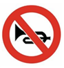

- A. 机场工作人员戴上防噪声耳罩
- B. 在马路边设置自动噪声监测仪
- C. 观演时手机调为静音
- D. 高速公路两旁安装隔音板

【答案】C

【解析】​

## 4. 填空题

如图所示是某同学在手机上安装的一款工具软件，该软件的作用是测量声音的（选填“音调”、“响度”或“音色”），根据图中的测量结果可知，此时的环境（选填“是”或“不是”）较为理想的安静环境. 

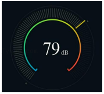

【答案】响度，不是.

【解析】​

## 5. 填空题（难度：简单）

跳广场舞已经成为人们健身的一项运动，优美的舞曲声是通过空气传入人耳的. 为了不影响周围居民的生活和休息，跳舞时将音箱的音量调小，这是在处减弱噪声. 如图所示的噪声监测装置，该装置显示了噪声的（选填“音调”“响度”或“音色”）. 

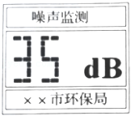

【答案】声源，响度

【解析】​

## 6. 填空题（难度：简单）

京张高铁穿越世界文化遗产——八达岭长城核心区域，为了避免爆破扰动周边文物，八达岭隧道在施工中采用了微损伤爆破技术，有效减小振动的，使爆破声的响度降到最低，这是在处减弱噪声.

【答案】幅度，声源

【解析】​

## 7. 填空题

冬奥高铁专列“踏雪无声”，采用了厦大科研团队研发的粒子阻尼减振降噪技术，减小了振动部位的振动幅度，实现在处减弱噪声，避免噪声的过大影响乘车体验. 

【答案】声源，响度

【解析】​

## 8. 单选题（难度：简单）

下列途径中，属于在声源处控制噪声的是（    ）

- A. 
摩托车的消声器
- B. 
马路上“隔音蛟龙”
- C. 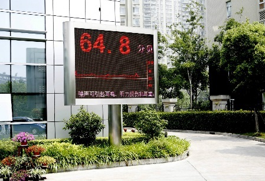
噪声检测装置
- D. 
工人的防噪声耳罩

【答案】A

【解析】​

## 9. 填空题（难度：简单）

如图所示，是中国特种兵装备的特种作战消音靴. 消音靴能够在处减弱噪声，在作战行动中可以降低声音的（选填“音调”、“音色”或“响度”）避免暴露目标. 
​​
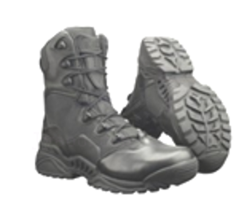
​

【答案】声源，响度

【解析】​

## 10. 填空题（难度：适中）

随着人们对住宅功能标准的不断提高，门窗玻璃由普通玻璃改用双层真空玻璃，如图所示. 这种玻璃不影响采光但却能起到减弱噪声的效果，双层真空玻璃是利用真空的原理，从处减弱噪声. 

【答案】不能传声，传播过程

【解析】​

## 11. 单选题（难度：适中）

居民家里通常安装双层玻璃以减弱噪声，下列实例中，减弱噪声的方法与之相同的是（　　）

- A. 摩托车上的消音器
- B. 路口的噪声监测仪
- C. 工厂里的降噪耳塞
- D. 高架路上的隔音板

【答案】D

【解析】小区内的窗户均使用双层隔音玻璃，这是在传播过程中减弱噪声。
A．摩托车的消声器是在声源处减弱噪声，与示例不同，故A不符合题意；
B．路口的噪声监测仪能够检测噪声的等级，不能够减弱噪声，故B不符合题意；
C．工厂里的降噪耳塞是在人耳处减弱噪声，与示例不同，故C不符合题意；
D．高架路上的隔音板是在传播过程中减弱噪声，与示例相同，故D符合题意。

## 12. 单选题（难度：适中）

关于声现象，下列说法组合正确的是（　　）
①发声体振动停止，声音立即消失
②超声波在真空中传播的速度是340m/s
③我们听到声音的音色与发声体的材料有关
④声能同时传递信息和能量
⑤摩托车发出的噪声只能在声源处安装消声器来减弱

- A. ③④
- B. ①②③⑤
- C. ①③④⑤
- D. ②③④

【答案】A

【解析】①振动停止，发声停止，但声音并不一定完全消失，它可能还在继续传播中，故①错误；
②声音的传播需要介质，不能在真空中传播，故②错误；
③不同发声体的材料与结构不同，发出声音的音色不同，我们听到声音的音色与发声体的材料有关，故③正确；
④声可以传递信息，也可以传递能量，声能同时传递信息和能量，故④正确；
⑤减弱噪声有三种途径，可以在声源处减弱、在传播过程中减弱、在人耳处减弱，摩托车发出的噪声也可以在人耳处减弱或传播过程中减弱，故⑤错误；
正确的选项为③④。

## 13. 单选题（难度：适中）

用洗衣机洗衣服时，如果衣服没有摆好，如一边多、一边少，就会使得洗衣机发出噪声。这时应该采取的办法是（　　）

- A. 从声源处想办法，在洗衣机中尽量将衣物摆放均匀，不让洗衣机做无规则的振动
- B. 关上房门，让噪声在传播过程中减弱
- C. 戴上耳罩，让噪声在人耳处减弱
- D. 以上三种方法均不是好办法

【答案】A

【解析】用洗衣机洗衣服时，因衣服没有放好，引起洗衣机剧烈振动而发出噪声，此时消除噪声的最好方法是先停机，将衣服重新摆放好再脱水，防止无规律振动的产生，故A符合题意，BCD不符合题意。

## 14. 单选题（难度：适中）

以下有关声现象的说法中，说法错误的是（　　）

- A. 市区内禁止鸣笛是在声源处减弱噪声
- B. 电影院的墙壁做成凹凸不平，是为了减弱声音的反射
- C. 用不同的力度弹钢琴主要改变了声音的响度
- D. 声呐发出的次声波可以用来探测海洋深度

【答案】D

【解析】A．市区内禁止鸣笛是在声源处减弱噪声，故A正确；
B．电影院的墙壁做成凸凹不平，声音在反射时能量会相互抵消\( （\)声音被吸收\( ）\)，减弱声波的反射，也可以说是防止声音的反射干扰，故B正确；
C．用不同的力度弹钢琴，发声体的振幅不同，从而发出声音的响度不同，故C正确；
D．声呐发出的超声波可以用来探测海洋深度，故D错误。

## 15. 单选题（难度：适中）

下列各种声音中，从环保角度看，不属于噪声的是（　　）

- A. 上物理课时老师讲话的声音
- B. 集市上的喧哗声
- C. 公路上汽车鸣笛声，发动机的排气声
- D. 深夜，邻室的钢琴演奏声

【答案】A

【解析】A．上物理课时老师讲话的声音是学生需要听到的，帮助学生学习的，不属于噪声，故A符合题意；
B．集市上的喧哗声干扰人们的交流，嘈杂无规律，属于噪声，故B不符合题意；
C．公路上汽车鸣笛声，发动机的排气嘈杂刺耳、影响人的心情属于噪声，故C不符合题意；
D．深夜，邻室的钢琴演奏声会干扰人的正常休息，属于噪声，故D不符合题意。

## 16. 单选题（难度：适中）

关于声现象，下列说法正确的是（　　）

- A. 向人体内结石发射超声波击碎结石，是利用超声波传递能量
- B. 声波在真空中传播速度约为340m/s
- C. 声音在气体中的传播速度比在固体中快
- D. 考场附近禁止鸣笛是在声音的传播过程中控制噪声

【答案】A

【解析】A．声音可以传递信息，也可以传递能量，向人体内结石发射超声波除去结石，是利用超声波传递能量来击碎结石，故A正确；
B．声音的传播需要介质，声音不能在真空中传播，故B错误；
C．声音在固体物质中的传播速度一般比在气体中的传播速度更快，故C错误；
D．考场附近禁止鸣笛，不让声音发出来，是在声源处来控制噪声的，故D错误。

## 17. 单选题（难度：适中）

关于声现象，下列说法正确的是（　　）

- A. 医院用超声做检查是利用超声波具有能量
- B. 在高架道路两旁安装隔音板，属于在声源处减弱噪声
- C. 声音在真空中传播的速度是340m/s
- D. 地震、火山喷发等自然现象都伴有次声波的产生

【答案】D

【解析】A．医院用超声做检查是利用声音传递信息，故A错误；
B．在高架道路两旁安装隔音板，属于在传播过程中减弱噪声，故B错误；
C．声音能在介质中传播，不能在真空中传播，声音在真空中传播的速度是0m/s，故C错误；
D．地震、火山喷发等自然现象发出声音的频率低于20Hz，都伴有次声波的产生，故D正确。

## 18. 单选题（难度：适中）

在比较材料隔音性能的跨学科实践活动中，把声源用不同材料包裹好塞满鞋盒，小明逐步远离声源，直至听不见声音为止，比较此处距鞋盒的距离。下列说法正确的是（　　）

- A. 每次实验时换用不同的发声装置
- B. 该实验对周围环境的声音没有要求
- C. 实验中测得的距离越远，对应材料的隔音性能越好
- D. 小明逐步远离声源，他所听到的声音发生改变的是响度

【答案】D

【解析】A．实验需要控制声源的响度一致，才能保证实验的合理性，所以不能每次换不同的发声装置，故A错误；
B．实验需要在安静的环境中进行，避免外界声音干扰实验结果，所以对周围环境的声音有要求，故B错误；
C．实验中测得的距离越远，说明声音传播得越远，对应材料的隔音性能越差，故C错误；
D．小明逐步远离声源，声音的传播距离增加，声音的响度会逐渐减小，所以他听到的声音发生改变的是响度，故D正确。

## 19. 单选题（难度：适中）

我国自主研发的新型深远海综合科考船“东方红3号”的低噪声控制指标已达全球最高级别。它行驶时，水面下20m处的鱼群都感觉不到。关于“低噪声”的说法正确的是（　　）

- A. 不是由振动产生的
- B. 在液体中不能传播
- C. 不能传递能量
- D. 从声源处减弱了噪音

【答案】D

【解析】A．物体振动产生声音，噪音也是由振动产生的，故A错误；
B．声的传播需要介质，液体能够传播噪音，故B错误；
C．噪音能够传递能量，故C错误；
D．噪声的控制可以从声源处、声音的传播过程、声音的接收处三个环节来处理，科考船“东方红3号”的“低噪声”是在声源处减弱噪声，故D正确。

## 20. 单选题（难度：适中）

在中考考试期间，环保部门会禁止市区单位施工，这种减弱噪声的途径是（　　）

- A. 在人耳处
- B. 在声源处
- C. 在传播过程中
- D. 以上都不是

【答案】B

【解析】禁止市区单位施工，不让工地的机器运转，是使声源不振动，是在声源处减弱噪声。

## 21. 单选题（难度：适中）

有关声现象的说法正确的是（　　）

- A. 只要物体振动，就一定能听到声音
- B. 广播里“考生开始答题”声是通过空气传入同学们耳朵的
- C. 坐在教室后面的同学有时听不清老师讲课，是因老师声音音调太低
- D. 美妙的音乐肯定不会是噪声

【答案】B

【解析】A. 只要物体振动就能产生声音，但是人要听到声音还必须满足有传声的介质、振动频率在人的听觉范围之内，故A错误；B. 学校广播中传来的声音是通过空气传入学生耳中的；故B正确；C. 响度的大小与距离声源的远近有关，所以坐在教室后排的同学听到老师讲课的声音响度小；故C错误；D. 美妙的音乐虽然动听，如果打扰了人们的休息和工作，就属于噪声，故D错误．故选B．
点睛：人的听觉频率范围在20Hz～20000Hz之间，频率不在这个范围的声，人们是听不见的；声音的传播需要介质，它既可以在气体中传播，也可以在固体和液体中传播；把人耳能感觉到的声音的强弱成为响度，与物体振动幅度有关，振幅越大，响度越大；振幅越小，响度越小；同时响度还和距离声源的距离有关，即距离声源越近，响度越大；距离声源越远，响度越小；从环境保护上说，凡是影响人们正常的生活、学习、休息的声音都是噪声．

## 22. 单选题（难度：适中）

从环境保护角度来看，以下属于噪声的是（　　）

- A. 会场上大学生们雄辩有力的演讲声
- B. 上课时，老师的讲话声
- C. 夜深人静时忽然传来练钢琴的声音
- D. 演奏会里的摇滚乐曲声

【答案】C

【解析】A．会场上大学生们雄辩有力的演讲声，是人们想要听到的声音，不属于噪声，故A不符合题意；
B．上课时，老师的讲话声是同学们想要听到的声音，不属于噪声，故B不符合题意；
C．夜深人静时忽然传来练钢琴的声音，影响了人们休息，属于噪声，故C符合题意；
D．演奏会里的摇滚乐曲声，是人们想要听到的声音，不属于噪声，故D不符合题意。

## 23. 单选题（难度：适中）

在医院、学校附近，常常有禁止鸣笛的标志，如图所示。这种控制噪声的措施属于（　　）

- A. 在人耳处减弱噪声
- B. 在传播过程中减弱噪声
- C. 在声源处减弱噪声
- D. 以上三种减弱噪声的方法都用了

【答案】C

【解析】减弱噪声的方式有三种，分别是在声源处减弱，在传播过程中减弱，在人耳处减弱。禁止鸣笛是在声源处减弱噪声，防止噪声的产生，故C符合题意，ABD不符合题意。

## 24. 单选题（难度：适中）

沿途有噪声监测设备，显示的“噪声60.5dB”指的是声音的（　　）

- A. 音调
- B. 音色
- C. 响度
- D. 频率

【答案】C

【解析】噪声等级用分贝表示，用来反映声音的强弱，即声音的响度，所以C符合题意，ABD不符合题意。

## 25. 单选题（难度：适中）

如图是我国航空母舰上两位甲板引导员引导飞机起飞的情景。他们工作时要配戴防噪声耳罩，这种控制噪声的措施属于（　　）

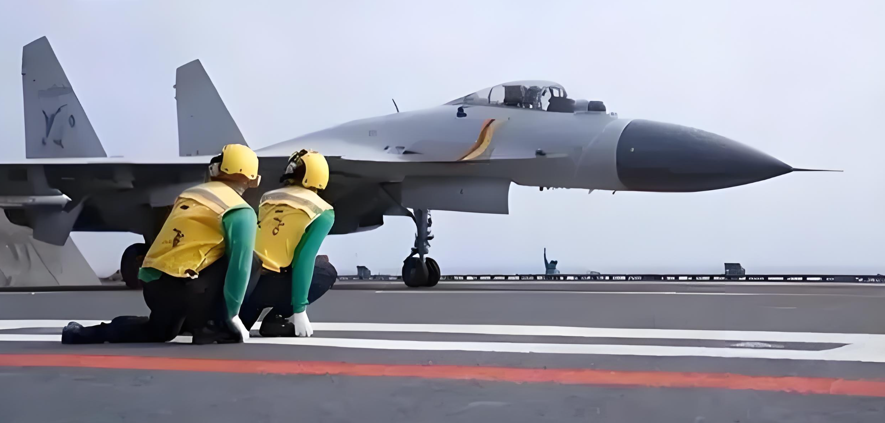

- A. 防止噪声产生
- B. 监测噪声强弱
- C. 防止噪声进入耳朵
- D. 减小噪声传播速度

【答案】C

【解析】航母甲板上的工作人员都要佩戴防护耳罩以保护听力，这是防止噪声进入耳朵，因为舰载机起飞时所发出声音的响度很大，容易对工作人员听力造成损伤。

## 26. 单选题（难度：适中）

下列关于声现象的说法中，正确的是（　　）

- A. 次声波听起来比较低沉
- B. 超声波粉碎体内结石是因为声波具有能量
- C. 佩戴降噪耳罩是在传播过程中减弱噪声
- D. 道路旁设置隔声板是在声源处减弱噪声

【答案】B

【解析】A．人耳能听到的声音的频率范围是20~20000Hz，低于20Hz的叫次声波，高于20000Hz叫超声波；超声波和次声波都是人耳听不到的，故A错误；
B．声音既能传递信息，又能传递能量，超声波粉碎体内结石说明声波具有能量，故B正确；
C．佩戴降噪耳罩，是在人耳处减弱噪声，故C错误；
D．道路旁设置隔声板可以在传播过程中减弱噪声，故D错误。

## 27. 单选题（难度：适中）

汽车在行驶过程中，车内乘客会听到来自多方面的噪声，如发动机噪声、胎噪、风噪等等，高档汽车采取加装隔音棉、安装隔音玻璃的降噪措施，这是（　　）

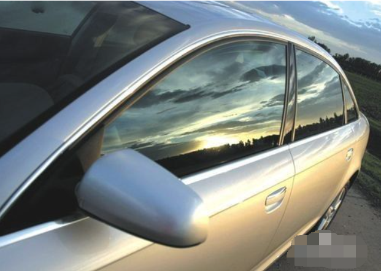

- A. 在声源处减弱噪声
- B. 在传播过程中减弱噪声
- C. 在人耳处减弱噪声
- D. 多种降噪法并举

【答案】B

【解析】减弱噪声的方法主要在声源处减弱、在传播过程中减弱、在人耳处减弱。高档汽车采取加装隔音棉、安装隔音玻璃的降噪措施可以阻断噪声的传播，属于在传播过程中减弱，故ACD不符合题意，B符合题意。

## 28. 单选题（难度：适中）

如图所示的真空隔音玻璃是将两片平板玻璃四周密封起来，将间隙抽成真空并密封排气口，形成真空层。若密封圈漏气，隔音效果会降低。由此可知真空玻璃隔音效果好是运用了（　　）

- A. 从声源处减弱噪声
- B. 从接收处减弱噪声
- C. 声音的传播需要介质
- D. 声音是由于物体振动产生的

【答案】C

【解析】真空隔音玻璃是将两片平板玻璃四周密封起来，将间隙抽成真空并密封排气口，形成真空层。因为声音的传播需要介质，真空不能传声，因此真空玻璃隔音效果好，这是在传播过程中控制噪声；若密封圈漏气，两片平板玻璃间有了空气，隔音效果会降低。故ABD不符合题意，C符合题意。

## 29. 单选题（难度：适中）

地铁轨道旁安装隔音屏障，主要针对噪声控制的环节是（　　）

- A. 防止噪声产生
- B. 阻断噪声传播
- C. 防止噪声入耳
- D. 降低噪声频率

【答案】B

【解析】A．隔音屏障并不能阻止列车运行时轮轨摩擦、空气动力等噪声的产生，故A不符合题意；
B．隔音屏障通过声波的反射和吸收作用，有效阻断了噪声从轨道向周围环境的传播路径，故B符合题意；
C．隔音屏障的作用对象是噪声传播过程，而非保护人耳免受噪声影响，故C不符合题意；
D．隔音屏障不会改变噪声本身的频率特性，故D不符合题意。

## 30. 单选题（难度：适中）

如图所示，是泡沫塑料块刮玻璃、钢琴发出C调1（do）的波形图，下列说法中正确的是（　　）

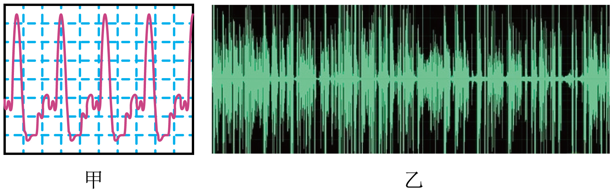

- A. 甲图为泡沫塑料块刮玻璃产生声音的波形图
- B. 甲图为钢琴发声的波形图，钢琴发出的声一定不是噪声
- C. 乙图为噪声的波形图
- D. 甲图是发声体做无规则振动时产生的波形图

【答案】C

【解析】泡沫塑料块刮玻璃发出的声音非常刺耳，是典型的噪声，其振动是无规则的，波形图杂乱无章，而、钢琴发出C调1（do）的声音是悦耳的声音，振动是规则的，其波形图有规律，比较规律；
AD．甲图波形图规律，乙的波形图杂乱无章，所以甲是由物体的规则振动发出的乐音，即为钢琴发出的声音，AD错误；
B．甲图波形振动规则，为钢琴发声的波形图；从环保角度看，钢琴发出的声如果影响了人们的正常生活，也可能是噪声，故B错误；
C．由图可知，乙声音的波形图没有规律，振动不规则，为噪声的波形图，故C正确。
故选 C。

## 31. 单选题（难度：适中）

如图所示,在城市的繁华路段旁常竖有噪声监测装置,从装置上显示的分贝数大小可知(　　)

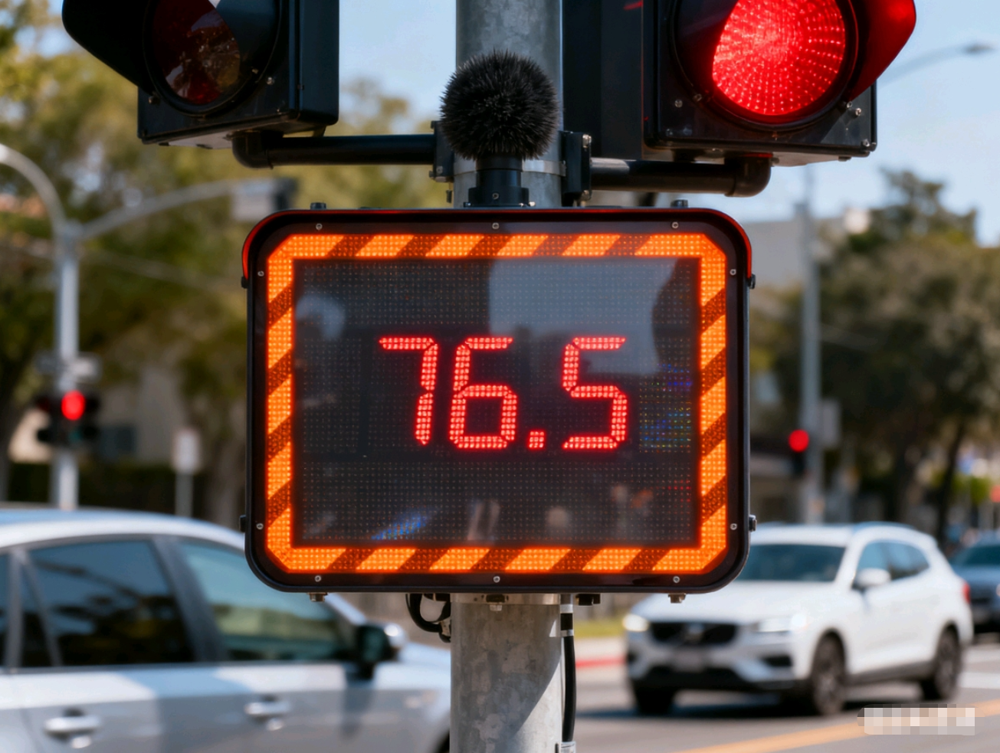

- A. 此时的噪声会使人失去听力
- B. 此时的噪声会妨碍人们的工作和学习
- C. 此时的噪声不会妨碍人们的休息和睡眠
- D. 此时的噪声是较理想的安静环境

【答案】B

【解析】根据噪声显示装置能看出，此时的噪声是76.5分贝，由于该数值不超过90分贝，故此时的噪声不会使人失去听力，故A错误；
超过了70分贝，此时的噪声会妨碍人们的工作和学习，更会影响人们的休息和睡眠，不是较理想的安静环境，故B正确，CD错误；
故选B．
【点睛】知道噪声的单位分贝，牢记为了保护听力，声音不能超过90dB；要保证休息和睡眠，声音不能超过50dB．

## 32. 单选题（难度：适中）

中考期间，为了给考生营造一个安静的环境，各地纷纷“禁噪”。“禁噪”是（　　）

- A. 防止噪声的产生
- B. 使噪声变成乐音
- C. 阻断噪声的传播
- D. 防止噪声进入人耳

【答案】A

【解析】声音的控制可以从三个环节，分别是声源、传播过程中、和人耳接收处，各地纷纷“禁噪”，比如考场附近禁止车辆鸣笛，禁止施工，限制娱乐场所的音量等，这是在声源处控制噪声，故A符合题意，ACD不符合题意。

## 33. 单选题（难度：适中）

科学技术是一把双刃剑，它既可以造福人类，也可能带来不利影响。生产和生活中产生的噪声会影响人们的生活，但有些情况下我们也可以利用噪声。下列现象属于利用噪声的是（　　）

- A. 摩托车安装消声器
- B. 有的道路旁设置隔声板
- C. 工厂工人戴着防噪声耳罩
- D. 飞行员根据发动机轰鸣声判断其运转情况

【答案】D

【解析】A．摩托车安装消声器，是在声源处控制噪声，故A不符合题意；
B．道路旁设置隔声板，是在传播过程中控制噪声，故B不符合题意；
C．工厂工人戴着防噪声耳罩，是在人耳处控制噪声，故C不符合题意；
D．飞行员根据发动机轰鸣声判断其运转情况，这是利用声音传递信息，故D符合题意。

## 34. 单选题（难度：适中）

下列关于声音的说法，不正确的是（　　）

- A. 临街住宅安装双层玻璃可以减弱噪声
- B. 长期佩戴耳机开大音量听音乐可能损伤听力
- C. 北京天坛的回音壁利用了声音反射的原理
- D. 声呐通过次声波的回声定位探索海洋的秘密

【答案】D

【解析】A．为了改善室内的居住环境，建筑师在设计窗户时常采用双层玻璃，这样做的主要优点是：①隔热，②隔声；故A正确，不符合题意；
B．长期戴着耳机听高分贝音量的音乐，有可能损伤鼓膜，致使听力下降，故B正确，不符合题意；
C．驰名中外的北京天坛里的回音壁，三音石，圜丘三处建筑有非常美妙的声音现象，它是我国古代建筑师利用声音的反射形成的音响效果，故C正确，不符合题意；
D．声呐利用超声波进行回声定位，而不是利用次声波，故D错误，符合题意。

## 35. 单选题（难度：适中）

空间站内过大的噪声会影响宇航员正常的工作和休息。以下措施中，从声源处减弱噪声的是（　　）

- A. 隔离睡眠区
- B. 设备散热风扇改用静音风扇
- C. 宇航员休息时佩戴耳塞
- D. 增加空间站内部舱壁隔音层的厚度

【答案】B

【解析】从声源处减弱噪声，就是从产生声音的源头采取措施降低噪声。
A．隔离睡眠区，是在传播过程中或者在噪声影响的区域进行隔离，不是从声源处减弱。故A不符合题意；
B．设备散热风扇改用静音风扇，风扇是产生噪声的源头，改用静音风扇，直接减少了风扇产生的噪声，属于从声源处减弱噪声。故B符合题意；
C．宇航员休息时佩戴耳塞，是在人耳处减弱噪声，不是声源处。故C不符合题意；
D．增加空间站内部舱壁隔音层的厚度，是在传播过程中减弱噪声，不是声源处。故D不符合题意。

## 36. 单选题（难度：适中）

一场大雪过后，人们会感到外面万籁俱静。其主要原因是（　　）

- A. 大雪后，行驶的车辆减少，噪声减小
- B. 大雪蓬松且多孔，对噪声有吸收作用
- C. 大雪后，大地银装素裹，噪声被反射
- D. 大雪后，气温较低，噪声传播速度变慢

【答案】B

【解析】声音是以声波的形式向外传播，声波在传播过程中遇到障碍物将会发生反射，由于大雪蓬松且多孔，声音进入后，很难再反射出来，因此刚下的雪，能很好地吸收声音，所以一场大雪过后人们会感到外面万籁俱寂，原因可能是大雪蓬松且多孔，对噪声有吸收作用，故B符合题意，ACD不符合题意。

## 37. 单选题（难度：适中）

“保护环境，人人有责”。下列措施是在声源处减弱噪声的是（　　）

- A. 教室周围植树
- B. 机场工作人员佩戴耳塞
- C. 公共场所禁止大声喧哗
- D. 高速公路两旁安装隔音板

【答案】C

【解析】A．道路两旁种植树木，是在传播过程中减弱噪声，故A不符合题意；
B．机场工作人员戴防噪声耳罩，是在人耳处减弱噪声，故B不符合题意；
C．公共场所禁止大声喧哗，是在声源处减弱噪声，故C符合题意；
D．高速公路两旁安装板墙，是在传播过程中减弱噪声，故D不符合题意。

## 38. 单选题（难度：适中）

高速公路通过村庄密集区时，在高速公路两侧安装玻璃隔声板，能有效降低噪声。下列减弱噪声的途径与之相同的是（　　）

- A. 禁止鸣笛
- B. 机场跑道工作人员戴防噪声耳罩
- C. 街道上安装噪声监测仪
- D. 学校周围植树

【答案】D

【解析】高速公路通过村庄密集区时，在高速公路两侧安装玻璃隔声板，能有效降低噪声，这是在传播过程中减弱噪声；
A．禁止鸣笛，使控制噪声的产生，是在声源处减弱噪声，故A不符合题意；
B．机场跑道工作人员戴防噪声耳罩，是防止声音进入耳朵，是在人耳处减弱噪声，故B不符合题意；
C．街道上安装噪声监测仪，只能测量噪声的大小，不能减弱噪声，故C不符合题意；
D．学校周围植树，树能吸收一部分声音，使噪音减弱，是在传播过程中减弱噪声，故D符合题意。

## 39. 单选题（难度：适中）

下列做法中，属于从噪声的传播这一环节来防治噪声的是（　　）

- A. 在摩托车上安装消声器
- B. 在市区内禁鸣汽车喇叭
- C. 室内打靶时要佩带耳罩
- D. 用吸音材料来装饰内墙

【答案】D

【解析】防治噪声的三种方法：在声源处减弱、在传播过程中减弱和在人耳处减弱。
AB．在摩托车上安装消声器，在市区内禁鸣汽车喇叭，都是在声源处减弱噪声，故AB不符合题意；
C．室内打靶时要佩带耳罩，是在人耳处减弱噪声，故C不符合题意；
D．用吸音材料来装饰内墙，是在传播过程中减弱噪声，属于从噪声的传播这一环节来防治噪声，故D符合题意。

## 40. 单选题（难度：适中）

教师监考时不能穿硬底鞋，以减小噪声对考生的干扰。这是（　　）

- A. 在声源处减弱噪声
- B. 阻断噪声传播途径
- C. 防止噪声进入耳朵
- D. 减小噪声传播速度

【答案】A

【解析】减弱噪声的途径有：在声源处减弱噪声、在传播过程中减弱噪声、在人耳处减弱噪声。中考考场很安静，若监考的老师穿硬底鞋，则鞋底敲碰地面振动会产生较大的声音，为避免影响考生答题，监考时规定老师不能穿硬底鞋，这是从声源处控制噪声的。故A符合题意，BCD不符合题意。

## 41. 多选题（难度：适中）

下列关于声现象的描述中正确的是（　　）

- A. 悠扬的音乐声一定不是噪声
- B. 摩托车的消声器可以防止噪声的产生
- C. 汽车的“倒车雷达”利用超声波来定位
- D. “超声波”的速度大于“次声波”的速度

【答案】B/C

【解析】A．悠扬的音乐声虽然动听，如果打扰了人们的休息和工作，就属于噪音，故A错误；
B．摩托车的消声器可以在声源处减弱噪声，即防止噪声的产生，故B正确；
C．因为超声波具有方向性强的特点，所以汽车的倒车雷达是利用超声波的回声定位工作的，故C正确；
D．在温度相同的同种介质中，超声波的速度与次声波的速度相同，故D错误；

## 42. 多选题（难度：适中）

为减弱周边噪声对课堂听讲的影响，下列措施合理可行的是（　　）

- A. 教室周围植树
- B. 校园周边禁止鸣笛
- C. 教室内安装噪声监测装置
- D. 同学们戴防噪声耳罩

【答案】A/B

【解析】A．教室周围植树是在传播过程中减弱噪声，措施合理可行，故A符合题意；
B．校园周边禁止鸣笛是在声源处减弱噪声，措施合理可行，故B符合题意；
C．在教室里安装噪声监测装置，对减弱噪声不起作用，故C不符合题意；
D．同学们都戴上耳罩，堵住耳朵，可以减弱噪声，但无法听课，故D不符合题意。

## 43. 多选题（难度：适中）

噪声严重影响着人们的生活和工作，下列控制噪声的办法中可行的是（　　）

- A. 通过科学研究，使所有噪声源不发生振动
- B. 在机器上安装消音器
- C. 在城市中穿过住宅区的快速路两旁建设隔音墙，道路两旁多植树种花
- D. 建筑工地不允许使用大型机械设备

【答案】B/C

【解析】A．噪声源主要来源于机械设备和结构部件的振动，如发动机、压缩机、风机等，这些设备的振动是其正常工作的副产品，若要完全消除振动，可能会影响设备的正常运行，故A不符合题意；
B．在噪声源处安装消声器可以达到减弱噪声的效果，办法可行，故B符合题意；
C．在高速公路两旁建隔音墙、道路两旁植树种花都可以在声音的传播途中减弱噪声，办法可行，故C符合题意；
D．工地没有大型机械工作无法进行，办法不可行，故D不符合题意；

## 44. 多选题（难度：适中）

关于声现象的下列说法正确的是（　　）

- A. 弹奏古琴时，用大小相同的力拨动不同的琴弦，则发声的响度相同
- B. 用大小不同的力拨动同一根琴弦能发出不同音调的声音
- C. 人耳区分各种不同的乐器是根据音色不同来判断的
- D. 悦耳动听的音乐可给人以愉悦的享受，则音乐一定是乐音

【答案】A/C

【解析】A．弹奏古琴时，用大小相同的力拨动不同的琴弦，琴弦振动幅度相同，则发声的响度相同，故A正确；
B．用大小不同的力拨动同一个根琴弦，琴弦的振动频率相同，音调相同，振幅不同，响度不同，故B错误；
C．能分辨出不同乐器发出的声音是根据音色判断的，故C正确；
D．悦耳动听的音乐给人的以愉悦的享受，若对人们的工作、学习、休息等造成干扰，从环境保护的角度来说属于噪音，故D错误。

## 45. 多选题（难度：适中）

在传播过程中减弱噪声的措施是（　　）

- A. 道路两旁种植树木
- B. 摩托车要安装消声器
- C. 纺纱工人戴防噪声耳罩
- D. 高速公路两旁安装板墙

【答案】A/D

【解析】AD．道路两旁种植树木、高速公路两旁安装板墙都是在传播过程中减弱噪声的，故AD符合题意；
B．摩托车要安装消声器，是在声源处减弱噪声，故B不符合题意；
C．纺纱工人戴防噪声耳罩是在人耳处减弱噪声的，故C不符合题意。

## 46. 填空题（难度：适中）

考试铃声一响，同学们就开始答题，说明声音能够传递，关闭窗户这是在中减弱噪音。

【答案】信息，传播过程

【解析】[1]声音能传递信息和能量，听到铃声同学就知道可以开始答题的信息，说明声音能够传递信息。
[2]我们可以通过声源处、传播过程和人耳处来减弱噪声，关闭窗户属于在传播过程中减弱噪音。

## 47. 填空题（难度：适中）

广场舞是深受广大群众喜爱的文化体育活动，优美的舞曲声对于附近居民楼上正在学习的学生来说是（选填“乐音”或“噪声”）。某市制定了《中高考期间禁噪方案》，规定中高考期间各考点噪声强弱不超过45（填合适的单位符号）。

【答案】噪声，$ \text{dB}$ 

【解析】[1]通常人们将有规律的、好听悦耳、使人愉快的声音叫做乐音；从环境保护的角度讲，凡是妨碍人们正常休息、学习和工作的声音，以及对人们要听的声音产生干扰的声音，都属于噪声。优美的舞曲声对于附近居民楼上正在学习的学生来说是噪声，会干扰学生的学习。
[2]噪声的等级用分贝表示，某市制定了《中高考期间禁噪方案》，规定中高考期间各考点噪声强弱不超过45dB。

## 48. 填空题（难度：适中）

在公共场所打电话、说话“轻声”是文明的表现，这里的“轻声”是指声音的；这是在防止噪声的产生；我们仅凭手机中听到对方的声音就判断出对方是谁，这是依据声音的进行判断的。

【答案】响度，声源处，音色

【解析】[1][2]振幅是物体振动时偏离原位置的大小，偏离原位置越大，振幅越大。响度跟振幅有关，振幅越大，响度越大。在公共场所“轻声”说话是文明的表现，这里的“轻声”是指声音的响度小，这是在声源处减弱噪声。
[3]音色反映声音的品质与特色，与发声体的结构、材料有关。打电话时，我们仅凭声音就可判断对方是谁，这是通过声音的音色进行判断的。

## 49. 填空题（难度：适中）

晚饭后，爸爸坐在客厅中收看新闻联播，影响了书房中小明的学习。请回答：
（1）客厅中电视机播放新闻联播的声音对爸爸来说（选填“属于”或“不属于”）噪声；
（2）为减小电视声音对小明的影响，请你帮助小明写出两条具体的措施。

【答案】不属于，见解析

【解析】（1）[1]从环境保护的角度分析，凡是影响人们工作和休息的声音都属于噪声，所以电视机播放新闻联播的声音对爸爸来说不属于噪声，对在书房中学习的小明来说是噪声。
（2）[2]减弱噪声的途径有：从声源处、传播过程中以及人耳处来减弱，则可采用的办法有：①把电视机的音量调小些；②把书房门关严实；③戴一个防噪声的耳罩等。

## 50. 填空题（难度：适中）

为保护听力，我们可以从声音的产生、传播和接收三个方面控制噪声。射击运动员训练时戴耳罩是从声音的方面进行控制；图书馆中规定不能大声喧哗是从声音的方面进行控制；家庭窗户安装真空双层玻璃是从声音的方面进行控制。

【答案】接收，产生，传播

【解析】减弱噪声主要从三种途径入手，一是在声源处减弱，二是在传播过程中减弱，三是在接收处减弱。射击运动员戴耳罩，属于在人耳处减弱噪声，即声音接收方面控制；图书馆中规定不能大声喧哗，属于从声源处减弱噪声，即声音的产生方面进行控制；家庭窗户安装真空双层玻璃，属于从传播过程中减弱噪声，即声音的传播方面进行控制。

## 51. 填空题（难度：适中）

诗句“姑苏城外寒山寺，夜半钟声到客船”中，“客船”上的人通过声音的 辨别出是钟声；“钟声”对于正在休息的客人属于 （选填“乐音”或“噪声”）。

【答案】音色，噪声

【解析】[1]钟与其它乐器发出声音的音色不同，“客船”上的人通过声音的音色辨别出是钟声。
[2]从环境保护角度分析，凡是影响人们正常工作、学习和生活的声音都是噪声，对于正在休息的客人“钟声”属于噪声。

## 52. 多选题（难度：适中）

对于如图所示的声现象描述或解释正确的是（　　）

- A. 甲图：弹奏古筝时，手在不同位置按弦，目的是为了改变发出声音的音调
- B. 乙图：超声波清洗眼镜，说明声可以传递能量
- C. 丙图：体验骨传导实验说明固体可以传声
- D. 丁图：摩托车上装有消声器，是为了在传播过程中减弱噪声

【答案】A/B/C

【解析】A．弹奏古筝时，手在不同的位置按弦，发声体的长度不同，振动频率不同，发出声音的音调不同，故A正确；
B．声可以传递信息和能量，超声波清洗眼镜是利用声传递能量，将眼镜上的脏污清洗掉，故B正确；
C．将振动的音叉接触牙齿，音叉发出的声音通过牙齿、骨头传递给听觉系统，说明固体可以传声，故C正确；
D．摩托车上的消声器是在声源处减弱噪声，故D错误。

## 53. 单选题（难度：适中）

噪声严重影响人们的工作和生活，被称为“隐形杀手”。 控制噪声已成为城市环境保护的重要项目之一、下列关于图的说法中正确的是（　　）

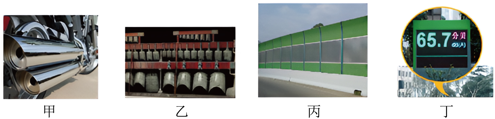

- A. 图甲：摩托车的消声器是在人耳处减弱噪声的
- B. 图乙：演奏编钟时发出的声音可能是噪声
- C. 图丙：道路旁的隔声板是在声源处控制噪声
- D. 图丁：噪声监测器可以减弱噪声

【答案】B

【解析】A．图甲摩托车消音器可以防止噪声的产生，是在声源处减弱噪声；故A错误；
B．美妙的音乐如果影响了人们正常的休息，敲击编钟时发出的声音可能属于噪声；故B正确；
C．图丙道路旁的隔声板可以阻断噪声的传播，是在传播过程中减弱噪声；故C错误；
D．图丁噪音检测仪可以监测噪声的等级，不能减弱噪声，故D错误。

## 54. 填空题（难度：适中）

在我们生活的环境中，有各种各样的标志。如图甲所示，“71”可以反映当时环境中声音的（选填“音调”、“响度”或“音色”）；如图乙所示，从控制噪声的角度分析，这是从减弱噪声。运用声呐系统向海底发射（选填“超声波”或“次声波”）可以探测海洋深度，受此启发，小华站在两山之间喊一声经2秒听到回声，再经2秒听到第二次回声，已知声音在空气中传播的速度是340m/s，则两山之间的距离是m。

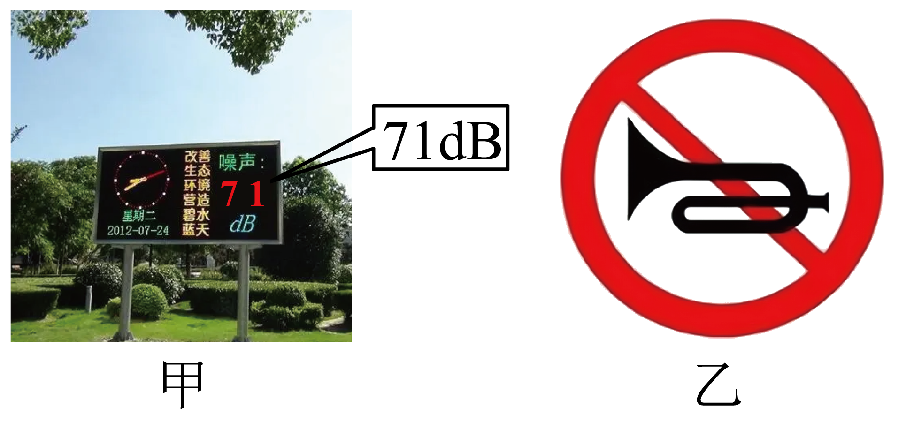

【答案】响度，声源处，超声波，1020

【解析】[1]从图甲可以看到，“71”是71dB，是指声音的大小，即反映当时环境中声音的响度。
[2]减弱噪声的方法：在声源处减弱、在传播过程减弱、在人耳处减弱，观察图乙，禁止鸣笛喇叭，这是在声源处减弱。
[3]根据回声定位的原理，科学家发明了声呐，运用声呐系统可以探测海洋深度，在与海平面垂直的方向上，声呐向海底发射超声波。
[4]由题意可知，小华站在两山之间喊一声，经2s听到回声，小华与其中一座山的距离为
\( {s}_{1}=\frac{v{t}_{1}}{2}=\frac{\text{340m/s}\times \text{2s}}{2}=\text{340m}\) 
再经2s听到第二次回声，往另一座山传播的声音，来回一趟需要的时间为4s，小华与另一座山的距离为
\( {s}_{2}=\frac{v{t}_{2}}{2}=\frac{\text{340m/s}\times \text{4s}}{2}=\text{680m}\) 
那么两山之间的距离
\( s={s}_{1}+{s}_{2}=\text{340m}+\text{680m}=\text{1020m}\) 
两山之间的距离为1020m。

## 55. 填空题（难度：适中）

为了跳广场舞时不影响周围居民的生活和休息，跳舞时将大木板挡住居民楼房一侧的音箱的声音，这是在过程中减弱噪声。如图所示的噪声监测装置，该装置显示了噪声的（选填“音调”“响度”或“音色”）。

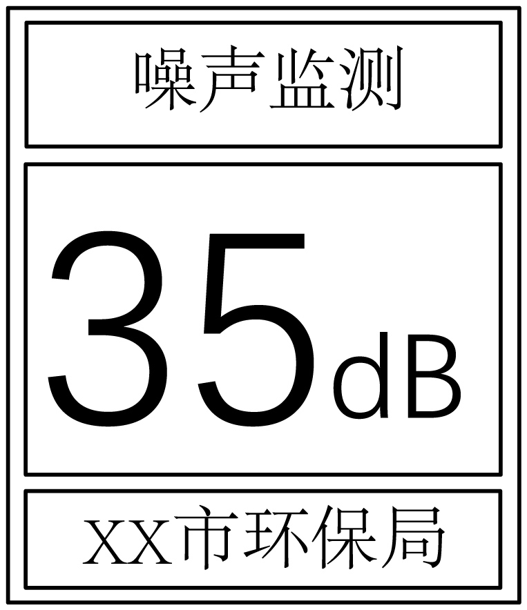

【答案】传播，响度

【解析】[1]跳舞时将大木板挡住居民楼房一侧的音箱的声音，阻碍了噪声的传播，这是在传播过程中减弱噪声。
[2]如图所示的噪声监测装置是用来监测噪声的强弱的，该装置显示了噪声的响度。

## 56. 单选题（难度：适中）

如图所示是汽车利用超声波辅助倒车的情境，当汽车与障碍物相距较近时，汽车就会发出“嘀嘀嘀”的警报声。下列关于声波的说法中，正确的是（　　）

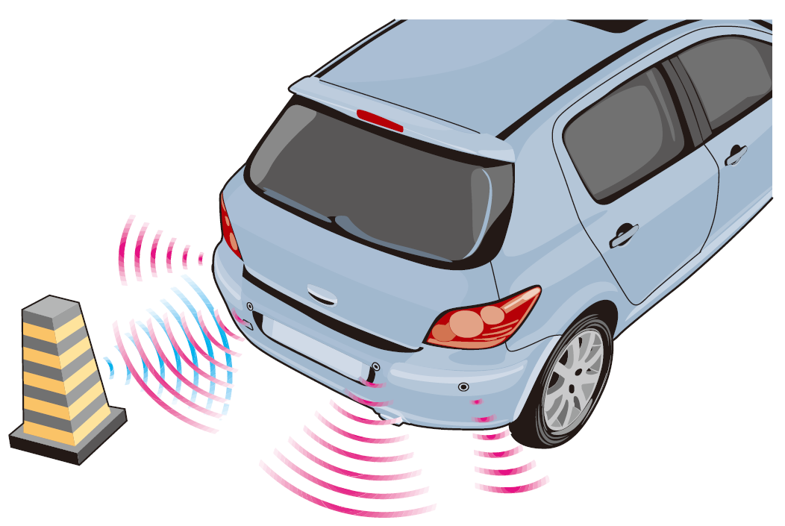

- A. 超声波的传播需要介质
- B. “嘀嘀嘀”的警报声，就是超声波
- C. 超声波在空气中的传播速度为：3×10⁸m/s
- D. 警报声对正在倒车的驾驶员来说是噪声

【答案】A

【解析】A．声音的传播需要介质，超声波属于声波，因此超声波的传播需要介质，故A正确；
B．人类听不到超声波，故“嘀嘀嘀”的警报声不是超声波，故B错误；
C．超声波在空气中的传播速度是340m/s，故C错误；
D．警报声对正在倒车的驾驶员来说不是噪声，故D错误。

## 57. 填空题（难度：适中）

周末，小林去市图书馆看书，一进门看如图张贴的标语。这是提醒看书者要注意声音的，从控制噪声的角度分析，这是在（选择“声源处”“传播过程中”或“人耳处”）减弱噪声。

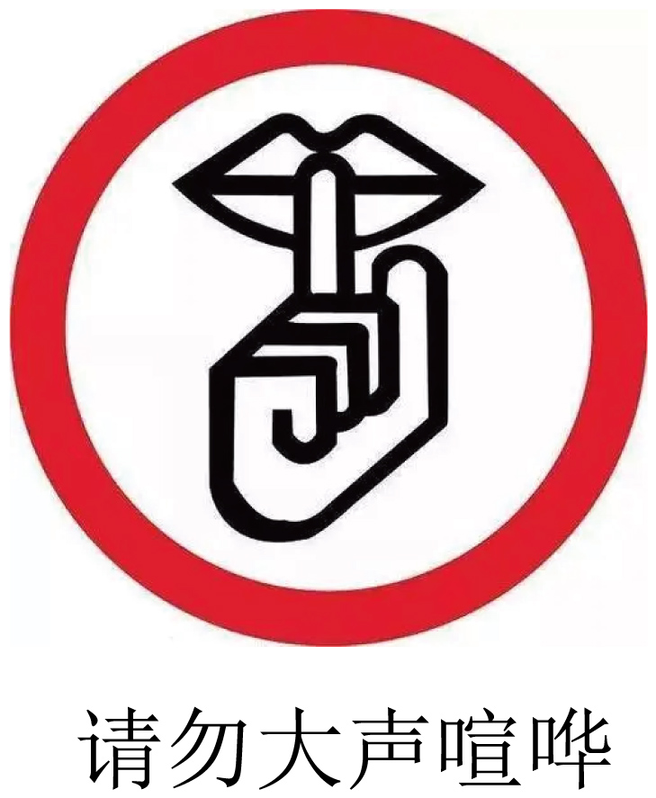

【答案】响度，声源处

【解析】[1]响度指声音的强弱或大小，这里的“大声”是指声音的响度大。
[2]大声喧哗产生的声音是人的声带振动产生的，所以“不要大声喧哗”是在声源处减弱噪声。

## 58. 填空题（难度：适中）

宜兴解放广场西面装了一个噪声监测仪，如图，在监测仪上看到显示的数字。当有几辆重型汽车并排通过时，显示屏上的数据将会（变大/不变/变小）；噪声监测仪（能/不能）降低噪声。

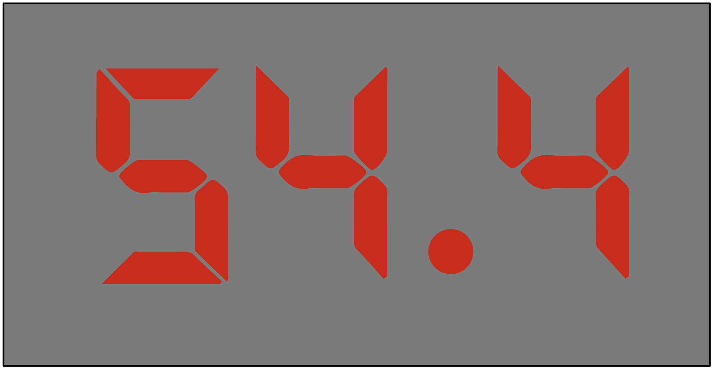

【答案】变大，不能

【解析】[1]当几辆重型汽车并排通过时，噪声增强，所以显示屏上的数据将变大。
[2]该装置是用来监测噪声强弱的仪器，故其测的是当时环境声音的响度，不能起到减弱噪声的作用。

## 59. 填空题（难度：适中）

2023年9月26日，武汉光谷空轨旅游线项目首列“光谷光子号”空轨列车在武汉市东湖高新区正式运行，如图所示，空轨列车采用双层真空玻璃，这是通过的方式控制噪声。

【答案】阻断噪声传播

## 60. 多选题（难度：适中）

为了降低噪声对周围居民生活的影响，在万家丽高架桥上，会安装如图所示的数米高的挡板。下列方法中与这种控制噪声的方法相同的是（　　）

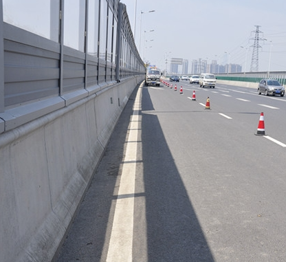

- A. 在街道里安装噪声检测仪
- B. 午休时关闭房间的门窗
- C. 市区内严禁车辆鸣笛
- D. 在城市街道两旁种草植树

【答案】B/D

【解析】在高架桥上安装数米高的挡板，是在传播过程中减弱噪声。
A．在街道里安装噪声监测仪，只能监测噪声的大小，不能减弱噪声，故A不符合题意；
B．午休时关闭房间的门窗，是在传播过程中减弱噪声，故B符合题意；
C．市区内严禁车辆鸣笛，是在声源处减弱噪声，故C不符合题意；
D．在城市街道两旁种草植树，可以在传播过程中减弱噪声，故D符合题意。

## 61. 单选题（难度：适中）

如图所示的实例中，属于在传播过程中减弱噪声的是（　　）

- A. 
 
大象通过次声波进行“无声”的交流
- B. 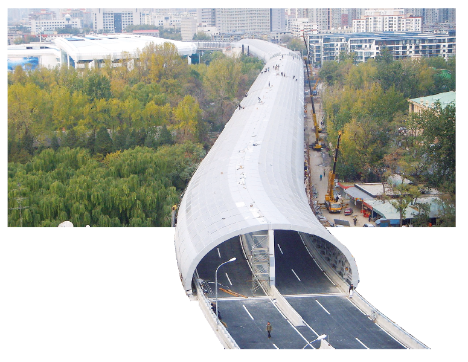
 
穿越北京动物园的“隔音蛟龙”
- C. 
 
学校附近设有禁止鸣笛的标志
- D. 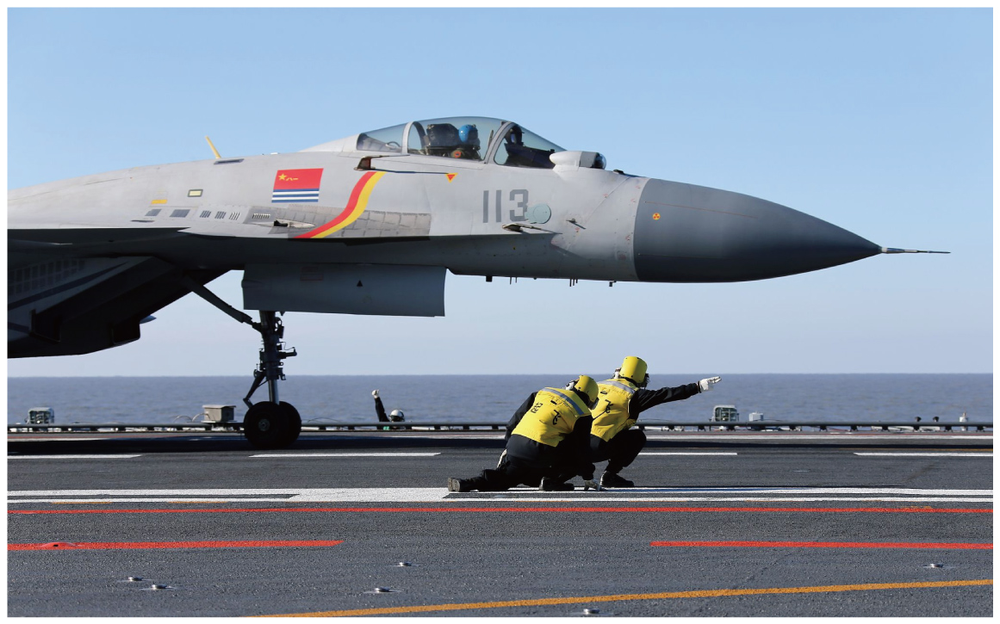
 
航母上的起飞引导员需要佩戴“耳罩”

【答案】B

【解析】A．大象通过次声波进行“无声”的交流，次声波只是人听不到，并没有减弱声音，故A不符合题意；
B．穿越北京动物园的“隔音蛟龙”，是在传播过程中减弱噪声，故B符合题意；
C．学校附近设有禁止鸣笛的标志，是在声源处减弱噪声，故C不符合题意；
D．航母上的起飞引导员需要佩戴“耳罩”，是在人耳处减弱噪声，故D不符合题意。

## 62. （难度：适中）

下列减弱噪声的措施中，通过阻断噪声传播的是（　　）
A．
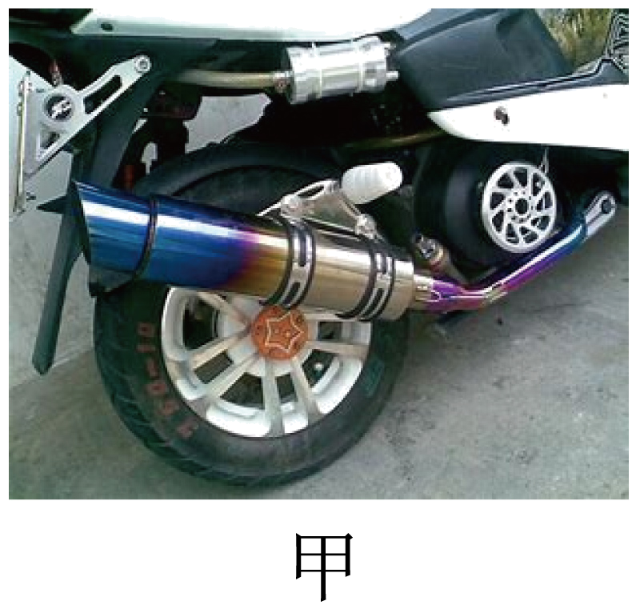
 
如图甲，摩托车上安装消声器
B．

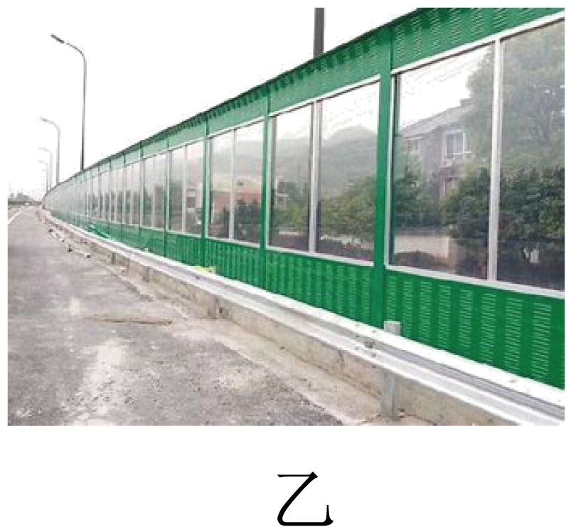
 
如图乙，道路旁安装隔声板
C．

 
如图丙，中考期间考场周边建筑工地停工
D．
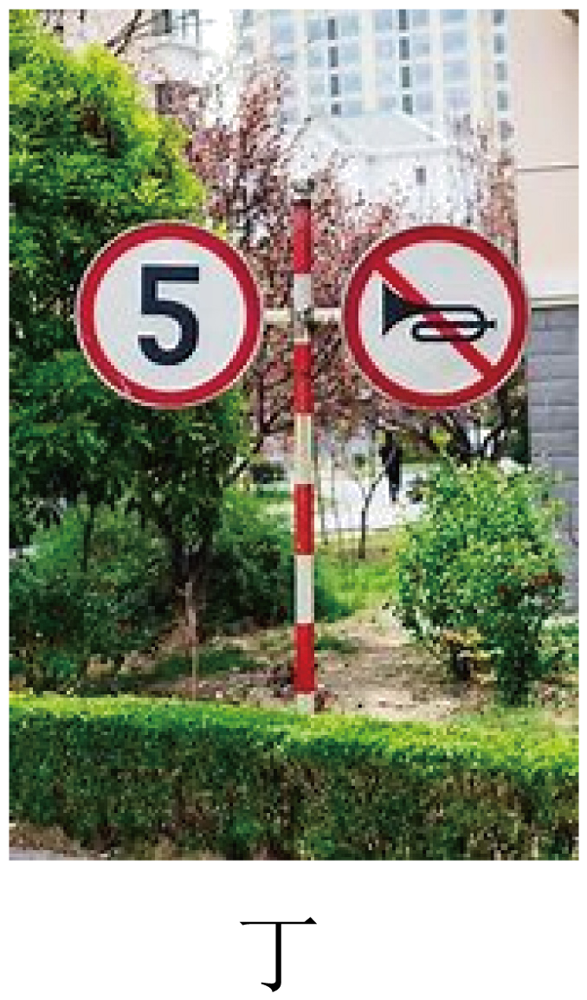
 
如图丁，小区内禁止鸣笛

【答案】

B

【解析】ACD．安装消声器、建筑工地停工和禁止鸣笛是在声源处控制噪声，故ACD不符合题意；
B．道路旁安装隔声板是在传播过程中控制噪声，故B符合题意。

## 63. 单选题（难度：适中）

城市道路上常出现下图几种标志，其中与控制噪声源有关的标志是（　　）

- A. 
- B. 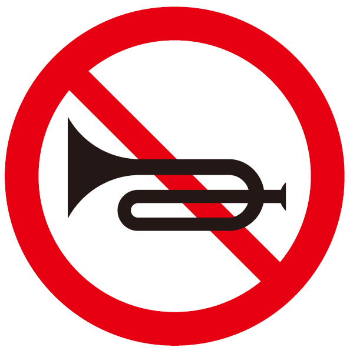
- C. 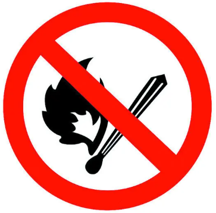
- D. 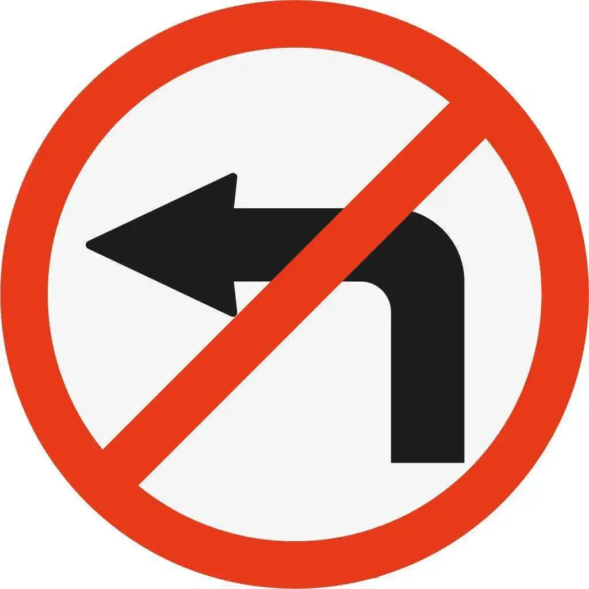

【答案】B

【解析】A．标志表示禁止载货汽车驶入，故A不符合题意；
B．标志表示禁止鸣笛，是从声源处控制噪声产生，故B符合题意；
C．标志表示严禁玩火，故C不符合题意；
D．标志表示前方路口禁止一切车辆向左转，故D不符合题意。
