# 第一节 压力的作用效果（同步练习）

> 教材：物理·八年级全一册·沪科技版2024新教材 ｜ 来源：国家中小学智慧教育平台·在线练习 ｜ 共 280 题

## 1. 单选题（难度：适中）

下列关于压强的说法错误的是（   ）。

- A. 压强反映的是压力作用的效果
- B. \( 1\text{Pa}\)的含义是作用在\( 1{\text{m}}^{2}\)的面积上的压力是\( \text{1N}\)
- C. 一位中学生站在水平地面上对地面的压强约为\( 100\text{Pa}\)
- D. 压强等于物体单位面积上受到的压力

【答案】C

【解析】​​

​​

## 2. 单选题（难度：简单）

关于压强公式\( p=\frac{F}{S}\),下列说法正确的是（   ）。

- A. 压强跟受力面积成正比
- B. 压强跟受力面积成反比
- C. 压强跟压力成正比
- D. 在压力相同的情况下，压强与受力面积成反比

【答案】D

【解析】​​

​​

## 3. 单选题（难度：适中）

将高为\( \text{10cm}\)的实心柱体放在水平桌面上，给这个重物施加竖直向上的拉力\( F\)，如图是表示重物对桌面的压强\( p\)与拉力\( F\)关系的图象，下列说法错误的是（   ）。
 
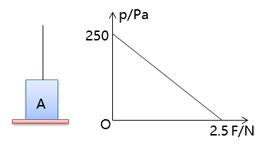

- A. 物体的重力为\( \text{2.5N}\)
- B. 物体的底面积为\( \text{100}{\text{cm}}^{2}\)
- C. 物体的密度是\( \text{2.5}\text{×}{10}^{2}\text{kg/}{\text{m}}^{3}\)
- D. 当物体受到竖直向上的拉力\( F=1\text{N}\)时，物体对桌面的压强为\( \text{100Pa}\)

【答案】D

【解析】​​

​​

## 4. 填空题（难度：简单）

压强是表示的物理量。某初中生站在水平地面上时对地面的压强为\( \text{1.5×}{10}^{4}\text{Pa}\)，表示每平方米面积上受到的压力为 \( \text{N}\)；当他平躺在地面上时，他对地面的压强将 （选填“变大”、“不变”或“变小”）。

【答案】压力的作用效果，$ \text{1.5×}{10}^{4}\text{Pa}$，变小

【解析】​​​

​​​​

 

​​

## 5. 填空题（难度：简单）

在放假外出旅游时，小明发现所乘坐的汽车窗边放置有在紧急情况下使用的逃生安全锤，如图所示。这种逃生安全锤有一端设计成锥形，这样做的目的是通过受力面积的方法，从而压强来破坏玻璃窗逃生（两空均选填“增大”或“减小”）。
 
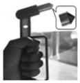

【答案】减小，增大

【解析】​​

​​

## 6. 单选题（难度：简单）

生活中的很多小设计可以通过改变受力面积来改变压强，从而达到给人们生活带来便利的目的，以下事例中，可以增大压强的是（   ）。

- A. 较宽的书包带

 

- B. 锋利的刀刃

 

- C. 铁轨下的枕木

 

- D. 滑雪时用的滑雪板

 

【答案】B

【解析】​​

​​

## 7. 填空题（难度：适中）

一个人站立时对水平地面的压强为\( \text{1.5×}{10}^{4}\text{Pa}\) ，它表示的物理意义是；当他在水平地面上行走时，对地面的压强为 \( \text{Pa}\)。如图所示是“自平衡电动踏板车”，当人站上踏板车后，踏板车对地面的压强将（选填“变大”、“不变”或“变小”）。
 
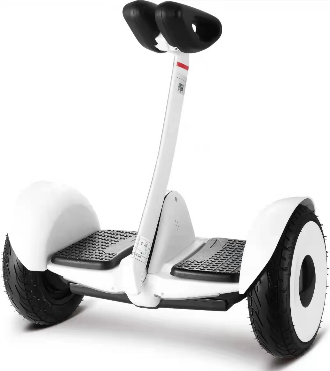

【答案】每平方米地面所受的压力为$ \text{1.5×}{10}^{4}\text{Pa}$ ，$ \text{3×}{10}^{4}$，变大

【解析】​​

​​

## 8. 

小明同学双脚站立时对地板的压强约为\( 1.5\times {10}^{4} \text{Pa}\)，他平躺时对地板的压强约为\( 3\times {10}^{3} \text{Pa}\)，他的双脚与地板的接触面积为\( 0.04{\text{m}}^{\text{2}}\)。

求：

（1）小明同学的重力；

（2）小明同学平躺时与地板的接触面积；

（3）小明背着重40N的书包双脚站立时对水平地板的压强；

（4）小明同学在行走时，压强是变大了还是变小了，为什么？

【答案】

解：

（1）根据$ p=\frac{F}{S}$  可得站立着对地板的压力：

$ F=pS=1.5\times {10}^{4}\text{Pa}\times 0.04{\text{m}}^{\text{2}}=600\text{N}$  

小明同学的重力等于其站立着对地板的压力，即：

​$ G=F=600\text{N}$ 

（2）小明同学平躺时对地板的压力

 $ F\text{'}=G=600\text{N}$ 

由$ p=\frac{F}{S}$  可得平躺时与地板的接触面积：

​$ {S}^{\mathrm{\text{'}}}=\frac{F\mathrm{\text{'}}}{p\mathrm{\text{'}}}=\frac{\text{600N}}{\text{3}\text{×}{\text{10}}^{\text{3}}\text{Pa}}\text{=0.2}{\text{m}}^{\text{2}}$     

（3）小明背着重40N的书包站立时对水平地板的压力： 

$ {F}^{\text{'}}={G}_{\text{人}}+{G}_{\text{包}}=600\text{N+40N}$ 

站立时对水平地板的压强：

$ {p}^{\text{'}}=\frac{{F}^{\text{'}}}{S}=\frac{\text{640N}}{\text{0.04}{\text{m}}^{\text{2}}}\text{=1.6×}{\text{10}}^{\text{4}}\text{Pa}$  

（4）因为站立时是两脚着地,行走时是一只脚着地,由压强公式 $ p=\frac{F}{S}$ 可知，在压力一定时，受力面积减小，压强增大，所以小明行走时，压强变大。

答：（1）小明同学的重力为$ \text{600N}$；

（2）小明同学平躺时与地板的接触面积为$ \text{0.2}{\text{m}}^{2}$；

（3）小明背着重$ \text{40N}$的书包站立时对水平地板的压强为$ \text{1.6}\text{×}{10}^{4}\text{Pa}$；

（4）小明同学在行走时，压强是变大，因为站立时是两脚着地，行走时是一只脚着地，在压力一定时，受力面积减小，压强增大，所以小明行走时，压强变大。

【解析】​​

​​

## 9. 填空题

如图甲、乙、丙所示，小明利用小桌、海绵、砝码等探究影响压力作用效果的因素。
 
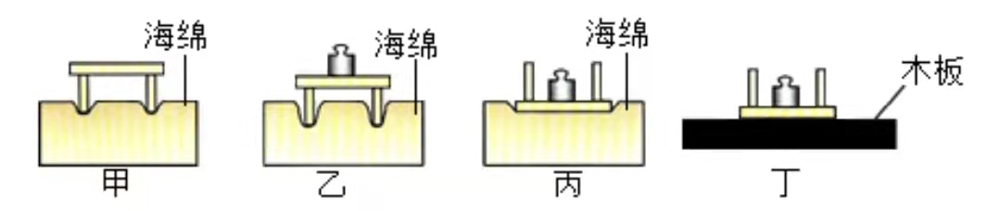

（1）本实验是通过观察来比较压力作用效果的。这种实验方法叫做法。
（2）通过比较图甲、乙，说明，压力的作用效果越明显。
（3）通过比较图（填序号），说明压力一定时，受力面积越小，压力的作用效果越明显。
（4）将该小桌和砝码放在如图丁所示的木板上，则图丙中海绵受到的压强\( p\)和图丁中木板受到的压强\( p\text{'}\)的大小关系为\( p\)\( p\text{'}\) （选填“>”“<”或“=” ）。
（5）实验结束后，同学们做了进一步的交流讨论，分析静止在水平桌面上的固体，它对桌面的压力和它受到的重力大小相等，这是因为它对桌面的压力与桌面对它的支持力是一对力；它受到的重力与桌面对它的支持力是一对力。

【答案】海绵的凹陷程度，转换法，当受力面积一定时，压力越大，乙、丙，=，相互作用，平衡

【解析】​

​​​

## 10. 单选题（难度：适中）

在探究压强与哪些因素有关时，小明猜想“压强可能与压力和受力面积有关”，为验证“压强是否与受力面积有关”，小明采用如图甲和图乙两种方法静止地挤压在两手指间来进行实验，下列说法不正确的是（   ）。

 
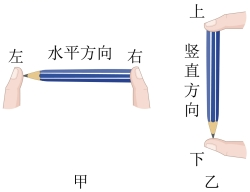

- A. 图甲与图乙中铅笔都受到了平衡力的作用
- B. 实验中用到转换法这种研究方法
- C. 图甲、图乙的方法都合理
- D. 用图甲的方法还能研究压强与压力的关系

【答案】C

【解析】​​

​​

## 11. 单选题（难度：简单）

压强是表示压力作用效果的物理量，下列哪位科学家的名字作为压强的单位（   ）。

- A. 帕斯卡

 

- B. 阿基米德

 

- C. 牛顿  

​

- D. 托里拆利 

 

【答案】A

【解析】​​​

​

## 12. 单选题（难度：适中）

如图所示，两个形状、大小、材料完全相同的实心物体1和2，放在水平桌面上时，它们对桌面产生的压力\( F\)和压强\( p\)的大小关系正确的是（   ） 

 
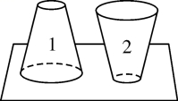

- A. \( {F}_{1}={F}_{2}\)，\( {p}_{1}={p}_{2}\)
- B. \( {F}_{1}={F}_{2}\)，\( {p}_{1}<{p}_{2}\)
- C. \( {F}_{1}={F}_{2}\)，\( {p}_{1}>{p}_{2}\)
- D. \( {F}_{1}>{F}_{2}\)，\( {p}_{1}<{p}_{2}\)

【答案】B

【解析】​​

​​

## 13. 单选题（难度：适中）

如图所示，开始时木块放到图中位置，木块对桌面压力为\( {F}_{1}\)、压强为\( {p}_{1}\)。锯断露出桌面的部分，则剩余木块对桌面的压力为\( {F}_{2}\)、压强为\( {p}_{2}\)，则（   ）。

 
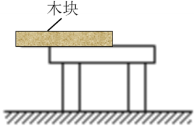

- A. \( {F}_{1}>{F}_{2}\)，\( {p}_{1}>{p}_{2}\)
- B. \( {F}_{1}<{F}_{2}\)，\( {p}_{1}<{p}_{2}\)
- C. \( {F}_{1}={F}_{2}\)，\( {p}_{1}={p}_{2}\)
- D. \( {F}_{1}<{F}_{2}\)，\( {p}_{1}={p}_{2}\)

【答案】A

【解析】​​

​​

## 14. 单选题（难度：适中）

如图所示，用两只手指压住铅笔的两端并保持静止，左边手指受到铅笔的压力为\( {F}_{1}\)、压强为\( {p}_{1}\)，右边手指受到铅笔的压力为\( {F}_{2}\)、压强为\( {p}_{2}\)，下列说法正确的是（   ）。

 
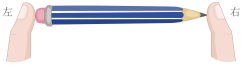

- A. 右边手指感觉比左边手指疼，是因为\( {F}_{1}<{F}_{2}\)
- B. \( {F}_{1}\)和\( {F}_{2}\)是一对平衡力，所以\( {F}_{1}={F}_{2}\)
- C. 右边手指感觉比左边手指疼，是因为\( {p}_{1}<{p}_{2}\)
- D. 此实验只能说明压力作用效果与受力面积的关系

【答案】C

【解析】​​​

​​​

​​

## 15. 单选题（难度：适中）

关于压力和压强，下列说法正确的是（　　）

- A. 压力总与重力方向一致
- B. 大气压随着高度的增加而增大
- C. 高压锅是利用气压越高，液体的沸点越高的原理工作的
- D. 用注射器给病人注射药液是利用了大气压强的作用

【答案】C

【解析】A．压力的方向是垂直于接触面指向受压物体，而重力的方向是竖直向下的，只有当物体放在水平面上时，压力的方向才与重力方向一致，其他情况下两者方向不一定相同，故A错误；
B．大气压的大小与高度有关，高度越高，空气越稀薄，大气压就越小，即大气压随着高度的增加而减小，故B错误；
C．高压锅的密封性较好，加热时锅内气压会增大，而液体的沸点随气压的增大而升高，这样就能使食物在更高的温度下被煮熟，缩短烹饪时间，故C正确；
D．用注射器给病人注射药液时，是医生用力将活塞推向针筒内，使药液在推力的作用下进入人体，这一过程利用的是推力，而不是大气压强，故D错误。
故选C。

## 16. 单选题（难度：适中）

关于压力的说法正确的是（　　）

- A. 压力的方向总是竖直向下的
- B. 压力的方向总是垂直于接触面
- C. 压力大小总是等于物体的重力
- D. 任何情况压力大小都等于物体重力大小

【答案】B

【解析】AB．压力的方向总是垂直于接触面的，如斜面上的物体对斜面的压力垂直于斜面，并非竖直向下，故A错误，B正确；
CD．只有当物体放在水平面上且不受其他外力时，压力大小才等于重力，如斜面上的物体，压力小于重力，故CD错误。
故选B。

## 17. 单选题（难度：适中）

下列关于压力和压强的说法中，正确的是（　　）

- A. 压力越大，压强一定越大
- B. 受力面积越小，压强一定越大
- C. 物体的重力越大，对支持面的压力一定越大
- D. 压力一定时，受力面积越小，压强越大

【答案】D

【解析】A．压力越大，受力面积未知，由\(p=\frac{F}{S}\)可知，压强不一定越大，故A错误；
B．压力未知，受力面积越小，由\(p=\frac{F}{S}\)可知，压强不一定越大，故B错误；
C．如果将物体压在竖直墙面上，物体对墙面的压力不等于重力，物体的重力越大，对支持面的压力不一定越大，故C错误；
D．压力一定时，受力面积越小，由\(p=\frac{F}{S}\)可知，压强越大，故D正确。
故选D。

## 18. 单选题（难度：适中）

在天安门的国旗班升旗时，每位战士站立不动时对地面的压力和压强最接近于（　　）

- A. 60N　10³Pa
- B. 60N　10⁴Pa
- C. 600N　10⁴Pa
- D. 600N　10⁶Pa

【答案】C

【解析】成年战士的体重约为60kg，在水平地面上时压力\(F=G=mg=60\text{kg}\times 10\text{N/kg}=600\text{N}\)
战士双脚站立时，单脚接触面积约为\(250c{{m}^{2}}\)（即\(0.025{{\text{m}}^{2}}\)），总接触面积为\(S=2\times 0.025{{\text{m}}^{2}}=0.05{{\text{m}}^{2}}\)
压强\(p=\frac{F}{S}=\frac{600\text{N}}{0.05{{\text{m}}^{2}}}=1.2\times {{10}^{4}}\text{Pa}\)
故ABD不符合题意，C符合题意。
故选 C。

## 19. 单选题（难度：适中）

一本书放在水平桌面上，如图所示。现用水平推力F将它缓缓推动，使其一部分移出桌面（但未倾翻），在此过程中，书对桌面的压力和压强的变化情况是（　　）

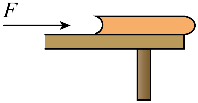

- A. 压力不变，压强变大
- B. 压力变小，压强变大
- C. 压力变大，压强不变
- D. 压力不变，压强变小

【答案】A

【解析】由题可知，书始终静止在桌面上（缓慢推动，视为匀速或平衡状态），且没有部分掉落；书的重力不变，对桌面的压力也不变，最初，书完全在桌面上，接触面积是整个底面积，当书被推着移出桌面时，与桌面的接触面积逐渐减小，即受力面积减小，根据\(p=\frac{F}{S}\)可知，压力不变，受力面积减小，压强增大，故A符合题意，BCD不符合题意。
故选 A。

## 20. 单选题（难度：适中）

某同学在水平公路上骑自行车，当车胎发生缓慢漏气时，车胎对地面的压力和压强（　　）

- A. 压力和压强不变
- B. 压力和压强都变大
- C. 压力不变，压强变小
- D. 压力变小，压强变大

【答案】C

【解析】车胎对地面的压力等于自行车和人的总重力，即 \(F=G=mg\)
当车胎漏气时，总质量m不变，故压力F 不变；车胎漏气后，与地面的接触面积S增大，根据\(p=\frac{F}{S}\)可知，压强p减小；综上，当车胎发生缓慢漏气时，车胎对地面的压力不变，压强变小，故C符合题意，ABD不符合题意。
故选C。

## 21. 单选题（难度：适中）

如图，练太极拳是很好的强身健体运动，由图甲的姿势换成图乙的姿势时（　　）

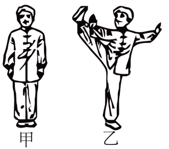

- A. 压力变大，压强不变
- B. 压力变大，压强变大
- C. 压力不变，压强变小
- D. 压力不变，压强变大

【答案】D

【解析】压力是垂直作用在物体表面上的力。当人站在水平地面上时，人对地面的压力大小等于人自身的重力。由图甲的姿势换成图乙的姿势时，人的质量不变，重力不变，所以人对地面的压力不变；从图甲的姿势换成图乙的姿势时，图乙中单脚着地，相比图甲中双脚着地，受力面积S变小。因为压力F不变，根据\(p=\frac{F}{S}\)可知，压强p会变大。故D符合题意，ABC不符合题意。
故选D。

## 22. 单选题（难度：适中）

如图甲所示，一均质长方体木块放在水平桌面上，右端与桌边平齐。现用一水平力F向右匀速缓慢地从甲图所示位置推木块，使其一部分（不到一半）露出桌面，如图乙所示，在此过程中，木块对桌面的压力F、压强p和摩擦力f的大小的变化情况是（　　）

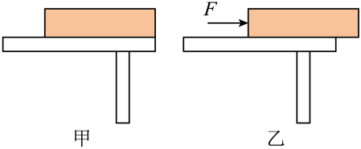

- A. F、p均不变
- B. F变大，f、p变小
- C. F、f不变，p变大
- D. F不变，p变小

【答案】C

【解析】水平面上物体对水平面的压力和自身的重力始终相等，向右缓慢地推木块的过程中，木块对桌面的压力F不变。
摩擦力的大小取决于压力大小和接触面的粗糙程度。由于压力大小不变，接触面的粗糙程度也不变，所以摩擦力f不变。
向右缓慢地推木块的过程中受力面积变小，由\(p=\frac{F}{S}\)可得，木块对桌面的压强p变大。
故ABD不符合题意，C符合题意。 
故选C。

## 23. 单选题（难度：适中）

如图所示，一个铁块放在一块薄木板上，下列关于铁块和木板受力情况的叙述正确的是（　　）

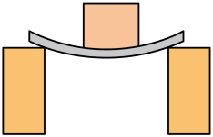
          
①只有木板发生了弹性形变，铁块没有形变；
②木板发生了弹性形变是因为木板受到向下的压力；
③铁块受到向上的支持力是因为木板发生了弹性形变；
④木板受到向下的压力就是铁块的重力。

- A. ①②
- B. ①③
- C. ②③
- D. ②④

【答案】C

【解析】①木板与铁块相互挤压，均发生弹性形变，故①错误；
②木板在铁块的作用下弯曲，是铁块对木板的压力使木板发生形变，故②正确；
③铁块受到向上的支持力是因为木板发生弹性形变而产生的，故③正确；
④压力和重力是两种不同性质的力，木板受到向下的压力，不是铁块的重力，故④错误。
故ABD错误，C正确。
故选C。

## 24. 单选题（难度：适中）

如图所示，小宇脚下穿有滑雪板，没有陷进雪地，而小雪在雪地中陷得较深。下列有关说法正确的是（    ）

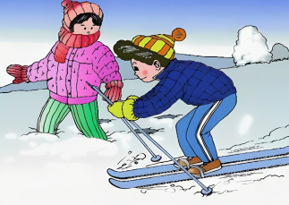

- A. 小雪对雪地产生较大的压强
- B. 小宇对雪地产生较小的压力
- C. 压力的大小一定等于物体的重力的大小
- D. 压力作用的效果与受压面积无关

【答案】A

【解析】A．压强是表示压力作用效果的物理量，定义为压力与受力面积的比值，小雪在雪地中陷得较深，说明小雪对雪地的压力作用效果更明显，即小雪对雪地产生的压强较大，故A正确；
B．小宇和小雪都是站在水平的雪地上，他们对雪地的压力等于各自的重力，由于各自的重力未知，则不能确定两人对雪地的压力大小关系，故B错误；
C．压力是垂直作用在物体表面上的力，只有当物体放置在水平面上且不受其他竖直方向的力时，物体对水平面的压力大小才等于其重力大小，故C错误；
D．压力作用的效果与压力的大小和受力面积的大小都有关系，在压力一定时，受力面积越小，压力的作用效果越明显；受力面积越大，压力的作用效果越不明显，故D错误。
故选A。

## 25. 单选题（难度：适中）

如图所示，把小桌甲倒放在海绵上，其上放一个物体乙，它们静止时，物体乙的下表面和小桌甲的桌面均水平。已知小桌甲重\({{G}_{1}}\)，桌面面积为\({{S}_{1}}\)；物体乙重\({{G}_{2}}\)，下表面积为\({{S}_{2}}\)。下列说法正确的是（　　）

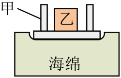

- A. 乙对甲的压力就是乙受到的重力
- B. 甲对海绵的压力等于海绵对甲的支持力
- C. 甲对海绵的压强大小为\(\frac{{{G}_{1}}+{{G}_{2}}}{{{S}_{2}}}\)
- D. 乙对甲的压强大小为\(\frac{{{G}_{2}}}{{{S}_{1}}}\)

【答案】B

【解析】A．压力是垂直作用在物体表面上的力，重力是指由于地球的吸引而产生的力，二力产生原因和方向不同，乙对甲的压力不是乙受到的重力，故A错误；
B．甲对海绵的压力和海绵对甲的支持力是一对相互作用力，大小相等，故B正确；
C．由于乙放在甲上，甲对海绵的压力大小等于甲和乙的总重力，即\({{F}_{}}={{G}_{1}}+{{G}_{2}}\)
甲对海绵产生压强时的受力面积为S1，根据公式\(p=\frac{F}{S}\)可知，甲对海绵的压强为\({{p}_{}}=\frac{{{F}_{}}}{{{S}_{1}}}=\frac{{{G}_{1}}+{{G}_{2}}}{{{S}_{1}}}\)
故C错误；
D．物体放在水平面上时，对水平面的压力大小与物体的重力大小相等，即乙对甲的压力大小等于乙的重力，即\({{F}_{}}={{G}_{2}}\)
甲对海绵产生压强时的受力面积为S2，根据公式\(p=\frac{F}{S}\)可知，乙对甲的压强为\({{p}_{}}=\frac{{{F}_{}}}{{{S}_{2}}}=\frac{{{G}_{2}}}{{{S}_{2}}}\)
故D错误。
故选B。

## 26. 单选题（难度：适中）

如图所示，上下两手指均用力，将铅笔挤压在两手指间静止不动，下面手指感觉更疼.下列说法正确的是（　　）

- A. 上手指对铅笔的压力小于下手指对铅笔的压力
- B. 上手指对铅笔的压力大于下手指对铅笔的压力
- C. 上手指对铅笔的压强等于下手指对铅笔的压强
- D. 上手指对铅笔的压强大于下手指对铅笔的压强

【答案】A

【解析】AB．因为下手指受到的压力等于上手指对铅笔的压力与铅笔的重力之和，故上手指对铅笔的压力小于下手指对铅笔的压力，故A符合题意，B不符合题意。故A正确，B错误；
CD．因为\({{F}_{}}<{{F}_{}}\)，且\({{S}_{}}>{{S}_{}}\)，则\({{p}_{}}<{{p}_{}}\)，即上手指对铅笔的压强小于下手指对铅笔的压强，故CD不符合题意，故CD错误。
故选A。

## 27. 单选题（难度：适中）

如图所示是宇树科技制造的机器狗，一个身背喇叭的机器狗在路上行走，下列有关说法中正确的是（   ）

- A. 机器狗行走时，跟地面之间没有摩擦力
- B. 走在斜坡上时，机器狗对斜坡的作用力垂直于斜坡向下
- C. 机器狗行走时，它一定受到平衡力
- D. 四条腿站立时，身背喇叭跟没背喇叭相比，机器狗对地面的压强变大了

【答案】D

【解析】A．机器狗行走时，机器狗向后蹬地，给地一个向后的力，由于物体间力的作用是相互的，地面给机器狗一个向前的摩擦力，故A错误；
B．走在斜坡上时，机器狗对斜坡的作用力有摩擦力和压力，其中摩擦力是沿着斜坡向下，压力是垂直于斜坡向下，故B错误；
C．物体在平衡状态时才受平衡力。机器狗行走时，未必是平衡状态，所以它不一定受到平衡力，故C错误；
D．四条腿站立时，受力面积不变，身背喇叭跟没背喇叭相比，背喇叭后机器狗的总重力变大，对地面的压力变大，根据\(p=\frac{F}{S}\)可知，机器狗对地面的压强变大了，故D正确。
故选D。

## 28. 单选题（难度：适中）

如图所示，一个图钉帽的面积是\(0.8\text{c}{{\text{m}}^{2}}\)，图钉尖的面积是\(5\times {{10}^{-4}}\text{c}{{\text{m}}^{2}}\)，手指对图钉帽的压力是20N，图钉帽与手指完全接触，下列说法错误的是（　　）

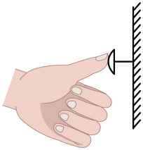

- A. 图钉尖对墙的压强相当于4000m深处水所产生的压强
- B. 手指对图钉帽的压强是\(2.5\times {{10}^{5}}\text{Pa}\)
- C. 图钉尖对墙的压力是20N
- D. 图钉帽的面积比较大，是为了减小图钉帽对手的压强

【答案】A

【解析】AC．固体能够传递压力，所以图钉尖对墙的压力等于手指对图钉帽的压力，即图钉尖对墙的压力\(F=20\text{N}\)，图钉尖对墙的压强\({{p}_{}}=\frac{F}{{{S}_{}}}=\frac{20\text{N}}{5\times {{10}^{-4}}\times {{10}^{-4}}{{\text{m}}^{2}}}=4\times {{10}^{8}}\text{Pa}\)
4000m深处水所产生的压强\({{p}_{}}={{\rho }_{}}gh=1.0\times {{10}^{3}}\text{kg}/{{\text{m}}^{3}}\times 10\text{N}/\text{kg}\times 4000\text{m}=4\times {{10}^{7}}\text{Pa}\ne 4\times {{10}^{8}}Pa\)
故A错误，符合题意；C正确，不符合题意；
B．手指对图钉帽的压强\({p}'=\frac{F}{{{S}_{}}}=\frac{20\text{N}}{0.8\times {{10}^{-4}}{{\text{m}}^{2}}}=2.5\times {{10}^{5}}\text{Pa}\)
故B正确，不符合题意；
D．图钉帽的受力面积比钉尖面积大，根据\(p=\frac{F}{S}\)可知，在压力一定时，可以减小图钉帽对手的压强，故D正确，不符合题意。
故选A。

## 29. 单选题（难度：适中）

如图所示，两手指用力挤压铅笔的两端使它保持静止，下列说法中正确的是（　　）

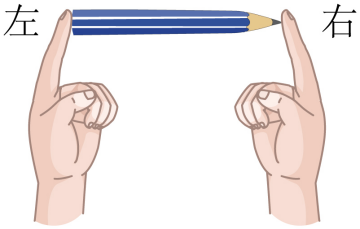

- A. 两手指对铅笔的压力是相等的
- B. 铅笔对左边手指的压力小于铅笔对右边手指的压力
- C. 左边手指受到的压强大于右边手指受到的压强
- D. 铅笔对两手指的压强是相等的

【答案】A

【解析】AB．铅笔处于静止状态，受到平衡力的作用，故左、右两侧人对铅笔的作用力大小相等；由于力的作用是相互的，铅笔给两个手的压力大小相等，故A正确，B错误；
CD．由于两手指受到的压力相等，左手指的受力面积大于右手指的受力面积，根据\(p=\frac{F}{S}\)可知，左边手指受到的压强小于右边手指受到的压强，故CD错误。
故选A 。

## 30. 单选题（难度：适中）

如图所示，水平桌面上有一长为L、质量分布均匀的木板M，其右端与桌边相齐。在水平力F的作用下，M沿桌面水平向右匀速运动至M一半在桌上、在此过程中，下列说法正确的是（　　）

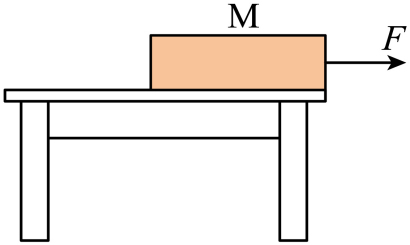

- A. M对桌面的压强变小，压力不变
- B. M对桌面的压强变大，摩擦力变小
- C. 若将移出桌面部分的二分之一切除，则对M对桌面的压强变小
- D. 若将移出桌面部分的二分之一切除，则对M对桌面的压强不变

【答案】C

【解析】A．木板向右运动的过程中，对桌面的压力大小始终等于木板的重力，而木板的重力大小不变，所以该过程中木板M对桌面的压力不变，但受力面积逐渐减小，由\(p=\frac{F}{\text{S}}\)可知，木板M对桌面的压强逐渐变大，故A错误；
B．由A知木板M对桌面的压强逐渐变大，木板向右运动时受到的摩擦力为滑动摩擦力，因为压力大小和接触面的粗糙程度都不变，所以木板M受到的摩擦力不变，故B错误；
CD．M沿桌面水平向右匀速运动至M一半在桌上，设木板的重力为G，底面积为S，M对桌面的压强为\(p=\frac{F}{\frac{1}{2}\text{S}}=\frac{2G}{\text{S}}\)
若将移出桌面部分的二分之一切除，则剩余部分对桌面的压力为\(\frac{3}{4}G\)，受力面积变为原来的一半，根据\(p=\frac{F}{\text{S}}=\frac{\frac{3}{4}G}{\frac{1}{2}S}=\frac{3G}{2S}\)可知，剩余部分对桌面的压强变小，故C正确，D错误。
故选C。

## 31. 单选题（难度：适中）

如图所示，一物块放在水平地面上处于静止，则关于物块受力分析正确的是（　　）

- A. 物块受重力、压力共两个力的作用
- B. 物块受支持力、压力共两个力的作用
- C. 物块受重力、支持力共两个力的作用
- D. 物块受重力、压力、支持力共三个力的作用

【答案】C

【解析】由于地球的吸引，物块受到一个竖直向下的力，即重力；物块压在水平地面上，地面会给物块一个竖直向上的支持力；压力是物块对地面施加的力，其受力物体是地面，而不是物块，故ABD错误，C正确。
故选C

## 32. 单选题（难度：适中）

少林功夫驰名中外，一武术爱好者练功时的姿势如图所示，下列说法正确的是（   ）

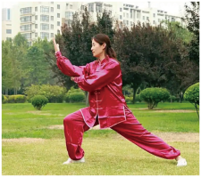

- A. 她对水平地面的压力是由于地面发生形变而产生的
- B. 她受到的重力的施力物体是地面
- C. 她对水平地面的压力与她所受到的重力是一对平衡力
- D. 她对水平地面的压力与地面对她的支持力是一对相互作用力

【答案】D

【解析】A．该武术爱好者对水平地面的压力是由于脚（鞋）发生形变而产生的，故A错误；
B．重力的施力物体是地球，故B错误；
C．该武术爱好者对地面的压力与她所受到的重力方向相同，不是一对平衡力，故C错误；
D．该武术爱好者对水平地面的压力与地面对她的支持力作用在不同的物体上，大小相等，方向相反，是一对相互作用力，故D正确。
故选D。

## 33. 单选题（难度：适中）

如图所示，把小桌甲倒放在海绵上，其上放一个物体乙，它们静止时，物体乙的下表面和小桌甲的桌面均水平。已知小桌甲重\({{G}_{1}}\)，桌面面积为\({{S}_{1}}\)；物体乙重\({{G}_{2}}\)，下表面的面积为\({{S}_{2}}\)。下列说法正确的是（    ）

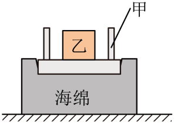

- A. 乙对甲的压力就是乙受到的重力
- B. 甲对海绵的压力大小为\({{G}_{1}}\)
- C. 甲对海绵的压强大小为\(\frac{{{G}_{1}}+{{G}_{2}}}{{{S}_{1}}}\)
- D. 乙对甲的压强大小为\(\frac{{{G}_{1}}+{{G}_{2}}}{{{S}_{2}}}\)

【答案】C

【解析】A．压力属于弹力，是由于物体发生弹性形变而产生的力。重力是由于地球的吸引而使物体受到的力。二者不是同一种性质的力，所以不能说压力就是重力，故A错误；
BC．物体放在水平面上时，对水平面的压力大小与物体的重力大小相等。所以，甲对海绵的压力\({{F}_{}}={{G}_{1}}+{{G}_{2}}\)，甲对海绵的压强\({{p}_{}}=\frac{{{F}_{}}}{{{S}_{1}}}=\frac{{{G}_{1}}+{{G}_{2}}}{{{S}_{1}}}\)。故B错误，C正确；
D．乙对甲的压力\({{F}_{}}={{G}_{2}}\)，乙对甲的压强\({{p}_{}}=\frac{{{F}_{}}}{{{S}_{2}}}=\frac{{{G}_{2}}}{{{S}_{2}}}\)，故D错误。
故选C。

## 34. 单选题（难度：适中）

一块长为L，质量分布均匀的木板A放在水平桌面上，板A右端与桌边相齐（如图所示）。在板的右端施一水平力F使板A右端缓慢地离开桌边\(\frac{L}{3}\)，在板A移动过程中，下列说法正确的是（　　）

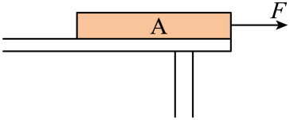

- A. A对桌面的压力变小，摩擦力变小
- B. A对桌面的压力不变，摩擦力变小
- C. A对桌面的压力不变，摩擦力不变
- D. A对桌面的压力变小，摩擦力不变

【答案】C

【解析】在缓慢移动的过程中，对桌面的压力大小始终等于的重力大小，因为木板的重力不变，所以在这一过程中，木板对桌面的压力也不变。在木板A移动过程中，压力不变，接触面的粗糙程度不变，摩擦力不变。故C符合题意，ABD不符合题意。
故选C。

## 35. 填空题（难度：适中）

作用在物体表面上的力叫压力；用50N的压力作用在0.1m²的面积上产生的压强帕，它表示。

【答案】垂直，500，1m2的面积上受到的压力是500N

【解析】[1]物体间由于相互挤压而垂直作用在物体表面上的力叫压力。
[2]50N的压力作用在0.1m²的面积上产生的压强为\(p=\frac{F}{S}=\frac{50\text{N}}{0.1{{\text{m}}^{\text{2}}}}=500\text{Pa}\)
[3]根据压强的定义可知，500Pa表示的物理意义是1m²的面积上受到的压力是500N。

## 36. 单选题（难度：适中）

小芳乘坐图示电梯匀速上行，则小芳对电梯压力的方向、电梯对小芳摩擦力的方向分别是（　　）

- A. 竖直向下，与v所示方向相同
- B. 竖直向下，与v所示方向相反
- C. 垂直电梯地面向下，与v所示方向相同
- D. 垂直电梯地面向下，与v所示方向相反

【答案】C

【解析】压力是垂直压在物体表面上的力，压力的方向总是垂直指向受压物体，小芳对电梯压力的方向是垂直电梯地面向下。小芳乘坐图示电梯匀速上行，小芳相对于电梯有向下运动的趋势，电梯对小芳摩擦力的方向是与v所示方向相同。故C符合题意，ABD不符合题意。
故选C。

## 37. 填空题（难度：适中）

吸附在磁性黑板上的小铁片受到对平衡力作用（选填“一”或“两”），与小铁片重力平衡的是磁性黑板对小铁片的力。小铁片对磁性黑板的压力是形变产生的（选填“小铁片”或“磁性黑板”）。

【答案】两，摩擦，小铁片

【解析】[1]小铁片吸附在磁性黑板上处于静止状态，在竖直方向上受到向下的重力和向上的摩擦力，这是一对平衡力；在水平方向上受到磁性黑板对它的吸引力和磁性黑板对它的支持力，这是一对平衡力，所以小铁片受到两对平衡力作用。
[2]在竖直方向上，小铁片受到的重力方向竖直向下，与重力平衡的力方向应竖直向上，磁性黑板对小铁片的摩擦力方向竖直向上，所以与小铁片重力平衡的是磁性黑板对小铁片的摩擦力。
[3]小铁片对磁性黑板的压力，其施力物体是小铁片，是由于小铁片发生形变而产生的力。

## 38. 单选题（难度：适中）

烧饼是大家喜爱的主要面食之一。制作时，将发酵好的面团揉成厚薄均匀的饼胚，再进行烤制。如图所示，将面团揉成一张饼胚后，其对桌面的（　　）

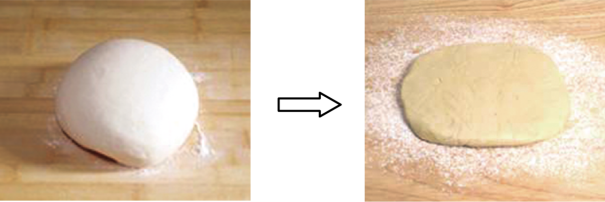

- A. 压力不变
- B. 压力变大
- C. 压强变大
- D. 压强不变

【答案】A

【解析】AB．物体放在水平面上，对水平面的压力等于其自身重力，将面团揉成饼胚，改变了面团的形状，面团所含物质的多少（即质量m）没有改变，根据G=mg可知，面团的重力不变，所以其对桌面的压力也不变，故A符合题意，B不符合题意；
CD．压力不变，将面团揉成饼胚后，面团与桌面的接触面积（受力面积）变大，在压力不变的情况下，受力面积变大，根据\(p=\frac{F}{S}\)可知，压强会变小，故CD不符合题意。 
故选A。

## 39. 填空题（难度：适中）

物体A在水平推力F的作用下，从下图所示的位置匀速运动到桌面中央的过程中，A对桌面的压力将，A对桌面的压强将。（均选填“变大”“变小”或“不变”）

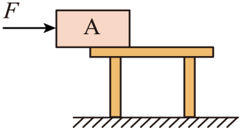

【答案】不变，变小

【解析】[1][2]物体A对桌面的压力大小等于重力大小，与水平方向的推力F无关，故压力大小不变；在物体移动的过程中受力面积变大，由\(p=\frac{F}{S}\)可知，因压力大小不变，受力面积增大，故压强将变小。

## 40. 填空题（难度：适中）

一个重为10N的物体，放在水平桌面上，物体对桌面的压力为N；若用5N的水平力推物体，物体未动，则物体受到的摩擦力为N。

【答案】10，5

【解析】[1]重为10N的物体，放在水平桌面上，物体对桌面的压力等于物体的重力，则物体对桌面的压力\(F=G=10\text{N}\)
[2]若用5N的水平力推物体，物体未动，此时物体处于平衡状态，受到的摩擦属于静摩擦，此时静摩擦力与推力是一对平衡力，大小相等，则摩擦力为\(f={{F}_{}}=5\text{N}\)

## 41. 填空题（难度：适中）

如图一块重\(\text{50}\ \text{N}\)的长方形砖块的长、宽、高分别为\(0.2\text{m}\)、\(0.1\ \text{m}\)和\(0.05\ \text{m}\)，将它平放、侧放、竖放在水平地面上，这三种情况下砖块对地面的压力（“相等”或“不相等”），放时，地面受到的压强最大。

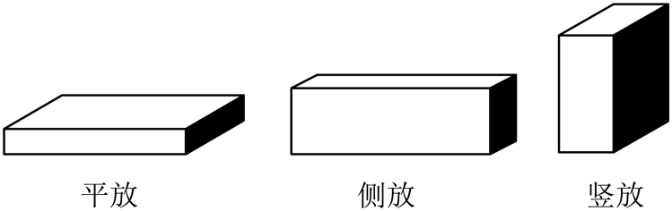

【答案】相等，竖

【解析】[1]砖块在水平地面上，对地面的压力等于其重力，即（\(F=G=50\text{N}\)）
因此平放、侧放、竖放时压力相等。
[2]根据压强公式\(p=\frac{F}{S}\)，压力\(F\)不变时，受力面积\(S\)越小，压强\(p\)越大。竖放时受力面积最小，故竖放时地面受到的压强最大。

## 42. 填空题（难度：适中）

一个质量均匀的长方体物块静止放在水平桌面上，若将其沿竖直方向切去一半，则该物块对桌面的压力，该物块对桌面的压强（均选填“变小”“变大”或“不变”）。

【答案】变小，不变

【解析】[1]在水平桌面上物块对桌面的压力大小等于其重力的大小。沿竖直方向切去一半后，物块质量减半，重力减半，因此对桌面的压力变小。
[2]由于物块对桌面的压力减半，受力面积减半，由公式\(p\text{=}\frac{F}{S}\)可知，物块对桌面的压强不变。

## 43. 填空题（难度：适中）

如图所示是一款擦窗机器人，它可借助真空泵抽出机身吸盘与玻璃之间的空气，利用“吸”在玻璃上；吸盘对玻璃的压力是由发生形变产生的；当机器人静止在竖直的玻璃上时，真空泵继续向外抽气，机器人所受摩擦力（填“变大”“不变”或“变小”）。

【答案】大气压/大气压强，吸盘，不变

【解析】[1]由题意得，将玻璃和机身吸盘之间的空气抽出后，吸盘内气压减小，机器人在大气压的作用下，牢牢地被压在竖直的玻璃上。
[2]吸盘对玻璃的压力是由吸盘发生形变产生的。
[3]擦窗机器人在竖直玻璃板上静止时，处于平衡状态，竖直方向受到的重力和摩擦力是一对平衡力，这两个力大小相等。当真空泵继续向外抽气时，机器人的重力不变，则擦窗机器人受到的摩擦力不变。

## 44. 填空题（难度：适中）

甲乙两个物体的质量之比是\(5\,\!:3\)，放在水平桌面上时与桌面的接触面积之比是\(2\,\!:1\)，则甲乙对桌面的压力之比为，压强之比为。

【答案】5∶3，5∶6

【解析】[1]在水平桌面上，物体对桌面的压力等于物体自身的重力，根据\(G=mg\)，重力之比等于质量之比。已知甲、乙质量之比为\(5\,\!:3\)，所以甲、乙两物体对桌面的压力之比\({{F}_{}}\,\!:{{F}_{}}={{G}_{}}\,\!:{{G}_{}}={{m}_{}}\,\!:{{m}_{}}=5\,\!:3\)。
[2]根据\(p=\frac{F}{S}\)，其中\({{F}_{}}\,\!:{{F}_{}}=5\,\!:3\)，\({{S}_{}}\,\!:{{S}_{}}=2\,\!:1\)，那么\({{p}_{}}{{p}_{}}=\frac {{F}_{}} {{S}_{}}\frac {{F}_{}} {{S}_{}}=\frac {{{F}_{}}{{S}_{}}} {{{F}_{}}{{S}_{}}}=\frac {5\times 1} {3\times 2}=5：6\)

## 45. 填空题（难度：适中）

如图，一质地均匀的长方体，将它放在水平桌面上，匀速推出一部分露出桌面（未翻倒），则长方体桌面的压力（选填“变大”、“不变”或“变小”，下同），压强，摩擦力大小（选填“变大”、“不变”或“变小”）。

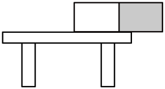

【答案】不变，变大，不变

【解析】[1]长方体对桌面的压力等于其重力，推出过程中重力不变，故压力不变。
[2]压强公式为\(p=\frac{F}{S}\)，压力F不变，露出桌面后受力面积S变小，因此压强变大。
[3]滑动摩擦力大小与压力和接触面粗糙程度有关，此过程中压力和接触面粗糙程度均不变，故摩擦力大小不变。

## 46. 填空题（难度：适中）

如图所示，有两个实心正方体物块A、B叠放在水平地面上，物块A重30N，B重10N，则B对A的压力与A对地面的压力之比为；若物块A与物块B的棱长之比为2∶1，则B对A的压强与A对地面的压强之比为。

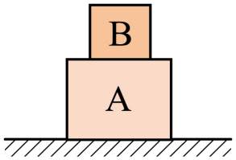

【答案】1∶4，1∶1

【解析】[1]B对A的压力与A对地面的压力之比为\(\frac{{{F}_{1}}}{{{F}_{2}}}=\frac{{{G}_{\text{B}}}}{{{G}_{\text{B}}}+{{G}_{\text{A}}}}=\frac{10\text{N}}{30\text{N}+10\text{N}}=\frac{1}{4}\)
[2]物块A与物块B的底面积之比\(\frac{{{S}_{\text{A}}}}{{{S}_{\text{B}}}}=\frac{{{2}^{2}}}{{{1}^{2}}}=\frac{4}{1}\)
根据\(p=\frac{F}{S}\)可知B对A的压强与A对地面的压强之比为\(\frac{{{p}_{1}}}{{{p}_{2}}}=\frac{\frac{{{F}_{1}}}{{{S}_{\text{B}}}}}{\frac{{{F}_{2}}}{{{S}_{\text{A}}}}}=\frac{{{F}_{1}}}{{{F}_{2}}}\times \frac{{{S}_{\text{A}}}}{{{S}_{\text{B}}}}=\frac{1}{4}\times \frac{4}{1}=\frac{1}{1}\)

## 47. 单选题（难度：适中）

我国是海洋大国，海岸线总长度3.2万公里，其中大陆海岸线1.8万公里，岛屿海岸线1.4万公里。每到暑假，都是我们去海边游玩的时候。如图所示，沙滩上留下深浅相同，大小不同的两串脚印，则（    ）

- A. 两人对沙滩的压力相同
- B. 两人对沙滩的压强相同
- C. 留下大脚印的人对沙滩的压强大
- D. 留下小脚印的人对沙滩的压力大

【答案】B

【解析】BC．压强是表示压力作用效果的物理量。脚印的深浅相同，表示压力产生的作用效果相同，即两人对沙滩的压强相同，故B符合题意，C不符合题意；
AD．因为脚印深浅相同，两人对沙滩的压强相同，由\(F=pS\)可知，压强相同时，留下大脚印的人受力面积大，则对沙滩的压力大，留下小脚印的人对沙滩的压力小，故AD不符合题意。
故选 B。

## 48. 填空题（难度：适中）

如图所示，小成的书桌上放着一本字典，字典的一部分悬空在桌面以外，小成发现后将字典推回桌面内，在这个推动的过程中：字典对桌面的压力，压强，桌面对字典的摩擦力大小。（三空均选填“变大”，“变小”或“不变”）

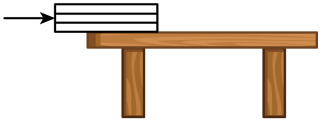

【答案】不变，变小，不变

【解析】[1][2] 字典对桌面压力大小等于字典重力，将字典水平推回桌面内的过程中，字典的重力不变，对桌面的压力大小不变，受力面积变大，根据\(p=\frac{F}{S}\)可知，字典对桌面的压强变小。
[3]无论是否匀速运动，压力和接触面的粗糙程度都不变化，因此桌面对字典的摩擦力大小不变。

## 49. 填空题（难度：适中）

踢毽子起源于汉代，如图所示，当晓琳抬起一只脚时，她对地面的压强，对地面的压力。（均选填“增大”“减小”或“不变”）

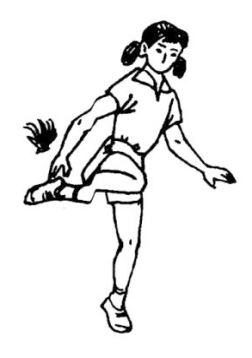

【答案】增大，不变

【解析】[1][2]在水平地面上，人对地面的压力等于人的重力，当抬起一只脚时，她对地面的压力不变。由\(p=\frac{F}{S}\)得，在压力一定时，抬起一只脚减小了受力面积，所以对地面的压强增大。

## 50. 填空题（难度：适中）

如图，物体与墙的接触面积为\(\text{0}\mathrm{}\text{2}{{\text{m}}^{\text{2}}}\)，某人用500N的力将重为300N的物体压在墙上处于静止状态，则物体对墙的压力为N，物体对墙的压强为Pa．物体受到墙对它的摩擦力为N。

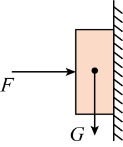

【答案】500，2500/$2.5\times {{10}^{3}}$，300

【解析】【小题1】[1]根据题意，人施加的500N力为水平方向，物体对墙的压力 \(F=500\text{N}\)
[2]压力 \(F=500\text{N}\) ，接触面积 \(S=0.2{{\text{m}}^{2}}\) 。根据压强公式\(p=\frac{F}{S}=\frac{500\text{N}}{0.2{{\text{m}}^{2}}}=2500Pa\)
[3]物体处于静止状态，说明在竖直方向上受力平衡。竖直向下的力为重力 \(G=300\text{N}\)，竖直向上的力是墙对物体的摩擦力 \(f\)，根据二力平衡， \(f=G=300\text{N}\)

## 51. 填空题（难度：适中）

如图甲所示，用一个水平推力F将物块A从如图甲位置推到如图乙位置，此过程中物体对桌面的压力（选填“变大”、“变小”或“不变”）；压强随时间变化的关系图像应为（填“丙”或“丁”）图。

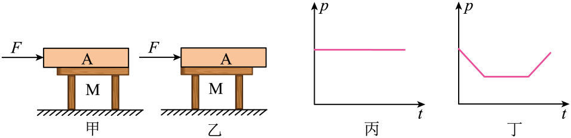

【答案】不变，丙

【解析】[1]压力是垂直作用在物体表面上的力。当物块在水平桌面上时，物块对桌面的压力大小等于物块自身的重力。物块A在水平推力作用下从图甲位置推到图乙位置的过程中，物块的重力不变，所以物体对桌面的压力不变。
[2]推动过程中，物体对桌面的压力不变，从图中可以看出，物块A被推动过程中与桌面的接触面积一直都是桌面的面积，根据\(p=\frac{F}{S}\)，物块A被推动过程中压强的大小不变，故压强随时间变化的关系图像应为丙图。

## 52. 填空题（难度：适中）

如图所示是一个质量分布均匀的长方体金属块，把它竖立在水平桌面上，金属块的密度为ρ、底面积为S、高度为h，金属块对地面的压力（用已知量表示），金属块对地面的压强p=（用已知量表示）。

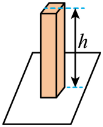

【答案】<i>&rho;Shg</i>，<i>&rho;gh</i>

【解析】[1]一个质量分布均匀的长方体金属块竖立在水平桌面上，对地面的压力等于其重力，即F=G=mg=ρVg=ρShg
[2]金属块对地面的压强\(p=\frac{F}{S}=\frac{\rho Shg}{S}=\rho gh\)

## 53. 填空题（难度：适中）

如图甲所示为一种常用核桃夹，核桃夹是杠杆，若要用更小的力来夹碎核桃则该力作用在点（选填“A”或“B”）上更好；如图乙所示为某同学在家锻炼身体的情景，锻炼时，以脚尖O点为支点，手臂弯曲、伸直交替进行。此时人体可看作杠杆。若脚尖O离墙壁越远，手掌对墙壁的压力就越。

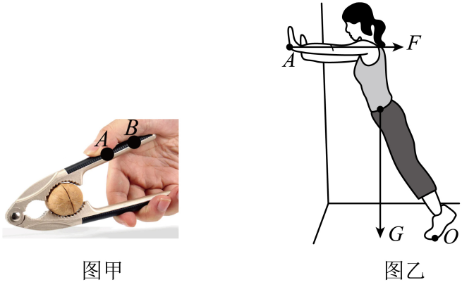

【答案】省力，<i>B</i>，大

【解析】[1]观察可知，核桃夹在使用时，动力臂大于阻力臂。根据杠杆的分类，动力臂大于阻力臂的杠杆是省力杠杆，所以核桃夹是省力杠杆。
[2]根据杠杆的平衡条件\({{F}_{1}}{{l}_{1}}={{F}_{2}}{{l}_{2}}\)，在阻力和阻力臂一定时，动力臂越长，动力越小。由图可知，力作用在B点时的动力臂比作用在A点时的动力臂长，所以若要用更小的力来夹碎核桃则该力作用在B点上更好。
[3]脚尖O离墙壁越远，墙壁对手的支持力的方向与脚尖O竖直距离变小，即动力臂变小；人体重力的方向与脚尖O水平距离变大，即阻力臂变大，根据杠杆平衡条件\({{F}_{1}}{{l}_{1}}={{F}_{2}}{{l}_{2}}\)可知，墙壁对手的支持力变大，即手掌对墙壁的压力越大。

## 54. 填空题（难度：适中）

如图是游戏期间小明被爸爸托在肩膀上的情景。已知爸爸的质量为\(75\text{kg}\)，小明的质量为\(15\text{kg}\)，爸爸每只脚与水平地面的接触面积为\(250\text{c}{{\text{m}}^{2}}\)。当爸爸双脚站立时，他对地面的压力为N，对地面的压强为Pa。若要使爸爸对地面的压强刚好增大一倍，最简单的办法是。（g取\(10\text{N}/\text{kg}\)）

【答案】900，$1.8\times \text{1}{{\text{0}}^{\text{4}}}$，提起一只脚

【解析】[1]当爸爸双脚站立时，他对地面的压力等于他们的总重力，所以，他对地面的压力为\({{F}_{\mathrm{}}}\text{=}{{G}_{}}\text{=}{{m}_{}}g\text{=(75kg}+15\text{kg)}\times \text{10N/kg=}900\text{N}\)  
[2]爸爸双脚与地面的接触面积为\(S\text{=}2\times 250\text{c}{{\text{m}}^{2}}\text{=}0.05{{\text{m}}^{2}}\)  
根据\(p\text{=}\frac{F}{S}\)可得，爸爸对地面的压强为\(p\text{=}\frac{{{F}_{\mathrm{}}}}{S}\text{=}\frac{\text{900N}}{\text{0}\text{.05}{{\text{m}}^{\text{2}}}}\text{=}1.8\times \text{1}{{\text{0}}^{\text{4}}}\text{Pa}\)  
[3]提起一只脚（或单脚站立）时，爸爸与地面的接触面积减小一半，对地面压力不变，根据\(p\text{=}\frac{F}{S}\)可知，压强增大一倍。

## 55. 填空题（难度：适中）

一头大象质量为6×10³kg，每只脚与地面的接触面积是0.06m²，则这头大象站水平地面上不动时对地面的压力是N，对地面的压强是Pa。（g取10N/kg）

【答案】6&times;104，2.5&times;105

【解析】[1]大象对地面的压力等于其重力，则有\(F=G=mg=6\times {{10}^{3}}\text{kg}\times 10\text{N/kg}=6\times {{10}^{4}}\text{N}\)
[2]大象有4只脚，总接触面积为\(S=4\times 0.06{{\text{m}}^{2}}=0.24{{\text{m}}^{2}}\)
对地面的压强为\(p=\frac{F}{S}=\frac{6\times {{10}^{4}}\text{N}}{0.24{{\text{m}}^{2}}}=2.5\times {{10}^{5}}\text{Pa}\)

## 56. 填空题（难度：适中）

如图所示，把两瓶同样的饮料放在水平桌面上，甲正放，乙平放，则饮料对底部的压强\({{p}_{}}\)\({{p}_{}}\)，瓶子对桌面的压力\({{F}_{}}\)\({{F}_{}}\)（均选填“>”“<”或“=”）。

【答案】$&gt;$，$=$

【解析】[1]甲正放，乙平放，甲中饮料的深度\({{h}_{}}\)大于乙中饮料的深度\({{h}_{}}\)，饮料密度\(\rho \)相同，\(g\)不变，所以根据液体压强公式\(p=\rho gh\)可得\({{p}_{}}>{{p}_{}}\)，即甲中饮料对底部的压强大于乙中饮料对底部的压强。
[2]瓶子对桌面的压力等于瓶子和饮料的总重力，即\(F={{G}_{}}\)。因为是两瓶同样的饮料，总重力相同，所以\({{F}_{}}={{F}_{}}\)，即甲、乙两个瓶子对桌面的压力相等。

## 57. 填空题（难度：适中）

同学去图书馆整理图书。如图所示，在水平书架上竖直并排放着10本书，若取走4本，则剩下的书对书架的压力，对书架的压强。

【答案】减小，不变

【解析】[1]水平面上物体的压力和自身的重力相等，取走4本书后，书的总重力减小，所以剩下的书对书架的压力减小。
[2]由压强公式\(p=\frac{F}{S}\)，取走4本书后，压力\(F\)减小，受力面积\(S\)也减小，且减小的比例相同（因为书是均匀并排摆放，压力与受力面积同比例变化），所以对书架的压强不变。

## 58. 填空题（难度：适中）

如图，现有五套现代汉语词典整齐地竖直摆放在书架上，若从书架上取走三套词典，则书架所受到的压力、压强。（两空均填“变大”、“变小”或“不变”）

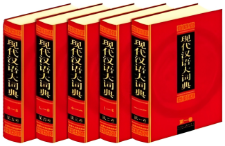

【答案】变小，不变

【解析】[1]书架所受到的压力等于书的总重力，从书架上取走三套词典，则书的总重力变小，故书架所受到的压力变小。
[2]五套现代汉语词典取走三套，则重力变为原来的\(\frac{2}{5}\)，则书架所受到的压力变为原来的\(\frac{2}{5}\)，受力面积也变为原来的\(\frac{2}{5}\)，根据\(p=\frac{F}{S}\)可知，压强不变。

## 59. 填空题（难度：适中）

两个物体甲和乙通过细绳与轻质弹簧测力计连接在一起，物体甲重4N，物体乙重7N，如图两物体都静止。此时弹簧测力计的示数为N，乙物体对地面的压力为N。

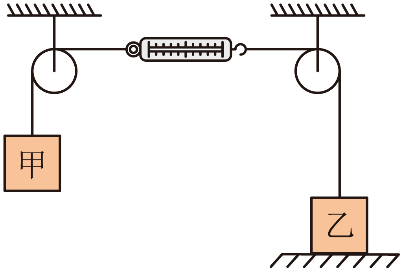

【答案】4，3

【解析】[1]弹簧测力计静止，处于平衡状态。物体甲重4N，则弹簧测力计受到向左4N的拉力，根据二力平衡条件，弹簧测力计受到向右4N的拉力，所以弹簧测力计的示数为4N。
[2]根据力的相互作用条件，乙受到绳子竖直向上4N的拉力，物体乙重7N，物体乙处于静止状态，根据力的平衡条件，乙物体受到地面支持力为\({{F}_{}}{={G}_{}}-{F}_{拉}=\text{7N-4N}=\text{3N}\)
乙物体对地面的压力与地面对它的支持力是一对相互作用力，大小相等，所以乙物体对地面的压力\({{F}_{}}{{=}_{}}\text{3N}\)

## 60. 填空题（难度：适中）

边长为\(5\text{cm}\)的正方体木块A，重\(0.75N\)，受水平作用力\(F=2\text{N}\)时，静止在竖直墙壁上，如图所示。则木块对墙面的压强是Pa。

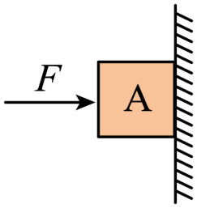

【答案】800

【解析】木块对墙的压力是\({{F}_{}}=F=2\text{N}\)，木块与墙壁的接触面积\(S=5\text{cm}\times 5\text{cm=25c}{{\text{m}}^{2}}=0.0025{{\text{m}}^{2}}\)
则木块对墙面的压强为\(p=\frac{{{F}_{}}}{S}=\frac{2\text{N}}{0.0025{{\text{m}}^{2}}}=800\text{Pa}\)

## 61. 单选题（难度：适中）

如图所示，质地均匀的长方体质量为9kg，放在水平地面上，该长方体与地面的接触面积为0.01m²，下列判断错误的是（g取10N/kg）（　　）

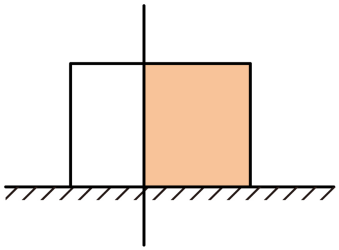

- A. 地面受到该长方体的压力是90N
- B. 竖直切除阴影部分后，剩余部分对地面的压强变大
- C. 该长方体对地面的压强大小为9×10³Pa
- D. 将切除的阴影部分放到剩余长方体上面，剩余长方体对地面的压强变大

【答案】B

【解析】A．长方体放在水平地面上，地面受到的压力F等于长方体的重力G。地面受到的压力F=G=mg=9kg×10N/kg=90N，故A正确，不符合题意；
B．竖直切除阴影部分后，长方体的密度ρ不变，高度h不变。根据压强公式p=ρgh（该公式适用于质地均匀、规则的柱状固体对水平面的压强计算），由于ρ和h都不变，所以剩余部分对地面的压强不变，故B错误，符合题意；
C．长方体对地面的压强为\(p=\frac{F}{S}=\frac{90\text{N}}{0.01{{\text{m}}^{2}}}=9\times {{10}^{3}}Pa\)，故C正确，不符合题意；
D．将切除的阴影部分放到剩余长方体上面，剩余长方体对地面的压力等于剩余部分和切除部分的重力之和，即压力变大，而受力面积不变。根据压强公式\(p=\frac{F}{S}\)，在受力面积S不变的情况下，压力F变大，则压强p变大，所以剩余长方体对地面的压强变大，故D正确，不符合题意。
故选B 。

## 62. 单选题（难度：适中）

如图所示，一个长方体铁块立放在桌面上。当把铁块平放时，桌面受到压力和压强的变化情况正确的是（　　）

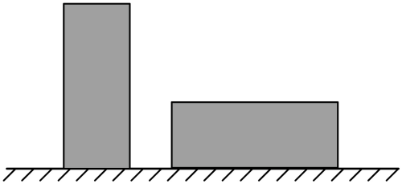

- A. 压力变大
- B. 压力变小
- C. 压强不变
- D. 压强变小

【答案】D

【解析】无论铁块是立放还是平放，其重力不变，桌面受到铁块的压力等于铁块的重力，所以，桌面受到的压力不变；由于平放时的受力面积变大，根据\(p\text{=}\frac{F}{S}\)可知，桌面受到的压强变小；故D正确，ABC错误。
故选D。

## 63. 单选题（难度：适中）

如图所示，静止在水平地面的桌面上，放一个重为G的杯子，下列说法正确的是 （    ）

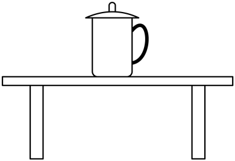

- A. 地面受到的压力的施力物体是杯子
- B. 杯子受到的重力和桌面对杯子的支持力是一对平衡力
- C. 杯子对桌面的压力和桌面对杯子的支持力是一对平衡力
- D. 杯子对桌面的压力就是杯子受到的重力，大小为G

【答案】B

【解析】A．桌子给地面一个压力，地面受到的压力的施力物体是桌子，故A错误；
B．杯子受到的重力和桌面对杯子的支持力大小相等、方向相反、作用在同一个物体上，作用在同一条直线上，是一对平衡力，故B正确；
C．杯子对桌面的压力和桌面对杯子的支持力作用在两个物体上，不是一对平衡力，故C错误；
D．杯子对桌面的压力的施力物体是杯子，杯子受到的重力的施力物体是地球，压力和重力是不同性质的力，不能说杯子对桌面的压力就是杯子受到的重力，应该是杯子对桌面的压力大小等于杯子的重力的大小，大小为G，故D错误。
故选B。

## 64. 填空题（难度：适中）

如图所示，物体在水平推力F1的作用下从甲图位置匀速运动到乙图位置。此过程中，物体受到的摩擦力为水平推力 F1（选填 “大于”、“等于” 或 “小于”），物体对桌面的压力（选填 “变大”、“变小” 或 “不变”），物体对桌面的压强将。（选填 “变大”、“变小” 或 “不变”）

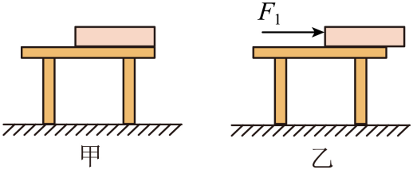

【答案】等于，不变，变大

【解析】[1]物体在水平推力F1的作用下从甲图位置匀速运动到乙图位置，物体在此过程中水平推力和摩擦力是一对平衡力，由二力平衡的条件可知物体受到的摩擦力等于水平推力F1。
[2][3]物体从甲图位置匀速运动到乙图位置，物体对桌面的压力等于自身的重力，重力不变，压力就不变，物体对桌面的压力不变，受力面积变小，由\(p=\frac{F}{S}\)可知，物体对桌面的压强将变大。

## 65. 填空题（难度：适中）

如图所示，水平桌面上有一长方形木板，从推力F作用在木板开始到木板运动距离s的过程中，木板对桌面的压力，压强（选填“变小”“不变”或“变大”）；

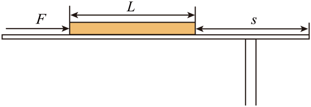

【答案】不变，不变

【解析】[1]木板在水平桌面上运动时，其重力不变，而木板对桌面的压力等于自身重力（水平面上，压力与重力大小相等），所以木板对桌面的压力不变。
[2]由图可知，在木板运动距离s的过程中，压力F不变，木板与桌面的接触面积S不变，由\(p=\frac{F}{S}\)可知，压强p不变。

## 66. 单选题（难度：适中）

一个足球放在一块长木板上静止，如图所示，木板和足球均发生了弹性形变，以下说法正确的是（　　）

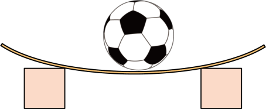

- A. 木板受到的压力是由于足球发生形变产生的
- B. 木板受到足球竖直向下的压力就是足球的重力
- C. 足球发生形变的施力物体是地球
- D. 图中木板一共受到2个力的作用

【答案】A

【解析】A．木板受到的压力的施力物体是足球，是由于足球发生形变产生的，故A正确；
B．足球对木板的压力属于弹力，与足球受到的重力的性质不相同，只是压力的大小与足球受到的重力大小相等，故B错误；
C．足球发生形变，是因为长木板对足球施加了支持力，所以足球发生形变的施力物体是长木板，故C错误；
D．图中木板受到重力、足球的压力及两边的物体对其产生的支持力，故D错误。
故选A。

## 67. 单选题（难度：适中）

如图所示，小鸟站在倾斜树枝上休息，保持静止状态，下列说法正确的是（　　）

- A. 树枝受到压力是因为树枝发生了形变
- B. 小鸟对树枝的压力不属于弹力
- C. 小鸟把树枝抓得更紧时，它受的摩擦力保持不变
- D. 树枝弯曲是因为小鸟受重力作用

【答案】C

【解析】A．树枝受到压力的施力物体是小鸟，压力属于弹力，施力物体发生形变产生弹力，因此树枝受到压力是因为小鸟发生了形变，故A错误；
B．小鸟对树枝的压力是小鸟发生弹性形变产生的，属于弹力，故B错误；
C．小鸟相对树枝没有运动，相对树枝有运动趋势，因此与树枝间的摩擦为静摩擦，静摩擦力的大小与压力大小无关，小鸟把树枝抓得更紧时，它受的摩擦力保持不变，故C正确；
D．树枝弯曲是由于树枝受到压力的作用，故D错误。
故选C。

## 68. 单选题（难度：适中）

如图所示，木块对支持面的压力示意图正确的是（    ）

- A. 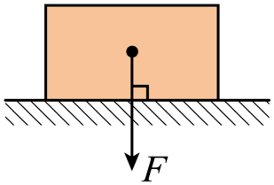
- B. 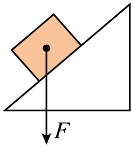
- C. 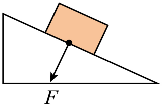
- D. 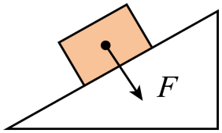

【答案】C

【解析】由题意可知，木块对支持面的压力的受力物体是支持面；已知压力是一种弹力，是垂直作用在支持面上并指向受力物体的一种力，所以，由以上信息可判断，所求压力示意图的作用点不能画在木块的重心上，且压力的方向须垂直于支持面，故ABD错误，C正确。
故选C。

## 69. 单选题（难度：适中）

将物理课本放在桌面上，则如图中可表示桌面受到压力的示意图的是（　　）

- A. 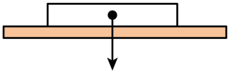
- B. 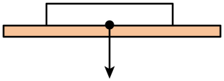
- C. 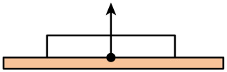
- D. 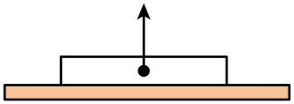

【答案】B

【解析】A．图中的力作用在课本上，不是桌面受到压力的示意图，故A不符合题意；
B．图中的力作用在桌面上，方向指向桌面，是课本对桌面的压力，故B符合题意；
C．图中的力作用在课本上，方向指向课本，是桌面对课本的支持力，故C不符合题意；
D．图中的力作用在课本上，不是桌面受到压力的示意图，故D不符合题意。
故选B。

## 70. 单选题（难度：适中）

如图所示，下列实例中属于增大压强的是（    ）
 

- A. 滑雪板的面积很大
- B. 骆驼脚掌较宽
- C. 破窗锤的锤头很尖
- D. 汽车安全带较宽

【答案】C

【解析】A．滑雪板的面积很大，是在压力一定的情况下，通过增大受力面积来减小对雪的压强，防止陷入雪中，故A不符合题意；
B．骆驼脚掌较宽，是在压力一定的情况下，通过增大受力面积来减小对沙地的压强，防止陷入沙中，故B不符合题意；
C．破窗锤的锤头很尖，是在压力一定的情况下，通过减小受力面积来增大对玻璃的压强，以便更容易击碎玻璃，故C符合题意；
D．汽车安全带较宽，是在压力一定的情况下，通过增大受力面积来减小对人体的压强，以保护乘客，故D不符合题意。
故选C。

## 71. 单选题（难度：适中）

在“探究影响压力作用效果的因素”时，小明做了如图所示的实验，实验中的小桌和砝码分别为相同的小桌和砝码，下列说法正确的是：（　　）

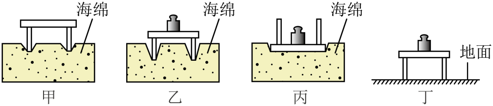

- A. 图甲、乙对比说明，压力一定时，受力面积越小，压力作用效果越明显
- B. 图乙中小桌桌面水平静止时，砝码只受重力和支持力，不受摩擦力
- C. 图丙中小桌静止时，小桌所受的重力和海绵对小桌的支持力是一对平衡力
- D. 图丁中小桌对地面的压力小于图乙中小桌对海绵的压力

【答案】B

【解析】A．图甲和图乙中，压力大小不同，受力面积相同，对比说明的是受力面积一定时，压力越大，压力作用效果越明显，而不是压力一定时受力面积对作用效果的影响，故A错误；
B．图乙中小桌桌面水平静止时，砝码处于静止状态，在竖直方向上受到竖直向下的重力和小桌对它竖直向上的支持力，这两个力是一对平衡力，砝码与小桌之间没有相对运动，砝码相对于小桌也没有相对运动趋势，所以不受摩擦力，故B正确；
C．图丙中小桌静止时，小桌受到自身的重力、砝码对它的压力以及海绵对它的支持力，海绵对小桌的支持力是竖直向上的，大小等于小桌重力与砝码压力之和，而小桌所受的重力只是其中一个力，这两个力大小不相等，所以不是一对平衡力，故C错误；
D．图丁中小桌对地面的压力等于小桌和砝码的总重力，图乙中小桌对海绵的压力也等于小桌和砝码的总重力，因此两者的压力大小相等，故D错误。
故选B。

## 72. 单选题（难度：适中）

某同学用如图所示的装置探究压力和受力面积对海绵形变的影响，下列说法正确的是（　　）

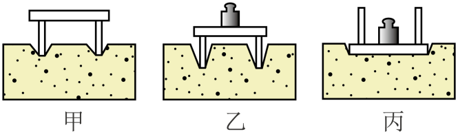

- A. 海绵受力发生形变，说明力可以改变物体的运动状态
- B. 图甲中，小桌对海绵的压力就是小桌的重力
- C. 甲、丙两次实验可得出海绵形变与受力面积有关
- D. 交通管理部门限定每个车轴平均承载的质量，利用了甲、乙两次实验的结论

【答案】D

【解析】A．海绵受力发生形变，说明力可以改变物体的形状，故A错误；
B．小桌对海绵的压力作用在海绵上；小桌的重力作用在小桌上，二者是不同的力，故B错误；
C．甲、丙两次实验的压力和受力面积均不同，不符合控制变量法的要求，不能得出海绵形变与受力面积有关，故C错误；
D．比较甲、乙两次实验可得出：在受力面积一定时，压力越大，压力的作用效果越明显。交通管理部门限定每个车轴平均承载的质量，是为了减小对路面的压力，从而在受力面积一定时减小压强，利用了甲、乙两次实验的结论，故D正确；
故选D。

## 73. 单选题（难度：适中）

如图甲所示，总质量相同的两人分别在雪地里滑雪和行走，图乙、丙、丁是压力和受力面积对海绵形变的影响实验，下列说法中正确的是（　　）

- A. 本实验中用木板代替海绵也可以进行实验探究
- B. 乙、丁两图说明海绵的形变和受力面积的大小有关
- C. 滑雪者没有陷入雪地，是因为滑雪者对雪地的压力比步行者的小
- D. 若要探究滑雪者和步行者对雪地压力的作用效果应该选择丙和丁进行模拟研究

【答案】D

【解析】A．本实验中用木板代替海绵，由于木板硬度大，受到压力时，形变不明显，难以比较压力的作用效果，故A错误； 
B．乙、丁两图压力、受力面积均不同，没有控制压力的大小相同，不能说明海绵的形变和受力面积的大小有关，故B错误；
C．滑雪者没有陷入雪地，是因为滑雪者对雪地的受力面积大，压强比步行者的小，故C错误；
D．若要探究滑雪者和步行者对雪地压力的作用效果，要控制压力相同，改变受力面积，应该选择丙和丁进行模拟研究，故D正确。
故选D。

## 74. 单选题（难度：适中）

在研究“压力作用效果和什么因素有关”的实验中，将实验小桌放入沙盘中，观察小桌陷入沙中的深度，如图所示。关于这个实验，下列说法正确的是（    ）

- A. 本实验将“压力的作用效果”转化为小桌的形变程度
- B. 甲和乙研究的是压力作用效果跟压力大小的关系
- C. 乙和丙研究的是压力作用效果跟压力的关系
- D. 甲和丙研究的是压力作用效果跟受力面积的关系

【答案】B

【解析】A．本实验将“压力的作用效果”转化为小桌陷入沙中的深度，而不是小桌的形变程度，故A错误； 
B．比较图甲与图乙的情况，甲、乙的受力面积相同，乙的压力大，陷入沙中的深度较深，所以可知压力作用的效果与压力大小有关，故B正确； 
C．比较图乙与图丙的情况，乙、丙的压力相同，乙的受力面积小，陷入沙中的深度较深，可知压力作用的效果与受力面积有关，故C错误； 
D．比较图甲与图丙的情况，甲、丙的压力和受力面积都不相同，不能探究压力作用的效果与受力面积有关，故D错误。 
故选B。

## 75. 单选题（难度：适中）

如图是“探究压力作用的效果跟哪些因素有关”的实验过程，下列说法中正确的是（　　）

- A. 若把图丙的海绵换成木板、木板受到的压强小于海绵受到的压强
- B. 乙丙对比说明，重力一定时，受力面积越小，压力作用效果越明显
- C. 甲乙对比说明，受力面积一定时，压力越大，压力作用效果越明显
- D. 通过海绵被压下的深浅来反映压力大小，用到的科学探究方法是转换法

【答案】C

【解析】A．若把图丙的海绵换成木板，木板受到的压强等于海绵受到的压强，根据p=\( \frac{F}{S}\)可知，因为压力大小和受力面积不变，故压强也不变，故A错误；
B．乙、丙对比说明，压力（不是重力）一定时，受力面积越小，压力作用的效果越明显，故B错误；
C．甲乙对比，受力面积相同，甲中压力小，海绵凹陷程度小，乙中压力大，海绵凹陷程度大，说明受力面积一定时，压力越大，压力作用效果越明显，故C正确；
D．本实验通过海绵被压下的深浅来反映压力的作用效果，即压强，而不是压力大小，故D错误。
故选C。

## 76. 单选题（难度：适中）

小松为了探究“压力的作用效果与哪些因素有关”，利用砝码、小木桌、海绵等器材做了如图所示的实验，下列说法中正确的是（   ）

- A. 实验中，我们通过观察海绵的凹陷程度来反映压力的大小
- B. 本实验用到的科学探究方法有“转换法”和“控制变量法”
- C. 比较甲、乙两图可知，当受力面积一定时，压力越小，海绵的凹陷程度越明显
- D. 比较乙、丙两图可知，当压力一定时，受力面积越大，海绵的凹陷程度越明显

【答案】B

【解析】A．实验通过观察海绵凹陷程度反映压力的作用效果，并非压力大小，故A错误；
B．用海绵凹陷程度反映压力作用效果是转换法，探究压力作用效果与压力、受力面积关系时控制变量，用到控制变量法，故B正确；
C．甲、乙受力面积相同，乙压力大，海绵凹陷程度大，说明受力面积一定时，压力越大，压力作用效果越明显，故C错误；
D．乙、丙压力相同，乙受力面积小，海绵凹陷程度大，说明压力一定时，受力面积越小，压力作用效果越明显，故D错误。
故选B。

## 77. 单选题（难度：适中）

小兴用小桌、砝码和海绵探究哪些因素影响压力的作用效果，实验过程如图甲、乙所示。下列说法正确的是（    ）

- A. 甲图中海绵受到的压力大于乙图中海绵受到的压力
- B. 甲图中小桌对海绵的压力等于小桌的重力
- C. 分析小兴的实验过程，可知小兴探究的是压力大小是否影响压力的作用效果
- D. 分析小兴的实验过程，可知小兴探究的是受力面积大小是否影响压力的作用效果

【答案】D

【解析】AB．如图，甲、乙两图中小桌对海绵的压力都等于小桌和砝码的总重力，所以甲图中海绵受到的压力等于乙图中海绵受到的压力，故AB错误；
CD．小兴实验时控制了压力相同，改变了受力面积，可知小兴探究的是受力面积大小是否影响压力的作用效果，故C错误，D正确。
故选D。

## 78. 单选题（难度：适中）

小敏利用海绵、桌子和砝码进行了如图探究实验。下列对整个探究活动的分析不正确的是（    ）

- A. 探究的问题：压力的作用效果与什么因素有关
- B. 探究的方法：控制变量法、转换法
- C. 探究过程分析：通过观察海绵凹陷面积大小判断压力的作用效果
- D. 探究的结论：压力的作用效果与压力的大小和受力面积大小有关

【答案】C

【解析】A．图中用海绵的凹陷程度来表示压力的作用效果，桌子正放和倒放改变海绵的受力面积，桌子上加砝码以改变海绵受到的压力，故该实验探究的问题是探究压力的作用效果和什么因素有关，故A正确，不符合题意；
B．通过海绵的凹陷程度来反映压力的作用效果，采用了转换法；压力的作用效果与压力的大小和受力面积的大小有关，实验时应采用控制变量法，所以该实验采用了控制变量法和转换法，故B正确，不符合题意；
C．实验中，物体对支持面的压力大小等于物体的重力，通过海绵的凹陷程度来反映压力的作用效果，采用了转换法，故C错误，符合题意；
D．比较甲乙两图实验，受力面积相同而压力不相同，由图可知，压力的作用效果不同，可得出压力的作用效果与压力的大小有关；比较乙丙两图，压力大小相同而受力面积不同，压力的作用效果不同，故可得出压力的作用效果和受力面积大小有关，故D正确，不符合题意。
故选C。

## 79. 单选题（难度：适中）

在“探究压力作用效果与哪些因素有关”实验时，某同学做了如图所示的实验，下列说法正确的是（　　）

- A. 实验中，海绵的凹陷程度越小，压力作用效果越明显
- B. 分析甲乙实验，可知压力的作用效果与压力大小有关
- C. 分析甲丙实验，可知压力的作用效果与受力面积有关
- D. 若把图丙的海绵换成木板，木板受到的压强小于海绵受到的压强

【答案】B

【解析】A．本实验通过海绵的凹陷程度来反映压力的作用效果，海绵的凹陷程度越大，压力的作用效果越明显，故A错误；
B．分析甲乙两图，根据控制变量法，受力面积相同，压力大小不同，海绵凹陷程度不同，所以可知压力的作用效果与压力大小有关，故B正确；
C．分析甲丙两图，受力面积不相同，压力大小不同，没有控制变量，故不可以得到压力的作用效果与受力面积有关，故C错误；
D．若把图丙的海绵换成木板，压力大小不变，受力面积不变，压强也不变，则木板受到的压强等于海绵受到的压强，故D错误。
故选B。

## 80. 单选题（难度：适中）

某同学把气球放在手掌和手指之间保持静止，发现气球两侧的凹陷程度不同，如图①所示，于是利用如图②③④所示的装置探究影响压力作用效果的因素。下列说法错误的是（　　）

- A. 实验时，通过海绵的形变情况来反映压力的作用效果
- B. ②和④可以探究压力的作用效果与受力面积的关系
- C. ②和③相比，压力大小不同，受力面积相同
- D. ③和④得到的结论可以解释①中的现象

【答案】B

【解析】把气球放在手掌和手指之间保持静止，手掌和手指给气球的作用力大小相等，由于气球的受力面积不同，气球两侧的压强不同，两侧气球两侧的凹陷程度不同；
A．实验时，通过海绵的形变情况来反映压力的作用效果， 海绵的形变量越大，压力的作用效果越明显，故A正确，不符合题意；
B．②和④相比较，压力的大小不同，受力面积不同，不能探究压力的作用效果与受力面积的关系，故B错误，符合题意；
C．②和③相比，压力大小不同，受力面积相同， 可以探究压力的作用效果与压力的关系，故C正确，不符合题意；
D．③和④压力相同，受力面积不同，可以探究压力的作用效果与受力面积的关系，得到的结论可以解释①中的现象，故D正确，不符合题意。
故选B。

## 81. 单选题（难度：适中）

物理实验中运用了一些研究物理问题的方法和应用，在“探究影响压力作用效果的因素“实验中，下列说法正确的是（        ）

- A. 通过观察海绵被压下的深浅来显示压力的作用效果，这种实验方法叫类比法
- B. 探究压力作用效果与压力大小关系时，控制受力面积不变，这是运用了控制变量法
- C. 注射器的针头比较尖，利用了甲、乙的实验结论
- D. 樵夫有力欲柴，利用了乙、丙的实验结论

【答案】B

【解析】A．在物理实验中把不易观察到的现象转换为显而易见的现象，这是转换法，故A错误；
B．压力作用效果跟压力大小和受力面积大小有关。当研究其中一个变量所产生的影响时，通常会把其他的变量控制，在物理学中是控制变量法，故B正确；
C．甲、乙图知，在受力面积一定时，压力越大，压力作用效果越明显，不可以解释注射器的针头比较尖，故C错误；
D．樵夫砍柴时，在压力一定的情况下，通过减小受力面积（斧头锋利）来增大压力作用效果。由图乙、丙知，在压力一定时，受力面积越小，压力作用效果越明显，不可以解释樵夫有力欲柴，故D错误。
故选B。

## 82. 单选题（难度：适中）

在实验中经常遇到器材选用不合理或次要因素影响等使现象不明显的情况，从而需要对实验进行优化改进，如图所示的物理实验中，对于采取的措施，解释不合理的是（　　）

- A. 图甲探究二力平衡条件，用硬纸板而不用小车是因为硬纸板不受重力
- B. 图乙探究影响压力作用效果的因素，用硬度小的海绵泡沫塑料
- C. 图丙探究流体压强与流速的关系，用乒乓球是因为它的惯性小
- D. 图丁探究力与运动的关系，采用小车是因为轮子滚动摩擦力小，滑行距离差别明显

【答案】A

【解析】A．图甲用硬纸板而不用小车，是因为硬纸板的重力远小于小车，可忽略重力对实验的影响，故A符合题意；
B．图乙用硬度小的海绵，是因为海绵受力后形变明显，便于观察压力的作用效果，故B不符合题意；
C．在探究流体压强与流速的关系时，向中间吹气，中间空气流速大，压强小，周围空气流速小，压强大，乒乓球在周围大气压的作用下向中间靠拢，是利用了乒乓球质量小，惯性小，运动状态易于改变的道理，故C不符合题意；
D．探究力与运动的关系，采用小车是因为轮子滚动的滚动摩擦力小于滑动摩擦力，故D不符合题意。
故选A。

## 83. 单选题（难度：适中）

在“探究影响压力作用效果的因素”时，小明做了如图所示的实验，实验中的小桌和砝码分别为相同的小桌和砝码，下列说法正确的是（　　）

- A. 图甲、乙对比说明，压力一定时，受力面积越小，压力作用效果越明显
- B. 图乙中小桌静止时，砝码只受重力和支持力，不受摩擦力
- C. 图丙中小桌静止时，小桌所受的重力和海绵对小桌的支持力是一对平衡力
- D. 图丁中小桌对地面的压力小于图乙中小桌对海绵的压力

【答案】B

【解析】A．甲、乙受力面积相同，压力不同，是探究压力作用效果与压力关系，故A错误；
B．图乙中小桌静止，砝码静止，水平方向无相对运动趋势，不受摩擦力，只受重力和支持力，故B正确；
C．图丙中海绵对小桌支持力等于小桌与砝码总重力，大于小桌自身重力，不是一对平衡力，故C错误；
D．在水平面上的物体对水平面的压力等于重力，由图可知，丙图中小桌对海绵的压力等于丁图中小桌对地面的压力，故D错误。
故选B。

## 84. 单选题（难度：适中）

如图所示是“探究压力的作用效果与什么因素有关”的实验，下列有关说法正确的是（　　）

【答案】A

## 85. 单选题（难度：适中）

关于下面四幅图，下列说法正确的是（    ）

- A. 如图甲，对比a和b中海绵形变程度，说明压力的作用效果与压力大小有关
- B. 如图乙是工作中的船闸，其原理是连通器
- C. 如图丙是自制水气压计，把它从山脚移到山顶，细管内水柱下降
- D. 如图丁，口含b管对a管上方吹气，a管水面上升是因为流速越大的位置压强越大

【答案】B

【解析】A．甲图中，对比a和b中海绵形变程度，压力大小相同，a图中受力面积较小，海绵的凹陷程度较大，压力作用效果较明显，说明压力的作用效果与受力面积有关，故A错误；
B．船闸属于连通器，在水不流动时，两侧水面保持相平，利用了连通器原理，故B正确；
C．把自制气压计从山下移到山顶，瓶内空气的压强不变，而外界大气压随高度的增加而减小，此时在瓶内气压的作用下会有一部分水被压入玻璃管，因此管内水柱会升高，故C错误；
D．丁图中，口含b管对a管上方吹气，a管上方气体流速加快，压强减小，因此a管水面将上升，故D错误。
故选B。

## 86. 单选题

如图所示，放在水平地面上的实心长方体\( \text{A}\)、\( \text{B}\)高度相同，底面积\( {S}_{\text{A}}>{S}_{\text{B}}\)。若在两物体上部沿水平方向分别切去一定的体积、高度或质量（均未切完），以下方法可以使\( \text{A}\)、\( \text{B}\)剩余部分对地面的压强相等的是（   ）

- A. 若密度\( {\rho }_{\text{A}}>{\rho }_{\text{B}}\)，切去相同质量
- B. 若质量\( {m}_{\text{A}}={m}_{\text{B}}\)，切去相同质量
- C. 若密度\( {\rho }_{\text{A}}<{\rho }_{\text{B}}\)，切去相同高度
- D. 若质量\( {m}_{\text{A}}<{m}_{\text{B}}\)，切去相同体积

【答案】D

【解析】A．切去相同质量，即\( \mathrm{\Delta }{m}_{\text{A}}=\mathrm{\Delta }{m}_{\text{B}}\)，由\( V=\frac{m}{\rho }\)可知，当\( {\rho }_{\text{A}}>{\rho }_{\text{B}}\)，切去部分的体积\( \mathrm{\Delta }{V}_{\text{A}}<\mathrm{\Delta }{V}_{\text{B}}\)
已知\( {S}_{\text{A}}>{S}_{\text{B}}\)，由\( h=\frac{V}{S}\)得切去部分的高度\( \mathrm{\Delta }{h}_{\text{A}}<\mathrm{\Delta }{h}_{\text{B}}\)
长方体A剩余部分的高度\( {{h}_{\text{A}}}^{\text{'}}={h}_{\text{A}}-\mathrm{\Delta }{h}_{\text{A}}\)
长方体B剩余部分的高度\( {{h}_{\text{B}}}^{\text{'}}={h}_{\text{B}}-\mathrm{\Delta }{h}_{\text{B}}\)
因为\( {h}_{\text{A}}={h}_{\text{B}}\)，所以\( {{h}_{\text{A}}}^{\text{'}}>{{h}_{\text{B}}}^{\text{'}}\)
因为长方体A、B是质量均匀、形状规则的柱体，所以长方体A剩余部分对地面的压强\( {{p}_{\text{A}}}^{\text{'}}={\rho }_{\text{A}}g{{h}_{\text{A}}}^{\text{'}}\)
长方体B剩余部分对地面的压强\( {{p}_{\text{B}}}^{\text{'}}={\rho }_{\text{B}}g{{h}_{\text{B}}}^{\text{'}}\)
则\( {{p}_{\text{A}}}^{\text{'}}>{{p}_{\text{B}}}^{\text{'}}\)，故A不符合题意；
B．切去相同质量，即\( \mathrm{\Delta }{m}_{\text{A}}=\mathrm{\Delta }{m}_{\text{B}}\)，长方体A剩余部分的质量\( {{m}_{\text{A}}}^{\text{'}}={m}_{\text{A}}-\mathrm{\Delta }{m}_{\text{A}}\)
长方体B剩余部分的质量\( {{m}_{\text{B}}}^{\text{'}}={m}_{\text{B}}-\mathrm{\Delta }{m}_{\text{B}}\)
已知\( {m}_{\text{A}}={m}_{\text{B}}\)，所以\( {{m}_{\text{A}}}^{\text{'}}={{m}_{\text{B}}}^{\text{'}}\)，即\( {{G}_{\text{A}}}^{\text{'}}={{G}_{\text{B}}}^{\text{'}}\)
长方体A剩余部分对地面的压强\( {{p}_{\text{A}}}^{\text{'}}=\frac{{{F}_{\text{A}}}^{\text{'}}}{{S}_{\text{A}}}=\frac{{{G}_{\text{A}}}^{\text{'}}}{{S}_{\text{A}}}\)
长方体B剩余部分对地面的压强\( {{p}_{\text{B}}}^{\text{'}}=\frac{{{F}_{\text{B}}}^{\text{'}}}{{S}_{\text{B}}}=\frac{{{G}_{\text{B}}}^{\text{'}}}{{S}_{\text{B}}}\)
因为\( {S}_{\text{A}}>{S}_{\text{B}}\)，所以\( {{p}_{\text{A}}}^{\text{'}}<{{p}_{\text{B}}}^{\text{'}}\)，故B不符合题意；
C．切去相同高度，即\( \mathrm{\Delta }{h}_{\text{A}}=\mathrm{\Delta }{h}_{\text{B}}\)，长方体A剩余部分的高度\( {{h}_{\text{A}}}^{\text{'}}={h}_{\text{A}}-\mathrm{\Delta }{h}_{\text{A}}\)
长方体B剩余部分的高度\( {{h}_{\text{B}}}^{\text{'}}={h}_{\text{B}}-\mathrm{\Delta }{h}_{\text{B}}\)
因为\( {h}_{\text{A}}={h}_{\text{B}}\)，所以\( {{h}_{\text{A}}}^{\text{'}}={{h}_{\text{B}}}^{\text{'}}\)
由\( p=\rho gh\)可知，当\( {\rho }_{\text{A}}<{\rho }_{\text{B}}\)，\( {{h}_{\text{A}}}^{\text{'}}={{h}_{\text{B}}}^{\text{'}}\)时，\( {{p}_{\text{A}}}^{\text{'}}<{{p}_{\text{B}}}^{\text{'}}\)，故C不符合题意；
D．切去相同体积，即\( \mathrm{\Delta }{V}_{\text{A}}=\mathrm{\Delta }{V}_{\text{B}}\)
已知\( {S}_{\text{A}}>{S}_{\text{B}}\)，由\( h=\frac{V}{S}\)得切去部分的高度\( \mathrm{\Delta }{h}_{\text{A}}<\mathrm{\Delta }{h}_{\text{B}}\)
长方体A剩余部分的高度\( {{h}_{\text{A}}}^{\text{'}}={h}_{\text{A}}-\mathrm{\Delta }{h}_{\text{A}}\)
长方体B剩余部分的高度\( {{h}_{\text{B}}}^{\text{'}}={h}_{\text{B}}-\mathrm{\Delta }{h}_{\text{B}}\)
因为\( {h}_{\text{A}}={h}_{\text{B}}\)，所以\( {{h}_{\text{A}}}^{\text{'}}>{{h}_{\text{B}}}^{\text{'}}\)
由\( V=Sh\)可知，当\( {S}_{\text{A}}>{S}_{\text{B}}\)，\( {h}_{\text{A}}={h}_{\text{B}}\)时，\( {V}_{\text{A}}>{V}_{\text{B}}\)
若质量\( {m}_{\text{A}}<{m}_{\text{B}}\)，由\( \rho =\frac{m}{V}\)可知，当\( {V}_{\text{A}}>{V}_{\text{B}}\)时，\( {\rho }_{\text{A}}<{\rho }_{\text{B}}\)
由\( p=\rho gh\)可知，当\( {\rho }_{\text{A}}<{\rho }_{\text{B}}\)，\( {{h}_{\text{A}}}^{\text{'}}>{{h}_{\text{B}}}^{\text{'}}\)时，存在合适的\( \rho \)和\( \mathrm{\Delta }V\)可使\( {{p}_{\text{A}}}^{\text{'}}={{p}_{\text{B}}}^{\text{'}}\)，故D符合题意。
故选D。

## 87. 单选题（难度：适中）

同学提出两个猜想：猜想一：压力作用效果与受力面积的大小有关；猜想二：压力作用效果与压力的大小有关。他设计了如图所示的实验：手指和手掌分别沿水平方向先后用不同的力多次同时压气球的两侧，挤压时气球保持静止。这样的操作（　　）

- A. 只能验证猜想一
- B. 只能验证猜想二
- C. 既能验证猜想一，也能验证猜想二
- D. 既不能验证猜想一，也不能验证猜想二

【答案】C

【解析】挤压时气球保持静止，则手指和手掌对气球的压力是一对平衡力，大小相等，手指和手掌与气球的接触面积不同，比较气球两侧的形变程度即可验证压力作用效果与受力面积的大小有关；手指和手掌分别沿水平方向先后用不同的力多次同时压气球的两侧，比较气球某侧在不同压力下的形变程度即可验证压力作用效果与压力的大小有关。所以这样的操作既能验证猜想一，也能验证猜想二。故C符合题意，ABD不符合题意。
故选C。

## 88. 单选题（难度：适中）

如图，在探究影响压力作用效果的因素时，小宾利用小桌、海绵和砝码等器材进行了如图所示的实验，下列说法不正确的是（    ）

【答案】A

## 89. 单选题（难度：适中）

如图所示，在“探究影响压力作用效果的因素”的实验中，下列说法中正确的是（　　） 

             
①甲、乙两图中，小桌对海绵压力的大小相等
②甲图中，小桌对海绵压力的作用效果比乙图中的明显
②甲、乙两图的对比，说明压力的作用效果跟压力的大小有关 
④为了完成整个实验，可将乙图中的砝码取下，然后与甲图对比

- A. 只有②③④
- B. 只有①②④
- C. 只有①③④
- D. 只有①②

【答案】D

【解析】①甲、乙两次实验中，小桌对海绵压力等于小桌和砝码的总重力，总重力大小相等，小桌对海绵压力大小相等，故①正确；
②甲图中海绵形变的程度大，故小桌对海绵压力作用的效果比乙图中的明显，故②正确；
③甲、乙两次实验，压力大小相同，受力面积不同，说明压力作用的效果跟受力面积的大小有关，故③错误；
④为了完成整个实验，即研究压力作用的效果跟压力的大小有关，将乙图中的砝码取下来，两图中受力面积和压力大小都不相同，不能研究压力作用的效果跟压力的大小有关，故④错误；
故D符合题意，ABC不符合题意。
故选D。

## 90. 单选题（难度：适中）

如图所示，两个人对雪地的压力是差不多的，然而一个人的脚陷进雪里，另一个人却没有。某实验小组利用海绵、小桌、钩码探究压力和受力面积对海绵形变的影响，下列说法中正确的是（　　）

【答案】A

## 91. 多选题（难度：适中）

如图所示为一些物理实验情景，其中对应分析正确的是（   ）

- A. 用大小相同的力竖直向上拉钢尺不同位置，钢尺弯曲程度不同；说明力的作用点会影响力的作用效果
- B. 用力蹬地，滑板车会运动；停止蹬地，滑板车会停下来；说明力是维持物体运动的原因。
- C. 两次海绵凹陷程度不同，说明压力的作用效果与受力面积大小有关
- D. 用两个弹簧测力计沿相反的方向水平拉橡皮筋，使橡皮筋伸长至O'点；再用一个弹簧测力计水平拉橡皮筋，同样使橡皮筋伸长至O'点；这是探究二力平衡条件的实验过程

【答案】A/C

【解析】A．用大小相同的力竖直向上拉钢尺不同位置，力的作用点不同，钢尺弯曲程度不同，力的作用效果不同，说明力的作用点会影响力的作用效果，故A正确；
B．用力蹬地，滑板车会运动；停止蹬地，滑板车会停下来，只能说明力是改变物体的运动状态的原因，物体的运动不需要力来维持，故B错误；
C．两图中，压力相同，受力面积不同，两次海绵凹陷程度不同，说明压力的作用效果与受力面积大小有关，故C正确；
D．用两个弹簧测力计沿相反的方向水平拉橡皮筋，使橡皮筋伸长至O'点；再用一个弹簧测力计水平拉橡皮筋，同样使橡皮筋伸长至O'点，运用了等效替代的思维，用两个弹簧测力计沿相反的方向水平拉橡皮筋，与一个弹簧测力计拉橡皮筋产生相同的效果，说明这两个力的合力与一个弹簧测力计产生的力等效，这是探究同一条直线上二力合成的实验过程，故D错误。
故选AC。

## 92. 单选题（难度：适中）

如图所示，在水平桌面上用手指压铅笔尖，铅笔在竖直位置处于静止状态。下列分析正确的是（　　）

- A. 手指形变更明显是因为笔尖对手指的作用力大于手指对笔尖的作用力
- B. 铅笔对桌面的压力大小等于铅笔重力的大小
- C. 不改变器材，进一步操作可以探究压力作用效果与压力大小的关系
- D. 铅笔受到的重力与桌面对铅笔的支持力是一对平衡力

【答案】C

【解析】A．笔尖对手指的作用力与手指对笔尖的作用力是相互作用力，大小相等，故A错误；
B．铅笔对桌面的压力等于铅笔重力与手指对笔尖压力之和，故B错误；
C．不改变器材，改变手指对笔尖的压力大小，可探究压力作用效果与压力大小的关系，故C正确；
D．桌面对铅笔的支持力等于铅笔重力与手指对笔尖压力之和，与铅笔重力大小不等，不是平衡力，故D错误。
故选C。
【题干】 14．如图，用两只手指压住铅笔的两端并保持静止；左边手指受到铅笔的压力为F1、压强为p1，右边手指受到铅笔的压力为F2、压强为\( {p}_{2}\)，下列说法正确的是（　　）

          
A．右边手指感觉比左边手指疼，是因为p1<p2
B．右边手指感觉比左边手指疼，是因为F1<F2
C．F1和F2是一对平衡力，所以F1=F2
D．此实验只能说明压力作用效果与受力面积的关系
【答案】A
【解析】ABC．铅笔处于静止状态，受到的两手指的压力是一对平衡力，所以两手指对铅笔的压力相等，由于手指对铅笔的压力与铅笔对手的压力是一对相互作用力，所以铅笔对两手指的压力也相等，即F1=F2，F1和F2没有作用在同一个物体上，不是一对平衡力，右手指的受力面积比较小，由\( p=\frac{F}{S}\)可知右手指受到的压强比较大，即p1<p2，所以右边手指感觉比左边手指疼，故A正确，BC错误；
D．实验中，若增大压力，手指会感觉到更疼，这说明压力的作用效果还与压力大小有关，故D错误。
故选A。

## 93. 单选题（难度：适中）

小渝用两个相同砖块和海绵探究“压力的作用效果与哪些因素有关”，如图，下列说法正确的是（　　）

- A. 实验中的海绵可以用木板来代替
- B. 甲图砖块对海绵的压力大于乙图砖块对海绵的压力
- C. 丙图中将上面的砖块竖直重叠放置在下面的砖块上，海绵的凹陷程度不变
- D. 甲、丁两图海绵凹陷程度相同，说明压强与受力面积无关

【答案】C

【解析】A．木板形变太小，无法直观观察，海绵形变明显，不能用木板代替海绵，故A错误；
B．砖块对海绵的压力等于海绵的重力，同一块砖重力相等，甲图砖块对海绵的压力等于乙图砖块对海绵的压力，故B错误；
C．丙图中将上面的砖块竖直重叠放置在下面的砖块上，压力大小和受力面积都没有改变，压强不变，海绵的凹陷程度不变，故C正确；
D．甲、丁两图受力面积改变，没有控制压力不变，海绵凹陷程度相同，不能说明压强与受力面积无关，故D错误。
故选C。

## 94. 填空题（难度：适中）

生活中，切菜是一常见行为，蕴含着丰富的物理知识，小明发现，当妈妈用同一把菜刀切土豆时，很难切断，而加大用力后，土豆就很容易被切开，这表明压力的作用效果与有关；刀刃锋利时，更容易切土豆，若刀刃变钝，切起来就费劲，这说明压力作用效果与有关。

【答案】压力大小，受力面积大小

【解析】[1]受力面积不变，加大用力后，压力增大，土豆就很容易被切开，即压力的作用效果显著，说明压力的作用效果与压力大小有关。
[2]刀刃锋利，减小了受力面积，更容易切土豆，即压力作用效果显著，说明压力作用效果与受力面积大小有关。

## 95. （难度：适中）

如图，用大小、形状、材料相同的砖块，以及海绵来探究压力的作用效果与哪些因素有关。

实验中通过观察来比较压力的作用效果，此实验方法是。

分析图甲、丙两次实验可知：当受力面积相同时，越大，压力的作用效果越明显。

分析图两次实验可知：当压力相同时，受力面积越小，压力的作用效果越明显。

若用图丁和图戊两种方案来探究压力作用效果与受力面积的关系，其中较合理的方案是图。

【答案】海绵的凹陷程度/转换法，压力，甲、乙，丁

【解析】[1][2]实验中压力作用效果难以直接观察，通过观察海绵的凹陷程度来比较压力的作用效果，这种方法叫转换法。

选择图甲、丙所示的操作进行实验时，受力面积相等，压力大小不同，丙的压力大，丙海绵下陷越深，说明当受力面积相同时，压力越大，压力的作用效果越明显。

探究压力的作用效果与受力面积的关系时应控制压力的大小不变，分析图甲、乙两次实验，海绵受到的压力相同，图甲受力面积较小，海绵凹陷程度较大。所以，分析图甲、乙两次实验可知，当压力相同时，受力面积越小，压力的作用效果越明显。

探究压力的作用效果与受力面积的关系时，要控制压力相同，而戊中，由于铅笔的重力作用，故两手指受到的压力不同，丁方案更合理一些，戊方案不合理的原因是未控制压力相等。

## 96. （难度：适中）

小亮在平坦的沙滩上玩耍时，发现了大小和深浅不同的脚印，如图甲所示。由此他产生了疑问：压力的作用效果与哪些因素有关呢？选用小桌子、钩码、海绵等器材进行实验，过程如图乙所示。

实验中，小亮通过观察图乙中来比较压力的作用效果；

探究压力的作用效果与压力大小的关系，可通过图乙中两次实验进行比较；

通过实验小亮发现坦克设计成履带的原因可用图乙中两图实验所得结论解释；

如图乙D实验，将海绵一端用木块垫起，他认为比较B、D也能完成实验B、C的探究，请判断该想法（选填“可行”或“不可行”）；

通过综合分析，图甲中两个脚印所对应的人的质量较大的是（填“较深的大脚印”或“较浅的小脚印”）。

将图乙中的小桌和砝码又放到一块木板上，如图E所示，则图C中海绵受到的压强\( {p}_{\text{C}}\)和图E中木板受到的压强\( {p}_{\text{E}}\)的大小关系为：\( {p}_{\text{C}}\)\( {p}_{\text{E}}\)（选填“\( >\)”、“\( <\)”或“\( =\)”）。

【答案】海绵的凹陷程度，A、B，B、C，不可行，较深的大脚印，=

【解析】实验中是通过观察海绵的凹陷程度来比较压力的作用效果，这种研究物理问题的方法叫转换法。

比较压力作用效果与压力大小的关系，要控制受力面积相同，改变压力的大小。除了控制受力面积相同以外，还应保持两次的压力作用在相同的物体或材料上，故可通过A、B两次实验来比较压力作用效果与压力大小的关系。

由\( p=\frac{F}{S}\)可知，坦克设计成履带可以增大受力面积，从而减小对地面的压强。比较图中B、C两次实验可知，压力相同，而受力面积不同，图B中受力面积小，海绵的凹陷程度大，说明压力的作用效果与受力面积有关，故可用图乙中B、C两图实验所得结论解释。

D中海绵一端被垫起，导致小桌对海绵的压力方向倾斜，小桌对海绵的压力变小。与图B相比，压力和受力面积均不同，无法比较压力作用效果与受力面积的关系。故该想法不可行。

由\( F=pS\)可知，较深(压强p较大)的大脚印（受力面积S大）压力更大，较浅的(压强p较小)小脚印（受力面积S小）压力更小，压力等于重力，根据\( G=mg\)可知，较深的大脚印对应的人质量更大。

将小桌和砝码放到一块木板上，与C相比，压力和受力面积均不变，故由\( p=\frac{F}{S}\)可知，海绵受到的压强等于木板受到的压强，即\( {p}_{\text{C}}\)=\( {p}_{\text{E}}\)。

## 97. （难度：适中）

在探究“压力的作用效果跟什么因素有关”的实验时，同学们利用小桌、海绵、砝码、木板等器材做了如图所示的实验：

同学们是根据来比较压力的作用效果；

观察比较图所示的情况可以得到的结论是：受力面积一定时，压力越大，压力的作用效果越明显；

如图丁所示，小华将小桌和砝码放到一块木板上，图乙中海绵受到的压强\( {p}_{\mathrm{乙}}\)和图丁中木板受到的压强\( {p}_{\mathrm{丁}}\)的大小关系为\( {p}_{\mathrm{乙}}\)\( {p}_{\mathrm{丁}}\)（选填“>”“<”或“=”）。

【答案】海绵的凹陷程度，甲、乙，=

【解析】压力的作用效果无法直接观察，。 海绵质地较软，压力会使它发生明显的凹陷，且压力作用效果越显著，海绵的凹陷程度越深。运用了转换法。因此，同学们是根据海绵的凹陷程度来比较压力的作用效果。

根据控制变量法，探究 “受力面积一定时，压力对作用效果的影响”，需控制 “受力面积相同”，只改变 “压力大小”。图甲：小桌正放时受力面积为桌面大小，压力等于小桌重力；图乙：小桌正放时受力面积与甲相同，加砝码后压力等于小桌和砝码的总重力，压力比甲大；满足“受力面积相同、压力不同”的条件，因此观察比较图甲、乙可得出结论：受力面积一定时，压力越大，压力的作用效果越明显。

观察乙、丁两图可知，压力均等于小桌和砝码的总重力，受力面积均等于桌腿的总面积。根据压强公式\( p=\frac{F}{S}\)可知，压力和受力面积均相等时，压强也相等。所以\( {p}_{\mathrm{乙}}\)=\( {p}_{\mathrm{丁}}\)

## 98. （难度：适中）

为探究影响压力作用效果的因素，小吉在家中用质量可忽略的塑料瓶和海绵进行实验，测得瓶底面积为\( 35{\text{cm}}^{2}\)，瓶盖面积为\( 7{\text{cm}}^{2}\)，并将瓶子装满600mL水，依次正放和倒放于海绵上（如图）。

实验通过观察来比较压力的作用效果，这种研究方法叫法；

由本实验可初步得出结论：压力的作用效果与有关；

正放时水对瓶底的压强为\( {p}_{1}\)，倒放时水对瓶盖的压强为\( {p}_{2}\)，则p1（选填“大于”“小于”或“等于”）p2；

要使瓶子倒放时对海绵的压强与正放时相同，需要从瓶子中倒出mL水。

【答案】海绵的凹陷程度/转换，受力面积，等于，480

【解析】[1][2]本实验通过观察海绵的凹陷程度来反映压力的作用效果，海绵凹陷程度越深表示压力作用效果越明显，这种研究方法叫做转换法。

由于本实验中压力相同，受力面积不同，海绵的凹陷程度不同，故可初步得出结论：压力的作用效果与受力面积有关。

瓶子中装满了水，瓶子正放和倒放水的深度相同，密度相同，根据\( p=\rho gh\)可知\( {p}_{1}={p}_{2}\)。

水的体积\( V=600\text{mL}=600{\text{cm}}^{\text{3}}\)
由密度公式可知，这瓶水的质量\( m=\rho V=1.0\text{g}/{\text{cm}}^{\text{3}}\times 600{\text{cm}}^{\text{3}}=600\text{g=0.6kg}\)
这瓶水的重力\( G=mg=0.6\text{kg}\times 10\text{N/kg}=6\text{N}\)
这瓶水放在水平面上，处于平衡状态，这瓶水对水平面的压力等于这瓶水的重力，即\( F=G=6\text{N}\)
瓶子正放时对海绵的压强\( p=\frac{F}{{S}_{\mathrm{瓶}\mathrm{底}}}=\frac{6\text{N}}{35\times {10}^{-4}{\text{m}}^{2}}\)
要使瓶子倒放时对海绵的压强与正放时相同，倒放时水的重力\( {G}^{\text{'}}={F}^{\text{'}}=p{S}_{\mathrm{瓶}\mathrm{盖}}=\frac{6\text{N}}{35\times {10}^{-4}{\text{m}}^{2}}\times 7\times {10}^{-4}{\text{m}}^{2}=1.2\text{N}\)
则需要倒出的水的重力为\( \mathrm{\Delta }G=G-{G}^{\text{'}}=6\text{N}-1.2\text{N}=4.8\text{N}\)
需要倒出的水的质量为\( \mathrm{\Delta }m=\frac{\mathrm{\Delta }G}{g}=\frac{4.8\text{N}}{10\text{N/kg}}=0.48\text{kg}=480\text{g}\)
需要倒出的水的体积为\( \mathrm{\Delta }V=\frac{\mathrm{\Delta }m}{{\rho }_{\mathrm{水}}}=\frac{480\text{g}}{1.0\text{g}/{\text{cm}}^{\text{3}}}=480{\text{cm}}^{\text{3}}\)

## 99. 填空题（难度：适中）

小明利用饮料瓶完成了以下四个小实验。如图1，装满水的饮料瓶瓶口覆盖硬纸片，倒置后水不流出，实验证明的存在；如图2，由此可提出的一个物理问题是压力作用效果与是否有关；如图3，快速击打支撑钢球的硬纸板，该实验通过观察（选填“纸板”或“钢球”）的运动状态变化，说明物体具有惯性。

【答案】大气压，受力面积，钢球

【解析】[1]在矿泉水瓶中装满水，用纸片盖住瓶口后倒置，纸片不会落下，是大气压将纸片和水托住的，该现象说明了大气压强的存在。
[2]由图2可知，两图的压力大小不变，受力面积的大小不同，海绵的凹陷程度不同，探究压力作用效果与受力面积是否有关。
[3]快速击打支撑钢球的硬纸板，硬纸板被击飞，而钢球由于具有惯性，要保持原来的静止状态，会下落，所以该实验通过观察钢球的运动状态变化，说明物体具有惯性。

## 100. （难度：适中）

如图甲、乙、丙所示，小聪利用小桌、海绵、砝码等探究影响压力作用效果的因素。

本实验是通过观察海绵的来比较压力作用效果的；

通过比较图甲、乙，说明压力的作用效果与有关；

将该小桌和砝码放在如图丁所示的木板上，比较丙、丁两种情况后，小聪认为压力的作用效果还与接触面的材料有关，这个结论是（填“正确”或“错误”）的，为了便于观察，我们在做此实验时应该选择表面材质（填“相同”或“不同”）且形变（填“明显”或“不明显”）的材料来做实验；

实验时，小聪同学将小桌换成木块，并将木块沿竖直方向切成大小不同的两块，如图戊所示，发现它们对海绵的压力作用效果相同，由此得出的结论是：压力的作用效果与受力面积无关，你认为此结论是否可靠？；理由：。

【答案】凹陷程度，压力大小，错误/相同/明显，不可靠/没有控制压力大小不变

【解析】在探究压力作用效果的实验中，压力的作用效果是无法直接观察的物理量，因此实验中采用转换法，将压力的作用效果转换为海绵的凹陷程度来直观判断，海绵的凹陷程度越大，说明压力的作用效果越显著；凹陷程度越小，压力的作用效果越微弱。

探究压力的作用效果与压力大小的关系时，应控制受力面积不变，改变压力大小。通过比较图甲、乙，两者受力面积相同，乙图中增加了砝码，压力更大，海绵凹陷程度更明显，因此说明：受力面积一定时，压力越大，压力的作用效果越显著。

[1][2][3]将该小桌和砝码放在如图丁所示的木板上，与图丙相比，因压力大小和受力面积都相同，则根据压强公式\( p=\frac{F}{S}\)可知，图丙中海绵受到的压强和图丁中木板受到的压强的大小相等，所以小聪的结论是错误的，而海绵看起来凹陷程度大，是因为海绵比较软，容易发生形变，木板比较硬，形变不明显，所以实验时要选择表面材质相同，且形变明显的材料。

[1][2]研究压力作用效果与受力面积的关系时，需用控制变量法，保证压力大小不变，只改变受力面积。实验中把木块沿竖直方向切成两块，虽然受力面积减小了，但每块木块对海绵的压力也随之减小，压力和受力面积同时改变。因此无法确定压力作用效果的变化是由受力面积导致的，得出“压力作用效果与受力面积无关”的结论是不可靠的，其问题在于没有控制压力大小不变。

## 101. （难度：适中）

晶晶用一块高度为10cm的海绵（装在塑料盒里）和一块长、宽、高均不相等的铁块，探究压力的作用效果与受力面积大小的关系。她把塑料盒放在水平桌面上，再分别将铁块平放、侧放、立放在海绵上，实验现象如图所示。请根据她的实验，回答下列问题：

晶晶在实验中用来反映压力的作用效果。

根据实验现象，可以得出的结论是：。

【答案】海绵的凹陷程度，压力相同时，受力面积越小，压力的作用效果越明显

【解析】根据转化法，探究压力的作用效果与受力面积大小的关系的实验中，用海绵的凹陷程度反应压力的作用效果；海绵的凹陷程度越大，压力的作用效果越明显。

由实验可知，铁块平放、倒放、立放时对海绵的压力相同，受力面积不同，立放时受力面积最小，作用效果更明显，可以得出的结论是：压力相同时，受力面积越小，压力的作用效果越明显。

## 102. 填空题（难度：适中）

在探究压力作用效果与受力面积的关系时，用拇指和食指分别以图示两种方式压在铅笔两端。图的方式合理；乙图中拇指和食指相比，受到的压强较大。

【答案】甲，拇指

【解析】[1]探究压力作用效果与受力面积的关系时要控制压力大小相同。图乙中，由于铅笔受到重力的作用，会导致拇指受到的压力大于食指，即图乙中没有控制压力大小相同，所以是不合理的，图甲中拇指和食指受到的压力大小相同，所以图甲是合理的。
[2]图乙中拇指受到的压力更大，受力面积更小，由\( p=\frac{F}{S}\)可知，拇指受到的压强更大。

## 103. 填空题（难度：适中）

如图所示是用来探究液体内部压强的特点的一个重要工具，它叫；实验时把金属盒放入水中，通过观察两管中水面的就可以反映橡皮膜受到水的的大小，这种方法在物理中叫法；根据你所学的知识写出一条液体内部压强的规律。在进行“压力的作用效果与哪些因素有关”的实验中，从图a和图b可以得出的结论：，从图b和图c可以得出的结论是：。

【答案】压强计，高度差，压强，转换法，同一深度，液体向各个方向的压强相等，受力面积相同时，压力越大，压力的作用效果越明显，压力相同时，受力面积越小，压力的作用效果越明显

【解析】[1]图中是U形管液体压强计，用来探究液体内部压强特点。
[2][3][4]金属盒上的橡皮膜受到水的压强时，U形管两侧液面会产生高度差。通过液面高度差大小反映橡皮膜所受压强的大小。用直观的高度差表示不可见的压强，是转换法。
[5]液体内部压强的规律示例：同种液体内部，同一深度向各个方向压强相等。同一液体，液体压强随深度增加而增大。液体压强与液体的密度有关，深度相同时，密度越大，压强越大。任选其一。
[6]比较图a与图b：受力面积相同，b的压力更大，海绵凹陷更深，所以受力面积相同时，压力越大，压力的作用效果越明显。
[7]比较图b与图c：压力相同，c的受力面积更小，凹陷更深，所以压力相同时，受力面积越小，压力的作用效果越明显。

## 104. 填空题（难度：适中）

如图所示，手指用4N的力压铅笔尖，手指与铅笔尖的接触面积是0.5mm²，笔尾端与桌面的接触面积是0.4cm²，手指受到的压强是Pa。铅笔竖直放置，可探究压力作用效果与的关系。

【答案】8&times;106，压力大小

【解析】[1]手指用4N的力压铅笔尖，根据物体间力的作用是相互的，手指受到的压力为\( {F}_{\mathrm{压}}\text{=}4\text{N}\)，根据\( p\text{=}\frac{F}{S}\)可得，手指受到的压强是\( p\text{=}\frac{{F}_{\text{压}}}{S}\text{=}\frac{4\text{N}}{\text{0.5}\times {\text{10}}^{\text{-6}}{\text{m}}^{\text{2}}}\text{=}8\times {\text{10}}^{\text{6}}\text{Pa}\)
[2]手指用力压铅笔尖，此时铅笔对水平桌面的压力等于手指对铅笔尖的压力加上自身的重力；铅笔竖直放置，手指对铅笔不施加力的作用，此时铅笔对水平桌面的压力等于铅笔的重力，受力面积不变（均等于笔尾端与桌面的接触面积），所以，可探究压力作用效果与压力大小的关系。

## 105. 填空题（难度：适中）

小明用如图所示装置“探究影响压力作用效果的因素”，通过观察来比较压力的作用效果；由两图可知，压力的作用效果与压力大小有关；将图乙中的桌子放在如图丁所示的木板上，则图乙中面团受到的压强（选填“大于”、“等于”或“小于”）图丁中木板受到的压强．

【答案】面团凹陷程度，甲乙，等于

【解析】[1]根据转换法，本实验是通过观察面团凹陷程度来比较压力作用效果的，面团凹陷得越深，说明压力的作用效果越明显。
[2]研究压力作用效果与压力大小的关系，要控制受力面积相同，压力大小不同。通过比较图中甲、乙两图可知，受力面积相同，而乙中压力大，压力作用效果明显，说明压力的作用效果与压力大小有关。
[3]将该小桌和砝码放在如图丁所示的木板 上，与图乙相比，因压力大小和受力面积都相同，由\( p=\frac{F}{S}\)可知，图乙中面团受到的压强等于图丁中木板受到的压强。

## 106. 填空题（难度：适中）

如图所示的三个实验是浩宇同学探究压力的作用效果与哪些因素有关，实验中通过观察海绵的___来反映压力的作用效果，比较图甲与图___所示实验，说明___相同时，压力越大，压力作用效果越明显。

## 107. （难度：适中）

同学们用完全相同的长方体物块和海绵探究压力的作用效果与哪些因素有关。

首先他们根据生活经验提出了猜想：压力的作用效果可能与压力有关；观察图1发现：两个人对雪地的压力是相近的，但一个陷下去了，另一个却没有，由此又提出压力的作用效果可能与有关；

为验证这两个猜想，他们设计了如图2所示的实验探究：实验中是通过观察海绵的来比较压力作用效果；

小梅组通过比较图甲、乙，所得结论是：一定时，越小，压力作用效果越明显；

小华组通过比较丙、丁两图也得出了与小梅组相同的结论，两组同学在交流时发现，通过比较和两图（均选填序号“甲”“乙”“丙”或“丁”），还可以探究压力的作用效果与压力大小的关系；

下列生活实例中运用到第（3）问中结论的是（　　）（选填字母）。
A．汽车不能超载  B．菜刀钝了要磨一磨

【答案】受力面积，形变程度，压力/受力面积，甲/丙，

B

【解析】观察图1，两个人对雪地压力相近，一个陷下去，一个没陷下去，原因是一个人直接站在雪地上，另一个人站在滑雪板上，与雪地接触面积不同，所以猜想压力的作用效果可能与受力面积有关。

因为海绵受力时形变明显，所以实验中通过观察海绵的形变程度来比较压力作用效果，海绵形变程度越大，压力作用效果越明显。

[1][2]比较图甲、乙，物块相同则压力相同，甲中物块平放与海绵接触面积大，乙中物块竖放与海绵接触面积小，且乙中海绵形变程度大，所以结论是压力一定时，受力面积越小，压力作用效果越明显。

[1][2]探究压力的作用效果与压力大小的关系时，要控制受力面积相同，改变压力大小。甲、丙两图中，物块都是竖放，受力面积相同，丙图是两个物块叠加，压力比甲图大，所以通过比较甲和丙两图，可以探究压力的作用效果与压力大小的关系。

第(3)问结论是压力一定时，受力面积越小，压力作用效果越明显。
A．汽车不能超载，是在受力面积相同的情况下，减小压力来减小压力作用效果，故A不符合题意；
B．菜刀钝了要磨一磨，是在压力一定时，减小受力面积，压力作用效果越明显，故B符合题意。
故选B。

## 108. 填空题（难度：适中）

小敏利用小桌、海绵和砝码等器材进行“探究压力的作用效果与哪些因素有关”的实验（如图）。实验中海绵的凹陷程度越大，说明压力的作用效果越；比较图所示两次实验可知压力的作用效果与压力大小有关；此实验（选填“能”或“不能”）用硬纸板代替海绵。
        

【答案】明显，甲乙，不能

【解析】[1]海绵所受压力的作用效果不同，海绵的凹陷程度不同，凹陷程度越大，所受的压力的作用效果越明显。
[2]要探究压力的作用效果与压力大小的关系，应保持受力面积相同，改变压力的大小。图甲和乙实验可达到目的。
[3]受到压力作用时，硬纸板的形变程度不明显，不能通过其形变明显比较出压力的作用效果，所以不能用硬纸板代替海绵。

## 109. （难度：适中）

小明同学在家用常见物体进行“探究压力作用效果影响因素”的实验，所用的水瓶均相同，操作步骤的简易示意图如图所示（A、B、E、F中水瓶装满水，C、D中水瓶未装满水）。

步骤A、B、C、D中，通过观察海绵的来比较压力的作用效果；

通过步骤A、B，说明压力的作用效果与大小有关；

通过步骤B、C、D，说明压力的作用效果与大小有关；

将步骤E中两个完全相同的水瓶紧靠在一起放在海绵上，此时对海绵压力的作用效果与步骤中的一样；

步骤A中水瓶对海绵的压强pA和步骤F中水瓶对砖块的压强pF的大小关系为pApF。（选填“>”“<”“=”）

【答案】凹陷程度，受力面积，压力，A，=

【解析】根据转换法，步骤A、B、C、D中，通过观察海绵的凹陷程度来比较压力的作用效果。

比较步骤A、B，只有受力面积不同，海绵的凹陷程度不同，说明压力的作用效果与受力面积大小有关。

比较步骤B、C、D，只有压力大小不同，海绵的凹陷程度不同，说明压力的作用效果与压力大小有关。

将步骤E中两个完全相同的水瓶紧靠在一起放在海绵上，此时压力变为原来一个水瓶压力的2倍，受力面积也变为原来一个水瓶受力面积的2倍。根据压强公式\( p=\frac{F}{S}\)，压力和受力面积同时扩大相同的倍数，压强不变，即对海绵压力的作用效果不变，与步骤A中的一样。

比较A、F，水瓶对海绵的压力和水瓶对砖块的压力大小相同，受力面积相同，根据压强公式\( p=\frac{F}{S}\)可知步骤A中水瓶对海绵的压强和步骤F中水瓶对砖块的压强大小相同，即\( {p}_{\text{A}}={p}_{\text{F}}\)。

## 110. （难度：适中）

如图所示，实验小组利用小桌、海绵及砝码，探究压力的作用效果跟什么因素有关。

压力的作用效果通过比较来显示，这种科学研究方法叫；

通过甲、乙两图实验说明：；下列实例中，直接涉及该结论的是（填序号）；
①小小的蚊子能轻而易举地用口器把皮肤刺破
②书包要用宽的背带
③把钉子钉进木板里时要用重锤敲打

将图丙中的小桌和砝码放在木板上，如图丁，则丙、丁两图中小桌对接触面的压强p1p2（选填“>”“<”或“=”）；

实验后小明提出还可以用铅笔探究压力的作用效果与受力面积的关系。小明分别采用图戊所示的①②两种方法，用两只手的食指分别压在铅笔两端给小红演示，小红指出图的方法不合理。

【答案】海绵的凹陷程度/转换法，当受力面积一定时，压力越大，压力作用效果越明显/③，=，①

【解析】[1][2]本实验通过海绵的凹陷程度来反映压力的作用效果，海绵的凹陷程度越大，说明压力的作用效果越明显，这种研究方法叫做转换法。

[1]由甲、乙两图可知，接触面积相同，乙图多了一个砝码，乙图中的压力大，海绵的凹陷程度大，说明压力的作用效果明显，因此可得出当受力面积一定时，压力越大，压力作用效果越明显。
[2] ①小小的蚊子能轻而易举地用口器把皮肤刺破说明压力一定时，受力面积越小，压力的作用效果越明显；②书包要用宽的背带说明压力一定时，受力面积越大，压力的作用效果越不明显；③把钉子钉进木板里时要用重锤敲打说明受力面积一定时，压力越大，压力的作用效果越明显，故③符合题意，①②不符合题意。
故选③。

丙、丁两图中小桌对接触面的压力均等于小桌和砝码的总重力，大小相等，都是桌面与海绵和木板接触，受力面积相等，因此压强大小相等，故\( {p}_{1}={p}_{2}\)。

图中方法①不合理，因为图①中铅笔自身有重力，因此上手指和下手指受到的压力大小不同，即没有控制压力大小相同。

## 111. 填空题（难度：适中）

将装满水的塑料瓶先后正放、倒放在同一海绵块上静止不动，如图所示，塑料瓶对海绵的压力\( {F}_{\mathrm{正}}\)\( {F}_{\mathrm{倒}}\)（选填“>”“<”或“=”），观察到海绵形变程度不同，说明压力的作用效果与有关。

【答案】=，受力面积

【解析】[1]瓶子正放与倒放时，对海绵的压力都等于自身的重力，装满水的塑料瓶自身重力不变，压力大小是相同的，即F正=F倒
[2]由题可知，压力大小相同，受力面积不同，海绵的形变程度不同，因此可知压力的作用效果与受力面积有关。

## 112. （难度：适中）

如图所示，某小组在“探究压力的作用效果与哪些因素有关”的实验中：

实验中是通过比较海绵的来比较压力作用效果的大小。

通过比较图甲和图乙两次实验，探究压力的作用效果与的关系；通过比较图两次实验，探究压力的作用效果与受力面积的关系，这种实验方法是法。

实验结束后，同学们做了进一步的交流讨论，分析静止在水平桌面上的固体，它对桌面的压力和它受到的重力大小相等，这是因为它对桌面的压力与桌面对它的支持力是一对力；它受到的重力与桌面对它的支持力是一对力。

在丙图中画出砝码的受力分析图。

【答案】凹陷程度，压力/乙、丙/控制变量，相互作用/平衡，

        

【解析】实验中是通过比较海绵的凹陷程度来比较压力作用效果的大小，这种科学探究方法是转换法。

[1]乙图中小桌子上加砝码的目的是为了增大压力大小，比较甲、乙两次实验，压力大小不同，受力面积相同，压力越大，海绵的凹陷程度越大，即压力的作用效果越明显，故可以得出结论：当受力面积相同时，压力越大，压力的作用效果越明显，探究压力的作用效果与压力大小的关系。
[2][3]根据控制变量法，要想探究压力的作用效果与受力面积的关系，应控制压力相同，受力面积不同，因此应比较乙、丙两次实验，压力相同，受力面积越小，海绵的凹陷程度越大，即压力的作用效果越明显，故可以得出结论：当压力相同时，受力面积越小，压力的作用效果越明显。

[1][2]静止在水平桌面上的固体，固体对水平桌面的压力与桌面对它的支持力，大小相等，方向相反，作用在同一直线上，分别作用在水平桌面上和固体上，这两个力是一对相互作用力。固体受到的重力与桌面对它的支持力，大小相等，方向相反，作用在同一直线上，都作用在固体上，这两个力是一对平衡力。

图丙中，砝码受竖直向下的重力和桌子对其竖直向上的支持力的作用，这两个力大小相等，作用点在其重心，如图所示：

## 113. 单选题（难度：适中）

小慧用弹簧测力计、木块、钩码、长木板、毛巾等实验器材在水平桌面上进行探究“滑动摩擦力的大小与哪些因素有关”的实验，如图所示。以下说法正确的是（    ）

【答案】A

## 114. 单选题（难度：适中）

如图甲所示，总质量相同的两人分别在雪地里滑雪和行走，图乙、丙、丁是利用海绵、小桌、砝码探究影响压力作用效果的实验，下列说法中正确的是（　　）

【答案】A

## 115. 单选题（难度：适中）

小语利用海绵、木板、桌子和砝码探究“压力作用效果和什么因素有关”，如图所示。下列说法正确的是（　　）

- A. 本实验将“压力的作用效果”转换为小桌的形变程度
- B. 甲和乙探究的是压力作用效果与重力的关系
- C. 乙和丙在探究时采用了控制变量法，控制了压力大小相等
- D. 比较丙、丁两图，海绵凹陷而木板未发生明显形变说明海绵受到的压力作用效果更明显，压强更大

【答案】C

【解析】A．本实验运用转换法，将“压力的作用效果”转换为海绵的凹陷程度，而不是小桌的形变程度，故A错误；
B．甲和乙中桌子与海绵的受力面积相同，压力大小不同，所以探究的是压力作用效果与压力大小的关系，而不是与重力的关系，故B错误；
C．压力作用效果与压力大小和受力面积有关，所以需要采用控制变量法进行探究；乙和丙中，控制压力大小相同，受力面积不同，来探究压力作用效果与受力面积的关系，故C正确；
D．丙、丁两图中，桌子对海绵以及木板的压力以及受力面积均相同，所以压强相等，故D错误。
故选C。

## 116. 单选题（难度：适中）

如图甲所示，总质量相同的两人分别在雪地里滑雪和行走，图乙、丙、丁是利用海绵、小桌、砝码探究影响压力作用效果的实验，下列说法中正确的是（　　）

【答案】A

## 117. 单选题（难度：适中）

如图是“探究压力作用的效果跟哪些因素有关”的实验过程、结论、应用，下列说法正确的是（　　）

- A. 实验中通过海绵的形变程度反映压力的作用效果，本实验中用到了控制变量法
- B. 从甲、乙两图可以得到的结论是：受力面积一定，受到压力越大的物体，压力作用效果更明显
- C. 丙图小桌静止时，海绵对小桌的支持力和小桌的重力是一对平衡力
- D. 营救落入冰窟窿中的人时，营救人员要匍匐到冰窟窿附近，应用了甲、乙两图的结论

【答案】B

【解析】A．通过观察海绵被压下的深浅来显示压力的作用效果，这种实验方法叫转换法，故A错误；
B．由甲、乙知道，受力面积一定，压力越大，压力的作用效果越明显，故B正确；
C．丙图小桌静止时，海绵对小桌的支持力等于小桌和砝码的重力之和，大于小桌的重力，不是一对平衡力，故C错误；
D．营救落入冰窟窿中的人时，营救人员要匍匐到冰窟窿附近，是压力不变时，通过增大受力面积来减小压强，故是利用乙、丙实验结论，故D错误。
故选B。

## 118. （难度：适中）

如图所示，继续用矿泉水瓶和海绵等器材探究“影响压力作用效果的因素”。

实验时，通过观察来比较矿泉水瓶对海绵的压力作用效果；

观察图B和C可知：受力面积一定时，越大，压力的作用效果越明显；

若将矿泉水瓶放在石块上，如图D所示。比较图D与图A，矿泉水瓶对石块和海绵的压强（填“相同”或“不相同”）。

【答案】海绵的凹陷程度，压力，相同

【解析】因为海绵容易发生形变，所以实验时可以通过观察海绵的凹陷程度来比较矿泉水瓶对海绵的压力作用效果，海绵凹陷程度越大，压力作用效果越明显。

观察图B和C，受力面积都是瓶底与海绵的接触面积，是一定的，B图中矿泉水瓶内装的水更多，对海绵的压力更大，海绵的凹陷程度也更明显，所以受力面积一定时，压力越大，压力的作用效果越明显。

根据压强公式\( p=\frac{F}{S}\)可知，图D与图A中，矿泉水瓶都是正放，压力都等于矿泉水瓶和瓶内水的总重力，即压力相同，受力面积都是瓶底面积，也相同，所以压强相同。

## 119. 单选题（难度：适中）

如图所示，关于以下四幅图片描述正确的是（　　）

【答案】A

## 120. （难度：适中）

如图所示，用一只矿泉水瓶和一块海绵等器材探究“影响压力作用效果的因素”。

实验时，通过观察来比较矿泉水瓶对海绵的压力作用效果；

在图A、B、C的操作中，观察图和图可知：压力一定时，受力面积越小，压力的作用效果越明显；观察图B和图C可知：受力面积一定时，越大，压力的作用效果越明显；

若将矿泉水瓶放在石块上，如图D所示。图D与图A比较，矿泉水瓶对石块和海绵的压强（填“相同”或“不相同”）；

如图甲所示，一质地均匀的长方体砖块放在水平地面上。现将砖块切去一部分，剩余部分如图乙所示，此时砖块对地面的压强将（选填“变大”、“变小”或“不变”）；将图乙中的砖块倒置后如图丙所示，此时砖块对地面的压强图甲中砖块对水平地面的压强（选填“大于”、“小于”或“等于”）。

【答案】海绵的凹陷程度，A/B/压力，相同，变小/大于

【解析】实验时，通过观察海绵的凹陷程度来比较矿泉水瓶对海绵的压力作用效果，海绵的凹陷程度越大，压力的作用效果越明显。

[1][2]研究压力作用效果与受力面积大小关系，要控制压力大小一定，在图A、B、C操作中，图A和图B的压力相同，因此观察图A和图B可知：压力一定时，受力面积越小，压力的作用效果越明显。
[3]观察图B和图C，受力面积相同，压力大小不同，压力作用效果不同，因此可知：受力面积一定时，压力越大，压力的作用效果越明显。

由（2）的结论知，压力的作用效果与压力和受力面积有关。若将矿泉水瓶放在石块上如图D所示，图D与A比较，压力和受力面积都相同，故对石块和海绵的压力作用效果相同，压强相同。

[1]图甲与图乙相比，受力面积相同，图甲的压力大于图乙的压力，因此从图甲到图乙，压强变小。
[2]将图乙中的砖块倒置后如图丙所示，为了便于比较压强的大小，可以将丙图中的砖块看做由一个小长方体和三棱柱组成，如下图所示：

            
丙图中的砖块与小长方体相比，受力面积相等，但丙图中的砖块对地面的压力较大，根据\( p=\frac{F}{S}\) 可知，丙图中的砖块对地面的压强较大，即\( {p}_{\mathrm{丙}}>{p}_{\mathrm{小}\mathrm{长}\mathrm{方}\mathrm{体}}\)
 而小长方体与甲图中的砖块相比，密度不变、高度也不变，因均匀柱体对水平面的压强\( p=\rho gh\)，所以两者对地面的压强相等，即\( {p}_{\mathrm{甲}}={p}_{\mathrm{小}\mathrm{长}\mathrm{方}\mathrm{体}}\)
 比较以上两式可知\( {p}_{\mathrm{丙}}>{p}_{\mathrm{甲}}\)，即丙图中砖块对水平地面的压强大于图甲中砖块对水平地面的压强

## 121. （难度：适中）

小融看到“胸口碎大石”的表演后，对“压力作用效果与什么因素有关”产生了兴趣，他找到一块海绵和两个完全相同的木块，和小侨一起进行了如图所示的实验。

实验中通过观察海绵的来比较压力作用效果；由两图可以探究“胸口碎大石”时人不会受伤的原因；

丁图中，小融将海绵一端用砖块稍稍垫起，此时仍处于静止的木块A受到的重力和支持力（选填“是”或“不是”）一对平衡力；小侨提出，实验乙、丁也可以完成实验乙、丙的探究，小侨的想法是（选填“正确”或“错误”）的，理由是：；

爱思考的他们决定继续探究摩擦力的相关知识。如图戊，小融将木块放在水平传送带上，弹簧测力计固定在可调高度的支架上，用细线将木块与弹簧测力计水平连接。实验中，与木块接触的传送带向右匀速运动时，木块受到摩擦力（选填“静”或“滑动”），方向水平向。待弹簧测力计示数稳定后，传送带突然向右加速，此时弹簧测力计的示数将（选填“变大”、“变小”或“不变”）。

【答案】凹陷程度/乙和丙，不是/错误/没有控制压力相同，滑动/右/不变

【解析】[1]本实验中通过观察海绵的凹陷程度来比较压力的作用效果，这样实验方法称为转换法。
[2]“胸口碎大石”时人不会受伤的原因是因为压力一定时，受力面积越大，压强越小，由乙和丙两图可知，两图中压力大小相同，受力面积大小不同，因此由乙和丙两图可以探究“胸口碎大石”时人不会受伤的原因。

[1]丁图中，木块A受到的重力的方向是竖直向下的，支持力的方向是垂直于接触面斜向上，两个力的方向不在同一条直线上且大小不相等，所以静止的木块A受到的重力和支持力不是一对平衡力。
[2][3]乙、丙两图中砖块对海绵的压力等于砖块的总重力，压力大小相等，受力面积大小不相等，因此探究的是压力的作用效果与受力面积大小的关系，而丁图中，小融将海绵一端用砖块稍稍垫起，砖块对海绵的压力小于砖块的总重力，乙图中砖块对海绵的压力等于砖块的总重力，因此两图中压力大小不相等，受力面积大小也不相等，所以不能探究压力的作用效果与受力面积大小的关系，因此小侨的想法是错误的，他没有控制压力大小相等。

[1][2]实验中，与木块接触的传送带向右匀速运动时，木块相对于传送带向左滑动，此时木块受到的是滑动摩擦力，因为滑动摩擦力的方向与物体的相对运动方向相反，所以此时木块受到的滑动摩擦力的方向是水平向右。
[3]待弹簧测力计示数稳定后，此时木块相对于地面静止，受力平衡，水平方向上受到的滑动摩擦力和弹簧测力计的拉力是一对平衡力，大小相等，因为滑动摩擦力的大小与接触面的粗糙程度和压力大小有关，当传送带突然向右加速时，接触面的粗糙程度和压力大小不变，所以木块受到的滑动摩擦力大小不变，木块仍相对于地面静止，此时弹簧测力计的示数仍等于滑动摩擦力的大小，所以弹簧测力计的示数将不变。

## 122. 单选题（难度：适中）

“金沙水拍云崖暖，大渡桥横铁索寒”，重走长征路的小张站在泸定桥上，感慨红军飞夺泸定桥的艰险。下列说法正确的是（　　）

- A. 抬起一只脚时小张对桥面的压力会变大
- B. 小张对桥面的压力与他受到的重力是一对平衡力
- C. 小张对桥面的压力与他受到的重力是一对相互作用力
- D. 小张对桥面的压力和桥面对他的支持力是一对相互作用力

【答案】D

【解析】A．抬起一只脚时，小张对桥面的压力大小等于他的重力，重力不变，压力大小不变，故A错误；
B．小张对桥面的压力与他受到的重力作用在不同物体上，不是一对平衡力，故B错误；
C．小张对桥面的压力与他受到的重力方向相同，不是一对相互作用力，故C错误；
D．小张对桥面的压力和桥面对他的支持力大小相等、方向相反、作用在两个物体上，作用在同一条直线上，是一对相互作用力，故D正确。
故选D。

## 123. 单选题（难度：适中）

某初中生对同班同学小明站立在水平地面的情况进行估测，其中不符合实际的是（    ）

- A. 他受到的重力大小是500N
- B. 他对地面的压强大小是1.25×10⁴Pa
- C. 他对地面的压力大小是50N
- D. 他受到的大气压强大小是1.0×10⁵Pa

【答案】C

【解析】ABC．小明的质量约为50kg，小明受到的重力G=mg=50kg×10N/kg=500N
小明对水平地面的压力F= G= 500N，双脚与地面的接触面积约为400cm²=0.04m²，小明对地面的压强\( p=\frac{F}{S}\text{=}\frac{500\text{N}}{0.04{\text{m}}^{2}}\text{=1.25}\times {10}^{4}\text{Pa}\)
故AB不符合题意，C符合题意；
D．通常情况下水平地面的大气压强接近标准大气压，故小明受到的大气压强为标准大气压，其大小约为1.0×10⁵Pa，故D不符合题意。
故选C。

## 124. 单选题（难度：适中）

下面对压力和压强的理解正确的是（　　）

【答案】A

## 125. 单选题（难度：适中）

在学习中，学会整理笔记是提高学习效率的重要方法之一。以下是粗心的小明同学整理的几条笔记，其中完全正确的一项是（    ）。

【答案】A

## 126. 单选题（难度：适中）

下列关于压力和压强的说法正确的是（　　）

【答案】A

## 127. 单选题（难度：适中）

为了让同学们养成关注生活的好习惯，老师倡导同学们留意身边常见的物理知识，以下是同学们交流时的一些估测数据，其中符合事实的是（　　）

- A. 2个鸡蛋重约为100g
- B. 一本物理课本平放在水平桌面上时对桌面的压力约为3N
- C. 一间教室空气质量约为20kg
- D. 站立时，某初中同学对地面的压强约为5000Pa

【答案】B

【解析】A．一个普通鸡蛋的质量大约是50g～60g，所以两个鸡蛋的质量约为\( 50\mathrm{g}\times 2=100\mathrm{g}\)
重约1N，题中说重100g，物理单位错误，故A不符合题意；
B．一本初中物理课本质量大约在300g～400g，即0.3kg～0.4kg，所以重力由\( G＝mg\)，取g=10N/kg，\( {G}_{1}=0.3\mathrm{k}\mathrm{g}\times 10\mathrm{N}/\mathrm{k}\mathrm{g}=3\mathrm{N}\)
\( {G}_{2}=0.4\mathrm{k}\mathrm{g}\times 10\mathrm{N}/\mathrm{k}\mathrm{g}=4\mathrm{N}\) 
在水平桌面上，压力等于重力，所以压力约为3N～4N，故B符合题意；
C．假设教室长8m，宽6m，高3m，则体积\( V=8\mathrm{m}\times 6\mathrm{m}\times 3\mathrm{m}=144{\mathrm{m}}^{3}\)
空气密度\( \rho \approx 1.29\mathrm{k}\mathrm{g}/{\mathrm{m}}^{3}\)，所以空气质量\( m=\rho V=1.29\mathrm{k}\mathrm{g}/{\mathrm{m}}^{3}\times 144{\mathrm{m}}^{3}\approx 185.76\mathrm{k}\mathrm{g}\)
远大于20kg，故C不符合题意；
D．初中生质量约50kg，重力\( G=mg=50\mathrm{k}\mathrm{g}\times 10\mathrm{N}/\mathrm{k}\mathrm{g}=500\mathrm{N}\)
双脚站立，每只脚接触面积约为\( 200{\mathrm{c}\mathrm{m}}^{2}=0.02{\mathrm{m}}^{2}\)
两只脚总面积\( S=2\times 0.02{\mathrm{m}}^{2}=0.04{\mathrm{m}}^{2}\)
压强\( p=\frac{F}{S}=\frac{500\mathrm{N}}{0.04{\mathrm{m}}^{2}}=12500\mathrm{P}\mathrm{a}\)
而选项说“约为5000Pa”，明显偏小，故D不符合题意。
故选 B。

## 128. 单选题（难度：适中）

甲乙两个质量分布均匀的物体，下列说法中正确的是（　　）

【答案】A

## 129. 单选题（难度：适中）

如图所示，上、下两手指均用力，将铅笔挤压在两手指间静止不动，两个手指的感觉差不多，下列说法正确的是（    ）

- A. 上手指对铅笔的压力一定小于下手指对铅笔的压力
- B. 上手指对铅笔的压力一定大于下手指对铅笔的压力
- C. 逐渐加大用力，两手指的感觉仍然差不多
- D. 上手指对铅笔的压强一定大于下手指对铅笔的压强

【答案】A

【解析】AB．铅笔静止时，上手指对铅笔的压力与铅笔的重力之和等于铅笔对下手指的压力，而铅笔对下手指的压力与下手指对铅笔的压力大小相等、方向相反、作用在两个物体上，作用在同一条直线上，是一对相互作用力，所以上手指对铅笔的压力小于下手指对铅笔的压力，故A正确，B错误；
C．逐渐加大用力，由于上手指的受力面积小，压强变大，可能感觉更疼一些，故C错误；
D．根据题意，两个手指感觉差不多，说明上手指对铅笔的压强约等于下手指对铅笔的压强，故D错误。
故选A。

## 130. 单选题（难度：适中）

如图甲所示，一块质量分布均匀的长木板平放在水平桌面上，对长木板施加一个水平向右的力F，使木板沿着与桌子边缘平行的方向缓慢向右做直线运动，直到木板的长度伸出桌面\( \frac{1}{4}\)时停止运动，此过程中木板对桌面的压强p与木板被推动的距离x的关系图象如图乙所示。已知木板宽为0.25m，下列判断正确的是（　　）

- A. 长木板的底面积为0.25m²
- B. 当x=0.26m时，木板对桌面的压强为37.5Pa
- C. 当x=0.2m时，木板对桌面的压力为9N
- D. 移动过程中，木板受到的摩擦力变小

【答案】B

【解析】A．木板的长度伸出桌面\( \frac{1}{4}\)时停止运动，由图乙可知，木板移动0.1m以内，木板对桌面的压强不变，则木板没有伸出桌面，则木板伸出\( \frac{1}{4}\)的长度为0.3m-0.1m=0.2m
则木板的总长度l=0.20m×4=0.80m
长木板的底面积为S=0.80m×0.25m=0.2m²
故A错误；
B．由图乙可知，木板没有伸出桌面对桌面的压强是30Pa，木板对桌面的压力F=pS=30Pa×0.2m²=6N
当x=0.26m时，受力面积为S1=（0.80m-0.26m+0.10m）×0.25m=0.16m²
由于木板的重心没有离开桌面，所以压力不变，则木板对桌面的压强为\( p=\frac{F}{S}=\frac{6\mathrm{N}}{0.16{\mathrm{m}}^{2}}=37.5\mathrm{P}\mathrm{a}\)
故B正确；
C．当x=0.2m时，由于木板的重心没有离开桌面，所以木板对桌面的压力不变为6N，故C错误；
D．移动过程中，由于木板的重心没有离开桌面，木板对桌面的压力等于重力，大小不变，接触面的粗糙程度不变，所以木板受到的摩擦力不变，故D错误。
故选B。

## 131. 单选题（难度：适中）

如图所示，一只杯子静止在水平桌面上。以下受力分析正确的是（　　）

- A. 杯子受到的重力与桌面对它的支持力，是一对平衡力
- B. 杯子受到重力、支持力、压力、摩擦力，共四个力的作用
- C. 杯子受到重力、支持力和压力，共三个力的作用
- D. 杯子受到的重力和杯子对桌面的压力，是一对相互作用力

【答案】A

【解析】A．杯子受到的重力与桌面对它的支持力，作用在同一物体上，大小相等，方向相反，作用在同一直线上，因此是一对平衡力，故A正确；
BC．杯子静止在水平桌面上，没有相对于桌面的运动或运动趋势，因此不受摩擦力，压力是杯子对桌面的，受力物体是桌面，因此杯子只受竖直向下的重力和竖直向上的支持力，故BC错误；
D．杯子受到的重力竖直向下，施力物体是地球，受力物体是杯子，杯子对桌面的压力也是竖直向下，施力物体是杯子，受力物体是桌面，且不符合方向相反这一条件，因此不是一对相互作用力，故D错误。
故选A。

## 132. 单选题（难度：适中）

如图所示，滑雪运动员正沿山坡雪道下滑，以下说法正确的是（　　）

【答案】A

## 133. 单选题（难度：适中）

“舞狮”是中国优秀的民间艺术，古时称“太平乐”，始于南北朝。今年春节，一段“小狮子”与“狮群”的暖心互动引发网友共鸣，如图为小女孩站在纸箱上静止的图片，下列说法正确的是（　　）

【答案】A

## 134. 单选题（难度：适中）

原平整的细沙面上放上甲、乙两个质地均匀实心正方体，沙面凹陷程度如图所示，则下列说法正确的是（　　）

- A. 甲的重力一定比乙大
- B. 甲的密度一定比乙大
- C. 甲对沙子的压力可能比乙对沙子的压力小
- D. 无法判断甲、乙的质量大小

【答案】A

【解析】C．由图可知，甲、乙两个实心正方体放在原来平整的细沙面上时，甲的凹陷程度比较深， 则甲对细沙面产生的压强较大，即p甲＞p乙，由图知S甲＞S乙，根据F=pS知，甲的压力一定比乙大，故C错误； 
AD．因物体对水平面的压力和自身的重力相等，所以，正方体对细沙面的压力F=G=mg
所以甲的重力一定比乙大，由G=mg知，甲的质量一定大于乙的质量，故A正确，D错误； 
B．由图知甲的体积大于乙的体积，但两者的具体关系不确定，根据\( \rho =\frac{m}{V}\)可知，甲、乙的密度关系无法确定，故B错误。 
故选A。

## 135. 单选题（难度：适中）

如图所示，两个均匀的实心正方体甲、乙放在水平桌面上，其边长之比L甲∶ L乙=1∶2，密度之比ρ甲∶ρ乙=2∶1。若甲、乙所受重力分别为G甲、G乙；甲、乙对桌面的压力分别为F甲、F乙；甲、乙对桌面的压强分别为p甲、p乙；下列说法正确的是（    ）

- A. G甲∶G乙=1∶2
- B. F甲∶F乙=2∶1
- C. p甲∶p乙=1∶1
- D. V甲∶V乙=1∶4

【答案】C

【解析】D．正方体体积V=L3，已知边长之比L甲∶L乙=1∶2，则体积之比\( {V}_{\mathrm{甲}}:{V}_{\mathrm{乙}}={{L}_{\mathrm{甲}}}^{3}:{{L}_{\mathrm{乙}}}^{3}={1}^{3}:{2}^{3}=1:8\)
故D错误。
AB．根据G=mg=ρVg，密度之比ρ甲∶ρ乙=2∶1，体积之比V甲∶V乙=1∶8，则重力之比\( {G}_{\mathrm{甲}}:{G}_{\mathrm{乙}}={\rho }_{\mathrm{甲}}{V}_{\mathrm{甲}}g:{\rho }_{\mathrm{乙}}{V}_{\mathrm{乙}}g=(2\times 1):(1\times 8)=2:8=1:4\)
水平桌面上物体对桌面的压力等于重力，所以F甲∶F乙=G甲∶G乙=1∶4
故AB错误。
C．正方体底面积S=L2，底面积之比\( {S}_{\mathrm{甲}}:{S}_{\mathrm{乙}}={{L}_{\mathrm{甲}}}^{2}:{{L}_{\mathrm{乙}}}^{2}={1}^{2}:{2}^{2}=1:4\)
根据\( p=\frac{F}{S}\)，压强之比\( {p}_{\mathrm{甲}}:{p}_{\mathrm{乙}}=\frac{{F}_{\mathrm{甲}}}{{S}_{\mathrm{甲}}}:\frac{{F}_{\mathrm{乙}}}{{S}_{\mathrm{乙}}}=\frac{1}{1}:\frac{4}{4}=1:1\)
故C正确。
故选C。

## 136. 单选题（难度：适中）

如图所示，一个质量分布均匀的正方体物块静止在水平地面上。下列说法正确的是（    ）

【答案】A

## 137. 单选题（难度：适中）

图中小红和滑雪板的总重大于小明的体重，小明陷入雪里，小红却没有。滑雪板和小明对雪地的压力和压强，下列说法正确的是（    ）

【答案】A

## 138. 单选题（难度：适中）

如图，重为300N的小孩从滑滑梯上加速下滑过程中，下列说法错误的是（　　）

【答案】A

## 139. 单选题（难度：适中）

如图所示，哪吒与敖丙在踢毽子．下列说法正确的是（　　）

【答案】A

## 140. 单选题（难度：适中）

在2025年春晚舞台上，传统秧歌与智能机器人巧妙融合，呈现出一场精彩绝伦的表演，科技的力量在此刻得到了淋漓尽致的展现。图中展示的是机器人表演转手绢的生动场景。关于机器人表演中蕴含的物理知识，下列说法正确的是（　　）

- A. 机器人对舞台的压力和机器人的重力是一对平衡力
- B. 机器人表演时呈半屈膝状态，是为了通过提高重心来提高稳度
- C. 手绢离开手上升到最高点时，不受任何力的作用
- D. 机器人一只脚悬空表演与两只脚站立表演，它对地面产生的压力大小不变

【答案】D

【解析】A．机器人对舞台的压力作用在舞台上，机器人的重力作用在机器人自身，两个力作用在不同物体上，不符合平衡力作用在同一物体上的条件，故A错误；
B．物体的稳度与重心高度有关，重心越低，稳度越高，机器人半屈膝时重心降低，是为了提高稳度，故B错误；
C．手绢离开手上升到最高点时，仍然受到重力的作用，正是重力改变了它的运动状态，故C错误；
D．机器人对地面的压力等于自身的重力，无论一只脚悬空还是两只脚站立，自身重力不变，所以对地面的压力大小不变，故D正确。
故选D。

## 141. 单选题（难度：适中）

取一支一端较平整一端削尖的铅笔（如图），两个手指的感觉有所不同，左手受到的压力为F1，压强为p1，右手受到的压力为F2，压强为p2，笔始终静止，F1、F2和p1、p2的大小关系为（　　）

- A. F1=F2；p1=p2
- B. F1=F2；p1＜p2
- C. F1＜F2；p1＞p2
- D. F1＞F2；p1＜p2

【答案】B

【解析】铅笔处于静止状态，水平方向上受到两手指的压力是一对平衡力，所以两手指对铅笔的压力相等；由于手指对铅笔的压力与铅笔对手指的压力是一对相互作用力，所以这两个力也相等，则两手指受到铅笔的压力大小相等，即F1=F2；两手指受到铅笔的压力大小相等，由图可知，右手指的受力面积比较小，根据压强公式\( p=\frac{F}{S}\)可知，右手指受到的压强较大，即p1<p2，故B符合题意，ACD不符合题意。
故选B。

## 142. 单选题（难度：适中）

如图所示，一本书放置在水平桌面上处于静止状态。下列说法中正确的是（　　）

【答案】A

## 143. 单选题（难度：适中）

2021年12月9日，在“天宫课堂”第一课中，航天员王亚平展示了一个“浮力消失实验”。在中国空间站微重力环境中，她用吸管把乒乓球轻轻压入水中，取出吸管后，观察到乒乓球悬停在水中，如图甲所示。在中国科技馆的同学们做同样的实验，用吸管把乒乓球压入水中，取出吸管后，乒乓球会迅速上浮直至漂浮，如图乙所示。判断下列说法中正确的是（　　）

- A. 图甲实验中，水对乒乓球的压力的合力几乎为零
- B. 图甲实验中，乒乓球所受重力可以忽略，因此它不具有惯性
- C. 图乙实验中，水中上浮的乒乓球所受水的浮力大于它的惯性
- D. 图乙实验中，杯底所受到的压力就是漂浮的乒乓球和水所受的重力

【答案】A

【解析】A．在中国空间站微重力环境中，图甲中乒乓球所受重力几乎为零，乒乓球悬停处于平衡状态，因此水对乒乓球的浮力几乎为零，即乒乓球所受压力及压力差都为零，所以水对乒乓球的压力的合力几乎为零，故A正确；
B．惯性的大小与质量有关，在空间站乒乓球质量不变，因此惯性不变，故B错误；
C．力和惯性不是同一物理概念，没有可比性，故C错误；
D．图乙实验中，杯底所受到的压力等于水的重力加上乒乓球对水的压力，即杯底所受到的压力等于水和乒乓球的总重力，但压力和重力是不同性质的力，只能说大小相等，故D错误。
故选A。

## 144. 单选题（难度：适中）

小泰发现家里洗手盆底部的出水口塞着由橡胶制成的水堵头，他在洗手盆中装一定质量的水，洗手盆侧壁A点在水面下，他用力F将柱状物体M完全压入水中，如图，关于上述情景，下列说法正确的是（　　）

- A. 水堵头没有受到水的压力
- B. 柱状物体M受到水的合力方向是竖直向上的
- C. 物体M此时只受到重力和浮力而静止
- D. 洗手池侧壁A点受到水的压力方向是竖直向下的

【答案】B

【解析】A．洗手盆底部的出水口塞着橡胶制成的水堵头，上方有水，所以受到水向下的压力，但水堵头的下表面没有水，没有受到水向上的压力，故A错误；
B．浮力是由于物体上下表面受到的压力差而产生的，浸在液体中的物体，浮力就是物体受到液体压力的合力，柱状物体M各表面都受到水的压力，水施加的压力的合力就是浮力，浮力的方向竖直向上，所以物体M受到水的合力方向是竖直向上的，故B正确；
C．用力F将柱状物体M完全压入水中，物体M除了受到重力和浮力，还受人的压力，故C错误；
D．洗手池侧壁A点受到水的压力方向垂直于A点切线斜向下，故D错误。
故选B。

## 145. 单选题（难度：适中）

长方体金属块放在水平桌面上，若沿虚线竖直切去一半，如图所示，则剩余一半对桌面的压力和压强与原来相比（　　）

- A. 压力减半，压强减半
- B. 压力不变，压强减半
- C. 压力不变，压强不变
- D. 压力减半，压强不变

【答案】D

【解析】因为在水平面上，压力等于其重力，即\( F=G\)。切去一半后，剩余部分的重力减小一半，则剩余部分对桌面的压力减小一半；受力面积也减小一半，根据\( p=\frac{F}{S}\)可知，则剩余部分对桌面的压强不变。故ABC不符合题意，D符合题意。
故选D。

## 146. 单选题（难度：适中）

下列说法中正确的是（    ）

【答案】A

## 147. 填空题（难度：适中）

体积相同的两个物体，密度之比为3∶2，则这两个物体的质量之比为，若与水平面的接触面积之比为2∶1，对桌面的压力之比为，对桌面的压强之比为。

【答案】3∶2，3∶2，3∶4

【解析】[1]由题意可知，两物体体积相同，\( {V}_{1}:{V}_{2}=1:1\)
由题意知，两物体密度之比为\( {\rho }_{1}:{\rho }_{2}=3:2\)
则两物体质量之比为\( {m}_{1}:{m}_{2}={\rho }_{1}{V}_{1}:{\rho }_{2}{V}_{2}=3:2\)
[2]物体对水平桌面的压力大小等于其重力大小，则两物体对桌面的压力之比为\( {F}_{1}:{F}_{2}={G}_{1}:{G}_{2}={m}_{1}g:{m}_{2}g=3:2\)
[3]由题意可知，两物体与水平桌面的接触面积之比为\( {S}_{1}:{S}_{2}=2:1\)
则两物体对桌面压强之比为\( \frac{{p}_{1}}{{p}_{2}}=\frac{{F}_{1}}{{S}_{1}}:\frac{{F}_{2}}{{S}_{2}}=\frac{{F}_{1}{S}_{2}}{{F}_{2}{S}_{1}}=\frac{3\times 1}{2\times 2}=\frac{3}{4}\)

## 148. 单选题（难度：适中）

如图所示，将木块放在粗糙程度相同的水平桌面上，小华水平匀速直线拉动木块，在木块运动过程中（    ）

- A. 绳对木块的拉力和木块对绳的拉力是一对平衡力
- B. 绳对木块的拉力大于桌面对木块的摩擦力
- C. 木块受到的滑动摩擦力大小保持不变
- D. 木块对桌面的压力大于木块受到的重力

【答案】C

【解析】A．绳对木块的拉力与木块对绳的拉力作用在不同物体上，不属于平衡力，故A不符合题意；
B．在水平方向上，绳对木块的拉力和桌面对木块的摩擦力是一对平衡力，所以拉力等于摩擦力，故B不符合题意；
C．木块放在粗糙程度相同的水平桌面上，在拉动过程中，压力和接触面的粗糙程度不变，所以摩擦力大小不变，故C符合题意；
D．木块对桌面的压力是由于木块的重力产生的，由于是水平桌面，所以木块对桌面的压力等于木块的重力，故D不符合题意。
故选C。

## 149. 单选题（难度：适中）

如图所示，轻质细绳将物体A和B通过两个定滑轮（定滑轮可以改变力的方向，但不改变力的大小）分别连在一个轻质弹簧测力计的两端（不计摩擦），物体B悬在空中，物体A置于水平地面上，整个装置处于静止状态。其中，物体A和B分别是边长为20cm和30cm的正方体，物体A的重力为100N，物体B的重力为20N，则下列说法正确的是（    ）

- A. 弹簧测力计的合力为80N
- B. 弹簧测力计的示数为80N
- C. 物体A对水平地面的压强为2000Pa
- D. 若用30N的力竖直向下拉B，则A受到的合力为50N

【答案】C

【解析】A．弹簧测力计处于静止状态，属于平衡状态，所以它受到的合力为0N，故A错误；
B．弹簧测力计的示数等于其一端受到的拉力大小。装置静止，物体B对弹簧测力计的拉力等于B的重力，即\( F={G}_{\text{B}}=20\text{N}\)
由于弹簧测力计处于静止状态，故受到A的拉力也等于20N，所以弹簧测力计的示数为20N，故B错误；
C．物体A静止在水平地面上，受到竖直向下的重力、竖直向上的支持力和绳子竖直向上的拉力。因为整个装置处于静止状态，所以绳子对A的拉力等于弹簧测力计的示数，即\( {F}_{\mathrm{拉}}=20\text{N}\)，所以地面对A的支持力\( {F}_{\mathrm{支}}={G}_{\text{A}}-{F}_{\mathrm{拉}}=100\text{N}-20\text{N}=80\text{N}\)
物体A对水平地面的压力与地面对A的支持力是一对相互作用力，大小相等，即\( {F}_{\mathrm{压}}={F}_{\mathrm{支}}=80\text{N}\)
物体A的底面积\( {S}_{\text{A}}={l}_{\text{A}}^{2}={\left(20\text{cm}\right)}^{2}=400{\text{cm}}^{\text{2}}=0.04{\text{m}}^{\text{2}}\)
物体A对水平地面的压强\( p=\frac{{F}_{\mathrm{压}}}{{S}_{\text{A}}}=\frac{80\text{N}}{0.04{\text{m}}^{\text{2}}}=2000\text{Pa}\)，故C正确；
D．若用30N的力竖直向下拉B，此时绳子对A的拉力\( {F}_{\mathrm{拉}\text{A}}={G}_{\text{B}}+{F}_{\mathrm{拉}\text{B}}=20\text{N}+30\text{N}=50\text{N}<\text{100N}\)
所以物体A仍然静止在地面上，处于平衡状态，其受到的合力为0N，故D错误。
故选C。

## 150. 填空题（难度：适中）

站桩是少林功夫的基本功之一。如图所示是某人在练习站桩，若该人质量约77kg，双脚与地面的总接触面积约为550cm2，则此人对地面的压力为___，此人对地面的压强为___，而人对地面的压力是由于___发生形变产生的。（g取10N/kg）

## 151. 填空题（难度：适中）

如图所示，质量为0.2kg的正方体冰块静止在水平放置的圆柱形容器中，冰块对容器底部的压力为N。当冰熔化成水后（\( {\rho }_{\mathrm{冰}}＜{\rho }_{\mathrm{水}}\)），它的质量将，对容器底部的压强将（后两空均选填“变小”“不变”或“变大”）。

【答案】2，不变，变小

【解析】[1]冰块对容器底部的压力等于自身的重力，所以冰块对容器底部的压力为\( F=G=mg=0.2\mathrm{k}\mathrm{g}\times 10\mathrm{N}/\mathrm{k}\mathrm{g}=2\mathrm{N}\)
[2][3]质量是物体自身的属性，不随物质状态而改变，所以冰熔化后它的质量不变；因质量不变则其重力不变，对容器底部的压力也不变，但冰熔化成水后，水与容器底面的接触面积变大，根据压强公式\( p=\frac{F}{S}\)可知，对容器底部的压强变小。

## 152. 填空题（难度：适中）

一场大雪过后，父子两人在雪地里行走，留下深浅相同、大小不同的脚印如图所示。则爸爸对雪地压强___儿子对雪地的压强，爸爸的重力___儿子的重力。

## 153. 填空题（难度：适中）

一个半球形实心金属块，按如图甲、乙所示的两种方法放置，则两种方法中金属块对支持面的压力$ {F}_{\mathrm{甲}}$___$ {F}_{\mathrm{乙}}$，对支持面的压强$ {p}_{\mathrm{

## 154. 填空题（难度：适中）

底面积为0.01m²、重10N的长方体放置在地面上，如图所示，沿竖直方向切割，将它分为A、B两块，若\( {L}_{A}:{L}_{B}=2:1\)，则A，B两物体对水平桌面的压力之比为，压强之比为。

【答案】2：1，1：1

【解析】[1][2] 如图所示，沿竖直方向切割，将它分为A、B两块，若\( {L}_{A}:{L}_{B}=2:1\)，则底面积之比\( {S}_{A}:{S}_{B}=2:1\)，高度相同，由\( V=Sh\)可知，体积之比\( {V}_{A}:{V}_{B}=2:1\)，密度不变，由\( \rho =\frac{m}{V}\)可知，质量之比为\( {m}_{A}:{m}_{B}=2:1\)，由\( G=mg\)可知，重力之比\( {G}_{A}:{G}_{B}=2:1\)，他们对水平桌面的压力等于重力，他们对水平桌面的压力之比\( {F}_{A}:{F}_{B}=2:1\)；由\( p=\frac{F}{S}\)可知压强之比\( \frac{{p}_{A}}{{p}_{B}}=\frac{\frac{{F}_{A}}{{S}_{A}}}{\frac{{F}_{B}}{{S}_{B}}}=\frac{{F}_{A}}{{S}_{A}}\times \frac{{S}_{B}}{{F}_{B}}=\frac{{F}_{A}}{{F}_{B}}\times \frac{{S}_{B}}{{S}_{A}}=\frac{2}{1}\times \frac{1}{2}=\frac{1}{1}\)

## 155. 填空题（难度：适中）

如图，物体A静止在粗糙的水平桌面上，当物体在拉力作用下从图示位置到部分露出桌面的过程中，此过程中物体对桌面的压力（选填“增大”“减小”或“不变”）。

【答案】不变

【解析】因水平面上物体对桌面的压力和自身的重力相等，所以在物体前端离开桌面一半到离开桌面的过程中，物体的重力不变，则物体对桌面的压力不变。

## 156. （难度：适中）

如下图所示，茶杯静止在水平桌面上。请画出桌面所受压力和茶杯所受支持力的示意图。

【答案】

          

## 157. 填空题（难度：适中）

如图甲，一质量分布均匀的长方形木板平放在水平桌面（桌面足够长）的左侧边缘处，有四分之一的长度伸出了桌面，现对长木板施加一个水平向右的力F，使木板沿着与桌子边缘平行的方向缓慢向右做直线运动，最终停止在桌面上，此过程中木板对桌面的压强p与木板被推动的距离x的关系图像如图乙所示，则该木板的长度为___m，当x=0.4m时，木板对桌面的压强为___Pa。

## 158. （难度：适中）

如图所示，一个苹果在倾斜放置的电子秤上保持静止，请画出苹果所受的重力\( G\)和它对斜面的压力\( F\)的示意图。（\( O\)点为苹果的重心）

【答案】

           

## 159. （难度：适中）

如图，物体沿斜面匀速下滑，画出物体对斜面的压力和物体所受的摩擦力示意图。

【答案】

             

## 160. （难度：适中）

(1)如图甲所示，一个足球静止于水平地面上，请画出足球对地面的压力F；

如图甲所示，一个足球静止于水平地面上，请画出足球对地面的压力F；

如图乙所示正方体物块沿粗糙斜面匀速下滑，请画出物块受到的摩擦力f示意图。

【答案】

        

，

          

## 161. （难度：适中）

图中物体对斜面压力大小为2N，请画出压力的示意图。

【答案】

           

## 162. （难度：适中）

如图所示，用6N的水平力将一个重3N的物体压在墙壁上，用力的示意图画出物体对墙壁的压力F。

【答案】

          

【解析】物体静止，为平衡状态，水平方向上受到水平向左的压力和水平向右的支持力为一对平衡力，大小相等，则物体受到的支持力为6N；物体受到的支持力和对墙壁的压力为一对相互作用力，大小相等，方向相反，则物体对墙壁的压力为6N，方向水平向左，如图所示：

        
49．如图所示，斜面上有一物体M，它受到的重力为60N，它对斜面的压力为40N，请在图中画出这两个力的示意图。

          
【答案】

        
【解析】物体M受到的重力竖直向下，作用点在物体M的重心，画一竖直向下的线段，标出箭头，记为G=60N；物体M对斜面的压力垂直于斜面向下，作用点在接触面的中心，画一垂直斜面向下的线段，标出箭头，记为F=40N，如图所示：

## 163. （难度：适中）

按要求作图。

如图所示，物体A静止在斜面上，请画出物体A对斜面的压力的示意图。

如图所示，一个乒乓球在倾斜放置的装有液体的烧杯内处于静止状态，O为其重心，请画出乒乓球的受力示意图。

【答案】

            

，

              

## 164. 单选题（难度：适中）

2024年8月9日，巴黎奥运会艺术体操个人全能决赛举行，来着中国的选手王子露最终排名决赛第七。如图是王子露比赛过程中静止在水平地面上的甲、乙两种姿势，其对地面的压力分别为F甲和F乙，压强分别为p甲和p乙。整个过程中王子露持球比赛，下列判断正确的是（　　）

- A. F甲>F乙，p甲>p乙
- B. F甲=F乙，p甲=p乙
- C. F甲<F乙，p甲<p乙
- D. F甲=F乙，p甲>p乙

【答案】D

【解析】由题意可知，选手对地面的压力大小等于其自身重力大小，所以无论什么姿势对地面的压力都不变，即F甲=F乙；而甲姿势与地面的接触面积比乙姿势小，受力面积更小，根据压强的定义可知，p甲>p乙。    
故选D。

## 165. 单选题（难度：适中）

如图所示，质量分布均匀的圆柱状物体甲、乙放置在水平地面A上，此时甲、乙对地面的压强相等。现沿水平面B切去上方的部分后，甲、乙剩余部分对地面的压强\( {p}_{\mathrm{甲}}\)、\( {p}_{\mathrm{乙}}\)和压力\( {F}_{\mathrm{甲}}\)、\( {F}_{\mathrm{乙}}\)的大小关系是（　　）

- A. \( {p}_{\mathrm{甲}}>{p}_{\mathrm{乙}}\)、\( {F}_{\mathrm{甲}}>{F}_{\mathrm{乙}}\)
- B. \( {p}_{\mathrm{甲}}<{p}_{\mathrm{乙}}\)、\( {F}_{\mathrm{甲}}<{F}_{\mathrm{乙}\mathrm{ }}\)
- C. \( {p}_{\mathrm{甲}}<{p}_{\mathrm{乙}}\)、\( {F}_{\mathrm{甲}}>{F}_{\mathrm{乙}}\)
- D. \( {p}_{\mathrm{甲}}>{p}_{\mathrm{乙}}\)、\( {F}_{\mathrm{甲}}<{F}_{\mathrm{乙}}\)

【答案】A

【解析】由题意可知，圆柱状物体甲、乙放置在水平地面A上，它们对地面的压力都等于其自身的重力，由\( p=\frac{F}{S}\)、\( G=mg\)及\( \rho =\frac{m}{V}\)可得，\( p=\frac{F}{S}=\frac{G}{S}=\frac{mg}{S}=\frac{\rho Vg}{S}=\rho gh\)
未切之前可得，甲、乙对地面的压强相等即\( {{p}^{\text{'}}}_{\mathrm{甲}}={\rho }_{\mathrm{甲}}g{{h}^{\text{'}}}_{\mathrm{甲}}={{p}^{\text{'}}}_{\mathrm{乙}}={\rho }_{\mathrm{乙}}g{{h}^{\text{'}}}_{\mathrm{乙}}\)
如图所示，乙的高度比甲高，即\( {{h}^{\text{'}}}_{\mathrm{甲}}<{{h}^{\text{'}}}_{\mathrm{乙}}\)，所以可得，甲的密度大于乙的密度即\( {\rho }_{\mathrm{甲}}>{\rho }_{\mathrm{乙}}\)；现沿水平面B切去上方的部分后，甲、乙剩余部分的高度相同，即\( {h}_{\mathrm{甲}}={h}_{\mathrm{乙}}\)，由\( p=\rho gh\)可得，甲、乙剩余部分对地面的压强大小关系为\( {p}_{\mathrm{甲}}>{p}_{\mathrm{乙}}\)；由图可知，甲、乙剩余部分的底面积关系是\( {S}_{\mathrm{甲}\mathrm{剩}}>{S}_{\mathrm{乙}\mathrm{剩}}\)，由\( p=\frac{F}{S}\)可得，甲、乙剩余部分对地面的压力大小关系为\( {F}_{\mathrm{甲}}>{F}_{\mathrm{乙}}\)，故A符合题意，BCD不符合题意。
故选A。

## 166. 单选题（难度：适中）

如下列图片所示，甲、乙两人在完全相同的沙滩上散步，留下了深浅相同、大小不同的脚印。则（　　）

- A. 甲对沙滩的压强大于乙对沙滩的压强
- B. 甲对沙滩的压强小于乙对沙滩的压强
- C. 甲的重力大于乙的重力
- D. 甲的重力等于乙的重力

【答案】C

【解析】AB．甲、乙两人在完全相同的沙滩上散步时，他们在沙地上留下的脚印深浅相同，则他们对沙地的压强相同，故AB不符合题意；
CD．因\( {S}_{\mathrm{甲}}>{S}_{\mathrm{乙}}\)，由\( p=\frac{F}{S}\)可得\( {F}_{\mathrm{甲}}>{F}_{\mathrm{乙}}\)，由于物体对水平沙地的压力大小等于重力大小，所以甲受到的重力大小大于乙受到的重力大小，故C符合题意，D不符合题意。
故选C。

## 167. 单选题（难度：适中）

在“探究影响压力作用效果的因素”实验中，小明把同一个长方体金属块分别竖直、水平放置在同一块海绵上，如图所示。下列说法正确的是（　　）

【答案】A

## 168. 单选题（难度：适中）

一只北极熊在通过一处薄冰时，趴下身子，腹部贴着冰面向前爬行，如图甲；越过薄冰到达陆地，再变成正常行走，如图乙。这只北极熊通过薄冰时采用特殊姿势是为了（　　）

- A. 增大压力
- B. 减小压力
- C. 增大压强
- D. 减小压强

【答案】D

【解析】北极熊在通过一处薄冰时，它趴下身子，腹部贴着冰面向前爬行，是在压力一定时，通过增大受力面积来减小压强，故D符合题意，ABC不符合题意。
故选D。

## 169. 单选题（难度：适中）

水平地面上有长\( a=0.2\text{m}\)、宽\( b=0.1\text{m}\)、高\( c=0.4\text{m}\)，密度\( \rho =2\times {10}^{3}{\text{kg/m}}^{\text{3}}\)的长方体砖块，其两种放置方式，如图所示。\( g=10\text{N/kg}\)。下列说法正确的是（   ）

- A. 砖块的质量\( m=160\text{kg}\)
- B. 两种放置方式砖块对水平地面的压力不同
- C. 竖放时砖块对地面的压强\( {p}_{\mathrm{竖}}=8\times {10}^{3}\text{Pa}\)，水平切去一半后，砖块对地面压强不变
- D. 平放时砖块对地面的压强\( {p}_{\mathrm{平}}=2\times {10}^{3}\text{Pa}\)，竖直切去一半后，砖块对地面压强不变

【答案】D

【解析】A．砖块的体积为\( V=abc=0.2\text{m}\times 0.1\text{m}\times 0.4\text{m}=0.008{\text{m}}^{3}\)，砖块的质量为\( m=\rho V=2\times {10}^{3}{\text{kg/m}}^{\text{3}}\times 0.008{\text{m}}^{3}=16\text{kg}\)，故A错误；
B．图中两种放置方式，砖块对水平地面的压力都等于自身重力，故砖块对水平地面的压力相同，故B错误；
C．由图可知，竖放时受力面积的大小为\( {S}_{\mathrm{竖}}=ab=0.2\text{m}\times 0.1\text{m}=0.02{\text{m}}^{2}\)
砖块对地面的压强为\( {p}_{\mathrm{竖}}=\frac{F}{{S}_{\mathrm{竖}}}=\frac{G}{{S}_{\mathrm{竖}}}=\frac{mg}{{S}_{\mathrm{竖}}}=\frac{16\text{kg}\times 10\text{N/kg}}{0.02{\text{m}}^{2}}=8\times {10}^{3}\text{Pa}\)   
水平切去一半后，砖块对地面的压力减半，受力面积不变，根据\( p=\frac{F}{S}\)可知，砖块对地面的压强减半，故C错误；
D．由图可知，平放时受力面积的大小为\( {S}_{\mathrm{平}}=ac=0.2\text{m}\times 0.4\text{m}=0.08{\text{m}}^{2}\)   
砖块对地面的压强为\( {p}_{\mathrm{平}}=\frac{F}{{S}_{\mathrm{平}}}=\frac{G}{{S}_{\mathrm{平}}}=\frac{mg}{{S}_{\mathrm{平}}}=\frac{16\text{kg}\times 10\text{N/kg}}{0.08{\text{m}}^{2}}=2\times {10}^{3}\text{Pa}\)   
竖直切去一半后，压力和受力面积同时减半，由\( p=\frac{F}{S}\)可知，砖块对地面的压强不变，故D正确。
故选D。

## 170. 单选题（难度：适中）

如图所示，消防员抓住一根竖直的杆从顶端A处滑下，即将到达靠近地面的BC段时，消防员增大手握杆的力，从而减速下滑，这样做的目的是（　　）

- A. 减小压强
- B. 增大压强
- C. 增大摩擦
- D. 减小摩擦

【答案】C

【解析】A．压强的改变取决于压力和受力面积的变化，而消防员增大手握杆的力，目的是改变摩擦力以减速，并非改变压强，故A不符合题意；
B．压强的改变并非消防员增大握力的目的，消防员的操作是为了调整摩擦力，故B不符合题意；
C．滑动摩擦力的大小与压力有关，当接触面粗糙程度不变时，压力越大，滑动摩擦力越大。消防员增大手握杆的力，增大了手与杆之间的压力，从而增大滑动摩擦力，实现减速下滑，这正是其操作的目的，故C符合题意；
D．增大握力会使手与杆之间的压力增大，对应的摩擦力会增大，而非减小，故D不符合题意。
故选C。

## 171. 单选题（难度：适中）

如图甲所示为我国古代劳动人民在建筑工地上运送大木料的情境，其简化装置如图乙所示，O为轻质杠杆AB的转轴，<latex class="math-tex">\( OA:OB=1:3$，木块用轻质细绳系在A端，工人在B端施加竖直向下的拉力F，此时杠杆水平平衡。已知木块的重力为1200N，工人重力为700N，双脚面积为$ 400{\tex

【答案】A

## 172. 单选题（难度：适中）

如图为一本放在课桌上的物理课本，下列估测正确的是（　　）

【答案】A

## 173. 单选题（难度：适中）

如图所示的实例中，属于增大压强的是（　　）

- A. 北极熊趴着爬过薄冰
- B. 载重汽车安装有很多个车轮
- C. 压路机的碾轮做得很重
- D. 铁轨下铺设枕木

【答案】C

【解析】A．北极熊趴着爬过薄冰，是通过增大接触面积来减小压强，故A不符合题意；
B．载重汽车安装有很多个车轮，是通过增大接触面积来减小压强，故B不符合题意；
C．压路机的碾轮做得很重，是通过增大压力来增大压强，故C符合题意；
D．铁轨下铺设枕木，是通过增大接触面积来减小压强，故D不符合题意；
故选C。

## 174. 单选题（难度：适中）

如图所示的实例中，利用增大压强服务于我们生活的是（     ）

- A. 图钉帽做得宽大
- B. 螺丝下加宽大垫片
- C. 水果叉前端尖细
- D. 书包背带加宽

【答案】C

【解析】A．图钉帽做得宽大，是在压力一定时，通过增大受力面积来减小压强，故A不符合题意；
B．螺丝下加宽大垫片，是在压力一定时，通过增大受力面积来减小压强，故B不符合题意；
C．水果叉前端尖细，是在压力一定时，通过减小受力面积来增大压强，故C符合题意；
D．书包背带加宽，是在压力一定时，通过增大受力面积来减小压强，故D不符合题意。
故选C。

## 175. 单选题（难度：适中）

关于压力、压强，下列说法正确的是（　　）

- A. 压力的方向总是竖直向下
- B. 单位面积的压力越大，压力的作用效果越明显
- C. 物体的底面积一定时，压力越大，压力的作用效果越明显
- D. 物体自由静止放在水平地面上时，对地面的压力就是物体的重力

【答案】B

【解析】A．压力的方向总是垂直于接触面，但不一定是竖直向下，故A错误；
B．根据\( p=\frac{F}{S}\)可知，单位面积的压力即为压强，压强是表示压力作用效果的物理量，压强越大，压力的作用效果越明显，故B正确；
C．根据\( p=\frac{F}{S}\)可知，压强的大小取决于压力和受力面积两个因素，物体的底面积不一定等于受力面积，故C错误；
D．物体自由静止在水平地面上时，对地面的压力大小等于物体的重力大小，但压力是物体对地面的力，施力物体是物体，受力物体是地面，重力是地球对物体的力，施力物体是地球，受力物体是物体，两者是不同的力，故D错误。
故选B。

## 176. 单选题（难度：适中）

对压力和压强的理解，以下说法正确的是（　　）

- A. 压力一定时，接触面越粗糙，压强越小
- B. 压力一定时，受力面积越小，压强越大
- C. 在受力面积一定时，物体的重力越大，压强就越大
- D. 压力不一定由重力产生，但压力的方向一定是竖直向下的

【答案】B

【解析】A．压强的大小由压力\( F\)和受力面积\( S\)决定，与接触面的粗糙程度无关，故A错误；
B．由压强公式\( p=\frac{F}{S}\)可知，当压力\( F\)一定时，受力面积\( S\)越小，压强\( p\)越大，故B正确；
C．压强取决于压力，而压力不一定等于物体的重力，物体放在水平面上时，压力等于重力；但在斜面上或用手压墙时，压力与重力无关，故C错误；
D．压力的方向是垂直于受力面，压力不一定由重力产生，所以压力的方向不一定是竖直向下，例如水平按压墙壁时压力方向为水平，故D错误。
故选B。

## 177. 单选题（难度：适中）

如图所示实例中，为了增大压强的是（    ）

- A. 铁轨下面铺有宽大的枕木
- B. 书包带做得较宽
- C. 逃生锤的锤头很尖
- D. 滑雪时穿较宽大的滑雪板

【答案】C

【解析】A．铁轨下面铺有宽大的枕木，是通过增大受力面积来减小压强，故A不符合题意；
B．书包带做得较宽，是通过增大受力面积来减小压强，故B不符合题意；
C．逃生锤的锤头很尖，是通过减小受力面积来增大压强，故C符合题意；
D．滑雪时穿较宽大的滑雪板，是通过增大受力面积来减小压强，故D不符合题意。
故选C。

## 178. 单选题（难度：适中）

以下文字选自朱自清的《春》：“坐着，躺着，打两个滚，踢几脚球”……关于文中所涉及的现象，以下说法正确的是（　　）

- A. “坐着，躺着”，由坐到躺，人的重心高度不变
- B. “坐着，躺着”，由坐到躺，人对地面的压强不变
- C. “打两个滚”，在草地上滚动，人不受摩擦力作用
- D. “踢几脚球”，力可以改变物体的运动状态

【答案】D

【解析】A．由坐到躺，人的姿势改变，坐着时重心较高，躺着时重心较低，重心位置降低，故A错误；
B．由坐到躺，人对地面的压力大小等于重力，不变，躺着时接触面积更大，受力面积增大，根据压强公式 \( p=\frac{F}{S}\)可知，压强减小，故B错误；
C．在草地上滚动时，人需要摩擦力来改变运动状态，否则无法滚动，故C错误；
D．踢球时，力作用在球上，使球从静止变为运动，说明力可以改变物体的运动状态，故D正确。
故选D。

## 179. 单选题（难度：适中）

以下实例是通过增大压力而增大压强的是（　　）

【答案】A

## 180. 单选题（难度：适中）

下列选项中，为了增大压强的是（　　）

- A. 啄木鸟的尖嘴
- B. 北极熊匍匐前进
- C. 书包宽宽的背带
- D. 铁轨下的枕木

【答案】A

【解析】A．啄木鸟的尖嘴，通过减小受力面积来增大压强，故A符合题意；
B．北极熊匍匐前进，是通过增大受力面积来减小对冰面的压强，故B不符合题意；
C．书包的背带做得很宽，是通过增大受力面积来减小对肩膀的压强，故C不符合题意；
D．铁轨下铺设枕木，是通过增大受力面积来减小对路基的压强，故D不符合题意。
故选A。

## 181. 单选题（难度：适中）

《天工开物》向我们展现了古代劳动人民的智慧。如图人们在劳作时，主要为了减小压强的劳动工具是（　　）

【答案】A

## 182. 单选题（难度：适中）

下列四个生产和生活中实例，为了增大压强的是（　　）

- A. 大型运输车安装多组车轮
- B. 增大书包背带的宽度
- C. 滑雪时穿滑雪板
- D. 用锋利的刀切菜

【答案】D

【解析】压强的大小与压力和受力面积有关，根据压强公式\( p=\frac{F}{S}\)可知，增大压强的方法有：在压力一定时，减小受力面积；或者在受力面积一定时，增大压力。
A．大型运输车安装多组车轮，是在车和货物对地面压力一定的情况下，通过增大受力面积来减小压强，以保护路面，故A不符合题意；
B．增大书包背带的宽度，是在压力一定的情况下，通过增大受力面积来减小压强，以使肩膀更舒适，故B不符合题意；
C．滑雪时穿滑雪板，是在压力一定的情况下，通过增大受力面积来减小压强，以防止人陷入雪中，故C不符合题意；
D．用锋利的刀切菜，是在压力一定的情况下，通过减小受力面积来增大压强，以便轻松切开蔬菜，故D符合题意。
故选D。

## 183. 单选题（难度：适中）

如下列图片所示，可以减小压强的是（　　）
     

- A. 载重汽车有很多轮子
- B. 刀刃磨得很薄
- C. 逃生锤的锤头造得很尖
- D. 压路机的碾轮质量很大

【答案】A

【解析】A．载重汽车有很多轮子，是在压力一定时，通过增大受力面积来减小压强，故A符合题意。
BC．刀刃磨得很薄、逃生锤的锤头造得很尖，都是在压力一定时，通过减小受力面积来增大压强，故BC不符合题意；
D．压路机的碾轮的质量很大，是在受力面积一定时，通过增大压力来增大压强，故D不符合题意。
故选A。

## 184. 单选题（难度：适中）

下列做法中，属于减小压强的是（    ）

【答案】A

## 185. 单选题（难度：适中）

下列动物适应环境的实例中，属于增大压强的是（　　）

- A. 北极熊在冰面匍匐爬行
- B. 鸭子脚趾间有蹼
- C. 啄木鸟用尖喙啄树皮
- D. 骆驼脚掌宽厚

【答案】C

【解析】A．北极熊匍匐爬行，是在压力一定时，通过增大受力面积来减小压强，故A不符合题意；
B．鸭子的脚上有蹼，是在压力一定时，通过增大受力面积来减小压强，故B不符合题意；
C．啄木鸟的嘴硬而尖，是在压力一定时，通过减小受力面积来增大压强，故C符合题意；
D．骆驼有宽大的脚掌，是在压力一定时，通过增大受力面积来减小压强，故D不符合题意。
故选 C。

## 186. 单选题（难度：适中）

如图所示，这是某滑雪运动员在北京冬奥会比赛中从山上滑下的情景。关于此情景，下列说法正确的是（    ）

- A. 滑雪板做得较宽大是为了减小对雪地的压力
- B. 滑雪板底面做得较光滑是为了增大与雪地间的摩擦
- C. 滑雪板受到的重力和地面对滑雪板的支持力是一对平衡力
- D. 滑雪板对运动员的支持力与运动员对滑雪板的压力是一对相互作用力

【答案】D

【解析】A．滑雪板做得较宽大是在压力不变时，通过增大受力面积，减小对雪地的压强，故A错误；
B．滑雪板底面做得较光滑是为了在压力不变时，通过减小接触面粗糙程度，减小与雪地间的摩擦，故B错误；
C．滑雪板受到的重力和地面对滑雪板的支持力大小不相等，不是一对平衡力，故C错误；
D．滑雪板对运动员的支持力与运动员对滑雪板的压力作用在两个相互作用的物体上，大小相等、方向相反，作用在同一直线上，是一对相互作用力，故D正确。
故选D。

## 187. 单选题（难度：适中）

一只北极熊在通过一处薄冰时，趴下身子，腹部贴着冰面向前爬行，如图甲；越过薄冰到达陆地，再变成正常行走，如图乙。这只北极熊通过薄冰时采用特殊姿势是为了（　　）

- A. 增大压力
- B. 减小压力
- C. 增大压强
- D. 减小压强

【答案】D

【解析】北极熊在通过一处薄冰时，它趴下身子，腹部贴着冰面向前爬行，是在压力一定时，通过增大受力面积来减小压强，故D符合题意，ABC不符合题意。
故选D。

## 188. 单选题（难度：适中）

如下列图片所示，甲、乙两人在完全相同的沙滩上散步，留下了深浅相同、大小不同的脚印。则（　　）

- A. 甲对沙滩的压强大于乙对沙滩的压强
- B. 甲对沙滩的压强小于乙对沙滩的压强
- C. 甲的重力大于乙的重力
- D. 甲的重力等于乙的重力

【答案】C

【解析】AB．甲、乙两人在完全相同的沙滩上散步时，他们在沙地上留下的脚印深浅相同，则他们对沙地的压强相同，故AB不符合题意；
CD．因\( {S}_{\mathrm{甲}}>{S}_{\mathrm{乙}}\)，由\( p=\frac{F}{S}\)可得\( {F}_{\mathrm{甲}}>{F}_{\mathrm{乙}}\)，由于物体对水平沙地的压力大小等于重力大小，所以甲受到的重力大小大于乙受到的重力大小，故C符合题意，D不符合题意。
故选C。

## 189. 单选题（难度：适中）

放在水平地面上的正方体、长方体和圆柱体都是由铁制成的实心物体，它们的高度如图所示，它们对地面的压强分别为\( {p}_{1}\)、\( {p}_{2}\)和\( {p}_{3}\)，则下列关系正确的是（　　）

- A. \( {p}_{1}={p}_{2}={p}_{3}\)
- B. \( {p}_{1}<{p}_{2}<{p}_{3}\)
- C. \( {p}_{1}>{p}_{2}>{p}_{3}\)
- D. 无法判断三者大小关系

【答案】B

【解析】因为放在水平地面上的正方体、长方体和圆柱体都属于柱形固体，都是由铁制成的实心物体，即\( \rho \)相同，且\( {h}_{1}<{h}_{2}<{h}_{3}\)，所以，根据\( \rho =\frac{F}{S}=\frac{G}{S}=\frac{mg}{S}=\frac{\rho Vg}{S}=\frac{\rho Shg}{S}=\rho gh\)可知，它们对地面的压强关系为\( {p}_{1}<{p}_{2}<{p}_{3}\)，故A、C、D错误，B正确。
故选B。

## 190. 单选题（难度：适中）

如图所示，轻质细绳将物体A和B通过两个定滑轮（定滑轮可以改变力的方向，但不改变力的大小）分别连在一个轻质弹簧测力计的两端（不计摩擦），物体B悬在空中，物体A置于水平地面上，整个装置处于静止状态。其中，物体A和B分别是边长为20cm和30cm的正方体，物体A的重力为100N，物体B的重力为20N，则下列说法正确的是（　　）

【答案】A

## 191. 单选题（难度：适中）

科技改变生活，如图所示是可骑行电动行李箱，当人骑着它在水平路面上匀速前进时，下列说法正确的是（　　）

- A. 行李箱所受的重力与地面对行李箱的支持力是一对平衡力
- B. 行李箱坐垫处设计得较宽，是为了减小人对行李箱的压力
- C. 行李箱把手上凹凸不平的花纹是通过增大接触面的粗糙程度来增大摩擦
- D. 驱动轮受到的摩擦力与行李箱前进的方向相反

【答案】C

【解析】A．行李箱所受的重力，是行李箱自身的重力；地面对行李箱的支持力，是行李箱和人的总重力。二者大小不相等，不满足平衡力“大小相等”的条件，所以不是一对平衡力，故A错误； 
B．行李箱坐垫设计得较宽，是通过增大受力面积来减小压强，让人乘坐更舒适。压力由人的重力决定，不会因为坐垫变宽而减小，故B错误；
C．行李箱把手上的凹凸不平花纹，是通过增大接触面的粗糙程度，来增大手与把手之间的摩擦力，方便稳定抓握，故C正确；
D．驱动轮是主动轮，前进时驱动轮会向后挤压地面，地面会给驱动轮一个向前的摩擦力，这个摩擦力是推动行李箱前进的动力，所以驱动轮受到的摩擦力与行李箱前进方向相同，故D错误。
故选C。

## 192. 单选题

如图所示，将重60N的物体A置于水平地面上，A与水平地面的接触面积为0.01m²，通过细绳将A系于轻质杠杆BOC的B端，杠杆可绕O点转动，且\( BO＝10\mathrm{c}\mathrm{m}\)，\( CO＝30\mathrm{c}\mathrm{m}\)，在C端用\( F＝10\mathrm{N}\)的力竖直向下拉杠杆，使杠杆在水平位置平衡，且细绳被拉直（物体A未离地），不计绳重，下列说法正确的是（　　）

- A. 杠杆对物体A的拉力为60N
- B. 水平地面对物体A的支持力为60N
- C. 物体A对水平地面的压强为6000Pa
- D. 当要将A拉离地面时，作用在C端的力至少为20N

【答案】D

【解析】A．杠杆对物体A的拉力等于物体A对杠杆的拉力，根据杠杆平衡原理可知，拉力为\( {F}_{\text{1}}=\frac{F{l}_{\text{OC}}}{{l}_{\text{OB}}}=\frac{10\text{N}\times 30\text{cm}}{10\text{cm}}=30\text{N}\)，故A错误；
B．物体重力为60N，杠杆对物体A的拉力为30N，则水平地面对物体A的支持力为\( {F}_{\mathrm{支}}=G-{F}_{1}=60\text{N}-30\text{N}=30\text{N}\)，故B错误；
C．物体A对水平地面的压力等于水平地面对物体A的支持力，则物体A对水平地面的压强为\( p=\frac{F}{S}=\frac{{F}_{\mathrm{支}}}{S}=\frac{30\text{N}}{0.01{\text{m}}^{2}}=3000\text{Pa}\)，故C错误；
D．当要将A拉离地面时，拉力等于物体的重力60N。则作用在B端的拉力为60N，根据杠杆平衡原理，作用在C端的力至少为\( {F}_{3}=\frac{{F}_{2}{l}_{\text{OB}}}{{l}_{\text{OC}}}=\frac{60\text{N}\times 10\text{cm}}{30\text{cm}}=20\text{N}\)，故D正确。
故选D。

## 193. 单选题（难度：适中）

如图所示，质量分布均匀的圆柱状物体甲、乙放置在水平地面A上，此时甲、乙对地面的压强相等。现沿水平面B切去上方的部分后，甲、乙剩余部分对地面的压强\( {p}_{\mathrm{甲}}\)、\( {p}_{\mathrm{乙}}\)和压力\( {F}_{\mathrm{甲}}\)、\( {F}_{\mathrm{乙}}\)的大小关系是（　　）

- A. \( {p}_{\mathrm{甲}}>{p}_{\mathrm{乙}}\)、\( {F}_{\mathrm{甲}}>{F}_{\mathrm{乙}}\)
- B. \( {p}_{\mathrm{甲}}<{p}_{\mathrm{乙}}\)、\( {F}_{\mathrm{甲}}<{F}_{\mathrm{乙}}\)
- C. \( {p}_{\mathrm{甲}}<{p}_{\mathrm{乙}}\)、\( {F}_{\mathrm{甲}}>{F}_{\mathrm{乙}}\)
- D. \( {p}_{\mathrm{甲}}>{p}_{\mathrm{乙}}\)、\( {F}_{\mathrm{甲}}<{F}_{\mathrm{乙}}\)

【答案】A

【解析】由题意可知，圆柱状物体甲、乙放置在水平地面A上，它们对地面的压力都等于其自身的重力，由\( p=\frac{F}{S}\)、\( G=mg\)及\( \rho =\frac{m}{V}\)可得，\( p=\frac{F}{S}=\frac{G}{S}=\frac{mg}{S}=\frac{\rho Vg}{S}=\rho gh\)
未切之前可得，甲、乙对地面的压强相等即\( {{p}^{\text{'}}}_{\mathrm{甲}}={\rho }_{\mathrm{甲}}g{{h}^{\text{'}}}_{\mathrm{甲}}={{p}^{\text{'}}}_{\mathrm{乙}}={\rho }_{\mathrm{乙}}g{{h}^{\text{'}}}_{\mathrm{乙}}\)
如图所示，乙的高度比甲高，即\( {{h}^{\text{'}}}_{\mathrm{甲}}<{{h}^{\text{'}}}_{\mathrm{乙}}\)，所以可得，甲的密度大于乙的密度即\( {\rho }_{\mathrm{甲}}>{\rho }_{\mathrm{乙}}\)；现沿水平面B切去上方的部分后，甲、乙剩余部分的高度相同，即\( {h}_{\mathrm{甲}}={h}_{\mathrm{乙}}\)，由\( p=\rho gh\)可得，甲、乙剩余部分对地面的压强大小关系为\( {p}_{\mathrm{甲}}>{p}_{\mathrm{乙}}\)；由图可知，甲、乙剩余部分的底面积关系是\( {S}_{\mathrm{甲}\mathrm{剩}}>{S}_{\mathrm{乙}\mathrm{剩}}\)，由\( p=\frac{F}{S}\)可得，甲、乙剩余部分对地面的压力大小关系为\( {F}_{\mathrm{甲}}>{F}_{\mathrm{乙}}\)，故A符合题意，BCD不符合题意。
故选A。

## 194. 单选题

水平地面上有长\( a=0.2\text{m}\)、宽\( b=0.1\text{m}\)、高\( c=0.4\text{m}\)，密度\( \rho =2\times {10}^{3}{\text{kg/m}}^{\text{3}}\)的长方体砖块，其两种放置方式，如图所示。\( g=10\text{N/kg}\)。下列说法正确的是（　　   ）

- A. 砖块的质量\( m=160\text{kg}\)
- B. 两种放置方式砖块对水平地面的压力不同
- C. 竖放时砖块对地面的压强\( {p}_{\mathrm{竖}}=8\times {10}^{3}\text{Pa}\)，水平切去一半后，砖块对地面压强不变
- D. 平放时砖块对地面的压强\( {p}_{\mathrm{平}}=2\times {10}^{3}\text{Pa}\)，竖直切去一半后，砖块对地面压强不变

【答案】D

【解析】A．砖块的体积为\( V=abc=0.2\text{m}\times 0.1\text{m}\times 0.4\text{m}=0.008{\text{m}}^{3}\)，砖块的质量为\( m=\rho V=2\times {10}^{3}{\text{kg/m}}^{\text{3}}\times 0.008{\text{m}}^{3}=16\text{kg}\)，故A错误；
B．图中两种放置方式，砖块对水平地面的压力都等于自身重力，故砖块对水平地面的压力相同，故B错误；
C．由图可知，竖放时受力面积的大小为\( {S}_{\mathrm{竖}}=ab=0.2\text{m}\times 0.1\text{m}=0.02{\text{m}}^{2}\)
砖块对地面的压强为\( {p}_{\mathrm{竖}}=\frac{F}{{S}_{\mathrm{竖}}}=\frac{G}{{S}_{\mathrm{竖}}}=\frac{mg}{{S}_{\mathrm{竖}}}=\frac{16\text{kg}\times 10\text{N/kg}}{0.02{\text{m}}^{2}}=8\times {10}^{3}\text{Pa}\)
水平切去一半后，砖块对地面的压力减半，受力面积不变，根据\( p=\frac{F}{S}\)可知，砖块对地面的压强减半，故C错误；
D．由图可知，平放时受力面积的大小为\( {S}_{\mathrm{平}}=ac=0.2\text{m}\times 0.4\text{m}=0.08{\text{m}}^{2}\)
砖块对地面的压强为\( {p}_{\mathrm{平}}=\frac{F}{{S}_{\mathrm{平}}}=\frac{G}{{S}_{\mathrm{平}}}=\frac{mg}{{S}_{\mathrm{平}}}=\frac{16\text{kg}\times 10\text{N/kg}}{0.08{\text{m}}^{2}}=2\times {10}^{3}\text{Pa}\)
竖直切去一半后，压力和受力面积同时减半，由\( p=\frac{F}{S}\)可知，砖块对地面的压强不变，故D正确。
故选D。

## 195. 单选题

有A、B两个均匀实心长方体，由同种材料制成。A的底面积SA=30cm²，高hA=5cm，重GA=4.5N；B的底面积SB=60cm²，高hB=10cm。现按图所示方式叠放在水平桌面上，B对A、A对桌面的压强分别为p1、p2，下列判断正确的是（　　）

- A. 材料密度为\( 2\times {10}^{3}{\text{kg/m}}^{\text{3}}\)
- B. p1=3×10³Pa，p2=7.5×10³Pa
- C. 若将AB整体倒置，倒置后A对B的压强小于p2
- D. 若将B取下放在桌面，则取下后B对桌面的压强大于p1

【答案】C

【解析】A．已知\( {G}_{\mathrm{A}}=4.5\mathrm{N}\)，根据\( G=mg\)，可得\( {m}_{\mathrm{A}}=\frac{{G}_{\mathrm{A}}}{g}=\frac{4.5\mathrm{N}}{10\mathrm{N}/\mathrm{k}\mathrm{g}}=0.45\mathrm{k}\mathrm{g}\)
A的底面积\( {S}_{\mathrm{A}}=30{\mathrm{c}\mathrm{m}}^{2}=30\times {10}^{-4}{\mathrm{m}}^{2}\)，高\( {h}_{\mathrm{A}}=5\mathrm{c}\mathrm{m}=0.05\mathrm{m}\)，根据\( V=Sh\)，A的体积\( {V}_{\mathrm{A}}={S}_{\mathrm{A}}{h}_{\mathrm{A}}=30\times {10}^{-4}{\mathrm{m}}^{2}\times 0.05\mathrm{m}=1.5\times {10}^{-4}{\mathrm{m}}^{3}\)。
由\( \rho =\frac{m}{V}\)，可得材料的密度\( \rho =\frac{{m}_{\mathrm{A}}}{{V}_{\mathrm{A}}}=\frac{0.45\mathrm{k}\mathrm{g}}{1.5\times {10}^{-4}{\mathrm{m}}^{3}}=3\times {10}^{3}{\mathrm{k}\mathrm{g}/\mathrm{m}}^{3}\)，故A错误；
B．B对A的压强\( {p}_{1}\)：B对A的压力\( {F}_{1}={G}_{\mathrm{B}}\)，B的底面积\( {S}_{\mathrm{B}}=60{\mathrm{c}\mathrm{m}}^{2}=60\times {10}^{-4}{\mathrm{m}}^{2}\)，高\( {h}_{\mathrm{B}}=10\mathrm{c}\mathrm{m}=0.1\mathrm{m}\)，B的体积\( {V}_{\mathrm{B}}={S}_{\mathrm{B}}{h}_{\mathrm{B}}=60\times {10}^{-4}{\mathrm{m}}^{2}\times 0.1\mathrm{m}=6\times {10}^{-4}{\mathrm{m}}^{3}\)，\( {m}_{\mathrm{B}}=\rho {V}_{\mathrm{B}}=3\times {10}^{3}{\mathrm{k}\mathrm{g}/\mathrm{m}}^{3}\times 6\times {10}^{-4}{\mathrm{m}}^{3}=1.8\mathrm{k}\mathrm{g}\)，\( {G}_{\mathrm{B}}={m}_{\mathrm{B}}g=1.8\mathrm{k}\mathrm{g}\times 10\mathrm{N}/\mathrm{k}\mathrm{g}=18\mathrm{N}\)，根据\( p=\frac{F}{S}\)，\( {p}_{1}=\frac{{G}_{\mathrm{B}}}{{S}_{\mathrm{A}}}=\frac{18\mathrm{N}}{30\times {10}^{-4}{\mathrm{m}}^{2}}=6\times {10}^{3}\mathrm{P}\mathrm{a}\)。
A对桌面的压强\( {p}_{2}\)：A对桌面的压力\( {F}_{2}={G}_{\mathrm{A}}+{G}_{\mathrm{B}}=4.5\mathrm{N}+18\mathrm{N}=22.5\mathrm{N}\)，\( {p}_{2}=\frac{{G}_{\mathrm{A}}+{G}_{\mathrm{B}}}{{S}_{\mathrm{A}}}=\frac{22.5\mathrm{N}}{30\times {10}^{-4}{\mathrm{m}}^{2}}=7.5\times {10}^{3}\mathrm{P}\mathrm{a}\)，故B错误；
C．若AB整体倒置，此时A对B的压力\( F={G}_{\mathrm{A}}=4.5\mathrm{N}\)，受力面积为\( S={S}_{\mathrm{A}}=30\times {10}^{-4}{\mathrm{m}}^{2}\)，A对B的压强\( p=\frac{{G}_{\mathrm{A}}}{{S}_{\mathrm{A}}}=\frac{4.5\mathrm{N}}{30\times {10}^{-4}{\mathrm{m}}^{2}}=1.5\times {10}^{3}\mathrm{P}\mathrm{a}\)，\( 1.5\times {10}^{3}\mathrm{P}\mathrm{a}<7.5\times {10}^{3}\mathrm{P}\mathrm{a}\)，即倒置后A对B的压强小于\( {p}_{2}\)，故C正确；
D．若将B取下放在桌面，B对桌面的压强\( {p}_{\mathrm{B}}=\frac{{G}_{\mathrm{B}}}{{S}_{\mathrm{B}}}=\frac{18\mathrm{N}}{60\times {10}^{-4}{\mathrm{m}}^{2}}=3\times {10}^{3}\mathrm{P}\mathrm{a}\)，\( 3\times {10}^{3}\mathrm{P}\mathrm{a}<6\times {10}^{3}\mathrm{P}\mathrm{a}\)，即取下后B对桌面的压强小于\( {p}_{1}\)，故D错误。
故选C。

## 196. 单选题（难度：适中）

在放假外出旅游时，小明发现所乘坐的汽车窗边放置有在紧急情况下使用的逃生安全锤，如图所示。这种逃生安全锤有一端设计成锥形，这样做的目的是（　　）

- A. 增大压强
- B. 增大压力
- C. 减小压力
- D. 减小压强

【答案】A

【解析】逃生安全锤有一端设计成锥形，目的是在压力一定时，通过减小受力面积的方法，从而增大压强来破坏玻璃窗逃生。故A符合题意，BCD不符合题意。
故选A。

## 197. 单选题（难度：适中）

如图所示，消防员抓住一根竖直的杆从顶端A处滑下，即将到达靠近地面的BC段时，消防员增大手握杆的力，从而减速下滑，这样做的目的是（　　）

- A. 减小压强
- B. 增大压强
- C. 增大摩擦
- D. 减小摩擦

【答案】C

【解析】A．压强的改变取决于压力和受力面积的变化，而消防员增大手握杆的力，目的是改变摩擦力以减速，并非改变压强，故A不符合题意；
B．压强的改变并非消防员增大握力的目的，消防员的操作是为了调整摩擦力，故B不符合题意；
C．滑动摩擦力的大小与压力有关，当接触面粗糙程度不变时，压力越大，滑动摩擦力越大。消防员增大手握杆的力，增大了手与杆之间的压力，从而增大滑动摩擦力，实现减速下滑，这正是其操作的目的，故C符合题意；
D．增大握力会使手与杆之间的压力增大，对应的摩擦力会增大，而非减小，故D不符合题意。
故选C。

## 198. 多选题（难度：适中）

动物的进化会使它们的身体结构和功能更适应环境。下列事例用压强知识解释正确的是（　　）

- A. 啄木鸟的嘴很尖细，可以增大压强，从而凿开树干，捉到躲藏在深处的虫子
- B. 骆驼的脚掌很大，可以减小压力，从而使其在沙漠中行走自如
- C. 壁虎的脚掌上有许多“吸盘”，从而利用大气压使其在天花板上也不会掉下来
- D. 深水里的海鱼被捕到岸上时会死掉，主要原因是水面上的压强比深水处大得多

【答案】A/C

【解析】A.啄木鸟的嘴很尖细，是通过减小受力面积的方法来增大压强的，便于啄木鸟凿开树干，吃到里面的虫子，故A正确。
B.骆驼的脚掌很大，可以通过增大受力面积来减小压强，但是不能减小压力，故B错误。
C.壁虎脚掌“吸盘”排出空气，在大气压的作用下，壁虎被紧紧地压在天花板上而不会掉下来，故C正确。
D.深水里的海鱼被捕到岸上时会死掉，是因为该鱼生活在深海中，体内的压强与体外的海水压强相抗衡，若捞出来，海水的压强消失，体内的压强就会把海鱼撑死，故D错误。
故选AC。

## 199. 多选题（难度：适中）

如图所示是运动员在短道速滑项目的精彩瞬间，下列说法中正确的有（   ）

- A. 运动员在转弯过程中，其运动状态保持不变
- B. 运动员的冰刀可增大在冰面上的压强
- C. 到达终点后不能立即停下来，是因为运动员具有惯性
- D. 运动员站立时对冰面的压力和运动员所受的重力是一对平衡力

【答案】B/C

【解析】A．运动员转弯时运动方向发生改变，因此运动状态发生了改变，故A错误；
B．根据压强公式\( p=\frac{F}{S}\)，冰刀的接触面积S很小，在压力F不变的情况下，压强会增大，故B正确；
C．到达终点后运动员不能立即停下，是因为运动员具有惯性，要保持原来的运动状态，故C正确；
D．运动员站立时对冰面的压力，受力物体是冰面；运动员所受的重力，受力物体是运动员，两个力作用在不同物体上，不满足平衡力“作用在同一物体上”的条件，因此不是一对平衡力，故D错误。
故选BC。

## 200. 单选题（难度：适中）

如图甲所示为我国古代劳动人民在建筑工地上运送大木料的情境，其简化装置如图乙所示，O为轻质杠杆AB的转轴，<latex class="math-tex">\( OA:OB=1:3$，木块用轻质细绳系在A端，工人在B端施加竖直向下的拉力F，此时杠杆水平平衡。已知木块的重力为1200N，工人重力为700N，双脚面积为$ 400{\tex

【答案】A

## 201. 多选题（难度：适中）

如图甲所示，将高为10cm的实心柱体放在水平桌面上，给柱体施加竖直向上的拉力F，柱体对桌面的压强p与拉力F的图像如图乙所示，下列说法错误的是（　　）

- A. 柱体的重力为2.5N
- B. 柱体的底面积为1000cm²
- C. 柱体的密度是\( 0.25\times {10}^{3}{\text{kg/m}}^{3}\)
- D. 当柱体受到竖直向上的拉力F=1N时，柱体对桌面的压强为100Pa

【答案】B/D

【解析】A．由图像可知，当拉力F为2.5N时，物体对桌面的压强为0，由\( F=pS\)可知，物体对桌面的压力为零，此时竖直向上的拉力F等于物体重力，即物体的重力为2.5N，故A正确，不符合题意；
B．当柱体受到的拉力为0时，柱体对桌面的压强为250Pa，物体对水平桌面的压力为2.5N，柱体的底面积为\( S=\frac{F}{p}=\frac{2.5\mathrm{N}}{250\mathrm{P}\mathrm{a}}=0.01{\mathrm{m}}^{2}=100{\mathrm{c}\mathrm{m}}^{2}\)
故B错误，符合题意；
C．柱体的密度是\( \rho =\frac{m}{V}=\frac{G}{gV}=\frac{G}{gSh}=\frac{2.5\mathrm{N}}{10\mathrm{N}/\mathrm{k}g\times 0.01{\mathrm{m}}^{2}\times 10\times {10}^{-2}\mathrm{m}}=0.25\times {10}^{3}\mathrm{k}\mathrm{g}/{\mathrm{m}}^{3}\)
故C正确，不符合题意；
D．当柱体受到竖直向上的拉力F=1N时，柱体对桌面的压力\( {F}^{\text{'}}=G-F=2.5\mathrm{N}-1\mathrm{N}=1.5\mathrm{N}\)
柱体对桌面的压强为\( {p}^{\text{'}}=\frac{{F}^{\text{'}}}{S}=\frac{1.5\mathrm{N}}{0.01{\mathrm{m}}^{2}}=150\mathrm{P}\mathrm{a}\)
故D错误，符合题意。
故选BD。

## 202. （难度：适中）

普通砖块能承受的最大压强为\( 5\times {10}^{6}\text{Pa}\)，当砖块平放在地面上时它与地面接触的面积大约为\( 2.5\times {10}^{-2}{\text{m}}^{2}\)。求：（g取10N/kg）

砖块能承受的最大压力。

可加在砖块上面的物体的最大质量。

【答案】

由$ p=\frac{F}{S}$得，砖块能承受的最大压力$ F=pS=5\times {10}^{6}\text{Pa}\times 2.5\times {10}^{-2}{\text{m}}^{2}=1.25\times {10}^{5}\text{N}$

，

）砖块平放在水平地面上，在砖块上的物体对砖块的压力等于砖块上物体的重力，即$ F=G=1.25\times {10}^{5}\text{N}$

由$ G=mg$得，可加在砖块上的物体的最大质量$ m=\frac{G}{g}=\frac{1.25\times {10}^{5}\text{N}}{10\text{N/kg}}=1.25\times {10}^{4}\text{kg}$      

## 203. 多选题（难度：适中）

我国高铁技术处于世界领先地位，高铁线路总长度居世界第一。下列关于高铁的相关描述，正确的是（　　）

【答案】A

## 204. 填空题（难度：适中）

在铺设园区人行道时，工程师面临两种地砖选择：A砖（实心，密度\( 2.0\times {10}^{3}\text{kg}/{\text{m}}^{3}\)）和B砖（有规则孔洞，密度\( 1.2\times {10}^{3}\text{kg}/{\text{m}}^{3}\)），单块砖体积均为\( 1.2\times {10}^{-3}{\text{m}}^{3}\)。则一块A砖的质量为kg。最终选择B砖，一是考虑可以通过的方式减小载重卡车运输砖过程中对地面的压强，避免损坏道路；二是考虑了其孔洞结构有利于通过渗水缓解城市热岛效应，这是利用了水的较大的特性。

【答案】2.4，减小压力，比热容

【解析】[1]因为A砖的密度为\( {\rho }_{A}=2.0\times {10}^{3}\text{kg}/{\text{m}}^{3}\)，且单块砖体积为\( V=1.2\times {10}^{-3}{\text{m}}^{3}\)，所以根据\( \rho =\frac{m}{V}\)可得，一块A砖的质量为\( m=\rho V=2.0\times {10}^{3}\mathrm{k}\mathrm{g}/{\mathrm{m}}^{3}\times 1.2\times {10}^{-3}{\mathrm{m}}^{3}=2.4\mathrm{k}\mathrm{g}\)
[2]因为B砖的密度比A砖的密度小，因此在体积相同的情况下，B砖的质量更小，所以整卡车的总重力（也就是对地面的压力F）就更小，那么根据公式\( p=\frac{F}{S}\)可知，在受力面积S不变时，减小压力就能减小压强，因此选择B砖是通过减小压力的方式减小载重卡车运输砖过程中对地面的压强。
[3]水的比热容较大，这意味着相同质量的水和其他物质相比，在吸收相同热量时，水的温度升高得更慢。B砖的孔洞结构可以存水，这些水分在吸收城市热量时，温度上升幅度较小，还能通过蒸发带走更多热量，从而有效缓解城市热岛效应。

## 205. （难度：适中）

图是我国自主研发的四轮长航程极地漫游机器人，其质量为\( 500\text{kg}\)，履带与地面的总接触面积为\( 0.4{\text{m}}^{\text{2}}\)，当机器人在水平冰面上匀速直线行驶时，阻力是总重的0.12倍。求：

机器人受到的重力；

机器人静止在水平冰面时对冰面的压强；

机器人匀速直线行驶时受到的牵引力。

【答案】

机器人受到的重力$ G=mg=500\text{kg}\times 10\text{N}/\text{kg}=5000\text{N}$  

，

机器人静止在水平冰面上时，对冰面的压力等于其自身重力，即$ F=G=5000\text{N}$

机器人对冰面的压强为$ p=\frac{F}{S}=\frac{5000\text{N}}{0.4{\text{m}}^{2}}=1.25\times {10}^{4}\text{Pa}$  

，

）因为机器人在水平冰面上匀速直线行驶，所以它处于平衡状态，受到的牵引力与阻力是一对平衡力，大小相等。则$ {F}_{\mathrm{牵}}={F}_{\mathrm{阻}}$，根据题意，阻力是总重的0.12倍，则$ {F}_{\mathrm{牵}}={F}_{\mathrm{阻}}=0.12G=0.12\times 5000\text{N}=600\text{N}$  

## 206. 填空题（难度：适中）

哈尔滨2025年第九届亚冬会冰壶比赛使用的冰壶质量为19kg，冰壶静止在水平冰面上时底部与冰面的接触面积约为0.02m²，则冰壶对冰面的压强为\(\text{Pa}\)。（\(g\)取\(10N/kg\)）

【答案】9500

【解析】冰壶静止在水平冰面上时，冰壶对冰面的压力等于其重力，压力大小为 \( F=G=mg=19\text{kg}\times 10\text{N/kg}=190\text{N}\)
压强为 \( p=\frac{F}{S}=\frac{190\text{N}}{0.02{\text{m}}^{2}}=9500\text{Pa}\)

## 207. （难度：适中）

人工智能时代的到来，无人驾驶技术更加成熟。如图所示，一辆电动汽车，空车质量为\( 2\text{t}\)，车轮与路面接触的总面积为\( 800{\text{cm}}^{2}\)。该车利用网络实现远程驾驶，以\( \text{54km}/\text{h}\)的速度在水平路面上匀速直线行驶\( 0.5\text{h}\)，这一过程中汽车发动机的牵引力为3000N。（\( g\)取\( 10\text{N}/\text{kg}\)）求：

以\( 54\text{km}/\text{h}\)的速度在水平路面上匀速直线行驶\( 0.5\text{h}\)通过的路程；

求该车空车静止在水平路面上对路面的压强；

这一过程中汽车发动机的牵引力所做的功。

【答案】

根据速度公式$ v=\frac{s}{t}$可得，汽车行驶的路程$ s=vt=54\text{km/h}\times 0.5\text{h}=27\text{km}$  

，

已知汽车的空车质量 $ m=2\text{t}=2000\text{kg}$，车轮与路面接触的总面积 $ S=800{\text{cm}}^{2}=0.08{\text{m}}^{\text{2}}$  

汽车空车静止在水平路面上，对路面的压力等于其重力$ {F}_{\mathrm{压}}=G=mg=2000\text{kg}\times 10\text{N/kg}=20000\text{N}$

该车对路面的压强$ p=\frac{{F}_{\mathrm{压}}}{S}=\frac{20000\text{N}}{0.08{\text{m}}^{2}}=2.5\times {10}^{5}\text{Pa}$

，

（3）已知汽车的牵引力$ {F}_{\mathrm{牵}}=3000\text{N}$，牵引力所做的功$ W={F}_{\mathrm{牵}}s=3000\text{N}\times 27000\text{m}=8.1\times {10}^{7}\text{J}$

## 208. 填空题（难度：适中）

如图，“天问一号”火星探测器准备登陆火星表面，着陆器设计了四个脚，每个脚上都安装了一个较大的圆盘，这是为了减小___；刚着陆的瞬间着陆器周围尘土飞扬，这___（选填“能”或“不能”）说明分子在做无规则运动。

## 209. （难度：适中）

一块未压缩的饼干，长、宽、高如图（a）所示，其质量为200g。经过高压压缩后，长、宽不变，高变为原来的\( \frac{1}{4}\)。在包装前，工人还需要对压缩好的饼干进行耐压测试，以保证出厂压缩饼干的品质。

求饼干被压缩后的密度\( \rho \)。

在耐压测试中，工人用一块面积为\( 100{\text{cm}}^{\text{2}}\)的金属板正对饼干施加\( \text{80N}\)的压力，如图（b）所示，求金属板对饼干表面的压强p。

【答案】

饼干被压缩后质量不变，先计算压缩后的体积，再用密度公式求解。已知饼干的质量$ m=200\text{g}$，压缩前的高度$ h=4\text{cm}$，压缩后的高度$ h=\frac{1}{4}h=\frac{1}{4}\times 4\text{cm}=1\text{cm}$

根据体积公式$ V=abh$，其中<i>a</i>是长，<i>b</i>是宽，<i>h</i>是高，则压缩后的体积为$ {V}^{\text{'}}=ab{h}^{\text{'}}=8\text{cm}\times 5\text{cm}\times 1\text{cm}=40{\text{cm}}^{3}$

根据密度公式$ \rho =\frac{m}{V}$，得压缩后的密度$ \rho =\frac{m}{{V}^{\text{'}}}=\frac{200\text{g}}{40{\text{cm}}^{3}}=5\text{g}/{\text{cm}}^{3}$

，
 

（2）计算压强时，受力面积应为金属板与饼干的接触面积，即饼干的上表面积，而不是金属板的总面积。已知金属板对饼干的压力$F=80\text{N}$，饼干上表面的受力面积为$S=ab=8\text{cm}\times 5\text{cm}=40{\text{cm}}^{2}=4\times {10}^{-3}{\text{m}}^{2}$

根据压强公式$p=\frac{F}{S}$，金属板对饼干表面的压强$p=\frac{F}{S}=\frac{80\text{N}}{4\times {10}^{-3}{\text{m}}^{2}}=20000\text{Pa}={\text{2×10}}^{4}$Pa

## 210. （难度：适中）

如图所示是我国自主研发的四足机器狗，2025年在南极中山站顺利完成了一系列科考测试。该机器狗在南极\( -30℃\)的低温环境下能持续工作4~6个小时，在冰雪地面能负重自由行走。若该机器狗的质量\( 12\text{kg}\)，单足与地面的接触面积\( 50{\text{cm}}^{\text{2}}\)，取\( g=10\text{N/kg}\)，请计算：

该机器狗空载站立在水平冰面上时对冰面的压力是多少牛？

该机器狗空载在水平冰面上三足着地行走时对冰面的压强是多少帕？

【答案】

机器狗空载站立在水平冰面上时，其对冰面的压力等于自身的重力，即机器狗空载站立在水平冰面上时对冰面的压力$ F=G=mg=12\text{kg}\times 10\text{N/kg=120N}$

，
机器狗与地面的接触面积为三只脚的面积之和。三足着地时的总受力面积$S=3{S}_{\mathrm{单}}=3\times 50{\mathrm{c}\mathrm{m}}^{2}=150{\text{cm}}^{\text{2}}=150\times {10}^{-4}{\text{m}}^{2}=1.5\times {10}^{-2}{\text{m}}^{\text{2}}$

机器狗对冰面的压强$p=\frac {F} {S}=\frac {120\text{N}} {1.5\times {10}^{-2}{\text{m}}^{2}}=8000\text{P}a$

## 211. （难度：适中）

两个质量分布均匀的正方体放在水平地面上如图甲所示，A、B对地的压强之比为\( 4:5\)，将A沿水平方向切去高为\( L\)的部分，把切去部分叠放在B上，B对地面的压强为\( {p}_{\text{B}}\)，A剩余部分对地的压强为\( {p}_{\text{A}}\)，\( {p}_{\text{A}}\)、\( {p}_{\text{B}}\)与\( L\)的变化关系如图乙所示。求：

A的密度；

B的底面积；

(3)\({p}_{\mathrm{A}}:{p}_{\mathrm{B}}=4:7\)时，\(L\)的值。

【答案】
$\mathrm{A}$、$\mathrm{B}$对地面的压强之比为$4:5$，由乙图像可知，当$\mathrm{A}$沿水平方向切去高度$\mathrm{L}$为$0$时，$\mathrm{A}$对地面的压强${P}_{\mathrm{A}}=4\times {10}^{3}\mathrm{P}\mathrm{a}$，$\mathrm{B}$对地面的压强${P}_{\mathrm{B}}=5\times {10}^{3}\mathrm{P}\mathrm{a}$，因此上面斜线代表${P}_{\mathrm{B}}$与$\mathrm{L}$的关系，下面斜线代表${P}_{\mathrm{A}}$与$\mathrm{L}$的关系，由乙图像可知，当$L=10\mathrm{c}\mathrm{m}$时，${P}_{\mathrm{A}}\text{'}=0$，则正方体的边长为${L}_{\mathrm{A}}=10\mathrm{c}\mathrm{m}$，由于${p}_{\mathrm{A}}=\frac{{F}_{\mathrm{A}}}{{S}_{\mathrm{A}}}=\frac{{G}_{\mathrm{A}}}{{S}_{\mathrm{A}}}=\frac{{m}_{\mathrm{A}}g}{{S}_{\mathrm{A}}}=\frac{{\rho }_{\mathrm{A}}{V}_{\mathrm{A}}g}{{S}_{\mathrm{A}}}=\frac{{\rho }_{\mathrm{A}}{S}_{\mathrm{A}}{L}_{\mathrm{A}}g}{{S}_{\mathrm{A}}}={\rho }_{\mathrm{A}}{L}_{\mathrm{A}}g$

则$\mathrm{A}$的密度${\rho }_{\mathrm{A}}=\frac {{p}_{\mathrm{A}}} {{L}_{\mathrm{A}}g}=\frac {4\times {10}^{3}\mathrm{P}\mathrm{a}} {0.1\mathrm{m}\times 10\mathrm{N}/\mathrm{k}\mathrm{g}}=4×{10}^{3}kg/{m}^{3}$
，
$\frac{4\times {10}^{3}\mathrm{P}\mathrm{a}}{0.1\mathrm{m}\times 10\mathrm{N}/\mathrm{k}\mathrm{g}}=4\times {10}^{3}\mathrm{k}\mathrm{g}/{\mathrm{m}}^{3}$ 

（2）$\mathrm{A}$受到的重力${G}_{\mathrm{A}}={m}_{\mathrm{A}}g={\rho }_{\mathrm{A}}{V}_{\mathrm{A}}g=4\times {10}^{3}\mathrm{k}\mathrm{g}/{\mathrm{m}}^{3}\times {10}^{-3}{\mathrm{m}}^{3}\times 10\mathrm{N}/\mathrm{k}\mathrm{g}=40\mathrm{N}$

设$\mathrm{B}$的重力为${G}_{\mathrm{B}}$，$\mathrm{B}$的底面积为${S}_{\mathrm{B}}$，由乙图像可知，当$L=0$时，$\mathrm{B}$对地面的压强${P}_{\mathrm{B}}=\frac{{F}_{\mathrm{B}}}{{S}_{\mathrm{B}}}=\frac{{G}_{\mathrm{B}}}{{S}_{\mathrm{B}}}=5\times {10}^{3}\mathrm{P}\mathrm{a}$

当$L=10\mathrm{c}\mathrm{m}$时，$\mathrm{B}$对地面的压强${P}_{\mathrm{B}}\text{'}=\frac{{F}_{\mathrm{B}}\text{'}}{{S}_{\mathrm{B}}}=\frac{{G}_{\mathrm{B}}+{G}_{\mathrm{A}}}{{S}_{\mathrm{B}}}=\frac{{G}_{\mathrm{B}}+40\mathrm{N}}{{S}_{\mathrm{B}}}=6\times {10}^{3}\mathrm{P}\mathrm{a}$

则${P}_{\mathrm{B}}\text{'}-{P}_{\mathrm{B}}=\frac{{G}_{\mathrm{B}}+40N}{{S}_{\mathrm{B}}}-\frac{{G}_{\mathrm{B}}}{{S}_{\mathrm{B}}}=6\times {10}^{3}\mathrm{P}\mathrm{a}-5\times {10}^{3}\mathrm{P}\mathrm{a}=1\times {10}^{3}\mathrm{P}\mathrm{a}$

解得${S}_{\mathrm{B}}=0.04{\mathrm{m}}^{2}$   

 
，
（3）由于${P}_{\mathrm{B}}=\frac{{F}_{\mathrm{B}}}{{S}_{\mathrm{B}}}=\frac{{G}_{\mathrm{B}}}{{S}_{\mathrm{B}}}$可知，$\mathrm{B}$的重力为${G}_{\mathrm{B}}={P}_{\mathrm{B}}{S}_{\mathrm{B}}=5\times {10}^{3}\mathrm{P}\mathrm{a}\times 0.04{\mathrm{m}}^{2}=200\mathrm{N}$

将$\mathrm{A}$沿水平方向切去高为$L$时，${p}_{\mathrm{A}}$对地面的压强${p}_{\mathrm{A}}={\rho }_{\mathrm{A}}g({L}_{\mathrm{A}}-L)=4\times {10}^{3}\mathrm{k}\mathrm{g}/{\mathrm{m}}^{3}\times 10\mathrm{N}/\mathrm{k}\mathrm{g}\times (0.1\mathrm{m}-L)$

把切去部分叠放在$\mathrm{B}$上，$\mathrm{B}$对地面的压强${P}_{\mathrm{B}}=\frac{{F}_{\mathrm{B}}}{{S}_{\mathrm{B}}}=\frac{{G}_{\mathrm{B}}+{\rho }_{A}{S}_{A}Lg}{{S}_{\mathrm{B}}}=\frac{200\mathrm{N}+4\times {10}^{3}\mathrm{k}\mathrm{g}/{\mathrm{m}}^{3}\times {10}^{-2}{\mathrm{m}}^{2}\times L\times 10\mathrm{N}/\mathrm{k}\mathrm{g}}{0.04{\mathrm{m}}^{2}}$

则$\frac {{p}_{A}} {{p}_{B}}=\frac {4\times {10}^{3}\mathrm{k}\mathrm{g}/{\mathrm{m}}^{3}\times 10\mathrm{N}/\mathrm{k}\mathrm{g}\times (0.1\mathrm{m}-L)} {\frac {200\mathrm{N}+4\times {10}^{3}\mathrm{k}\mathrm{g}/{\mathrm{m}}^{3}\times {10}^{-2}{\mathrm{m}}^{2}\times L\times 10\mathrm{N}/\mathrm{k}\mathrm{g}} {0.04{\mathrm{m}}^{2}}}=\frac {4} {7}$

解得L=0.025m=25cm  

## 212. （难度：适中）

小聪用弹簧测力计竖直向上拉放在台秤托盘中央的一个组件，该组件由高度均为\( 10\text{cm}\)的甲、乙两部分粘连而成，如图所示。已知甲部分材料的密度\( 0.5\times {10}^{3}\text{kg}/{\text{m}}^{3}\)，底面积\( 100{\text{cm}}^{2}\)，乙部分底面积为\( 50{\text{cm}}^{2}\)，整个过程组件始终处于静止状态。此时弹簧测力计的示数为\( 2\text{N}\)时，台秤示数为\( 1.8\text{kg}\)，此时求：

乙对台秤的压力；

甲对乙的压强；

乙部分的密度。

【答案】

台秤示数为1.8kg，所以物体对台秤的压力为$ {F}_{\mathrm{压}}={F}_{\mathrm{示}}=mg=1.8\mathrm{k}\mathrm{g}\times 10\mathrm{N}/\mathrm{k}\mathrm{g}=18\mathrm{N}$

，
由$\rho =\frac{m}{V}$得，甲的质量为${m}_{\mathrm{甲}}={\rho }_{\mathrm{甲}}{V}_{\mathrm{甲}}=0.5\times {10}^{3}\mathrm{k}\mathrm{g}/{\mathrm{m}}^{3}\times {\left(0.1\mathrm{m}\right)}^{3}=0.5\mathrm{k}\mathrm{g}$

甲的重力为${G}_{\mathrm{甲}}={m}_{\mathrm{甲}}g=0.5\mathrm{k}\mathrm{g}\times 10\mathrm{N}/\mathrm{k}\mathrm{g}=5\mathrm{N}$

由于甲处于静止状态，受力平衡，乙对甲的支持力为${F}_{\mathrm{支}}=G-{F}_{\mathrm{示}}=5\mathrm{N}-2\mathrm{N}=3\mathrm{N}$

甲对乙的压力与乙对甲的支持力是一对相互作用力，大小相等，甲对乙的压强为$p=\frac {{{F}_{\mathrm{压}}}^{\text{'}}} {{S}_{\mathrm{乙}}}=\frac {{F}_{\mathrm{支}}} {{S}_{\mathrm{乙}}}=\frac {3\mathrm{N}} {50\times {10}^{-4}{\mathrm{m}}^{2}}=600Pa$
，
$\frac{3\mathrm{N}}{50\times {10}^{-4}{\mathrm{m}}^{2}}=600\mathrm{P}\mathrm{a}$ 

（3）由于乙处于静止状态，受力平衡，结合力的作用是相互的，可得乙的重力为${G}_{\mathrm{乙}}={F}_{\mathrm{压}}-{{F}_{\mathrm{压}}}^{\text{'}}=18\mathrm{N}-3\mathrm{N}=15\mathrm{N}$

乙部分的质量为${m}_{\mathrm{乙}}=\frac{{G}_{\mathrm{乙}}}{g}=\frac{15\mathrm{N}}{10\mathrm{N}/\mathrm{k}\mathrm{g}}=1.5\mathrm{k}\mathrm{g}$

乙部分的体积为${V}_{\mathrm{乙}}={S}_{\mathrm{乙}}{h}_{\mathrm{乙}}=0.005{\mathrm{m}}^{2}\times 0.1\mathrm{m}=0.0005{\mathrm{m}}^{3}$

乙部分的密度为${\rho }_{\mathrm{乙}}=\frac {{m}_{\mathrm{乙}}} {{V}_{\mathrm{乙}}}=\frac {1.5\mathrm{k}\mathrm{g}} {0.0005{\mathrm{m}}^{3}}=3×{10}^{3}kg/{m}^{3}$

## 213. 填空题（难度：适中）

有两个质量分布均匀的正方体A、B，A的质量为\( 2\text{kg}\)，边长为\( 10\text{cm}\)，将A放置在水平桌面时，如图甲，A对桌面的压力为N；将边长为\( 20\text{cm}\)的B叠放在A的正上方，如图乙，A对水平桌面的压强增加了4000Pa：再将A和B倒过来放置，A叠放在B的正上方，如图丙，此时B对水平桌面的压强为。

【答案】20，$ 1.5\times {10}^{3}$ 

【解析】[1]A的质量为\( 2\text{kg}\)，则A的重力为\( {G}_{1}=mg=2\text{kg}\times 10\text{N}/\text{kg}=20\text{N}\)
A放置在水平桌面上，对桌面的压力等于自身的重力，为20N。
[2]将A放置在水平桌面时，A对桌面的压强为\( p=\frac{F}{S}=\frac{20\text{N}}{{\left(0.1\text{m}\right)}^{2}}=\text{2}\times {10}^{3}\text{Pa}\)
将边长为\( 20\text{cm}\)的B叠放在A的正上方，A对水平桌面的压强增加了4000Pa，根据\( p=\frac{F}{S}\)可知，增加的压力为\( \mathrm{\Delta }F=\mathrm{\Delta }pS=4000\text{Pa}\times {\left(0.1\text{m}\right)}^{2}=40\text{N}\)
此时增加的压力即为B的重力，即B的重力为40N。将A和B倒过来放置，A叠放在B的正上方，此时B对水平桌面的压力为A、B的总重力，为\( {F}_{\text{B}}={G}_{\mathrm{总}}={G}_{1}+{G}_{2}=20\text{N}+40\text{N}=60\text{N}\)
B对水平桌面的压强为\( {p}_{\text{B}}=\frac{{F}_{\text{B}}}{{S}_{\text{B}}}=\frac{60\text{N}}{{\left(0.2\text{m}\right)}^{2}}=\text{1.5}\times {10}^{3}\text{Pa}\)

## 214. 填空题

质量分布均匀的实心正方体A、B置于水平桌面上，如图甲所示。将B沿水平方向截取高为h的柱体，并将截取部分叠放在A的中央，此时A和B剩余部分对桌面的压强P随截取高度h的变化关系如图乙，则B的高度为cm；当A、B剩余部分对桌面的压强之比为\( 2:1\)时，B沿水平方向截取的高度为cm。

【答案】10，5

【解析】[1]由图像可知，当实心正方体B沿水平方向截取高为10cm时，B剩余部分对桌面的压强为0，故B的高度为10cm。
[2]静止在水平桌面上的实心正方体B对桌面的压力等于自身重力，当\( h=0\text{cm}\)时，B对桌面的压强为600Pa，B的底面积为\( {S}_{\text{B}}=1\text{0cm}\times \text{10cm}=100{\text{cm}}^{\text{2}}=0.01{\text{m}}^{\text{2}}\)
则B的重力为\( {G}_{\text{B}}={F}_{\text{B}}={p}_{\text{B}}{S}_{\text{B}}=600\text{Pa}\times 0.01{\text{m}}^{\text{2}}=6\text{N}\)
设A的底面积为SA，当\( h=\text{2cm}\)时，A和B剩余部分对桌面的压强相等，则有\( \frac{{G}_{\text{A}}+{G}_{\text{B}}\times \frac{\text{2cm}}{\text{10cm}}}{{S}_{\text{A}}}=\frac{{G}_{\text{B}}\times \frac{\text{10cm}-\text{2cm}}{\text{10cm}}}{{S}_{\text{B}}}\)
即\( \frac{{G}_{\text{A}}+6\text{N}\times \frac{\text{2cm}}{\text{10cm}}}{{S}_{\text{A}}}=\frac{\text{6N}\times \frac{\text{10cm}-\text{2cm}}{\text{10cm}}}{0.01{\text{m}}^{\text{2}}}\)①
当\( h=1\text{0cm}\)时，A对桌面的压强为800Pa，则有\( \frac{{G}_{\text{A}}+{G}_{\text{B}}}{{S}_{\text{A}}}=\frac{{G}_{A}+\text{6N}}{{S}_{\text{A}}}=800\text{Pa}\)②
联立①②，解得\( {G}_{\text{A}}=\text{6N}\)、\( {S}_{\text{A}}=0.015{\text{m}}^{\text{2}}\)。设当A、B对桌面的压强之比为2:1时，B沿水平方向截取的高度为b，则有\( \frac{{G}_{\text{A}}+{G}_{\text{B}}\times \frac{b}{10\text{cm}}}{{S}_{\text{A}}}:\frac{{G}_{\text{B}}\times \frac{\text{10cm}-b}{\text{10cm}}}{{S}_{\text{B}}}=2:1\)
代入数据解得\( b=\text{5cm}\)

## 215. 填空题（难度：适中）

如图所示，<latex class="math-tex">\( \text{A}$、B是材料相同的圆柱体（一个为实心，一个内部为空心），$ \text{A}$、B的高度之比为1∶3，底面积之比为2∶3。将它们静置在水平地面上，$ \text{A}\)</latex

## 216. （难度：适中）

中国已成为机器人与智能装备产业全球最大应用市场。如图所示是送餐机器人在水平地面静止时的情景，送餐机器人总质量60kg，与地面接触的总面积为0.01m²。（\( g=10\text{N/kg}\)）求：

该送餐机器人所受的总重力。

该送餐机器人对水平地面的压强。

【答案】

送餐机器人所受的总重力$ G=mg=60\text{kg}\times 10\text{N/k}g=600\text{N}$

，

送餐机器人在水平地面上静止，它对水平地面的压力$ F=G=600\text{N}$

机器人对水平地面的压强$ p=\frac{F}{S}=\frac{600\text{N}}{0.01{\text{m}}^{\text{2}}}=6\times {10}^{4}\text{Pa}$     

## 217. 填空题（难度：适中）

如图所示，手压气球的力越大，气球的形变程度越明显，这说明压力的作用效果与压力的___有关。

## 218. 填空题（难度：适中）

如图所示，水平桌面上放置有甲、乙两实心均匀正方体，甲的质量为6.3kg，边长为0.1m；乙的边长为0.2m，对水平桌面的压强为1500 Pa，实心正方体乙的密度为；若沿实心正方体乙的上表面向内部挖去一个底面为正方形的长方体使其变为一个容器，并在挖去部分中倒满水，此时乙对桌面的压强为甲对水平桌面压强的\( \frac{\text{1}}{\text{4}}\)，挖去部分的体积cm³。（g取10N/kg）

【答案】$ 0.75\times {10}^{3}\mathrm{k}\mathrm{g}/{\mathrm{m}}^{3}$ ，1200

【解析】[1]设正方体边长为L，则正方体对水平桌面的压强为\( p=\frac{F}{S}=\frac{G}{S}=\frac{mg}{S}=\frac{\rho Vg}{S}=\frac{\rho SLg}{S}=\rho gL\)
乙正方体的边长\( {L}_{\mathrm{乙}}=0.2\text{m}\)，乙正方体对水平桌面的压强\( {p}_{\mathrm{乙}}=1500\text{Pa}\)，则乙的密度为\( {\rho }_{\mathrm{乙}}=\frac{{p}_{\mathrm{乙}}}{g{L}_{\mathrm{乙}}}=\frac{1500\text{Pa}}{10\text{N}/\text{kg}\times 0.2\text{m}}=0.75\times {10}^{3}{\text{kg/m}}^{\text{3}}\)
[2]甲对水平桌面压强为\( {p}_{\mathrm{甲}}=\frac{{F}_{\mathrm{甲}}}{{S}_{\mathrm{甲}}}=\frac{{G}_{\mathrm{甲}}}{{S}_{\mathrm{甲}}}=\frac{{m}_{\mathrm{甲}}g}{{{L}_{\mathrm{甲}}}^{2}}=\frac{6.3\text{kg}\times 10\text{N}/\text{kg}}{（0.1\text{m}{）}^{2}}=6300\text{Pa}\)
根据题意可知，挖去长方体装满水时，乙对桌面的压强为\( {p}_{\mathrm{乙}}\text{'}=\frac{1}{4}{p}_{\mathrm{甲}}=\frac{1}{4}\times 6300\text{Pa}=1575\text{Pa}\)
未挖之前，乙的重力为\( {G}_{\mathrm{乙}}={m}_{\mathrm{乙}}g={\rho }_{\mathrm{乙}}{V}_{\mathrm{乙}}g=0.75\times {10}^{3}{\text{kg/m}}^{3}\times {\left(0.2\text{m}\right)}^{3}\times 10\text{N/kg=60N}\)
设挖去部分的体积为V挖，则倒入水的体积也为V挖，根据题意可得\( \frac{{G}_{\mathrm{乙}}-{\rho }_{\mathrm{乙}}{V}_{\mathrm{挖}}g+{\rho }_{\mathrm{水}}{V}_{\mathrm{挖}}g}{{S}_{\mathrm{乙}}}={p}_{\mathrm{乙}}\text{'}\)
代入数值，得\( \frac{60\text{N}-0.75\times {10}^{3}{\text{kg/m}}^{\text{3}}\times {V}_{\mathrm{挖}}\times 10\text{N}/\text{kg}+1\times {10}^{3}{\text{kg/m}}^{\text{3}}\times {V}_{\mathrm{挖}}\times 10\text{N}/\text{kg}}{{\left(0.2\text{m}\right)}^{2}}=1575\text{Pa}\)
解得\( {V}_{\mathrm{挖}}=0.0012{\mathrm{m}}^{3}=1200{\mathrm{c}\mathrm{m}}^{3}\)

## 219. （难度：适中）

2025年春晚的创意融合舞蹈《秧BOT》中，机器人身穿花棉袄，与真人舞蹈演员同台表演（\( g\)取\( \text{10N}/\text{kg}\)）。

若某个机器人的质量为50kg，每只脚与舞台的接触面积为0.01m²，则机器人站立时，如图所示，对舞台的压强为Pa；

当它行走时，对舞台的压力将；压强将（均选填“A．变大”“B．不变”或“C．变小”）。

【答案】$ 2.5\times {10}^{4}$ ，B/A

【解析】机器人站立时对舞台的压力\( F=G=mg=50\text{kg}\times \text{10N}/\text{kg}=500\text{N}\)
则对舞台的压强为\( p=\frac{F}{S}=\frac{500\text{N}}{2\times 0.01{\text{m}}^{2}}=2.5\times {10}^{4}\text{Pa}\)

）[1][2]行走时，机器人对舞台的压力不变，始终等于自身的重力，受力面积减小，根据\( p=\frac{F}{S}\)可知，对舞台的压强变大。

## 220. 填空题（难度：适中）

如图所示，A、B是质量分布均匀的正方体物块，其边长分别为20cm、30cm，密度之比\( {\rho }_{\text{A}}:{\rho }_{\text{B}}=3:1\)。将A放在水平地面上，B放在A的上面，A对水平地面的压强为5100Pa（如图甲），则图甲中，物块A对地面的压力\( \text{N}\)；若将物块B放在水平地面上，A放在B的上面（如图乙），要使B对地面的压强为3120Pa，应将物块B沿竖直方向切去的体积为cm³。（g取10N/kg）

【答案】204，$ 1.2\times {10}^{4}$/12000

【解析】[1]图甲中物块A与地面的接触面积为A的底面积，即\( {S}_{\text{A}}={\left(20\text{cm}\right)}^{2}={\left(0.2\text{m}\right)}^{2}=0.04{\text{m}}^{2}\)
图甲中物块A对地面的压力为\( {F}_{\text{A}}=p{S}_{\text{A}}=5100\text{Pa}\times 0.04{\text{m}}^{2}=204\mathrm{N}\)
[2]A、B两物体重力之比为\( \frac{{G}_{\text{A}}}{{G}_{\text{B}}}=\frac{{m}_{\text{A}}}{{m}_{\text{B}}}=\frac{{\rho }_{\text{A}}{V}_{\text{A}}}{{\rho }_{\text{B}}{V}_{\text{B}}}=\frac{3}{1}\times \frac{8}{27}=\frac{8}{9}\)
图甲中物块A对地面的压力等于A、B两物体重力之和，即\( {G}_{\text{A}}+{G}_{\text{B}}=204\text{N}\)
所以\( {G}_{\text{A}}=96\text{N}\)，\( {G}_{\text{B}}=108\text{N}\)
物体B的密度为\( {\rho }_{\text{B}}=\frac{{m}_{\text{B}}}{{V}_{\text{B}}}=\frac{\frac{{G}_{\text{B}}}{g}}{{V}_{\text{B}}}=\frac{\frac{108\text{N}}{10\text{N/kg}}}{\left(30\times {10}^{-2}\right){\text{m}}^{3}}=0.4\times {10}^{3}{\text{kg/m}}^{3}\)
物块B的底面积为\( {S}_{\mathrm{B}}={\left(30\text{cm}\right)}^{2}={\left(0.3\text{m}\right)}^{2}=0.09{\text{m}}^{2}\)
若将物块B放在水平地面上，A放在B的上面（如图乙），要使B对地面的压强为3120Pa，设应将物块B沿竖直方向切去的体积为V，则图乙中物块B对地面的压力为\( 204\text{N}-{\rho }_{\text{B}}Vg=3120\text{Pa}\times \left({S}_{\text{B}}-\frac{V}{{h}_{\text{B}}}\right)\)
代入得\( 204\text{N}-0.4\times {10}^{3}{\text{kg/m}}^{3}\times V\times 10\text{N/kg}=3120\text{Pa}\times \left({\text{0.09m}}^{2}-\frac{V}{30\times {10}^{-2}\text{m}}\right)\)
解得\( V=0.012{\text{m}}^{3}=1.2\times {10}^{4}{\text{cm}}^{3}\)

## 221. 单选题（难度：适中）

无需等待，随叫随到！酒店机器人化身贴心助手，全程无接触服务，高效又卫生，守护您的安心旅居时光！关于酒店机器人，如图，下列说法正确的是（　　）

【答案】A

## 222. 多选题（难度：适中）

江西广丰传统木雕历史悠久，起源隋唐、闻名于明清、昌盛于当代，有着深厚的历史文化底蕴。如图展示广丰传统木雕雕刻的四个重要工序，以下说法正确的是（    ）

【答案】A

## 223. （难度：适中）

2024年3月28日小米SU7官宣上市，车型定位“C级高性能生态科技轿车”，如图所示为SU7标准版轿车。已知：整车质量为2200kg，每个车轮与地面的接触面积为\( 110{\text{cm}}^{2}\)，求：

汽车静止在水平地面上时，对地面的压强大小；

在水平地面匀速行驶时，汽车所受阻力是车重力的0.1倍，汽车所受的牵引力大小。

【答案】
汽车静止在水平地面上，对地面的压力等于其自身的重力，即${F}_{\mathrm{压}}=G=mg=2200\text{kg}\times \text{10N/kg}=2.2\times {10}^{4}\text{N}$

汽车与地面的总接触面积为${S}_{\mathrm{总}}=4S=4\times 110{\text{cm}}^{\text{2}}=440{\text{cm}}^{\text{2}}=0.044{\text{m}}^{\text{2}}$

汽车对地面的压强为$p=\frac {{F}_{\mathrm{压}}} {{S}_{\mathrm{总}}}=\frac {2.2\times {10}^{4}\text{N}} {0.044{\text{m}}^{\text{2}}}=5\times {10}^{5}Pa$
，
  

（2）汽车在水平地面上匀速行驶时，处于平衡状态，其受到的牵引力与阻力是一对平衡力，大小相等，即${F}_{\mathrm{牵}}={F}_{\mathrm{阻}}=0.1G=0.1\times 2.2\times {10}^{4}\text{N}=\text{2.2}\times {\text{10}}^{\text{3}}N$

## 224. 多选题（难度：适中）

近年来，我国军队的武器装备建设取得了巨大进步。下列说法正确的是（　　）

- A. 图甲：舰载机从国产航母上起飞后，航母受到的浮力减小，航母会略微上浮些
- B. 图乙：重达25吨的国产歼－20战机能在空中翱翔，利用了流体的流速越大，压强越大
- C. 图丙：国产99式装甲车安装宽大的履带，是为了增大装甲车对地面的压强
- D. 图丁：漂浮于水中的国产潜水艇所受的重力与所受的浮力大小相等

【答案】A/D

【解析】A.舰载机从航母上起飞后，航母的总重力减小，由于航母漂浮，其所受浮力等于重力，所以航母所受的浮力会减小，其排开水的体积会减小，航母会略微上浮些，故A正确。
B.歼－20战机在空中翱翔，利用的是流体的流速越大，压强越小，故B错误。
C.装甲车安装宽大的履带是在压力一定时，通过增大受力面积来减小压强的，故C错误。
D.漂浮在水中的潜水艇受到的浮力等于其受到的重力，故D正确。
故选AD。

## 225. 单选题（难度：适中）

自行车是常见的交通工具，骑车出行既健康又环保。周末小华骑自行车去森林公园，下列说法正确的是（　　）

【答案】A

## 226. （难度：适中）

下列生活现象中，不属于利用大气压的是（　　）
A．用吸管吸饮料  
B．用锋利的菜刀切菜
C．用注射针筒抽取药液  
D．贴在墙上的吸盘式挂衣钩

【答案】

B

【解析】A．用力吸气，吸管内的气压小于外界大气压，饮料在外界大气压的作用下，被压入口内，利用了大气压，故A不符合题意；
B．用锋利的菜刀切菜，是在压力一定时，通过减小受力面积来增大压强的，不是利用大气压来工作，故B符合题意；
C．抽取药液时，将针口插入药液后，向外拔活塞，使管内的气体体积增大，气压减小，药液就被管外的大气压压进管内，利用了大气压，故C不符合题意；
D．把吸盘紧压在光滑的墙上，把吸盘内的空气排出，大气压就把吸盘紧压在了墙上，在钩上可以挂衣服，利用了大气压，故D不符合题意。
故选B。

## 227. 多选题（难度：适中）

有关压强知识的应用，下列说法正确的是

- A. 液压机的工作基础是帕斯卡定律
- B. 坦克装有履带是为了减小对路面的压力
- C. 用注射器将药液注入病人体内是靠大气压强
- D. 飞机机翼获得升力是因流体中流速大的地方压强大

【答案】A/B/C/D

【解析】A. 帕斯卡原理：密闭的液体，其传递压强有一个重要的特点，即加在密闭液体上的压强，能够大小不变的被液体向各个方向传递．液压机的工作原理即是帕斯卡原理，故A正确．
B. 减小压强的方法，在压力一定时，增大受力面积来减小压强；在受力面积一定时，减小压力来减小压强；坦克装有履带是为了增大受力面积，减小压强不是减小对地面的压力，故B错误．
C. 用注射器将药液注入病人体内是靠人的推力把药液推入人体的，故C错误．
D. 伯努利原理：流体在流速大的地方，压强小，在流速小的地方，压强大；飞机机翼获得升力是因流体中流速大的地方压强小，不是大，故D错误．
故答案选选A.

## 228. 单选题（难度：适中）

在学校的安全教育中，要求学生骑自行车时不载人、不超速。下列说法中正确的是（　　）

【答案】A

## 229. （难度：适中）

2022年2月20日，北京冬奥会比赛圆满落幕，也让我们对冰雪运动有了更多的了解。下列关于冰雪运动的说法：①短道速滑运动员沿弯道匀速滑行时，他受到了平衡力；②滑雪用的滑板宽大可以减小对雪地的压强；③冰壶底面做的非常光滑，是为了减小与冰面的摩擦力；④花样滑冰运动员在起跳前要先加速，是为了获得更大的惯性。其中正确的是（   ）
A．①②③  
B．②③④  
C．②③  
D．②④

【答案】

C

【解析】①短道速滑运动员沿弯道匀速滑行时，他受到的并非平衡力，故①错误；
②滑雪用的滑板宽大可以减小对雪地的压强；该说法正确，故②正确；
③冰壶底面做的非常光滑，是为了减小与冰面的摩擦力；此说法正确，故③正确；
④花样滑冰运动员在起跳前要先加速，是为了获得更大的初始速度，而并非是惯性，故④错误。
故ABD错误，C正确。
故选C。

## 230. （难度：适中）

下列实例中，为了增大压强的是（    ）
A．书包有宽宽的背带  
B．越野汽车装有宽大的轮子
C．为保护道路对大型货车限重  
D．破窗锤的敲击端做成锥状

【答案】

D

【解析】A．书包有宽宽的背带，是在压力一定时，通过增大受力面积来减小压强，故A不符合题意。
B．越野汽车装有宽大的轮子，是在压力一定时，通过增大受力面积来减小压强，故B不符合题意。
C．为保护道路对大型货车限重，是在受力面积一定时，通过减小压力来减小压强，故C不符合题意。
D．破窗锤的敲击端做成锥状，是在压力一定时，通过减小受力面积来增大压强，故D符合题意。
故选D。

## 231. 单选题（难度：适中）

以下说法中正确的是（　　）

- A. 压路机有较重的前轮是为了增大压强
- B. 同学们的书包带都比较宽其目的是为了减小压力
- C. 鞋底印有花纹是为了减小摩擦
- D. 冰壶运动中“擦冰”是为了增大摩擦

【答案】A

【解析】A．压路机有较重的前轮是通过增大压力来增大压强，故A正确；
B．同学们的书包带都比较宽是通过增大受力面积来减小压强，故B错误；
C．鞋底印有花纹是通过增大接触面粗糙程度来增大摩擦，故C错误；
D．冰壶运动中“擦冰”是为了冰面更光滑，是通过减小接触面粗糙程度来减小摩擦，故D错误。
故选A。

## 232. 单选题（难度：适中）

下列设计、制作或建造中，说法正确的是

【答案】A

## 233. 单选题（难度：适中）

在生产、生活中有很多物理知识的应用，下列说法中正确的是（　　）

- A. 把书包带做得扁而宽，是为了减小书包对人体的压强
- B. 滑雪板一般都有较大的面积，是为了增大压力
- C. 列车进站时车体附近气体流速大，压强大
- D. 在铁轨下面铺设枕木，是为了减小对地面的压力

【答案】A

【解析】A. 把书包带做得扁而宽，是在压力大小一定时，增大受力面积，为了减小书包对人体的压强，故A正确；
B. 滑雪板一般都有较大的面积，是为了在压力大小一定时，减小压强，故B错误；
C. 根据流体压强与流速的关系可知，列车进站时车体附近气体流速大，压强小，故C错误；
D. 在铁轨下面铺设枕木，是在压力大小一定时，增大受力面积，减小对地面的压强，故D错误。
故选A。

## 234. 单选题（难度：适中）

下列实例中，为了减小压强的是（　　）

【答案】A

## 235. 单选题（难度：适中）

下列有关压强知识的应用，说法错误的是（　　）

- A. 使用吸管吸饮料是利用的大气压
- B. 三峡大坝的下部比上部建造得宽，是由于水对坝的压强随深度的增加而增大
- C. 坐沙发比坐木凳舒服，是利用了增大受力面积减小压强的道理
- D. 飞机的机翼能获得向上的升力，是应用了流速越大气体的压强越大的原理

【答案】D

【解析】A．用吸管从瓶子中吸饮料时，是利用大气压工作的，当吸饮料时，吸管中的气压减小，饮料在大气压的作用下进入嘴里，故A正确，A不符合题意；
B．根据液体压强计算公式\( p=\rho gh\)，液体的压强与液体的深度有关，对于一定的液体，压强随着液体深度的增加而增大的，所以三峡大坝的下部比上部建造得宽，故B正确，B不符合题意；
C．由压强公式\( p=\frac{F}{S}\)可知，坐沙发比坐木凳舒服，是因为在压力一定时，增大受力面积来减小压强，故C正确，C不符合题意；
D．飞机的机翼能获得向上的升力，因为机翼上方的空气流速大，压强较小，机翼下方的空气流速小，压强大，所以机翼受到一个向上的压强差，飞机受到向上的升力，故D错误，D符合题意。
故选D。

## 236. 单选题（难度：适中）

在生产、生活中有很多物理知识的应用，下列说法中正确的是（　　）

【答案】A

## 237. 多选题（难度：适中）

物理知识在生产、生活中有广泛的应用，下列说法正确的是（　　）

- A. 为便于把吸管插入软包装饮料盒内，吸管插入端被削尖，这样可增大压力
- B. 人们使用电磁继电器，可以利用高压控制电路来控制低压工作电路
- C. 相同材料制成粗细相同的导体，长度越长电阻也越大
- D. 医院里常用紫外线灯杀菌

【答案】C/D

【解析】A．吸管被削尖，减小了吸管对包装盒的受力面积，从而可以增大吸管对包装盒的压强，故A错误；
B．使用电磁继电器的目的之一是利用低压电路来控制高压电路，故B错误；
C．相同材料制成粗细相同的导体，导体的长度越长，其电阻也越大，故C正确；
D．紫外线的化学性质较强，它具有杀菌消毒的作用，故D正确。
故选CD。

## 238. 单选题（难度：适中）

“生活处处有物理，留心观察皆学问”。下面对生活中有关现象的解释，正确的是（　　）

- A. 水坝的下部要比上部修得宽一些是因为水的压强随深度而增加
- B. 用高压锅煮食物容易熟，是因为液体沸点随气体压强的增大而降低
- C. 书包的背带做得比较宽是为了增大对人的肩膀的压强
- D. 菜刀手柄上刻有凹凸不平的花纹是为了减小摩擦

【答案】A

【解析】A．因为水的压强随深度而增加，所以水坝的下部要比上部修得宽一些，故A正确；
B．用高压锅煮食物容易熟，是因为液体沸点随气体压强的增大而升高，故B错误；
C．包的背带做得比较宽，是为了在压力一定时，通过增大受力面积来减小压强；故C错误；
D．菜刀手柄上刻有凹凸不平的花纹，是在压力一定时，通过增大接触面的粗糙程度来增大摩擦力。故D错误。
故选A。

## 239. 单选题（难度：适中）

关于压强，下列说法不正确的是（　　）

- A. 在气体和液体中，流速越大的位置，压强越大
- B. 最早测出大气压强值得科学家是托里拆利
- C. 菜刀磨得很锋利是为了增大压强
- D. 拦河坝建成上窄下宽，是由于液体的压强随深度的增加而增大

【答案】A

【解析】A．在气体和液体中，流速越大的位置，压强越小，故A错误，符合题意；
 B．最早测出大气压强值得科学家是托里拆利，故B正确，不符合题意；
C．刀刃磨得很锋利，是为了在压力一定时，减小受力面积，增大压强，故C正确，不符合题意；
D．液体的压强随深度的增加而增大，水坝建成上窄下宽的形状可承受更大的压强，故D正确，不符合题意；
故选A。

## 240. 填空题（难度：适中）

小红的妈妈在超市买了很多食品，她用塑料袋提着回家，没走多远就感到手被勒得很痛。于是她改用双手抱着塑料袋的方法。这是利用增大来减小袋子对手的。

【答案】受力面积，压强

【解析】改用双手抱着塑料袋的方法，食品的质量是一定的，对手的压力也不变，通过增大受力面积来减小袋子对手的压强。

## 241. （难度：适中）

下列事实与所对应的物理知识相符的是（　　）
A．驾驶员使用安全带——惯性  
B．三峡船闸——连通器
C．飞机的升力——流速与压强关系  
D．鞋底有凸凹不平的花纹——增大压强

【答案】

ABC

【解析】A．汽车遇到紧急情况紧急刹车时，人体由于惯性仍要保持原来的运动状态而向前运动，这样就会导致司机向前运动撞击车体，对人造成伤害。此时安全带对人施加一个向后的力，防止人由于惯性而向前运动，从而对人起到保护作用，故A符合题意；
B．连通器至少有两个开口，而且下面是相通的，船闸是连通器，故B符合题意；
C．机翼形状上凸下平，上下不对称，上方空气流速大，压强小，下方空气流速小压强大，形成向上的压强差，即产生了向上的升力，故C符合题意；
D．鞋底有凸凹不平的花纹，是在压力一定时，通过增大接触面的粗糙程度来增大摩擦力，不是增大压强，故D不符合题意。
故选ABC。

## 242. 填空题（难度：适中）

汽车是常见的交通工具，请你用学过的物理知识回答下列问题：
（1）汽车轮胎表面有花纹，目的是。
（2）载重汽车的轮子比小汽车的多而且大，目的是减小。
（3）小车司机和乘客要系好安全带，是为了防止带来的危害。

【答案】增大摩擦，压强，惯性

【解析】（1）[1]汽车轮胎表面有花纹，是在压力大小一定的时候，通过增大接触面的粗糙程度的方式来增大摩擦。
（2）[2]载重汽车的轮子比小汽车的多而且大，是在压力大小一定的时候，通过增大接触面积的方式来减小压强。
（3）[3]为防止惯性带来的伤害，小车司机和乘客要系好安全带。

## 243. 填空题（难度：适中）

生活中有以下一些现象利用了物理知识：①房屋的墙基总比墙厚些；②刀口常被磨得很薄；③钉子做得尖尖的；④背包带做得较宽；⑤用细线切割熟鸡蛋；⑥铁路的钢轨要铺在枕木上；⑦插入软包装饮料盒内的吸管一端被削得很尖；⑧固定零件时，常要在螺母下面垫一片大垫圈。以上例子中增大压强的是，采用的方法是；减小压强的是采用的方法是。

【答案】②③⑤⑦，在压力不变时，减小受力面积，①④⑥⑧，在压力不变时，增大受力面积

【解析】[1] ②刀口常被磨得很薄，在压力不变时，减小受力面积，增大压强；③钉子做得尖尖的，在压力不变时，减小受力面积，增大压强；⑤用细线切割熟鸡蛋，在压力不变时，减小受力面积，增大压强；⑦插入软包装饮料盒内的吸管一端被削得很尖，在压力不变时，减小受力面积，增大压强。
[2]采用的方法是：在压力不变时，减小受力面积以增大压强。
[3] ①房屋的墙基总比墙厚些，在压力不变时，增大了受力面积，减小压强；④背包带做得较宽，在压力不变时，增大了受力面积，减小压强；⑥铁路的钢轨要铺在枕木上，在压力不变时，增大了受力面积，减小压强；⑧固定零件时，常要在螺母下面垫一片大垫圈，在压力不变时，增大了受力面积，减小压强。
[4]采用的方法是：在压力不变时，增大受力面积以减小压强。

## 244. 单选题（难度：适中）

如图所示，机器人“巡霄”正在表演，独立完成了摊饼、冲咖啡等复杂动作，充分展现了我国的科技水平。下列说法正确的是（   ）

【答案】A

## 245. 单选题（难度：适中）

丽水市区推行公共自行车免费使用政策，不仅给市民的出行带来方便，而且低碳环保，下列有关自行车结构及使用的说法中正确的是（　　）

【答案】A

## 246. 

如图所示的四个实例中，为了增大压强的是（　　）

   
A．图甲，铁轨铺在枕木上  
B．图乙，压路机的碾子质量很大
C．图丙，骆驼宽大的脚掌  
D．图丁，装有履带的雪地车

【答案】

B

【解析】A．图甲，铁轨铺在枕木上，是在压力一定时，通过增大受力面积来减小压强，故A不符合题意；
B．图乙，压路机的碾子质量很大，是在受力面积一定时，通过增大压力来增大压强，故B符合题意；
C．图丙，骆驼宽大的脚掌，是在压力一定时，通过增大受力面积来减小压强，故C不符合题意；
D．图丁，装有履带的雪地车，是在压力一定时，通过增大受力面积来减小压强，故D不符合题意。
故选B。

## 247. 单选题（难度：适中）

2025年亚洲冬运会在哈尔滨举行，如图所示，当运动员穿着滑雪板在水平雪地上进行滑行训练时，下列说法中正确的是（　　）

【答案】A

## 248. 单选题（难度：适中）

如图，“共享单车”低碳环保，便于出行，深受西安市民欢迎。周末，小华准备骑单车去公园玩时她用手机摄像头扫描“共享单车”的二维码后自动开锁，下列说法错误的是（  ）

- A. 手机描二维码时，要把二码摄像头二倍焦距以外
- B. 单车轮胎表面上有凹凸不平的花纹，是为了增大摩擦
- C. 骑行时，小明看见树木向后退，是以自行车为多参照物
- D. 小明骑行时，看到自行车的坐垫宽大，这是为了减小压力

【答案】D

【解析】A．手机的镜头是一个凸透镜，属于照相机的原理，描二维码时，要把二码摄像头二倍焦距以外，A正确，故A不符合题意；
B．自行车的轮胎表面有凹凸不平的花纹是为了在压力一定时，通过增大接触面的粗糙程度来增大摩擦力，B正确，故B不符合题意；
C．骑自行车时看到树木向后退，是树木相对于自行车发生位置的变化，参照物是他的自行车，C正确，故C不符合题意；
D．自行车的坐垫比较宽大，是在压力一定时，通过增大受力面积的方法来减小压强的，D错误，故D符合题意。
故选D。

## 249. 单选题（难度：适中）

新冠肺炎疫情期间，各地白衣战士最美逆行。由于病毒强大的传染性必须做好防护，医护人员长时间戴口罩后，脸上留下了深深的压痕（如图所示）。为减轻由于护目镜和口罩而勒出的勒痕，海军军医大学研发了“防护凝胶贴片”，有效地减轻了医护人员的面部不适。下列说法中正确的是（　　）

- A. 口罩的弹性绳形变量越大，弹性绳的弹性势能越小
- B. 压痕深说明压强较小
- C. 要减轻压痕只能把口罩系得松一点
- D. 防护凝胶贴片可以减轻压痕，是由于增大了受力面积，减小了压强

【答案】D

【解析】A．弹性势能的大小与弹性形变有关，同种物质的弹性形变越大，弹性势能越大，口罩的弹性绳形变量越大，弹性绳的弹性势能越大，故A错误；
B．压痕越深说明压力的作用效果越明显，即压强越大，故B错误；
C．要减轻压痕可以把口罩系得松一点，也可以增大受力面积，故C错误；
D．防护凝胶贴片是在压力一定时，通过增大受力面积来较小压强的，故D正确。
故选D。

## 250. 多选题（难度：适中）

如图是某班主任老师为班级悬挂装饰画的情景，则关于这一情景下列说法正确的是（　　）

【答案】A

## 251. 填空题（难度：适中）

2020年5月21日，公安部要求，各地要稳妥推进“一盔一带”安全守护行动，引导群众树立“佩戴安全头盔”、“系安全带”的意识，发生交通事故时，“佩戴安全头盔"可减小头部撞击时受到的；“系安全带”可束缚人因具有而产生相对于车的运动，避免碰撞。

【答案】压强，惯性

【解析】[1][2]发生交通事故时，“佩戴安全头盔"可通过增大受力面积，而减小头部撞击时受到的压强；物体保持静止状态或匀速直线运动状态的性质，称为惯性，“系安全带”可束缚人因具有惯性而产生相对于车的运动，避免碰撞。

## 252. 多选题（难度：适中）

俗话说“团结一心，其利断金”！中国武汉火神山医院是由几千名建设者奋战10个昼夜（如图所示），建成的一座占地3.39万平方米、可容纳1000张病床的高标准传染病医院。中国人创造了令世界惊叹的“中国速度”。结合工地上的实际情景，下列说法错误的是（　　）

- A. 大型运输车有很多轮子是为了增大摩擦力
- B. 起重机吊着板材匀速水平移动，对板材做了功
- C. 起重机将板材吊起的过程中，对板材做了功
- D. 挖掘机的铲头尖利是为了在挖土时增大压力

【答案】A/B/D

【解析】A．大型运输车有很多轮子是为了在压力一定时通过增大受力面积减小压强，故错误，符合题意；
B．起重机吊着板材匀速水平移动，力和运动不在同一方向上，因此不做功，故错误，符合题意；
C．起重机将板材吊起的过程中，在力的方向上移动了距离，对板材做了功，故正确，不符合题意；
D．挖掘机的铲头尖利是为了在压力一定时通过减小受力面积增大压强，故错误，符合题意。
故选ABD。

## 253. 多选题（难度：适中）

这是宾馆用的一次性牙膏，如图所示，根据你的观察和生活经验，你认为下列说法正确的是 （　　）.
 

- A. 挤压牙膏时说明力能使物体发生形变
- B. 牙膏盖上的条纹是为了增大摩擦
- C. 新买的整支牙膏受到的重力是0.03N
- D. 牙膏盖子中间的尖锐物是为了增大压强

【答案】A/B/D

【解析】A．挤牙膏时，手对牙膏一个力的作用，结果牙膏的形状发生了变化，这表明力可以改变物体的形状，故A正确；
B．摩擦力大小与压力大小和接触面粗糙程度有关。牙膏盖上的条纹，增大了牙膏盖与手之间的粗糙程度，从而增大了摩擦，故B正确；
C．图中所示牙膏净含量是8g，所以新的整支牙膏质量大于8g＝0.008kg，则受到的重力大于\( G＝mg＝0.008\mathrm{k}\mathrm{g}\times 10\mathrm{N}/\mathrm{k}\mathrm{g}＝0.08\mathrm{N}\)
故C错误；
D．压强大小与压力大小和受力面积有关。尖锐物的一端非常细，这是通过减小受力面积来增大压强，故D正确。
故选ABD。

## 254. 填空题（难度：适中）

2023年4月以来，淄博烧烤火遍全网。吃淄博烧烤要有技巧，拿两串滋滋冒油的肉串，先裹上蘸料，然后摊在小饼上，手掌握住小饼将肉串攥紧，往后一拉签子，几块肉就这样完整包裹在小饼里面了。签子尖是通过减小受力面积来（选填“增大”或"减小"）压强，方便穿肉。用力握紧小饼是通过增大来增大摩擦的。

【答案】增大，压力

【解析】[1]根据压强的公式可知，签子尖是在压力一定时，通过减小受力面积来增大压强，方便穿肉。
[2]根据滑动摩擦力的影响因素可知，用力握紧小饼是在接触面粗糙程度一定时，通过增大压力来增大摩擦力的。

## 255. 填空题（难度：适中）

刀刃磨得锋利，是为了减小，增大压强，易于切开物体。拦河大坝设计成上窄下宽则是因为水的深度越深，水对大坝的压强越。为了安全，禁止随意下河游泳，因为看似平静的水面下往往暗藏漩涡，旋涡中心水流速度大，压强，若被卷入其中就难以脱身，出现危险。

【答案】受力面积，大，小

【解析】[1]根据压强的计算公式\( p=\frac{F}{S}\)可知，刀刃磨得锋利，是在压力一定时，减小受力面积，增大压强，易于切开物体。
[2]由于液体内部压强随着深度的增大而增大，故拦河大坝修建成上窄下宽，以承受更大的压强。
[3]旋涡中心水流速度大，压强小，若被卷入其中就难以脱身，出现危险。因此为了安全，禁止随意下河游泳。

## 256. 填空题（难度：适中）

我国古代的劳动人民有着超乎寻常的智慧，他们通过如图所示的装置将巨木的一端抬起，垫上圆木，将其移到其他地方。支架下端垫由底面积较大的石块，其作用是；架在支架上的横杆属于杠杆（选填“省力”、“费力”或“等臂”）。

【答案】减小压强，省力

【解析】[1]支架下端垫有底面积较大的石块，是为了在压力相同的情况下，通过增大受力面积来减小压强。
[2]由图可知，支架上横杆的动力臂大于阻力臂，所以支架上的横杆相当于省力杠杆。

## 257. 填空题（难度：适中）

如图所示，在许多公共游乐场所，大家都会看到铺满鹅卵石的小路，如果你光脚走在上面时，就会感到脚底痛，这是因为脚与鹅卵石路面的接触面积，脚底受到的压强造成的．
 

【答案】较小，较大

【解析】人行走在平整路面上和石子路面上，路面对人的压力等于人的重力，石子对脚底的压力不变，脚底与鹅卵石的接触面积减小，鹅卵石对脚底的压力增大，增强对人的刺激，达到健身的目的．

## 258. 多选题（难度：适中）

动物的进化会使它们的身体结构和功能更适应环境。下列事例用压强知识解释正确的是（　　）

- A. 啄木鸟的嘴很尖细，可以增大压强，从而凿开树干，捉到躲藏在深处的虫子
- B. 骆驼的脚掌很大，可以减小压力，从而使其在沙漠中行走自如
- C. 壁虎的脚掌上有许多“吸盘”，从而利用大气压使其在天花板上也不会掉下来
- D. 深水里的海鱼被捕到岸上时会死掉，主要原因是水面上的压强比深水处大得多

【答案】A/C

【解析】A.啄木鸟的嘴很尖细，是通过减小受力面积的方法来增大压强的，便于啄木鸟凿开树干，吃到里面的虫子，故A正确。
B.骆驼的脚掌很大，可以通过增大受力面积来减小压强，但是不能减小压力，故B错误。
C.壁虎脚掌“吸盘”排出空气，在大气压的作用下，壁虎被紧紧地压在天花板上而不会掉下来，故C正确。
D.深水里的海鱼被捕到岸上时会死掉，是因为该鱼生活在深海中，体内的压强与体外的海水压强相抗衡，若捞出来，海水的压强消失，体内的压强就会把海鱼撑死，故D错误。
故选AC。

## 259. 单选题（难度：适中）

建筑工地上常用的挖掘机，质量为<latex class="math-tex">\( 42\text{t}$，静止时履带与水平地面的总接触面积为$ 6{\text{m}}^{2}$。下列说法正确的是（　　）

【答案】A

## 260. 填空题（难度：适中）

如图所示是共享小黄车，方便了市民的出行。小黄车的坐垫宽而大，目的是。捏紧车闸刹车时，是通过增大来增大摩擦力。为了更为轻便，小黄车车身适宜使用密度的材料制造。

【答案】减小压强，压力，小

【解析】[1]在压力一定时，增大受力面积可以减小压强，所以小黄车的坐垫宽而大，是通过增大受力面积来减小压强。
[2]增大摩擦力的方法有：增大压力、增大接触面的粗糙程度。捏紧车闸刹车时，刹车皮对车轮的压力增大，所以是通过增大压力来增大摩擦力。
[3]在体积一定时，密度越小，质量越小。为了使小黄车更为轻便，即质量更小，在体积不变的情况下，车身适宜使用密度小的材料制造。

## 261. 填空题（难度：适中）

如图所示是中医理疗“艾灸”过程，艾灸穴位时，皮肤有温热感，是通过的方式改变内能。“针灸”的针头做得比较尖是为了压强。

【答案】热传递，增大

【解析】[1]改变物体内能的方式有两种：做功和热传递。艾灸穴位时，艾条的温度较高，人体从艾条吸收热量，是通过热传递的方式改变内能。
[2]“针灸”的针头做得比较尖，是在压力一定时，通过减小受力面积来增大压强。

## 262. （难度：适中）

“雪龙2号”是我国自主建造的极地考察破冰船。

“雪龙2号”在极地附近航行时，船只的螺旋桨旋转将水向后推出，同时船只向前航行，这说明了力的作用是；若其排开水的质量为1.2×10⁴t，则此时受到的浮力为N。

船头下方有一个特殊的凸起，在破冰时能（　　）

- A. 增大对冰面的压力
- B. 减小对冰面的压力
- C. 增大对冰面的压强
- D. 减小对冰面的压强

【答案】相互的/　$ 1.176\times {10}^{8　　　}$，C

【解析】[1]螺旋桨旋转将水向后推，说明桨对水有力的作用；同时船只向前航行，可知水对船有反作用力；因此说明物体间力的作用是相互的。
[2]根据阿基米德原理可知，浮力等于排开水的重力。所以船受到的浮力为\( {F}_{\mathrm{浮}}={G}_{\mathrm{排}\mathrm{水}}={m}_{\mathrm{排}\mathrm{水}}g=1.2\times {10}^{4}\text{t}\times 9.8\text{N/kg}=1.2\times {10}^{7}\text{kg}\times 9.8\text{N/kg}=1.176\times {10}^{8}\text{N}\text{　　}\)

破冰船船头下方设计凸起，是为了破冰时减小与冰的接触面积，在压力一定时增大对冰面的压强，便于压碎冰层。故ABD不符合题意，C符合题意。
故选C。

## 263. 填空题（难度：适中）

如图甲乙中安全带和安全气囊的宽度都比较大，这是为了（选填“增大”或“减小”）对人体的压强；汽车紧急刹车或者发生严重撞击时，安全带和自动弹出的安全气囊都可以减小对人体造成的伤害，同一辆汽车行驶时的速度越大，所具有的就越大，发生交通事故时的破坏性程度就越大。

【答案】减小，惯性，动能

【解析】[1]安全带和安全气囊的宽度都比较大是通过增大受力面积的方式来减小压强。
[2]人具有惯性，安全带和自动弹出的安全气囊都可以减小因为惯性带来的伤害。
[3]同一辆汽车质量不变，行驶时的速度越大，所具有的动能就越大，具有的破坏性就越大。

## 264. 填空题（难度：适中）

北京冬奥会带动了冰雪运动热。如图所示，一名滑雪爱好者穿着滑雪板在水平雪地上进行滑行，当他抬起右脚只有一块雪板接触雪地时，他对地面的压强会（选填“增大”、“减小”或“不变”），滑雪爱好者用滑雪杖向后撑雪地就会向前滑行，这是利用力的作用是的，滑雪爱好者停止用滑雪杖撑雪地，仍会向前滑行一段距离，这是由于他具有。

【答案】增大，相互，惯性

【解析】[1]当他抬起右脚只有一块雪板接触雪地时，与雪地的接触面积减小，由\( p=\frac{F}{S}\)可知，在压力一定下，减小接触面积，压强增大。
[2]滑雪爱好者用滑雪杖向后撑雪地时，由于力的作用是相互的，雪地对滑雪者有一个向前的力，使滑雪者向前运动。
[3]滑雪爱好者停止用滑雪杖撑雪地，滑雪者由于惯性会保持原有速度做匀速直线运动一段距离。

## 265. 单选题（难度：适中）

如图所示，城市共享单车的出现极大地方便了城区居民出行。从车的结构和使用上来看，它涉及了许多物理知识。下列对其认识不正确的是（　　）

- A. 车胎表面有花纹，主要是通过增大接触面的粗糙程度来增大摩擦
- B. 坐垫下有许多根弹簧，目的是利用它的缓冲作用减小震动
- C. 车中设计的脚踏板能轻易带动齿轮转动是利用了轮轴的原理
- D. 马鞍形坐垫能够增大坐垫与臀部的接触面积，以减小臀部所受的力

【答案】D

【解析】A. 车胎表面有花纹，在压力一定时，通过增大接触面的粗糙程度可以增大摩擦力，该说法正确，故A不符合题意。
B.坐垫下的弹簧，当车辆行驶遇到颠簸时，弹簧会发生弹性形变，从而起到缓冲作用，减小震动，该说法正确，故B不符合题意。
C.脚踏板带动齿轮转动，脚踏板相当于轮，齿轮相当于轴，轮轴的实质是可以连续旋转的杠杆，利用轮轴原理能省力，所以脚踏板能轻易带动齿轮转动，该说法正确，故C不符合题意。
D.马鞍形坐垫增大了与臀部的接触面积，根据压强公式\( p=\frac{F}{S}\)，在压力一定时，增大受力面积可以减小压强，该说法错误，故D符合题意。
故选D。

## 266. 单选题（难度：适中）

如图所示是《天工开物》中古人用脚踏碓（duì）舂米（将稻米去皮）的情景，脚踏碓是用柱子架起一根木杠，木杠绕着O点能够上、下转动，木杠的前端装有锥形石头。不断用脚踩踏木杠后端，就可以进行舂米。下列分析正确的是（　　）

- A. 脚踏碓舂米时相当于费力杠杆
- B. 使用脚踏碓舂米时动力臂大于阻力臂
- C. 使用脚踏碓舂米是费距离的
- D. 前端石头下端做成锥形是为了减少压强

【答案】A

【解析】A. 脚踏端到O点的距离（动力臂）小于石头端到O点的距离（阻力臂），动力臂＜阻力臂，属于费力杠杆，故A正确。 
B. 脚踏端到O点的距离（动力臂）小于石头端到O点的距离（阻力臂），动力臂＜阻力臂，故B错误。
C. 费力杠杆的特点是费力但省距离，脚踏端移动距离更小，是省距离的，故C错误。
D. 前端石头下端做成锥形是为了减小受力面积，是增大压强，故D错误。
故选A。

## 267. 单选题（难度：适中）

厨房里能发现许多与物理知识有关的现象，下列说法正确的是（    ）

- A. 甲图中菜刀的刀刃磨得光滑而薄，是为了使菜刀更光滑，减小切菜时的阻力
- B. 乙图中向水平管中吹气，水从竖直管中喷出，是因为管上方空气流速变大，压强越小
- C. 丙图中轻轻一吸，牛奶入口，使牛奶上升到嘴里的力是嘴的吸力
- D. 丁图中高压锅能很快煮熟食物，是由于锅内气压增大，水的沸点减小

【答案】B

【解析】A．菜刀的刀刃磨得光滑而薄，是在压力一定时，通过减小受力面积而增大压强，这样更容易把菜切断，故A错误；
B．向水平管中吹气时，竖直管上方空气流速变大。根据流体压强与流速的关系：流体在流速越大的位置压强越小，所以竖直管上方压强变小，而竖直管下方的压强不变，在压强差的作用下，水从竖直管中喷出，故B正确；
C．轻轻一吸，口腔内气压减小，小于外界大气压，在大气压的作用下牛奶被压入嘴里，而不是嘴的吸力使牛奶上升到嘴里，故C错误； 
D．液体的沸点跟气压有关，气压越大，沸点越高。高压锅能增大锅内气体的压强，从而提高水的沸点，食物在高温下更容易煮熟，而不是水的沸点减小，故D错误。
故选B。

## 268. 填空题（难度：适中）

家庭中有很多与物理有关的现象及应用。
如图（a）所示，厨房中使用的切蛋器的钢丝线是通过减小受力面积的方法来压强（选填：A．增大    B．减小）；如图（b）所示，卧室中的寒暑表是根据液体的性质制成的；如图（c）所示，客厅中常用的静电除尘刷，在与家具表面摩擦后带上电荷，这是利用带电体能（选填：A．吸引    B．排斥）轻小物体的性质来除尘的。

【答案】A，热胀冷缩，A

【解析】【小题1】[1]切蛋器使用钢丝线来切鸡蛋，钢丝线非常细，这说明受力面积很小。根据压强公式\( p=\frac{F}{S}\)，在压力一定的情况下，减小受力面积可以增大压强。这样，钢丝线就能更容易地将鸡蛋切开。
[2]寒暑表是一种液体温度计，其工作原理是利用液体的热胀冷缩性质。当温度升高时，液体体积膨胀，液柱上升；当温度降低时，液体体积收缩，液柱下降。
[3]当除尘刷与家具表面摩擦后，会带上静电。根据静电现象，带电体具有吸引轻小物体的性质。因此能够除尘。

## 269. （难度：适中）

如图所示的实例中，为了增大压强的是（　　）
A．

　　  
B．

　　  
C．

　　  
D．

【答案】

B

【解析】A、重在汽车的轮子很多，是在压力一定时，增大受力面积来减小压强，A错误．
B、安全锤的锤头很尖，即在压力一定时，减小了受力面积，增大了压强，B正确．
C、坦克装有履带，是在压力一定时，增大受力面积来减小压强，C错误．
D、滑雪板的面积很大，是在压力一定时，增大受力面积来减小压强，D错误.
故选B.

## 270. 多选题（难度：适中）

我国高铁技术处于世界领先地位，高铁线路总长度居世界第一。下列关于高铁的相关描述，正确的是（　　）

【答案】A

## 271. （难度：适中）

压强知识在生活中有着广泛的应用，如图所示情景中，主要目的是为了增大压强的是（　　）
A．

椅子面  
B．

图钉尖
C．

大型运输车有多个车轮  
D．

书包带比较宽

【答案】

B

【解析】ACD．椅子面、大型运输车有多个车轮和书包带比较宽，这些都是通过增大受力面积来减小压强的，故ACD不符合题意；
B．图钉做的很尖是通过减小受力面积来增大压强的，故B符合题意。
故选B。

## 272. （难度：适中）

1．如图所示的情景中，为了增大压强的是（　　）
A．

骆驼具有宽大的脚掌  
B．

蚊子的口器
C．

推土机有两条宽大的履带  
D．

火车轨道铺在枕木上

【答案】

B

【解析】A．骆驼具有宽大的脚掌，是在压力一定时，通过增大受力面积来减小压强，故A不符合题意；
B．蚊子的口器，是在压力一定时，通过减小受力面积来增大压强，故B符合题意；
C．推土机有两条宽大的履带，是在压力一定时，通过增大受力面积来减小压强，故C不符合题意；
D．火车轨道铺在枕木上，是在压力一定时，通过增大受力面积来减小压强，故D不符合题意。
故选B。

## 273. （难度：适中）

《天工开物》向我们展现了古代劳动人民的智慧。如图人们在劳作时，主要为了减小压强的劳动工具是（　　）
A．

压碎谷物的碾子  
B．

挑粮食的宽扁担
C．

锄田地的锄头  
D．

加工石料的凿子

【答案】

B

【解析】A．压碎谷物的碾子，其本身很重，增大了对谷物的压力，同时碾子与谷物的接触面很小，减小了受力面积，根据\( p=\frac{F}{S}\)可知，这样增大了对谷物的压强，更容易压碎谷物，故A不符合题意；
B．挑粮食的宽扁担，是在压力一定时，通过增大肩膀的受力面积来减小对肩膀的压强，使人感觉更舒适，故B符合题意；
C．锄田地的锄头，其刃部做得很锋利，是在压力一定时，通过减小土地的受力面积来增大压强，以便更容易锄开土地，故C不符合题意；
D．加工石料的凿子，其尖端做得很锋利，是在压力一定时，通过减小石料的受力面积来增大压强，以便更容易凿开石料，故D不符合题意。
故选B。

## 274. 单选题（难度：适中）

如图所示的实例中，目的是为了增大压强的是（　　）

- A. 
滑雪时使用宽大的滑雪板
- B. 
汽车上安全锤头部做成锥形
- C. 
旅行箱下装有小轮
- D. 
螺钉下加宽大的金属垫

【答案】B

【解析】A．滑雪时使用宽大的滑雪板，是在压力一定时，增大受力面积来减小滑雪者对地面的压强，故A不符合题意；
B．汽车上安全锤头部做成锥形，是在压力一定时，减小受力面积来增大锥尖对玻璃的压强，故B符合题意；
C．旅行箱下装有小轮，是用滚动代替滑动摩擦，属于减小摩擦力，故C不符合题意；
D．螺钉下加宽大的金属垫，是在压力一定时，增大受力面积来减小螺钉对物体的压强，胡D不符合题意。
故选B。

## 275. （难度：适中）

如图所示的实例中，属于增大压强的是（　　）A．北极熊趴着爬过薄冰  B．载重汽车安装有很多个车轮C．压路机的碾轮做得很重  D．铁轨下铺设枕木

## 276. （难度：适中）

下列选项中，为了增大压强的是（ 　　  ）A．啄木鸟的尖嘴  B．北极熊匍匐前进C．书包宽宽的背带  D．铁轨下的枕木

## 277. （难度：适中）

下列动物适应环境的实例中，属于增大压强的是（　　）
A．

北极熊在冰面匍匐爬行  
B．

鸭子脚趾间有蹼
C．

啄木鸟用尖喙啄树皮  
D．

骆驼脚掌宽厚

【答案】

C

【解析】A．北极熊匍匐爬行，是在压力一定时，通过增大受力面积来减小压强，故A不符合题意；
B．鸭子的脚上有蹼，是在压力一定时，通过增大受力面积来减小压强，故B不符合题意；
C．啄木鸟的嘴硬而尖，是在压力一定时，通过减小受力面积来增大压强，故C符合题意；
D．骆驼有宽大的脚掌，是在压力一定时，通过增大受力面积来减小压强，故D不符合题意。
故选 C。

## 278. 填空题（难度：适中）

在杂技表演中，重为500N的人直接站立在16个鸡蛋上，鸡蛋放在泡沫板的凹槽内，如图所示泡沫板的凹槽增大了鸡蛋的，从而减小压强来保护鸡蛋，如果脚与鸡蛋的总接触面积约为1.0×10⁻³m²，此时脚对鸡蛋的压强为Pa。

【答案】受力面积，5×105

【解析】[1]减小压强的方法是：在压力一定时，通过增大受力面积来减小压强；在受力面积一定时，通过减小压力来减小压强；人对鸡蛋的压力是一定的，等于其自身重力，鸡蛋放在泡沫板的凹槽内，泡沫板的凹槽增大了鸡蛋的受力面积，由\( p=\frac{F}{S}\)知道，减小了对鸡蛋的压强。
[2]人对鸡蛋的压力约是
\( F=G=500\text{N}\) 
所以脚对鸡蛋的压强是
\( p=\frac{F}{S}=\frac{500\text{N}}{1.0\times {10}^{-3}{\text{m}}^{2}}=5\times 1{\text{0}}^{\text{5}}\text{Pa}\text{　　　}\)

## 279. 填空题（难度：适中）

如图所示是一种开瓶器。使用时将螺旋钻头旋进软木塞，再用双手按压把末端是为了增大，就可轻松省力地将瓶塞拔出；钻头做得尖细是为了压强。

【答案】动力臂，增大

【解析】[1]压力作用在压把末端时，动力臂大，动力小，可以更省力。
[2]钻头做得尖细是通过减小受力面积增大压强。

## 280. 单选题（难度：适中）

在图所示的现象中，不是大气压强引起的是(　　)

- A. 
用吸管能吸饮料
- B. 
铁轨下铺枕木
- C. 
吸盘能吸附墙壁
- D. 
水杯倒置水未流出

【答案】B

【解析】A．饮料是被大气压压上去的。A选项不符合题意。
B．铺枕木是通过增大受力面积的方法减小铁轨对地面的压强，没有应用到大气压。B选项符合题意；
C．吸盘是被大气压压在墙壁上的。C选项不符合题意；
D．杯口的纸片是被大气压压在杯口的，没有掉下来。D选项不符合题意。
故选B。
