# 第四节 流体压强与流速的关系（同步练习）

> 教材：物理·八年级全一册·沪科技版2024新教材 ｜ 来源：国家中小学智慧教育平台·在线练习 ｜ 共 51 题

## 1. 单选题（难度：简单）

杜甫在《茅屋为秋风所破歌》中写到：“八月秋高风怒号，卷我屋上三重茅”，说的是大风掀起了茅草做的屋顶。如图所示，关于这一现象解释正确的是（     ）

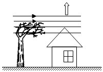

- A. 屋顶上方空气流速大，压强小
- B. 屋顶上方空气流速小，压强大
- C. 屋内空气流速大，压强大
- D. 屋内空气流速小，压强小

【答案】A

【解析】​

## 2. 单选题（难度：简单）

用细线悬挂着的轻质塑料汤勺靠近水流时，汤勺会向水流靠拢，这是因为（    ）

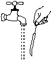

- A. 汤勺和水流之间的空气流速小，压强小
- B. 汤勺和水流之间的空气流速大，压强大
- C. 汤勺和水流之间的空气流速小，压强大
- D. 汤勺和水流之间的空气流速大，压强小

【答案】D

【解析】​

## 3. 单选题（难度：适中）

如图所示是北美草原犬鼠洞穴的横截面示意图。它有两个出口，洞口\( A\)表面隆起，洞口\( B\)表面平坦。则下列分析正确的是（     ）
 
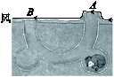

- A. 洞口\( A\)表面空气流速小，压强大
- B. 风总是从\( A\)口吹入，从\( B\)口吹出
- C. 洞口\( B\)表面空气流速大，压强小
- D. 风总是从\( B\)口吹入，从\( A\)口吹出

【答案】D

【解析】​

## 4. 单选题

一辆轿车在水平平直公路上高速行驶，如图所示（    ）

- A. 轿车上表面空气流速小
- B. 轿车上表面空气压强大
- C. 轿车对地面的压力小于重力
- D. 轿车对地面的压力等于重力

【答案】C

【解析】​

## 5. 填空题（难度：简单）

如图所示，让两张纸自由下垂，在两张纸中间向下吹气，结果发现两张纸，这表明气体流动速度越大的位置，压强。

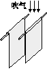

【答案】向中间靠拢，越小

【解析】​

## 6. 多选题（难度：适中）

如图所示装置，蓄水槽与一根粗细不均匀的管道相连，在管道的不同部位分别装有底部连通的竖直管\( A\)、\( B\)，管道的另一端是一个阀门。若在蓄水槽中装入一定量的水，则下列说法正确的是（     ）

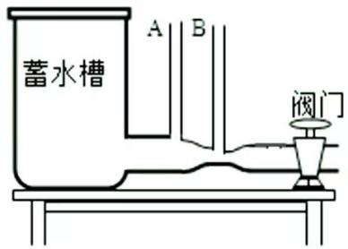

- A. 当阀门关闭，水处于静止状态时，\( A\)、\( B\)管中的水柱高度相同
- B. 当阀门关闭，水处于静止状态时，\( A\)、\( B\)管中的水柱高度不相同
- C. 当阀门打开水流动时\( A\)管中水柱比\( B\)管中水柱要高一些
- D. 当阀门打开水流动时，\( A\)、\( B\)管底部水流的速度相同

【答案】A/C

【解析】​

## 7. 填空题（难度：简单）

如图所示是机翼的模型，当飞机飞行时，迎面吹来的风被机翼分成两部分。由于机翼横截面的形状上下不对称，机翼上方气流的速度，它对机翼上表面的压强；机翼下方气流的速度，它对机翼下表面的压强。这样，机翼的上下表面就存在着压强差，从而产生向上的升力。

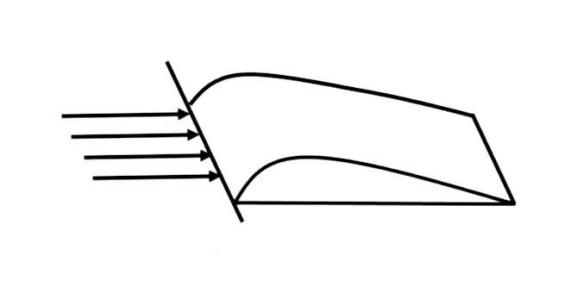

【答案】较大，较小，较小，较大

【解析】​

## 8. 单选题（难度：适中）

我国不少地方建有风力发电站，绿色环保无污染。若同时需在山上建一种简约却不易被吹飞的休息站，其独特的支架悬空形状发挥作用。下列哪个休息站的形状符合要求（    ）

- A. 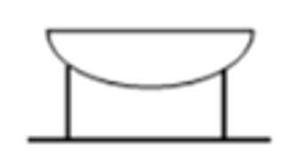
- B. 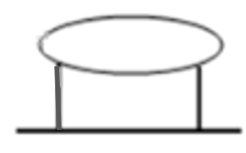
- C. 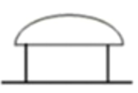
- D. 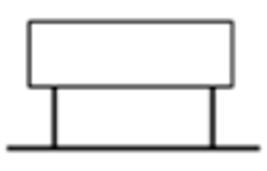

【答案】A

【解析】​

## 9. 多选题

如图所示，静止时\(U\)​形管两侧液面相平，\(U\)​形管两侧液面的情形合理的是（   ）

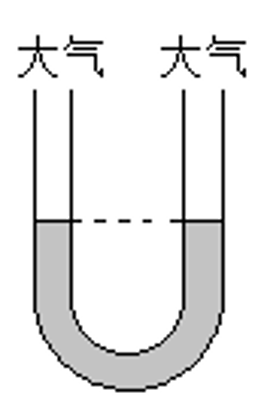

- A. 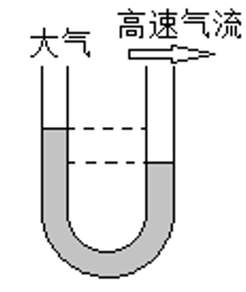
- B. 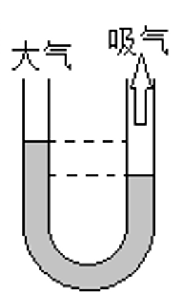
- C. 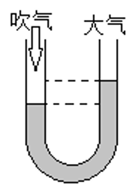
- D. 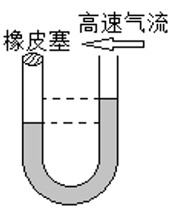

【答案】C/D

【解析】​

## 10. 填空题（难度：适中）

如图所示，向饮料管\( A\)中吹气，饮料管\( B\)中的液体会上升，并从管口喷出。这是因为气体（或液体）的压强与气体（或液体）的流速有关，气体（或液体）的流速越大的位置，压强。故当向\( A\)管吹气时，\( B\)管上方的空气流速，压强，液体就会上升并从管口喷出。

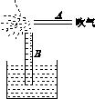

【答案】越小，增大，减小

【解析】​

## 11. 单选题（难度：适中）

无动力水翼板是一种水上运动器材，由一块冲浪板和水翼（未画出）组成，如图所示，一位重为750N的运动员站在水平的冲浪板上向前匀速滑行。 

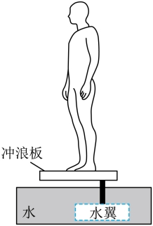
   
(1)请在图中画出冲浪板对运动员的支持力F的示意图。
(2)为了在滑行的过程中使水对水翼产生一个较大的向上的力，图中虚框内水翼形状应设计成（    ）

- A. 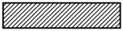
- B. 
- C. 
- D. 

【答案】B

## 12. 单选题（难度：适中）

无动力水翼板是一种水上运动器材，由一块冲浪板和水翼（未画出）组成，如图所示，一位重为750N的运动员站在水平的冲浪板上向前匀速滑行。 

   
(1)请在图中画出冲浪板对运动员的支持力F的示意图。
(2)为了在滑行的过程中使水对水翼产生一个较大的向上的力，图中虚框内水翼形状应设计成（    ）

- A. 
- B. 
- C. 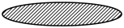
- D. 

【答案】B

## 13. 单选题（难度：适中）

下列有关压强知识的说法正确的是（    ）

- A. 马德堡半球实验首次测出大气压强值
- B. 随着大气压的减小，水的沸点会升高
- C. 用吸管将瓶中饮料吸入口中，利用了大气压
- D. 1个标准大气压的值与高度为760cm水银产生的压强大小相等

【答案】C

【解析】A．马德堡半球实验证实了大气压强的存在，故A错误；
B．随着大气压的减小，水的沸点会降低，故B错误；
C．用吸管吸饮料，吸气时管内气体压强减小，饮料在大气压作用下被压入嘴里．故C正确；
D．一标准大气压的数值等于高度差为760mm水银柱产生的压强，故D错误．

## 14. 单选题（难度：适中）

下列有关生产和生活中的应用解释正确的是

- A. 斧头具有很薄的刃，是为了增大压力
- B. 用吸管吸饮料，利用了大气压
- C. 风筝能在空中飞行，是因为受到空气的浮力
- D. 拉杆箱下安装轮子，是通过减小受力面积减小摩擦

【答案】B

【解析】A．斧头具有很薄的刃，是在压力一定时，减小受力面积来增大斧头对物体的压强，故A错误；
B．用吸管吸饮料时是在大气压的作用下把饮料吸入人的口腔，是利用了大气压，故B正确；
C．风筝是利用风筝上下方空气的流速不同产生的升力升空的，不是因为受到空气的浮力，故C错误；
D．拉杆箱下安装轮子，是用滚动代替滑动来减小摩擦力，故D错误．

## 15. 单选题（难度：适中）

水是人类生存的最重要资源之一，下列关于水的相关数据中错误的是（　　）

- A. 用量筒量1L的水，它的质量就是1kg
- B. 声音在15℃ 水中1s传播的路程是340m
- C. 水可以在 90℃ 沸腾
- D. 体积相同的水在0℃ 和10℃ 时的质量比4℃ 时的小

【答案】B

【解析】A．水的密度ρ水=1.0×10³kg/m³，则1L水的质量为
\( m={\rho }_{\text{水}}V=\text{1}{\text{.0×10}}^{\text{3}}{\text{kg/m}}^{\text{3}}{{\text{×1×10}}^{\text{﹣}}}^{\text{3}}{\text{m}}^{\text{3}}\text{=1kg}\) 
故A正确，不符合题意；
B．声音在15℃ 的空气中的传播速度是340m/s，在水中要比在空气中传播速度更快，故B错误，符合题意；
C．水的沸点受气压的影响，气压越小，沸点越低，当气压很低时，水可以在90℃ 沸腾，故C正确，不符合题意；
D．水有反常膨胀的特点，水在4℃ 时的密度最大，由\( \rho =\frac{m}{V}\)可知，相同体积的水在0℃ 和10℃ 时的质量比4℃ 时的小，故D正确，不符合题意。
故选B。

## 16. （难度：适中）

火车进站时，人若越过安全线，有可能被吸进铁道，发生危险，因此在火车站台上候车的乘客应站在安全线外，因为火车通过时，人体与车辆之间的（　　）
A．空气流速快，压强减小  
B．空气流速慢，压强增大
C．空气流速慢，压强减小  
D．空气流速快，压强增大

【答案】

A

【解析】火车通过时，人体与车辆之间的空气流速快，压强减小，小于安全线外的大气压，若乘客站在安全线内，在大气压作用下，乘客会被推进车轨，因此火车站台上候车的乘客应站在安全线外，故A符合题意，BCD不符合题意。
故选A。

## 17. 单选题（难度：适中）

1．下列各种应用与其涉及的主要物理知识，错误的是（　　）

- A. 举重运动员涂镁粉——增大摩擦力
- B. 塑料挂衣钩能贴在墙上挂衣服——利用大气压强作用
- C. 拦河大坝上窄下宽——液体压强随深度增加而增大
- D. 飞机能靠机翼的升力升起来——利用物体的惯性

【答案】D

【解析】A．举重运动员涂镁粉，是为了增大了接触面的粗糙程度，故A正确，不符合题意；
B．塑料挂衣钩能贴在墙上挂衣服是利用大气压的作用把塑料挂钩仅仅贴在墙上，故B正确，不符合题意；
C．拦河大坝上窄下宽，是因为液体内部的压强随深度的增加而增大，为了能承受更大的压强，下面更宽，故C正确；不符合题意；
D．在气体和液体中，流速越大的位置，压强越小；飞机的机翼做成上面凸起，下面平直，飞机在飞行时，机翼上方的空气流速大，压强较小，机翼下方的空气流速小，压强大，所以飞机受到一个向上的升力，故D错误；符合题意。
故选D。

## 18. 单选题（难度：适中）

日常生活中有很多现象都与我们学习过的物理知识有关。下列说法正确的是（　　）

- A. 自行车前后轮安装在滚动轴承上，可以增大摩擦
- B. 投掷出去的铅球在空中飞行的过程中，运动员对铅球做了功
- C. 用吸管把饮料吸到嘴里，是利用了大气压
- D. 开着的窗户在外面有风时窗帘向外飘，是因为流速越大的地方压强越大

【答案】C

【解析】A．自行车前后轮安装在滚动轴承上，是通过变滑动摩擦为滚动摩擦来减小摩擦，故A错误；
B．做功包括两个必要因素：作用在物体上的力、物体在力的作用下通过的距离；铅球空中飞行是由于惯性，只有距离，没有力，故这种情况没有做功，故B错误；
C．将管中的空气吸走，吸管中的气压减小，饮料在外界大气压的作用下沿吸管上升而进入口中，利用的是大气压强，故C正确；
D．开着的窗户在外面有风时窗帘向外飘，是因为流速越大的地方压强越小，故D错误。
故选C。

## 19. 单选题（难度：适中）

下面是一些生活中的实例，对其应用物理知识的解释正确的是（　　）

- A. 飞艇可以悬停在空中，利用了飞艇受到的浮力大于它受到的重力
- B. 护士用注射器给病人注射药液时，利用了大气压强的作用
- C. 飞机机翼受到升力，利用了气体流速越大的位置压强越大
- D. 茶壶的壶嘴和壶身内的水静止时水面相平，利用了连通器的原理

【答案】D

【解析】A．飞艇可以悬停在空中，利用了飞艇受到的浮力等于它受到的重力，故A错误；
B．用注射器给病人注射药液是利用人的推力产生的压强作用，不是大气压的作用，故B错误；
C．飞机的机翼上方突起，下方平直，这样的结果决定了当飞机启动后，机翼上方空气流速快，空气压强小，空气压力方向向下；机翼下方空气流速慢，空气压强大，空气压力方向向上，两个压力形成一个向上的合力，当合力达到一定程度后，飞机就可以腾空而起，故C错误；
D．茶壶是一个上端开口、底部连通的容器，静止时水面相平，利用了连通器的原理，故D正确。
故选D。

## 20. 单选题（难度：适中）

下列说法中正确的是（　　）

- A. 运动的物体比静止的物体惯性大
- B. 重力方向始终竖直向下
- C. 流体在流速大的地方压强大
- D. 分子间只存在相互作用的引力

【答案】B

【解析】A．惯性大小只与物体的质量有关，质量越大，惯性越大，与物体的运动状态无关，故A错误；
B．物体由于地球的吸引而受到的力是重力，重力的方向始终是竖直向下的，故B正确；
C．流体流速大的地方压强小，故C错误；
D．分子间同时存在相互作用的引力和斥力，故D错误。
故选B。

## 21. 单选题（难度：适中）

如图是某同学分析飞机如何获得升力时所画的示意图。下列说法正确的是（　　）

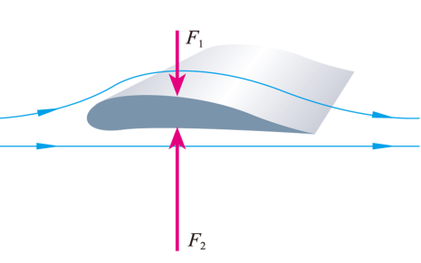

- A. 飞机获得升力利用了流体流速大的位置压强大的原理
- B. 根据机翼上凸下平分析出机翼上方空气流速大
- C. 根据所知原理可推理出机翼下方空气压强小
- D. 机翼受到空气向上的压力小于向下的压力

【答案】B

【解析】A．根据流体压强与流速的关系，流速越大的位置，压强越小。飞机获得升力利用了流体流速大的位置压强小的原理。故A错误；  
B．观察机翼的形状，机翼上方是凸起的，而下方是平的。当飞机飞行时，机翼上方的空气需要流经更长的路程，所以流速会相对较大。因此，根据机翼上凸下平的形状，我们可以分析出机翼上方空气流速大。故B正确； 
C．飞机机翼上凸下平，机翼上方空气流速大，压强小。机翼下方空气流速小，所以压强相对较大。故C错误； 
D．飞机获得升力的原因，是机翼下方空气对机翼向上的压强大于上方空气对机翼向下的压强，所以机翼受到空气向上的压力大于向下的压力，这个压力差使飞机获得向上的升力。故D错误。
故选B。

## 22. 单选题（难度：适中）

以下几个验证性小实验，其中有错误的是（   ）

- A. 在烧杯中装满水，用硬纸覆盖在杯口，倒置后，发现水流不出来，说明存在大气压强
- B. 向两张自由下垂的纸片中间吹气，发现两纸向中间靠拢，说明流速越大的位置压强越大
- C. 将滚摆卷到最高处后松手，发现滚摆在下降的时候旋转的速度越来越快，说明滚摆在下降时，将重力势能转化为动能
- D. 对手哈气，感到手变热，说明热传递可以改变内能

【答案】B

【解析】A. 将玻璃杯盛满水，杯口盖上纸片倒置过来，水排出了杯子内的空气，在大气压的作用下纸片掉不下来，说明了大气压强的存在，故A正确；B. 向两张纸中间吹气时，纸中间的空气流动速度大，压强小，纸两侧的空气流动速度不变，压强不变，纸两侧的压强大于纸中间的压强，把纸压向中间；故B错误；C. 滚摆在从高处下降的过程中，发现越滚越快，速度增大，高度降低，重力势能转化为动能；故C正确；D. 对手哈气，感到手变热，这是通过热传递的方式改变物体的内能，故D正确．故选B.

## 23. 单选题（难度：适中）

如图所示，小明将a、b两张纸悬挂起来，把两只吹风机分别置于纸的外侧。当吹风机同时竖直向下吹风时，会发生的现象是（　　）

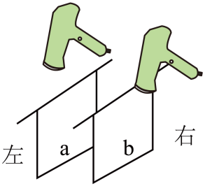

- A. a、b的下部同时向左侧飘动
- B. a、b的下部同时向右侧飘动
- C. a的下部向左侧飘动，b的下部向右侧飘动
- D. a、b的下部同时向中间靠拢

【答案】C

【解析】气体压强与流速的关系是：流速越大，压强越小；流速越小，压强越大。在两张纸的外侧向下吹气，两纸中间的空气流速小，压强大；而两纸的外侧空气流速大，压强小，两纸受到向外的压强差，所以两张纸将相互“远离”，a的下部向左侧飘动，b的下部向右侧飘动。
故选C。

## 24. 单选题（难度：适中）

下列的四种装备在启动时主要是利用流体压强与流速关系而获得升力的是（　　）

【答案】A

## 25. 单选题（难度：适中）

如图所示，将汽车模型放在风洞中，固定在水平地面不动，让风（流动的空气）高速地迎着汽车模型吹，模拟汽车在空气中高速运动的情景。在此情景中，下列说法正确的是（　　）

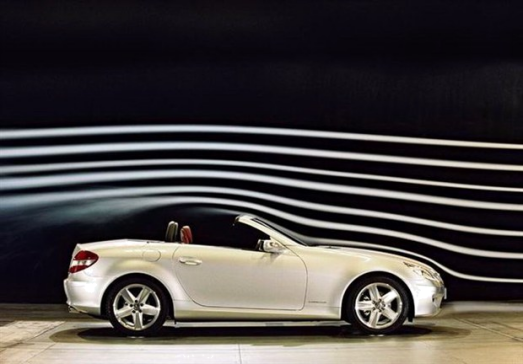

- A. 汽车模型上方的气体流速小，压强小
- B. 汽车模型下方的气体流速大，压强大
- C. 降低风速，汽车模型对地面的压力增大
- D. 提高风速，汽车模型对地面的压力增大

【答案】C

【解析】AB．流速大的地方压强小。汽车模型上方的气流相对于下方的气流在相同时间内走过的距离大，流速快。因此汽车模型上方的气体流速大，压强小。故AB错误；
CD．流速大的地方压强小。提高风速，汽车模型受到的升力增大，对地面的压力减小；降低风速，汽车模型受到的升力减小，对地面的压力增大。故C正确，D错误。
故选C。

## 26. 单选题（难度：适中）

如图所示，C919国产大飞机首度服务2024年春运。下列说法正确的是（　　）

- A. 起飞时，飞机在跑道上加速滑行时惯性逐渐增大
- B. 飞机在上升过程中，舱外的大气压会变小
- C. 机翼是利用气体流速大，压强大的原理获得升力
- D. 飞机座椅设计得很柔软，是为了减小乘客对座椅的压力

【答案】B

【解析】A．惯性的大小与质量有关，与速度无关，故惯性不变，故A错误；
B．大气压强与高度有关，高度越高气压越低，飞机在上升过程中，高度变大，舱外的大气压会变小，故B正确；
C．液体压强与流速有关，机翼是利用气体流速大，压强小的原理获得升力，故C错误；
D．飞机座椅设计得很柔软，很容易发生形变，人坐上去后，受力面积较大，是为了减小乘客对座椅的压强。故D错误。
故选B。

## 27. 单选题（难度：适中）

如图所示，是我国自主研发的C919商用大飞机。关于客机的相关物理知识下列说法正确的是（　　）

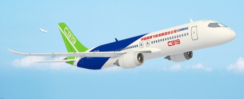

- A. 客机所在高空的大气压强，比海平面附近的大气压强更大
- B. 客机采用密度大的材料，可以减轻它受到的重力
- C. 客机升空利用了“空气流速大的地方压强小”的原理
- D. 客机在加速起飞阶段，受平衡力作用

【答案】C

【解析】A．大气压随海拔的升高而降低，故客机所在高空的大气压强，比海平面附近的大气压强更小，故A选项错误；
B．客机采用密度小的材料，减轻它受到的重力，故B选项错误；
C．客机升空运用了空气流速大，压强小，产生向上的升力，故C选项正确；
D．客机在加速时，运动状态在变化，故其不是受平衡力的作用，故D选项错误。
故选C。

## 28. 单选题（难度：适中）

下列与图中所给现象原理不同的是（   ）

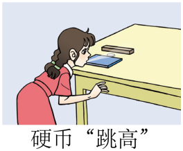

- A. 火车站台都有安全线，乘客应站在安全线外．
- B. 乒乓球运动员能够打出各种弧旋球．
- C. 用塑料管能将瓶内饮料吸入口中．
- D. 春天是放风筝，美丽的风筝在大风中升上了高空．

【答案】C

【解析】硬币跳高利用的物理原理是流体压强与流速的关系：流速大的地方压强小，流速小的地方压强大；
A. 火车站台都有安全线，乘客应站在安全线外，包含流体压强与流速的关系，不符合题意．
B. 乒乓球运动员能够打出各种弧旋球，利用流体压强与流速的关系，不符合题意．
C. 用塑料管能将瓶内饮料吸入口中，利用了大气压强，符合题意．
D. 春天是放风筝，美丽的风筝在大风中升上了高空，利用了流体压强与流速的关系，不符合题意．

## 29. 单选题（难度：适中）

（本题正文受平台版权限制，题干见下方预览图：下列关于压强的说法正确的是（_）

）

## 30. 单选题（难度：适中）

关于下列四幅图中说法正确的是（　　）

【答案】A

## 31. 单选题（难度：适中）

小湖同学通过平时观察发现如下现象，其中表述正确的是（　　）

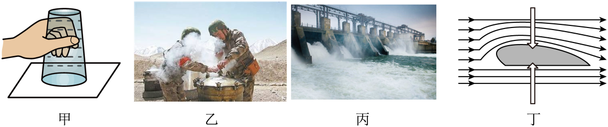

- A. 如图甲，“覆杯实验”时，在杯子装满水，纸片不会掉下来，这是水对纸片的吸附作用
- B. 如图乙，青藏高原边防战士用高压锅煮面条，是因为海拔越高，大气压越大，水的沸点越高
- C. 如图丙，拦河大坝“上窄下宽”，是为了能够承受水深处的较大的压强
- D. 如图丁，飞机获得升力是因为其上表面空气流速大，导致空气压强大

【答案】C

【解析】A．如图甲，“覆杯实验”是因为大气压托住了杯中的水和纸片，要求杯内没有空气只有水，且杯内水柱产生压强远小于外界的大气压，故A错误； 
B．青藏高原海拔高，气压低，水的沸点低，边防战士用高压锅煮面条，是为了增大锅内气压来提高水的沸点，故B错误； 
C．拦河大坝上窄下宽，是因为液体内部的压强随深度的增加而增大，拦河大坝“上窄下宽”，为了能够承受水深处的较大的压强，故C正确；
D．如图丁，飞机获得升力是因为其上表面空气流速大，空气压强小，下表面空气流速小，空气压强大，形成向上的压力差，故D错误。
故选C。

## 32. 单选题（难度：适中）

如图所示生活中蕴含着丰富的物理知识，下列分析正确的是（　　）

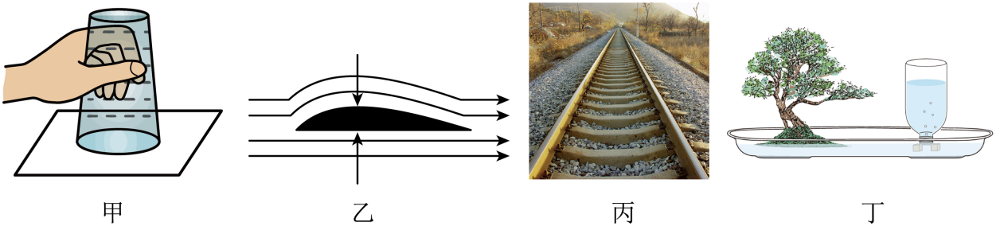

- A. 图甲覆杯实验证明了大气压的存在
- B. 图乙飞机升空主要是机翼上表面的流速小，压强小
- C. 图丙铁轨下面铺放枕木，通过减小受力面积增大压强
- D. 图丁盆景自动供水装置是液体压强使水不会全部流掉而能保留在塑料瓶中

【答案】A

【解析】A．覆杯实验中，水杯倒置后，水杯中的水不会流出，这是因为大气压强对水杯底部有一个向上的压力，这个压力抵消了水的重力，使得水不会流出，这个实验直接证明了大气压的存在，故A正确；
B．飞机升空的原理是伯努利原理，即流体流速大的地方压强小，流速小的地方压强大。飞机机翼的上表面是弯曲的，下表面是平的，当空气流过机翼时，上表面的空气流速快，压强小，下表面的空气流速慢，压强大，从而产生向上的升力，故B错误；
C．铁轨下面铺放枕木的目的是通过增大受力面积来减小压强，从而保护路基，防止铁轨陷入泥土中，故C错误；
D．盆景自动供水装置的原理是大气压强。当瓶口被水封住后，瓶内水面上方的气压较低，外界大气压大于瓶内气压，从而使得水不会流出，这不是液体压强的作用，故D错误。
故选A。

## 33. 填空题（难度：适中）

“清风不识字，何故乱翻书”所述清风能翻书，是风使书页上表面空气流速变大，导致书页上表面压强（选填“增大”或“减小”）；“闻其声，不见其人”主要是通过人发出声音的（选填“音调”、“响度”或“音色”）来判断“其人”的；“秋风瑟瑟天气凉，草木摇落露为霜”，“霜”的形成过程要（选填“吸收”或“放出”）热量。

【答案】减小，音色　　，放热

【解析】[1]流速越快的地方，流体压强越小。风吹过书页的上表面时，使书表面上空气流动速度增大，而导致书上表面压强减小，而书页下表面的压强不变，在上下压强差的作用下，书页会向上翻，故有“清风不识字、何故乱翻书”之说。
[2]音色反映的是声音的品质与特色，它跟发声体的材料和结构有关。因为每个人的声带结构不同，所以发出声音的音色就会不同，所以我们可以通过音色辨别是谁。
[3]霜是水蒸气遇冷放热凝华成的固态冰，霜的形成过程要放热。

## 34. 填空题（难度：适中）

在火车站或地铁站的站台上，离站台边缘1m左右的地方标有一条安全线，人必须站在安全线以外的位置上候车，这是因为列车驶过时，其两侧空气流动速度，气压，人靠近时容易被压向列车而发生危险．

【答案】快，　

【解析】人离火车太近，火车开动时，使人和火车之间的空气流动速度快，压强变小，离站台远的地方气体相对流速较慢，压强较大，人在内外压强差的作用下，被强大的气流压向列车，从而造成危险．

## 35. 填空题（难度：适中）

我国“歼15”舰载机已在“辽宁舰”上成功起降，飞机在起飞的时候利用了（选填“二力平衡的条件”或“流体压强与流速的关系”）；舰载机往航母甲板上降落后仍然继续高速滑行，这是由于的缘故。

【答案】流体压强与流速的关系，　惯

【解析】[1][2]飞机在起飞的时候，根据流体压强与流速的关系，机翼上方空气流速快，压强小，机翼下方空气流速慢，压强大，这样就使舰载机产生了一个向上的升力，使飞机起飞；舰载机往航母甲板上降落后仍然继续高速滑行，这是由于舰载机具有惯性，仍要保持原来的运动状态不变。

## 36. 填空题（难度：适中）

如图所示，若在蓄水槽中装入一定量的水，蓄水槽与一粗细不均匀的管道相连，在管道的不同部位分别装有底部连通的竖直管\( A\)、\( B\)、\( C\)．当阀门打开，水流动时，管中的水柱最低（选填“\( A\)”、“\( B\)”或“\( C\)”）．

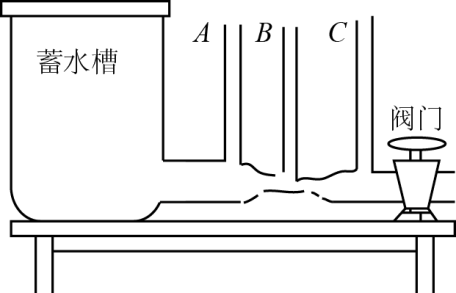

【答案】B

【解析】当阀门打开水流动，在流过的水量一定的情况下，管的横截面积越大，水流速越慢，其压强越大，水的高度越大，由于B处的水的流速最大，故该处的压强最小，水的高度最低．

## 37. 填空题（难度：适中）

图所示的装置上方为一个粗细不均匀的两头开口的玻璃管，管下连通一个装有红墨水的U形管AB。当用吹风机向玻璃管中吹风时，出现的现象是。

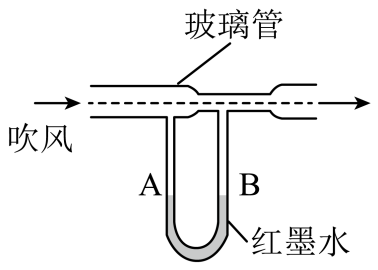

【答案】A管液面下降，B管液面上升

【解析】相同时间内，通过玻璃管的空气量是相同的；A管上方玻璃管的横截面积大，风经过A管上方的流动速度小于B管上方的流动速度，根据流体压强和流速的关系可知，A管上方的压强大于B管上方的压强，红墨水被压向B管，因此A管液面下降，B管液面上升。

## 38. 填空题（难度：适中）

如图在两张纸中间向下吹气,可以看到纸张相互,这是因为．

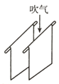

【答案】靠近，中间空气流速快、压强小

【解析】利用流体流速大压强小的特点解答问题．
当从两张纸中间向下吹气时，由于两张纸中间空气流速加快，压强变小，外侧的压强相对较大，在此压强差的作用下，会看到两张纸相互靠近．

## 39. 填空题（难度：适中）

中国海军5月2日派出辽宁舰和山东舰展开“双航母出巡”，如图是舰载机歼-15起飞时的情景，飞行时机翼上方的空气流速，压强小，使飞机获得了向上的升力。如果舰载机的质量为20t。那么一架舰载机起飞后，航母排开海水的体积将减少m³.若此时航母的吃水深度为10.1m，航母底部受到水的压强为Pa、（\( {\rho }_{\mathrm{海}\mathrm{水}}=1.0\times {10}^{3}{\text{kg/m}}^{\text{3}}\)，g取\( \text{10N/kg}\)）

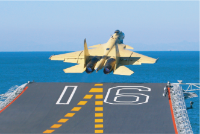

【答案】大，20　　，1.01×105

【解析】[1]舰载机飞行时机翼上方空气流速大于机翼下方空气流速，上方压强小于下方，能获得向上的压强差，从而产生向上的升力。
[2]舰载机飞离航母后，航母的总重力减小，航母始终漂浮，浮力等于重力，所以浮力会减小，减小的浮力等于舰载机的重力，航母排开海水的体积将减少
\( \Delta {V}_{\mathrm{排}}=\frac{\Delta {F}_{\mathrm{浮}}}{{\rho }_{\mathrm{海}\mathrm{水}}g}=\frac{{m}_{\mathrm{舰}\mathrm{载}\mathrm{机}}g}{{\rho }_{\mathrm{海}\mathrm{水}}g}=\frac{20\mathrm{t}}{1.0\times {10}^{3}\mathrm{k}\mathrm{g}/{\mathrm{m}}^{3}}=\frac{20\times {10}^{3}\mathrm{k}\mathrm{g}}{1.0\times {10}^{3}\mathrm{k}\mathrm{g}/{\mathrm{m}}^{3}}=20{\mathrm{m}}^{3}\mathrm{　}\mathrm{　}\mathrm{　}\)　　　　
 
[3]航母的吃水深度为10.1m，所以航母底部受到水的压强
p=ρ海水gh=1.0×10³kg/m³×10N/kg×10.1m=1.01×10⁵Pa

## 40. 填空题（难度：适中）

如图所示，将两个乒乓球放在水平桌面上，用吸管向两球中间迅速吹气，则将看到两个乒乓球向（选填“两边分开”或“中间靠拢”），理由是用吸管吹气时使两球中间空气流速变大，压强。

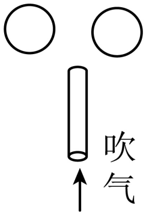

【答案】中间靠拢，变小

【解析】[1][2]当用吸管向两球中间迅速吹气时，两球中间的空气流速变大，压强会变小。两球外侧的空气流速相对较小，压强相对较大。 由于两球外侧的压强大于两球中间的压强，存在向内的压强差，这个压强差会对两球产生一个向内的压力，使得两个乒乓球向中间靠拢。

## 41. 单选题（难度：适中）

关于本题图中所示的四种情景，下列说法中正确的是

【答案】A

## 42. 填空题（难度：适中）

如图所示是“浮子流计”，用来测量气体的流速，使用时被测气体从锥形管下端流入，形成对浮子向上的冲力，浮子就会向上移动，浮子与锥形管间的空隙就会增大，空气冲力就会变小，最终浮子会稳定在某一位，当浮子稳定时，空气的冲力浮子的重力（选填“大于”“小于”或“等于”）；空气流速越大，浮子所在的位置（选填“越高”“越低”或“不变”）；若空气流速超过流计的最大测量值，需要换成体积相同，但密度更（选填“大”或“小”）的浮子．

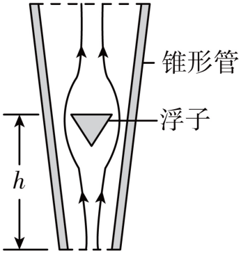

【答案】等于，越高　，大

【解析】第一空．当浮子稳定时，受重力和冲力一对平衡力的作用，平衡力大小相等，所以空气的冲力等于浮子的重力；
第二空．空气流速越大，浮子受到气流的冲力大，就会向上移动，环形空隙加大，即浮子所在的位置越高；
第三空．当空气流速过大时，即超过流计的最大测量值时，说明向上的冲力远大于重力，这时要更重的浮子才能正常工作，根据\( G=mg=\rho Vg\)可知，应换成体积相同，密度更大的浮子．

## 43. （难度：适中）

2025年1月7日，西藏日喀则市定日县突然发生里氏6.8级地震，地震发生后，西部战区的“运-20”战略运输机就带着解放军指战员和救灾物资，腾空而起直奔灾区。

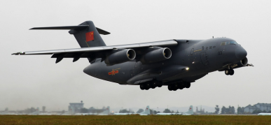

“运-20”飞行时，发动机向后喷燃气，这利用了物体间力的作用是的，此时“运-20”机翼上方空气流速大于下方空气流速，机翼上方空气压强（选填“大于”“小于”或“等于”）下方空气压强。

如图所示，“运-20”降落时，速度逐渐减慢，这是力改变了它的。

在我国的青藏高原，如果没有高压锅，“生米煮成熟饭”是不可能的，煮软了仍是夹生的，这是因为海拔越高，气压越低，沸点越。

【答案】相互/小于，运动状态，低

【解析】[1]发动机向后喷燃气，利用了物体间力的作用是相互的，燃气给发动机向前的力即“运-20”战略运输机受到向前的力而向前飞行。
[2]由于流体流速大，压强小，此时“运-20”机翼上方空气流速大于下方空气流速，机翼上方空气压强小于下方空气压强。

“运-20”降落时，受到阻力的作用，速度逐渐减慢，这是力改变了它的运动状态。

因为海拔越高，气压越低，沸点越低，所以青藏高原海拔较高，大气压较低，气压低于1标准大气压时，水的沸点就会低于100℃，所以如果没有高压锅，“生米煮成熟饭”是不可能的。

## 44. 填空题（难度：适中）

如图1所示，吸管A插入杯中，吸管B管口贴在A管上端，往B管中吹气，A管中水面将上升，这是因为A管口处气体压强变。图2是探究影响液体内部压强因素的实验装置，将金属盒向下移动，观察到U形管两边液面的高度差h变大，表明金属盒所在处水的压强变，说明了液体内部压强与有关｡

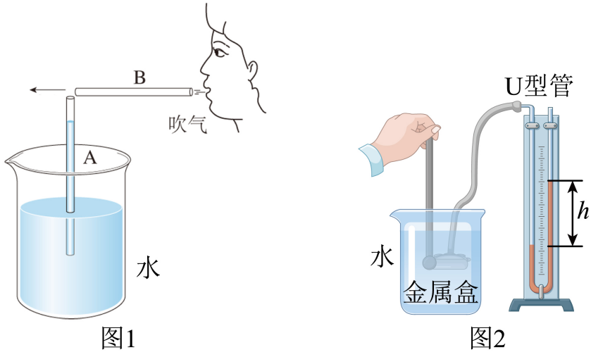

【答案】小，大　　，深度

【解析】[1]往B管中吹气，吸管A上方空气的流速增大，压强变小，在烧杯中水面上方大气压的作用下，A管水上升或有水喷出。
[2][3]金属盒浸没在水中时的深度增加，U形管两边液面的高度差变大，所以在液体密度一定时，液体越深，液体压强越大，所以液体的压强跟液体的深度有关。

## 45. 单选题（难度：适中）

如图甲所示，用绝缘细线将毛皮摩擦过的硬橡胶棒悬挂起来，再用丝绸摩擦过的玻璃棒向它靠近，会发现橡胶棒被“吸”了过来。图所示的实例中“吸”的物理原理与 橡胶棒被“吸”过来原理相同的是（     ）

【答案】A

## 46. 填空题（难度：适中）

小明用圆珠笔芯做了很多物理小实验：
（1）图甲所示，用力弯折圆珠笔芯，笔芯变形，说明力可以；
（2）图乙所示，该型号的圆柱笔芯的长度为cm；
（3）将圆珠笔芯用毛皮摩擦，发现它可以吸引物体；
（4）将圆珠笔芯笔头取下，去除里面墨水，做成吸管，将吸管一端插入水中，用手堵住另一端，可以将水移走，这是因为的作用；
（5）用圆珠笔芯做成吸管，图丙所示，在一个盛水的瓶子内插入一根吸管A，用另一根吸管B对准A的管口上方吹气，看到A的管口有水喷出，这是因为流体的流速越大，压强越。

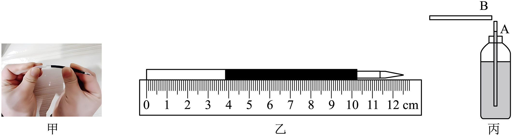

【答案】使物体发生形变，12.50，轻小，　大气压，小

【解析】（1）[1]用手指压圆珠笔芯，笔芯会弯曲，这个实验说明力可以改变物体的形状。
（2）[2]由图可知，刻度尺的分度值为0.1cm，圆柱笔芯的左端对齐零刻度线，右端对齐12.50cm，所以圆柱笔芯的长度为12.50cm。
（3）[3]将圆珠笔芯用毛皮摩擦，发现它可以吸引轻小物体，是因为圆珠笔芯与毛皮摩擦摩擦后带电，带电体有吸引轻小物体的性质。
（4）[4]当用手指堵住上端开口时，上端不再与大气相通，下端受到大气压的作用，所以水不会从下端流出，吸管中有一段水柱。
（5）[5]用吸管B对准A的管口上方吹气，，吸管A上方空气的流速增大，压强减小，A管中液体受到向上的压强大于向下的压强，液面上升，这是因为流体的流速越大，压强越小。

## 47. 单选题（难度：适中）

对下列四个图描述正确的是（　　）

- A. 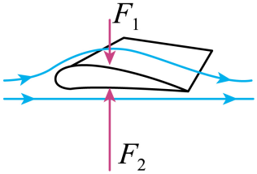
客机飞行时机翼下表面空气流速大压强大
- B. 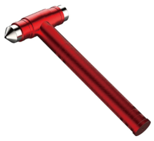
安全锤做得很尖是为了减小受力面积从而减小压强
- C. 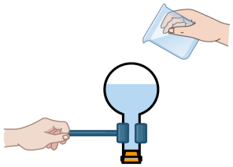
向装有沸水的烧瓶底浇冷水，可以增大水面上方的气压从而降低水的沸点
- D. 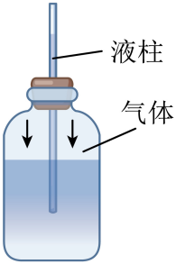
自制气压计从山脚拿到山顶，玻璃管中液柱随外界气压的减小而升高

【答案】D

【解析】A．大型客机飞行时机翼上表面空气流速大，压强小，下表面流速小压强大，产生向上的升力，故A错误；
B．安全锤做得很尖是在压力一定时，减小受力面积，从而增大压强，故B错误；
C．向盛有刚沸腾的水的烧瓶底浇冷水，使得内部水蒸气液化，内部压强减小，减小了水面上方的气压从而降低水的沸点，故C错误；
D．自制气压计瓶内压强等于外界大气压加上水柱的压强，从山脚拿到山顶，大气压减小，内部压强几乎不变，因而水柱升高，说明玻璃管中液柱随外界气压减小而升高，故D正确。
故选D。

## 48. 单选题（难度：适中）

今年三、四月份，我省迎来了几轮强风天气，某次强风袭来，一些屋顶的瓦片被掀起。下列事例中与瓦片被掀起的原理相同的是（    ）

【答案】A

## 49. 单选题（难度：适中）

如图所示的情景中利用大气压的是（　　）

- A. 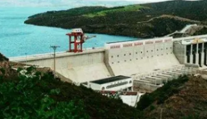
拦河坝上窄下宽
- B. 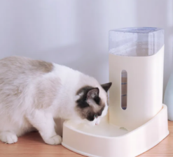
喂水器
- C. 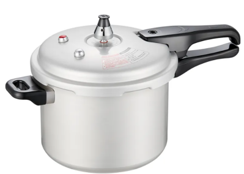
高压锅
- D. 
破窗锤

【答案】C

【解析】A．拦河坝上窄下宽，运用的是液体压强，深度越深，压强越大的特点，故A不符合题意；
B．喂水器利用的是液体压强的特点，故B不符合题意；
C．高压锅利用的是气压越大，沸点越高的特点，故C符合题意；
D．破窗锤利用的是受力面积越小，固体压强越大的原理，故D不符合题意。
故选C。

## 50. 单选题（难度：适中）

下列物理现象解释正确的是（　　）

- A. 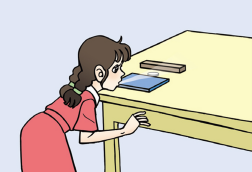
 硬币越过“栏杆”是因为空气流速越快压强越大
- B. 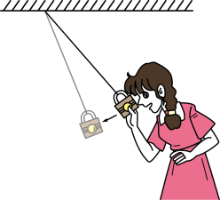
 铁锁下降时动能转化为重力势能
- C. 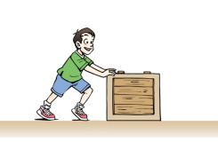
 箱子没有被推动时所受的摩擦力大于推力
- D. 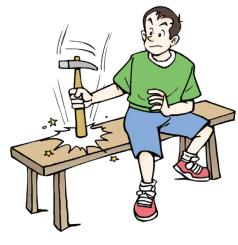
 利用惯性使锤头套紧

【答案】D

【解析】A．从硬币上方吹气时，空气流动速度增大，压强减小，小于硬币下方的压强，形成向上的压力差，所以硬币越过“栏杆”，故A错误； 
B．铁锁下降时，速度增大，高度减小，重力势能转化为动能，故B错误；
C．箱子没有被推动，箱子保持静止状态，受到平衡力的作用，水平方向上受到摩擦力和推力，二力是平衡力，大小相等，故C错误；
D．锤子的锤头松了，用锤柄撞击地面前，锤柄和锤头是运动的，撞击时，锤柄停止运动，锤头由于惯性保持原来的运动状态，紧紧地套在锤柄上，利用惯性使锤头套紧，故D正确。
故选D。

## 51. 单选题（难度：适中）

如图所示的四种飞行器，在飞行时利用流体压强与流速关系获升力的是（　）

- A. 
 热气球
- B. 
飞艇
- C. 
飞机
- D. 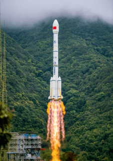
 火箭

【答案】C

【解析】A．热气球是利用热空气的密度小于冷空气的密度，热气球上升时，热气球受到的浮力大于重力，故A不符合题意；
B．飞艇内部装有氢气或氦气，密度小于空气的密度，飞艇受到的浮力大于重力而上升的，故B不符合题意；
C．飞机飞行时，飞机的机翼上方突起，机翼上方空气流速大于下方空气流速，根据流体流速越大压强越小，机翼上方空气压强小于下方压强，飞机受到向上的升力作用，故C符合题意；
D．火箭喷出燃气，火箭给燃气一个向下的力，物体间力的作用是相互的，燃气给火箭一个向上的力，推动火箭上升，故D不符合题意。
故选C。
