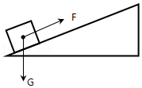

# 第一节 机械功（同步练习）

> 教材：物理·八年级全一册·沪科技版2024新教材 ｜ 来源：国家中小学智慧教育平台·在线练习 ｜ 共 3 题

## 1. 填空题（难度：简单）

正常人的心脏推动血液流动的功率约为\( \text{1.5W}\)，那么在\( \text{10}\text{s}\)内心脏做的功是 \( \text{J}\)，这些功可把一个\( \text{1kg}\)的物体匀速举高 \( \text{m}\)（\( g\)取\( \text{10N/kg}\)）.

【答案】15，1.5

【解析】​

## 2. （难度：简单）

起重机在\( \text{10s}\)内将重为\( \text{2000N}\)的石头沿竖直方向匀速提升\( \text{0.5m}\). 

求：

（1）起重机对石头做的功. 

（2）起重机提升石头的功率.

【答案】

（1）$ 1000\text{J}$；（2）$ 100\text{W}$

解：

（1）起重机对石头做的功：$ W=Fs=Gh=2000\text{N}\times 0.5\text{m}=1000\text{J}$

（2）起重机提升石头的功率：$ P=\frac{W}{t}=\frac{\text{1000J}}{\text{10s}}=100\text{W}$  

【解析】​

## 3. 填空题（难度：适中）

将一个重为\( \text{4.5N}\)的物体沿斜面从底端匀速拉到顶端（如图所示）. 已知斜面长\( \text{1.2m}\)，高为\( \text{0.4m}\)，斜面对物体的摩擦力为\( \text{0.3N}\)（物体的大小可忽略不计）. 则在上述过程中有用功为 \( \text{J}\)，额外功为 \( \text{J}\)，沿斜面向上的拉力大小为 \( \text{N}\). 

【答案】1.8，0.36，1.8

【解析】​
