# 第三节 动能和势能（同步练习）

> 教材：物理·八年级全一册·沪科技版2024新教材 ｜ 来源：国家中小学智慧教育平台·在线练习 ｜ 共 261 题

## 1. 单选题（难度：简单）

下列物体具有动能的是（   ）.

- A. 正在走进教室的同学
- B. 教室里悬挂在电线上的日光灯
- C. 静止在课桌上的物理课本
- D. 正在测物体重力的弹簧测力计

【答案】A

【解析】​

## 2. 单选题（难度：简单）

一辆大卡车和一辆小汽车以同样的速度在水平路面上行驶时，比较它们的动能大小（    ）.

- A. 大卡车的动能等于小汽车的动能
- B. 大卡车的动能大于小汽车的动能
- C. 大卡车的动能小于小汽车的动能
- D. 无法比较

【答案】B

【解析】​

## 3. 单选题（难度：适中）

如图所示，运动着的子弹能轻易射穿苹果，是因为子弹具有较大的（    ）. 

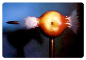

- A. 弹性势能
- B. 动能
- C. 重力势能
- D. 惯性

【答案】B

【解析】​

## 4. 单选题（难度：适中）

“珍爱生命，远离危险!”学校严禁同学们玩耍极其危险的玩具“牙签弩”，如图所示，射出的牙签能穿透易拉罐. 这说明射出的牙签具有很大的（    ）. 

- A. 动能
- B. 重力势能
- C. 弹性势能
- D. 惯性

【答案】A

【解析】​

## 5. 单选题（难度：简单）

屹立在山上的巨石给人以危险的感觉，原因是它具有较大的（    ）.

- A. 重力
- B. 高度
- C. 动能
- D. 重力势能

【答案】D

【解析】​

## 6. 单选题

如图所示，表示甲、乙两辆相同小车的\( s-t\)图像，关于这两辆小车的动能，以下判断中正确的是（    ）. 

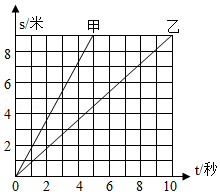

- A. 甲、乙两车的动能相等
- B. 甲车的动能大
- C. 乙车的动能大
- D. 缺乏条件，无法判断

【答案】B

【解析】​

## 7. 单选题（难度：适中）

如图是雨滴在空中下落过程中速度与时间的关系图像. 雨滴在\( {t}_{1}~{t}_{3}\)三个时刻中具有的动能分别是\( {E}_{1}\)、\( {E}_{2}\)、\( {E}_{3}\)，不考虑下落过程中雨滴的质量变化，则动能的大小关系是（    ）. 

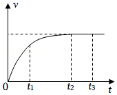

- A. \( {E}_{1}<{E}_{2}={E}_{3}\)
- B. \( {E}_{1}>{E}_{2}>{E}_{3}\)
- C. \( {E}_{1}<{E}_{2}<{E}_{3}\)
- D. \( {E}_{1}={E}_{2}={E}_{3}\)

【答案】A

【解析】​

## 8. 单选题（难度：适中）

如图，跳伞运动员在空中匀速直线下降的过程中，下列说法正确的是（    ）. 

- A. 运动员动能减小，重力势能减小
- B. 运动员动能增大，重力势能增大
- C. 运动员动能不变，重力势能减小
- D. 运动员动能减小，重力势能不变

【答案】C

【解析】​

## 9. 单选题（难度：适中）

某市为了杀灭美国白蛾调动了直升飞机，在灾区上空喷洒生物农药. 飞机在某一高度水平匀速飞行喷洒农药的过程中，飞机的（    ）.

- A. 动能不变，重力势能不变
- B. 动能减小，重力势能减小
- C. 动能减小，重力势能不变
- D. 动能增大，重力势能减小

【答案】B

【解析】​

## 10. 单选题（难度：简单）

下列物体中具有弹性势能的是（    ）.

- A. 被拉开的弹弓
- B. 压扁的橡皮泥
- C. 悬挂在天花板上的吊灯
- D. 自然伸长的弹簧

【答案】A

【解析】​

## 11. 单选题（难度：简单）

下列物体中不具有弹性势能的是（    ）.

- A. 从拉弯的弓中射出的箭
- B. 被撑杆跳运动员压弯的撑杆
- C. 被压紧的弹簧
- D. 已有示数的弹簧测力计

【答案】A

【解析】​

## 12. 单选题（难度：适中）

下列物体中：①拧紧的钟表发条；②扔在空中的橡皮；③被拉伸的弹簧；④充满气的气球；具有弹性势能的是（    ）.

- A. ①②③④
- B. ①③④
- C. 只有①
- D. 只有①③

【答案】B

【解析】​

## 13. 单选题（难度：简单）

如图所示，跳水运动员在跳板上起跳前都会猛地向下踏压一下跳板，使跳板向下弯曲，下列关于跳板向下弯曲过程中其弹性势能的说法，正确的是（    ）. 

- A. 逐渐变大
- B. 逐渐变小
- C. 保持不变
- D. 没有弹性势能

【答案】A

【解析】​

## 14. 单选题（难度：简单）

2011年3月11日，日本发生里氏9.0级地震，引发了大规模海啸，冲毁了建筑，卷走了村落，造成了大量人员伤亡，海啸具有极大破坏力的主要原因是海啸形成的海浪具有巨大的（    ）.

- A. 机械能
- B. 重力势能
- C. 动能
- D. 惯性

【答案】A

【解析】​

## 15. 单选题（难度：适中）

2022年4月20日，我国在西昌卫星发射中心用“长征三号乙”运载火箭，成功发射了第44颗北斗导航卫星. 如图所示. 这颗北斗导航卫星在随火箭加速升空过程中（    ）. 

- A. 重力势能增大，动能不变
- B. 重力势能增大，动能增大
- C. 重力势能不变，机械能增大
- D. 重力势能增大，机械能不变

【答案】B

【解析】​

## 16. 单选题（难度：简单）

在匀速飞行的鸽子和小燕子，如果它们具有相同的动能，则（    ）.

- A. 鸽子飞得快
- B. 它们飞得一样快
- C. 小燕子飞得较快
- D. 无法判断

【答案】C

【解析】​

## 17. 单选题（难度：适中）

水平匀速飞行的飞机在投放救灾物资时（    ）.

- A. 动能减小，重力势能增大
- B. 动能不变，重力势能增大
- C. 动能不变，重力势能不变
- D. 动能减小，重力势能减小

【答案】D

【解析】​

## 18. 单选题（难度：简单）

如图所示，载重卡车、电瓶车与自行车，若三种车辆速度相等，则动能最小的是（    ）. 

- A. 载重卡车
- B. 电瓶车
- C. 自行车
- D. 一样大

【答案】C

【解析】​

## 19. 单选题（难度：简单）

如图所示，苹果树上结有甲、乙、丙三个质量相同的苹果，则三个苹果中哪个苹果的重力势能最小（    ）. 

- A. 甲
- B. 乙
- C. 丙
- D. 无法判断

【答案】A

【解析】​

## 20. 单选题（难度：适中）

周末，小丽跟妈妈去千佛山游玩. 如图所示，小丽和妈妈乘坐索道匀速上山时，她们的（    ）. 

- A. 动能不变，势能减小
- B. 动能不变，势能增大
- C. 动能增大，势能减小
- D. 动能减小，势能增大

【答案】B

【解析】​

## 21. 单选题（难度：适中）

如图消毒机器人已投入抗击疫情，机器人匀速向前行驶并喷洒消毒液，此过程机器人的动能（    ）. 

- A. 不变
- B. 变小
- C. 变大
- D. 无法确定

【答案】B

【解析】​

## 22. 填空题（难度：简单）

司机开车上坡前，往往加大油门，以提高车速，这是为了增大汽车的能. 清洁车沿街道匀速行驶同时将垃圾吸入车内容器中，则它在该过程中的动能将（选填“变大”“变小”“不变”）.

【答案】动，变大

【解析】​

## 23. 填空题（难度：适中）

民以食为天. 如图所示是在收粮季节匀速前进的收割机和运粮车. 在前进收粮的过程中，运粮车的动能（填“变大”、“变小”或“不变”）. 

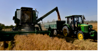

【答案】变大

【解析】​

## 24. 单选题（难度：适中）

2021年9月17日，中国“太空三人组”搭乘神舟12号返回地球. 在返回舱进入大气层后加速下落的过程中，返回舱的（    ）. 

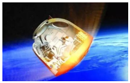

- A. 动能减小、重力势能减小
- B. 动能增大、重力势能增大
- C. 动能增大、重力势能减小
- D. 动能不变、重力势能不变

【答案】C

【解析】​

## 25. 多选题

如图为用频闪照相的方法记录下甲、乙两物（质量相同）的运动轨迹. 关于这两个物体运动时相对应的图像，分析正确的是（    ）. 

- A. 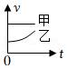
- B. 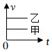
- C. 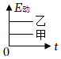
- D. 
​

【答案】B/C

【解析】​

## 26. 填空题（难度：简单）

春季我国北方某地区出现虫灾，有关部门派出飞机喷洒杀虫药，飞机在某一高度匀速飞行喷洒杀虫药的过程中，它的动能（增大/不变/减小），你判断的理由是.

【答案】减小，飞机速度不变，质量减小，动能减小

【解析】​

## 27. 填空题（难度：适中）

如图所示打桩机打桩时重锤被拉起又下落，打在桩面上，如果要把桩打得深些，可以采用的方法是（1）（2）. 

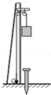

【答案】增加重锤的质量，提高重锤的高度

【解析】​

## 28. 填空题

如图所示，货架上放着\( A\)、\( B\)、\( C\)三个体积相同的实心球，其中\( A\)和\( B\)为铅球，\( C\)为铁球. 则\( B\)与\( C\)相比，的势能大. \( A\)与\( B\)相比，\( A\)球势能大的原因是 （\( {\rho }_{\text{铁}}<{\rho }_{\text{铅}}\)）. 

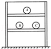

【答案】$ B$  ，$ A$和$ B$的质量相同，但$ A$的位置比$ B$高

【解析】​

## 29. 填空题（难度：适中）

如图所示，将一张卡片对折，在开口的一边剪两刀，然后将橡皮筋套在开口边，就做成了一个会“跳”的卡片. 将卡片反过来，用手压平在桌面上，使橡皮筋伸长，迅速松开手，会看到卡片，这一现象说明：发生弹性形变的橡皮筋具有能，对卡片做功. 卡片在上升过程中，重力势能将（选填“增大”“减小”或“不变”）. 

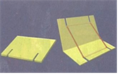

【答案】跳起，弹性势，增大

【解析】​

## 30. 填空题（难度：简单）

如图所示，当蹦床运动员从高处落下，与蹦床接触的过程中，蹦床表面发生 ，而获得能. 

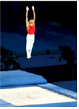

【答案】弹性形变   ，弹性势

【解析】​

## 31. 填空题

建高楼时首先要打好地基. 原来相同高度的相同地桩，经打击后某一瞬时三个地桩所处的位置如图所示. 如果\( A\)、\( B\)两锤的质量相同，则刚开始下落时，锤的高度要高一些. 如果\( B\)、\( C\)两锤刚下落时的高度相同，则​​​\(B\)​锤的质量要小一些. 打桩时，锤把地桩打的最深，\( B\)锤具有的重力势能（一定/不一定）大. 

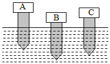

【答案】$ B$   ，$ C$ ，一定

【解析】​

## 32. （难度：适中）

炎炎夏日，雾炮车（如图所示）通过喷洒系统向空中发射颗粒极为细小的水雾，有效地起到降温作用. 正常工作时，在平直的路上匀速行驶的雾炮车的动能如何变化？依据是什么？

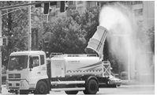

【答案】

动能变小；动能和运动的速度以及物体的质量有关 ，质量减小，所以其动能变小.

【解析】​

## 33. 

小明同学在做“探究物体的动能与什么因素有关”的实验中，设计了如图所示的实验，用一条没有弹性的细绳吊着一个实心铁球制成单摆，将一滑块放到滑槽上并使之左端刚好在悬点\( O\)的正下方，小明进行了以下三步实验操作. 
步骤一：将铁球挪到\( a\)点位置静止释放，打到滑块上，记录滑块在滑槽上移动的距离\( {s}_{1}\)；
步骤二：把滑块摆放到原处，将小球挪到\( b\)点位置静止释放，打到滑块上，记录滑块在滑槽上移动的距离\( {s}_{2}\)；
步骤三：换一等体积的实心铝球，将铝球挪到\( b\)点位置静止释放，打到摆放在原处的滑块上，记录滑块在滑槽上移动的距离\( {s}_{3}\). 

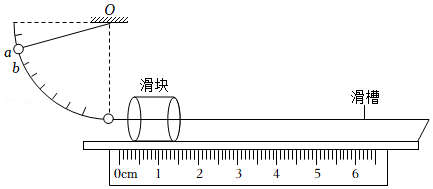

小明同学进行“步骤一”和“步骤二”的实验，是想探究动能大小与的关系.

该实验中物体的动能是指（    ）.

请你根据已学的知识判断，\( {s}_{2}\)和\( {s}_{3}\)的大小关系是：\( {s}_{2}\)  \( {s}_{3}\)（选填“大于”、“小于”或“等于”），由此可得出结论：.

物理学的研究方法有很多，本实验设计时利用了和控制变量法.

- A. 小球在撞击滑块前的平均动能
- B. 小球撞击滑块时的动能
- C. 小球撞击滑块后的动能
- D. 滑块的动能

【答案】速度，B，大于/速度相同时，物体质量越大，动能越大，转换法

【解析】​

## 34. （难度：适中）

如图所示是投掷实心球的场景（不计空气阻力），根据所学的物理知识，回答下列问题. 

​
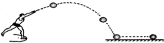

（1）实心球在空中做曲线运动上升过程中动能大小如何变化的？

（2）实心球在空中做曲线运动上升过程中势能大小如何变化的？

【答案】

（1）动能变小；

（2）重力势能变大

【解析】​

## 35. 填空题（难度：简单）

如图所示是玩弹弓的情景，经验表明，橡皮筋拉得越长，同样的“子弹”射的越远，这说明橡皮筋的弹性势能与有关. 

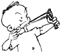

【答案】形变程度

【解析】​

## 36. 填空题（难度：适中）

小明想利用如图所示的实验装置（斜面、木块、不同质量的小钢球）“研究动能的大小与哪些因素有关”，请帮助他完成如下实验方案. 

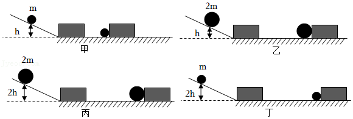

（1）实验时通过来比较动能大小. 
（2）第一次实验的情景如图甲所示，在进行第二次实验前，应先将撞出的木块. 
（3）实验中小明进行了如图甲，乙两次操作，由甲、乙两图可探究动能的大小与物体的有关.

【答案】木块被推动的距离大小，恢复到原位置，质量

【解析】​

## 37. 填空题（难度：适中）

在探究“重力势能的大小与哪些因素有关”的实验中，已知木块\( A\)、\( B\)、\( C\)质量关系为\( {m}_{A}={m}_{B}<{m}_{C}\). 三个完全相同的木桩和三个木块从不同高度处释放时的位置如图甲所示，木桩被打击后陷入沙中的情形如图乙所示，木块\( B\)、\( C\)将木桩打入沙中的深度相同. 
（1）比较木块\( A\)和\( B\)将木桩打入沙中的深度，可得：在质量一定时，物体高度越高，重力势能 选填“越大”或“越小”）. 
（2）实验时，我们可以通过观察木桩陷入沙中的来判断重力势能的大小. 此实验运用了转换法和 . 

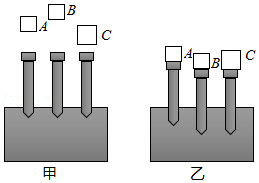

【答案】越大，深度，控制变量法.

【解析】​

## 38. 填空题（难度：适中）

如图所示，在“探究物体的动能跟哪些因素有关”的实验中，将不同金属球从斜面的某一高度由静止开始滚下，推动小木块向前移动一段距离\( s\)后停下，完成甲、乙、丙所示的三次实验. 
（1）本实验的研究对象是. （选填“小球”或“木块”）
（2）做了甲、乙、丙三次实验：让不同金属球从斜面的某一高度由静止开始滚下，碰到水平面上的物块，将物块撞出一段距离. 物块被撞击得越远，说明金属球到达水平面时的动能就越；这种比较动能大小的研究方法是. 
（3）如图丁所示是交通管理部门对不同车型设定的最高速度，由“十次车祸九次快”、“安全驾驶莫超载”可知事故的原因是超载或超速. 用甲、丙两图的实验现象所得到的结论，可以解释汽车（选填“超载”或“超速”）行驶时危险性大的原因. 

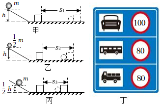

【答案】小球，大，转换法，超速.

【解析】​

## 39. 填空题

在探究“弹性势能的大小跟哪些因素有关”时，小明提出了如下猜想：
猜想一：弹性势能的大小与弹簧被压缩的程度有关；
猜想二：弹性势能的大小与弹簧的材料有关；
猜想三：弹性势能的大小与弹簧的长度有关；
猜想四：弹性势能的大小与弹簧的粗细有关. 
（1）为验证猜想一，他设计了如图所示的实验，实验时将同一弹簧压缩（相同/不同）的长度（弹簧被压缩后未超过其弹性限度），将小球置于弹簧的右端，松开后小球碰到同一位置的相同木块上，分析比较 ，从而比较弹性势能的大小. 
（2）为验证猜想二，需选用的两根弹簧，实验时将两根弹簧压缩（相同/不同）的长度，将小球置于弹簧的右端，松开后小球碰到同一位置的相同木块上，对数据进行比较分析时，若，说明弹性势能的大小与弹簧的材料有关. 
（3）若水平面绝对光滑，本实验将（能/不能）达到探究目的，原因是. 

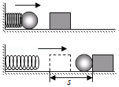

【答案】不同，木块被推动距离的远近，长度和粗细相同，材料不同，相同，木块被推动的距离不相等，不能，水平面绝对光滑，木块就会做匀速直线运动，无法比较木块移动距离的远近.

【解析】​

## 40. 填空题

某实验小组利用“模拟打桩”探究物体重力势能的大小与哪些因素有关，物体质量\( {m}_{1}={m}_{2}<{m}_{3}\)实验时，让物体从木桩正上方某一高度自由下落，将木桩打入沙中，如图. 

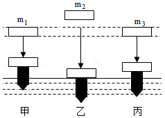

（1）物体下落过程中，可以通过比较来判断重力势能的大小，由图可判断：物体（选填“\( {m}_{1}\)”、“\( {m}_{2}\)”或“\( {m}_{3}\)”）释放前的重力势能最大；
（2）比较图甲和图丙，可探究重力势能与的关系；
（3）比较图甲和图乙，可得到的结论是；实验后，同学们联想到高空抛物是一种很不文明的行为，被称为“悬在城市上空的痛”，会带来很大的危害，因为高空的物体具有很大的能.

【答案】陷入沙坑的深度，$ {m}_{2}$，质量，质量相同，落下的位置越高，重力势能越大，重力势

【解析】​

## 41. 多选题（难度：简单）

如图是某大桥上的交通标志牌。对通过大桥的车辆限速与限重，是因为当车辆质量过大，速度过快时，车辆会有较大的（　　）

【答案】A

## 42. 多选题（难度：简单）

如图是某大桥上的交通标志牌。对通过大桥的车辆限速与限重，是因为当车辆质量过大，速度过快时，车辆会有较大的（　　）

【答案】A

## 43. 单选题（难度：简单）

如图所示，两名工人分别用<latex class="math-tex">\( {F}_{1}=300\mathrm{N}\)</latex>和<latex class="math-tex">\( {F}_{2}=200\mathrm{N}\)</latex>的力水平向右推车和拉车，则这两个力合力的大小和方向为（　　）

【答案】A

## 44. 多选题（难度：简单）

如图是某大桥上的交通标志牌。对通过大桥的车辆限速与限重，是因为当车辆质量过大，速度过快时，车辆会有较大的（　　）

【答案】A

## 45. 单选题（难度：适中）

两只完全相同的铁球从同一高度分别以相同的速度抛出，甲球竖直向上抛，乙球竖直向下抛，不考虑空气阻力的影响，两球到达地面时的动能是（    ）

- A. 甲球的大
- B. 一样大．
- C. 乙球的大
- D. 无法比较．

【答案】B

【解析】由题意可知，两球的质量相同，当两球从同一高度分别以相同的速度被抛出时，所具有的速度相同，即两球最初的机械能相同．在不考虑空气阻力的情况下，最终到达地面时，只剩下动能，根据机械能的守恒定律可知，此时的动能是相同的．

## 46. 单选题（难度：简单）

甲、乙两辆质量相同的客车，在同一条平直的公路上匀速行驶，甲车的速度为72km/h，乙车的速度为60km/h，则它们的动能大小关系为（    ）

【答案】A

## 47. 单选题（难度：简单）

下列物体中，具有动能的是（　　）

- A. 放在桌上的玻璃杯
- B. 挂在树上的苹果
- C. 正在滑雪的人
- D. 停在机场上的飞机

【答案】C

【解析】由于运动而具有的能量为动能。
A．放在桌上的玻璃杯，速度为0，没有动能，故A不符合题意；    
B．挂在树上的苹果，速度为0，没有动能，故B不符合题意；
C．正在滑雪的人，相对地面的位置发生改变，是运动的，具有动能，故C符合题意；    
D．停在机场上的飞机，速度为0，没有动能，故D不符合题意。
故选C。

## 48. 单选题（难度：简单）

体育课上，李华同学让铅球和足球在跑道上以相同的速度滚动，则（　　）

- A. 铅球的动能大
- B. 足球的动能大
- C. 铅球、足球的动能一样大
- D. 无法比较

【答案】A

【解析】铅球和足球在跑道上的滚动速度相同，但铅球的质量大于足球的质量，所以铅球的动能大。故A符合题意，BCD不符合题意。
故选A。
【点睛】此题考查动能的大小比较，难度不大，掌握动能的影响因素是关键。

## 49. 单选题（难度：适中）

如图所示质量不同的小球从同一斜面同一高度由静止开始下滑，撞击静止在水平面上的纸盒，甲球将纸盒推动的更远，水平面的粗糙程度也相同，关于该实验，下列判断正确的是（　　）
   
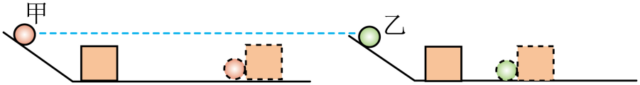

- A. 本实验是研究动能大小与速度的关系
- B. 根据现象可以推知甲球到达水平面时的速度较大
- C. 根据现象可以推知甲对纸盒做的功较多
- D. 如果甲乙从不同高度静止滚下，则不能判断甲乙到达水平面时具有动能多少

【答案】C

【解析】A．质量不同的小球从同一斜面同一高度由静止开始下滑，是为了控制到达水平面时的速度相同，而球的质量不同，实验探究的是动能大小与物体质量的关系，故A错误；
B．根据甲球将纸盒推得更远这一实验现象，只能推出甲球到达水平面时具有的动能更大，而动能大小与质量有关，两球质量不同，不能推知甲球到达水平面时的速度较大这一结论，故B错误；
C．实验中利用球将纸盒推动的距离来反映球对纸盒做功的多少，这是转换法。甲球将纸盒推得更远，说明甲球对纸盒做功更多。故C正确；
D．甲乙从不同高度静止滚下，只要比较两球将纸盒推动的距离即可比较甲乙到达水平面时具有动能的多少。能将纸盒推得越远，说明该球对纸盒做功多，该球到达水平面时具有的动能就大。故D错误。
故选C。

## 50. 单选题（难度：适中）

2024年8月，我国运动员郑钦文夺得巴黎奥运会网球女单冠军。如图是某次网球落地后又弹起的频闪照片，A、C两点高度相同。分析可知（　　）

【答案】A

## 51. 单选题（难度：简单）

如图所示，小朋友荡揪千，从A点经过B点再到达C点的过程中，比较A、B、C三点的动能（　　）

【答案】A

## 52. （难度：简单）

“蹦极”被称为“勇敢者的游戏”，如图所示，人将一根有弹性的绳子系在身上，另一端固定在跳台上。人从跳台跳下，落至图中A点时弹性绳刚好被拉直，下落至图中B点时弹性绳对人的拉力与人受到的重力大小相等，图中C点是人能达到的最低点。不计空气阻力，下列说法正确的是（   ）
    
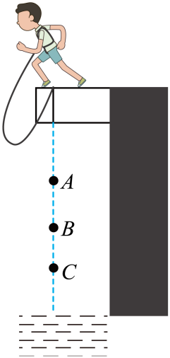

A．从A点到B点，绳子弹性势能减小
B．从A点到C点，人的动能先增大后减小
C．从B点到C点，人的重力势能转化为动能  
D．从A点到C点，人的机械能不变

【答案】

B

【解析】A．从A点到B点，弹性绳逐渐被拉长，弹性形变增大，弹性势能增大，故A错误；
B．从A点到B点，人的质量不变，人的重力大于弹性绳拉力，加速下落，动能增大；从B点到C点，弹性绳拉力大于人的重力，减速下落，动能减小，所以从A点到C点，人的动能先增大后减小，故B正确；
C．从B点到C点，人的质量不变，人的高度降低、重力势能减小，速度减小、动能减小，弹性绳弹性形变程度变大，弹性绳弹性势能变大，该过程是重力势能和动能转化为弹性绳的弹性势能，故C错误；
D．从A点到C点，弹性绳的弹性势能增大，人的机械能转化为弹性绳的弹性势能，人的机械能减小，故D错误。
故选B。

## 53. 单选题（难度：适中）

如图所示，在“探究动能大小与哪些因素有关”的实验中，使两辆相同的小车分别从不同高度由静止开始下滑，撞击静置于水平面上的木块。下列说法正确的是（　　）
     
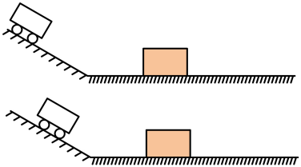

- A. 图中两辆小车的重力势能大小相等
- B. 两种情况下，木块在水平面上移动的距离相等
- C. 木块被撞击后由静止变为运动，惯性增大
- D. 如果水平面光滑，木块被撞击后将做匀速直线运动

【答案】D

【解析】A．图中两辆小车的质量相等，高度不等，则重力势能大小不等，故A错误；
B．两种情况下，小车初始重力势能不同，小车到达水平面的动能不同，小车推动木块移动的距离不同，故B错误；
C．木块被撞击后由静止变为运动，惯性与质量有关，与速度无关，质量不变，惯性不变，故C错误；
D．如果水平面光滑，木块不受摩擦力，被撞击后，木块受到的合力为0，将做匀速直线运动，故D正确。
故选D。

## 54. 单选题（难度：简单）

如图所示，载重卡车、电瓶车与自行车，若三种车辆速度相等，则动能最小的是（　　）
        
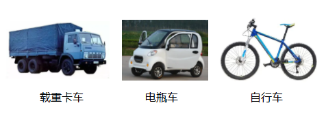

- A. 载重卡车
- B. 电瓶车
- C. 自行车
- D. 一样大

【答案】C

【解析】若三种车辆速度相等，质量小的，动能小，自行车的质量最小，故自行车的动能最小，故C正确。
故选C。

## 55. （难度：适中）

小红按照如图所示情景做了一个有趣的实验：她把一个悬挂起来的铁锁拉到自己的面前并接触鼻子，然后将铁锁由静止释放，保持头的位置不变，铁锁摆回时不会撞击她的鼻子。铁锁由接触鼻子的位置a开始，沿弧线abc向另一侧的最高点c运动的过程中，关于它的动能大小，下列说法中正确的是（　　）    A．铁锁在位置a有最大的动能  B．铁锁在位置b有最大的动能C．铁锁在位置c有最大的动能  D．铁锁在a、b、c三处的动

## 56. 单选题（难度：适中）

2010年9月27日上午，成都地铁1号线一期工程首发仪式在天府广场下沉广场举行。如图所示为一列正在减速进站的载有乘客的地铁，小李同学坐在该车的座位上。在进站过程中，对该列车和小李同学的叙述正确的是（　　）

【答案】A

## 57. 单选题（难度：适中）

邓钦文获得2024年巴黎奥运会女子网球单打冠军。如图所示是用频闪相机拍摄的网球离开球拍后在空中飞行过程的照片，下列说法正确的是（　　）
    

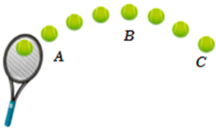

- A. 球从位置A运动到位置B的过程中动能在增大
- B. 球在最高点B处时动能不为零
- C. 球从位置B运动到位置C的过程中机械能在增大
- D. 球落地后反弹的高度一定超过B点

【答案】B

【解析】A．球从位置A运动到位置B的过程中，质量不变，速度减小，动能在减小，故A错误；
B．球在最高点B处时速度不为0，动能不为零，故B正确；
C．球从位置B运动到位置C的过程中，不断克服阻力做功，机械能在减小，故C错误；
D．球运动过程中，不断克服阻力做功，机械能不断减小，则球落地后反弹的高度一定低于B点，故D错误。
故选B。

## 58. 单选题（难度：简单）

如图所示，从A点沿水平桌面自由滚落的小球运动轨迹如虚线所示，C、F两处等高，D为球与水平地面的接触点。关于小球下列说法正确的是（　　）

【答案】A

## 59. 单选题（难度：简单）

“蹦极”被称为“勇敢者的游戏”，如图所示，人将一根有弹性的绳子系在身上，另一端固定在跳台上。人从跳台跳下，落至图中A点时弹性绳刚好被拉直，下落至图中B点时弹性绳对人的拉力与人受到的重力大小相等，图中C点是人能达到的最低点。不计空气阻力，下列说法正确的是（   ）

【答案】A

## 60. （难度：适中）

小红按照如图所示情景做了一个有趣的实验：她把一个悬挂起来的铁锁拉到自己的面前并接触鼻子，然后将铁锁由静止释放，保持头的位置不变，铁锁摆回时不会撞击她的鼻子。铁锁由接触鼻子的位置a开始，沿弧线abc向另一侧的最高点c运动的过程中，关于它的动能大小，下列说法中正确的是（　　）      A．铁锁在位置a有最大的动能  B．铁锁在位置b有最大的动能C．铁锁在位置c有最大的动能  D．铁锁在a、b、c三处

## 61. 单选题（难度：适中）

小红按照如图所示情景做了一个有趣的实验：她把一个悬挂起来的铁锁拉到自己的面前并接触鼻子，然后将铁锁由静止释放，保持头的位置不变，铁锁摆回时不会撞击她的鼻子。铁锁由接触鼻子的位置a开始，沿弧线abc向另一侧的最高点c运动的过程中，关于它的动能大小，下列说法中正确的是（　）

【答案】A

## 62. 填空题（难度：简单）

为了提高环境质量，无锡经常有喷雾车在街道上喷洒水雾。喷雾车工作时以较小的速度匀速直线行驶，此过程中喷雾车的动能___（选填“变大”“变小”或“不变”）。

## 63. （难度：适中）

（本题正文受平台版权限制，题干见下方预览图：小明在“探究物体的动能大小跟哪些因素有关“的实验中，所用钢球质量m＜M，分别从图中的位置由静止释放（h＜H）

）

## 64. （难度：适中）

图中甲是电动自行车，乙是超标车更接近于电动摩托车．符合新国标的电动自行车，是指时速25公里以下、质量55公斤以下且必须带脚蹬的电动自行车，超标车设计的速度和质量都比较大，是禁止上路的．从动能的角度分析电动自行车为什么要限制速度和质量？

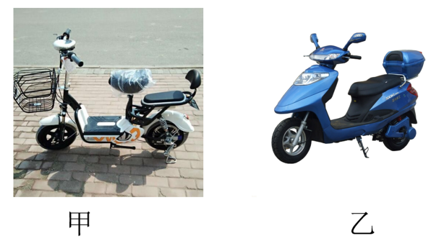

【答案】

速度和质量都比较大，则动能大，遇到紧急情况，不能及时停下，容易出现交通事故

【解析】影响动能大小的因素是质量和速度，当质量越大、速度越大时，动能会越大．
由于超标车设计的速度和质量都比较大，行驶时动能大，当遇到紧急情况时，不能在较短距离内停下，危险系数大，更容易出现交通事故，所以要限制电动自行车的速度和质量．

## 65. （难度：适中）

十次车祸九次快，安全驾驶莫超载。某兴趣小组的同学们认为车祸的危害程度与汽车的动能大小有关，于是他们设计了如图甲、乙所示的实验，来探究“动能的大小与哪些因素有关”。【证据】实验甲：让质量相同的两个小球沿同一光滑斜面分别从<latex class="math-tex">\( A\)</latex>、<latex class="math-tex">\( B\)</latex>两处由静止开始向下运动，然后

## 66. 填空题（难度：适中）

如图所示，过山车是一项惊险刺激的游戏项目，当过山车通过环形轨道最高点时，重力势能最大，动能（填“为零”或“不为零”）。
    
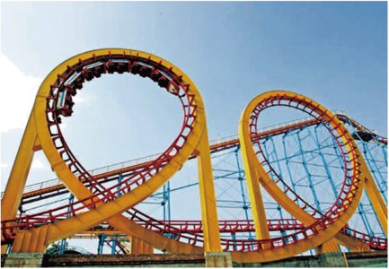

【答案】　不为零

【解析】当过山车通过环形轨道最高点时，它具有一定的速度（若速度为零，过山车会因重力下落，无法顺利通过最高点）。而动能的大小与物体的质量和速度有关，质量不变，速度不为零，所以动能不为零。

## 67. 填空题（难度：简单）

科技的发展使农业机械化水平越来越高，如图所示，这是一架飞机在水平方向匀速直线飞行给小麦喷洒农药时的情景。喷洒农药的过程中，飞机的动能（增大/减小/不变），重力势能（增大/减小/不变）。
   

【答案】　减，　减

【解析】[1][2]匀速飞行的飞机喷洒农药的过程中，其速度不变，但质量变小，所以其动能变小；同时其高度不变，质量减小，故其重力势能变小。

## 68. 填空题（难度：简单）

如图所示，小孩滑滑梯时，从滑梯的顶部匀速滑动到地面的过程中，它的动能（选填“变大”“变小”或“不变”）。
   

【答案】　不变【详解】由题意知，小孩从滑梯的顶部匀速滑动到地面过程中，质量不变，速度不变，因此动能不变。

## 69. 填空题（难度：简单）

如图所示，小孩滑滑梯时，从滑梯的顶部匀速滑动到地面的过程中，它的动能___（选填“变大”“变小”或“不变”）。

## 70. 填空题（难度：简单）

（本题正文受平台版权限制，题干见下方预览图：跳伞运动员在空中匀速下落时，其动能___；扫地车匀速前进并将地面上的落叶吸入车内，此过程中，扫地车的动能___。（均选填“增大”“减小”或“不变”）

）

## 71. 填空题（难度：适中）

甲、乙两质量相同的人，同时从同一起跑线出发，同向做匀速直线运动，某时刻他们的位置如图所示，此时甲的速度乙的速度，甲的动能乙的动能。（两个空都选填“大于”、“小于”、“等于”。）
   

【答案】　小，　小

【解析】[1]从同一起跑线出发，同向做匀速直线运动，相同的时间内，乙的路程对甲的路程大，故甲的速度大于乙的速度。
[2]质量相同时，甲的速度小于乙的速度，甲的动能小于乙的动能。

## 72. 填空题（难度：简单）

在“推断物体不受力时的运动”实验中，按下图顺序正确实验：同一小车依次从同一斜面的同一高度滑入不同水平面，最终静止。小车在三种不同水平面上受到阻力，但动能减小量（两空均选填“相同”或“不相同”）。
   

【答案】　不相，　相

【解析】[1]平面越光滑，小车受到的阻力越小，速度减小得越慢，在水平面上运动的距离越远。由图可知，同一小车依次从同一斜面的同一高度滑入不同水平面的情况下，小车分别在毛巾、棉布、木板上运动的距离不相同，所以小车在三种不同水平面上受到阻力不相同。
同一小车依次从同一斜面的同一高度滑入不同水平面，保证了小车刚刚到达三种不同水平面时的初始动能相同，最后小车都静止了，最终小车的动能都减小为零，所以动能减小量相同。

## 73. 填空题（难度：简单）

如图所示，小孩滑滑梯时，从滑梯的顶部匀速滑动到地面的过程中，它的动能（选填“变大”“变小”或“不变”）。
   

【答案】&#163;不变【详解】由题意知，小孩从滑梯的顶部匀速滑动到地面过程中，质量不变，速度不变，因此动能不变。

## 74. 填空题（难度：简单）

如图所示，小孩滑滑梯时，从滑梯的顶部匀速滑动到地面的过程中，它的动能（选填“变大”“变小”或“不变”）。
   

【答案】　不变

【解析】由题意知，小孩从滑梯的顶部匀速滑动到地面过程中，质量不变，速度不变，因此动能不变。

## 75. 填空题（难度：简单）

跳伞运动员在空中匀速下落时，其动能___；扫地车匀速前进并将地面上的落叶吸入车内，此过程中，扫地车的动能___。（均选填“增大”“减小”或“不变”）

## 76. 填空题（难度：简单）

科技的发展使农业机械化水平越来越高，如图所示，这是一架飞机在水平方向匀速直线飞行给小麦喷洒农药时的情景。喷洒农药的过程中，飞机的动能___（增大/减小/不变），重力势能___（增大/减小/不变）。

## 77. 填空题（难度：简单）

为了提高环境质量，无锡经常有喷雾车在街道上喷洒水雾。喷雾车工作时以较小的速度匀速直线行驶，此过程中喷雾车的动能___（选填“变大”“变小”或“不变”）。

## 78. 填空题（难度：简单）

如图所示，小孩滑滑梯时，从滑梯的顶部匀速滑动到地面的过程中，它的动能（选填“变大”“变小”或“不变”）。
   

【答案】　不变【详解】由题意知，小孩从滑梯的顶部匀速滑动到地面过程中，质量不变，速度不变，因此动能不变。

## 79. （难度：适中）

小明在“探究物体的动能大小跟哪些因素有关“的实验中，所用钢球质量m＜M，分别从图中的位置由静止释放（h＜H）

## 80. 填空题（难度：适中）

如图所示，过山车是一项惊险刺激的游戏项目，当过山车通过环形轨道最高点时，重力势能最大，动能（填“为零”或“不为零”）。
    

【答案】　不为零

【解析】当过山车通过环形轨道最高点时，它具有一定的速度（若速度为零，过山车会因重力下落，无法顺利通过最高点）。而动能的大小与物体的质量和速度有关，质量不变，速度不为零，所以动能不为零。

## 81. 填空题（难度：适中）

甲、乙两质量相同的人，同时从同一起跑线出发，同向做匀速直线运动，某时刻他们的位置如图所示，此时甲的速度___乙的速度，甲的动能___乙的动能。（两个空都选填“大于”、“小于”、“等于”。）

## 82. 填空题（难度：简单）

科技的发展使农业机械化水平越来越高，如图所示，这是一架飞机在水平方向匀速直线飞行给小麦喷洒农药时的情景。喷洒农药的过程中，飞机的动能___（增大/减小/不变），重力势能___（增大/减小/不变）。

## 83. 填空题（难度：简单）

科技的发展使农业机械化水平越来越高，如图所示，这是一架飞机在水平方向匀速直线飞行给小麦喷洒农药时的情景。喷洒农药的过程中，飞机的动能（增大/减小/不变），重力势能（增大/减小/不变）。
   
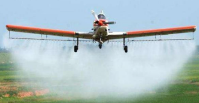

【答案】　减，　减

【解析】[1][2]匀速飞行的飞机喷洒农药的过程中，其速度不变，但质量变小，所以其动能变小；同时其高度不变，质量减小，故其重力势能变小。

## 84. 填空题（难度：简单）

科技的发展使农业机械化水平越来越高，如图所示，这是一架飞机在水平方向匀速直线飞行给小麦喷洒农药时的情景。喷洒农药的过程中，飞机的动能___（增大/减小/不变），重力势能___（增大/减小/不变）。

## 85. 填空题（难度：简单）

为了提高环境质量，无锡经常有喷雾车在街道上喷洒水雾。喷雾车工作时以较小的速度匀速直线行驶，此过程中喷雾车的动能（选填“变大”“变小”或“不变”）。

【答案】变小

【解析】喷雾车在水平路面上工作时将水雾喷洒出车外，水的质量变小，喷雾车的整体质量变小；喷雾车工作时以较小的速度匀速直线行驶，速度不变。喷雾车的速度不变，质量变小，故此过程中喷雾车的动能变小。

## 86. 填空题（难度：简单）

跳伞运动员在空中匀速下落时，其动能；扫地车匀速前进并将地面上的落叶吸入车内，此过程中，扫地车的动能。（均选填“增大”“减小”或“不变”）

【答案】不变，增大

【解析】[1]跳伞运动员在空中匀速下落时，由于速度和质量不变，故其动能不变。
[2]扫地车在平直的路面上匀速前进并将地面上的落叶吸入车内，此过程中，由于车的质量变大，速度不变，故扫地车的动能增大。

## 87. 填空题（难度：简单）

如图所示，小孩滑滑梯时，从滑梯的顶部匀速滑动到地面的过程中，它的动能___（选填“变大”“变小”或“不变”）。

## 88. 填空题（难度：简单）

科技的发展使农业机械化水平越来越高，如图所示，这是一架飞机在水平方向匀速直线飞行给小麦喷洒农药时的情景。喷洒农药的过程中，飞机的动能（增大/减小/不变），重力势能（增大/减小/不变）。
   

【答案】减小，减小

【解析】[1][2]匀速飞行的飞机喷洒农药的过程中，其速度不变，但质量变小，所以其动能变小；同时其高度不变，质量减小，故其重力势能变小。

## 89. （难度：适中）

小明在“探究物体的动能大小跟哪些因素有关“的实验中，所用钢球质量m＜M，分别从图中的位置由静止释放（h＜H）

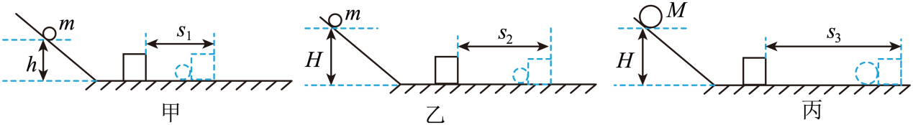

实验中，小明是通过来比较铜球动能大小的，这种研究方法是（选填“控制变量法”或“转换法”）。

木块被钢球撞出一段距离后停了下来，这是因为木块受到的作用；若水平面是光滑且足够长的，木块被撞后将做（选填“匀速”或“变速”）直线运动。

根据甲、丙两次实验，（选填“能”或“不能”）得出结论：物体的动能大小与质量有关，原因是。

汽车行驶过程中为了保证安全，需要限速，能说明这一原因的是两次实验，原因是：当质量一定时，越大，物体的动能越大。

【答案】木块移动的距离/转换法，阻力/匀速，不能/没有控制速度相同，甲、乙/速度

【解析】[1][2]铜球动能大小无法通过肉眼直接看出，实验中，小明是通过木块移动的距离来比较铜球动能大小的，木块移动的距离越远，铜球动能越大，这种研究方法是转换法。

[1]力可以改变物体的运动作用，木块被钢球撞出一段距离后停了下来，这是因为木块受到摩擦力的作用。
[2]若水平面是光滑且足够长的，木块被撞后，水平方向受到的合力为0，木块的运动状态不会改变，将做匀速直线运动。

根据甲、丙两次实验，木块的质量与下滑高度均不同，则木块到达水平面的速度不变，没有控制速度相同，故不能得出结论：物体的动能大小与质量有关。

[1][2]汽车行驶过程中为了保证安全，需要限速，原因是：当质量一定时，速度越大，物体的动能越大；甲乙实验控制钢球的质量相同，钢球下滑的高度不同，钢球到达水平面的速度不同，甲乙两实验能说明这一原因。

## 90. （难度：适中）

十次车祸九次快，安全驾驶莫超载。某兴趣小组的同学们认为车祸的危害程度与汽车的动能大小有关，于是他们设计了如图甲、乙所示的实验，来探究“动能的大小与哪些因素有关”。

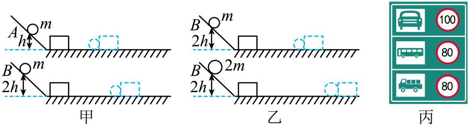

【证据】
实验甲：让质量相同的两个小球沿同一光滑斜面分别从\( A\)、\( B\)两处由静止开始向下运动，然后与水平面上的纸盒相碰，纸盒在水平面上移动一段距离后静止。
实验乙：让质量不同的两个小球沿同一光滑斜面分别从\( B\)处由静止开始向下运动，然后与水平面上的纸盒相碰，纸盒在水平面上移动一段距离后静止。
【解释】

实验中通过观察纸盒移动的距离判断（选填“小球”或“纸盒”）的动能大小。如果水平面光滑，则（选填“能”或“不能”）完成本实验。

图甲是为了探究：在相同时，动能与大小的关系。由实验现象可知，质量相同时，越大，物体的动能越大。

由图乙实验现象可得到结论：。
【交流】

图丙所示的交通标志牌是交通管理部门对不同车型设定的最高行驶速度，质量越大的车，限速越（选填“高”或“低”），主要是受到实验（选填“甲”或“乙”）结论的启示。

【答案】小球/不能，质量/速度/速度，速度相同时，质量越大，物体的动能越大，低/乙

【解析】[1]实验通过纸盒移动距离判断小球动能大小，因为小球动能越大，对纸盒做功越多，纸盒移动越远。
[2]若水平面光滑，纸盒不受摩擦力，将做匀速直线运动，不能通过纸盒移动距离判断动能，所以不能完成实验。

[1][2]图甲质量相同小球，从不同高度滑下，到达水平面时的速度不同，因此是探究质量相同时，动能与速度的关系。
[3]质量相同时，速度越大（高度越高，滑下后速度越大 ），纸盒移动越远，动能越大。

图乙小球从同一高度滑下（速度相同 ），质量不同，质量大的小球使纸盒移动远，结论：速度相同时，质量越大，动能越大。

[1]动能大小与质量、速度有关。质量大的车，限速越低，因为质量大动能大，需限制速度保障安全。
[2]受实验乙结论启示，乙探究速度相同时，质量对动能的影响，对应不同车型限速 。

## 91. 填空题（难度：适中）

如图所示，过山车是一项惊险刺激的游戏项目，当过山车通过环形轨道最高点时，重力势能最大，动能（填“为零”或“不为零”）。
    

【答案】不为零

【解析】当过山车通过环形轨道最高点时，它具有一定的速度（若速度为零，过山车会因重力下落，无法顺利通过最高点）。而动能的大小与物体的质量和速度有关，质量不变，速度不为零，所以动能不为零。

## 92. 填空题（难度：适中）

甲、乙两质量相同的人，同时从同一起跑线出发，同向做匀速直线运动，某时刻他们的位置如图所示，此时甲的速度乙的速度，甲的动能乙的动能。（两个空都选填“大于”、“小于”、“等于”。）
   
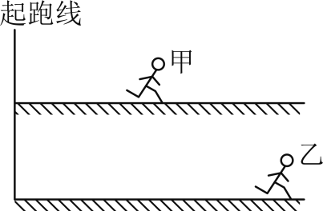

【答案】小于，小于

【解析】[1]从同一起跑线出发，同向做匀速直线运动，相同的时间内，乙的路程对甲的路程大，故甲的速度大于乙的速度。
[2]质量相同时，甲的速度小于乙的速度，甲的动能小于乙的动能。

## 93. 单选题（难度：适中）

小红按照如图所示情景做了一个有趣的实验：她把一个悬挂起来的铁锁拉到自己的面前并接触鼻子，然后将铁锁由静止释放，保持头的位置不变，铁锁摆回时不会撞击她的鼻子。铁锁由接触鼻子的位置a开始，沿弧线abc向另一侧的最高点c运动的过程中，关于它的动能大小，下列说法中正确的是（　）
      
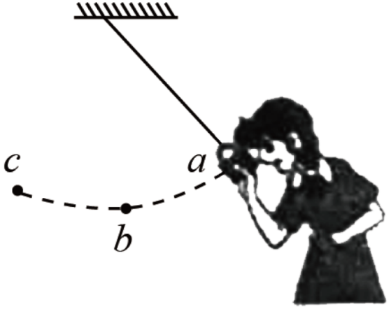

- A. 铁锁在位置a有最大的动能
- B. 铁锁在位置b有最大的动能
- C. 铁锁在位置c有最大的动能
- D. 铁锁在a、b、c三处的动能相同

【答案】B

【解析】从a→b的过程中，铁锁的质量不变，高度减小，速度增大，重力势能减小，动能增大，在b点动能最大；从b→c的过程中，铁锁的质量不变，高度增大，速度减小，重力势能增大，动能减小，在c点动能为0；铁锁从a点由静止下落，速度为0，动能为0。
故选B。

## 94. （难度：适中）

2025年11月4日，航天员对神舟二十号例行检查时，发现返回舱舷窗边缘被太空微小碎片撞击产生贯穿性裂纹。撞击造成如此严重后果，是因为微小碎片具有较大的（　）

A.质量
‎B.重力势能
‎C.动能
‎D.弹性势能

【答案】

C

【解析】动能的大小与物体的质量和速度有关。太空微小碎片虽然质量较小，但速度极大，所以具有较大的动能，能够对返回舱舷窗造成严重撞击，产生贯穿性裂纹。重力势能与物体的质量和高度有关，弹性势能与物体的弹性形变程度有关，而此次撞击后果严重主要是因为碎片的动能大，并非重力势能和弹性势能，且碎片质量较小，不是因为质量大造成严重后果。所以撞击造成如此严重后果，是因为微小碎片具有较大的动能。
‎故选C。

## 95. 单选题（难度：适中）

小红按照如图所示情景做了一个有趣的实验：她把一个悬挂起来的铁锁拉到自己的面前并接触鼻子，然后将铁锁由静止释放，保持头的位置不变，铁锁摆回时不会撞击她的鼻子。铁锁由接触鼻子的位置a开始，沿弧线abc向另一侧的最高点c运动的过程中，关于它的动能大小，下列说法中正确的是（　）

【答案】A

## 96. （难度：简单）

如图是某大桥上的交通标志牌。对通过大桥的车辆限速与限重，是因为当车辆质量过大，速度过快时，车辆会有较大的（　　）　　A．动能  B．重力势能  C．弹性势能  D．内能

## 97. （难度：简单）

如图甲所示，小南加工纸杯杯底，做成一个纸杯风车；如图乙所示，小实加工了另一纸杯并用铜丝把纸杯风车架起来，在杯底点燃蜡烛后，纸杯风车转起来。以下判断正确的是（　）　　A．转动的纸杯风车只具有动能‎B．不燃烧时，蜡烛具有的内能为零‎C．蜡烛燃烧过程中，其热值在减少‎D．纸杯风车的动能来自蜡烛的化学能

## 98. 单选题（难度：适中）

小红按照如图所示情景做了一个有趣的实验：她把一个悬挂起来的铁锁拉到自己的面前并接触鼻子，然后将铁锁由静止释放，保持头的位置不变，铁锁摆回时不会撞击她的鼻子。铁锁由接触鼻子的位置a开始，沿弧线abc向另一侧的最高点c运动的过程中，关于它的动能大小，下列说法中正确的是（　）

【答案】A

## 99. （难度：简单）

如图甲所示，小南加工纸杯杯底，做成一个纸杯风车；如图乙所示，小实加工了另一纸杯并用铜丝把纸杯风车架起来，在杯底点燃蜡烛后，纸杯风车转起来。以下判断正确的是（　）      A．转动的纸杯风车只具有动能‎B．不燃烧时，蜡烛具有的内能为零‎C．蜡烛燃烧过程中，其热值在减少‎D．纸杯风车的动能来自蜡烛的化学能

## 100. （难度：简单）

如图甲所示，小南加工纸杯杯底，做成一个纸杯风车；如图乙所示，小实加工了另一纸杯并用铜丝把纸杯风车架起来，在杯底点燃蜡烛后，纸杯风车转起来。以下判断正确的是（　）
      
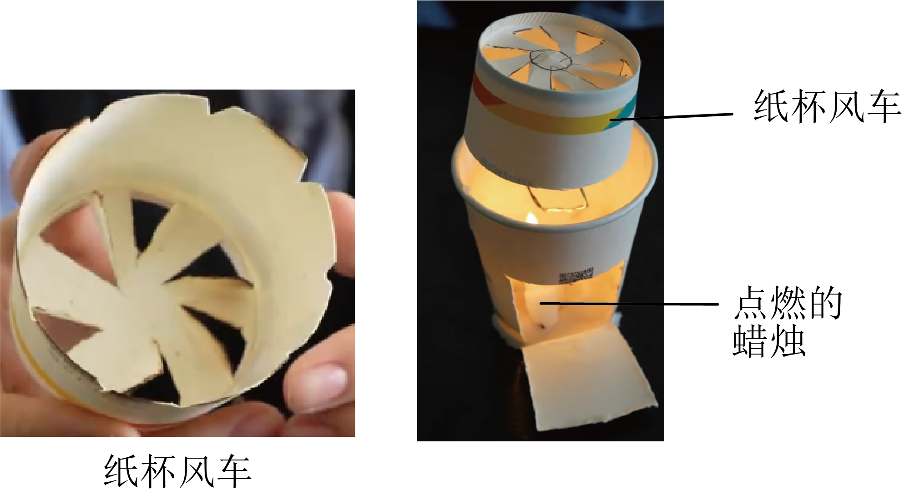

A．转动的纸杯风车只具有动能
B．不燃烧时，蜡烛具有的内能为零
C．蜡烛燃烧过程中，其热值在减少
D．纸杯风车的动能来自蜡烛的化学能

【答案】

D

【解析】A．转动的纸杯风车，因运动而具有动能，同时它具有一定的高度，也具有重力势能，故A错误；B．任何物体都具有内能，不燃烧时，蜡烛也具有内能，故B错误；C．热值是燃料的一种特性，它只与燃料的种类有关，与燃料的质量、燃烧情况等无关，蜡烛燃烧过程中，其质量在减少，但其热值保持不变，故C错误；D．蜡烛燃烧，将自身的化学能转化为内能，使周围的空气受热，密度变小而上升，形成热空气流，热空气流推动纸杯风车转动，即将空气的内能转化为风车的动能，所以，纸杯风车的动能最终来源于蜡烛的化学能，故D正确。故选D。

## 101. 单选题（难度：简单）

如图甲所示，小南加工纸杯杯底，做成一个纸杯风车；如图乙所示，小实加工了另一纸杯并用铜丝把纸杯风车架起来，在杯底点燃蜡烛后，纸杯风车转起来。以下判断正确的是（　）
      

- A. 转动的纸杯风车只具有动能
- B. 不燃烧时，蜡烛具有的内能为零
- C. 蜡烛燃烧过程中，其热值在减少
- D. 纸杯风车的动能来自蜡烛的化学能

【答案】D

【解析】A．转动的纸杯风车，因运动而具有动能，同时它具有一定的高度，也具有重力势能，故A错误；B．任何物体都具有内能，不燃烧时，蜡烛也具有内能，故B错误；C．热值是燃料的一种特性，它只与燃料的种类有关，与燃料的质量、燃烧情况等无关，蜡烛燃烧过程中，其质量在减少，但其热值保持不变，故C错误；D．蜡烛燃烧，将自身的化学能转化为内能，使周围的空气受热，密度变小而上升，形成热空气流，热空气流推动纸杯风车转动，即将空气的内能转化为风车的动能，所以，纸杯风车的动能最终来源于蜡烛的化学能，故D正确。故选D。

## 102. 单选题（难度：适中）

下列说法正确的是（　　）

【答案】A

## 103. （难度：简单）

2025年我国福建舰成功实现五代战机弹射起飞。这是为了增大战机起飞时的（ ）A．动能B．重力势能C．弹性势能D．内能

## 104. （难度：适中）

为响应“绿色环保，低碳出行”的号召，我们常骑自行车出行。骑行中若刹车减速，则（　　）
A．车的惯性减小  B．车的运动状态不变
C．车的动能减小  D．车受到的摩擦力变小

【答案】

C

【解析】A．惯性只与质量有关，与速度无关，故A不符合题意；
B．骑行中若刹车减速，速度变小，故车的运动状态发生改变，故B不符合题意；
C．骑行中若刹车减速，速度变小，质量不变，故动能减小，故C符合题意；
D．捏刹车时，车受到的摩擦力变大，故D不符合题意。
故选C。

## 105. 单选题（难度：适中）

在“探究物体动能大小与哪些因素有关”的实验中，同学们做了如图甲、乙、丙所示的三个实验，质量为m和2m的小球分别沿同一斜面按照实验要求下滑，与水平面上静止在C点的纸盒相碰，纸盒在水平面上移动一段距离后静止。下列说法中错误的是（　　）

【答案】A

## 106. （难度：适中）

如图所示，空中加油机正在给匀速水平飞行的战斗机加油，加油后战斗机仍以原来的高度和速度做匀速飞行，则战斗机的（　　）      A．动能增加，势能增加，机械能增加  B．动能不变，势能减少，机械能减少C．动能增加，势能不变，机械能增加  D．动能不变，势能不变，机械能不变

## 107. （难度：适中）

科技赋能正深刻改变着传统农业的生产方式，大大减轻了农民的负担，提高了生产效率。如图所示，一架无人机正在进行农药喷洒作业，随着农药的减少，下列情形中无人机（包括水箱和箱中农药）的机械能可能保持不变的是（　　）      A．水平向前匀速飞行B．竖直向下匀速飞行C．斜向上匀速飞行D．斜向下匀速飞行

## 108. 单选题（难度：简单）

如图所示，在“探究动能的大小跟哪些因素有关”的实验中，下列说法正确的是

【答案】A

## 109. 单选题（难度：简单）

我省首届省级冬季综合性运动会将于2026年1月至2月在榆林举行。如图所示，这是我市运动员在自由式滑雪空中技巧训练时从高空下落时的情景。在加速下落过程中，运动员的动能（　　）

【答案】A

## 110. 单选题（难度：适中）

2024年6月25日，嫦娥六号实现了中国首次月球背面无人采样返回，历时53天的史诗级无人登月采集项目取得圆满成功，令世界瞩目。返回器使用类似“打水漂”的方式着陆地球，其着陆过程的部分轨迹简化图如图所示。关于此过程（只考虑空气阻力和重力的影响），下列说法正确的是（　　）

【答案】A

## 111. （难度：简单）

2025年中国航天全年发射92次，创历史新高！如图所示，在搭载卫星的运载火箭加速升空过程中，下列有关卫星的说法正确的是（   ）      A．动能减小，重力势能增大  B．动能不变，重力势能增大C．动能增大，重力势能增大  D．动能减小，重力势能不变

## 112. 单选题（难度：简单）

2025年第九届亚洲冬季运动会在哈尔滨举行。图片所示的是我国运动员在单板大跳台比赛中的情景，运动员在空中下落过程中，他的（　　）
      
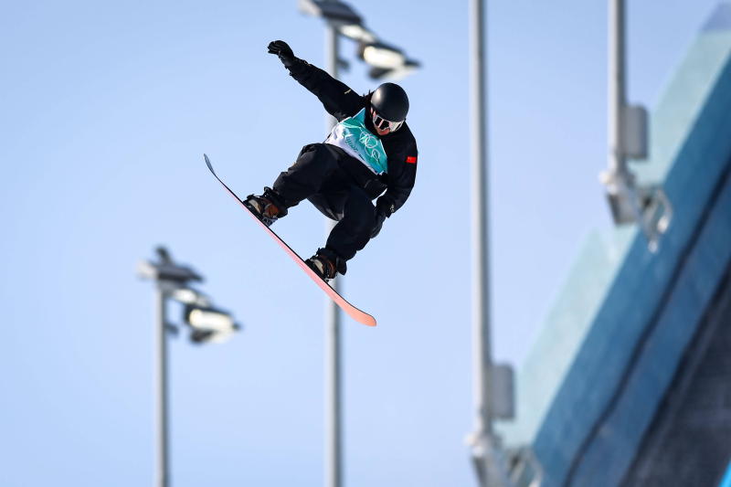

- A. 动能不变
- B. 重力势能增大
- C. 机械能增大
- D. 重力势能部分转化为动能

【答案】D

【解析】AB．运动员在空中下落过程中，质量不变，速度增大，高度减小，所以动能增大，重力势能减小，故AB错误，不符合题意；
C．由于受到空气阻力的作用，运动员的部分机械能转化为内能，机械能会减小，故C错误，不符合题意；
D．运动员在空中下落过程中，质量不变，速度增大，高度减小，所以动能增大，重力势能减小，重力势能部分转化为动能，故D正确，符合题意。
故选D。

## 113. 单选题（难度：简单）

如图，无人机已被应用于诸多领域，当无人机匀速上升时，对其分析正确的是（　　）

【答案】A

## 114. （难度：适中）

如图是人形机器人在水平路面训练的场景。有关机器人的说法不正确的是（    ）      A．加速跑时动能增大B．匀速跑时水平方向合力为零C．跑步时速度越大惯性越大D．加速奔跑的过程中重力不变

## 115. 单选题（难度：简单）

八年级的篮球比赛活动中，小林所在的班级获得冠军，如图为小林在赛前练习投篮时的场景，不计空气阻力，下列说法正确的是（   ）

【答案】A

## 116. 单选题（难度：适中）

下列说法正确的是（　）

- A. 诗句“人在桥上走，桥流水不流”，前半句所选择的参照物是人
- B. 物体的温度越高，分子运动越快，分子的动能越大
- C. 脱离树枝的苹果总是落向地面，是因为苹果具有惯性
- D. 组成物质的分子间存在相互作用的引力和斥力，斥力存在时就没有引力

【答案】B

【解析】A．“人在桥上走”描述的是人在运动，判断物体的运动情况时不能选研究物体本身作为参照物，因此判断人在运动不能选人作为参照物，故A错误；
B．物体的温度越高，分子无规则运动越快，分子的动能越大，故B正确；
C．脱离树枝的苹果总是落向地面，是因为苹果受重力的作用，故C错误；
D．组成物质的分子间存在相互作用的引力和斥力，引力和斥力是同时存在的，故D错误。
故选B。

## 117. 单选题（难度：适中）

为响应“绿色环保，低碳出行”的号召，我们常骑自行车出行。骑行中若刹车减速，则（　）

- A. 车的惯性减小
- B. 车的运动状态不变
- C. 车的动能减小
- D. 车受到的摩擦力变小

【答案】C

【解析】A．惯性只与质量有关，与速度无关，故A不符合题意；
B．骑行中若刹车减速，速度变小，故车的运动状态发生改变，故B不符合题意；
C．骑行中若刹车减速，速度变小，质量不变，故动能减小，故C符合题意；
D．捏刹车时，车受到的摩擦力变大，故D不符合题意。
故选C。

## 118. （难度：简单）

2025年我国福建舰成功实现五代战机弹射起飞。这是为了增大战机起飞时的（　）
A．动能
B．重力势能
C．弹性势能
D．内能

【答案】

A

【解析】当战机在福建舰上起飞时，采用弹射起飞可迅速增大战机起飞时的速度，从而使战机获得了很大的动能，故A符合题意，BCD不符合题意。
故选A。

## 119. 单选题（难度：适中）

2025年11月4日，航天员对神舟二十号例行检查时，发现返回舱舷窗边缘被太空微小碎片撞击产生贯穿性裂纹。撞击造成如此严重后果，是因为微小碎片具有较大的（　）

【答案】A

## 120. 单选题（难度：简单）

如图甲所示，重为G的正方体滑块P套在水平放置的方管Q上，在水平向右风力的作用下，滑块P向右做匀速直线运动。将方管Q按图乙竖直放置后，滑块P竖直向下运动。假设滑块P受到风力的大小和方向始终保持不变，其受到方管Q的摩擦力等于它们间压力大小的0.9倍，方管足够长且忽略空气阻力。关于图乙中的滑块P，下列说法正确的是（　）

【答案】A

## 121. 单选题（难度：适中）

2024年6月25日，嫦娥六号实现了中国首次月球背面无人采样返回，历时53天的史诗级无人登月采集项目取得圆满成功，令世界瞩目。返回器使用类似“打水漂”的方式着陆地球，其着陆过程的部分轨迹简化图如图所示。关于此过程（只考虑空气阻力和重力的影响），下列说法正确的是（　）
      
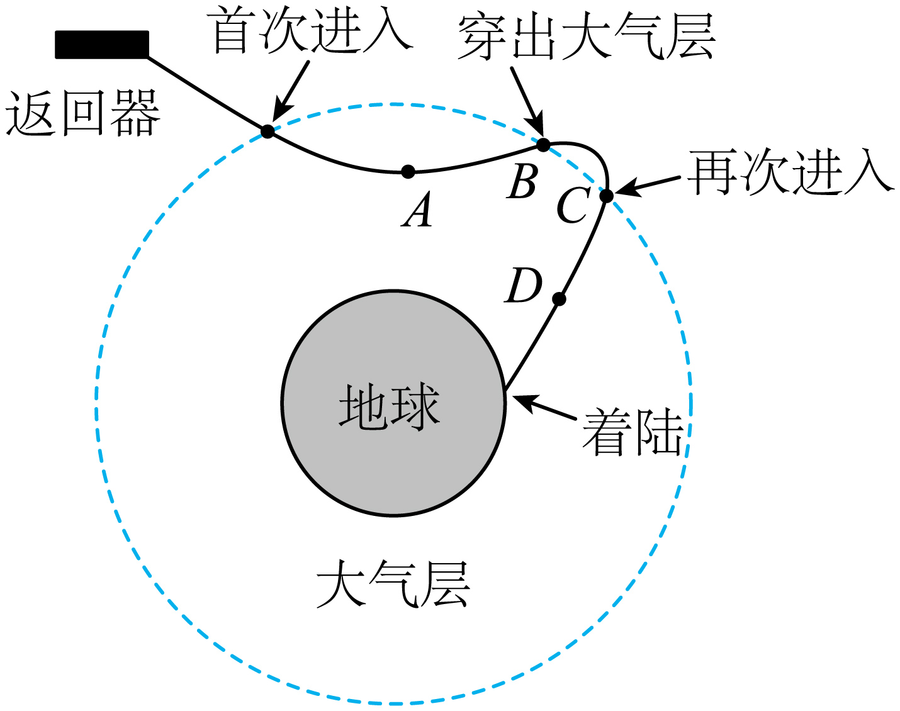

- A. AB段返回器的动能变大
- B. BC段由于没有空气阻力，所以返回器的运动状态不变
- C. CD段返回器动能的增加量小于重力势能的减小量
- D. A到D的过程中，返回器的机械能守恒

【答案】C

【解析】A．AB段返回器质量不变，速度变小，动能变小，故A错误；
B．BC段返回器的运动方向改变，运动状态改变，故B错误；
C．CD段返回器的质量不变，速度最大，高度减小，动能增大，重力势能减小；由于考虑阻力，CD段返回器减小的重力势能部分转化为动能，部分转化为内能，则动能的增加量小于重力势能的减小量，故C正确；
D．A到D的过程中，返回器的部分机械能转化为内能，机械能不断减小，故D错误。
故选C。

## 122. 单选题（难度：简单）

如图，无人机已被应用于诸多领域，当无人机匀速上升时，对其分析正确的是（　）

【答案】A

## 123. 单选题（难度：简单）

八年级的篮球比赛活动中，小林所在的班级获得冠军，如图为小林在赛前练习投篮时的场景，不计空气阻力，下列说法正确的是（　）

【答案】A

## 124. （难度：适中）

如图所示，空中加油机正在给匀速水平飞行的战斗机加油，加油后战斗机仍以原来的高度和速度做匀速飞行，则战斗机的（　）
      
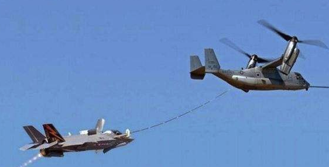

A．动能增加，势能增加，机械能增加  
B．动能不变，势能减少，机械能减少
C．动能增加，势能不变，机械能增加  
D．动能不变，势能不变，机械能不变

【答案】

A

【解析】空中加油机正在给匀速水平飞行的战斗机加油，加油后战斗机仍以原来的高度和速度做匀速飞行，由于质量变大，速度不变，故动能变大，同时高度不变，故势能增加，机械能是势能和动能的总和，故机械能变大。
故选A。

## 125. 单选题（难度：适中）

在“探究物体动能大小与哪些因素有关”的实验中，同学们做了如图甲、乙、丙所示的三个实验，质量为m和2m的小球分别沿同一斜面按照实验要求下滑，与水平面上静止在C点的纸盒相碰，纸盒在水平面上移动一段距离后静止。下列说法中错误的是（　）

【答案】A

## 126. 单选题（难度：简单）

运动员郑钦文在巴黎奥运会上为我国赢得了首枚奥运网球单打项目金牌。某次发球，她在<latex class="math-tex">\( a\)</latex>点将球击出，击球后网球运动的频闪照片如图所示，球触地弹起后运动的最高点为<latex class="math-tex">\( c\)</latex>，触地过程中有一部分机械能转化成了内能，<latex class="math-tex">\( b\

【答案】A

## 127. 单选题（难度：简单）

如图所示，在“探究动能的大小跟哪些因素有关”的实验中，下列说法正确的是（　）

【答案】A

## 128. 单选题（难度：适中）

科技赋能正深刻改变着传统农业的生产方式，大大减轻了农民的负担，提高了生产效率。如图所示，一架无人机正在进行农药喷洒作业，随着农药的减少，下列情形中无人机（包括水箱和箱中农药）的机械能可能保持不变的是（　）
      
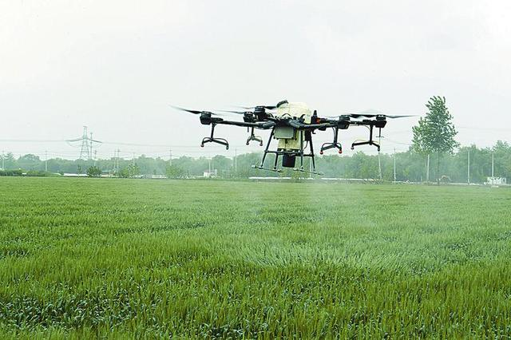

- A. 水平向前匀速飞行
- B. 竖直向下匀速飞行
- C. 斜向上匀速飞行
- D. 斜向下匀速飞行

【答案】C

【解析】无人机正在进行农药喷洒作业，随着农药的减少，质量减小，而做匀速运动时，其动能减小。要机械能不变，则必须增大重力势能，而质量减小，则高度必须增大，才有可能增大重力势能，因而斜向上匀速飞行时，机械能可能保持不变。故C符合题意，ABD不符合题意。
故选C。

## 129. 单选题（难度：简单）

我省首届省级冬季综合性运动会将于2026年1月至2月在榆林举行。如图所示，这是我市运动员在自由式滑雪空中技巧训练时从高空下落时的情景。在加速下落过程中，运动员的动能（　）

【答案】A

## 130. 单选题（难度：简单）

如图所示是家用水果削皮机，转动摇把，上面的梨旋转起来即可削皮。下列关于水果削皮机的说法中正确的是（　）

【答案】A

## 131. （难度：简单）

如图所示，农民赶着牛拉着犁铧在田里劳动，它们以相同速度向前行进，则其动能（　）       A．农民最大  B．铧犁最大C．牛最大D．一样大

## 132. 单选题（难度：简单）

2025年第九届亚洲冬季运动会在哈尔滨举行。图片所示的是我国运动员在单板大跳台比赛中的情景，运动员在空中下落过程中，他的（　）

【答案】A

## 133. 单选题（难度：简单）

2025年中国航天全年发射92次，创历史新高！如图所示，在搭载卫星的运载火箭加速升空过程中，下列有关卫星的说法正确的是（　）

【答案】A

## 134. （难度：适中）

如图是人形机器人在水平路面训练的场景。有关机器人的说法不正确的是（（　））      A．加速跑时动能增大B．匀速跑时水平方向合力为零C．跑步时速度越大惯性越大D．加速奔跑的过程中重力不变

## 135. 单选题（难度：简单）

2020年11月28日，临沂首次大规模千架无人机纵队表演，摆设各种精美图案，为市民奉上一场精彩夺目的视觉盛宴。在表演过程中，千架无人机匀速升空过程中（　）

【答案】A

## 136. 单选题（难度：简单）

如图所示，是小球下落后压弹簧的示意图，a点是小球下落的最高点，b点是弹簧自然伸长点，c点是弹力与重力相等的点，d点是弹簧压缩后的最低点。以下说法正确的是（　）

【答案】A

## 137. 单选题（难度：适中）

北京2022年冬奥会首钢滑雪大跳台局部示意图如图所示。运动员从a处由静止自由滑下，到b处起跳，c点为a、b之间的最低点，a、c两处的高度差为h。下列说法正确的是（　）
      
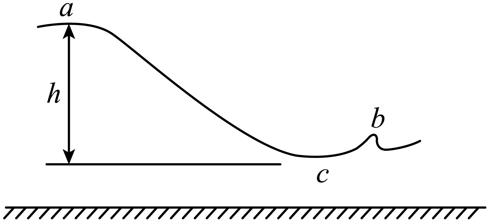

- A. 三处动能比较b＞c＞a
- B. 三处重力势能比较a＞c＞b
- C. 三处动能比较c＞b＞a
- D. 三处重力势能比较b＞a＞c

【答案】C

【解析】BD．重力势能大小的影响因素是质量和高度，运动员在全程中质量不变，a、b、c三处的高度关系为ha＞hb＞hc
所以三处重力势能比较a＞b＞c
故BD错误；
AC．运动员在a点时速度为零，动能为零，从a到c重力势能转化为动能，到c点时动能最大，从c到b动能转化为重力势能，b点时的动能小于c点时的动能，则三处动能比较
c＞b＞a
故A错误，C正确。
故选C。

## 138. 单选题（难度：适中）

小明利用如图所示的装置探究“阻力对物体运动的影响”。实验时，他让小车从斜面顶端由静止滑下，观察小车在不同表面上运动的距离。下列说法正确的是（　）

【答案】A

## 139. 单选题（难度：简单）

利用斜槽、钢球和小木块等器材探究物体的动能跟哪些因素有关。下列有关说法正确的是（　）

【答案】A

## 140. 单选题（难度：适中）

如图所示，让同一钢球从不同高度滚下，撞击同一水平面上同一木块，比较木块被撞击后移动的距离。关于上述实验，下列说法正确的是（　）
      
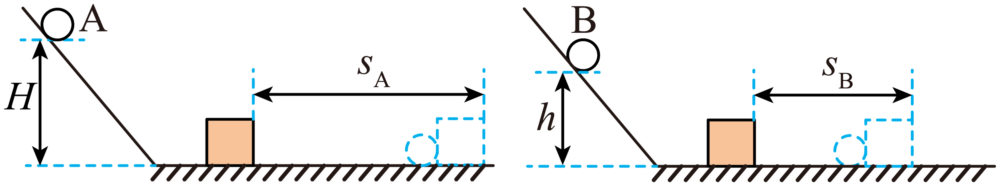

- A. 两次实验钢球具有的重力势能大小相同
- B. 两次实验对比可以探究“动能大小与物体高度的关系”
- C. 两次实验对比可以研究“摩擦力大小对物体运动的影响”
- D. 两次实验对比可以得出结论：质量相同时，速度越大的物体具有的动能越多

【答案】D

【解析】A．同一钢球从不同高度滚下，质量相同，高度不同，重力势能不同，故A错误；
B．同一钢球从不同高度滚下，撞击同一水平面上同一木块，钢球的高度不同，到达水平面的速度不同，木块被撞击后移动的距离不同，可以探究动能大小与物体速度的关系，故B错误；
C．两次实验木块在水平面上受到的摩擦力相同，不可以研究“摩擦力大小对物体运动的影响”故C错误；
D．同一钢球从不同高度滚下，撞击同一水平面上同一木块，钢球的高度越高，到达水平面的速度越大，木块被撞击后移动的距离越远，说明质量相同时，速度越大的物体具有的动能越多，故D正确。
故选D。

## 141. 单选题（难度：简单）

我国高速公路总里程位居世界前列，为探究高速公路上超速和超载的危害，小明设计了图示三次实验，实验中球体积均相同，同一弹簧的压缩量<latex class="math-tex">\( \text{Δ}{x}_{1}>\text{Δ}{x}_{2}\)</latex>，木块被撞后静止时的位置如虚线木块所示。根据上述实验可探究（　）

【答案】A

## 142. 单选题（难度：简单）

如图所示，小红用平行于斜面的拉力把物体从A点匀速拉至B点，忽略摩擦和空气阻力，以物体为研究对象，下列图像正确的是（　）

【答案】A

## 143. 多选题（难度：简单）

用如图所示的实验装置来研究“动能跟哪些因素有关”，下列关于该装置及实验操作的说法正确的是（　）
      
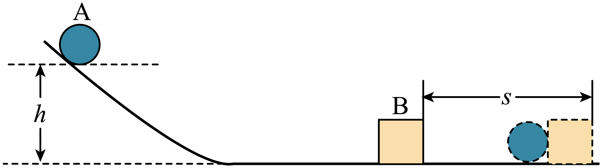

- A. 实验中要研究的是水平面上的木块的动能
- B. 让小球从斜面的不同高度滚下是为了研究动能与高度的关系
- C. 研究动能与质量关系时，应该让不同质量的小球从斜面同一位置自由滚下
- D. 本实验是通过观察木块被球撞击后运动距离的远近来判断动能的大小

【答案】C/D

【解析】A．该实验研究的主体是小球A，研究的是小球A动能的大小与速度和质量的关系，故A错误；

## 144. 多选题（难度：适中）

如图所示是物体由静止开始沿光滑斜面下滑过程中的频闪照片示意图，照片记录了物体每隔相等时间的位置。根据照片可以分析出物体（　）

【答案】A

## 145. 多选题（难度：简单）

如图所示，是某实验小组在“探究物体的动能跟哪些因素有关”的实验，实验装置由小球、木块、斜面和水平木板组成。下列说法正确的是（　）
      
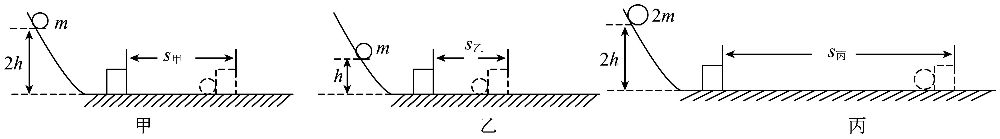

- A. 通过观察木块在水平面上移动的距离来判断小球动能的大小属于控制变量法
- B. 甲和丙中小球从同一高度滚下，是为了让小球到达水平面的速度相同
- C. 比较甲和乙，可以探究物体的动能与质量的关系
- D. 实验装置中，若水平面光滑，则无法完成本实验

【答案】B/D

【解析】A．通过观察木块在水平面上移动的距离来判断小球动能的大小属于转换法，故A错误；
B．甲和丙中小球从同一高度滚下，小球到达水平面的速度相同，可以探究动能大小与小球质量的关系，故B正确；
C．比较甲和乙，小球质量相同，滚下时的高度不同，到达水平面时的速度不同，可以探究物体的动能与速度的关系，故C错误；
D．实验装置中，若水平面光滑，小球将一直不停地做匀速直线运动，也就无法通过观察木块在水平面上移动的距离来判断小球动能的大小，无法完成本实验，故D正确。
故选BD。

## 146. 多选题（难度：适中）

关于如图所示的两个探究实验，说法正确的是（　）

【答案】A

## 147. 多选题（难度：适中）

如图是小明同学探究物体动能跟哪些因素有关的实验装置，A是一个钢球，B是一木块，探究实验结束后，小明同学谈了一些他对本实验的看法。对于小明同学的下列观点，你认为正确的是（　）

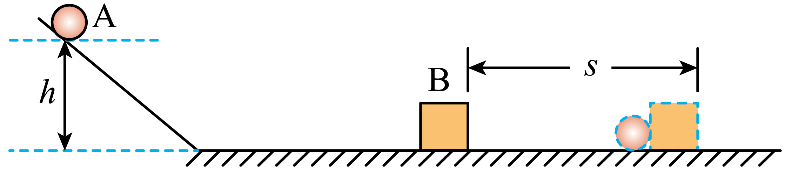

- A. 实验中所探究的动能是指木块的动能
- B. 实验中物体动能的大小是通过木块滑行距离的远近来判断的
- C. 实验中，我们是通过改变小球所在斜面的高度来改变小球的速度的，所以说物体动能跟物体所处的高度有关
- D. 撞击后的木块之所以会停下来，是因为受到了水平面摩擦力的作用

【答案】B/D

【解析】A．该实验中所探究物体的动能是指钢球的动能，故A错误；
B．通过观察木块移动的距离来说明钢球对木块做功的多少，用到了转换法。木块被撞得越远，表明钢球的动能越多，故B正确；
C．实验中，我们是通过改变小球所在斜面的高度来改变小球的速度的，所以说物体动能跟物体的速度有关，故C错误；
D．撞击后的木块之所以会停下来，是因为受到了水平面摩擦力的作用，故D正确。
故选BD。

## 148. 单选题（难度：适中）

下列实例中与加点字对应的能量是 （　　）

- A. 悬挂在天花板上的吊灯--吊灯的动能
- B. 空中飞行的飞机--飞机的动能
- C. 水平公路上行驶的自行车--车的重力势能
- D. 被拉开的弹弓--弹弓的弹性势能

【答案】D

【解析】A．吊灯“悬挂”时静止，动能为0，所处高度使其具有重力势能，故A不符合题意；
B．飞机“空中”飞行时，具有一定的高度具有重力势能，故B不符合题意；
C．自行车“行驶”时因运动具有动能，故C不符合题意；
D．弹弓“拉开”时发生弹性形变，拉开的弓具有弹性势能，故D符合题意。
故选D。

## 149. （难度：适中）

下列哪一诗句蕴含物体具有弹性势能（　　）A．会挽雕弓如满月  B．飞流直下三千尺C．春风十里扬州路  D．群峰倒影山浮水

## 150. 单选题（难度：适中）

关于势能的说法正确的是（　　）

- A. 势能包含重力势能，不包含弹性势能
- B. 受重力作用的物体由于被举高而能做功，不具有重力势能
- C. 橡皮筋被拉长，产生弹力能够做功，不具有弹性势能
- D. 物体重力势能的大小与与物体的质量及物体被举高的高度有关

【答案】D

【解析】A．势能包含重力势能，也包含弹性势能，故A错误；
B．受重力作用的物体由于被举高而能够对外做功，具有重力势能，故B错误；
C．橡皮筋被拉长，产生弹力能够做功，由于发生了弹性形变而具有弹性势能，故C错误；
D．物体重力势能的大小与与物体的质量及物体被举高的高度有关，质量越大，高度越大，重力势能越大，故D正确。
故选D。

## 151. 单选题（难度：适中）

毛主席在《沁园春·雪》一词中写到：“一代天骄，成吉思汗，只识弯弓射大雕”。对于“弯弓”的过程中所蕴含的物理知识，下列理解正确的是（　　）

- A. “弯弓”发生的塑性形变
- B. “弯弓”说明力可以改变物体的运动状态
- C. “弯弓”的过程中弓的弹性势能增大
- D. “弯弓”的过程中弓的机械能不变

【答案】C

【解析】A．弯弓后撤去拉力，弓能恢复原状，则弓发生的是弹性形变，故A错误；
B．弯弓时，弓的形状发生改变，说明力可以改变物体的形状，故B错误；
C．弯弓的过程中，弓的形变量变大，则弓的弹性势能增大，故C正确；
D．弯弓的过程中，弓的动能、重力势能不变，弹性势能增加，则弓的机械能增大，故D错误。
故选C。

## 152. 单选题（难度：简单）

《中华人民共和国民法典》规定：禁止从建筑物中抛掷物品。高空抛物危害性大的原因是高处的物体具有较大的（　　）

【答案】A

## 153. 单选题（难度：适中）

生活中我们要杜绝“高空抛物”这种严重危害公共安全的行为。“高空抛物”危害性大是因为高处的物体具有很大的（　　）

- A. 内能
- B. 重力势能
- C. 热量
- D. 弹性势能

【答案】B

【解析】高空抛物危害性大，是因为高处的物体具有很大的重力势能。物体所具有的重力势能与物体的质量和高度有关，质量一定的物体高度越高，重力势能越大。物体下落过程中，由重力势能转变成的动能越大，危害越大。内能是指物体内部所有分子的分子动能与分子势能的总和；热量是指在热传递的过程中发生转移的内能；弹性势能是物体发生弹性形变时具有的能。内能、热量、弹性势能与高空抛物危害性大这个问题没有关系。故B符合题意，ACD不符合题意。
故选B。

## 154. （难度：简单）

在下列实例的物体中，既具有动能，又具有势能的是（　　）
A．在水平地面上静止的汽车
B．悬挂在天花板上的吊灯
C．在空中飞行的飞机
D．被拉开的弹弓

【答案】

C

【解析】A．在水平地面上静止的汽车，没有运动，不具有动能，故A不符合题意；
B．悬挂在天花板上的吊灯，处于静止状态，没有运动，但处于一定的高度，所以只有重力势能，没有动能，故B不符合题意；
C．在空中飞行的飞机，一方面处于运动状态，具有动能；另一方面被举高，具有重力势能，所以既具有动能，又具有势能，故C符合题意；
D．被拉开的弹弓，发生了弹性形变，具有弹性势能，但处于静止状态，没有运动，所以没有动能，故D不符合题意。
故选C。

## 155. 单选题（难度：简单）

蹦床是一项运动员利用弹性蹦床的反弹在空中表现杂技技巧的竞技运动。如图是一位运动员在蹦床比赛中的示意图，某时刻他从<latex class="math-tex">\( A\)</latex>点自由下落，与水平床面在<latex class="math-tex">\( B\)</latex>点接触，他能到达的最低点为<latex class="math-tex">\( C\)</latex>点。不计空

【答案】A

## 156. 单选题（难度：适中）

如图所示，在跳板跳水比赛中，运动员总是尽可能把跳板向下压弯一点，然后再高高腾起。不计空气阻力，下列分析正确的是（　　）

【答案】A

## 157. 单选题（难度：适中）

如图所示为人拉弓射箭的示意图，下列说法正确的是（　　）
      
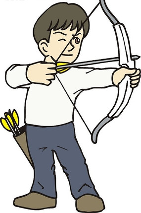

- A. 在弹性限度内，弓弦拉得越弯，弓弦的弹性势能越大
- B. 弓弦张紧时，放在弓弦上的箭具有弹性势能
- C. 箭离弦的过程中，弓弦的弹性势能转化为弓弦的重力势能
- D. 箭离弦后下落过程中，箭的动能转化为它的重力势能

【答案】A

【解析】A．在弹性限度内，弓弦拉得越弯，弓弦的弹性形变程度越大，弓弦的弹性势能越大，故A正确；
B．弓弦张紧时，弓弦具有弹性势能，放在弓弦上的箭没有弹性形变，没有弹性势能，故B错误；
C．箭离弦的过程中，弓弦的弹性形变程度减小，弓弦的弹性势能减小，箭的速度变大，箭的动能变大，弓弦的弹性势能转化为箭的动能，故C错误；
D．箭离弦后下落过程中，箭的质量不变，高度减小，重力势能减小，速度增大，动能增大，箭的重力能转化为它的动能，故D错误。
故选A。

## 158. 单选题（难度：适中）

近日9岁汉族男孩刘坤练习骑射的视频，被央媒点赞尽显少年豪气，如图为刘坤骑马射箭的精彩瞬间。下列说法正确的是（　　）

【答案】A

## 159. 单选题（难度：适中）

如图是小明用拉力器锻炼身体，关于臂力器说法不正确的是（　　）

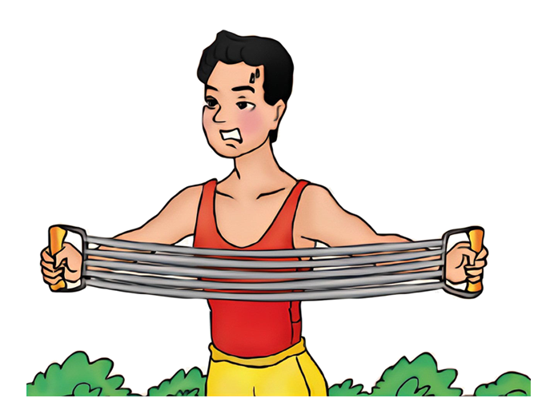

- A. 使臂力器伸长的力施力物体是小明的手
- B. 该过程能说明力可以使物体发生形变
- C. 被拉伸的臂力器具有弹性势能
- D. 小明和小华都能将该臂力器拉直，他们施加的力一定一样大

【答案】D

【解析】A．小明用力使臂力器伸长，所以使臂力器伸长的力施力物体是小明的手，故A正确，不符合题意；
BC．被拉伸的臂力器的弹簧发生弹性形变，具有弹性势能，故BC正确，不符合题意；
D．都把手臂撑直，手臂越长的人，弹簧的伸长量越大，人所用的拉力越大，小明和小华没有说明手臂情况，故无法比较，故D错误，符合题意。
故选D。

## 160. 单选题（难度：适中）

对于图所涉及的物理知识，解释正确的是（　　）

【答案】A

## 161. 单选题（难度：简单）

如图所示是某同学在做引体向上。他先用两手握住单杠，两脚离地，两臂及身体自然下垂，然后缓缓屈肘，将身体向上拉起，直到他的下巴超过单杠。在这个过程中，主要增大的是（　）
      
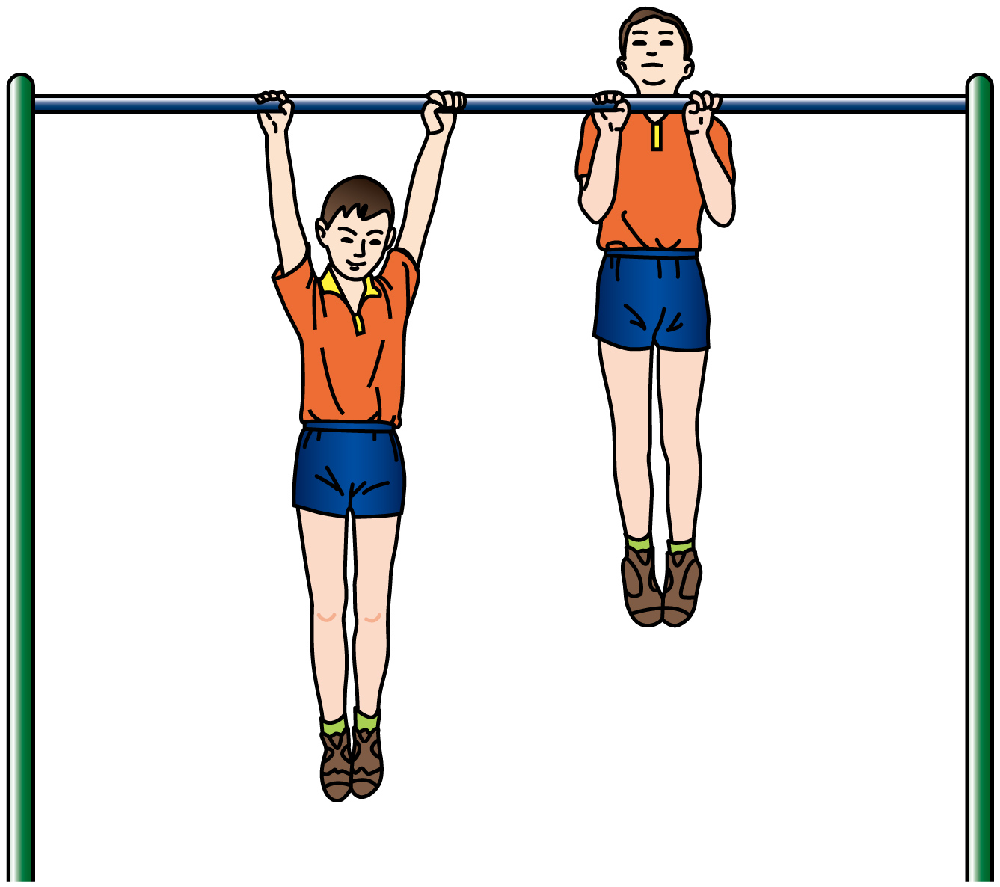

- A. 动能
- B. 重力势能
- C. 弹性势能
- D. 内能

【答案】B

【解析】A．动能是物体由于运动而具有的能，其大小与物体的质量和速度有关。该同学在做引体向上的过程中，“缓缓屈肘”说明其运动速度很小，可以认为速度基本不变，所以动能基本不变。故A不符合题意；
B．重力势能是物体由于被举高而具有的能，其大小与物体的质量和高度有关。该同学在做引体向上的过程中，质量不变，身体的重心位置升高，即高度增加，所以重力势能增大。故B符合题意；
C．弹性势能是物体发生弹性形变时所具有的能。在此过程中，该同学的身体没有发生弹性形变，所以不具有弹性势能。故C不符合题意；
D．内能是物体内部所有分子做无规则运动的动能和分子势能的总和。该同学通过消耗体内的化学能来做功，一部分转化为身体的重力势能，另一部分会以热量的形式散失，使身体的内能增加。但题干描述的是将身体向上拉起的宏观机械运动过程，其最主要的能量变化是克服重力做功，使重力势能增加。故D不符合题意。 
故选B。

## 162. 单选题（难度：简单）

观察如图所示的两幅漫画，该现象主要说明高处的物体具有较大的（　　）

【答案】A

## 163. 单选题（难度：适中）

如图所示，轻质弹簧左端固定，它自由伸长时，右端恰好位于 O 点，将弹簧右端固定在物体上并压缩到 A 点静止释放，物体沿水平面运动，经过 O 点，到达 B 点，然后往回运动到 C 点静止。其中 AO>BO，则在上述运动过程中（　　）

【答案】A

## 164. 单选题（难度：简单）

做一个能自动回转的“魔罐”。如图所示，在金属罐的盖子和罐底各开两个小孔，用细线将一个钩码系在橡皮筋的中部，然后将橡皮筋穿过盖子和罐底的小孔并固定起来，这样，一个“魔罐”就做成了。当适当用力推一下“魔罐”，观察到它在水平地面上滚出去，接着便自动滚回且来回滚动几次后停了下来，有关这一现象下列说法正确的是（　　）

【答案】A

## 165. 单选题（难度：简单）

输入苏轼的“会挽雕弓如满月，西北望，射天狼”词句后，某国产AI智能软件快速生成如图所示的图片。下列对弯弓射箭现象的分析不正确的是（　　）
      

- A. 用力把弓拉弯，此时弓没有动能
- B. 弓被拉得越弯，它具有的弹性势能就越大
- C. 弓把箭射出的过程中动能转化成弹性势能
- D. 离弦的箭速度越大，其具有的动能就越大

【答案】C

【解析】A．动能是物体因运动而具有的能量。用力把弓拉弯，弓处于静止状态，速度为零，因此此时弓没有动能。故A正确，不符合题意；
B．弹性势能是物体发生弹性形变时所具有的能量，物体的弹性形变越大，具有的弹性势能就越大。弓被拉得越弯，其弹性形变越大，所以它具有的弹性势能就越大。故B正确，不符合题意；
C．弓把箭射出的过程中，弓的弹性形变逐渐减小，其储存的弹性势能也随之减小；同时，箭由静止变为运动，速度增大，动能增大。这个过程是弓的弹性势能转化为箭的动能。故C错误，符合题意；
D．物体的动能大小与物体的质量和速度有关。根据动能的定义，对于质量一定的箭，其速度越大，具有的动能就越大。故D正确，不符合题意。
故选C。

## 166. 单选题（难度：适中）

下列所画的连线和知识结构，不正确的是（　　）

- A. 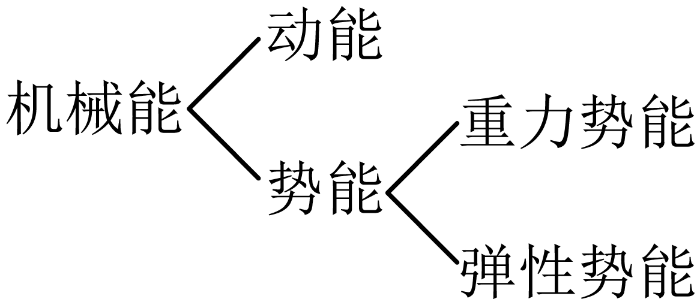
关于机械能的知识结构
- B. 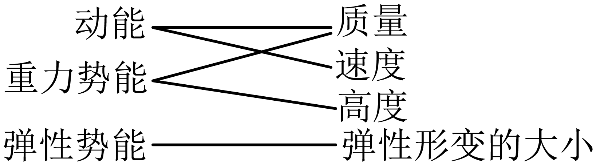
关于各种形式的能及其决定因素
- C. 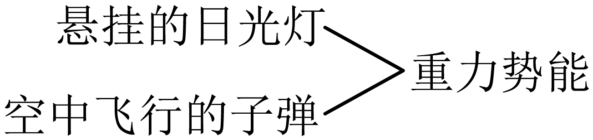
关于物体及其所具有的机械能平直公路上行驶的汽车——重力势能
- D. 
关于能的知识及研究它所涉及到的科学方法 重力势能的定义——控制变量法

【答案】C

【解析】A．势能包括重力势能和弹性势能，动能和势能统称为机械能，故A正确，不符合题意；
B．动能的影响因素有质量和速度，重力势能的影响因素有质量和高度，弹性势能的影响因素有弹性形变大小和弹性系数，故B正确，不符合题意；
C．悬挂的日光灯、空中飞行的子弹都具有重力势能，而平直公路上行驶的汽车不具有重力势能，具有动能，故C错误，符合题意；
D．探究重力势能的大小与质量、高度的关系时，需要用到控制变量法，故D正确，不符合题意。
故选C。

## 167. 单选题（难度：适中）

如图所示，用同样大小的力作用在甲、乙两根完全相同的弹簧上，则关于它们弹性势能的大小关系，下列说法中正确的是（　　）

【答案】A

## 168. （难度：适中）

小明观察到篮球落地后会被弹起，但弹起的高度不同，小明问同学们“篮球弹起的高度与哪些因素有关呢”？小聪说：“可能与篮球下落时的高度有关，也可能与地面的材料有关”。小龙说：“可以用一个篮球从不同高度下落到地板上，测量反弹的高度”。小华取来一个篮球按照小龙的方法进行测试并记录每次下落的高度和反弹的高度。四名同学进行的科学探究活动属于“进行实验收集证据”这环节的是（　　）A．小明  B．小聪  C．小龙

## 169. 单选题（难度：简单）

小火在学习了1.4节后，猜想制造乒乓球材料的不同，乒乓球的弹性也不同。他用材料不同、其它条件相同的乒乓球设计了以下实验验证方案，其中最合理的是（　　）

【答案】A

## 170. 单选题（难度：简单）

下列几个实验中，说法不正确的是（　　）

- A. 探究影响动能的因素时，依次让体积相同的实心铜球和钢球从同一斜面的同一高度自由下滑撞击放在斜面底端的木块，一定是铜球把木块推出的距离更远
- B. 测量斜面的机械效率时，弹簧测力计必须拉着物体做匀速运动
- C. 为了探究究重力势能与高度的关系，可以把一个铜球从不同的高度用力扔下撞击地面
- D. 探究影响弹性势能因素时，可通过观察橡皮筋把纸团弹开的距离判断弹性势能的大小

【答案】C

【解析】A．由于铜的密度大于钢的密度，所以当体积相同时，铜球的质量大于钢球的质量，当滑到底端时，两球的速度相同，铜球具有的动能大于钢球具有动能，所以铜球把木块推的远一些，故A正确，不符合题意；
B．测量斜面的机械效率时，为了要保证弹簧测力计的示数稳定，必须让木块做匀速直线运动，故B正确，不符合题意；
C．探究重力势能与高度的关系时，应让铜球从一定高度由静止开始自由下落，而不能向下扔，故C错误，符合题意；
D．探究影响弹性势能因素时，可通过观察橡皮筋把纸团弹开的距离判断弹性势能的大小；橡皮筋把纸团弹的越远，说明橡皮筋的弹性势能越大，这里采用了转换法，故D正确，不符合题意。
故选C。

## 171. 多选题（难度：适中）

苏轼在《江城子•密州出猎》中写到“会挽雕弓如满月，西北望，射天狼”，表达了作者强国抗敌的心愿。对词中提到的弯弓射箭现象，下列分析正确的是（　　）

- A. 射箭时弓的形变越大，箭的弹性势能就越大
- B. 离弦的箭在空中水平飞行的过程中，重力不做功
- C. 斜向上射出的箭在空中飞行的过程中，其机械能不变
- D. 箭在离弦之前被水平射出的过程中，是弹性势能转化为动能

【答案】B/D

【解析】A．弹性势能是发生弹性形变的物体自身具有的能，射箭时，弓的形变越大，弓的弹性势能就越大，而不是箭的弹性势能，故A错误；
B．离弦的箭在空中水平飞行的过程中，在重力方向上没有通过距离，所以重力不做功，故B正确；
C．斜向上射出的箭在空中飞行的过程中，克服空气的阻力做功，一部分机械能转化为内能，使得机械能减小，故C错误；
D．箭在离弦之前被水平射出的过程中，弓的弹性势能减小，箭的动能增大，是弹性势能转化为动能，故D正确。
故选BD。

## 172. 多选题（难度：适中）

如图是撑竿跳高运动员进行撑竿跳高的情景，下列说法正确的是（　　）
      

- A. 是运动员的重力将撑竿压弯的
- B. 运动员在上升过程中具有的动能减小
- C. 运动员在上升过程中具有的重力势能变大
- D. 运动员上升过程中，撑竿的弹性势能减小

【答案】C/D

【解析】A．撑杆被压弯是因为受到了运动员的压力，故A错误；
B．上升过程中，运动员质量不变，速度先增大后减小，具有的动能先增大后减小，故B错误；
C．在上升过程中，运动员质量不变，高度增加，重力势能增加，故C正确；
D．在上升过程中，撑竿的弹性形变变小，其弹性势能减小，故D正确。
故选CD。

## 173. 单选题（难度：简单）

下列说法中正确的是（　　）

【答案】A

## 174. 多选题（难度：适中）

如图所示，将小铁块绑在橡皮筋上，橡皮筋固定在易拉罐两端。易拉罐从不太陡斜面上自由滚下，到达斜面底端又自动滚上斜面，下列说法正确的是（　　）

【答案】A

## 175. 多选题（难度：适中）

在东京奥运会上，中国选手朱雪莹夺得蹦床女子个人冠军。在比赛中，朱雪莹从高处落到蹦床上又被弹起，该过程中有关机械能及其转化的说法正确的是（　　）

- A. 运动员上升到最高点时，重力势能为零
- B. 运动员从高处下落到蹦床前，重力势能转化为动能
- C. 运动员弹离蹦床后上升的过程中，动能转化为重力势能
- D. 运动员下落到蹦床最低点时弹性势能为零

【答案】B/C

【解析】A．运动员上升到最高点时质量不变，有一定的高度，所以重力势能不为零，故A错误；
B．运动员从高处下落到蹦床前，高度变小，质量不变，重力势能减小；速度变大，质量不变，动能变大，重力势能转化为动能，故B正确；
D．运动员弹离蹦床后上升的过程中，高度变大、速度变小，质量不变，则动能变小，重力势能变大，动能转化为重力势能，故C正确；
C．蹦床被压缩到最低点时，蹦床的弹性形变程度最大，弹性势能最大，故D错误。
故选BC。

## 176. 多选题（难度：适中）

如图所示，粗糙程度相同的斜面与水平面在M点相连，弹簧左端固定在竖直墙壁上，弹簧为原长时右端在N点。小物块从斜面上P点由静止滑下，与弹簧碰撞后小物块又返回到斜面上，最高到达Q点。下列说法正确的是（　　）

【答案】A

## 177. 多选题（难度：适中）

图是小朋友玩蹦蹦床的情景，不考虑空气阻力，对小朋友在上升和下落过程中机械能的变化，下列分析正确的是（　　）

【答案】A

## 178. 多选题（难度：适中）

如图所示，粗糙程度相同的斜面与水平面在M点相连，弹簧左端固定在竖直墙壁上，弹簧处于自由状态时右端在N点，小物块从斜面的P点由静止自由滑下，与弹簧碰撞后又返回到斜面上，最高到达Q点。下列说法正确的是（　　）

【答案】A

## 179. 多选题（难度：适中）

如图所示是运动员参加射箭比赛时的场景，下列说法正确的是（　　）

【答案】A

## 180. 单选题（难度：适中）

如图所示为人拉弓射箭的示意图，下列说法中正确的是(　　)
      

- A. 在弹性限度内，弓拉得越弯，弓的弹性势能越大
- B. 放在张紧了的弓上的箭，具有弹性势能
- C. 箭离弦时，弓的弹性势能转化为弓的动能
- D. 箭在水平飞行时，箭的动能转化为重力势能

【答案】A

【解析】A. 在弹性限度内，弓拉得越弯，形变量越大，弓的弹性势能越大，故A正确．
B. 具有弹性势能的变形的弓，而不是箭，故B错误；
C. 箭离弦时，弓的弹性势能转化为箭的动能，故C错误；
D. 箭在水平飞行时，箭的动能克服阻力做功转化为内，故D错误；
故选A．

## 181. 单选题（难度：简单）

如图为撑竿跳高运动员跃过横杆前的一个情景，下列说法正确的是（　　）
      

- A. 人对竿的力改变了竿的运动状态
- B. 此时竿具有弹性势能
- C. 竿对人的力是人发生了弹性形变产生的
- D. 人在上升时受到平衡力的作用

【答案】B

【解析】A．根据图片可知，人对竿的力改变了竿的形状，故A错误；
B．当物体发生弹性形变时，具有弹性势能，所以竿子发生弹性形变具有弹性势能，故B正确；
C．根据弹力产生的条件可知，竿对人的力是竿发生弹性形变产生的，故C错误；
D．人在上升时只受重力作用，速度和方向不断改变，不处于平衡状态，不受平衡力，故D错误。
故选B。

## 182. 单选题（难度：简单）

高空“蹦极”是勇敢者的游戏。蹦极运动员将弹性长绳（质量忽略不计）的一端系在双脚上， 另一端固定在高处的跳台上，运动员无初速地从跳台上落下，若不计空气阻力（　　）

【答案】A

## 183. 多选题（难度：适中）

如图，一款铁皮弹跳青蛙玩具内部有一个发条机制。当发条上紧时，它会通过齿轮带动曲柄旋转，从而使青蛙的后腿摆动，产生跳跃的动作。下列说法正确的是（　　）
      

- A. 发条上紧时，发条弹簧被压缩，弹簧具有了弹性势能
- B. 青蛙的后腿摆动时，弹性势能转化为动能
- C. 青蛙向上跳动时，动能转化为重力势能
- D. 青蛙弹跳一会后静止了，此时青蛙的机械能最大

【答案】A/B/C

【解析】A．上紧发条时，弹簧被压缩，发生了弹性形变，具有了弹性势能，故A正确；
B．发条释放时，弹簧的弹性势能转化为动能，带动青蛙后腿摆动，故B正确；
C．青蛙向上跳起时，速度减小，动能减少，高度增加，重力势能增加，动能转化为重力势能，故C正确；
D．青蛙静止时速度为零，动能为零，静止在地面上，重力势能也最小，则机械能最小，故D错误。
故选ABC。

## 184. 单选题（难度：适中）

如图所示为人拉弓射箭的示意图，下列说法中正确的是（　　）

【答案】A

## 185. 多选题（难度：适中）

蹦床是集艺术性和竞技性于一身的运动，是深受广大青少年喜爱的健身运动。如图所示为蹦床运动照片及其简化示意图，O点是运动员由最高点开始自由落下的起始位置，A点是蹦床不发生形变时的原位置，B点是运动员受到的重力与蹦床对运动员的弹力相等处，C点是运动员到达的最低点。整个过程忽略空气阻力，则（　　）

【答案】A

## 186. 多选题（难度：适中）

如图所示，斜面与水平面在M点通过小圆弧相连，弹簧左端固定，原长时右端在N点．小物块从斜面上P点由静止滑下，与弹簧碰撞后又返回到P 点．则（　　）
      

- A. 小物块从P向M运动过程中，重力势能减少
- B. 小物块从P向M运动过程中，机械能减少
- C. 小物块压缩弹簧至最短的过程中，小物块的机械能不变
- D. 弹簧被压缩到最短时，弹簧的弹性势能最大

【答案】A/D

【解析】A．小物块从P向M运动过程中，质量不变，高度变小，重力势能减小，故A正确；
B．与弹簧碰撞后又返回到P点，说明整个过程中没有能量损失，机械能守恒，所以小物块从P向M运动过程中，机械能不变，故B错误；
C．小物块压缩弹簧至最短的过程中，小物块的速度最终减小到0，机械能也减小到0，故C错误；
D．弹性势能与形变量大小有关，弹簧被压缩到最短时，弹簧的弹性形变达到最大，弹性势能最大，故D正确．

## 187. 单选题（难度：简单）

如图所示，射箭运动员在比赛时总是要把弓拉得很弯，其主要目的是（　　）

- A. 增大弓的弹性势能
- B. 增大弓的重力势能
- C. 增大箭的弹性势能
- D. 增大箭的重力势能

【答案】A

【解析】物体的弹性形变程度越大，其弹性势能就越大；运动员在射箭比赛时总是要把弓拉得很弯，就是让弓的弹性形变程度增大，获得更大的弹性势能；题中只是说把弓拉得很弯，没说将弓释放，所以不能增大箭的弹性势能和重力势能，没有改变弓的高度，没有改变弓的重力势能，故A符合提意，BCD不符合题意。
故选A。

## 188. 多选题（难度：适中）

在某AI智能软件输入苏轼的“会挽雕弓如满月，西北望，射天狼”词句后，能快速生成下图所示的图片。下列对图中拉弓射箭现象分析正确的是（　　）

【答案】A

## 189. 单选题（难度：简单）

如图所示，向下按压内有弹簧的圆珠笔，放手后笔会向上弹起，则笔离地上升过程中（　　）

【答案】A

## 190. 多选题（难度：适中）

下列说法中正确的是（　　）

【答案】A

## 191. 填空题（难度：适中）

如图所示，将一张卡片对折，在开口的一边剪两刀，然后将橡皮筋套在开口边，就做成了一个会“跳”的卡片，将卡片反过来，用手压平在桌面上，使橡皮筋伸长，迅速松开手，会看到卡片，这一现象说明：发生弹性形变的橡皮筋具有能，对卡片做功。卡片在上升过程中，重力势能将（选填“增大”“减小”或“不变”）。
      

【答案】跳起，弹性势，增大

【解析】[1][2][3]“橡皮筋伸长”说明橡皮筋发生弹性形变，发生弹性形变的物体要恢复原状，就会对使它发生形变的物体施加力的作用，所以橡皮筋对硬卡片施力，使它跳起；橡皮筋发生了弹性形变，所以它具有了弹性势能；卡片在上升过程中，质量不变，高度升高，所以重力势能将增大。

## 192. 多选题（难度：适中）

如图所示，粗糙程度相同的斜面与水平面在M点平滑相连。弹簧左端固定在竖直墙壁上，弹簧处于自由状态时右端在N点，小物块从斜面的P点由静止滑下，与弹簧碰撞后又返回到斜面上，最高到达Q点。下列说法正确的是（　　）

【答案】A

## 193. 多选题（难度：适中）

下列四幅图，说法正确的是（　　）

- A. 
在刚盛过热水的密闭塑料瓶上浇冷水，塑料瓶会变扁，是因为大气压的作用
- B. 
拦河大坝利用提高水位来提高水的重力势能
- C. 
杆跳高运动员随杆上升过程中，撑杆的弹性势能越来越小
- D. 
开车系安全带是为了减小司机的惯性

【答案】A/B/C

【解析】A．刚盛过热水的密闭塑料瓶内水蒸气的密度较大，给塑料瓶浇冷水后，瓶内的水蒸气遇冷液化为水，瓶内气压减小，瓶外的气压大于瓶内气压，所以塑料瓶会变扁，是因为大气压的作用，故A正确；
B．当质量不变时，物体位置越高重力势能越大，拦河大坝就是利用提高水位高度来提高水的重力势能，故B正确；
C．撑杆跳高运动员随杆上升过程中，杆逐渐恢复原状，弹性减弱，所以弹性势能越来越小，故C正确；
D．开车系安全带是为了减小惯性带来的危害；司机的质量没有减小，所以惯性不会减小，故D错误。
故选ABC。

## 194. 多选题（难度：适中）

如图所示的情景中，关于能量的说法不正确的是（　　）

A
B
C
D

- A. 水力发电，将电能转化为机械能
- B. 在空中飞行的C919，只具有重力势能
- C. 张弓待发，弓箭静止，所以没有能量
- D. 过山车冲上高处的过程中重力势能增加

【答案】A/B/C

【解析】A．水力发电是利用水的机械能推动发电机运转，最终产生电能，此过程是将机械能转化为电能，并非电能转化为机械能，故A错误，符合题意；
B．在空中飞行的 C919，既在一定高度具有重力势能，又在运动具有动能，并非只具有重力势能，故B错误，符合题意；
C．张弓待发时，弓发生了弹性形变，具有弹性势能，并非没有能量，故C错误，符合题意；
D．过山车冲上高处的过程中，质量不变，高度增加，根据重力势能的影响因素，其重力势能增加，故D正确，不符合题意。
故选 ABC。

## 195. 单选题（难度：简单）

北京时间2025年4月24日17时17分，搭载神舟二十号载人飞船的长征二号F遥二十运载火箭在酒泉卫星发射中心点火发射，火箭在加速升空过程中，火箭上载人飞船的（　　）

- A. 动能增大，重力势能增大，机械能增大
- B. 动能增大，重力势能减小，机械能不变
- C. 动能减小，重力势能增大，机械能不变
- D. 动能减小，重力势能减小，机械能减小

【答案】A

【解析】火箭上升过程中，火箭上的载人飞船质量不变，速度变大，高度变高，故载人飞船的动能变大，重力势能变大，因为机械能等于动能与重力势能之和，所以载人飞船的机械能也变大，故A符合题意，BCD不符合题意。
故选A。

## 196. 单选题（难度：简单）

下列关于功的说法正确的是（　　）

【答案】A

## 197. 单选题（难度：适中）

骑自行车上坡前，往往要加紧用力蹬几下，这样做是为了（　　）

- A. 增大势能
- B. 增大动能
- C. 增大惯性
- D. 减小阻力

【答案】B

【解析】骑自行车上坡前，往往要用力加紧蹬几下，这样车的速度增大，车的动能增大，上坡时就会有更多的动能转化为重力势能，这样自行车就会爬得更高，故B符合题意，ACD不符合题意。
故选B。

## 198. 单选题（难度：简单）

下列关于机械能及其转化的说法中，错误的是（　　）

【答案】A

## 199. 单选题（难度：简单）

舰载直升机完成任务返航，要降落在航空母舰上，在直升机减速下降靠近航母甲板的过程中（　　）

- A. 惯性变大
- B. 动能变小
- C. 重力势能不变
- D. 机械能不变

【答案】B

【解析】A、惯性大小只与质量有关，与速度无关，质量不变，惯性不变，故A错误；
BCD、直升机减速下降过程中，高度减小，重力势能减小；速度减小，动能减小；机械能为动能和势能的和，故机械能减小；故B正确，CD错误．

## 200. 单选题（难度：适中）

日常生活中的许多现象都与我们所学习的物理知识有关，下列说法不正确的是（　　）

- A. 轮胎上的花纹可以增大摩擦力
- B. 荡秋千时，小孩的机械能不守恒
- C. 盘山公路不省距离，但是省力
- D. 投掷出去的铅球在空中飞行的过程，是受到了运动员对它做的功

【答案】D

【解析】A．轮胎上的花纹可以通过增大接触面的粗糙程度增大摩擦力，故A正确，不符合题意；
B．荡秋千时，克服摩擦力做功，小孩的机械能不守恒，故B正确，不符合题意；
C．盘山公路费距离，但是省力，因为在斜面上，推力小于物体的重力，故C正确，不符合题意；
D．投掷出去的铅球在空中飞行的过程，是由于惯性继续前进，此时运动员对铅球没有力的作用，故运动员对球不做功，故D错误，符合题意。
故选D。

## 201. 单选题（难度：适中）

现代农业利用无人机喷洒农药，安全又高效。如图所示，喷药无人机在农田上方沿水平方向匀速飞行，均匀喷洒农药。无人机匀速飞行喷洒农药过程中（　　）
      

- A. 受惯性作用
- B. 动能不变
- C. 重力势能减小
- D. 机械能守恒

【答案】C

【解析】A．惯性不是力，不能说受到惯性作用，故A不符合题意；
BCD．无人机在农田上方沿水平方向匀速飞行时，质量不断减小，速度不变，动能减小，高度不变，重力势能减小，因此机械能减小，故C符合题意，BD符合题意。
故选C。

## 202. 单选题（难度：适中）

踢毽子，又叫“打鸡”，是中国民间传统的体育健身活动之一、从毽子离开脚开始上升至第一次到达最高点的过程中（忽略空气阻力），毽子的（　　）

- A. 动能一直增大
- B. 重力势能一直减小
- C. 机械能保持不变
- D. 机械能一直增大

【答案】C

【解析】从毽子开始上升至第一次到达最高点的过程中，毽子的质量不变，速度逐渐变小，高度逐渐升高，所以毽子的动能一直减小，重力势能一直增大，由于忽略空气阻力，所以机械能没有损失，故机械能保持不变，故C符合题意，ABD不符合题意。
故选C。

## 203. 单选题（难度：适中）

如图所示，人造地球卫星在绕地球椭圆轨道运行的过程中，当卫星从近地点向远地点运行时，下列说法正确的是（　　）
      

- A. 动能增大，势能增大
- B. 动能减小，势能增大
- C. 动能增大，势能减小
- D. 动能减小，势能减小

【答案】B

【解析】人造地球卫星在绕地球椭圆轨道运行的过程中，机械能守恒，近地点高度小于远地点，则近地点重力势能小于远地点，当卫星从近地点向远地点运行时，重力势能增大，动能转化为重力势能，动能减小，故B符合题意，ACD不符合题意。
故选B。

## 204. 单选题（难度：适中）

科技的发展使农业机械化水平越来越高，如图所示是一架飞机在一定的高度匀速直线飞行给小麦喷洒农药时的情景（不计空气阻力）。喷洒农药的过程中，飞机的（　　）
      

- A. 重力势能减小
- B. 动能增大
- C. 机械能不变
- D. 动能转化为重力势能

【答案】A

【解析】飞机在一定的高度匀速直线飞行给小麦喷洒农药，喷洒农药的过程中，飞机总质量减小，速度不变，高度不变，因此飞机动能减小，重力势能减小，则机械能减小，故A符合题意，BCD不符合题意。
故选A。

## 205. 单选题（难度：简单）

如图所示，热气球在空中匀速上升过程中（阻力不能忽略），下列说法不正确的是 （　　）
      

- A. 动能不变
- B. 势能增加
- C. 机械能增加
- D. 所受的浮力等于重力

【答案】D

【解析】ABC．热气球在空中匀速上升过程中，其质量不变，速度不变，则动能不变；同时高度变大，则重力势能变大；因机械能等于动能与势能的总和，所以热气球的机械能变大，故ABC正确，不符合题意；
D．热气球在空中匀速上升过程中，其受到的力为平衡力，空气阻力不能忽略，此时热气球受到竖直向下的重力和阻力、竖直向上的浮力，所以浮力大于重力，故D错误，符合题意。
故选D。

## 206. 单选题（难度：适中）

在2025年哈尔滨亚冬会自由式滑雪女子大跳台的比赛中，我国选手获得金牌。如图所示，运动员从 50 m高的跳台由静止出发，在空中完成了一次超高难度的1080度旋转后平稳落到雪地上。下列说法中正确的是（    ）

【答案】A

## 207. 单选题（难度：简单）

2025年1月17日，山东省首条低空无人机物流运输航线试航成功。下图为运输货物的无人机正在匀速下降，下列有关货物的说法正确的是（　　）

【答案】A

## 208. 单选题（难度：适中）

如图所示是人造卫星绕地球运行的示意图，关于人造卫星绕地球运行过程中下列说法正确的是（　　）

【答案】A

## 209. 单选题（难度：适中）

如图所示，把一个铁锁用不可伸长的轻绳悬挂起来，将它拉到鼻子附近，稳定后松手，铁锁来回摆动，最后停止。在铁锁摆动过程中，下列说法正确的是（　　）
      

- A. 铁锁的机械能在减小
- B. 铁锁的重力没有做功
- C. 铁锁的重力势能保持不变
- D. 只有动能和重力势能的相互转化

【答案】A

【解析】A．铁锁摆动幅度逐渐减小，说明摆动过程中，铁锁的机械能一直在减小，故A正确
B．铁锁来回摆动的过程中，在竖直方向上有距离，铁锁的重力做功，故B错误。
C．摆动过程中，铁锁的高度不断变化且高度越来越低，因此重力势能是变化的，故C错误；
D．由于最后停止了，所以铁锁在摆动过程中，其动能和重力势能相互转化的同时，还有一部分机械能转化为内能，故D错误；
故选A 。

## 210. 单选题（难度：适中）

2025年1月13日，我国太原卫星发射中心使用捷龙三号运载火箭将微厘空间01组卫星发射升空。如图所示，在卫星随火箭加速升空的过程中（　　）

【答案】A

## 211. 单选题（难度：适中）

如图是一个光滑的轨道，某小球从轨道的O点出发，以某一初速度开始下滑，小球始终没有离开轨道（不计空气阻力），你认为小球最远可以运动到（　　）

【答案】A

## 212. 单选题（难度：简单）

我国现代农业已进入信息化和数字化时代，农用机械已经能通过北斗导航系统精准作业。如图所示，水平匀速飞行的无人机正在喷洒农药，在此过程中（　　）

【答案】A

## 213. 单选题（难度：适中）

2022年2月14日，我国自由式滑雪运动员徐梦桃在北京冬奥会上获得冠军。如图所示是她比赛中的运动轨迹，如果不计空气阻力，下列说法正确的是（　　）

【答案】A

## 214. 单选题（难度：适中）

在“探究影响电流热效应的因素”的活动中，我们可根据温度计示数来反映电阻产生的热量，下列研究问题的方法与此相同的是（   ）

- A. 探究电阻大小与导体长度的关系时，保持横截面积不变
- B. 通过水流来学习电流
- C. 为了研究磁场引入“磁感线”
- D. 根据木块被撞移动的距离反映小车动能的大小

【答案】D

【解析】在“探究影响电流热效应的因素”的活动中，我们可根据温度计示数来反映电阻产生的热量，用到转换法。
A．研究电阻大小与导体长度的关系时，选择材料、横截面积和温度相同的导体，采用的是控制变量法，故A不符合题意；
B．利用水流的形成来认识电流的形成，这是利用了类比法，故B不符合题意；
C．为了研究磁场引入“磁感线”，这是利用了理想模型法，故C不符合题意；
D．探究“动能大小与哪些因素有关”的实验时，通过木块被撞后移动的距离反映小车的动能，利用了转换法，故D符合题意。
故选D。

## 215. （难度：适中）

下列物体既具有动能又具有重力势能的是（   ）
A．被压缩后静止的弹簧  
B．在空中飞行的子弹
C．水平地面上行驶的汽车  
D．高山上静止的石头

【答案】

B

【解析】A．被压缩后静止的弹簧，由于其静止，速度为0，因此动能为0，故A不符合题意；
B．在空中飞行的子弹，具有一定的速度，因此具有动能；同时子弹具有一定高度，因此子弹具有重力势能，故B符合题意；
C．水平地面上行驶的汽车，具有一定的速度，具有动能；但位于水平地面，没有被举高，因此重力势能为0，故C不符合题意；
D．高山上静止的石头，具有一定高度，因此具有重力势能；但由于静止，速度为0，因此动能为0，故D不符合题意。
故选B。

## 216. 单选题（难度：适中）

小明一家到公园游玩，下列场景的分析中不正确的是（    ）

【答案】A

## 217. 单选题（难度：适中）

北京时间2025年10月31日23时44分，长征二号F遥二十一运载火箭搭载神舟二十一号载人飞船在酒泉卫星发射中心成功发射，飞船入轨后，将按照预定程序与空间站组合体进行自主快速交会对接，神舟二十一号航天员乘组将与神舟二十号航天员乘组进行在轨轮换。在空间站驻留期间，神舟二十一号航天员乘组将在空间生命与人体研究、微重力物理科学、空间新技术等领域开展多项实（试）验与应用，进行多次出舱活动，完成空间站碎片防

【答案】A

## 218. 单选题（难度：适中）

2025年11月25日12时11分，长征二号F运载火箭在酒泉卫星发射中心点火升空，成功将神舟二十二号飞船送入预定轨道。关于神舟二十二号飞船加速升空的过程，下列说法正确的是（　　）

【答案】A

## 219. （难度：适中）

荡秋千的人从最高点向最低点摆动的过程中，他的（   ）A．重力势能增加，动能不变  B．重力势能减小，动能增加C．重力势能不变，动能增加  D．重力势能减小，动能减小

## 220. （难度：适中）

2025年11月4日，航天员对神舟二十号例行检查时，发现返回舱舷窗边缘被太空微小碎片撞击产生贯穿性裂纹。撞击造成如此严重后果，是因为微小碎片具有较大的（   ）A．质量  B．重力势能  C．动能  D．弹性势能

## 221. （难度：适中）

关于能量、比热容、内能和热值的说法中，正确的是（　　）
A．能够做功的物体不一定具有能量  
B．\( -10℃\)的冰块具有内能
C．物体的比热容越大，吸收的热量越多
D．燃料燃烧越充分，其热值就越大

【答案】

B

【解析】A．一个物体能够对外做功，则称这个物体具有能量，故A错误；    
B．一切物体在任何温度下都具有内能，\( -10℃\)的冰块具有内能，故B正确；
C．由\( {Q}_{\mathrm{吸}}\text{=}cm\mathrm{\Delta }t\)得，物体吸收的热量与物体的比热容、质量、升高的温度有关，物体的比热容越大，吸收的热量不一定越多，故C错误；    
D．燃料的热值是一种特性，与燃烧的充分程度无关，使燃料燃烧更充分不能改变燃料的热值，故D错误。
故选B。

## 222. （难度：适中）

如图所示，弹簧下端悬挂一个实心小球，用手托住小球，小球静止在A点，此时弹簧处于自然长度。释放小球，小球从A点运动到最低点B的过程中，不计空气阻力，下列说法中正确的是（    ） A．小球动能一直增加  B．小球动能一直不变C．小球动能先变大再变小  D．小球动能先变小再变大

## 223. 单选题（难度：适中）

为探究动能大小的影响因素，利用如图的器材在同一水平面上开展了探究，下列分析正确的是（　　）

【答案】A

## 224. 单选题（难度：适中）

（本题正文受平台版权限制，题干见下方预览图：2025年12月6日，晋城市首届“梦回长平杯”青少年无人机挑战赛开赛。如图，在比赛中，下列关于无人机说法正确的是（_）

）

## 225. （难度：适中）

如图运载火箭离开地面加速上升的过程中（   ）

 
A．动能增大  
B．重力势能减小  
C．动能不变  
D．重力势能不变

【答案】

A

【解析】运载火箭加速上升时，质量不变，速度增大，动能增大；高度增大，重力势能增大。故BCD不符合题意，A符合题意。
故选A。

## 226. 单选题（难度：适中）

用如图所示的装置探究影响动能大小的因素。让小车从斜面上由静止开始下滑，撞击置于水平面上的木块，下列说法中错误的是（　　）

【答案】A

## 227. 单选题（难度：适中）

将球斜向上抛出，先后经过ABCDE五个位置，其在空中不同位置时的能量变化借助电脑技术统计情况如图所示，下列判断错误的是（　　）

【答案】A

## 228. （难度：适中）

顶碗是我国传统杂技节目。如图所示，是某杂技团的演员进行顶碗表演的场景，被演员抛出的一只碗斜向上运动到最高点的过程中（忽略空气阻力），下列说法正确的是（　　） A．碗的动能变大  B．碗的重力势能变大C．碗的机械能变大  D．碗的机械能变小

## 229. （难度：适中）

某县在县医院举行航空医疗救援开通仪式暨直升机医疗应急转运演练。如图所示，工作人员将“伤员”送上直升机，直升机载着“伤员”加速升空的过程中，下列有关“伤员”的说法正确的是（   ） A．动能增大，重力势能减小  B．动能减小，重力势能增大C．动能和重力势能都减小  D．动能和重力势能都增大

## 230. 单选题（难度：适中）

将弹性球从离地某一高度O点处水平抛出，球落地后又弹起，其部分运动轨迹如图所示。下列说法中正确的是（　　）

【答案】A

## 231. （难度：适中）

如图所示是某同学在做引体向上。他先用两手握住单杠，两脚离地，两臂及身体自然下垂，然后缓缓屈肘，将身体向上拉起，直到他的下巴超过单杠。在这个过程中，主要增大的是（    ）

 
A．动能  
B．重力势能  
C．弹性势能  
D．内能

【答案】

B

【解析】在做引体向上的过程中，该同学的身体缓缓向上拉起，高度逐渐增加，而质量保持不变，故重力势能增大；他的速度、温度不变，所以动能和内能不变，他不具有弹性势能，故ACD不符合题意，B符合题意。
故选B。

## 232. （难度：适中）

如图所示，避险车道是山区高速公路的重要安全设施，通常修建在长下坡路段的右侧，路面材质粗糙且呈上坡倾斜状态。当载重货车因刹车失灵冲入避险车道时，下列说法正确的是（　　） A．动能增大  B．重力势能增大  C．机械能不变  D．重力势能转化为动能

## 233. 单选题（难度：适中）

如图所示，“蹦极”是人们喜爱的刺激运动的示意图。质量为<latex class="math-tex">\( m\)</latex>的运动员，将橡皮绳一端系自己的腰间，另一端固定在<latex class="math-tex">\( P\)</latex>点，<latex class="math-tex">\( O\)</latex>点是橡皮绳不系人自然下垂所在的位置，<latex class="m

【答案】A

## 234. 单选题（难度：适中）

《天工开物》中记载有一种自动引水灌溉工具--“高转筒车”（如图）．使用时下方转轮安装在河道中，流水驱动轮子转动，系在传动绳索上的竹筒将水从河里源源不断输送到上方农田中．下列说法正确的是（    ）

【答案】A

## 235. 单选题（难度：适中）

端午节是我国的传统节日，赛龙舟是端午节的主要风俗，如图所示是赛龙舟的情景。下列相关的说法正确的是（　　）

【答案】A

## 236. 单选题（难度：适中）

图甲是频闪相机拍摄的网球离开球拍在空中飞行的情景。该球先后经过B、C两点的重力势能和动能的参数如图乙所示（C位置图甲中未标出）。下列说法正确的是（　　）

【答案】A

## 237. （难度：适中）

下列四次实验中，对比哪两次实验能正确说明动能与质量的关系（　　）

 
A．①②  
B．②③  
C．②④  
D．③④

【答案】

B

【解析】图②③小车下滑的高度相同，小车撞击木块时的速度相同，图③中小车上增加一物体，质量不同，由控制变量法可知，对比②③实验可以探究动能与质量的关系。故ACD不符合题意，B符合题意。
故选B。

## 238. （难度：适中）

2025年11月25日神舟二十二号飞船于酒泉卫星发射中心成功发射。飞船搭载了空间站所需的货物约6t。在飞船加速升空的过程中，搭载货物的（　　）A．重力势能增大  B．动能不变  C．机械能不变  D．质量增大

## 239. （难度：适中）

大课间我们训练立定跳远时，蹬地起跳，当脚离开地面后，人在上升过程中（    ）
A．动能变大，重力势能变大  
B．动能变小，重力势能变小
C．动能变小，重力势能变大  
D．动能变大，重力势能变小

【答案】

C

【解析】影响动能的因素是质量和速度，影响重力势能的因素是质量和高度，人在上升过程中，质量不变，速度变小，动能变小；质量不变，高度变大，重力势能变大，故C符合题意，ABD不符合题意。
故选C。

## 240. 单选题（难度：适中）

秦岭隧道采用竖井和风机来实现通风。车辆在隧道内行驶需要开启近光灯，下列说法正确的是（　　）

【答案】A

## 241. （难度：适中）

2025年11月14日，我国首批“月壤砖”样品随神舟二十一号飞船顺利返回地球，在距地面约10km时，返回舱打开减速伞和主降落伞。在减速下降的过程中，“月壤砖”样品的（　　）A．动能增大  B．重力势能不变C．机械能减小  D．重力势能转化为动能

## 242. （难度：适中）

2024年5月22日，辽宁男篮夺得2023~2024赛季中国男子篮球职业联赛（CBA）总冠军，实现了三连冠。比赛中运动员投出的篮球（    ）
A．离开手后由于惯性继续运动  
B．上升过程中重力势能减小
C．到达最高点时不受力的作用  
D．下落过程中运动状态保持不变

【答案】

A

【解析】A．篮球离开手后，由于惯性会继续保持运动状态，继续向前运动，故A符合题意；
B．上升过程中，篮球的质量不变，高度增加，重力势能增加，故B不符合题意；
C．到达最高点时，篮球会受到重力作用，故C不符合题意；
D．下落过程中，篮球的速度变快，运动状态发生变化，故D不符合题意。
故选A。

## 243. （难度：适中）

关于力和运动、功和能量之间的关系，下列说法错误的是（　　）
A．运动的物体一定具有能量  
B．物体受到力的作用，力一定对物体做功
C．做功的本质是能量的转化  
D．功和能量的单位都是焦耳

【答案】

B

【解析】A．物体由于运动而具有的能量叫做动能，因此运动的物体具有能量，故A正确，不符合题意；
B．有力作用在物体上，如果物体没有在力的方向上通过一定的距离，则力没有对物体做功，故B错误，符合题意；
C．能量的转化需要通过做功来实现，所以做功的本质是能量的转化，故C正确，不符合题意；
D．为纪念焦耳在热学和能量研究领域取得的卓越成就，物理量以其名字命名功和各种能量的基本单位，故D正确，不符合题意。
故选B。

## 244. （难度：适中）

人造卫星升空过程中（　　）A．机械能不变  B．重力势能变小C．惯性变大  D．机械能不守恒

## 245. （难度：适中）

在下列实例的物体中，既具有动能，又具有势能的是（   ）
A．在水平地面上静止的汽车  
B．悬挂在天花板上的吊灯
C．在空中飞行的飞机  
D．被拉开的弹弓

【答案】

C

【解析】A．在水平地面上静止的汽车，没有运动，不具有动能，故A不符合题意；
B．悬挂在天花板上的吊灯，处于静止状态，没有运动，但处于一定的高度，所以只有重力势能，没有动能，故B不符合题意；
C．在空中飞行的飞机，一方面处于运动状态，具有动能；另一方面被举高，具有重力势能，所以既具有动能，又具有势能，故C符合题意；
D．被拉开的弹弓，发生了弹性形变，具有弹性势能，但处于静止状态，没有运动，所以没有动能，故D不符合题意。
故选C。

## 246. 单选题（难度：适中）

2024年11月4日，  神舟十八号载人飞船返回舱在东风着陆场成功着陆，3名航天员顺利“回家”。在返回舱减速下落的过程中，返回舱的（    ）

【答案】A

## 247. （难度：适中）

《中华人民共和国民法典》规定：禁止从建筑物中抛掷物品。高空抛物危害性大的原因是高处的物体具有较大的（　　）A．重力势能  B．弹性势能C．动能  D．惯性

## 248. 单选题（难度：适中）

国产大型客机C919质量较大，五代战机歼-20质量较小，如果它们同时在空中飞行，且动能相等，那么（    ）

- A. 战机比客机飞得快
- B. 客机比战机飞得快
- C. 战机与客机飞得一样快
- D. 两者速度大小无法比较

【答案】A

【解析】动能的大小与物体的质量和速度有关，由题意可知，客机C919和战机歼-20的动能相等，由于战机歼-20的质量小于客机C919，则战机歼-20的速度大于客机C919。故A符合题意，BCD不符合题意。
故选A。

## 249. 单选题（难度：适中）

蹦床是一项运动员利用弹性蹦床的反弹在空中表现杂技技巧的竞技运动。如图是一位运动员在蹦床比赛中的示意图，某时刻他从\( A\)点自由下落，与水平床面在\( B\)点接触，他能到达的最低点为\( C\)点。不计空气阻力，下列说法正确的是（　　）

- A. 运动员在\( B\)点时的重力势能最小
- B. 运动员在\( C\)点时，蹦床的弹性势能最大
- C. 运动员从\( A\)点到\( B\)点的过程中，运动员的动能转化为蹦床的弹性势能
- D. 运动员从\( B\)点到\( C\)点的过程中，运动员的动能逐渐减小

【答案】B

【解析】A．运动员的重力势能取决于运动员所处的高度，高度越低重力势能越小，所以运动员在C点重力势能最小，故A错误；
B．运动员在C点时，蹦床的形变程度最大，弹性势能最大，故B正确；
C．运动员在从A点到B点的过程中没有与蹦床接触，蹦床没有发生形变，所以该过程运动员的动能没有转化为蹦床的弹性势能，故C错误；
D．运动员从B点接触蹦床到最低点C的过程中，一开始运动员受到的重力大于弹力，速度还会继续增大，当重力等于弹力时，速度达到最大，此时动能最大，当重力小于弹力时，动能转化为蹦床的弹性势能，速度减小，动能减小，所以运动员从B点到C点过程中，动能先增大后减小，故D错误。
故选B。

## 250. （难度：适中）

如图所示，是《清明上河图》中荡秋千的场景。秋千从下向上荡的过程中（空气阻力不可忽略），下列说法正确的是（　　） A．人的机械能减小  B．人的重力势能不变C．人的动能增大  D．人的重力势能主要转化为动能

## 251. 单选题（难度：适中）

这个夏天，“赣超”火爆江西。如图甲所示是某球员传球后足球在空中飞行的一段运动轨迹，图乙是该足球落地后弹跳的过程。关于以上两过程下列说法正确的是（　　）

- A. 图甲中足球从P点运动到Q点的过程中，球员对足球做了功
- B. 图甲中足球从P点运动至Q点的过程中，足球的重力势能转化为动能
- C. 图乙中A、C两点为同一高度，足球在A点的动能大于C点的动能
- D. 图乙中足球运动到B点时动能为零

【答案】C

【解析】A．图甲中足球从P点移动至Q点的过程中，球员没有对球施加力，所以对球不做功，故A错误；
B．图甲中足球从P点运动至Q点的过程中，质量不变，高度增大，重力势能增大，速度减小，动能减小，动能转化为重力势能，故B错误；
C．由图可知，足球跳起的高度逐渐变小，这说明足球的机械能是逐渐变小的，该足球在A点的机械能大于C点的机械能，A、C两点为同一高度，足球的重力势能相等，所以足球在A点的动能大于在C点的动能，故C正确；
D．图乙中足球在从B点向后的过程中继续水平方向运动，说明B水平方向的速度不为0，故最高点B点的动能不为零，故D错误。
故选C。

## 252. （难度：适中）

如图是某大桥上的交通标志牌。对通过大桥的车辆限速与限重，是因为当车辆质量过大，速度过快时，车辆会有较大的（　　） A．动能  B．重力势能  C．弹性势能  D．内能

## 253. 单选题（难度：适中）

做一个能自动回转的“魔罐”。如图所示，在金属罐的盖子和罐底各开两个小孔，用细线将一个钩码系在橡皮筋的中部，然后将橡皮筋穿过盖子和罐底的小孔并固定起来，这样，一个“魔罐”就做成了。当适当用力推一下“魔罐”，观察到它在水平地面上滚出去，接着便自动滚回且来回滚动几次后停了下来，有关这一现象下列说法正确的是（      ）

【答案】A

## 254. 单选题（难度：适中）

这个夏天，“赣超”火爆江西，如图甲所示是某球员传球后足球在空中飞行的一段运动轨迹，图乙是该足球落地后弹跳的过程，关于以上两过程下列说法正确的是（　　）

【答案】A

## 255. （难度：适中）

2025年10月，我国研发的全球首款集齐适航三证的吨级eVTOL航空器成功完成了海上风电平台飞行，开启了海上低空零碳方案应用场景商业化探索。eVTOL是一种无需跑道、可垂直起降的电动飞行器。如图所示，飞行器在低空水平匀速直线飞行过程中，下列说法正确的是（　　）

 
A．飞行器的动能增大  
B．乘客的重力势能增大
C．飞行器的机械能不变  
D．乘客的机械能减小

【答案】

C

【解析】A．飞行器在低空水平匀速直线飞行时，速度不变，质量不变，所以动能不变，故A错误；
B．飞行器在低空水平匀速直线飞行时，飞行器内的乘客的高度、质量不变，所以重力势能不变，故B错误；
C．飞行器在低空水平匀速直线飞行时，速度不变，高度不变，质量不变，所以动能不变，重力势能不变，所以机械能不变，故C正确；
D．飞行器在低空水平匀速直线飞行时，飞行器内的乘客速度不变，高度不变，质量不变，所以乘客动能不变、重力势能不变，所以机械能不变，故D错误。
故选C。

## 256. （难度：适中）

如图，无人机已被应用于诸多领域，当无人机匀速上升时，对其分析正确的是（　　）

 
A．重力势能不变  
B．动能增大
C．机械能增大  
D．动能减小

【答案】

C

【解析】A．重力势能的大小只与物体的质量和被举高的高度有关，当无人机匀速上升时，它的质量并没有变化，但是它的高度在不断增加，所以它的重力势能是变大的，故A错误；
B．动能的大小只与物体的质量和运动的速度有关，无人机是匀速上升的，说明它的速度没有变，并且它的质量也没有变，所以动能是不变的，故BD错误；
C．机械能是动能与重力势能的总和，当无人机匀速上升时，动能不变，重力势能在变大，两者相加的总和自然也会变大，也就是机械能在增大，故C正确。
故选C。

## 257. （难度：适中）

如图所示是奥运期间全红婵跳水的情景，当全红婵加速下落时，下列说法正确的是（　　）

 
A．动能减小  
B．动能不变  
C．重力势能减小  
D．机械能增大

【答案】

C

【解析】当全红婵加速下落时，质量不变，速度增大，动能增大，高度减小，重力势能减小；由于存在空气阻力，有一部分机械能转化为内能，机械能减小。故ABD错误，C正确。
故选C。

## 258. （难度：适中）

如图所示，摩天轮匀速转动过程中，小城乘坐的轿厢缓慢从最低点向最高点运动，下列有关小城的说法正确的是（    ） A．动能变大  B．重力势能变大C．机械能保持不变  D．重力势能转化为动能

## 259. 单选题（难度：适中）

在探究“物体的动能的大小与哪些因素有关”的实验中，让质量相同的铁球从斜面的不同高度由静止释放，撞击同一木块，能将木块撞出一段距离，如图所示，下列说法正确的是（　　）

- A. 上述操作的目的是探究铁球动能的大小与高度的关系
- B. 木块被撞击后滑行距离不同，但滑行时所受摩擦力大小相同
- C. 用小车代替木块更便于得到实验结论
- D. 若不计空气阻力，该实验中小球和木块的总机械能保持不变

【答案】B

【解析】A．实验中，让质量相同的铁球从斜面的不同高度由静止释放，使小球到达斜面底端的速度不同，是探究铁球在水平面上滚动时动能的大小与速度的关系，不是动能大小与高度的关系，故A错误；
B．木块被撞击后滑行距离不同，但木块对水平面的压力和接触面的粗糙程度都相同，木块滑行时所受摩擦力相同，故B正确；
C．用小车代替木块，小车与水平面之间的摩擦是滚动摩擦，由于滚动摩擦力相对较小，小车被撞击后运动的路程较远，不易探究，故C错误；
D．若不计空气阻力，该实验中小球和木块受到摩擦力的作用，总机械能变小，故D错误。
故选B。

## 260. 单选题（难度：适中）

输入苏轼的“会挽雕弓如满月，西北望，射天狼”词句后，某国产AI智能软件快速生成如图所示的图片。下列对弯弓射箭现象的分析不正确的是（　　）

- A. 用力把弓拉弯，此时弓没有动能
- B. 弓被拉得越弯，它具有的弹性势能就越大
- C. 弓把箭射出的过程中动能转化成弹性势能
- D. 离弦的箭速度越大，其具有的动能就越大

【答案】C

【解析】A．动能是物体因运动而具有的能量。用力把弓拉弯，弓处于静止状态，速度为零，因此此时弓没有动能。故A正确，不符合题意；
B．弹性势能是物体发生弹性形变时所具有的能量，物体的弹性形变越大，具有的弹性势能就越大。弓被拉得越弯，其弹性形变越大，所以它具有的弹性势能就越大。故B正确，不符合题意；
C．弓把箭射出的过程中，弓的弹性形变逐渐减小，其储存的弹性势能也随之减小；同时，箭由静止变为运动，速度增大，动能增大。这个过程是弓的弹性势能转化为箭的动能。故C错误，符合题意；
D．物体的动能大小与物体的质量和速度有关。根据动能的定义，对于质量一定的箭，其速度越大，具有的动能就越大。故D正确，不符合题意。
故选C。

## 261. 单选题（难度：适中）

2024年10月10日，我国在西昌卫星发射中心使用长征三号乙运载火箭，成功将卫星互联网高轨卫星03星发射升空，卫星顺利进入预定轨道，发射任务获得圆满成功。如图关于卫星发射，下列说法不正确的是（　　）

【答案】A
