# 第四节 机械能转化及其应用（同步练习）

> 教材：物理·八年级全一册·沪科技版2024新教材 ｜ 来源：国家中小学智慧教育平台·在线练习 ｜ 共 133 题

## 1. 单选题（难度：简单）

下述现象中，机械能没有发生变化的是（    ）.

- A. 跳伞运动员从空中跳伞后匀速下落
- B. 一个物体从高处自由下落（空气阻力不计）
- C. 一个小孩从滑梯上匀速滑下
- D. 物体在光滑水平面上受水平拉力做加速运动

【答案】B

【解析】​

## 2. 单选题（难度：简单）

电梯匀速上升过程中，电梯的（    ）.

- A. 动能保持不变
- B. 机械能保持不变
- C. 重力势能保持不变
- D. 动能转化为重力势能

【答案】A

【解析】​

## 3. 单选题（难度：简单）

2022年4月16日上午9点56分中国载人航天飞船神舟十三号返回舱在东风着陆场完美着陆. 如图，返回舱在空中加速下落时的能量转化情况是（    ）. 

- A. 动能转化为重力势能，动能减小
- B. 动能转化为重力势能，重力势能增加
- C. 重力势能转化为动能，动能增加
- D. 无能量的转化，重力势能和动能不变

【答案】C

【解析】​

## 4. 单选题（难度：适中）

北京时间2022年6月5日10时44分，航天员陈冬、刘洋、蔡旭哲搭载神舟十四号载人飞船的长征二号F遥十四运载火箭在酒泉卫星发射中心点火发射升空，成功进入预定轨道. 则火箭加速上升过程中，下列有关神舟十四号的说法中正确的是（    ）. 

- A. 动能减小，重力势能增大，机械能守恒
- B. 动能减小，重力势能增大，机械能增大
- C. 动能增大，重力势能减小，机械能守恒
- D. 动能增大，重力势能增大，机械能增大

【答案】D

【解析】​

## 5. 单选题（难度：适中）

在冬奥会自由式滑雪比赛中，选手的运动轨迹如图所示，如果不计空气阻力，下列说法正确的是（    ）. 

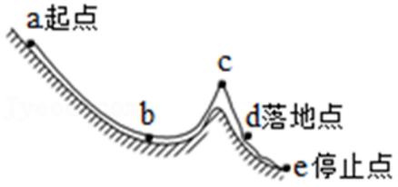

- A. 在\( a\)点和\( c\)点速度都为零，因此这两点动能也为零
- B. 在\( a\)点和\( e\)点都处于静止状态，因此机械能相等
- C. 从\( a\)点下滑到\( b\)点过程中，机械能保持不变
- D. 从\( c\)点下落到\( d\)点过程中，机械能保持不变

【答案】D

【解析】​

## 6. 单选题（难度：简单）

如图所示，将同一物体从\( A\)点静止开始沿三个光滑的弧面\( AB\)、\( AC\)、\( AD\)自由滚下，到达同一水平面时的动能分别为\( {E}_{1}\)、\( {E}_{2}\)、\( {E}_{3}\)，则（    ）. 

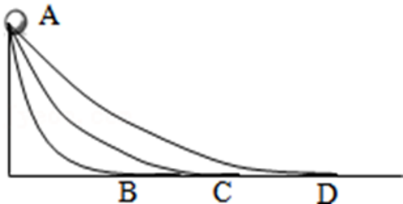

- A. \( {E}_{1}\)最大
- B. \( {E}_{2}\)最大
- C. \( {E}_{3}\)最大
- D. \( {E}_{1}\)、\( {E}_{2}\)、\( {E}_{3}\)一样大

【答案】D

【解析】​

## 7. 单选题（难度：简单）

如图所示，在伽利略理想实验中，小球每次均从斜面\( A\)点自由滚下，分别经过图中\( a\)，\( b\)，\( c\)各位置，关于小球的动能和重力势能描述错误的是（    ）. 

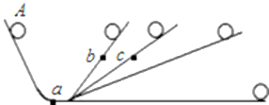

- A. 从\( a\)到\( b\)动能转化为重力势能
- B. 在\( b\)，\( c\)处重力势能相等
- C. 从\( a\)到\( c\)重力势能转化为动能
- D. 在\( a\)处动能最大

【答案】C

【解析】​

## 8. 单选题（难度：简单）

如图所示，将一小钢球从\( a\)点竖直向上抛出（不计空气阻力），经过\( b\)点到达最高点\( c\)时速度为零，图中\( {h}_{ab}={h}_{bc}\)，下列判断正确的是（    ）. 

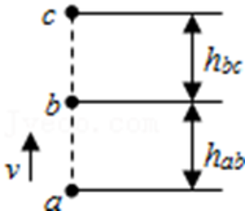

- A. 小钢球在\( ac\)段重力势能的增加量与动能的减小量相等
- B. 小钢球运动到最高点\( c\)时不受力
- C. 小钢球在\( ab\)段克服重力做功小于在\( bc\)段克服重力做功
- D. 就\( a\)、\( b\)、\( c\)三点而言，小钢球在\( a\)点具有的机械能最大

【答案】A

【解析】​

## 9. 多选题（难度：简单）

在如图所示的滚摆上升、下降的实验中（不计摩擦和空气阻力），以下说法中正确的是（    ）. 

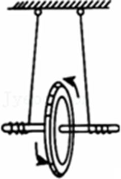

- A. 上升时，滚摆的机械能不变
- B. 上升时，滚摆的动能转化为重力势能
- C. 下降时，滚摆的动能转化为重力势能
- D. 上升、下降时，其他形式的能转化为机械能

【答案】A/B

【解析】​

## 10. 单选题（难度：适中）

甲、乙是两个相同的小球，如图所示，在同一高度同时以大小相等的速度v，将甲球竖直向下抛出，乙球竖直向上抛出，不计空气阻力，下列说法中正确的是（    ）. 

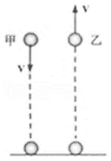

- A. 抛出瞬间，乙球的机械能大于甲球的机械能
- B. 落地前的运动中，甲球的动能转化成重力势能
- C. 落地前的运动中，乙球的机械能先增大后减少
- D. 落地前的运动中，甲球与乙球的机械能一直相等

【答案】D

【解析】​

## 11. 多选题（难度：简单）

下列关于人造卫星说法正确的是（    ）. 

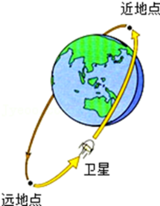

- A. 卫星运动到近地点时，动能最大，势能最小
- B. 卫星运动到远地点时，动能最大，势能最小
- C. 卫星由近地点向远地点运动，势能转化为动能
- D. 卫星由远地点向近地点运动，势能转化为动能

【答案】A/D

【解析】​

## 12. 多选题（难度：适中）

如图将一小球置于一弹簧上方，放手后，小球向下运动，到达\( A\)位置小球刚好与弹簧接触，到达\( B\)位置小球的速度变为零，则对于此过程分析下列说法错误的是（    ）. 

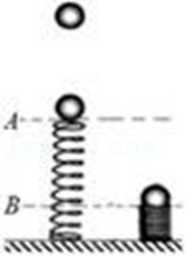

- A. 从\( A\)到\( B\)位置过程中，小球的机械能全部转化为弹簧的弹性势能
- B. 从\( A\)到\( B\)位置过程中，小球受到弹力一直变大
- C. 从\( A\)到\( B\)位置过程中，小球的速度由大变小，到\( B\)位置为零
- D. 从\( A\)到\( B\)位置过程中，小球开始时受到的弹力小于重力，后来受到的弹力大于重力

【答案】A/C

【解析】​

## 13. 多选题（难度：适中）

如图所示，一个小球从光滑斜面的顶端自由下滑经过\( A\)点到达斜面底端，如果小球经过\( A\)点时具有的重力势能为\( \text{50J}\)，若不计空气阻力，以下说法正确的是（    ）. 

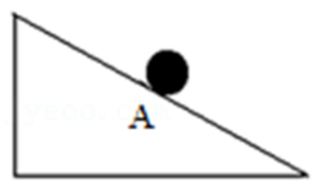

- A. 小球到达底端时动能大于\( \text{50J}\)
- B. 小球从顶端到达底端的过程中，重力势能转化为动能
- C. 小球到达底端时的机械能大于经过\( A\)点时的机械能
- D. 小球到达底端时的机械能等于经过\( A\)点时的机械能

【答案】A/B/D

【解析】​

## 14. 多选题（难度：简单）

如图所示，把一个铁锁用绳子悬挂起来，将铁锁拉到自己鼻子附近，稳定后松手，铁锁向前摆去. 下列说法中正确的是（    ）. 

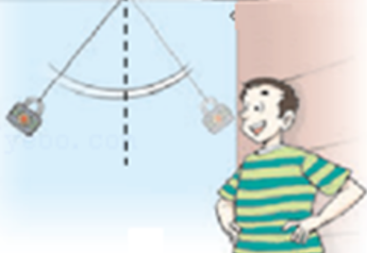

- A. 铁锁刚开始由鼻子附近向下摆动时，重力势能最大
- B. 铁锁由最低点向上摆动时重力势能转化为动能
- C. 铁锁在摆动的过程中机械能守恒
- D. 铁锁在摆动到最高点时受力不平衡

【答案】A/D

【解析】​

## 15. 多选题（难度：适中）

如图所示，在光滑的水平台面上，一轻弹簧左端固定，右端连接一金属小球，\( O\)点是弹簧保持原长时小球的位置. 开始时通过小球压缩弹簧到\( A\)位置（已知\( AO=OB\)），释放小球，研究小球在水平方向上的受力和运动情况，则（    ）. 

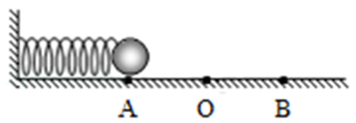

- A. 小球运动到\( B\)点时速度为\( 0\)
- B. 小球在运动过程中所受弹力的方向保持不变
- C. 小球从\( A\)运动到\( O\)的过程中弹性势能转化动能
- D. 小球从\( O\)运动到\( B\)的过程中所受弹力方向向右，速度不断减小

【答案】A/C

【解析】​

## 16. 填空题（难度：简单）

如图，滚摆下降过程中，滚摆的 能转化为能. 滚摆上下往复运动过程中，其每次上升所能达到的高度越来越低，滚摆在运动过程中的机械能（选填“增加”、“减少”或“不变”）. 

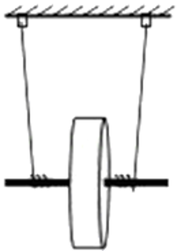

【答案】重力势，动，减少

【解析】​

## 17. 多选题（难度：适中）

如图所示为杂技里的蹦床表演，演员从高处跳下落在蹦床上，又被弹起，对此下列说法中错误的是（    ）. 

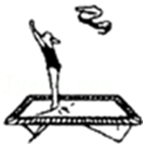

- A. 在下落过程中，演员的重力势能转化为动能
- B. 演员与蹦床接触使其发生弹性形变的过程中，动能转化为弹性势能
- C. 在蹦床恢复原状的过程中，弹性势能转化为演员的动能
- D. 在演员向上弹起的过程中，演员的动能转化为弹性势能

【答案】B/C/D

【解析】​

## 18. 填空题（难度：适中）

在城市街道上，常会看到洒水车一边播放着优美的乐曲，一边向道路上洒水. 如图所示，一辆在水平路面上匀速行驶的洒水车正在洒水作业，该洒水车的机械能；理由是. （前两空均选填“增大”“减小”或“不变”）

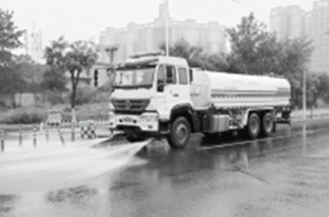

【答案】减小，重力势能不变，速度不变，质量减小，动能减小

【解析】​

## 19. 填空题（难度：简单）

如图所示，物体\( M\)与弹簧一端相连，系在绳子末端的小球从\( A\)处由静止开始释放，在最低点\( B\)处，撞击物体\( M\)后反弹，并使\( M\)在水平面上向右运动，最远可以到达\( D\)点. （图中\( C\)点是弹簧原长时的末端，不计空气阻力）. 
（1）从\( A\)到\( B\)的过程中，小球的转化为（选填“动能”、“重力势能”）. 
（2）物体\( M\)从\( C\)到\( D\)的过程中，动能大小变化是，弹簧的弹性势能（以上两空均选填“一直变大”、“一直变小”或“先变大后变小”）. 

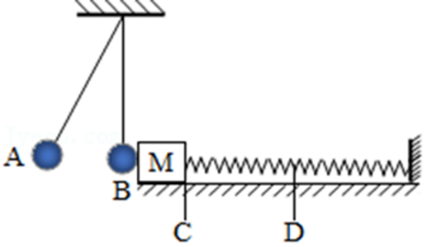

【答案】重力势能，动能，一直变小，一直变大

【解析】​

## 20. 填空题（难度：适中）

如图所示，小球从左端最高点A摆至最低点B的过程中，能转化为能. 在转化的过程中，不计空气阻力，小球的机械能总量（选填“增大”“减小”或“不变”）. 

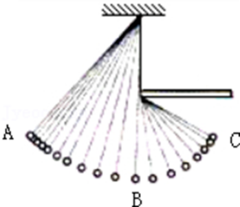

【答案】重力势，动，不变

【解析】​

## 21. 填空题（难度：适中）

将一小球水平抛出，如图是小球弹跳的频闪照片，小球在\( A\)、\( B\)位置的高度一样. 小球首次到达最高点，小球的动能零（选填“等于”或“不等于”）. 落地弹起后小球从\( A\)到\( B\)过程中机械能将（选填“增大”“不变”或“减小”）
 
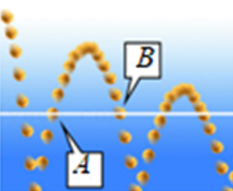

【答案】不等于，减小

【解析】​

## 22. 填空题（难度：简单）

火车站站台设计方案如图所示，进站和出站的轨道都与站台构成一个缓坡，火车进站时由于就能冲上缓坡，把转化成重力势能，使速度（选填“增大”、“减小”或“不变”），出站时，又把储存的转化为动能，有效利用了能量. 

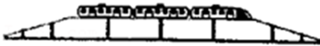

【答案】惯性，动能，减小，重力势能

【解析】​

## 23. 填空题（难度：简单）

如图所示，橡皮筋两头分别固定在罐子两端，中间系一个钩码，就制成了一个神奇的滚筒，将滚筒在水平地面上滚出，橡皮筋的弹性形变变大，具有的弹性势能增多. 滚筒还能神奇的自动滚回来，滚回的过程中能转化为能. 

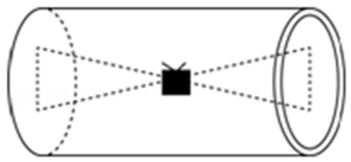

【答案】弹性势，动

【解析】​

## 24. 填空题（难度：简单）

如图所示，用细线把一个小球悬挂起来，将小球从位置\( B\)拉到位置\( A\)，松开手释放小球，小球就在\( A\)、\( B\)、\( C\)三点之间来回摆动. 当小球从（选填“\( A\)到\( B\)”或“\( B\)到\( C\)”）的过程中，小球的重力势能转化为动能，小球运动到选填“\( A\)”、“\( B\)”或“\( C\)”）点时，动能最大. 

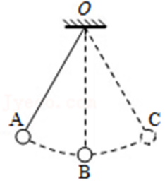

【答案】$ A$到$ B$  ，$ B$ 

【解析】​

## 25. 填空题（难度：简单）

如图所示，有一轻质弹簧左端固定，右端连接一金属小球，\( O\)点是弹簧保持原长时小球的位置，小球压缩弹簧至\( A\)位置，然后由静止释放小球，小球向右运动，经过\( B\)点时速度为\( {v}_{1}\)，继续运动到最远处的\( C\)点，已知\( AO>OC\). 
（1）小球经过\( O\)点时， （ “有”或“没有”）受到弹簧的弹力？
（2）小球从\( A\)到\( C\)的运动过程中，小球的动能和弹簧的弹性势能之间是如何转化的： . 
（3）到达\( C\)点后，小球向左运动，再次经过\( B\)点时的速度为\( {v}_{2}\). 则：\( {v}_{1}\)  \( {v}_{2}\)（选填“＜”“＝”“＞”）；小球前后两次经过\( B\)点时，弹簧弹力的方向（选填“相同”“相反”）. 

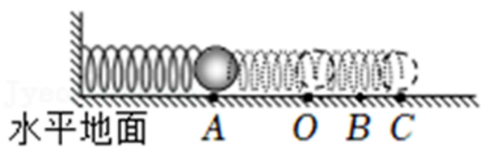

【答案】没有，小球从$ A$到$ O$的过程中，弹簧弹性势能转化为小球的动能；小球从$ O$到$ A$的过程中，小球的动能转化为弹簧弹性势能，＞，相同

【解析】​

## 26. （难度：简单）

用绳子把一个铁锁悬挂起来，把铁锁拉到刚好贴着自己的鼻子，稳定后松手、头不动（如图所示），铁锁由开始位置\( a\)沿弧线\( ac\)向另一侧的最高点\( c\)运动，然后再从\( c\)往回运动. 

（1）从\( a\)点到最低点\( b\)点的过程中，铁锁的动能、重力势能如何变化？

（2）分析铁锁摆回时能否碰到鼻子，为什么？

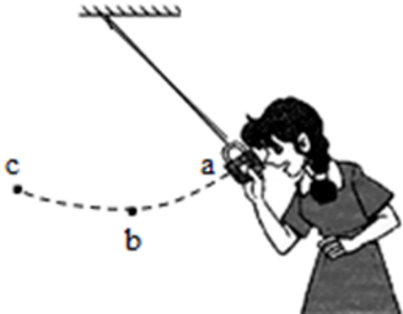

【答案】

（1）铁锁从$ a$点$ b$点的过程中，铁锁的质量不变，高度减小，重力势能减小；速度增大，动能增大. 

（2）铁锁在摆动时，有一部分机械能转化为内能，机械能减小，故不会碰到鼻子. 

【解析】​

## 27. 填空题（难度：适中）

在探究“动能和重力势能相互转化”的实验中，采用如图所示的实验装置. 用细线把一个质量为\( m\)的小球悬挂起来，将小球从位置\( B\)拉到位置\( A\)，由静止释放小球，观察小球从\( A\to B\to C\)的过程中的高度和速度的变化，并测出了小球在\( A\)、\( B\)、\( C\)三个位置时动能和重力势能的值，从而分析这一过程中动能和重力势能之间的转化，数据如表所示. 

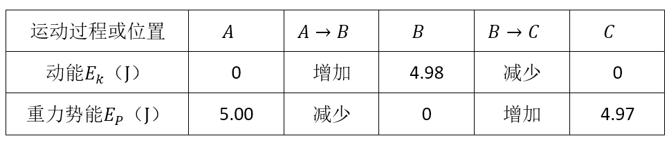

（1）小球在图中的\( C\)位置，受到个力的作用. 

（2）从实验中可以看出，小球从\( A\to B\)的过程中速度不断，高度不断降低，这个过程中是能逐渐转化为能；在能量转化的过程中，机械能在逐渐减少，这主要是小球由于受到造成的. 

（3）在实验中，如果换用质量为\( 2m\)的小球，其他条件不变. 那么，小球到达\( B\)位置时的机械能质量为\( m\)的小球到达\( B\)位置时的机械能（选填“大于”、“小于”或“等于”）. 

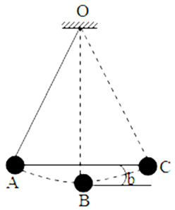

【答案】2，增大，重力势，动，空气阻力，大于

【解析】​

## 28. 单选题（难度：简单）

我国现代农业已进入信息化和数字化时代，农用机械已经能通过北斗导航系统精准作业。如图所示，水平匀速飞行的无人机正在喷洒农药，在此过程中（　　）
     

- A. 它的动能不变，重力势能减小，机械能减小
- B. 它的动能不变，重力势能不变，机械能不变
- C. 它的动能减小，重力势能不变，机械能减小
- D. 它的动能减小，重力势能减小，机械能减小

【答案】D

【解析】动能的大小与质量和速度有关，重力势能的大小与质量和高度有关，水平匀速飞行的无人机正在喷洒农药，在此过程中，水平飞行说明高度不变，匀速说明速度大小不变，但喷洒农药说明总质量在减小，因此动能减小，重力势能减小，动能和势能统称为机械能，所以机械能在减小，故D符合题意，ABC不符合题意。
故选D。

## 29. 单选题（难度：简单）

下列关于机械能及其转化的说法中，错误的是（　　）

- A. 蹦床运动员从高处落下，与蹦床接触后到达最低点时，运动员的动能最大
- B. 人造地球卫星在从近地点向远地点运行的过程中，机械能守恒
- C. 滚摆在上升过程中，动能转化为重力势能
- D. 人们修筑拦河坝提高上游的水位，增大水的重力势能

【答案】A

【解析】A．运动员刚接触蹦床时，重力大于弹力，受到的合力向下，会继续向下做加速运动，所以刚接触蹦床时，动能未达到最大值；随着蹦床面形变程度加大，弹力也变大，当弹力大于重力时，运动员受到的合力向上，开始做减速运动，所以蹦床面发生弹性形变过程中，运动员的动能先增大，后减小，与蹦床接触后到达最低点时，运动员的动能减小，弹性势能最大，故A错误，符合题意；
B．人造地球卫星不受空气阻力，所以从近地点向远地点运行的过程中，机械能守恒，故B正确，不符合题意；
C．滚摆在上升过程中，速度减小，高度变大，动能转化为重力势能，故C正确，不符合题意；
D．提高上游的水位，高度变大，水的重力势能变大，故D正确，不符合题意。
故选A。

## 30. 单选题（难度：简单）

北京时间2025年4月24日17时17分，搭载神舟二十号载人飞船的长征二号F遥二十运载火箭在酒泉卫星发射中心点火发射，火箭在加速升空过程中，火箭上载人飞船的（　　）

- A. 动能增大，重力势能增大，机械能增大
- B. 动能增大，重力势能减小，机械能不变
- C. 动能减小，重力势能增大，机械能不变
- D. 动能减小，重力势能减小，机械能减小

【答案】A

【解析】火箭上升过程中，火箭上的载人飞船质量不变，速度变大，高度变高，故载人飞船的动能变大，重力势能变大，因为机械能等于动能与重力势能之和，所以载人飞船的机械能也变大，故A符合题意，BCD不符合题意。
故选A。

## 31. 单选题（难度：适中）

骑自行车上坡前，往往要加紧用力蹬几下，这样做是为了（　　）

- A. 增大势能
- B. 增大动能
- C. 增大惯性
- D. 减小阻力

【答案】B

【解析】骑自行车上坡前，往往要用力加紧蹬几下，这样车的速度增大，车的动能增大，上坡时就会有更多的动能转化为重力势能，这样自行车就会爬得更高，故B符合题意，ACD不符合题意。
故选B。

## 32. 单选题（难度：适中）

踢毽子，又叫“打鸡”，是中国民间传统的体育健身活动之一、从毽子离开脚开始上升至第一次到达最高点的过程中（忽略空气阻力），毽子的（　　）

- A. 动能一直增大
- B. 重力势能一直减小
- C. 机械能保持不变
- D. 机械能一直增大

【答案】C

【解析】从毽子开始上升至第一次到达最高点的过程中，毽子的质量不变，速度逐渐变小，高度逐渐升高，所以毽子的动能一直减小，重力势能一直增大，由于忽略空气阻力，所以机械能没有损失，故机械能保持不变，故C符合题意，ABD不符合题意。
故选C。

## 33. 单选题（难度：简单）

舰载直升机完成任务返航，要降落在航空母舰上，在直升机减速下降靠近航母甲板的过程中（　　）

- A. 惯性变大
- B. 动能变小
- C. 重力势能不变
- D. 机械能不变

【答案】B

【解析】A、惯性大小只与质量有关，与速度无关，质量不变，惯性不变，故A错误；
BCD、直升机减速下降过程中，高度减小，重力势能减小；速度减小，动能减小；机械能为动能和势能的和，故机械能减小；故B正确，CD错误．

## 34. 单选题（难度：适中）

日常生活中的许多现象都与我们所学习的物理知识有关，下列说法不正确的是（　　）

- A. 轮胎上的花纹可以增大摩擦力
- B. 荡秋千时，小孩的机械能不守恒
- C. 盘山公路不省距离，但是省力
- D. 投掷出去的铅球在空中飞行的过程，是受到了运动员对它做的功

【答案】D

【解析】A．轮胎上的花纹可以通过增大接触面的粗糙程度增大摩擦力，故A正确，不符合题意；
B．荡秋千时，克服摩擦力做功，小孩的机械能不守恒，故B正确，不符合题意；
C．盘山公路费距离，但是省力，因为在斜面上，推力小于物体的重力，故C正确，不符合题意；
D．投掷出去的铅球在空中飞行的过程，是由于惯性继续前进，此时运动员对铅球没有力的作用，故运动员对球不做功，故D错误，符合题意。
故选D。

## 35. 单选题（难度：简单）

下列关于功的说法正确的是（　　）

- A. 小明用力推发生故障的汽车而未推动时，推力对汽车做了功
- B. 吊车吊着重物沿水平方向匀速运动一段距离时，吊车的拉力对重物做了功
- C. 足球在水平地面上滚动一段距离时，重力对足球做了功
- D. 举重运动员从地面将杠铃举起的过程中，杠铃机械能增大

【答案】D

【解析】Ａ．小明推车推而未动，车并没有沿着推力的方向移动一段距离，所以推力并没有对汽车做功，故Ａ错误；
Ｂ．吊车对重物的拉力竖直向上，然而重物的移动方向沿水平方向，与力的方向垂直，所以吊车的拉力没有对重物做功，故Ｂ错误；
Ｃ．足球在水平地面上滚动一段距离，是由于足球具有惯性，在此过程中，重力方向竖直向下，足球的运动方向沿水平方向，与重力方向垂直，因此重力对足球不做功，故Ｃ错误；
Ｄ．杠铃被举起的过程中，杠铃的重力势能和动能都增大，机械能等于重力势能与动能之和，因此机械能也增大，故Ｄ正确。
故选Ｄ。

## 36. 单选题（难度：简单）

我国现代农业已进入信息化和数字化时代，农用机械已经能通过北斗导航系统精准作业。如图所示，水平匀速飞行的无人机正在喷洒农药，在此过程中（　　）

【答案】A

## 37. 单选题（难度：简单）

2025年1月17日，山东省首条低空无人机物流运输航线试航成功。下图为运输货物的无人机正在匀速下降，下列有关货物的说法正确的是（　　）

【答案】A

## 38. 单选题（难度：适中）

2025年1月13日，我国太原卫星发射中心使用捷龙三号运载火箭将微厘空间01组卫星发射升空。如图所示，在卫星随火箭加速升空的过程中（　　）
      
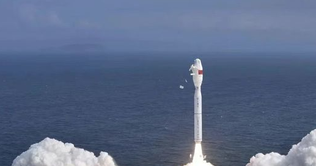

- A. 火箭的燃料燃烧时，内能转化为化学能
- B. 以火箭为参照物，卫星是运动的
- C. 卫星的动能增大，重力势能减小，机械能不变
- D. 卫星的动能增大，重力势能增大，机械能增大

【答案】D

【解析】A．火箭的燃料燃烧时，放出热量，化学能转化为内能，故A不符合题意；
B．以火箭为参照物，卫星的相对位置不变，是静止的，故B不符合题意；
CD．卫星在随火箭加速升空的过程中，质量不变，高度和速度都增大，因此卫星的重力势能增大，动能增大，机械能增大。故C不符合题意，D符合题意。
故选D。

## 39. 单选题（难度：适中）

如图所示，人造地球卫星在绕地球椭圆轨道运行的过程中，当卫星从近地点向远地点运行时，下列说法正确的是（　　）
      

- A. 动能增大，势能增大
- B. 动能减小，势能增大
- C. 动能增大，势能减小
- D. 动能减小，势能减小

【答案】B

【解析】人造地球卫星在绕地球椭圆轨道运行的过程中，机械能守恒，近地点高度小于远地点，则近地点重力势能小于远地点，当卫星从近地点向远地点运行时，重力势能增大，动能转化为重力势能，动能减小，故B符合题意，ACD不符合题意。
故选B。

## 40. 单选题（难度：适中）

如图是一个光滑的轨道，某小球从轨道的O点出发，以某一初速度开始下滑，小球始终没有离开轨道（不计空气阻力），你认为小球最远可以运动到（　　）
      
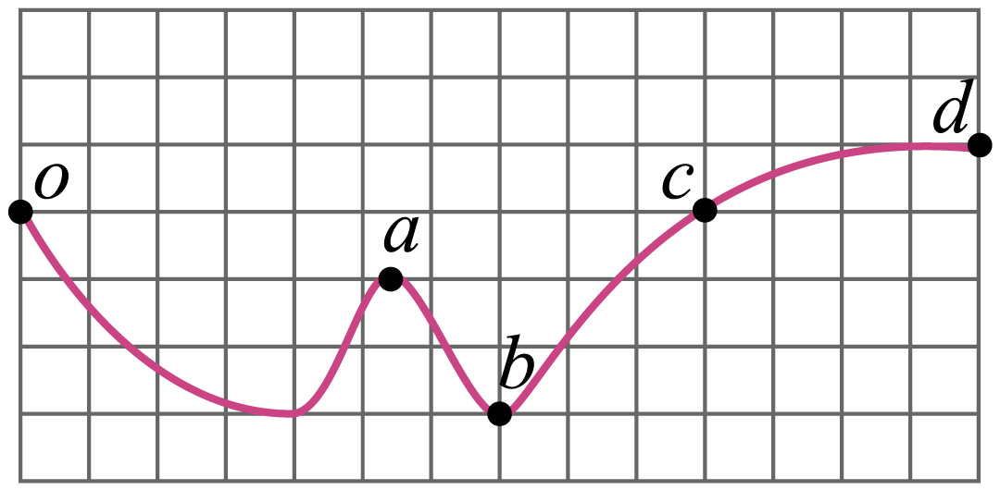

- A. a点
- B. b点
- C. c点
- D. d点

【答案】D

【解析】不计空气阻力，由于轨道是光滑的，没有摩擦力，所以小球的机械能守恒。如果小球从O点由静止释放，始终没有离开轨道，最远可以滚到与O点等高的c点，但是小球从O点以某一初速度开始下滑，此时比静止释放多一些动能，所以可以运动到d点。
故选D。

## 41. 单选题（难度：简单）

如图所示，热气球在空中匀速上升过程中（阻力不能忽略），下列说法不正确的是 （　　）
      

- A. 动能不变
- B. 势能增加
- C. 机械能增加
- D. 所受的浮力等于重力

【答案】D

【解析】ABC．热气球在空中匀速上升过程中，其质量不变，速度不变，则动能不变；同时高度变大，则重力势能变大；因机械能等于动能与势能的总和，所以热气球的机械能变大，故ABC正确，不符合题意；
D．热气球在空中匀速上升过程中，其受到的力为平衡力，空气阻力不能忽略，此时热气球受到竖直向下的重力和阻力、竖直向上的浮力，所以浮力大于重力，故D错误，符合题意。
故选D。

## 42. 单选题（难度：适中）

如图所示，把一个铁锁用不可伸长的轻绳悬挂起来，将它拉到鼻子附近，稳定后松手，铁锁来回摆动，最后停止。在铁锁摆动过程中，下列说法正确的是（　　）
      
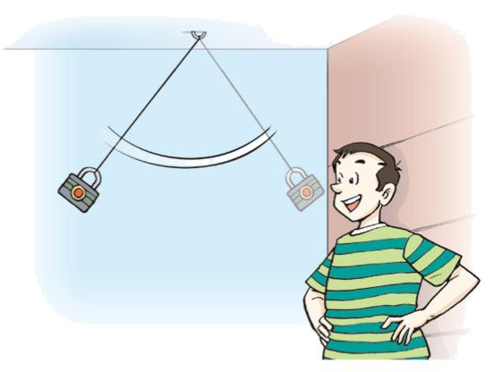

- A. 铁锁的机械能在减小
- B. 铁锁的重力没有做功
- C. 铁锁的重力势能保持不变
- D. 只有动能和重力势能的相互转化

【答案】A

【解析】A．铁锁摆动幅度逐渐减小，说明摆动过程中，铁锁的机械能一直在减小，故A正确
B．铁锁来回摆动的过程中，在竖直方向上有距离，铁锁的重力做功，故B错误。
C．摆动过程中，铁锁的高度不断变化且高度越来越低，因此重力势能是变化的，故C错误；
D．由于最后停止了，所以铁锁在摆动过程中，其动能和重力势能相互转化的同时，还有一部分机械能转化为内能，故D错误；
故选A 。

## 43. 单选题（难度：适中）

如图所示是人造卫星绕地球运行的示意图，关于人造卫星绕地球运行过程中下列说法正确的是（　　）
      
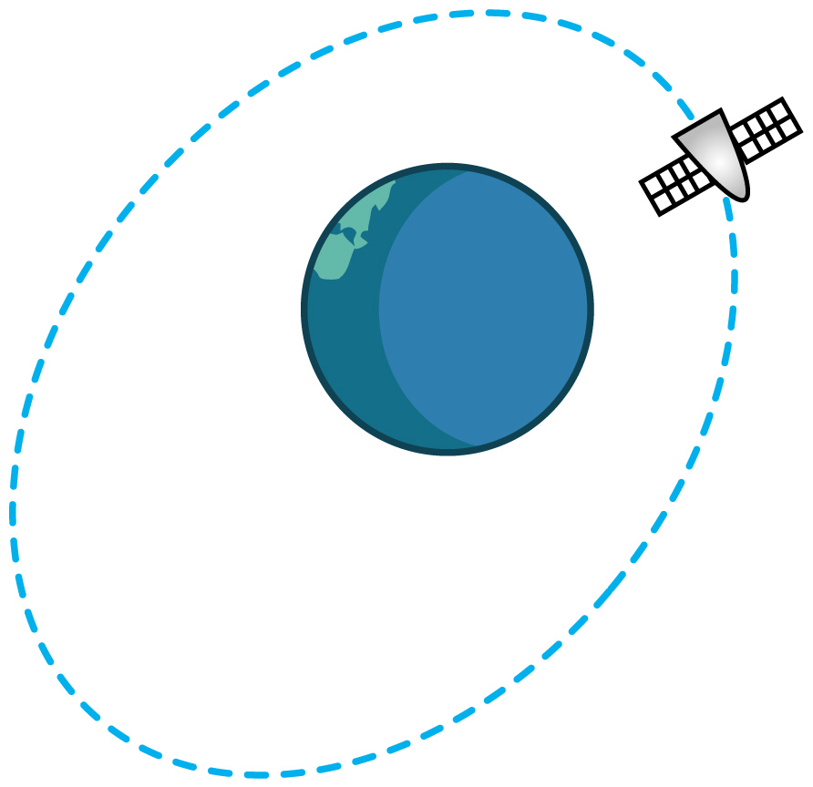

- A. 人造卫星从近地点运动到远地点的过程中重力势能转化为动能
- B. 人造卫星运行过程中处于平衡状态
- C. 人造卫星对地球的力等于地球对人造卫星的力
- D. 人造卫星运行过程中不受到任何力的作用

【答案】C

【解析】A．人造卫星从近地点向远地点运动时，人造卫星的质量不变，它的运动速度变小，故它的动能变小，而人造卫星离地球的高度在增大，所以它的重力势能在增大，将动能转化为重力势能，故A错误；
B．人造卫星在运行过程中运动的方向不断改变，则人造卫星的运动状态不断改变，所以人造卫星处于非平衡状态，故B错误；
C．人造卫星对地球的力与地球对人造卫星的力是一对相互作用力，则人造卫星对地球的力等于地球对人造卫星的力，故C正确；
D．力是改变物体运动状态的原因，由B可知人造卫星的运动状态不断改变，则人造卫星在运行过程中一定受到力的作用，故D错误。
故选C。

## 44. 单选题（难度：适中）

在2025年哈尔滨亚冬会自由式滑雪女子大跳台的比赛中，我国选手获得金牌。如图所示，运动员从 50 m高的跳台由静止出发，在空中完成了一次超高难度的1080度旋转后平稳落到雪地上。下列说法中正确的是（    ）
      
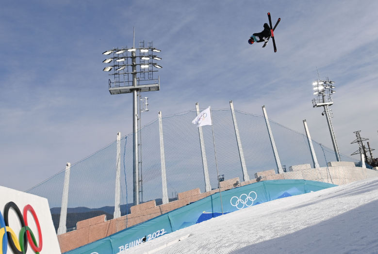

- A. 滑雪板宽大的设计是为了减小对雪地的压力
- B. 运动员在跳台上静止时所受的力是平衡力
- C. 运动员在空中旋转是受到惯性的作用
- D. 运动员在下降过程中，机械能守恒，

【答案】B

【解析】A．宽大滑雪板是为了增大受力面积，从而减小压强，而不是减小压力。在水平地面上时压力大小等于运动员重力，不会因板宽大而改变，故A错误；
B．静止在水平台面上时合力为零，受到的重力和支持力是一对平衡力，故B正确；
C．惯性是物体保持运动状态的性质，不是一种力，不能说“受到惯性的作用”，故C错误；
D．由于有空气阻力，运动员在下降过程中机械能是不守恒的，故D错误。
故选B 。

## 45. 单选题（难度：适中）

科技的发展使农业机械化水平越来越高，如图所示是一架飞机在一定的高度匀速直线飞行给小麦喷洒农药时的情景（不计空气阻力）。喷洒农药的过程中，飞机的（　　）
      
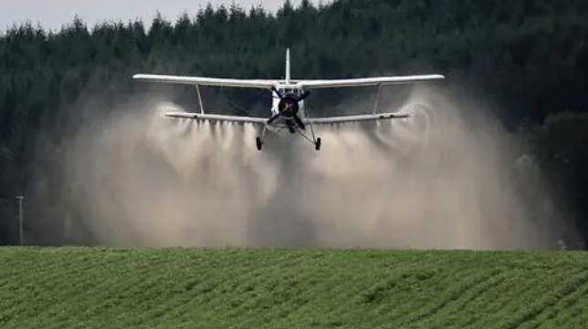

- A. 重力势能减小
- B. 动能增大
- C. 机械能不变
- D. 动能转化为重力势能

【答案】A

【解析】飞机在一定的高度匀速直线飞行给小麦喷洒农药，喷洒农药的过程中，飞机总质量减小，速度不变，高度不变，因此飞机动能减小，重力势能减小，则机械能减小，故A符合题意，BCD不符合题意。
故选A。

## 46. 单选题（难度：适中）

2022年2月14日，我国自由式滑雪运动员徐梦桃在北京冬奥会上获得冠军。如图所示是她比赛中的运动轨迹，如果不计空气阻力，下列说法正确的是（　　）
      
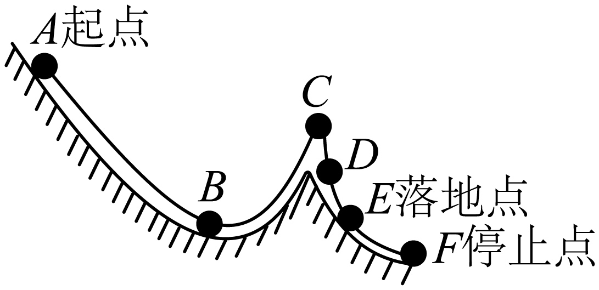

- A. 从A点滑向B点过程中，运动员的重力势能转化为动能
- B. 在C点时运动员受平衡力作用
- C. 从C点下落到D点过程中，运动员的机械能增大
- D. 运动员从E点滑向F点，是因为受到惯性的作用

【答案】A

【解析】A．运动员从A点滑向B点过程中，高度变小，质量不变，重力势能变小；质量不变，速度变大，动能变大，是重力势能转化为动能，故A正确；
B．不计空气阻力，在C点时受到重力的作用，受力不平衡，故B错误；
C．运动员从C点下落到D点过程中，不计空气阻力，机械能是守恒的，保持不变，故C错误；
D．运动员从E点滑向F点，是因为运动员具有惯性，惯性是一种性质，不能说受到惯性的作用，故D错误。
故选A。

## 47. 单选题（难度：适中）

现代农业利用无人机喷洒农药，安全又高效。如图所示，喷药无人机在农田上方沿水平方向匀速飞行，均匀喷洒农药。无人机匀速飞行喷洒农药过程中（　　）
      
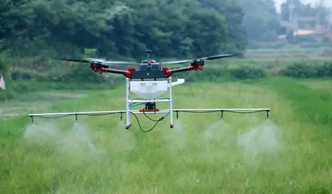

- A. 受惯性作用
- B. 动能不变
- C. 重力势能减小
- D. 机械能守恒

【答案】C

【解析】A．惯性不是力，不能说受到惯性作用，故A不符合题意；
BCD．无人机在农田上方沿水平方向匀速飞行时，质量不断减小，速度不变，动能减小，高度不变，重力势能减小，因此机械能减小，故C符合题意，BD符合题意。
故选C。

## 48. 单选题（难度：适中）

如图所示的四种情景中，属于弹性势能转化为动能的是（　　）

- A. 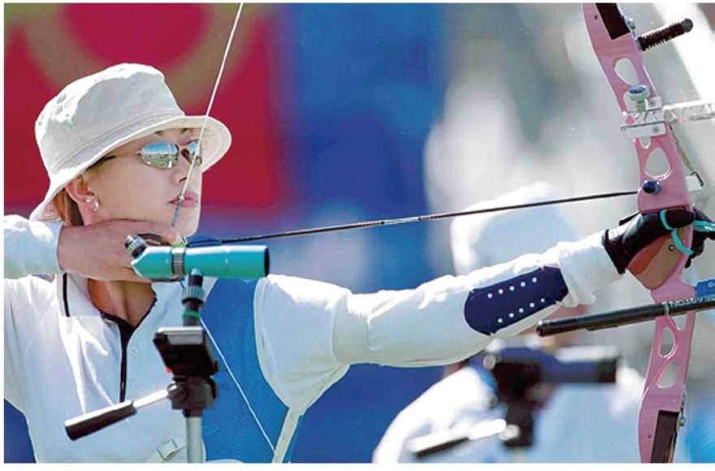
 运动员弯弓射箭
- B. 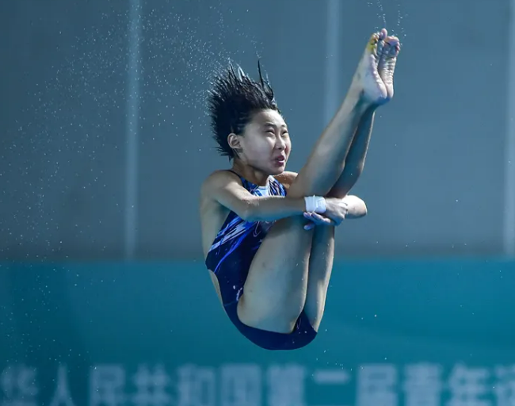
 跳水运动员竖直下落
- C. 
 运动员骑自行车冲向坡顶
- D. 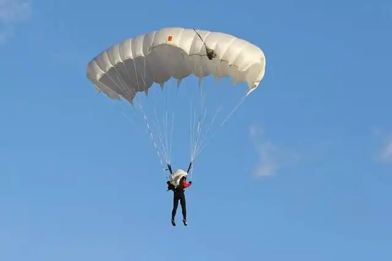
 跳伞运动员匀速下降

【答案】A

【解析】A．运动员把弯弓拉开将箭射出，是弓的弹性势能转化为箭动能的过程，故A符合题意；
B．跳水运动员从空中下落，质量不变，速度增大，动能增大，高度减小，重力势能减小，此过程中，重力势能转化为动能，故B不符合题意；
C．运动员骑自行车冲向坡顶，运动员和自行车的质量不变，速度减小，动能减小，高度增大，重力势能增大，此过程中，动能转化为重力势能，故C不符合题意；
D．跳伞运动员匀速下落，运动员的质量不变，速度不变，动能不变，高度减小，重力势能减小，故D不符合题意。
故选A。

## 49. 单选题（难度：适中）

适量运动是健康的生活方式。下列对日常运动情景分析错误的是（　　）

- A. 用力将足球踢出，说明力可以改变物体的运动状态
- B. 竖直向上运动到最高点时的排球受到平衡力的作用
- C. 离开蹦床后人继续上升过程中，动能转化为重力势能
- D. 篮球离手后能继续向前运动，是由于篮球具有惯性

【答案】B

【解析】A．用力将足球踢出，球受到力的作用，由静止变为运动，说明力可以改变物体的运动状态，故A正确，不符合题意；
B．竖直向上运动到最高点时的排球只受到重力，受到非平衡力的作用，故B错误，符合题意；
C．离开蹦床后人继续上升过程中，人的质量不变，速度变小，高度变大，则他的动能变小，重力势能变大，动能转化为重力势能，故C正确，不符合题意；
D．篮球离手后能继续向前运动，是由于篮球具有惯性，要保持原来的运动状态，故D正确，不符合题意。
故选 B。

## 50. 单选题（难度：适中）

如图所示，将一个小球用细线悬挂起来，让小球从A点静止释放，小球会在A、C两点之间来回摆动，受到空气阻力和悬挂点摩擦的影响，最终静止下来。下列说法正确的是（　　）
      
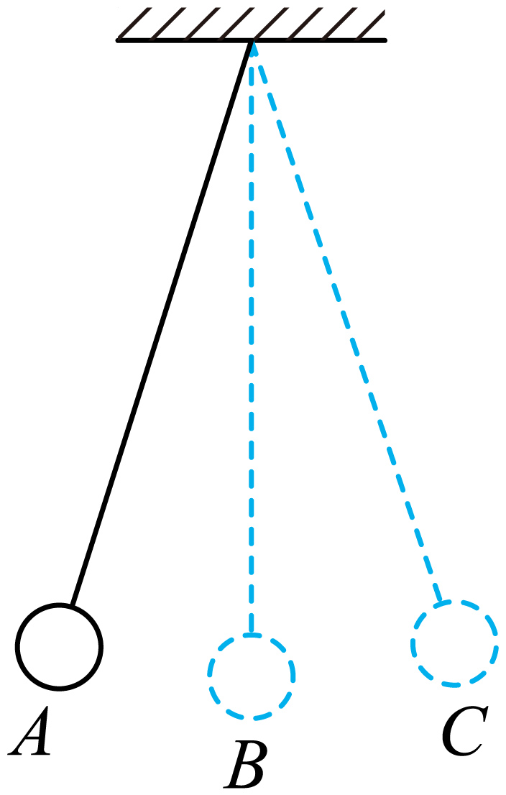

- A. 小球从A点摆动到B点，动能减小
- B. 小球从A点摆动到B点，重力势能减小
- C. 小球从A点摆动到B点，动能转化为重力势能
- D. 小球每次经过B点，其机械能总和不变

【答案】B

【解析】ABC．因为小球从A点由静止释放，所以小球在A点时，动能为零，重力势能最大，小球从A点摆动到B点的过程中，重力势能转化为动能，重力势能减小，动能增大，当小球摆动到B点时，动能最大，重力势能最小，故AC错误，B正确；
D．由题意可知，因受到空气阻力和悬挂点摩擦的影响，部分机械能转化为其它形式的能，故小球的机械能不守恒，所以小球每次经过B点，其机械能总和都在减小，故D错误。
故选B。

## 51. 单选题（难度：适中）

2025年1月7日，长征三号乙运载火箭在西昌卫星发射中心点火升空。火箭在离地加速上升的过程中，下列说法正确的是（　　）

- A. 动能减小
- B. 重力势能减小
- C. 重力势能转化为动能
- D. 机械能增加

【答案】D

【解析】火箭加速升空，质量不变，速度变大，高度升高，动能增加，重力势能增加，其他形式的能转化为动能和重力势能；机械能为动能和势能的总和，所以机械能增加，故ABC错误，D正确。
故选D。

## 52. 单选题（难度：适中）

如图所示，小球以初速度v沿着凹凸不平的草地从a运动到e，其中b点与d点在同一高度。下列能正确表示小球在b、d点时的动能和重力势能的是（　　）
      
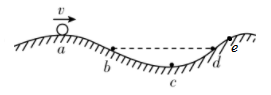

【答案】B

【解析】C．小球以初速度v沿着凹凸不平的草地从a运动到e，其中b点与d点在同一高度，同一个小球质量不变，故重力势能相同，故C不符合题意；
ABD．由于小球以初速度v沿着凹凸不平的草地从a运动到e，阻力比较大，故从b点到d点，总机械能在减小，故b点的机械能大于d点的机械能，由于两点的重力势能相同，故b点的动能大于d的动能，故AD不符合题意，B符合题意。
故选B。

## 53. 单选题（难度：适中）

如图甲是小石荡秋千时的情景，可将其简化为图乙的模型。小石从A点由静止释放，经过最低点B点运动到C点。下列说法正确的是（　　）
      
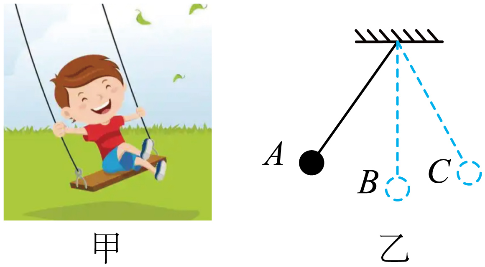

- A. A点到B点过程，小石的动能减小，重力势能增大
- B. B点到C点过程，小石的重力势能和动能都增大
- C. 小石在A点和C点的机械能相等
- D. 秋千荡不起来时，旁人推一下，外力对小石做功，使小石的机械能增加

【答案】D

【解析】A．A点到B点过程，小石的质量不变，高度降低，重力势能减小，速度变大，动能增大，故A错误；
B．B点到C点过程，小石的质量不变，高度增大，重力势能增大，速度变小，动能减小，故B错误；
C．小石在荡秋千过程中，由于存在空气的摩擦，机械能会减小，因此在A点和C点的机械能不相等，故C错误；
D．在荡秋千的过程中，秋千荡不起来时，旁人推一下，外力对小石做功，小石的速度增大，动能增大，所以小石的机械能增加，故D正确。
故选D。

## 54. 单选题（难度：适中）

投石器是古代的攻城利器，如图所示，松开系绳，配重下降，装有石块的一端快速上升，木杆停止转动后，石块被投出，下列说法正确的是（　　）
      
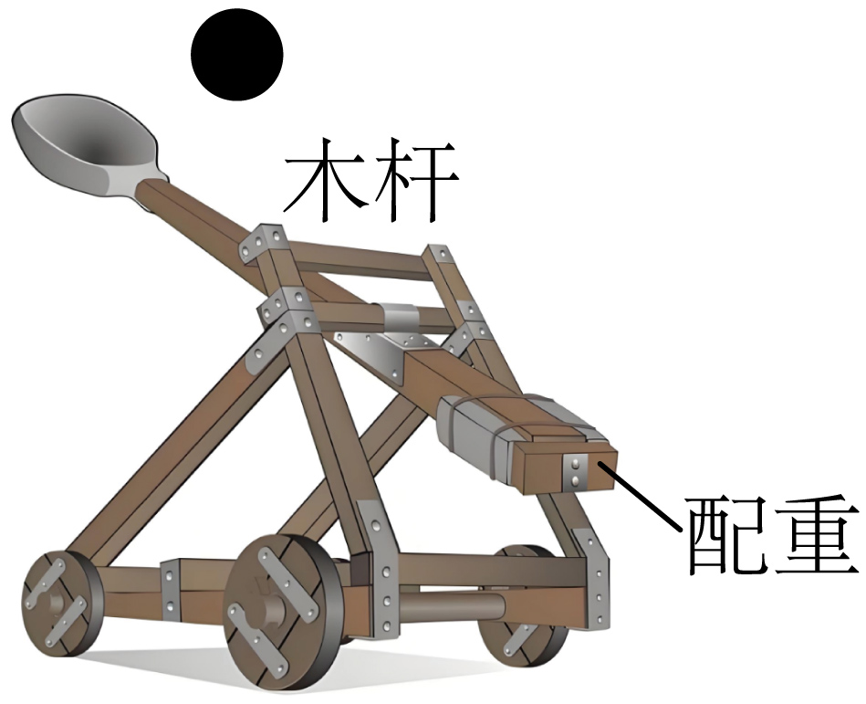

- A. 城门被石块摧毁说明力可以改变物体的运动状态
- B. 投石器装轮子是为了减小摩擦力，方便移动
- C. 木杆停止转动后，石块被投出是因为石块惯性变大
- D. 石块上升的过程动能增大，机械能减小

【答案】B

【解析】A．城门受到石块的作用力被摧毁，说明其形状发生了变化，故说明力可以改变物体的形状，故A错误；
B．投石器装轮子，用滚动代替滑动的方法减小了摩擦力，所以方便移动，故B正确；
C．木杆停止转动后，石块被投出是因为石块具有惯性，此过程中石块的质量不变，惯性大小不变，故C错误；
D．石块在上升过程中，质量不变，由于受到重力的作用，其速度会变小，其动能减小，同时，石块在上升的过程中，高度增加，所以其重力势能增大。石块在上升的过程中，受到空气阻力作用，将一部分机械能转化为内能，因此机械能减小，故D错误。
故选B。

## 55. 单选题（难度：适中）

如图所示，模拟“蹦极”的小实验，一根橡皮筋一端系一个小球，另一端固定在A点。B点是橡皮筋不系小球自然下垂时下端所在的位置，C点是小球从A点自由释放后所能达到的最低点，关于小球从A点到C点的运动过程，不考虑空气阻力，下列说法中正确的是（　　）

【答案】A

## 56. 单选题（难度：适中）

如图所示，将一小球从A点竖直向上抛出（不计空气阻力），经过B点到达最高点C时速度为零。图中\( {h}_{1}={h}_{2}\)，下列判断正确的是（　　）
      
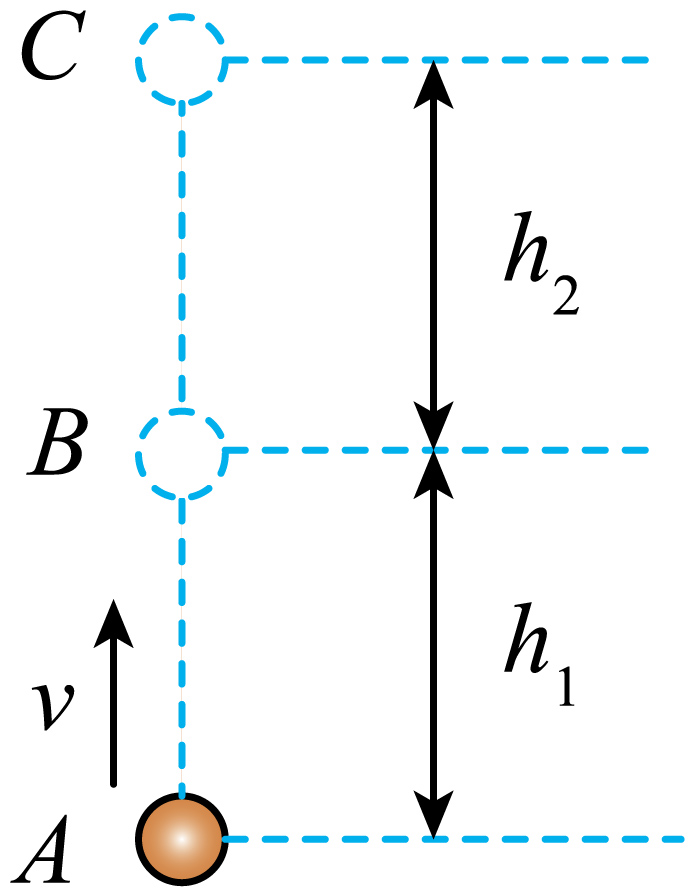

- A. 小球抛出后在B点和C点的机械能相等
- B. 小球上升过程中克服重力做功，重力势能转化为动能
- C. 小球上升过程中克服重力做功，AB段的功率等于BC段的功率
- D. 小球运动到最高点C时动能为零，小球处于平衡状态

【答案】A

【解析】A．不计空气阻力时，小球的机械能（动能 + 重力势能）守恒。因此，小球在B点和C点的机械能相等，故A正确；
B．小球上升过程中，克服重力做功，高度增加、速度减小，是动能转化为重力势能，故B错误；
C．小球上升时速度逐渐减小，AB段平均速度大于BC段平均速度，所用时间\( {t}_{AB}<{t}_{BC}\)
小球在AB段和BC段克服重力做功\( {W}_{AB}=G{h}_{1}={W}_{BC}=G{h}_{2}\)
根据\( P=\frac{W}{t}\)可知，\( {P}_{AB}>{P}_{BC}\)，故C错误；
D． 小球向上做减速运动，到达最高点C，速度变为0，动能变为零。小球此时只受重力作用，它所受的力不是平衡力，它不能处于平衡状态，故D错误。
故选A。

## 57. （难度：适中）

如图所示，在同一高度以大小相同的初速度\( {v}_{0}\)分别竖直向上和斜向上将同一小球抛出，不计空气阻力，小球竖直向上、斜向上到达最高点时到水平地面的高度分别为\( {h}_{1}\)和\( {h}_{2}\)，小球又下落到与抛出点等高度时的速度大小分别为\( {v}_{1}\)和\( {v}_{2}\)，则（　　）
      
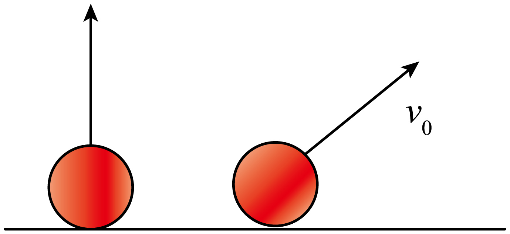

A．\( {h}_{1}={h}_{2}\)，\( {v}_{1}={v}_{2}\)  B．\( {h}_{1}>{h}_{2}\)，\( {v}_{1}={v}_{2}\)
C．\( {h}_{1}={h}_{2}\)，\( {v}_{1}>{v}_{2}\)  D．\( {h}_{1}>{h}_{2}\)，\( {v}_{1}<{v}_{2}\)

【答案】

B

【解析】小球上升时，速度变小，高度变大，动能变小，重力势能变大，动能转化为重力势能；两个完全相同的小球，在同一高度处以相同大小的初速度抛出，它们的动能和重力势能相同，故两球抛出时的机械能相同，忽略空气阻力，两球机械能守恒，两球抛出后上升到最高点时，竖直向上的小球在最高点时速度为0，动能全部转化为重力势能，斜向上的小球运动到最高点时，速度不为0，动能没有全部转化为重力势能，因此两球抛出后上升到最高点时竖直向上的小球的重力势能大于斜向上的小球的重力势能，则最高点到地面的高度\( {h}_{1}>{h}_{2}\)；小球又下落到与抛出点等高度时，重力势能相同，不计空气阻力，机械能不变，则动能相同，所以速度也相同，即\( {v}_{1}={v}_{2}\)。故B符合题意，ACD不符合题意。
故选B。

## 58. 单选题（难度：适中）

如图所示，是探究“阻力对物体运动的影响”的实验。让小车从斜面上某一固定位置由静止开始自由滑下，观察小车从斜面上同一位置滑下后在粗糙程度不同的水平面上运动的距离，用旗子标记小午静止时所处的位置。下列说法中正确的是（　　）
      
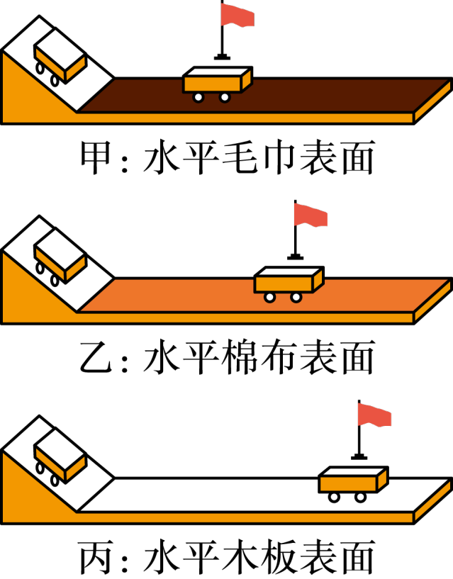

- A. 小车在水平面上运动过程中，小车的重力势能不变，动能不断减小
- B. 小车在不同水平面上运动的距离不同，是因为小车的惯性大小不同
- C. 小车在水平面上运动时，其所受的重力和水平面给它的支持力是一对相互作用力
- D. 小车在水平面上运动时，若所有外力都消失，它将处于静止状态

【答案】A

【解析】A．小车在水平面上运动过程中，小车的高度不变，质量不变，故小车的重力势能不变，速度越变越小，故动能变小，故A正确；
B．小车在不同水平面上运动的距离不同，是因为小车所受的阻力的大小不同，故B错误；
C．小车在水平面上运动时，其所受的重力和水平面给它的支持力是平衡力，故C错误；
D．小车在水平面上运动时，若所有外力都消失，由于惯性，它将做匀速直线运动，故D错误。
故选A。

## 59. 单选题（难度：适中）

如图所示，小明在做模拟“蹦极”的小实验，一根橡皮筋一端系一个小球，另一端固定在A点，B点是橡皮筋不系小球自然下垂时下端所在的位置，C点是小球从A点自由释放后所能达到的最低点，不考虑空气阻力，关于小球从A点到C点运动过程的说法，正确的是（　　）

【答案】A

## 60. 单选题（难度：适中）

将皮球从离地某一高度O点处水平抛出，球落地后又弹起。它的部分运动轨迹如图所示。下列说法正确的是（　　）
      
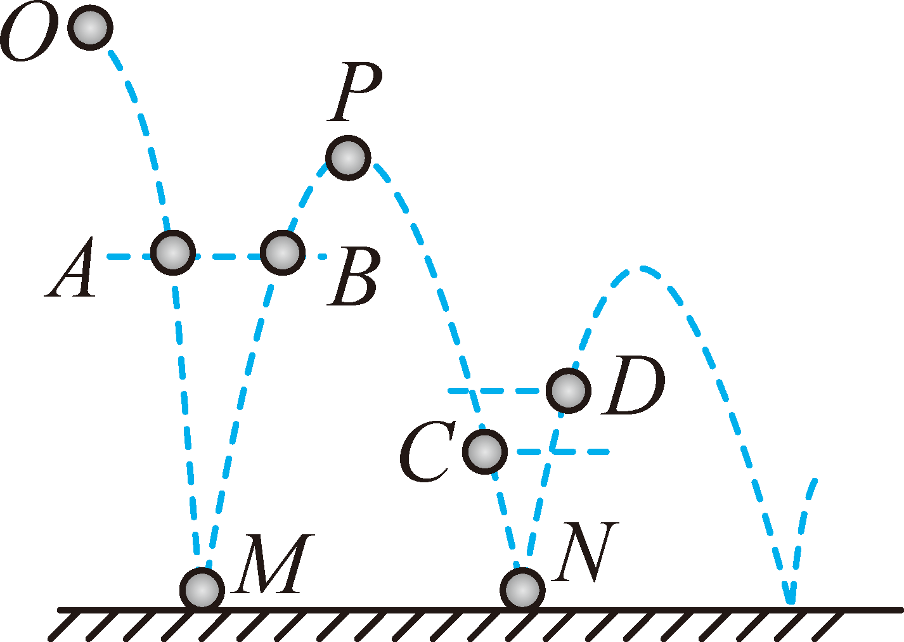

- A. 皮球从O点到D点的过程中机械能守恒
- B. 皮球经过A点和B点时的动能相等
- C. 若将皮球表面涂黑，则会在地面M、N两点留下两个大小不等的黑色圆斑
- D. 皮球从B点到C点的过程中重力势能一直在变大

【答案】C

【解析】A．皮球从O点到D点的过程中，落地时与地面碰撞会有能量损失，且在空气中运动时受到空气阻力，由机械能转化为其他形式的能，也会有能量损耗。因此，皮球的机械能不守恒，故A错误；
B．由图可知，每次小球反弹后到达的最高点都比上一次的最高点要低，小球运动时受到空气阻力，其机械能逐渐变小，则在A点的机械能大于在B点的机械能；同一小球在A、B两点的高度相同则重力势能相同，因机械能是物体动能与势能的总和，所以在A点的动能大于在B点的动能，故B错误；
C．整个过程中，机械能逐渐变小，所以皮球在M点时的机械能大于在N点时的机械能，即皮球在M点时的弹性势能大于在N点时的弹性势能，M、N两点留下两个大小不等的黑色圆斑，故C正确；
D．皮球从B点到C点的过程中高度先上升再下降，所以重力势能先增大再减小，故D错误。
故选C。

## 61. 单选题（难度：适中）

单板滑雪是一项以一块滑雪板为工具的雪上竞技项目，能使运动者同时体验冲浪的自由洒脱和驰骋雪海的刺激震撼，因而这项运动受到许多青少年的喜爱。如图所示为单板滑雪爱好者正沿雪道加速下滑的情境，下列说法正确的是（　　）
      
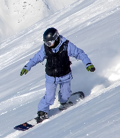

- A. 滑雪板对雪道的压力跟雪道对滑雪板的支持力是一对平衡力
- B. 滑雪板对雪道的压力等于滑雪板的重力
- C. 滑雪板加速下滑，是因为滑雪板具有惯性
- D. 滑雪板的动能增大，重力势能减小

【答案】D

【解析】A．滑雪板对雪道的压力跟雪道对滑雪板的支持力作用在不同的物体上，不是一对平衡力，故A错误；
B．在倾斜的雪道上，滑雪板对雪道的压力不等于滑雪板的重力，故B错误；
C．滑雪板加速下滑，是因为滑雪板受竖直向下的重力的作用，说明力可以改变物体的运动状态，故C错误；
D．单板滑雪爱好者正沿雪道加速下滑时，滑雪板的质量不变，速度增加，则动能变大，高度降低，则重力势能减小，故D正确。
故选D。

## 62. 单选题（难度：适中）

如图是排球落地后弹跳过程每隔相等时间曝光一次所拍摄的照片，A、B是同一高度的两点，则下列说法正确的是（　　）
       
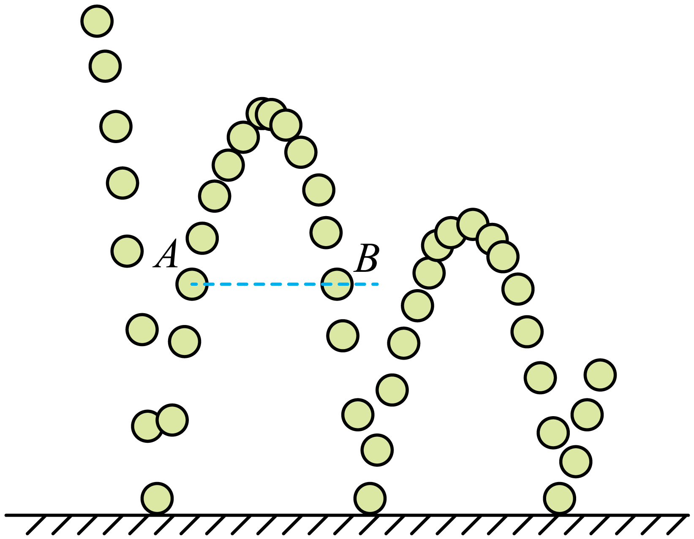

- A. 排球从开始下落到静止的过程中，排球的机械能先变大后变小
- B. 排球在A点时的重力势能等于在B点时的重力势能
- C. 排球在A点时的动能等于在B点时的动能
- D. 排球在下降过程中，它的动能减少，重力势能增加

【答案】B

【解析】A．由图可知，排球弹起的高度越来越小，说明排球从开始下落到静止的过程中，排球克服摩擦做功，机械能一直变小，故A错误；
B．排球在A、B两点的高度相同，质量不变，则在A、B两点的重力势能相同，故B正确；
C．排球在A、B两点的重力势能相同，但在A点的机械能大于在B点时的机械能，则在A点的动能大于在B点时的动能，故C错误；
D．排球在下降过程中，质量不变、速度变大，动能变大；质量不变、高度减小，重力势能减小，故D错误。
故选B。

## 63. 单选题（难度：适中）

《天工开物》中记载了一种古代机械——踏车，它通过脚踏装置将低处的水抽到高处灌溉农田。若人踩踏车，使踏车的转动速度不变。则下列说法正确的是（　　）
      
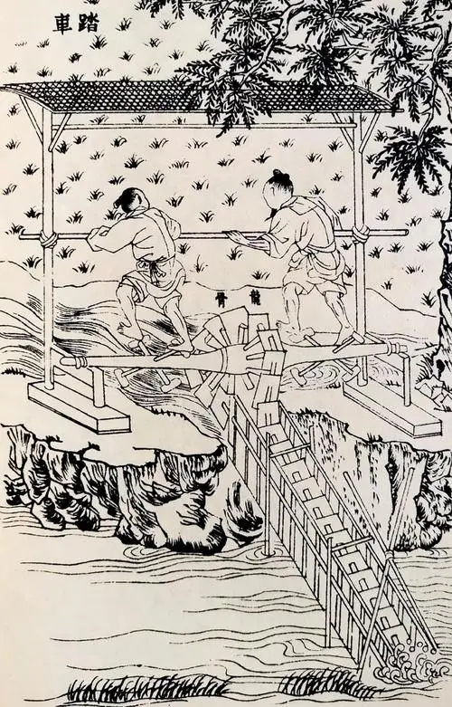

- A. 人为踏车提供动力，消耗了弹性势能
- B. 取水时，水在上升过程中动能转化为重力势能
- C. 取水时，水在上升过程中受到的是平衡力
- D. 取水时，水在上升过程中重力对水不做功

【答案】C

【解析】A．人用力踩踏车时，即消耗了人的生物能而非弹性势能，故A错误；
B．取水时，水在上升过程中，质量不变，速度不变，动能不变，高度增加，重力势能增加，因此动能没有转化为重力势能。故B错误；
C．若人踩踏车，使踏车的转动速度不变。取水时，水在上升过程中，做匀速直线运动，运动状态不变，受平衡力作用，故C正确；
D．取水时，重力的方向竖直向下，在竖直方向上有移动距离，需要克服重力做功，因此重力对水做功。故D错误。
故选C。

## 64. 单选题（难度：适中）

将小球水平抛出，其部分运动轨迹如图所示，位置①和③离地高度相等。小球在运动过程中经过M、N两点，其动能和重力势能的参数如图所示，且M、N两点分别为图中“①”、“②”或“③”点中的某一点。则小球（　　）
      
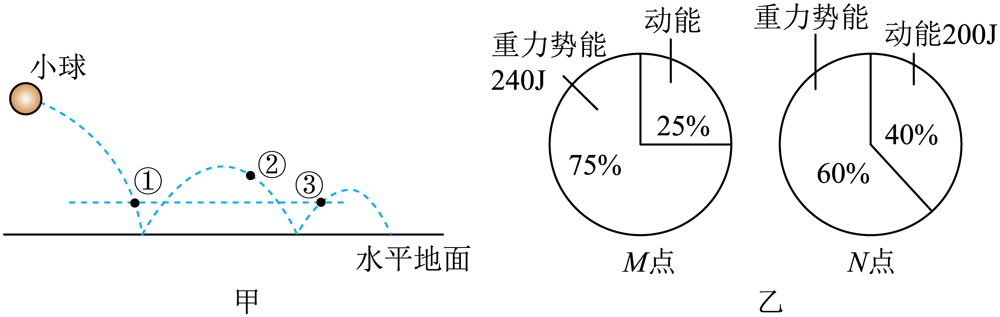

- A. 整个运动过程中，机械能是守恒
- B. 经过的N点就是“②”点
- C. 在M点的重力势能大于在N点的
- D. 在N点的机械能为1000J

【答案】B

【解析】A．根据小球水平抛出其部分运动轨迹可知，小球反弹起的最大高度越来越小，说明机械能越来越小，整个运动过程中，机械能是不守恒的 ，故A不符合题意；
BC．在M点时，由图知，重力势能占机械能的比为动能的3倍，因重力势能为240J，故动能为80J，在M点时机械能为
WM=240J+80J=320J
在N点时，动能为200J，则重力势能为
\( \frac{0.6}{0.4}\times 200\text{J=300J}\) 
故在M点的重力势能240J小于在N点的重力势能300J，M点的高度小于N点，则经过的N点就是“②”点，故B符合题意，C不符合题意；
D．在N点时的机械能为WN=200J+300J=500J
故D不符合题意。
故选B。

## 65. 单选题（难度：适中）

小明在进行“原地掷铅球”项目时，球从出手到落地的过程如图所示。若不计空气阻力，下列说法正确的是（　　）
      
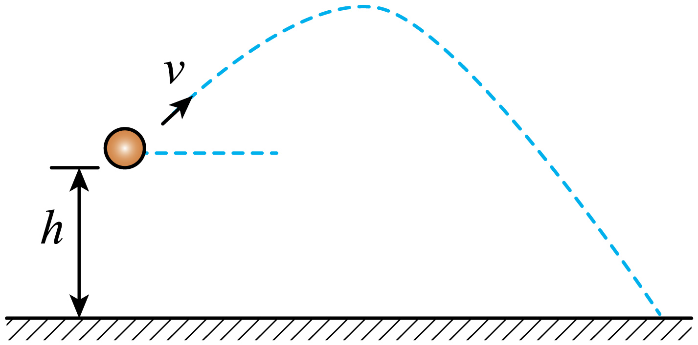

- A. 球刚出手时的动能最大
- B. 球到达最高点时的机械能最大
- C. 球落地时的重力势能最大
- D. 球从最高点下落的过程中，重力势能转化为动能

【答案】D

【解析】AD．球出手时，球具有动能和重力势能；球从最高点下落过程中，不计空气阻力，重力势能全部转化为动能，即球落地时动能最大，故A错误，D正确；
B．由于不计空气阻力，所以整个过程中球的机械能是守恒的，即机械能保持不变，故B错误；
C．球出手后会向上运动，高度增加，重力势能增加，在最高点时球的重力势能最大，故C错误。
故选D。

## 66. 单选题（难度：适中）

当地时间2024年8月7日，巴黎奥运会田径男子跳高资格赛在法兰西体育场举行。如图所示为中国选手王振比赛前热身时的场景，若不计空气阻力，下列关于王振跳高过程的描述正确的是（　　）
      
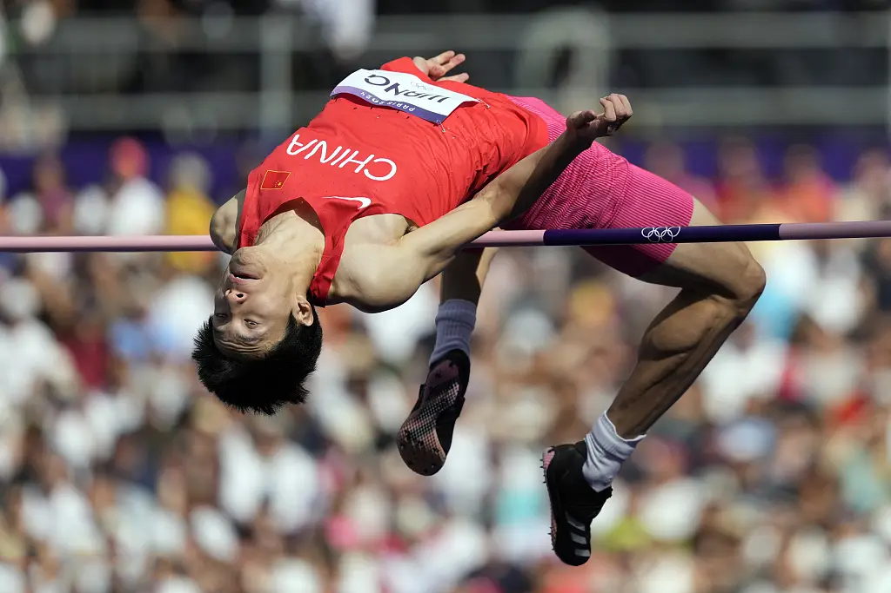

- A. 上升的过程中动能和机械能都不断减小
- B. 下降的过程中动能增大，重力势能不变
- C. 上升的过程中动能不变，重力势能增大
- D. 下降的过程中重力势能减小，机械能不变

【答案】D

【解析】AC．上升的过程中，他的质量不变，速度减小，动能减小，高度增大，重力势能增大，若不计空气阻力，则只发生动能向重力势能的转化，机械能总量不变，，故AC错误；
BD．下降的过程中，他的质量不变，速度增大，动能增大，高度减小，重力势能减小，若不计空气阻力，则只发生重力势能向动能的转化，机械能总量不变，故B错误，D正确。
故选D。

## 67. 单选题（难度：适中）

小华做了阻力对物体运动的影响实验，如图所示，下列说法正确的是（　　）
   
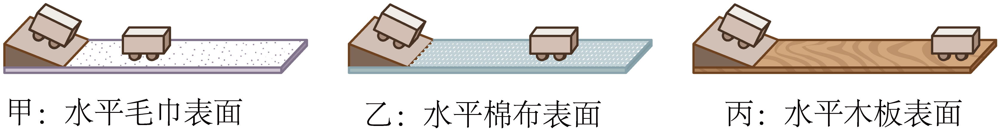

- A. 每次实验，都必须让小车从斜面最高处静止释放
- B. 实验中，通过小车在水平面上移动的距离反映小车所受阻力大小
- C. 每次实验，都应同时改变斜面和水平面的材料
- D. 每次实验，小车克服阻力做功一样多

【答案】D

【解析】A．为了确保每次实验小车到达水平面的速度相同，小车应从同一斜面的同一位置由静止滑下，但不一定要从顶端由静止滑下，故A错误； 
B．在该实验中，是通过改变水平面的粗糙程度来改变小车所受阻力大小，小车在水平面上移动的距离反映的是阻力对物体运动的影响，即阻力越小，小车运动的距离越远。所以小车在水平面上移动的距离不是反映小车所受阻力大小，故B错误； 
C．实验中通过改变水平面的粗糙程度是改变运动的小车所受的阻力大小，为确保小车每次到达水平面时的速度相同，不能改变斜面的材料，而应使斜面材料相同，故C错误； 
D．每次实验让小车从斜面的同一高度静止释放，小车的重力势能相同，下滑到水平面时的动能也相同。小车在水平面上运动时，最终都会停下来，动能的变化量相同，而动能全部通过克服阻力做功转化为其他形式的能量，所以每次实验小车克服阻力做功一样多，故D正确。 
故选D。

## 68. 单选题（难度：适中）

蹦床运动有“空中芭蕾”之称，在蹦床比赛中，运动员从高处落到蹦床上又被弹起，该过程中有关机械能及其转化的说法中不正确的是（　　）
      

- A. 运动员上升到最高点时动能为零
- B. 运动员从高处下落到蹦床前，重力势能转化为动能
- C. 运动员被弹起上升过程中，弹性势能转化为动能和重力势能
- D. 运动员下降过程中机械能不变

【答案】D

【解析】A．蹦床运动中，运动员是在竖直方向上运动的，运动员上升到最高点时速度为零，则动能为零，故A正确，不符合题意；
B．运动员从高处下落到蹦床前，质量不变，高度降低，则重力势能变小，速度变大，则动能变大，重力势能转化为动能，故B正确，不符合题意；
C．运动员被弹起上升过程中，蹦床形变程度减小，则弹性势能减小，运动员的速度增大，高度增加，则动能和重力势能变大，所以弹性势能转化为动能和重力势能，故C正确，不符合题意；
D．运动员下降过程中要克服空气阻力做功，机械能减小，故D错误，符合题意。
故选D。

## 69. 多选题（难度：适中）

2025年贵港市中考体育测试在4月举行，下列关于测试过程的说法正确的是（　　）

- A. 50m跑：加速冲刺过程中，同学的动能变大
- B. 1min跳绳：跳绳时，人在下降的过程中，重力势能变小
- C. 掷实心球：实心球掷出后上升过程中，球的重力势能转化为动能
- D. 立定跳远：同学下落过程中，不计空气阻力，机械能变大

【答案】A/B

【解析】A．50m跑加速冲刺过程中，同学的质量不变但速度增大，可知动能变大，故A正确；
B．跳绳时人在下降过程中，质量不变但高度降低，可知重力势能变小，故B正确；
C．实心球掷出后上升过程中，高度增加速度减小，是动能转化为重力势能，而不是重力势能转化为动能，故C错误；
D．立定跳远下落过程中，不计空气阻力时只有重力做功，重力势能减小，动能增大，但机械能守恒保持不变，故D错误。
故选AB。

## 70. 多选题（难度：适中）

荡秋千是同学们平时喜爱的一项运动。如图所示，秋千在摆荡的过程中，\( A\)为最低点，\( B\)为摆荡到右边时的最高点。下列说法正确的是（　　）
      

- A. 人从\( A\)点运动到\( B\)点的过程中，重力势能增加
- B. 人从\( B\)点运动到\( A\)点的过程中，动能增加
- C. 人从\( B\)点运动到\( A\)点的过程中，重力势能全部转化为动能
- D. 人从\( A\)点运动到\( B\)点的过程中，运动速度越来越慢，其运动状态发生改变

【答案】A/B/D

【解析】A．人由\( A\)点运动到\( B\)点的过程中，质量不变，高度增大，重力势能增大，故A正确；
B．人从\( B\)点运动到\( A\)点的过程中，质量不变，高度减小，重力势能减小，速度增加，动能增加，但由于摩擦，部分机械能会转化为内能，机械能会减小，故B正确；
C．由B知，人从\( B\)点运动到\( A\)点的过程中，但由于摩擦，重力势能部分转化为动能，还有部分会转化为内能，故C不正确；
D．人由\( A\)点运动到\( B\)点的过程中，运动速度的大小发生改变，其运动状态发生改变，故D正确。
故选ABD。

## 71. 多选题（难度：适中）

下列情况中，属于机械能转化为内能的是（　　）

- A. 冷天搓手取暖
- B. 水沸腾时蒸汽冲开壶盖
- C. 陨石在大气层坠落时发光发热成为流星
- D. 压缩空气点火

【答案】A/C/D

【解析】A．冷天搓手取暖，是通过双手摩擦做功，将机械能转化为内能，故A符合题意；
B．水沸腾时蒸汽冲开壶盖，是内能转化为机械能，故B不符合题意；
C．陨石在大气层坠落时发光发热成为流星，是陨石与空气摩擦，机械能转化为内能，故C符合题意；
D．压缩空气点火，是通过压缩空气做功，机械能转化为内能，故D符合题意。
故选ACD 。

## 72. 多选题（难度：适中）

跳远运动的几个阶段如图所示，不考虑空气阻力，则下面说法中正确的是（　　）
      

- A. 助跑过程可以增大运动员的惯性，从而增大跳远的距离
- B. 运动员运动到最高点时，运动员的动能最大
- C. 运动员在空中向上运动时，受到的合力是竖直向下的
- D. 运动员落地静止后，运动员受到的重力和地对运动员的支持力是一对平衡力

【答案】C/D

【解析】A．惯性大小只取决于质量，助跑过程中运动员质量不变，惯性不变，助跑是为了增大速度，利用惯性增大跳远距离，故A错误；
B．运动员运动到最高点时，竖直方向速度为0，但水平方向仍有速度，此时动能不是最大，故B错误；
C．不考虑空气阻力，运动员在空中向上运动时，只受到重力作用，重力方向竖直向下，所以受到的合力竖直向下，故C正确；
D．运动员落地静止后，处于平衡状态，受到的重力和地对运动员的支持力大小相等、方向相反、作用在同一直线上、作用在同一物体上，是一对平衡力，故D正确。
故选CD。

## 73. 填空题（难度：适中）

2023年6月4日，我国神舟十五号载人飞船返回舱在东风着陆场成功着陆，如图甲。
    

飞船返回舱进入大气层，在距地面约10km的空中打开降落伞，如图乙。在飞船返回舱减速下降的过程中，飞船返回舱的动能，机械能。（均选填“增大”“减小”或“不变”）

【答案】减小，减小

【解析】[1][2]在飞船返回舱减球下降的过程中，飞船返回舱的质量不变，速度变小，动能减小，同时其高度减小，重力势能减小，由于机械能等于动能和势能的总和，所以机械能减小。

## 74. 多选题（难度：适中）

如图所示，小朋友们在蹦床上欢欣跳跃，下列说法不正确的是（　　）

【答案】A

## 75. 多选题（难度：适中）

如甲图所示，小球从竖直放置的弹簧上方一定高度处由静止开始下落，从a处开始接触弹簧，压缩至c处时弹簧最短。从a至c处的过程中，小球在b处速度最大。小球的速度v和弹簧被压缩的长度∆l之间的关系如乙图所示。不计空气阻力，则从a至c处的过程中，下列说法中正确的是（　　）

【答案】A

## 76. 填空题（难度：适中）

如图所示，商场电动扶梯载着顾客匀速向上运动的过程中，顾客的动能，机械能（选填“变大”、“变小”或“不变”）；这种扶梯不载人时，以较低速度运行；载人时则以较快的速度运行。则这种自动调速扶梯载人时做功的功率（选填“大于”、“等于”或“小于”）不载人时做功的功率。 
    

【答案】不变，变大，大于

【解析】[1][2]电动扶梯载着顾客匀速向上运动的过程中，质量和速度是不变的，所以顾客的动能不变，但是高度增加，所以重力势能变大，机械能包括动能和势能，机械能变大。
[3]电动扶梯载人时，重力大，上升相同高度做功多，速度快，用时又少，所以功率大，即自动调速扶梯载人时做功的功率大于不载人时做功的功率。

## 77. （难度：适中）

如图所示，小明将小球从轨道A点由静止释放（A、D两点等高），小球通过B点和C点。下列关于小球运动过程中的描述不正确的是（小球和轨道间存在摩擦）（　　）
      

A．小球在A点的机械能最大  
B．小球在B点的速度为零
C．小球不能到达D点
D．小球在C点和B点的机械能相等

【答案】

BD

【解析】A．小球从A点由静止释放后，在经过B和C点时，由于克服摩擦做功，一部分机械能转化为内能，消耗机械能，机械能一直在减小，故A点机械能最大，故A正确，不符合题意；
B．小球在B点处于运动状态，小球的速度不为零，故B错误，符合题意；
C．由于AD两点的高度相同，D点的机械能小于A点的机械能，小球不能到达D点，故C正确，不符合题意；
D．小球从B点运动到C点时，由于克服摩擦做功，一部分机械能转化为内能，消耗机械能，B点的机械能大于C点的机械能，故D错误，符合题意。
故选BD。

## 78. 填空题（难度：适中）

北京冬奥会上，中国运动员谷爱凌获得自由式滑雪双板大跳台冠军，图中显示的是谷爱凌在空中最高处的情形，她从高处下落后能转化为能。
    

【答案】重力势，动

【解析】[1][2]他从高处下落后，质量不变，高度降低，重力势能减小；质量不变，速度增大，动能增大，所以是重力势能转化为动能。

## 79. 多选题（难度：适中）

在某自由式滑雪锦标赛中，一名选手的运动轨迹如图所示。如果不计空气阻力，下列说法正确的是（　　）
      

- A. 该选手从a点向b点运动的过程中，重力势能全部转化为动能
- B. 该选手在a点和e点动能都为零，但在e点的重力势能小于在a点的重力势能
- C. 该选手从c点下落到d点的过程中，重力势能转化为动能
- D. 该选手在a点和e点都处于静止状态，因此机械能相等

【答案】B/C

【解析】A．从a点向b点运动过程中，高度减小，重力势能减小，重力势能大部分转化成动能，因为有滑动摩擦，少部分转化成内能，故A错误；
BD．在a点和e点都处于静止状态，说明动能都为零，因为高度不同，所以，重力势能就不相等，因此机械能不相等，e点高度小，所以e点重力势能小于在a点的重力势能，故B正确，D错误；
C．从c点下落到d点过程中，高度减小，重力势能减小，速度增大，动能增大，重力势能转为动能，故C正确。
故选BC。

## 80. 多选题（难度：适中）

如图所示，北京时间2024年8月16日15时35分，长征四号乙运载火箭在西昌卫星发射中心一飞冲天，成功将遥感四十三号01组卫星送入预定轨道，发射任务取得圆满成功，本次发射是长征系列运载火箭第531次发射。下列关于火箭发射的说法正确的是（　　）
      

- A. 火箭升空过程中，遥感卫星与运载火箭保持相对静止
- B. 火箭点火加速升空时，动能转化为重力势能
- C. 火箭燃料燃烧时，质量减小，热值不变
- D. 燃料充分燃烧时，火箭发动机的效率可以达到100%

【答案】A/C

【解析】A．火箭升空过程中，遥感卫星相对于运载火箭位置没有发生变化，是静止的，故A正确；
B．火箭加速升空过程中质量不变，速度和高度都增加，动能和重力势能都增大，故机械能增大，不是动能转化为重力势能，故B错误；
C．燃料的热值是燃料的一种特性，只决定于燃料的种类，与质量和燃烧情况等无关，因此火箭的燃料燃烧时，质量减小，热值不变，故C正确；
D．火箭发动机在工作时不可避免的有能量损失，而且要克服机械部件间的摩擦做额外功，效率一定小于100%，故D错误。
故选AC。

## 81. （难度：适中）

《天工开物》是我国古代的科学著作，其中这样写道：“凡河滨有制筒车者，堰陂障流绕于车下，激轮使转，挽水入筒，\( ——\)顷于枧内，流入亩中，昼夜不息，百亩无忧。”该段文字描述了筒车这样一种以水流作动力，用来取水的机械，如图所示：

从能量转化的角度，筒车的工作原理是将水的能转化为水的重力势能；

若接水槽离取水处高4m，水轮上有12个取水筒，一个取水筒每次可取水4kg，筒车转一圈对进入接水槽的水所做的功为J（接水槽离倒水处的高度忽略不计）。

【答案】动，1920

【解析】水流具有一定的质量和速度，具有一定的动能，水流通过对筒车做功使水的高度增大，重力势能增大，是动能转化为重力势能。

筒车转一圈提升的水的质量为
\( m=12\times 4\text{kg}=48\text{kg}\) 
则筒车转一圈对进入接水槽的水所做的功为
\( W=Gh=mgh=48\text{kg}\times 10\text{N}/\text{kg}\times 4\text{m}=1920\text{J}\)

## 82. 多选题（难度：适中）

关于如图所示的四个实验，下列说法正确的是（　　）

- A. 
将自制气压计从一楼拿到五楼，细玻璃管中的液柱会下降
- B. 
将空的易拉罐放在火上加热，用橡皮泥封住开口处，冷却一会儿，易拉罐会变瘪
- C. 
轮船从河里开到海里，排开液体的体积变少
- D. 
塑料桶向回滚动的前半段路程中橡皮筋的弹性势能减小

【答案】B/C/D

【解析】A．自制气压计瓶内气体的压强等于外界大气压和液柱压强之和。将自制气压计从一楼拿到五楼，外界大气压随高度升高而减小，而瓶内气压不变，瓶内气压会将细玻璃管中的液柱向上压，所以液柱会上升，故A错误；
B．将空的易拉罐放在火上加热，罐内空气受热膨胀，部分空气排出；用橡皮泥封住开口处，冷却一会儿，罐内空气收缩，气压减小，小于外界大气压，在外界大气压的作用下，易拉罐会变瘪，故B正确；
C．轮船从河里开到海里，始终处于漂浮状态，浮力等于重力，轮船的重力不变，所以受到的浮力不变。海水的密度大于河水的密度，根据\( {F}_{\mathrm{浮}}\text{=}{\rho }_{\mathrm{液}}g{V}_{\mathrm{排}}\)可知，浮力不变，液体密度变大，所以排开液体的体积变少，故C正确；
D．塑料桶向回滚动的前半段路程中，橡皮筋展开，塑料桶越滚越快，橡皮筋的弹性势能减小，塑料桶的动能增大，弹性势能转化为动能，故D正确。
故选BCD。

## 83. （难度：适中）

2025年11月14日，神舟二十一号载人飞船返回舱在东风着陆场成功着陆。返回舱开伞后匀速下落的过程中（　　）
A．动能不变  
B．重力势能增大  
C．机械能不变  
D．重力势能转化为动能

【答案】

A

【解析】返回舱开伞后匀速下落的过程中，质量不变，速度不变，动能不变；高度变小，重力势能减少，重力势能没有转化为动能。因为机械能等于动能和势能之和，所以机械能减少。故A符合题意，BCD不符合题意。
故选A。

## 84. （难度：适中）

橡皮擦从桌面掉落的过程中，其能量变化正确的是（　　）A．动能增大  B．重力势能不变C．弹性势能减小  D．机械能增大

## 85. 单选题（难度：适中）

华山是我国著名的五岳之一、某同学乘坐景区观光索道缆车，以恒定速度匀速下山，饱览西岳奇峰美景。下列说法正确的是（　　）

- A. 该同学的动能不变，重力势能增加
- B. 该同学的动能增加，重力势能不变
- C. 缆车的重力势能减小，机械能减小
- D. 缆车的动能不变，机械能不变

【答案】C

【解析】AB，该同学乘坐索道缆车匀速下山时，质量不变，速度不变，动能不变，高度降低，重力势能减小，故AB错误；
CD，缆车随着索道下山，速度不变，质量不变，动能不变，高度降低，重力势能减小，机械能是动能和重力势能的总和，所以缆车的机械能在减小，故C正确，D错误。
故选C。

## 86. （难度：适中）

如图所示，小明沿滑道从顶端匀速下滑的过程中，小明的（   ）

 
A．重力势能不变，机械能减小  
B．动能不变，机械能不变
C．重力势能减小，动能增大  
D．重力势能减小，机械能减小

【答案】

D

【解析】小明沿滑道从顶端匀速下滑的过程中，小明的质量不变，速度不变，则动能不变，高度降低，则重力势能减小，机械能是动能和势能之和，所以机械能减小。故ABC不符合题意，D符合题意。
故选D。

## 87. （难度：适中）

乒乓球从高处自由下落，经地板反弹后再跳起的最大高度总小于开始下落时的高度。下列做法可以使乒乓球弹跳到高于下落位置的是（　　）
A．增大乒乓球的质量  
B．增加乒乓球下落时的高度
C．乒乓球以一定速度向下抛出  
D．让乒乓球落在更硬的地板上

【答案】

C

【解析】ABD．因为乒乓球在下落的过程中和碰撞过程中，需要克服空气摩擦阻力来做功和能量损耗，消耗掉一部分能量，所以乒乓球从高处自由下落，经地板反弹后再跳起的最大高度总低于原来下落时的高度。增大乒乓球的质量、增加乒乓球下落时的高度、让乒乓球落在更硬的地板上乒乓球初始的动能为零，由于能量损失，反弹后再跳起的重力势能小于初始重力势能，则再跳起的最大高度总小于开始下落时的高度，故ABD不符合题意。
C．乒乓球以一定速度向下抛出，就给了乒乓球一个初速度，也就有了初动能，在碰撞过程中会有能量的损失，但如果你给的初动能大于这个能量损失，即能量补给大于能量损失，那么球弹到原先高度时（这时重力势能与下落时是相同的），球仍具有能量，所以还会向上运动，弹到高出原来的高度，故C符合题意。
故选C。

## 88. 单选题（难度：适中）

如图所示，是用金属罐制作的“魔罐”，橡皮筋的两头固定在罐子的两端，中间系一个钩码。当将“魔罐”在水平地面上滚出后，它能自动滚回来。下列说法中正确的是（　　）

- A. “魔罐”滚动过程中，动能保持不变
- B. 滚出去的过程中，“魔罐”的动能转化为钩码的重力势能
- C. 滚出去的过程中，“魔罐”的动能转化为橡皮筋的弹性势能
- D. 滚回来的过程中，钩码的动能转化为“魔罐”的动能

【答案】C

【解析】A．“魔罐”滚出去的过程中，速度减小，动能减小；滚回来的过程中，速度增大，动能增大。因此，在整个滚动过程中，动能是变化的。故A错误;
B．“魔罐”滚出去的过程中，罐的动能减小，同时橡皮筋被拧紧，弹性势能增加。钩码的高度会发生微小变化，重力势能也会变化，但主要的能量转化是动能转化为橡皮筋的弹性势能，而不是钩码的重力势能。故B错误;
 C．“魔罐”滚出去的过程中，速度越来越慢，动能减小；橡皮筋的形变程度越来越大，弹性势能增大。这个过程是“魔罐”的动能转化为橡皮筋的弹性势能。故C正确;
D．“魔罐”滚回来的过程中，是橡皮筋的弹性势能转化为“魔罐”和钩码的动能，使得“魔罐”的速度越来越快。故D错误。 
故选C。

## 89. 单选题（难度：适中）

如图所示是抽水蓄能电站的示意图，用电低谷时，通过电力将水从下水库抽到上水库；用电高峰时，再由上水库放水至下水库发电。下列说法正确的是（　　）

- A. 水从下水库被抽到上水库的过程中，水的重力势能减小
- B. 水从下水库被抽到上水库的过程中，水的重力势能转化为动能
- C. 由上水库放水至下水库的过程中，水的动能增大
- D. 由上水库放水至下水库的过程中，水的动能转化为重力势能

【答案】C

【解析】A．水被抽到上水库，质量不变、高度升高，根据重力势能的影响因素，重力势能增大，而非减小。故A错误；
B．抽水过程需要消耗电能，电力对水做功，将电能转化为水的重力势能，不存在重力势能转化为动能的过程。故B错误；
C．放水时，水质量不变、高度降低，重力势能减小，同时水向下流动的速度变大，根据动能的影响因素，动能增大（重力势能转化为动能）。故C正确；
D．放水过程中是水的重力势能减小、动能增大，实际是重力势能转化为动能，而非动能转化为重力势能。故D错误。
故选C。

## 90. 单选题（难度：适中）

学科融合  图甲所示的是某地的地形及其等高线图（闭合曲线由海拔高度相等的点连成，数字表示该处的海拔高度）。如图乙所示，研究人员正操作一架无人机对此地展开勘察。下列说法正确的是（　　）

- A. 山间的溪水由B点流到A点时，重力势能转化为动能
- B. 无人机保持同一高度匀速盘旋过程中，不需要动力
- C. 无人机从A点向上飞到B点的过程中，重力势能不变
- D. 无人机从C点匀速爬升到D点的过程中，机械能不变

【答案】A

【解析】A．由等高线可知，B点海拔高于A点，溪水由B到A，高度降低、速度增大，重力势能转化为动能，故A正确；
B．无人机保持同一高度匀速盘旋，需要克服空气阻力、竖直方向需要克服自身重力等，因此需要动力，故B错误；
C．无人机从A到B，质量不变，高度升高，重力势能增大，故C错误；
D．无人机从C匀速爬升D，高度升高，重力势能增大，动能不变，机械能增大，故D错误。
故选A。

## 91. 单选题（难度：适中）

2026年1月8日，中国选手孙佳旭在自由式滑雪空中技巧世界杯加拿大玻波特湖站夺冠，收获个人第七个世界杯冠军。如图所示，在他滑行过程中，下列说法正确的是（    ）

- A. A点时没有机械能
- B. 从A点滑行到C点的过程中重力势能不断变大
- C. 在B点的速度大于与它高度相同的D点的速度
- D. 由于滑雪板底面比较光滑，摩擦阻力小，所以整个过程中机械能守恒

【答案】C

【解析】A．A点虽然静止，动能为0，但由于在高处而具有重力势能，则机械能不为0，故A错误；
B．从A点滑行到C点的过程中，运动员的质量不变，高度降低，则重力势能减小，故B错误；
C．运动员在滑动的过程中存在摩擦，运动员的一部分机械能克服摩擦做功，所以B点的机械能大于D点的机械能；由于BD的高度相同，重力势能相同，则B点的动能要大于D点的动能，所以在B点的速度大于在D点的速度，故C正确；
D．即使滑雪板底面比较光滑，摩擦阻力小，但仍会存在能量损失，所以整个过程中机械能不守恒，故D错误。
故选C。

## 92. 单选题（难度：适中）

如图所示，小明沿滑道从顶端加速下滑的过程中，小明的（　　）

【答案】A

## 93. （难度：适中）

如图甲是北京冬奥会自由式滑雪大跳台，运动员从60m高的A点静止滑下，从B点冲出。A点和C点在同一高度，阻力不可忽略。下列关于运动员的说法正确的是（　　）

 
A．从A点到B点的过程中机械能减少  
B．从B点冲出至落地机械能不变
C．在空中能到达C点  
D．不能到达C点，说明能量不守恒

【答案】

A

【解析】A．从A点到B点的过程中，由于阻力不可忽略，运动员需要克服阻力做功，机械能会转化为内能，所以机械能减少，故A正确；
B．从B点冲出至落地，运动员要克服空气阻力做功，机械能会转化为内能，机械能是减少的，并非不变，故B错误；
C．因为从A点到B点机械能已经减少，A点和C点在同一高度，所以运动员在空中不能到达C点，故C错误；
D．不能到达C点是因为运动过程中克服阻力做功，机械能转化为内能，能量的总量是守恒的，并没有消失，故D错误。
故选A。

## 94. （难度：适中）

如图，是古人利用龙骨水车提水灌溉的场景。提水时，用脚踩动脚踏板，拐木转动，木链条带动叶板转动，将水从低处提升至高处，实现灌溉。下列说法正确的是 （　　） A．踩动脚踏板越快，对水做功越多  B．增大拐木的长度，可以更省力C．水在上升的过程中，机械能不变  D．使用龙骨水车提水，可以省功

## 95. （难度：适中）

如图，系好弹性绳的蹦极运动员，离开平台由静止开始下落。经过一段时间，第一次到达最低点，此过程忽略空气阻力，下列分析正确的是（　　） A．运动员下落过程受惯性作用  B．运动员的动能先增大后减小C．运动员始终受到两个力作用  D．最低点时运动员受平衡力作用

## 96. 单选题（难度：适中）

2025年12月31日，如图所示，我国在文昌航天发射场使用“长征七号改”运载火箭，成功将“实践二十九号”A、B双星送入预定轨道，标志着我国全年航天发射任务圆满收官。此次任务彰显了中国航天人勇攀高峰、自主创新的精神品质，展现了我国航天事业的蓬勃发展，为科技强国建设贡献了重要力量。关于火箭发射，下列说法正确的是（    ）

【答案】A

## 97. 单选题（难度：适中）

如图甲所示是被球拍击打的羽毛球在空中飞行的轨迹。下列说法正确的是（　　）

【答案】A

## 98. （难度：适中）

如图所示是自由式滑雪项目示意图，实线代表雪道，虚线是运动员重心轨迹，从A点起滑，最后停在D点（忽略空气阻力），则运动员（　　） A．在B点动能最大  B．从B点到C点是受到惯性的作用C．在D点机械能最小  D．从A点到D点速度一直在增大

## 99. 单选题（难度：适中）

如图所示，小球由A点静止释放（忽略绳子形变），经B点运动到C点返回，B点为摆动过程中的最低点，C点比A点位置低。下列说法正确的是（　　）

- A. 小球由A点运动到B点的过程中，绳的拉力做的功比小球重力做功多
- B. 小球经过B点时所受重力与绳的拉力不可能是一对平衡力
- C. 小球由B点运动到C点的过程中，小球在C点的机械能等于在B点的机械能
- D. 小球由A点运动到B点的过程中，重力势能只转化为动能

【答案】B

【解析】A．小球由A点运动到B点的过程中，绳子拉力方向始终与小球运动方向垂直，所以绳的拉力做功为0；小球在重力方向上有移动距离，重力做功不为0，所以绳的拉力做的功比小球重力做功少，故A错误；
B．小球经过B点时，绳的拉力大于重力，两个力大小不相等，所以重力与绳的拉力不可能是一对平衡力，故B正确；
C．因为C点比A点位置低，说明小球运动过程中有能量损失，则小球由B点运动到C点的过程中，机械能不守恒，小球在C点的机械能小于在B点的机械能，故C错误；
D．由于运动过程中有能量损失，所以小球由A点运动到B点的过程中，重力势能转化为动能和因克服阻力产生的内能等，不是只转化为动能，故D错误。
故选B。

## 100. 单选题（难度：适中）

《天工开物》是我国古代的科学著作，书中记载着大量的古代农业机械，其中写道：“凡河滨有制筒车者，堰陂障流，绕于车下，激轮使转，挽水入筒，一一倾于枧内，流入亩中。昼夜不息，百亩无忧。”该段文字描述了筒车这样一种以水流为动力，把低处的水匀速提升到高处的机械（如图甲所示），图乙为筒车的简化图。下列说法正确的是（　　）

【答案】A

## 101. 单选题（难度：适中）

2026年1月13日，我国长征六号改运载火箭将遥感五十号01星顺利送入预定轨道，此次任务是该型号运载火箭第624次飞行。如图是火箭发射时的情景，下列说法正确的是（    ）

- A. 火箭的燃料燃烧得越充分，热值越大
- B. 火箭发动机工作过程中的热机效率是100%
- C. 升空过程中箭体与空气摩擦做功使箭体内能增大
- D. 火箭加速升空的过程中机械能增大，不遵循能量守恒定律

【答案】C

【解析】A．热值是燃料的一种特性，它只与燃料的种类有关，与燃料是否完全燃烧无关。燃料燃烧得越充分，单位质量的燃料放出的热量越多，但燃料的热值本身不变，故A错误； 
B．热机在工作过程中，总会有部分能量以热量的形式散失掉，或者废气会带走一部分能量，所以用来做有用功的能量总是小于燃料完全燃烧放出的总能量，因此热机的效率总是小于100%，故B错误； 
C．火箭升空过程中，箭体与空气发生剧烈摩擦，克服摩擦力做功，将机械能转化为内能，导致箭体的温度升高，内能增大，故C正确； 
D．火箭加速升空的过程中，速度和高度都在增加，所以动能和重力势能都在增大，机械能增大。这个能量的增加是燃料燃烧释放的化学能转化而来的，整个系统的总能量是守恒的，遵循能量守恒定律，故D错误。
故选C。

## 102. 单选题（难度：适中）

如图所示的四种情景中，属于重力势能转化为动能的是（    ）

【答案】A

## 103. 单选题（难度：适中）

12月28日，2025年北京TOP短道速滑国际公开赛第三站在国家速滑馆“冰丝带”迎来收官，如图是比赛时的场景，下列说法正确的是（　　）

- A. 冰刀在冰面上高速滑行时，冰面含有的热量增加
- B. 运动员在水平赛道上加速冲刺过程中，动能增大，重力势能不变
- C. 运动员到达终点后，不能立即停下来是因为受到惯性作用
- D. “补冰”时，工作人员在冰面上浇水，并向浇水处喷撒干冰，使水快速凝华成冰

【答案】B

【解析】A．热量是过程量，不能说含有热量，故A错误；
B．加速冲刺时速度增大，动能增大；水平赛道上高度不变，重力势能不变，故B正确；
C．惯性是物体的属性，不是力。不能说“受到惯性作用”，故C错误；
D．水由液态变为固态是凝固过程，而不是凝华，故D错误。
故选B。

## 104. 单选题（难度：适中）

下列说法正确的是（   ）

- A. 壶中水的温度在升高过程中，内能变大
- B. 小球按如图弹跳路径，弹跳到最高点时，动能为零
- C. 由于能量守恒，永动机是能造出来的
- D. 高温铁水的内能一定大于冰山的内能

【答案】A

【解析】A．壶中水的温度在升高过程中，分子热运动更剧烈，分子动能增大，因此内能变大，故A正确，符合题意；
B．小球弹跳至最高点时，竖直方向速度为0，但水平方向仍有速度，所以动能不为零，故B错误，不符合题意；
C．永动机违背了能量守恒定律（或热力学第二定律），无法制造出来，故C错误，不符合题意；
D．内能不仅与温度有关，还与质量、状态等因素有关。高温铁水质量可能很小，冰山质量极大，因此高温铁水的内能不一定大于冰山的内能，故D错误，不符合题意。
故选A。

## 105. 单选题（难度：适中）

如图，用酒精灯给试管内的水加热一段时间，试管口软木塞冲出。下列相关说法正确的是（　　）

【答案】A

## 106. 单选题（难度：适中）

2025年9月29日，长征二号丁运载火箭，成功将试验三十号卫星01、02星发射升空，卫星顺利进入预定轨道。该火箭使用的燃料偏二甲肼属于化石燃料。如图是火箭发射的场景，下列有关说法正确的是（　　）

【答案】A

## 107. 单选题（难度：适中）

2024年9月25日，我国成功发射一枚携带训练模拟弹头的洲际弹道导弹，准确落入预定海域。对导弹加速升空过程判断正确的是（　　）

- A. 导弹相对于地面是静止的
- B. 导弹升空利用了物体间力的作用是相互的
- C. 导弹的机械能保持不变
- D. 导弹所受的合力为零

【答案】B

【解析】A‌．导弹在加速升空过程中，相对于地面的位置不断发生变化，所以导弹相对于地面是运动的，故A错误；
‌B‌．导弹升空时，向下喷射燃气，对燃气施加了向下的力，同时燃气对导弹产生向上的反作用力，使导弹升空，利用了物体间力的作用是相互的原理，故B正确；
C‌．导弹加速升空时，质量近似不变，速度与高度均变大，速度增大则动能增大，高度增加则重力势能增大，因为机械能等于动能与势能之和，所以导弹的机械能增大，故C错误；
D‌．导弹加速升空，速度变大，其运动状态发生改变，处于非平衡状态，根据力与运动的关系可知，受到的是非平衡力，所以此过程中导弹所受合力不为零，故D错误。
故选B。

## 108. 单选题（难度：适中）

2025年12月11日，如图所示的“九天”大型通用无人平台在陕西完成首飞。无人平台与其携带的上百架无人机组成“平台一载荷”系统，以700km/h的速度在1.5万米高空巡航，再通过电磁弹射将无人机从静止加速至60m/s脱离母机。以下说法正确的是（   ）

- A. 无人机随平台巡航时只具有重力势能
- B. 电磁弹射时最终将电能转化为无人机的机械能
- C. 弹射出部分无人机后“平台一载荷”系统的机械能不变
- D. 无人机脱离平台后无动力向下滑翔时动能不变

【答案】B

【解析】A．无人机随平台巡航时具有一定的高度和飞行速度，故无人机既具有动能，也具有重力势能，故A错误；
B．电磁弹射依靠电能驱动，工作时最终电能转化为无人机的机械能，使无人机从静止加速到60m/s，故B正确；
C．弹射出部分无人机后，“平台一载荷”系统的质量减小，其速度和高度不变时，动能和重力势能都会减小，故系统的机械能减小，故C错误；
D．无人机无动力向下滑翔时，无人机的质量不变，高度降低，重力势能减小，将重力势能转化为动能，无人机的速度不断增大，故无人机的动能变大，故D错误。
故选B。

## 109. （难度：适中）

在一次自由式滑雪比赛中，某运动员从助滑区加速下滑的过程中（    ）
A．动能减小，重力势能增大  
B．动能增大，重力势能减小
C．动能不变，重力势能减小  
D．动能增大，重力势能不变

【答案】

B

【解析】动能与质量、速度有关，速度越大，动能越大。重力势能与质量、高度有关，高度越低，重力势能越小。她加速下滑时，速度增大、高度减小，因此动能应增大、重力势能应减小，故ACD 不符合题意，B符合题意。 
故选B。

## 110. 单选题（难度：适中）

2025年5月29日，我国用长征三号乙运载火箭成功将行星探测工程天问二号探测器发射升空。火箭起飞时，发动机内的燃料剧烈燃烧，提供强大推力。下列说法错误的是（　　）

- A. 火箭发动机属于热机
- B. 燃料燃烧得越充分，其热值越大
- C. 发动机的效率不可能达到100%
- D. 加速升空，探测器的机械能增大

【答案】B

【解析】A．火箭发动机通过燃烧燃料将化学能转化为机械能，符合热机的定义，故A正确，不符合题意；
B．热值是燃料的固有属性，表示单位质量燃料完全燃烧释放的热量，其大小与燃烧充分程度无关，故B错误，符合题意；
C．热机工作时存在能量损失（如摩擦、散热），根据能量守恒定律，效率不可能达到100%，故C正确，不符合题意；
D．探测器加速升空时，速度增大（动能增加），高度升高（重力势能增加），因此机械能增大，故D正确，不符合题意。
故选B。

## 111. 单选题（难度：适中）

“长征五号”系列运载火箭，为“天问一号”“嫦娥五号”等多项重要航天器发射任务立下了汗马功劳。下面关于“长征五号”涉及的物理知识说法正确的是（　　）

【答案】A

## 112. 单选题（难度：适中）

《范蠡兵法》记载着一种攻守兼备的战具——抛石机，如图所示，这是它的简化结构示意图，长杆\( AB\)可绕\( O\)点转动，在\( B\)处放重石，人拉\( A\)处的绳子将重石抛出。在抛石机使用过程中（　　）

- A. 石块增加的机械能大于人对机械做的功
- B. 该装置在一定程度上可以省功
- C. 抛石机在使用时属于省力杠杆
- D. 此机械可看作杠杆，使用时可以省距离

【答案】D

【解析】A．人对机械做的功是总功，抛石机将石块抛出时，对石块做的功是有用功，即石块增加的机械能，由于摩擦和杠杆自重的存在，有用功总小于总功，即石块增加的机械能小于人对机械做的功，故A不符合题意；
B．由于摩擦和杠杆自重的存在，所以使用该装置是不能省功的，故B不符合题意；
C．抛石机在使用时，动力臂小于阻力臂，属于费力杠杆，故C不符合题意；
D．抛石机在使用时，动力臂小于阻力臂，属于费力杠杆，好处是可以省距离，故D符合题意。
故选D。

## 113. 单选题（难度：适中）

“升国旗，唱国歌”，学校每周一都举行升国旗活动（如图所示），下列说法正确的是（   ）

【答案】A

## 114. 单选题（难度：适中）

如图所示，单摆的小球在ABC间不停地做往复运动，如果不考虑阻力的影响，A、C两处的高度相等，则以下说法正确的是（   ）

- A. 小球在A处和C处的机械能相等
- B. 小球在B处时，动能最大，重力势能为零
- C. 小球由A处运动到B处过程中，动能保持不变
- D. 小球由B处运动到C处过程中，动能增大

【答案】A

【解析】A．不考虑空气的阻力，小球的机械能是守恒的，所以小球在A处和C处的机械能相等，故A正确；
B．小球在B处时，高度最低，重力势能最小但不一定为零，由于小球的机械能是守恒的，则此时动能最大，故B错误；
C．小球的机械能是守恒的，小球由A处运动到B处过程中，高度降低，重力势能减小，动能变大，故C错误；
D．小球的机械能是守恒的，小球由B处运动到C处过程中，高度增加，重力势能变大，动能减小，故D错误。
故选A。

## 115. （难度：适中）

如图所示，相同质量的物体甲和乙在定滑轮的两边处于静止，用手指向上轻弹一下乙的底部。物体乙离开手指后到与定滑轮接触前，不计绳重、摩擦和空气阻力，则（　　） A．甲在下降过程中动能增大  B．甲在下降过程中机械能增加C．乙在上升过程中动能减小  D．乙在上升过程中机械能增加

## 116. （难度：适中）

2025年12月14日，我国单板滑雪运动员在2025~2026国际雪联单板滑雪大跳台世界杯中荣获赛季总冠军。如图所示，运动员在空中加速下落过程中，运动员的（　　） A．动能增大，重力势能减小  \B．动能不变，重力势能增大C．动能不变，重力势能减小  D．动能减小，重力势能不变

## 117. 单选题（难度：适中）

AI分拣机器人被广泛应用于物流仓库，它可以精准抓取包裹并搬运。如图所示的AI分拣机器人，在工作时匀速竖直向上提起包裹，并水平匀速移动包裹至指定位置。下列说法错误的是（　　）

- A. 包裹匀速上升时，其动能转化为重力势能
- B. 包裹匀速上升时，其动能不变，重力势能变大
- C. 包裹匀速上升时，其动能不变，机械能变大
- D. 包裹水平匀速移动时，其动能和重力势能均不变

【答案】A

【解析】AB．包裹匀速上升时，质量不变，速度不变，故动能不变；高度增大，重力势能增大，故包裹匀速上升时，动能没有转化为重力势能，故A错误，符合题意；B正确，不符合题意；
C．包裹匀速上升时动能不变，重力势能增大，机械能等于动能与重力势能之和，故包裹的机械能变大，故C正确，不符合题意；
D．包裹水平移动时，包裹的质量、速度和高度均不变，故包裹的动能和重力势能均不变，故D正确，不符合题意。
故选A。

## 118. 单选题（难度：适中）

如图所示，是2025年9月3日东风-61陆基洲际导弹在纪念中国人民抗日战争暨世界反法西斯战争胜利80周年阅兵式上震撼亮相的场景。该导弹采用新型固体燃料推进发射，所用新型燃料具有能量水平高、力学性能良好等优点。下列有关说法正确的是（　　）

- A. 燃料燃烧时内能转化为化学能
- B. 燃料箱燃料减少，燃料的热值变小
- C. 导弹加速上升时，其动能和重力势能均增大
- D. 导弹飞行时，弹身温度越高，含有的热量越多

【答案】C

【解析】A．燃料燃烧时化学能转化为内能，故A错误；
B．燃料的热值与质量无关，所以，燃料箱燃料减少，燃料的热值不变， 故B错误；
C．动能与质量和速度有关，质量一定速度越大动能越大，重力势能与质量和高度有关，质量一定，高度升高重力势能增大，所以，导弹加速上升时，其动能和重力势能均增大，故C正确；
D．热量是热传递过程中内能的改变量，属于过程量，不能“含有”，故D错误。
故选C。

## 119. 单选题（难度：适中）

科技改变我们的生活方式。某同学家住在16楼，某天收到一条让他去门卫那拿快递的信息，于是他派出了他们家的“无人机快递员”如图所示，是他用遥控器控制该“快递员”匀速上升时情景（不考虑空气阻力），下列判断正确的是（　　）

- A. 重物对细绳的拉力和细绳对重物的拉力是一对平衡力
- B. 无人机受到重力和升力，此时两个力是一对平衡力
- C. 重物匀速上升过程中机械能不守恒
- D. 遥控器是利用超声波给“快递员”下达指令的

【答案】C

【解析】A．重物对细绳的拉力，受力物体是细绳；细绳对重物的拉力，受力物体是重物。这两个力作用在不同物体上，是一对相互作用力，不是平衡力，故A错误；
B．无人机匀速上升时，除了受到自身重力和升力，还受到下方重物对它的拉力。此时无人机受三个力，重力、升力、重物的拉力，这三个力平衡，并非重力和升力二力平衡，故B错误；
C．机械能包括动能和势能。重物匀速上升，质量不变、速度不变，所以动能不变；质量不变、高度升高，所以重力势能增大。机械能等于动能与势能之和，因此机械能增大，此时机械能不守恒，故C正确；
D．遥控器是利用电磁波给“快递员”下达指令的，超声波在空气中传播距离有限，且易受干扰，不适合用于遥控，故D错误。
故选C。

## 120. （难度：适中）

如图所示，2025年4月30日，神舟十九号载人飞船返回舱在东风着陆场成功着陆。神舟十九号返回舱进入地球时，看上去像一个大火球，下列关于返回舱着陆过程中的能量转化说法正确的是（    ） A．内能转化为机械能  B．机械能不变C．动能不断增大  D．重力势能不断减小

## 121. 单选题（难度：适中）

如图所示在水平面上（假设其绝对光滑），一弹簧左端固定，右端连接一小球，O点是弹簧保持原长时小球的位置。开始时用力推金属球压缩弹簧到A位置，释放小球，B是金属球能到达的最右端，\( AO=OB\)，小球从A位置滑到B位置的过程中（不计空气阻力），下列说法正确的个数有（　　）

 
①从A点到B点过程中，弹簧的弹力大小先变小后变大
②从A点到B点过程中，弹簧的弹力方向先水平向右后水平向左
③从A点到O点过程中，弹簧的弹力对小球做功，实现弹簧的弹性势能转化为小球的动能
④小球在O点速度最大

- A. 1个
- B. 2个
- C. 3个
- D. 4个

【答案】D

【解析】从A到O，弹簧压缩量减小，弹力减小，从O到B，弹簧拉伸量增大，弹力增大。故从A点到B点过程中，弹力大小先变小后变大，故①正确；
从A到O，弹簧被压缩，弹力水平向右，从O到B，弹簧被拉伸，弹力水平向左，故②正确；
从A点到O点过程中，弹簧的弹力和小球运动方向相同，弹力对小球做功，弹簧的弹性势能转化为小球的动能；
从A点到O点过程中，：弹簧弹力向右，与小球运动方向相同，小球加速。在O点弹簧恢复原长，弹力为零，此时小球不再加速。从O到B，弹簧被拉伸，弹力向左，与小球运动方向相反，小球开始减速，故④正确。则说法正确的个数有四个。
故选D。

## 122. 单选题（难度：适中）

同学们一起踢毽子，如图所示，毽子被从A点踢起，到达最高点B点后开始下落，下落过程经过$ C$点，且$ C$点与$ A$点等高。下列说法正确的是（　　）

【答案】A

## 123. 单选题（难度：适中）

如图是小球在地面弹跳的频闪照片，下列说法中错误的是（　　）

【答案】A

## 124. 单选题（难度：适中）

物理学习小组在空旷的室外测试某型号无人机负重飞行能力。如图所示，将重50N的物体固定在无人机上，并控制无人机完成以3m/s的速度匀速上升、在空中悬停、以2m/s的速度匀速下降三个阶段的测试项目，并做出测评报告。下列说法中正确的是（　　）

- A. 匀速上升阶段，物体的动能增大
- B. 空中悬停阶段，物体的机械能增大
- C. 匀速下降阶段，物体的重力势能转化为动能
- D. 匀速下降阶段，物体的动能小于匀速上升阶段的动能

【答案】D

【解析】A．物体在匀速上升阶段，其质量不变，速度不变，根据动能的大小影响因素，可知物体的动能不变，故A错误；
B．物体在空中悬停阶段，质量不变，高度不变，速度不变。重力势能与质量和高度有关，动能与质量和速度有关，所以重力势能不变，动能不变，机械能等于动能与势能之和，因此物体的机械能不变，故B错误；
C．物体在匀速下降阶段，质量不变，速度不变，动能不变；高度降低，重力势能减小。因为动能不变，重力势能减小，所以不是重力势能转化为动能，故C错误；
D．物体在匀速下降阶段的速度为2m/s，匀速上升阶段的速度为3m/s，物体质量不变。根据动能的影响因素，速度越大动能越大，所以匀速下降阶段物体的动能小于匀速上升阶段的动能，故D正确。
故选D。

## 125. 单选题（难度：适中）

神舟二十二号飞船已于‌北京时间2025年11月25日12时11分‌在‌酒泉卫星发射中心‌成功发射。下列说法正确的是（　　）

- A. 燃料燃烧过程中，质量减小、热值减小
- B. 飞船加速上升过程中，重力势能增加
- C. 飞船加速上升过程中，动能减小
- D. 飞船加速上升过程中，机械能守恒

【答案】B

【解析】A．热值是燃料的一种属性，与质量、是否完全燃烧无关，因此燃料燃烧过程中，质量减小，热值不变，故A错误；
BCD．飞船随火箭加速上升过程中，飞船的速度变大，动能增加，高度升高，重力势能增大，机械能是动能和势能的总和，故机械能增大，不守恒，故B正确，CD错误。
故选B。

## 126. 单选题（难度：适中）

2024年10月30日，搭载神舟十九号载人飞船的长征二号F遥十九运载火箭在酒泉卫星发射中心点火发射。如图所示，火箭加速升空的过程中，下列有关说法中错误的是（　　）

- A. 火箭使用液态氢作燃料，是因为其热值较大
- B. 火箭发动机工作时，将内能转化为机械能
- C. 火箭发动机工作过程中的热机效率是100%
- D. 载人飞船的动能、重力势能和机械能都增大

【答案】C

【解析】A．火箭发射需要巨大的能量，液态氢的热值较大，相同质量的液态氢完全燃烧能释放出更多的热量，所以火箭使用液态氢作燃料，故A正确，不符合题意；
B．火箭发动机工作时，燃料燃烧将化学能转化为内能，然后内能再转化为火箭的机械能，推动火箭升空，故B正确，不符合题意；
C．热机在工作过程中，不可避免地会有能量损失，比如废气带走一部分热量、机械散热以及克服摩擦做功等，所以热机效率不可能达到 100%，故C错误，符合题意； 
D．动能的大小与质量和速度有关，重力势能的大小与质量和高度有关，机械能是动能与势能的总和。火箭加速升空时，载人飞船的质量不变，速度增大，所以动能增大；高度升高，所以重力势能增大；机械能等于动能与重力势能之和，因此机械能也增大，故D正确，不符合题意。 
故选C。

## 127. 单选题（难度：适中）

用科技为民生“解渴”，我国研发的“翼龙”系列无人机在抗旱救灾过程中，携带饮用水、药品等物资，先竖直升空至一定高度，再水平匀速飞行至投放点上空并将物资投放到地面。下列说法正确的是（　　）

- A. 无人机竖直升空时，机械能不变
- B. 无人机水平匀速飞行时，动能减少
- C. 无人机水平匀速飞行时，重力不做功
- D. 匀速向下投放物资过程中，物资的重力对物资不做功

【答案】C

【解析】A．无人机竖直升空时，重力势能在不断增加，机械能是增加的，故A错误；
B．无人机水平匀速飞行时，质量不变，速度不变，所以动能不变，故B错误；
C．无人机水平匀速飞行时，在竖直方向上高度没有发生变化，所以重力不做功，故C正确；
D．匀速向下投放物资过程中，物资在重力方向上移动了距离，重力对物资做了功，故D错误。
故选C。

## 128. 单选题（难度：适中）

2023年5月10日，搭载天舟六号货运飞船的运载火箭成功发射，进入轨道后天舟六号与我国空间站完成对接形成组合体，如图。下列说法正确的是（　　）

- A. 加速升空时，天舟六号机械能不变
- B. 进入轨道后，天舟六号的惯性消失
- C. 对接靠近时，以“天和”舱为参照物，天舟六号是静止的
- D. 对接成功后，组合体绕地运行过程中运动状态发生改变

【答案】D

【解析】A．天舟六号加速升空时，速度和高度都在增加。动能与速度有关，重力势能与高度有关，所以动能和重力势能都在增大。机械能是动能和重力势能的总和，因此机械能增大，故A错误；
B．惯性是物体保持原来运动状态不变的性质，一切物体都有惯性，惯性的大小只与物体的质量有关。天舟六号进入轨道后，质量不变，所以其惯性不变，不会消失，故B错误；
C．对接靠近时，以“天和”舱为参照物，天舟六号与“天和”舱之间的位置在发生变化，所以天舟六号是运动的，故C错误； 
D．对接成功后，组合体绕地球运行，其运动方向时刻在改变，所以运动状态发生改变，故D正确。 
故选D。

## 129. 单选题（难度：适中）

下列情景中，以下说法错误的是（　　）

【答案】A

## 130. 单选题（难度：适中）

如图所示的是云南禄劝县雪山乡的“挂壁”公路，垂直落差一千多米，车辆在这条路上行驶，就像坐过山车一样。对此，下列说法正确的是（    ）

【答案】A

## 131. 单选题（难度：适中）

体育运动蕴含很多科学道理，下面有关图中实例的描述正确的是（　　）

- A. 如图-1，踢出去的足球会慢慢停下来，是因为没有受到力的作用
- B. 如图-2，实心球在上升过程中，重力势能转化为动能
- C. 如图-3，运动员用力扣击排球时，手会感觉到疼，说明力的作用是相互的
- D. 如图-4，运动员举着杠铃站定不动的过程中对杠铃做了功

【答案】C

【解析】A．踢出去的足球会停下来，是受到阻力的结果，并不是没有受到力的作用，故A错误；
B．实心球在上升过程中，慢慢升高，动能转化为重力势能，故B错误；
C．用力扣击排球时，手对排球有较大作用力，由于力的作用是相互的，排球对手产生反作用力，所以手感到疼痛，故C正确；
D．做功需要满足两个必要因素：一是作用在物体上的力，二是物体在力的方向上通过的距离。运动员举着杠铃站立不动时，虽然对杠铃有向上的力，但杠铃在力的方向上没有移动距离，所以运动员对杠铃没有做功，故D错误。
故选C。

## 132. 单选题（难度：适中）

物理源于生活。如图所示的四种生活现象，下列说法中正确的是（　　）

【答案】A

## 133. （难度：适中）

2025年中国航天全年发射92次，创历史新高！如图所示，在搭载卫星的运载火箭加速升空过程中，下列有关卫星的说法正确的是（   ） A．动能减小，重力势能增大  B．动能不变，重力势能增大C．动能增大，重力势能增大  D．动能减小，重力势能不变

