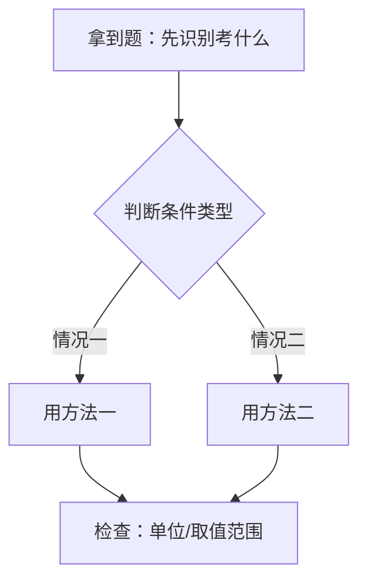

---
tags:
  - 知识点详解
  - {学科}
学科:
章节:
考频: 高    # 高/中/低：中考出现的频率
来源:
概要版: "[[{学科目录}/知识点/{文件名}]]"   # 对应概要版笔记的完整路径
updated: 2026-10-28
---

# {标题}（详解版）

> **使用说明**：本文是"从头学"的详细版，假设基础不牢也能看懂；概要版（[[{学科目录}/知识点/{文件名}]]）用于考前速查，掌握度只在概要版记录。第一次学这章、或做题总卡壳时，从上往下顺着读。

## 0️⃣ 这章学什么 & 中考怎么考

- 用 3~5 句话说清楚：这一章解决什么问题、和前后章节的关系
- 中考怎么考：题型、大致位置（题号/题块）、分值——只写有依据的，不确定标「待核对」

## 🧭 先修自检（学不下去先回到这里）

> 下面每一项都是本章的地基。做不出就先去补对应知识，硬学只会更挫败。

| # | 你应该会的 | 自查题（先做再看答案） | 答案 | 不会去哪补 |
| - | ---------- | ---------------------- | ---- | ---------- |
| 1 |  |  |  | [[]] |

## 🌱 概念从头讲

> 每个概念按"**为什么需要它 → 它是什么 → 符号与单位 → 容易想错的地方**"四步讲。

### {概念 1}

- **为什么需要**：
- **定义**：
- **符号/单位**：
- **容易想错**：❌错误想法 → 为什么很多人这样想 → ✅正确理解

## 🧮 公式逐个拆解

> 每个公式都必须能回答四件事：每个符号是什么？单位是什么？什么时候能用？怎么变形？

### 公式 1：$$公式$$

| 符号 | 含义 | 单位 |
| ---- | ---- | ---- |
|  |  |  |

- 成立条件/适用范围：
- 常用变形：
- 最小例子：（一道一步就能算的小题，带完整算式）

## 🪜 例题阶梯

> 三级台阶，每一级都要动笔跟着算，不许只看。

### 第 1 级 · 入门（照着模仿）

> **题目**：
>
> **每一步为什么这么做**：（逐步写，每步标注依据）
>
> **完整解答**：

### 第 2 级 · 标准（中考中档）

> **题目**：
>
> **读题→翻译成数学/物理/化学语言**：
>
> **每一步为什么这么做**：
>
> **完整解答**：

### 第 3 级 · 提高（与压轴/综合题接轨）

> **题目**：
>
> **思路从哪来**：（卡住时先看这句再往下读）
>
> **完整解答**：
>
> **和入门题的差别**：

## 🗺️ 解题流程图

## 🔥 易错点：为什么会错

| ❌ 常见错误想法 | 为什么会这样想 | ✅ 正确理解 / 自救方法 |
| -------------- | -------------- | ---------------------- |
|  |  |  |

## ✅ 自测清单（能独立做到才打勾）

- [ ] 1. 能不看书说出……的定义
- [ ] 2. 能默写……公式并说明每个符号
- [ ] 3. 能独立做出例题阶梯第 1 级
- [ ] 4. 能独立做出第 2 级
- [ ] 5. 能说出本章 3 个易错点及正确做法

## 🔗 关联

- 概要版：[[{学科目录}/知识点/{文件名}]]（掌握度在这边更新）
- 前置知识：[[]] · 后续/综合应用：[[]] · 相关专题：[[]]
